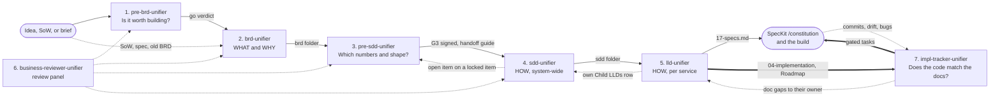
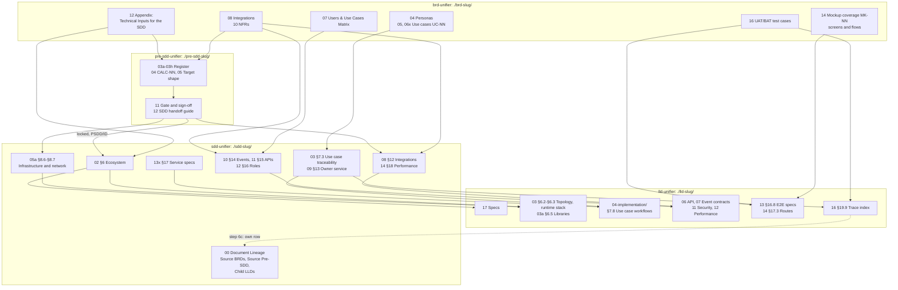
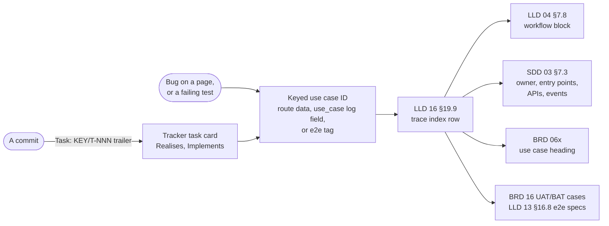
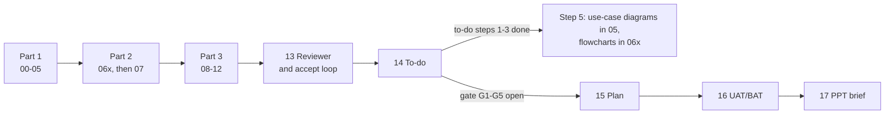
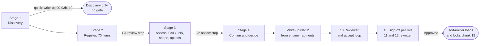
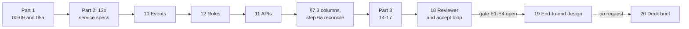
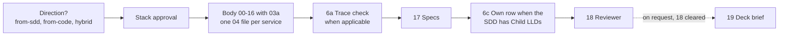
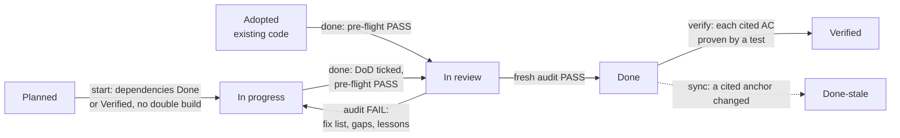

# Product Documentation Skill Suite

Seven skills that take a product from a raw idea to built, audited code. Five authoring skills each own one design stage and write numbered Markdown chunks or a combined document; the sixth reviews the chain; the seventh, `impl-tracker-unifier`, carries the finished LLD into the code and keeps the build true to it. Downstream stages read their source documents, cite them by link and ID, and add their own detail. The BRD, Pre-SDD, and SDD stop at review checkpoints and gates, the Pre-SDD's G3 sign-off is the permission to start the SDD, and the tracker gates every task. Each skill acts as one employee of the unifier company and hands work to the next through the status board. A companion skill in this repo, `tutorialize-unifier`, sits outside the chain.

> **Why stage 7 matters.** Stages 1-6 produce documents; stage 7 is the only one that proves the code matches them. Without it the chain stops at the LLD, and nothing stops a task from starting before its dependencies, the same thing from being built twice, or work from counting as done because its builder says so. `impl-tracker-unifier` splits the LLD into keyed, dependency-ordered tasks, refuses to start a task whose dependencies are not done, and lets no agent mark a task Done until a pre-flight script passes and a fresh, read-only auditor has checked it against the LLD (only you can waive an audit, and the waiver is logged as a gap). It never edits a document by hand: a decided design change runs the owning skills in chain order, and a doc problem nobody has decided yet goes back to the owning skill as a gap. See [7. Implementation tracker](#7-implementation-tracker-impl-tracker-unifier).

- [The chain at a glance](#the-chain-at-a-glance)
- [Shared conventions](#shared-conventions)
- [How the skills link together](#how-the-skills-link-together)
- [1. pre-BRD](#1-pre-brd-pre-brd-unifier) · [2. BRD](#2-brd-brd-unifier) · [3. Pre-SDD](#3-pre-sdd-pre-sdd-unifier) · [4. SDD](#4-sdd-sdd-unifier) · [5. LLD](#5-lld-lld-unifier) · [6. Business reviewer](#6-business-reviewer-business-reviewer-unifier) · [7. Implementation tracker](#7-implementation-tracker-impl-tracker-unifier)
- [Companion skill: tutorialize-unifier](#companion-skill-tutorialize-unifier)
- [Installation and usage](#installation-and-usage)
- [Suggested workflow](#suggested-workflow) · [Known gaps](#known-gaps)

---

## The chain at a glance



**Summary:** the solid arrows show the input and handoff flow; a BRD can also start straight from a SoW, spec, or old BRD. Every new SDD builds on the G3-signed Pre-SDD of its BRDs, and its only way back to the Pre-SDD is an open item with a handoff request, never an edit. The thick arrows are stage 7: the tracker turns the LLD into gated tasks and audits each task's commits against it. Apart from the review panel's decided edits, the LLD's own row in its parent SDD is the only write a skill makes into another skill's document; a change that another document must state runs that document's skill, up or down the chain ([Lineage and change flow](#lineage-and-change-flow)). The tracker never edits a document by hand: a decided change runs the owning skills, and an undecided doc problem becomes a gap for its owner (BRD, SDD, or LLD). The review panel can challenge the pre-BRD, BRD, Pre-SDD, and SDD at any point.

| Stage | Skill | Question it answers | You give it | It writes | It stops for you |
| ----- | ----- | ------------------- | ----------- | --------- | ---------------- |
| 1. Discovery | `pre-brd-unifier` | Is this worth building? | An idea, notes, a brief, or an existing pre-BRD | `./pre-brd-[slug]/`: master and 24 chunks; `.xlsx` on request | Before the Excel export, which runs only after you approve the Markdown |
| 2. Requirements | `brd-unifier` | What are we building, and why? | A pre-BRD, SoW, brief, product spec, RFP scope, old BRD, or notes | `./brd-[slug]/`: master and chunks 00-14; 15-17 once unlocked | After parts 1 and 2; on every open item; at the delivery gate (G1-G5) |
| 3. Pre-solution design | `pre-sdd-unifier` | Which numbers and shape must the design meet? | One or more finished BRDs of one system, and optionally a Studio v2.2 project file or ZIP to import | `./pre-sdd-[slug]/`: master, chunks 00-13 with 03a-03h (06 only for a brownfield or mixed change, 08 only with the migration overlay), `decision-log.md`, and `studio/` (project state, Studio page, blueprint, fragments, diagrams); a `quick` run writes 00, 01, 02, 03a-03h, and 10 | The input path (web or prompt) and the output mode; each register group, with one confirm per group; the G1 and G2 review stops; on every open item; at the G3 sign-off, where only people sign, per role |
| 4. Solution design | `sdd-unifier` | How does the whole system work? | One or more finished BRDs with their G3-signed Pre-SDD, or an SDD to reshape | `./sdd-[slug]/`: master, chunks 00-18 (with 05a, infrastructure and network), one `13x` chunk per service or module; 19 once unlocked; 20 (deck brief) on request once the e2e gate reads `Open - Up to date` | Before any chunk, until a G3-signed Pre-SDD of its BRDs exists; project type, architecture, and ecosystem choices; after parts 1 and 2; on every open item; at the e2e gate (E1-E4) |
| 5. Detailed design | `lld-unifier` | How is each service built? | An SDD, a codebase, or both | `./lld-[slug]/`: master, chunks 00-18 with 03a (14 only with a UI), one `04-implementation/<service>.md` per service; 19 (deck brief) on request once 18 is cleared | The direction question (from-sdd, from-code, hybrid), always asked; the stack approval; after parts 1 and 2 of a first build; on an existing LLD, one refresh offer for SDD and BRD changes (none when the refresh is a documents-chain hop) |
| 6. Review | `business-reviewer-unifier` | Does the document chain hold up? | The documents to challenge | `review-comments-tracker.md` and `review-panel-findings.md` in the project root, plus the decided changes in the reviewed documents | On every review point, one at a time |
| 7. Implementation | `impl-tracker-unifier` | Does the code match the documents, task by task? | An approved LLD with its SDD and BRDs, and the code repository | `./tracking/` in the code repo: config and baseline, task index, plans, task and slice cards, gaps, ownership, lessons, changes, journal, pre-flight and audit reports | Before writing a plan and before each wave; on a dependency override (only your own words count) or a double-build clash; on a contract or direction change; before moving the doc baseline (not when a documents-chain hop moved it); before a push, unless you set delivery to `auto` |

---

## Shared conventions

The six document skills (stages 1-6) share a house style, with these output and handoff rules. The tracker reads their output and keeps its own rules ([section 7](#7-implementation-tracker-impl-tracker-unifier)); the keyed IDs below are what its tasks cite.

- **Markdown by default.** BRD, SDD, and LLD write other formats only on explicit request. The pre-BRD produces Markdown and, on demand after approval, an `.xlsx` export. The Pre-SDD produces Markdown plus its Studio project file (`studio/project-state.json`) and the files its engine computes from it.
- **Chunks or combined.** Every authoring skill takes `chunks` (the default: one file per section group) or `combined` (one file). The BRD, SDD, and LLD also take `parts` (the default in chunks mode: three parts, with a stop for your review after parts 1 and 2; for the LLD, a first build only) or `whole` (one run); the Pre-SDD takes `full` (the default, through G3) or `quick` (the discovery only). All five authoring skills convert between layouts in both directions (merge and re-chunk): pre-BRD uses `modes.md`; BRD, Pre-SDD, SDD, and LLD use `chunking.md`. A combined BRD still keeps 14 and 17 as separate files, a combined SDD or LLD keeps its deck brief (SDD 20, LLD 19) as a separate file, and the BRD, Pre-SDD, SDD, and LLD decision logs stay separate.
- **Stable file names.** `NN-kebab-name.md`, with a letter suffix where a chunk repeats (`06a`, `06b` per persona in the BRD; `13a`, `13b` per service in the SDD; `03a` to `03h`, one per register group, in the Pre-SDD); a letter also marks a section added later without renumbering (SDD `05a`, LLD `03a`). The LLD puts one file per service in `04-implementation/`. Numbers never shift, so links stay valid.
- **Self-describing chunks.** BRD, Pre-SDD, SDD, and LLD chunks open with a `CHUNK: NN` comment block and close with a `<!-- MASTER: ... | PREV: ... | NEXT: ... -->` footer. Each folder has a master index: `[project-slug]-brd-master.md`, `[slug]-pre-sdd-master.md`, `[project-slug]-sdd-master.md`, `[project-slug]-lld-master.md`, and `00-pre-brd-master.md`. The pre-BRD instead uses a `PRE-BRD CHUNK:` comment block with `TITLE:`, `TIER:`, `PROJECT:`, and `PART OF:`, and no navigation footer. The BRD, SDD, and LLD masters record part progress so interrupted runs can resume (the LLD's Part table exists only in a `parts` build), and the Pre-SDD master records its progress by stage and group; the pre-BRD master is an index.
- **What vs how.** The BRD is business language only (the WHAT). The Pre-SDD settles the numbers and the shape the design must meet (capacity, latency, availability, RTO and RPO, the DR strategy, the hosting target), and never names a product, a version, or the architecture style. The SDD owns every other technical decision (the HOW). The LLD owns implementation detail and the constitution-grade Specs chunk (Mission, Tech Stack, Roadmap, Project Type) that feeds SpecKit `/constitution`.
- **One fact, one home.** A downstream document cites upstream content by link and ID and adds only its delta; restating it is a review defect (Type `Duplication`), except in an LLD derived view that names its SDD source on every row (the runtime stack, the libraries and conventions, tables, API contract blocks, port behaviour, resilience instances, configuration defaults, alerts, and SLOs). Inside the SDD, the registries (10 events, 11 APIs, 12 roles) are the single home of contract names; the service chunks and the LLD match them character for character. The SDD cites a locked Pre-SDD value as `PSDD/<ID>` and never recomputes it; the LLD reads Pre-SDD content only through the SDD section that carries it.
- **IDs are stable and owned.** IDs are never renumbered once seen. Use case, test case, and mockup IDs belong to the BRD; the register rows (`BUS-01` to `ECO-06`, `HDR-NN`, `OVL-NN`), entries (`REL-03.2`), `CALC-NN`, `OPT-NN`, `COND-NN`, `EXC-NN`, and `QD-NN` belong to the Pre-SDD; service names, `API-NN`, `INT-NN`, and event names belong to the SDD. Every BRD ID cited downstream carries its BRD's short key, even when there is one BRD: `REFUNDS/UC-04`. Every Pre-SDD ID cited downstream carries the key `PSDD`: `PSDD/REL-03.2`. The tracker keys its own IDs the same way (`REFUNDS/T-014`, `REFUNDS/GAP-007`, `REFUNDS/S-01`) and never renumbers or deletes them.
- **Gaps are flagged, never invented.** `[NEEDS CLARIFICATION: ...]` in the pre-BRD, BRD, Pre-SDD, and SDD; an `Open` register entry in the Pre-SDD, which every calculation reads as TBD, never zero; `[TBD - EXTERNAL: ...]` for provider-owned API fields in the SDD; `> Confirm:` and `> TODO:` confidence flags in the LLD.
- **Cleared-context review.** Every full generation includes an independent reviewer subagent that writes an Open Items chunk (pre-BRD 24, BRD 13, Pre-SDD 13, SDD 18, LLD 18). Each item has options, a recommendation, and the reason it wins. The BRD, Pre-SDD, SDD, and LLD then walk you through every item (accept, choose another option, defer, or reject) and apply only what you accept; the pre-BRD leaves the items for you and your team to decide. A Pre-SDD request allows at most three review passes (the baseline review and up to two scoped application passes), and a later Pre-SDD update that changes content gets a delta review of the changed chunks. For BRD, SDD, and LLD, the full review runs once, on the first build; a BRD also gets it on its first substantive migration into the current template when earlier review evidence does not cover the risks, or when it has no chunk 13. BRD consistency checks stop after three runs in one request, SDD reviews after three review passes, and LLD reviews after two (the full or delta review, then one check of the answers applied in that request). A BRD gets a new full review only when you ask. What the last run finds is not applied in that request: it stays open. In the BRD, SDD, and LLD, a decision the owner gives on it is recorded as `Decided - pending application` and applied by the next request. A later SDD update that changes chunks 01-17, or an LLD update that changes content, gets a delta review of the changed chunks (an SDD update that only applies decisions left pending by an earlier request gets an application check of them instead); in a BRD update, the rerun consistency check is that review. Every write of SDD chunk 19 also gets a cleared-context faithfulness check against chunks 02-13x. An open item that a later upstream change or business review settles is closed in that update.
- **Answer policy and stand-ins.** Every document skill accepts an answer policy you set for a run (for example "accept the recommended option"). It takes recommended options only: it never defers, rejects (one exception: a recommended rejection that changes no document, in the review panel, or a Recommended Answer that reads `No change: <evidence>`, in the BRD, SDD, and LLD), picks another option, or supplies a fact only a person or provider can give (a target the business sets, such as a time limit, is a choice, not a fact), and it never takes a decision your standing instructions for the project reserve (for example adopting a new dependency; proposing one, as a `Proposed` decision with its alternative, is not reserved), or a business rule a source document rules out. Each decision it takes is labelled `Policy: <policy> (set by <name>, <date>)`, and the handoff (the review panel: its close-out summary) lists each choice it took that adds behaviour no source states, for the owner's review. A policy may name stand-ins (Product Owner, Mockup, SME, Approver) whose labelled confirmations count where a person's would; a stand-in never approves its own work, and the Approver stand-in signs only a latest version whose gate is met. With no policy, every rule stays as written. In the Pre-SDD the engine enforces the limits: a policy never supplies a fact only a person gives (forecasts, costs, weights, owner names, due dates), never takes a stage 4 decision or scores an option, never ticks the G3 checklist or grants an exception, and its Approver stand-in signs the G3 roles only when the engine's G3 result names no other problem. Each skill states the rule once: the pre-BRD, the Pre-SDD, and the review panel in § Answer policy, the BRD and SDD in step 8, the LLD in step 7a.
- **Light runs.** Every document skill takes `light` for a lighter run that keeps templates, IDs, and hand-off contracts whole; each skill's § Light run lists what it skips (the review panel states its light rule in § Argument parsing).
- **Decision history lives in `decision-log.md`** (BRD, Pre-SDD, SDD, and LLD), a companion file that is never merged. The BRD's and SDD's include the Clarification, Marker, and Business review registers; the Pre-SDD's holds the Proposal record, those three registers, the walkthrough and delegation history, and the Sign-off record; the LLD's holds the stack approval record, the clarification register, and the delegation history. Content chunks state only the settled rule.
- **One update, one version** (BRD, Pre-SDD, SDD, LLD; the Pre-SDD's own rule is in its `SKILL.md` § Output conventions, and its sign-offs, gate lines, and board rows bump nothing). An update is one request, up to its handoff; the first build is one update, at 1.0 (an SDD whose first build spans several requests may bump once per request that changes content; only the first of those rows reads `Chunks: none (initial build)`). Only a content change bumps the version: the update's first one moves it one minor step (1.0 to 1.1; a major step only when you ask) and opens one Changes Log row, which every later change in the update joins. Each row ends with `Chunks:`: the first build's row reads `Chunks: none (initial build)`; a later row names the chunks whose content changed in meaning (LLD service files by name; a combined document names its changed sections), not routine cover, navigation index, or footer updates. An update row is dated by the request's first content change; the first build's row by the build's completion. A BRD bumps only for changes to product content in 00-13; delivery tracking, refreshes, a merge or re-chunk, and rewording that changes no fact do not bump it. Writing, refreshing, or marking an SDD or LLD deck brief (SDD 20, LLD 19) bumps no version and adds no Changes Log row. A BRD that already has versions moves into the current template as one update, one minor step above its last version. The master and chunk 00 carry the current version; every other chunk keeps the version its content last changed in, and a gated chunk (BRD 15-17, SDD 19) the version it was written at; SDD 19 keeps it when a later write changes none of its content. Status lines, Stale marks, links, footers, the SDD gate lines and E3 marker inventory, an SDD review's coverage rows when nothing else changed, and the Child LLDs rows bump nothing; so do Figma link-only edits, diagram splits that keep every rule, actor, and path, adding a missing BRD key to a citation, setting an upstream version in an LLD link label to the one 16 §19.1 records, the SDD's `**Review passes:**` line, and a BRD or SDD sign-off.
- **BRD, Pre-SDD, SDD, and LLD diagrams are inline Mermaid,** each with a 1-2 sentence summary so the document reads without a renderer. The Pre-SDD's diagrams come from its engine (`compute`) and are pasted unchanged into chunk 05. Miro boards are created only on explicit request, and the board link is additive (`> Miro: <url>` under the Mermaid block), never a replacement.
- **Shared rule files.** `deck-brief-rules.md`, `eco-system-template.md`, and `mermaid-syntax.md` are shared byte for byte: edit the HOME copy named on line 1 and copy it to every carrier in the same change; `_fixtures/checkers/check_shared.py` compares the copies.
- **No em dash characters** in the authoring skills' generated documents. Use commas, colons, parentheses, or a short hyphen with spaces instead.
- **Tech defaults (SDD and LLD only).** Java 21, Spring Boot 3.5+, PostgreSQL 17+, UUIDv7 keys, Kafka on premises (SNS and SQS on AWS), Keycloak, Angular 17+ standalone with Tailwind and PrimeNG, UTC for all timestamps. The SDD proposes them and you confirm them; BRD Technical Inputs override them; a locked Pre-SDD item constrains them (a product that breaks one becomes an open item owned by the E2E Architect); the LLD follows the SDD's §6 over them, and a stack row it changes is an approved override that goes up to SDD §6 through `sdd-unifier`. The Pre-SDD names no product.
- **Roles: one employee per skill.** Each chain skill acts as one employee of the unifier company, in one of two teams, and says so in its `SKILL.md` ("You act as the ..."). Employees work together only through files: their documents, the status board, and the handoff requests on it.

  | Employee | Team | Skill |
  | -------- | ---- | ----- |
  | Business development | Product Management & Business Development | `pre-brd-unifier` |
  | Product manager | Product Management & Business Development | `brd-unifier` |
  | Business owner | Product Management & Business Development | `business-reviewer-unifier` |
  | E2E Architect | Software Development & Delivery | `pre-sdd-unifier` |
  | Software Architect | Software Development & Delivery | `sdd-unifier` |
  | Tech Lead | Software Development & Delivery | `lld-unifier` |
  | Developer / software engineer | Software Development & Delivery | `impl-tracker-unifier` |
  | Mentor / assistant | Software Development & Delivery | `tutorialize-unifier` |

- **The status board.** `unifier-status.md` in the project root (the folder that holds `./pre-brd-*`, `./brd-*`, `./pre-sdd-*`, `./sdd-*`, `./lld-*`) is the one shared file for handoffs. The first chain skill that runs creates it, and nobody deletes it. It holds a `Run mode:` line, an Employees table (one row per chain employee: folder, state, version, next step, and what it waits on), and a Handoff requests table (`HR-NNN`, from, to, request, why, state, link, with UTC times). Each skill writes only its own row and the requests it raises; the receiver alone sets a request `Accepted`, `Done`, or `Declined`. One request stands per blocker: a raiser reuses its own pending request instead of raising a second one. In `solo` mode a hop offers to start the next skill in the same session ("now" or "later"); in `team` mode it raises the request and stops. Only the user changes the run mode. The rules are one `## Status board` section, word for word the same in every chain skill's `SKILL.md`; `impl-tracker-unifier` writes its row from the code repo through the docs root it records, and `tutorialize-unifier` only reads the board.

---

## How the skills link together

The BRD, Pre-SDD, SDD, and LLD form one traceable chain, and the tracker carries it into the code. The diagram shows the main chunk-to-chunk handoffs; the tables summarize the mappings, with the files that hold the full rules.



**Summary:** the BRD's use cases, matrix, integrations, NFRs, and technical inputs become the SDD's ownership, contracts, and ecosystem; the BRD's NFRs and technical inputs also pre-fill the Pre-SDD's register, whose signed handoff guide locks the numbers and shape that the SDD's ecosystem, infrastructure and network, and performance sections build on. The SDD's registries and service specs become the LLD's implementation, contracts, and Specs. The LLD also reads the BRD's screens, mockups, and test cases directly, and writes one row back into the SDD's lineage.

### Who owns what

| Fact | Home (the only place it is stated) | Cited by |
| ---- | ---------------------------------- | -------- |
| Personas, use cases (`UC-NN`), permissions | BRD 04, 05, `06x`, 07 | SDD 03 §7, 09, 12; LLD 04, 16 |
| Business NFRs and their measures | BRD 10 | Pre-SDD 03a-03h (pre-filled as `BRD: KEY/NFR-NN`); SDD 14 §18.5, one technical target row per BRD NFR with its realisation link |
| Capacity numbers (TPS, RPS, concurrency, latency budgets, growth, payload sizes, storage, bandwidth: `CALC-NN`) | Pre-SDD 03b, 04 (locked for the SDD through chunk 12) | SDD 14 §18 and §18.5 as `PSDD/<ID>`, never recomputed |
| Availability and DR targets (SLO, fault scope, RTO and RPO per failure scope, DR strategy, topology) | Pre-SDD 03c, 05, 09 ADR-DR-001 (locked through chunk 12) | SDD 05a §8.6 (§8.6.4 for RTO and RPO per failure scope), §11, §19, §20; Q3 evidence |
| Hosting shape (cloud, on-prem, or hybrid; a provider only when the business makes it a hard constraint) and data shape (store kind, consistency, replication, residency, isolation level) | Pre-SDD 05, 03d, 09 ADR-DATA-001 and the hosting part of ADR-PLATFORM-001 (locked through chunk 12) | SDD Q8 and the §6 Compute / Infra row (Source `Pre-SDD (PSDD/<ID>)`), Q7 within `PSDD/DAT-07`, §6 Notes, 04 §8.3, 05a §8.6-§8.7 |
| Pre-SDD gate and sign-offs (G0-G3, conditions, exceptions) | Pre-SDD 11 | Pre-SDD 12 § 12.1 and § 12.5; SDD 00 Source Pre-SDD row; each open condition as an SDD §4 risk (`PSDD/COND-NN`) |
| Integration partners and purpose | BRD 08 | SDD 08 §12 (mechanisms, `INT-NN`), 11 §15 (`API-NN`) |
| Screens and mockups (`MK-NN`), UAT/BAT cases (`TC-[AREA]-NN`) | BRD 14 Mockup coverage, 16 | LLD 04, 13 §16.8, 14 §17.3, 16 §19.9 |
| Technology stack and version pins | SDD 02 §6 (seeded by BRD Technical Inputs and the project's eco-system file) | LLD 03 §6.3, 03a §6.5.1, 17 Specs |
| Infrastructure and network architecture | SDD 05a §8.6-§8.7 | LLD 03 §6.2 |
| Services and use-case ownership | SDD 09 §13 | SDD 03 §7.3; LLD master and `04-implementation/` files |
| Event, API, and role contracts (HTTP and in-process) | SDD 10 §14 (with §14.10 in-process events), 11 §15, 12 §16 | SDD `13x`; LLD 06, 07, 09, 11 |
| Table design and configuration defaults | SDD `13x` DB Modeling, 15 §19 | LLD 05 §8.2 and 10 §13.1, restated with a Source per row |
| Classes, pseudocode, patterns, and the tables, columns, and settings the LLD adds | LLD 04, 05, 08, 09, 10 | Implementation |
| Specs (Mission, Tech Stack, Roadmap, Project Type) | LLD 17 | SpecKit `/constitution` |
| Source BRDs, the source Pre-SDD, and child LLDs | SDD 00 § Document Lineage (each LLD writes only its own row); a Pre-SDD's own source BRDs in its chunk 00 | The BRD key in every downstream ID; the key `PSDD` in every Pre-SDD citation |
| Tasks, gaps, lessons, direction changes, pre-flight and audit evidence | Tracker `./tracking/` in the code repo | Commits (one `Task:` or `Tracking:` trailer each), standups, manager reports |

### BRD to Pre-SDD (rules: `pre-sdd-unifier/prefill-and-derivation.md`)

| BRD chunk | Pre-SDD destination | How it moves |
| --------- | ------------------- | ------------ |
| 00 Cover | 00 § Document Lineage, Source BRDs; HDR-01 to HDR-10 in 01 § 1.1 | Each BRD gets a short capital key (`REFUNDS`); its version and status are recorded, and a BRD that is not `Approved` is asked about once |
| 01 Executive summary, objectives, deadlines | BUS-01, BUS-03, BUS-04, BUS-05, BUS-08; ECO-01 to ECO-06; header rows | Pre-filled only where the BRD states the value, as `Estimated` with the source `BRD: KEY/<ID>` or `BRD: KEY NN` |
| 02 Glossary, assumptions, facts, constraints, dependencies | BUS-04 to BUS-08, CAP, REL, DAT, SEC, OPS, ECO rows | A stated constraint can make an entry a hard guardrail; `Needed before` feeds BUS-05 |
| 03 Domain concepts | DAT-01, DAT-05, one entry per data workload | Concepts and lifecycles suggest the workloads and their data kind |
| 04 Scope, personas | BUS-03, BUS-06, BUS-07, CAP-10 to CAP-12, DAT tenancy rows, SEC rows, header rows | Geography and tenants inform residency and isolation |
| 05 Journeys and Use Case Summary | BUS-02, one entry per journey | Each journey the BRDs name also gets its own entry on the other per-journey rows (CAP-07, REL-01) |
| `06x` Use cases | CAP-07 to CAP-09, REL rows, DAT-01, DAT-05 | Deadlines, business rules, and exception flows |
| 07 Users & Use Cases Matrix | SEC rows | Access needs only; the authorization model stays the SDD's |
| 08 Integrations | INT-01 to INT-09 (one INT-01 and INT-03 entry per partner), BUS-04, BUS-08, CAP-10 to CAP-12, SEC rows | INT-03 (partner quotas, latencies, SLAs) is a fact only a person gives |
| 09 Reporting | CAP and DAT rows | Volumes, schedules, and freshness |
| 10 NFRs | CAP, REL, DAT, SEC, OPS rows | The main source of the numbers; a vague word ("fast", "always available") stays `Open`, and only REL-01, REL-03, REL-04, and CAP-07 take a proposal with its reason |
| 11 Summary and UI/UX expectations | BUS-06, BUS-07 | Locale and accessibility only |
| 12 Appendix § Technical Inputs for the SDD | BUS-06, BUS-07, CAP-06, DAT, SEC, INT rows, header rows, the classification (HDR-07, HDR-08) | A stated hosting or provider constraint becomes a hard constraint; the products in it stay for the SDD |
| 13 to 17 | No register row | Open items, plans, test cases, the to-do, and the presentation brief are not requirements |

A fact only a person gives (for example CAP-01 transactions per day, CAP-03 peak users, DAT-02 data volume, every option cost, owner names, and due dates) is never proposed and never guessed: it stays `Open`, reads TBD in every calculation, and is asked in its stage. The Pre-SDD refuses an unfinished BRD (a part still `Pending` or `In progress` in its master), and one Pre-SDD covers one system: several BRDs of that system give one Pre-SDD with several parents.

### Pre-SDD to SDD (rules: `sdd-unifier/brd-to-sdd.md` § Pre-SDD inputs (locked); contract: `pre-sdd-unifier/handoff-guide.md`)

The SDD reads three things of the Pre-SDD, in this order: chunk 12 (the handoff guide), the master's **Gate:** line, and chunk 11; it also reads chunk 00's Source BRDs to match the Pre-SDD to its own BRDs, and never reads the Pre-SDD skill's rule files. Chunk 12 § 12.2 holds the lock list (each locked entry with what it measures, its value, its status, its owner, and the SDD places it lands in), the calculations §18 cites, the target-shape decisions, and the landing table.

| Pre-SDD source (in chunk 12) | SDD destination | How it moves |
| ---------------------------- | --------------- | ------------ |
| § 12.1 Gate and signers, with the master's gate line and chunk 11 | Step 2a: load, wait, or ask; 00 § Document Lineage, Source Pre-SDD (key `PSDD`) | Only a G3-signed Pre-SDD (`Approved` or `Approved with conditions`, gate line not `Review`) is loaded and locked. A Pre-SDD that is not signed, or a missing one, stops the SDD before any chunk, with one handoff request to the E2E Architect |
| HDR-07 classification | Project Type (step 3a) | Pre-fills the question, cited on the `**Project Type:**` line; a brownfield Pre-SDD with no codebase to extend gives Greenfield, and §1 carries the migration context |
| Load and availability entries | Q3 | Cited evidence; Q3 stays the SDD's choice |
| DAT-07 isolation level | Q7 | Only the options the isolation level allows are offered; an open DAT-07.1 leaves Q7 open, waiting for its owner |
| Hosting target | Q8 and the §6 Compute / Infra row | Locked with Source `Pre-SDD (PSDD/<ID>)`; the runtime option stays the SDD's |
| Each constraint on an ecosystem row (the data store kind per workload, DAT-01, among them) | §6 Notes | The SDD still picks the product, within the constraint; a product that breaks one becomes an open item owned by the E2E Architect |
| Hosting, data, integration, and network shape (DAT-01, INT-03) | 04 §8.3 | The high-level architecture follows it |
| Topology, availability, failure scopes, RTO and RPO, DR strategy per scope, restore granularity, durability (REL-10); network constraints | 05a §8.6 and §8.7 | §8.6.4 is the SDD's home of the RTO and RPO per failure scope; the §18.5 row of a recovery NFR links there |
| DR strategy, classification, residency, retention, isolation level, security obligations, BUS-07 and BUS-08, REL-10 | §11 | The cross-cutting defaults follow them |
| The calculations table (`CALC-NN`), CAP-03, CAP-08, INT-03 | 14 §18 and §18.5 | Cited as `PSDD/CALC-NN` with a link to chunk 04, never recomputed; the per-service breakdown stays the SDD's |
| DR strategy, environment list, recovery sequence, failover authority | 15 §19, 16 §20 | Environments and runbook follow them |
| ADR-DR-001, ADR-DATA-001, the hosting part of ADR-PLATFORM-001, ADR-MIG-001 (with the migration overlay only) | Cited, never rewritten | ADR-PERF-001, ADR-INT-001, and ADR-IAM-001 are SDD ADRs, written in chunk 06 citing the Pre-SDD answers that drive them |
| § 12.5 Conditions, exceptions, and unknowns | 01 §4 risks (`PSDD/COND-NN`); `[NEEDS CLARIFICATION: ...]` markers that name the Pre-SDD owner | Never filled; E3 judges each marker like any other |
| § 12.4 Left to the SDD | The SDD's own questions and design | Products and versions, the architecture style (Q4), communication (Q5), data ownership (Q6), the integration mechanism, DR procedures, per-service sizing |

A disagreement with a locked item is never an edit: the SDD raises an open item in chunk 18 with `Owner: E2E Architect (pre-sdd-unifier)`, citing `PSDD/<ID>`, plus a handoff request on the board; the e2e gate treats it like any other open item, and it closes when the E2E Architect answers ("Pre-SDD has a new version", or a decision to keep the item with its reason). An SDD built before this rule (derived from BRDs, with no Source Pre-SDD table) is kept as it is: its next content update offers once to bring the Pre-SDD in, and a decline is recorded. An SDD made by TRANSFORM does not run the check.

### BRD to SDD (rules: `sdd-unifier/brd-to-sdd.md`)

| BRD chunk | SDD destination | How it moves |
| --------- | --------------- | ------------ |
| 00 Cover | 00 § Document Lineage, Source BRDs row | Each BRD gets a short capital key (`REFUNDS`) used on every BRD ID the SDD cites |
| 01 Executive summary, objectives | 01 §1 Executive summary | Recast as the technical summary; objectives become technical implications |
| 02 Glossary, assumptions, facts, challenges, dependencies | 01 §1, §3-§5; 02 §6; 04 §8.1; 08 §12; 07 §11.3 | Reference plus delta; challenges and hard dependencies inform risks; external dependencies become integrations. `Needed before` names the build of a use case, BAT sign-off, or go-live; the last two also become promotion gates in §11.3 |
| 03 Domain concepts | 09 §13 service boundaries; `13x` business logic and data | Concepts suggest bounded contexts; lifecycles suggest state machines and events |
| 04 Scope, personas | 01 §2 Scope; 03 §7.1 Actors | Reference plus delta; each persona becomes an actor |
| 05, `06x` Use cases | 03 §7.2 and §7.3; 09 §13 owner; 05 §8.4 and §8.5 flows; `13x` business logic and List of APIs | Cited by keyed link (`[REFUNDS/UC-04](...)`), never restated; exactly one owner service per use case. Each owned use case that a request starts gets a proposed endpoint (method and path only, fields flagged), named for your review at the part 2 stop or in the handoff |
| 07 Users & Use Cases Matrix | 12 §16 roles; 07 §11 security; `13x` authorization notes | Personas become roles, `Yes` cells become permissions, footnotes become conditional rules |
| 08 Integrations | 08 §12 (protocol, auth, timeouts); 11 §15 API contracts | The SDD adds the mechanism; partner contracts stay `TBD - external` until you supply the provider's documentation |
| 09 Reporting | `13x` Output; 14 §18 load context | |
| 10 NFRs | 14 §18.5 NFR targets; 07 §11; 04 §8.1 style drivers | Quantified technically; a target the BRD does not imply is flagged |
| 11 Summary and UI/UX expectations | 01 §1 (when it adds a technical angle); 07 §11 notes; 02 §6 frontend context; 11 §15.1 error model | UX expectations inform the design; frontend technology comes from parked Technical Inputs, defaults, or architect input |
| 12 Appendix § Technical Inputs for the SDD | 02 §6 Ecosystem (shown as `BRD-mandated`), §9, §12, §18 | Read first; overrides the CLAUDE.md defaults |
| 12 Other appendix references; wishlist | 17 §21 Appendix; §22 Wishlist | Carry references; wishlist is reference plus delta |
| 13 Open items; 15 Implementation plan; 16 UAT/BAT cases | Input context only | Never copied; deferred business decisions may become SDD risks |
| 14 To-do; 17 Presentation brief | Ignored | Working artifacts, not requirements |

The SDD refuses an unfinished BRD (a part still `Pending` or `In progress` in its master), and a new SDD waits for the G3-signed Pre-SDD of its BRDs ([Pre-SDD to SDD](#pre-sdd-to-sdd-rules-sdd-unifierbrd-to-sddmd--pre-sdd-inputs-locked-contract-pre-sdd-unifierhandoff-guidemd)). With two or more BRDs, it reconciles them before the design starts and never resolves a conflict silently.

### SDD to LLD (rules: `lld-unifier/sdd-to-lld.md`)

| SDD chunk | LLD destination | How it moves |
| --------- | --------------- | ------------ |
| 00 § Document Lineage | 00 Related BRD(s); 16 §19.1; this LLD's own Child LLDs row | The row (scope, Direction, version, the SDD version its content reflects, link) is the LLD's only write into another skill's document |
| 01 §1-§5 | 01 §1-§4; 15 §18 for implementation risks; 17 Specs Mission and Project Type | Reference plus delta; the SDD risk register is not copied |
| 02 §6 Ecosystem | 03 §6.3 Runtime stack; 03a §6.5.1 for a library the SDD names; 17 Specs Tech Stack | Version pins verbatim; the SDD wins over the CLAUDE.md defaults; an approved stack override is not drift |
| 03 §7.3 Use case traceability | 04 §7.8, one `### KEY/UC-NN` block per active use case; 16 §19.9 index | The trace spine: owner and entry points exactly as §7.3 states them |
| 04 §8.1-§8.3, 05 §8.4-§8.5 | 02 §5.4; 03 §6.1, §6.4; 04 §7.8 workflows and sequences | Operationalised per service, never restated |
| 05a §8.6-§8.7 | 03 §6.2 deployment topology | Referenced with the implementation delta; a value that differs is drift |
| 06 §9-§10 principles and ADRs | Principles followed and referenced from 03; ADR links in 16 §19.2 | |
| 07 §11 Cross-cutting | 09 §12 (all of it); 05 §8.4; 10 §13.3 and §13.6 (§11.4 Metrics and Dashboards) | Defaults become concrete configuration; metrics and dashboards are referenced with their implementation delta |
| 08 §12 Integrations | 06, 07; 09 §12.3 resilience | Each becomes an outbound call or an event subscription |
| 09 §13 Services and modules | One `04-implementation/<service>.md` per row, module rows included; the master; 17 Specs Roadmap | `Use cases (BRD)` becomes the file's `Owns use cases (SDD 09):` line |
| 10 §14 Event hub | 07 §10 Event contracts (§14.10 in-process events: 07 §10.6); 09 outbox | Names match character for character; payloads are referenced, not copied; in-process events get no topic or DLQ, and use the outbox only when the §14.10 Delivery line is durable |
| 11 §15 API contracts | HTTP: 06 §9.1 (with the `API-NN`); in-process ports: 06 §9.6; 04 §7.7 error mapping | Names, URIs, and port operations match; bodies are referenced; §9.6 carries the port's Idempotency and Transaction rows. `TBD - external` stays a `> TODO:`; internal HTTP calls carry the §15.1 client-credentials token, checked against the §16 permission token; port calls check the token at the port |
| 12 §16 Roles | 11 §14 Security; 09 §12.1; 04 §7.2 Authorization | Role names and permission tokens match; the catalogue is referenced |
| `13x` §17.X Service specs | 04 §7.1-§7.8; 05 §8; 06; 07; 08 §11.1; 09 §12.3; 10; 11 §14.6 | The heaviest derivation step. 05 §8.2 restates the Tables Design rows with a Source per row; the §8.1 ERD shows keys and relationships only |
| 14 §18, 15 §19, 16 §20, 17 §21-§22 | 12 §15; 10 §13.1 and §13.8; 16 §19; §18.5 targets also map to the place their `Realised in` cell names (12 §15.1 for a §18 row, 09 for a §11 default, the owner's 04 file for a §17.X section, or wherever an ADR's decision is implemented) | Targets are referenced with their implementation detail; environment configuration is a derived view with a Source per row; the §22 wishlist is not carried, except an item that informs near-term implementation, which goes to 15 §18.4 |
| Alerts: 07 §11.4 Alerting, or an 08 §12 integration row, 11 §15 error row, or `13x` section that raises one; the 16 §20 procedure each triggers | 10 §13.7 Alerts | A derived view with a Source per row: the metric and threshold that implement each SDD alert, and an Action that links its §20 procedure, or a `> TODO:` when §20 has none |
| 18 §23 Open items | Not carried: input context | A decided item reaches the LLD through the chunks it changed; an open or deferred one that an implementation choice depends on becomes a `> Confirm:` or `> TODO:` flag, and a `Decided - pending application` one a `> TODO:` with the decided option as its best guess; a refresh checks LLD chunk 18 against the change |
| 19 §24 (when written) | 02 §5.4; saga narratives in 04 | Optional: the LLD does not wait for the SDD's e2e gate. HTTP edges become outbound calls with resilience settings; in-process edges become port calls |
| 20 (deck brief) | Not read | Derived from the SDD; never an input to the LLD |

The LLD refuses an unfinished SDD (a part still pending, or §7.3 still `Pending (part 2)`).

### BRD to LLD, directly (found through the SDD's lineage)

| BRD chunk | LLD destination |
| --------- | --------------- |
| 05 Use Case Summary and the `06x` use case headings | 04 §7.8 block headings and links; 16 §19.9 |
| 14 Mockup coverage (one row per screen or flow, keyed `MK-NN` or a legacy screen ID; the row wins); a screen ID from the BRD text only when no chunk 14 row exists | 14 §17.3 route rows (`Screen (BRD)`, `Use cases (BRD)`); the Screens field of each 04 traceability line |
| 16 UAT/BAT test cases | The UAT/BAT field of each 04 traceability line; 13 §16.8 e2e tags; 16 §19.9. While BRD chunk 16 is locked: `Pending (BRD 16 not written)` |

### LLD to tracker (rules: `impl-tracker-unifier/task-splitting.md`)

| LLD source | Becomes | Layer |
| ---------- | ------- | ----- |
| 05 Data model: a table or migration group | One task per aggregate's tables | data |
| 04 §7.2 repositories, services, and domain types; §7.3 pseudocode blocks | One task per repository, per pseudocode block, and per service with no §7.3 block; domain types join the first task that needs them | data, domain |
| 04 §7.4 cross-cutting patterns (outbox, idempotency, problem details) | One foundation task, before its first user | foundation |
| 06 API contracts: an endpoint group | One task per controller | api |
| 07 Event contracts: an event | A producer task, and a consumer task that depends on it | events |
| 14 Frontend: a route or screen (`MK-NN`) | One task per screen | ui |
| 13 Testing: an e2e spec row | One task per spec, after every task that realises its use case | e2e |
| 17 Specs Roadmap phases | The plan's phases; no task depends on a later phase | |

The plan reads BRD use cases only through the anchors the LLD links, and records the BRD, SDD, and LLD versions it planned against as its baseline; `sync` compares later versions with it. Each task cites its keyed use case and ACs (`[REFUNDS/UC-04](...) AC-3`) and its LLD anchor, or says why none applies (for example infrastructure). A shared-kernel or platform capability becomes a dependency on the `PLATFORM` task, never a rebuild. Every code commit carries exactly one `Task: KEY/T-NNN` trailer, so each commit traces back to its requirement.

### Use-case traceability, end to end



**Summary:** every traced entry point, route, and e2e test carries the keyed use case ID, so a production bug or a failing test leads to one row of the LLD's trace index, and from there one click reaches the design, the requirement, and its acceptance tests. A commit's `Task:` trailer leads to its tracker task card, which cites the same keyed IDs.

### Lineage and change flow

- **One SDD, one or more parent BRDs, at most one source Pre-SDD, zero or more child LLDs.** An SDD generated from a brief before every new SDD needed a BRD has no parent BRD: its register says `None - generated without a BRD`. SDD chunk 00 § Document Lineage lists each source BRD (key, version, link), the source Pre-SDD (key `PSDD`, version, gate, link, or `None - <reason>`), and each child LLD (scope, direction, version, the SDD version its content reflects, link). Each LLD adds or updates only its own row; the SDD checks those rows on every run and marks a row out of date once the SDD has moved past the version that LLD reflects. Declining a refresh keeps the older version and the out-of-date note.
- **One Pre-SDD per system, between its BRDs and its SDD.** The Pre-SDD's chunk 00 lists its source BRDs (key, version, status, link) and, once an SDD loads it, the consuming SDD. Once G3 is signed, its numbers and shape are locked for the SDD. Any content change after G3 sends G3 back to `Review`, and until every applicable role signs again the SDD treats the Pre-SDD as not signed and keeps the version it loaded. The SDD never edits a locked item: a disagreement is an open item owned by the E2E Architect plus a handoff request; the E2E Architect decides with the owner, and a change runs one Pre-SDD update (new version, delta review, G3 again) that raises "Pre-SDD has a new version" to the Software Architect. The SDD takes a new version only once it is signed, as one targeted update, and closes the open items it answers. A Pre-SDD change reaches an LLD only as a new SDD version.
- **An upstream change on an existing LLD:** the LLD checks the SDD and BRD versions, BRD chunk 16 state, and mockup rows against its recorded state and routes. It reads each newer SDD Changes Log row's `Chunks:` list (mapping combined sections to chunks). It makes one offer covering the affected LLD chunks and trace changes, then runs one accepted update with one version bump for content changes and a delta review. For each field mapping row whose SDD source the change touched, the LLD places it maps to are checked against that whole source, not only the changed text. When SDD §1, §6, or §13 changed, the update also re-synthesises the Specs. In every case it settles, supersedes, or reopens the chunk 18 items the change answers, and removes the flags the change answers. If a BRD is newer than the SDD's register, the offer suggests updating the SDD first; that BRD's trace refresh waits. It never refreshes silently: a refresh run as a hop of the documents chain (below) is accepted by the decision that started the chain, and the handoff names that decision.
- **The documents chain runs both ways.** A change that another document of the chain states otherwise, or must state, is carried there in the same request, each hop through its owning skill, in chain order (BRD, Pre-SDD, SDD, LLD, tracker). Top-down, a BRD change goes to the Pre-SDD when the project has one, then the SDD, each child LLD it reaches, and the tracker (`sync`, and `plan` for new scope). Bottom-up, an LLD change that its SDD states otherwise goes up through `sdd-unifier`, and a change to a business rule, a use case's behaviour, or another BRD-owned fact goes on to `brd-unifier`; a change that needs a locked Pre-SDD item changed reaches `pre-sdd-unifier` as an open item and a request, never an edit. In the tracker, a decided design change runs the owning skills before its code reaches `In review`, and a question still waiting for its owner stays a gap. A document that already holds the change only records the new upstream version. The handoff names each hop with the version it produced, or why a document needed no change; each hop keeps its own skill's stops, and an answer policy answers only the run it was set for. The rules: `brd-unifier/SKILL.md` principle 17, `sdd-unifier/SKILL.md` principle 18 and step 9a, `lld-unifier/SKILL.md` principle 15 and step 7b, and `impl-tracker-unifier/SKILL.md` § Documents chain. An undecided doc gap goes to the owning skill as a board request, is recorded and decided there as an open question, then runs the chain like any decided change.
- **A new BRD version:** `brd-unifier` carries a change to a use case, business rule, persona, integration, or screen down the chain in the same request. When the project has a Pre-SDD, the change goes to `pre-sdd-unifier` first ("BRD `KEY` has a new version"): one offer names the affected items and chunks, an approved update bumps the Pre-SDD once (and needs G3 again when it was signed), and it raises "Pre-SDD has a new version" to the Software Architect. Then `sdd-unifier` takes "BRD `KEY` has a new version". It updates the lineage, derives the delta, back-fills what the change makes wrong, reconciles contracts, and marks chunk 19 `Stale` if it exists. It settles or supersedes the items and markers the change answers, reopens choices left undecided, runs a delta review, and then checks the e2e gate again (a chunk 19 whose source claims did not change keeps its body and version; when it was marked `Stale`, a faithfulness check must first find no mismatch). Several BRDs named in one request are one update, with one version bump when content changes. Then `lld-unifier` refreshes each child LLD the change reaches, and that refresh also covers the required BRD trace changes.
- **BRD chunk 16 written later, or screens and mockups changed:** "refresh the trace" in the LLD updates the affected 04 lines, routes, e2e tags, the index, and 16 §19.1. It also settles, supersedes, or reopens affected chunk 18 items and removes the flags the change answers, then runs a delta review. A Figma link change alone needs no refresh: the LLD links the chunk 14 row, which carries the current link.
- **After a business review:** the panel changes content within each document's template and bumps each changed BRD or SDD once. It edits an SDD only where a decision targets it or makes its text wrong, and leaves deriving new BRD content into the SDD to the SDD hand-off. It never edits an LLD, a Pre-SDD, or gated content; it sets existing gated outputs `Stale` and repoints links after a file rename. The close lists the requests in chain order: `brd-unifier` "update the todo: decisions from the business review of [the tracker's Created date] ([tracker path])" for each changed BRD, including a BRD derived from a changed pre-BRD; then `pre-sdd-unifier` "the business review of [the tracker's Created date] decided points on this Pre-SDD ([tracker path])" for each Pre-SDD a decision changes, which takes them through its own update; then `sdd-unifier` "BRD [KEY] has a new version, after the business review of [the tracker's Created date] ([tracker path])", naming all changed source BRDs, or "the business review changed this SDD" when only the SDD changed; then `lld-unifier` "the SDD has a new version" for each child LLD. Each hand-off runs only when you ask, or under an answer policy that names the hand-offs, and once a row runs, that skill's documents chain carries the change on inside that request (`business-reviewer-unifier/apply-and-verify.md` § Hand-off); `brd-unifier` and `sdd-unifier` take a review's hand-off once, and a repeat changes nothing but its pending items. Owners close the items the decisions answer and raise the open remainders under their own rules (the SDD raises an open item only for a design choice a decision leaves to it; a fact, or a question for a BRD owner or a provider, stays a clarification marker); a pre-BRD remainder goes to its BRD. Owner runs bump again only for their own content changes.
- **Gated outputs after a change:** an SDD or LLD deck brief (SDD 20, LLD 19) is marked `Stale` in its status line and the master's Deck brief line when a chunk it cites changes or an open item is raised or reopened. Existing BRD 15-17 chunks are marked `Stale` when a change alters their source meaning, or when a new to-do item, open item, consistency finding, or clarification marker appears after they were written. The mark goes in their status lines, chunk 14's Downstream outputs, and the master's State cells (chunks mode). SDD 19 is marked on the master's E2E gate line, or the combined cover. The owners refresh these outputs only after checking their gates again; the review's close notes them separately from its hand-off rows.
- **A document change during the build:** after the owners update the BRD, SDD, or LLD, run `sync` in the tracker. Tasks citing a changed anchor become `Stale` (finished ones `Done-stale`) with a `doc-changed` gap that quotes the changelog line, and it asks once before moving its baseline to the new versions (a re-plan). A `sync` run as a hop of the documents chain instead moves the baseline and re-plans the citing tasks at once, since the decision that started the chain is the acceptance. A direction you decide in chat goes through `change` instead: it records a `CHG` row before any code follows the new direction, marks the affected tasks, creates the rework tasks, and runs the documents chain for every design point it decides.

---

## 1. pre-BRD (`pre-brd-unifier`)

**Purpose:** the discovery layer that runs before any requirements are written. It creates a pre-BRD from an idea or reshapes an existing one. It tests whether the idea is worth building before a full BRD, using sourced research for market sizing, competitors, and external factors. Internal factors come from your intake; research only supplies the benchmarks that rate them. A transform preserves supplied facts and researches only missing frameworks.

**Usage:** `pre-brd-unifier [chunks|combined] [light]` (chunks is the default; `light` fills a reduced framework set, `pre-brd-unifier/SKILL.md` § Light run).

**Chunks** (folder `./pre-brd-[slug]/`, index `00-pre-brd-master.md`; combined: `PRE-BRD-[ProjectName]-v1.1.md`):

| Chunks | Tier | Frameworks |
| ------ | ---- | ---------- |
| 01-05 | 1. Idea definition | Concept Sheet, Product Charter, Lean Canvas, Value Proposition Canvas, Empathy Map |
| 06-12 | 2. Market and competition | Market Comparison, Market Sizing, PESTLE, Porter's Five Forces, EFAS, IFAS, SWOT |
| 13-15 | 3. Prioritization | RICE, MoSCoW, OKRs |
| 16-21 | 4. Strategy and planning | BCG Matrix, Ansoff Matrix, VRIO, Product Strategy Canvas, Product Lifecycle, Roadmap, Project Plan and Go-To-Market |
| 22 | 5. Synthesis | Executive Summary Scoreboard: composite score and go / no-go thresholds |
| 23 | Investor pass | Investor Assessment: seven aspects scored, go-to-market among them, and an independent Go, Conditional, or No-Go verdict |
| 24 | Reviewer pass | Open Items and Assumptions Log: the reviewer's findings plus every material assumption with its basis and risk |

**How the chunks relate:** chunks 01-21 are filled tier by tier from one sourced research bundle; each shared fact (value proposition, target segment, roadmap) is stated once in its home chunk and linked elsewhere, and shared market figures and the USD exchange rate sit in the Canonical figures table of 07. Chunk 22 scores five signals from Market Sizing (07, the SAM in USD), Porter's (09), EFAS (10), and IFAS (11) by a fixed mapping, then computes the composite; chunk 23 is written by a separate investor agent after 22, and chunk 24 is written last by a cleared-context reviewer over 01-23.

**What to expect:**

| | |
| --- | --- |
| You provide | An idea, notes, a brief, a SoW, or an existing pre-BRD to transform. |
| It asks you | The output format if not given; generate or transform, when your input leaves it unclear; at most four intake questions (product idea, target segment, geography, currency and hard constraints); and the investor lens (venture or business case) when the intake does not show it. |
| It stops | After presenting the Markdown. Excel is produced only when you approve it ("export to Excel"). |
| It never | Invents a market figure without a source (unverifiable values become `[NEEDS CLARIFICATION: ...]`), hardcodes a value the formulas in `frameworks.md` compute, or produces Excel before your approval. |
| Done when | All 24 chunks and the master, or the equivalent combined sections, exist, and the handoff lists the chunks, the clarification count, the open item count, the source count (distinct source links), and the investor verdict with its composite. |

**Excel export:** `scripts/export_xlsx.py` clones the reference workbook `reference/PRE-BRD-v1.1.xlsx` (fonts, settings, sample columns, live formulas) using `reference/cell-map.json`. The scoreboard uses the same signal mapping as chunk 22. The workbook covers the 22 frameworks only: the investor assessment (23), the open items log (24), the go-to-market section of 21, and the canonical figures table of 07 stay in the Markdown. Money values go into the workbook in USD, at the exchange rate recorded in 07. See `xlsx-export.md`. Tests live in `scripts/tests/`.

**Reference files:** `modes.md`, `transform-detection.md`, `frameworks.md`, `research-orchestration.md`, `xlsx-export.md`; the chunk templates in `chunks/`; the workbook and cell map in `reference/` and the exporter in `scripts/`. More detail: [`pre-brd-unifier/README.md`](pre-brd-unifier/README.md).

**Feeds into:** the BRD. A validated pre-BRD supplies the problem statement, target users, market context, and prioritized scope. Give `brd-unifier` the pre-BRD folder as its source: it maps each framework chunk to its BRD home (`sow-transformation.md`), links the market figures and scores instead of copying them, and names a No-Go or Conditional verdict in its handoff.

---

## 2. BRD (`brd-unifier`)

**Purpose:** generate, or transform an existing document (SoW, old-format BRD, loose notes) into, a Business Requirements Document in the house template. The BRD is business language only and written in plain language (`writing-style.md`): short sentences, common words, every number and rule kept.

**Usage:** `brd-unifier [chunks|combined] [parts|whole] [light] [phase=N]` (`light`: `brd-unifier/SKILL.md` § Light run; `phase=N`: § Phase-based BRD).

- `parts` (default in chunks mode): three parts, stopping for your review after parts 1 and 2 (`parts-mode.md`). Part 1 settles scope, personas, and the use case list; part 2 writes the detailed use cases and the matrix; part 3 writes the rest, runs the review and the open items loop, and writes the to-do.
- `whole`: chunks 00-14 in one run; 15-17 stay behind the delivery gate. Combined mode, merges, re-chunks, and targeted updates always run `whole`.

**Chunks** (folder `./brd-[slug]/`, index `[slug]-brd-master.md`; rules: `chunking.md`):

| # | File | Content | Written | In merged BRD |
| - | ---- | ------- | ------- | ------------- |
| 00 | `00-cover-and-changelog.md` | Title block, Changes Log, table of contents, figure and table indexes | Part 1 | Yes |
| 01 | `01-executive-summary-and-context.md` | Executive summary, background and problem, business objectives | Part 1 | Yes |
| 02 | `02-glossary-assumptions-facts.md` | Glossary (business terms), assumptions and constraints, facts, challenges, dependencies with `Needed before` (`Build of UC-NN`, BAT sign-off, or go-live) | Part 1 | Yes |
| 03 | `03-definitions-and-domain-concepts.md` | Domain concepts in business terms (split into `03a`, `03b` when very large) | Part 1 | Yes |
| 04 | `04-scope-and-personas.md` | In and out of scope; personas | Part 1 | Yes |
| 05 | `05-user-journeys-overview.md` | One journey per persona, summarized workflow, Use Case Summary (the `UC-NN` list) | Part 1 | Yes |
| 06a, 06b, ... | `06a-use-cases-[persona-slug].md` | Detailed `UC-NN` blocks, one chunk per persona | Part 2 | Yes |
| 07 | `07-users-use-cases-matrix.md` | Persona by use case matrix (`Yes` / `-`, footnotes for conditional access) | Part 2 | Yes |
| 08 | `08-integrations.md` | Business partners, purpose, information exchanged | Part 3 | Yes |
| 09 | `09-reporting-and-analytics.md` | What each report shows, audience, frequency | Part 3 | Yes |
| 10 | `10-nfrs.md` | NFRs as business expectations with business measures | Part 3 | Yes |
| 11 | `11-summary-and-uiux.md` | Summary, global UI/UX expectations | Part 3 | Yes |
| 12 | `12-appendix-and-wishlist.md` | Appendix, including Technical Inputs for the SDD (source mandates, verbatim); wishlist | Part 3 | Yes |
| 13 | `13-open-items-and-clarifications.md` | Reviewer findings `OI-NN`, each with options, a Recommended Answer, and the Why; an applied item keeps a stub (heading, Status, Resolution Log link) and its full record moves to `decision-log.md`. Optional scope proposals sit in Reviewer Notes and block nothing unless you adopt them | Part 3, reviewer | Yes |
| 14 | `14-todo.md` | Product-manager to-do: open items register, consistency check, grill-me, mockups, diagrams, delivery gate | End of part 3 | No |
| 15 | `15-implementation.md` | Use cases, and stated report or other section capabilities with no use case, as dependency-ordered tasks (`TASK-NN`) in waves, with a delivery status | Gated | Yes |
| 16 | `16-uat-bat-test-cases.md` | Business acceptance cases (`TC-[AREA]-NN`) traced to use cases (or the owning requirement section when there is none), NFRs, and tasks | Gated | Yes |
| 17 | `17-for-ppt.md` | Executive slide sequence and 30-second use-case videos | Gated | No |
| - | `decision-log.md` | Clarification, Marker, and Business review registers (companion file, created on first use) | As needed | No |

For a new `whole` BRD with at most six use cases and one or two personas, 05 and `06x` may collapse into one chunk, `05-user-journeys-and-use-cases.md` (`chunking.md`). In `parts` and on a re-chunk, they stay separate.

**How the chunks relate:**



**Summary:** the body is written in three reviewed parts, reviewed by an independent agent, and turned into a to-do; the gated diagrams come once to-do steps 1-3 are done, and the three delivery chunks come on later runs, only once the whole to-do is cleared.

- Personas in 04 drive everything after them: one journey in 05, one `06x` chunk, and one matrix column each.
- The matrix (07) is derived from the use cases' actor fields and cross-checked both ways. The use case wins: a matrix cell that disagrees is corrected to match it, and an actor field that looks wrong becomes an open item.
- Accepted open items (13) are applied back into 00-12 and recorded in `decision-log.md`.
- The to-do (14) has five steps: resolve open items, consistency check, grill-me session, Figma mockups, and use-case diagrams with flowcharts (after steps 1-3, in parallel with step 4).
- The delivery gate requires all five steps `Complete` with evidence: to-do items resolved, open items closed, and no body markers; a current consistency check with no waiting finding; confirmed grill-me decisions; approved mockups and a confirmed prototype play-through; and diagrams checked against the use cases, with a consistency rerun (G1-G5 in `delivery-chunks.md`). `Deferred` and `Decided - pending application` count as open. A pending outside dependency needs a confirmed owner and `Needed before`, not delivery now. The gate is checked before each of 15-17; there is no override, and these chunks never add a requirement.

**What to expect:**

| | |
| --- | --- |
| You provide | A source (a pre-BRD, SoW, brief, product spec, RFP scope, old BRD, notes) or a topic. Optional: `AGENTS.md` and `ui-ux-global-constitution.md` in the project root, read automatically when present. |
| It asks you | The output format if not given; at most three intake questions (project name, source, personas); one short business-or-technical question for an unqualified "HLD" request unless context decides; the brand or key color, once, with the open items, when there is no UI/UX constitution (never under an answer policy); a decision on every open item. |
| It stops | After parts 1 and 2 until you say "continue"; and for 15-17, until the delivery gate is open. |
| It never | Puts technology, protocols, or implementation terms in the body; invents measures, targets, or behaviour; writes 15-17 (not even a draft) while the gate is shut; applies an open item without your decision; marks the BRD `Approved`, or fills Reviewed/Approved By, unless you name the approver, or an answer policy names an Approver stand-in and its sign-off conditions hold (a content change to an `Approved` BRD sets it back to `In Review`). |
| Done when | 00-14 exist (or 00-13 as combined sections plus the separate to-do), the open items are decided or explicitly left open, and the handoff reports the clarification markers, the matrix status, the to-do, the gate state, and any scope proposals for your choice. |

**Reference files:** `chunking.md`, `modes.md`, `parts-mode.md`, `transform-detection.md`, `sow-transformation.md`, `mermaid-diagrams.md`, `mermaid-syntax.md`, `use-case-quality.md`, `writing-style.md`, `decision-log.md`, `delivery-chunks.md`, `TEMPLATE-COMBINED.md`; the chunk templates in `chunks/`. `mermaid-syntax.md` is a shared copy ([Shared conventions](#shared-conventions)). More detail: [`brd-unifier/README.md`](brd-unifier/README.md).

**Feeds into:** the Pre-SDD, whose register its NFRs, integrations, constraints, and Technical Inputs pre-fill (the BRD's hand-off offers "Next hop: Pre-SDD (E2E Architect)" and raises the request on the board); the SDD (derive-from-BRD), once that Pre-SDD is G3-signed; and, for use cases, screens, mockups, and test cases, the LLD.

---

## 3. Pre-SDD (`pre-sdd-unifier`)

**Purpose:** the E2E Architect's hop between the BRD and the SDD. It runs the Pre-SDD (pre-solution design) for one system: it turns the business expectations in the system's finished BRDs into settled technical numbers (TPS and RPS, latency budgets, availability, RTO and RPO, data growth, bandwidth, cost) and shape decisions (hosting target, fault scope, DR strategy per failure scope, topology, data-store shape), with a person confirming every value. It covers all 70 checklist items of the Pre-SDD Architecture Standard (`BUS-01` to `ECO-06`) through the Standard's gates G0 to G3; the Standard and the Quick Discovery Guide are kept verbatim in `reference/`. It settles numbers and shape, never products, versions, or the architecture style, and its G3-signed handoff guide locks them for the SDD.

**Usage:** `pre-sdd-unifier [quick|full] [web|prompt] [chunks|combined] [light]` (full is the default; `light`: `pre-sdd-unifier/SKILL.md` § Light run).

- `full` (default): stages 1 to 4, ending at the G3 sign-off stop. `quick`: the discovery only; it claims no gate (its gate label reads `Discovery`) and authorizes no SDD.
- `web` (the recommended input path): the Studio, one offline HTML file that opens from disk with no server and no network call, opens filled from the BRDs; you answer, tick to confirm, and save, and the skill picks up the saved file. `prompt`: the same questions in chat, up to four at a time. Asked once per run when not given; the path can change at any stage boundary.
- **One calculator.** Every number, shape, and gate comes from one engine, `studio/src/engine.js`. The Studio bundles it, and the skill runs it under Node.js through `studio/cli.mjs`, so both input paths give the same results. No number is worked out by hand or in prose.

| Stage | What happens | Ends at |
| ----- | ------------ | ------- |
| 1. Discovery | The classification (change type HDR-07, intended target HDR-08), the fault scope, and the minimum numbers; every open question becomes an unknown `QD-NN` with an owner and a due date | The discovery summary; a `quick` run ends here |
| 2. Register | The header rows, the migration overlay switch, then the 70 items one group at a time (BUS, SEC, DAT, INT, CAP, REL, OPS, ECO), pre-filled with their sources; every `Open` entry gets an owner name and a due date | The G1 review stop |
| 3. Assess | The calculations (`CALC-NN`), the DR strategy per failure scope, the target shape and its conflicts, the path, and the shape-level options with their costs and TCO (weighted only with approved weights) | The G2 review stop: a feasible shortlist, or a blocker |
| 4. Confirm and decide | One confirm per group for every `Estimated` value left; people take the decisions (a topology or DR override, the chosen option); validation; the write-up and the review | The G3 sign-off stop |

**Chunks** (folder `./pre-sdd-[slug]/`, index `[slug]-pre-sdd-master.md`; combined: `PRE-SDD-[ProjectName]-vX.Y.md`; rules: `chunking.md`):

| # | File | Content | Written |
| - | ---- | ------- | ------- |
| 00 | `00-cover-and-changelog.md` | Title block (version, mode, gate label, engine version, signers), Document Lineage (source BRDs with keys, versions, statuses, and links; the consuming SDD), Changes Log, indexes | Quick and full |
| 01 | `01-business-brief.md` | The header rows HDR-01 to HDR-10 (§ 1.1); outcome, scope, critical journeys, and business constraints, linked to the BRD | Quick and full |
| 02 | `02-classification-and-path.md` | Classification (path code, hybrid, overlay, recovery tier, closest worked example), path evidence, hybrid boundary | Quick and full |
| 03a to 03h | `03a-register-business.md` to `03h-register-economics.md` | The register, one chunk per group (BUS, CAP, REL, DAT, SEC, INT, OPS, ECO); each row is a `### <ROW-ID>` heading with its entries, each with its status, source, and who confirmed it | Quick (the stage 1 rows answered; every other value `Estimated` with its source, or `Open`) and full |
| 04 | `04-targets-and-calculations.md` | Targets by entry ID; every `CALC-NN` with its formula, inputs, result, and status | Full |
| 05 | `05-target-shape.md` | Hosting, topology, DR strategy per failure scope, data and network shape, conflicts; the infrastructure, network, and DR diagrams, plus the others the engine writes | Full |
| 06 | `06-existing-estate.md` | Brownfield inventory, observed baseline, constraints, as-is and to-be | Full, brownfield or mixed change only |
| 07 | `07-options-and-economics.md` | Options (shapes, never products), the hard-constraint filter, a comparison with approved weights only, TCO | Full |
| 08 | `08-migration-overlay.md` | The overlay rows per workload, 7R per workload, cutover and fallback, transfer math, hazards, waves | Full, migration overlay only |
| 09 | `09-decisions.md` | Requirement-to-consequence trace, decision tree (`DT-01` to `DT-15`), rule trace, the Pre-SDD ADRs, the SDD ADRs it drives | Full |
| 10 | `10-validation-risks-unknowns.md` | Blockers, conflicts, advisories, unknowns (`QD-NN`) with owner and due date, risks (`R-NN`), the hard entries still `Open` with their exceptions | Quick and full |
| 11 | `11-gate-and-sign-off.md` | G0 to G3, the G3 checklist (`G3-01` to `G3-14`), the sign-off register per role, conditions, exceptions, "SDD initiation authorized by" | Full |
| 12 | `12-sdd-handoff-guide.md` | The contract `sdd-unifier` reads: version, gate, and signers; the lock list (each locked entry with what it measures, its value, its status, its owner, and its SDD landings), the calculations §18 cites, and the landing table; what is left to the SDD; conditions, exceptions, and unknowns; the open-item rule; the `PSDD/<ID>` citation format | Full |
| 13 | `13-open-items-and-clarifications.md` | Reviewer findings `OI-NN`, each with options, a Recommended Answer that an engine operation can apply, and the Why | Full, reviewer |
| - | `decision-log.md` | Proposal record; Clarification, Marker, and Business review registers; walkthrough and delegation history; Sign-off record (companion file, never merged) | As needed |
| - | `studio/` | `project-state.json` (the project state of record), `pre-sdd-studio.html` (the Studio with this project inside), and the engine's output: `model.json`, `blueprint.json` and `blueprint.yaml`, `fragments/`, `diagrams/` | From setup |

**How the chunks relate:**



**Summary:** the register is filled in four stages, pre-filled from the BRDs, earlier answers, engine derivations, and the defaults appendix, and confirmed by people one group at a time; a quick run stops after the discovery and claims no gate. The engine computes every number, shape, and gate, the write-up pastes its fragments unchanged, an independent reviewer writes chunk 13, and only a G3 signed by people, role by role, lets the SDD load and lock the handoff guide.

- Every entry has a status (`Open`, `Estimated`, `Confirmed`, or `N/A`) and a source. Only a person confirms a value, by a tick in the Studio or an answer in chat, recorded with who and when. A business number the sources do not give stays `Open` and reads TBD, never zero.
- An item the Standard answers per journey, transaction type, failure scope, dataset, workload, or external system holds several entries (`REL-03.2`); `.1` is the primary entry, and the engine picks a DR strategy per failure scope.
- Only REL-01 (availability), REL-03 (RTO), REL-04 (RPO), and CAP-07 (P99 latency) take a proposed target, with its reason; the entry stays `Open` until a person or an answer policy picks it. Forecasts, measurements, and other facts only a person gives are never proposed.
- The engineering factors come from the owner-approved defaults appendix, `reference/policy-appendix.md`, pre-filled as `Estimated` for a person to confirm per group.
- The chunk templates mark each engine fragment with `<!-- ENGINE-FRAGMENT: <name> -->`; the fragment is pasted unchanged, and a wrong value is fixed in the project state and recomputed, never in the chunk.
- G3 needs every line of the G3 checklist ticked (`Done`, or `N/A` with a reason) and each applicable role of the Standard's sign-off register signed; one person may hold several roles. `Approved with conditions` lets the SDD start when every condition (`COND-NN`) has an owner and a due date. Only a named person grants a time-bound exception (`EXC-NN`) that lets an `Open` hard entry pass.
- One update, one version: a content change after G3 sends G3 back to `Review`, and every applicable role signs again.

**What to expect:**

| | |
| --- | --- |
| You provide | One or more finished BRDs of one system (folders or combined files), and optionally a Studio v2.2 project file or handoff ZIP to import (the BRD start conditions still hold; its values come in as `Estimated`, and its decision history is not imported). Node.js on the PATH. |
| It asks you | The input path and the output mode if not given; at most three intake questions (system name, source BRDs, mode) and the confirmer's name; once, whether to go on from a BRD that is not `Approved`; each stage's questions, with pre-filled values asked as keep or change and one confirm per group; the owners and due dates of the `Open` entries, in batches; the migration overlay switch; option costs, the TCO horizon, and the criterion weights; the stage 4 decisions; a decision on every open item; the G3 checklist ticks and each role's signature. |
| It stops | After the discovery in `quick` mode; at the G1 and G2 review stops until you say "continue"; at the G3 sign-off stop until the signers sign (no answer policy passes it); when Node.js is missing; when a source BRD is unfinished or there is no BRD. |
| It never | Names a product, a version, or the architecture style (a provider only when the business makes it a hard constraint); guesses a business number; works out a number by hand or edits an engine fragment; writes `Confirmed` for a value, signs G3, ticks the checklist, or grants an exception; edits a BRD, an SDD, or an LLD; starts another skill in `team` run mode. |
| Done when | Quick: the discovery chunks exist, with every unknown's owner and due date. Full: chunks 00-13 (or their combined sections) exist from the engine's fragments, the open items are decided or explicitly left open, and G3 is signed, or the board row names the stop it waits at. The handoff reports the gate and the G3 status, the signers per role, the engine version, the conditions, exceptions, and unknowns with owner and due date, the open items by status, the questions only a BRD owner can answer (raised as requests to `brd-unifier`), and, under an answer policy, the policy choices without a source. |

**Requirements:** Node.js on the PATH for the engine and the CLI; the Studio needs only a browser ([Installation and usage](#installation-and-usage)).

**Reference files:** `chunking.md`, `register-and-entries.md`, `prefill-and-derivation.md`, `stages-and-input.md`, `engine-and-studio.md`, `classification-and-paths.md`, `gates-and-signoff.md`, `options-and-economics.md`, `migration-overlay.md`, `handoff-guide.md`, `review-and-open-items.md`, `decision-log.md`, `TEMPLATE-COMBINED.md`; the chunk templates in `chunks/`; the method in `reference/` (the Standard, the Quick Discovery Guide, `policy-appendix.md`); the worked examples and `ERRATA.md` in `examples/`; the engine, CLI, Studio, and schemas in `studio/`; the design notes and tests in its own [`README.md`](pre-sdd-unifier/README.md).

**Feeds into:** the SDD. Once G3 is signed, the E2E Architect raises `Hand-off: Pre-SDD [slug] v<X.Y> is G3-signed` to the Software Architect (in `solo` run mode it offers to start `sdd-unifier` now). `sdd-unifier` reads chunk 12, the master's gate line, and chunk 11, and locks every item the lock list names ([Pre-SDD to SDD](#pre-sdd-to-sdd-rules-sdd-unifierbrd-to-sddmd--pre-sdd-inputs-locked-contract-pre-sdd-unifierhandoff-guidemd)). Questions only a BRD owner can answer go to `brd-unifier` as requests.

---

## 4. SDD (`sdd-unifier`)

**Purpose:** the Solution Design Document. It owns the HOW, within the numbers and shape the Pre-SDD locks. It derives an SDD from one or more BRDs and their G3-signed Pre-SDD (`brd-to-sdd.md`), or transforms an existing SDD. A request for a new SDD with no BRD writes no SDD content: its material goes to the Product manager to become the BRD, and the chain runs BRD, then Pre-SDD, then SDD. An SDD built before these rules is kept as it is.

**Usage:** `sdd-unifier [chunks|combined] [parts|whole] [light]` (`light`: `sdd-unifier/SKILL.md` § Light run).

- `parts` (default in chunks mode): three parts, stopping for your review after parts 1 and 2 (`parts-mode.md`). Part 1 settles the architecture, infrastructure and network, ADRs, and service decomposition; part 2 writes the per-service specs and the three registries, then reconciles them; part 3 writes performance and capacity, environments, the runbook, and the appendix, runs the review and the open items loop, then tries the e2e gate.
- `whole`: chunks 00-18 in one run; chunk 19 follows in the same run only if the e2e gate opens. Combined mode, merges, re-chunks, and targeted updates always run `whole`.

**Chunks** (folder `./sdd-[slug]/`, index `[slug]-sdd-master.md`; rules: `chunking.md`):

| # | File | Sections | Content | Written |
| - | ---- | -------- | ------- | ------- |
| 00 | `00-cover-and-changelog.md` | Cover | Title block, Document Lineage (source BRDs with keys; the source Pre-SDD, key `PSDD`; child LLDs with the SDD version each reflects), Changes Log, indexes | Part 1 |
| 01 | `01-executive-summary-scope-risks.md` | §1-§5 | Executive summary (with Project Type), scope, assumptions, risks, glossary | Part 1 |
| 02 | `02-ecosystem-overview.md` | §6 | Full platform stack and ecosystem-level rules, from the ecosystem selection, each row with its Status and Source, plus the Integration landscape of the external systems | Part 1 |
| 03 | `03-users-and-use-cases.md` | §7 | Actors, use case diagram, §7.3 Use Case Traceability (one row per BRD use case) | Part 1 (§7.3 columns completed in part 2) |
| 04 | `04-architecture-style-and-diagrams.md` | §8.1-§8.3 | Architecture style, context diagram, high-level architecture | Part 1 |
| 05 | `05-workflows-and-sequences.md` | §8.4-§8.5 | Workflow and sequence diagrams for the critical flows | Part 1 |
| 05a | `05a-infrastructure-and-network.md` | §8.6-§8.7 | Infrastructure (deployment topology, data stores, backup and disaster recovery, scaling) and network (zones, ingress, egress to each external system, TLS, ports and protocols) | Part 1 |
| 06 | `06-principles-and-decisions.md` | §9-§10 | Architecture principles, ADRs | Part 1 |
| 07 | `07-cross-cutting-concerns.md` | §11 | Data modeling, multi-tenancy, deployment, observability, configuration, security defaults | Part 1 |
| 08 | `08-integrations.md` | §12 | Every external integration with protocol, auth, timeout, retries, fallback | Part 1 |
| 09 | `09-services-summary.md` | §13 | One row per service or module (Type), with the BRD use cases it owns and its status | Part 1 |
| 10 | `10-events-hub.md` | §14 | Centralized Event Hub: topics, events, envelope, payload contracts, and in-process domain events (§14.10) (the event registry) | Part 2 |
| 11 | `11-api-contracts.md` | §15 | One `API-NN` contract per synchronous domain or provider integration, HTTP or in-process port call (the API registry); standard database, Vault, and identity-provider client calls are infrastructure configuration | Part 2 |
| 12 | `12-centralized-user-roles.md` | §16 | Roles, permission tokens, capability and permission matrices (the role registry) | Part 2 |
| 13a, 13b, ... | `13a-service-[slug].md` | §17.X | Full spec of one service or module: boundaries, logic, data model, APIs, events, errors, observability | Part 2 |
| 14 | `14-performance-and-capacity.md` | §18 | Load estimates, throughput targets, peak scenarios, stress testing, NFR targets (one §18.5 row per BRD NFR) | Part 3 |
| 15 | `15-environments.md` | §19 | Dev, SIT, UAT, Prod | Part 3 |
| 16 | `16-operations-runbook.md` | §20 | Procedures, diagnostics, on-call | Part 3 |
| 17 | `17-appendix-and-wishlist.md` | §21-§22 | Appendix, wishlist | Part 3 |
| 18 | `18-open-items-and-clarifications.md` | §23 | Reviewer findings `OI-NN`, each with a Recommended Answer and the Why, plus the items the author must raise (a use-case overlap between BRDs, a conflict between a project file and a source, behaviour no BRD use case covers, a chunk 19 source problem that a chunk 19 claim depends on or that lies in text the request changed, a business review remainder). Optional scope proposals sit in Reviewer Notes and block nothing unless you adopt them; a chunk 19 check finding that no chunk 19 claim depends on, in text the request did not change, is noted there too, for its owner | Part 3, reviewer |
| 19 | `19-e2e-system-design.md` | §24 | End-to-end view consolidated from 02-13x and checked against them on every write: landscape, fan-out maps, sync edges, sagas | Gated (E1-E4) |
| 20 | `20-for-ppt.md` | - | Architecture deck brief for a deck-generating agent (system design, infrastructure, network, and integration slides), every claim cited to the SDD; derived, never merged, not read by `lld-unifier` | On request, once the e2e gate is open |
| - | `decision-log.md` | - | Ecosystem and questionnaire records; Clarification, Marker, and Business review registers (companion file) | As needed |

**How the chunks relate:**



**Summary:** the service specs are drafted first, then consolidated into the three registries and reconciled against them; the review follows, and the end-to-end design is written last, only when all four e2e gate conditions are met. The deck brief follows on request, behind the same gate.

- Chunks 10, 11, and 12 are the contract registries: topic and event names, API method and URI, role names and permission tokens in every `13x` chunk must match them character for character. Divergences go to §14.8, §15.5, or §16.12 and are never reconciled silently.
- §7.3 is a consolidated view: owner from 09, entry points from the `13x` List of APIs (an `Event:` or `Schedule:` trigger from its Input table), flows from 05, APIs from §15.2, events from §14.5 and §14.10.
- Step 6a also checks each new or changed `13x` data model: the ERD and Tables Design show the same tables and keys, every shared-schema key and index includes `tenant_id`, a column a rule relies on is NOT NULL or its null case is stated, and retention covers every table.
- The e2e gate requires every open item to read `Accepted - applied`, `Adjusted - applied`, or `Rejected`; every divergence row `Fixed in vX.X`; no unresolved value that an end-to-end claim depends on, wherever its marker sits (every live `[NEEDS CLARIFICATION: ...]` marker is classified in the E3 marker inventory (in the master, or the combined cover), with its owner and why it blocks or not); and contract reconciliation after the final relevant change, recorded with its order, not a date alone (E1-E4, SKILL.md step 8b). `Deferred` and other unapplied items, and divergence rows with no Status, block it. A `[TBD - EXTERNAL: ...]` placeholder does not block while the external system is only a named black box with its API IDs. An SDD gated before the inventory existed builds it at its next gate check. There is no override.
- The SDD never writes a Specs chunk: the LLD owns Specs.

**What to expect:**

| | |
| --- | --- |
| You provide | One or more finished BRD folders or combined files (a BRD with a part still pending is refused) with the G3-signed Pre-SDD of the same BRDs, or an existing SDD to transform. Optionally, in the project root: `AGENTS.md` or `AGENT.md`, `CLAUDE.md`, `ui-ux-global-constitution.md`, and `[project-slug]-eco-system.md`; none is ever requested. |
| It asks you | The output format if not given or implied (an SDD already in the folder keeps its own mode); at most three intake questions; greenfield or brownfield; when deriving from a BRD, the architecture questionnaire (accept all, or walk through eight questions); the ecosystem selection (accept all proposed, answer one by one, or import `[project-slug]-eco-system.md`, asking about each conflict between the file and a locked row); conflicts between BRDs; a decision on every open item; an optional walk through the gate-blocking markers that are design choices (a provider fact, legal basis, or business number stays marked and goes to its named owner as an exact question); once, whether to derive from a source BRD that is not `Approved`; one short business-or-technical question for an unqualified "HLD" request unless context decides. |
| It stops | Before any chunk of a new SDD while its Pre-SDD is missing or not signed (one handoff request to the E2E Architect; no answer policy passes it); after part 1 (architecture, infrastructure and network, ADRs, services) and part 2 (service specs and contracts) until you say "continue"; and for chunk 19 and the deck brief (chunk 20), until the e2e gate is open. |
| It never | Fills the ecosystem silently; assumes microservices; invents an external API contract (provider fields stay `TBD` until documentation or your explicit answer supplies them); invents an IP range, CIDR, hostname, or vendor product; creates or renumbers a BRD use case; writes into a child LLD; edits a locked Pre-SDD item or the Pre-SDD, or reads the Pre-SDD skill's rule files (a disagreement is an open item owned by the E2E Architect). |
| Done when | 00-18 (or their combined sections) exist and are reconciled, the open items are decided or explicitly left open, and chunk 19 is checked and `Open - Up to date`, or reported `Locked` or `Stale` with the blockers. The handoff reports contracts and lineage (with out-of-date child LLDs), the Pre-SDD (version, gate, signers, the locked items applied by SDD place, the open conditions as §4 risks, the open items raised to the E2E Architect, or why none was loaded), the use-case trace per BRD, the gate state, the deck brief state, the open items (including those decided and pending application), proposed endpoints, scope proposals, and the questions only a BRD owner can answer, as follow-ups for `brd-unifier`. |

**Reference files:** `chunking.md`, `modes.md`, `parts-mode.md`, `architecture-questionnaire.md`, `eco-system-template.md`, `decision-log.md`, `transform-detection.md`, `source-transformation.md`, `brd-to-sdd.md`, `sdd-quality.md`, `mermaid-diagrams.md`, `mermaid-syntax.md`, `deck-brief-rules.md`, `TEMPLATE-COMBINED.md`; the chunk templates in `chunks/`. `eco-system-template.md`, `mermaid-syntax.md`, and `deck-brief-rules.md` are shared copies ([Shared conventions](#shared-conventions)). More detail: [`sdd-unifier/README.md`](sdd-unifier/README.md).

**Feeds into:** the LLD. By default one LLD covers every service in chunk 09 (one `04-implementation/` file each); a large system can be split into several LLDs, each registered in chunk 00.

---

## 5. LLD (`lld-unifier`)

**Purpose:** the Low-Level Design. It specifies services to an implementation-ready level that any AI agent or developer can build from.

**Usage:** `lld-unifier [chunks|combined] [parts|whole] [light]` (chunks is the default; `light`: `lld-unifier/SKILL.md` § Light run). The arguments set only the output mode, the generation option, and the light run; the skill always asks for the direction first:

- **from-sdd:** greenfield, design before code exists (`sdd-to-lld.md`).
- **from-code:** reverse-engineer an LLD from an existing codebase (`code-extraction.md`).
- **hybrid:** compare an SDD with complete code and mark the drift (`hybrid-drift.md`). When only some services have code, the built ones are read from code and the rest get a "not yet built" placeholder.

Generation option (`parts-mode.md`):

- `parts` (default for a first build in chunks mode): three parts, stopping for your review after parts 1 and 2. Part 1 writes the frame, the stack, and the libraries (00 to 03a); part 2 the service files, the data model, the contracts, and the rules (04 to 08); part 3 the rest, the Specs, and the review.
- `whole`: chunks 00-18 in one run. Combined mode, merges, re-chunks, and every request on an existing LLD run `whole`.

**Chunks** (folder `./lld-[slug]/`, index `[slug]-lld-master.md`; rules: `chunking.md`):

| # | File | Sections | Content |
| - | ---- | -------- | ------- |
| 00 | `00-metadata.md` | Metadata | Title block, direction, Related BRD(s) with keys, Related SDD, source code path, Changes Log, flag summary |
| 01 | `01-purpose-and-scope.md` | §1-§4 | Purpose, scope (the services this LLD covers), assumptions, glossary |
| 02 | `02-context.md` | §5 | Bounded context, upstream and downstream, cross-service dependencies |
| 03 | `03-architecture.md` | §6 | Component and deployment topology, runtime stack, the style as operationalised |
| 03a | `03a-libraries-and-conventions.md` | §6.5 | Libraries by concern with each Status (`RestClient` for synchronous calls, records for DTOs), the coding conventions with a pointer to the chunk that holds each detail, per-service departures. An LLD written before it has none |
| 04 | `04-implementation/<service>.md` | §7 | One file per service: responsibility, class map with each entry point's authorization, pseudocode, patterns, DI graph, transactions, errors, use-case workflows (§7.8) |
| 05 | `05-data-model.md` | §8 | ERD (keys and relationships), tables (columns, with a Source per row), indexes, multi-tenancy, Flyway plan, retention, encryption |
| 06 | `06-api-contracts.md` | §9 | Endpoint inventory with `API-NN` and permission tokens, request and response shapes, OpenAPI snippets, in-process port contracts (§9.6) |
| 07 | `07-event-contracts.md` | §10 | Topics, schemas, producer and consumer specs, DLQ strategy, in-process domain events (§10.6) |
| 08 | `08-state-and-rules.md` | §11 | State machines, cross-service rules, algorithms |
| 09 | `09-cross-cutting.md` | §12 | Auth and tenant, idempotency, resilience (defaults, then one row per Resilience4j instance with its Source), outbox, saga, errors, logging, tracing (`use_case`), config, health |
| 10 | `10-operations.md` | §13 | Configuration, metrics, logs, dashboards, alerts, runbook, on-call |
| 11 | `11-security.md` | §14 | Data classification, PII, secrets, authorization, threats, compliance |
| 12 | `12-performance.md` | §15 | SLOs, caching, hot-path indexes, bulkheads, peak scenarios, load tests |
| 13 | `13-testing.md` | §16 | Test pyramid, Testcontainers, contract and e2e tests, e2e specs tagged with use case and test case IDs (§16.8) |
| 14 | `14-frontend.md` | §17 | Only when there is a UI: component tree, state, routes with their BRD screens and use cases (§17.3), i18n, RTL, a11y |
| 15 | `15-open-questions.md` | §18 | The author's own index of `> Confirm:` and `> TODO:` flags, drift markers, pending decisions, and policy findings, plus a confidence summary (§18.5) that counts the open flags in every section |
| 16 | `16-references.md` | §19 | Source documents and their state, ADR links, schemas, runbooks, and the use-case trace index (§19.9) |
| 17 | `17-specs.md` | §20 in combined | Specs: Mission, Tech Stack, Roadmap, Project Type, synthesised after the body for SpecKit `/constitution` |
| 18 | `18-open-items-and-clarifications.md` | §21 in combined | Reviewer findings `OI-NN` the author did not flag, each with options, a Recommended Answer, and the Why |
| 19 | `19-for-ppt.md` | - | Implementation deck brief for a deck-generating agent (clean code, code architecture, API statistics and contracts, database design and practices, integrations with failover), every statistic computed from the LLD; derived, never merged; written on request, once chunk 18 is cleared |
| - | `decision-log.md` | - | Stack approval record with its overrides, clarification register, delegation history (companion file, created on first use, never merged) |

**How the chunks relate:**



**Summary:** the stack is approved first (an override goes up to SDD §6), then the body is written from the SDD, the code, or both; the use-case trace is checked when applicable, the Specs are synthesised from the finished body, the LLD registers itself when its SDD has a Child LLDs table, and an independent reviewer writes chunk 18 last. The deck brief follows on request, once chunk 18 is cleared.

- Chunk 04 is the load-bearing split. Each `04-implementation/<service>.md` holds one `### KEY/UC-NN: Title` block with a traceability line per active use case it owns. Work requested by the BRD or SDD but covered by no use case gets a `### Workflow:` block, a link to what it realises, and no invented UC ID, `@UseCase`, or trace-index row.
- Chunk 15 is the author's own flag index; chunk 18 is the reviewer's external findings. They never duplicate each other.
- Chunk 16 §19.9 is the production-bug entry point: one row per SDD §7.3 row, each cell read from its home.
- Chunk 14 is omitted, not stubbed, when there is no UI. A route that serves a `### Workflow:` block reads `None - no BRD screen` in both BRD columns and carries no route data; when its screen has a BRD chunk 14 row, it cites that row instead, carries `screen` data only, and its use-case cell says `None - no BRD use case`.
- The BRD trace applies when a source SDD derives from BRDs. Without a source SDD or source BRD, the trace slots say so and workflows use names.

**What to expect:**

| | |
| --- | --- |
| You provide | An SDD folder or combined file (from-sdd), a code path (from-code), or both (hybrid). The BRDs are found through the SDD's lineage. |
| It asks you | The output mode if not given (an existing LLD keeps its own); the direction (always, with a suggested default that the records set); at most three intake questions; the Project Type when neither the SDD nor an existing LLD's Specs records it; the runtime stack approval (asked in from-sdd and for services not yet built; from-code and hybrid read the manifests; approve all, change one by one, or replace all with a pasted list or an `eco-system-template.md` file), where an override is carried up to SDD §6 through `sdd-unifier`; roadmap phases when the SDD has no natural breaks, the BRDs are not phase-based, and the LLD records no grouping; on an existing LLD, one offer covering changed SDD chunks, BRD versions, test-case state, and mockup rows. A missing version pin is flagged in §6.3 and routed to SDD §6 through `sdd-unifier`, never asked here. Every question except the direction is asked only when no record (the SDD and its decision log, the project instruction file, the LLD's decision log, the existing LLD) answers it; when records disagree the question names both sources. |
| It stops | When the SDD is unfinished (a part still pending, or §7.3 still `Pending (part 2)`); after parts 1 and 2 of a first build until you say "continue"; and for the deck brief (chunk 19), until chunk 18 is cleared. |
| It never | Picks a direction silently; invents class names, columns, topics, or version pins (it flags them); creates a use case, test case, or screen ID; writes into the SDD beyond its own Child LLDs row. |
| Done when | The body, the Specs, and chunk 18 (or their combined sections) exist, and the handoff reports flag and drift counts, the stack approval (each override with the SDD version that adopted it), the decision log, the deck brief state, the use-case trace per BRD when applicable, and the Child LLDs row when an SDD lineage table exists. On an existing LLD, it also names the SDD and BRD versions the LLD reflects and which chunks were refreshed or left. |

**Key behaviors:**

- from-code and hybrid dispatch two specialist agents: `feature-dev:code-explorer` for structural discovery and `code-documentation:docs-architect` for narrative synthesis (`agent-orchestration.md`).
- Confidence and pattern rules (`confidence-rules.md`, `pattern-rules.md`) govern how inferred facts are marked and which patterns apply.
- Reads a modular-monolith SDD too: each module gets its own `04-implementation/` file, in-process port contracts go to 06 §9.6 and in-process domain events to 07 §10.6. Broker, DLQ, and HTTP resilience rules apply only to integration traffic. An in-process event uses the outbox only when the SDD's §14.10 Delivery line is durable. The outbox carries every side effect that must follow a state change and must not be lost: integration events, writes to an external provider, and in-process events under a durable Delivery line.
- Every traced entry point carries `@UseCase("REFUNDS/UC-04")`, which puts a `use_case` attribute on its logs and spans; e2e tests carry the same keyed IDs, and routes carry their screen ID plus the use case IDs the BRD names for them.

**Reference files:** `chunking.md`, `modes.md`, `parts-mode.md`, `transform-detection.md`, `sdd-to-lld.md`, `code-extraction.md`, `hybrid-drift.md`, `pattern-rules.md`, `confidence-rules.md`, `lld-quality.md`, `mermaid-diagrams.md`, `mermaid-syntax.md`, `agent-orchestration.md`, `decision-log.md`, `eco-system-template.md`, `deck-brief-rules.md`, `TEMPLATE-COMBINED.md`; the chunk templates in `chunks/`. `mermaid-syntax.md`, `eco-system-template.md`, and `deck-brief-rules.md` are shared copies ([Shared conventions](#shared-conventions)). More detail: [`lld-unifier/README.md`](lld-unifier/README.md).

**Feeds into:** implementation, including SpecKit-driven and Claude Code-assisted builds; the Tech Lead raises `Start or sync the implementation tracker for LLD <slug> vX.X` to the Developer (`impl-tracker-unifier`).

---

## 6. Business reviewer (`business-reviewer-unifier`)

**Purpose:** a multi-angle adversarial review panel over business and design documents (pure-business docs, domain identification, service boundaries, project preparation, a pre-BRD when there is one, BRDs, a Pre-SDD when there is one, SDDs), driven to resolution. It is the cross-document panel; it is separate from the single reviewer pass built into each authoring skill.

**Usage:** `business-reviewer-unifier [panel|walkthrough|apply|verify] [light]` (`light`: the five default personas, no add-on offer). With no phase argument, the phase is detected from the tracker; a new review flows from `panel` into `walkthrough`. An explicit `panel` stops after the findings.

| Phase | What happens |
| ----- | ------------ |
| `panel` | Dispatches the reviewer personas and builds `review-comments-tracker.md` in the project root, with `review-panel-findings.md` (every raw finding, with its Why and Direction) next to it. |
| `walkthrough` | Resumes point-by-point resolution with you; each decided point is applied at once. |
| `apply` | Applies decided points not yet applied (for example when you decided several first) across the whole document chain. |
| `verify` | Cleared-context consistency re-review. It fixes confirmed remnants and asks you when one has two or more possible fixes, then writes the close and the hand-offs to the owning skills. |

**Panel:** Business Owner, Domain SME, Product Manager, Principal Architect, and Document Consistency. The SME's domain is the customer's business, confirmed before dispatch. Security, Finance/Legal, and UX join only on request. A pre-BRD is in scope only when one exists, and so is a Pre-SDD, which is reviewed but never edited; LLD version records are lineage context, not review targets. Before the walkthrough, you may ask a reviewer for more once; new findings join both files. The raw findings file is fixed once the walkthrough starts.

**What to expect:** you point it at the documents and decide each point; it applies only decided changes. It keeps each document's template structure. Each point that changes a BRD or SDD gets one record in that document's `decision-log.md` Business review register, with a `Rule home:` link to the section that now states the rule; other documents note a supersession on both sides, and a pre-BRD's story stays in the tracker. A change needing a new structure is recorded for the skill owner. It never edits an LLD or a Pre-SDD (a decision that targets either goes to its hand-off), owner-managed open items or lineage rows, BRD step 5 diagrams, or gated content. It marks existing gated outputs `Stale` and repoints links after file renames.

A changed BRD or SDD gets one minor version bump and one Changes Log row for the review session; that row's Reviewed and Approved By cells stay empty until the owner approves, and an `Approved` BRD or SDD goes back to `In Review`. A changed business document gets its own version bumped and a changelog entry in its header. In a pre-BRD it changes Answer cells and recomputes affected formulas; it adds no version or changelog, and the close notes that the unchanged investor verdict predates the edits. At the hand-off, `sdd-unifier` reruns the §7.3 and contract-registry checks, checks lineage and the e2e gate, and runs a delta review of the chunks the review changed; you decide any new open items it raises.

**Done when:** no points remain `Pending`, accepted changes are applied, partial acceptance, rejection, and deferral are recorded, and the verification pass and hand-offs are in the tracker. The close reports statuses, structural decisions, the rejections an answer policy took, skill changes requested, touched files, versions, and hand-offs in chain order ([Lineage and change flow](#lineage-and-change-flow)).

**Reference files:** `reviewer-personas.md`, `panel-orchestration.md`, `tracker-schema.md`, `walkthrough-protocol.md`, `apply-and-verify.md`. More detail: [`business-reviewer-unifier/README.md`](business-reviewer-unifier/README.md).

---

## 7. Implementation tracker (`impl-tracker-unifier`)

**Purpose:** the seventh stage, and the one that carries the chain into the code. It turns an approved LLD into an ordered, dependency-checked task ledger, keeps that ledger true while code is written, and reports the gap between what the documents require and what the code does. It never edits a BRD, SDD, or LLD by hand: a decided design change runs the owning skills in chain order in the same change (`SKILL.md` § Documents chain), and a document problem nobody has decided yet becomes a gap row routed to the owning skill.

**Why it matters:**

- **The design reaches the code intact.** Every task cites its keyed use case and ACs and the LLD anchor it implements (or says why none applies), with a Why that names the pattern, ADR, or rule behind its shape. Every code commit carries one `Task:` trailer, so each commit traces back to a requirement.
- **Nobody grades their own work.** Before a task is Done, a pre-flight script runs every mechanical check (clean tree, commit trailers, owned items, test suites, lesson checks, task isolation, risk floor). Then a fresh, read-only auditor reviews only that task's commits, on a clean export, layer by layer: API, DB migrations, frontend, logs and audit trail, security, tests, and the cross-layer trace from UI field to migration and back. `In progress` straight to `Done` is illegal; only you can waive an audit, and the waiver opens a major gap.
- **Gates, not reminders.** `start` refuses a task whose dependencies are not Done (or Verified) and prints the blocking chain; an override needs your own words in chat and is logged as a `forced-start` gap. An ownership index and a code grep stop the same class, table, route, or screen from being built twice.
- **Existing code counts, but is never assumed.** `init` inventories the pages, endpoints, and migrations already in the repo, and `plan` matches them to LLD units. Matched code is `Adopted`, which is not Done until it passes an audit; its dependents stay blocked until then.
- **Drift gets caught.** `sync` compares the documents' versions with the plan's baseline and marks tasks citing a changed anchor `Stale`; owned code that disappears becomes a `code-drift` gap, and code no task owns becomes `untracked-code`.
- **It learns.** Audit failures, reopens, your corrections, and closed bugs become lessons with a mechanical check, replayed before the next matching task; a direction change gets a `changes.md` row before any code follows it.
- **Any agent can pick it up.** Every state change is written to disk at once, so Claude, Codex, Kimi, or a person continues from `./tracking/` alone.

**Usage:** `impl-tracker-unifier <command> [target] [flags]`. With no command it asks once, with `next` as the default. Plain words work too: "what's next", "I'm starting T-014", "finished T-014", "found a bug", "where are we", "what do I tell my manager". Flags: `deep` (plan only: one sub-agent per use-case block), `dry` (show the changes, write nothing), `agent=<name>` (attribution).

| Group | Commands | What they do |
| ----- | -------- | ------------ |
| Set up | `init`, `discover` | Create `./tracking/`, record the doc paths and feature keys, and inventory existing code; `discover` re-scans and proposes matches and gaps |
| Plan | `plan KEY` (or `KEY/UC-NN`, `KEY/P2`; flags `slice`, `reslice`) | Split the LLD into tasks with dependencies, a Why, a Risk, and coverage checks, then ask for approval; `slice` groups them into end-to-end slices in your order |
| Build | `next`, `wave`, `start`, `done` | Show the next ready tasks and why; pick up to four (by default) that can be built together; start one through its gates; finish one or several through pre-flight and one fresh audit each |
| Check | `audit`, `verify`, `sync` | Audit a task, use case, or feature; prove each cited AC with a test; compare doc versions and owned code with the baseline |
| Record | `gap`, `lesson`, `change` | Log or close a gap; record, list, or retire a lesson; record a direction change and create the rework tasks |
| Report | `standup`, `status`, `slice`, `report` | Write the day's journal; show progress by feature, phase, and use case; deliver, list, or reorder slices; give a manager-ready summary |

**What it writes** (folder `./tracking/` in the code repo; templates: `templates.md`):

| File | Holds |
| ---- | ----- |
| `config.md` | Doc paths, the status board path, feature keys, the version baseline, audit and pre-flight commands, delivery mode, slice order, standing rules from promoted lessons |
| `index.md` | One generated line per task, with its status; `next`, `status`, and the Stop hook read it |
| `KEY/plan.md`, `KEY/tasks/`, `KEY/slices/` | The plan (phases or slices, dependency graph, coverage, planning decisions), one card per task, one card per slice |
| `gaps.md`, `ownership.md` | The gap register (`KEY/GAP-NNN`, typed and routed to an owner) and the ownership index |
| `lessons.md`, `checks.json`, `changes.md` | Lessons, their mechanical checks, and direction changes (`CHG` rows) |
| `KEY/preflight/`, `KEY/audits/` | Pre-flight and audit reports, linked from each task's History |
| `inventory.md`, `journal/`, `history.md` | The existing-code inventory; dated standups and manager reports; time per task, rebuilt by script from recorded facts only |

With your OK at `init`, it also adds its Stop hook to the code repo's `.claude/settings.json` (merged, never replacing other hooks) and an agent rules block to `AGENTS.md` or `CLAUDE.md`.

**How a task moves:**



**Summary:** a task moves forward only through gates: `start` checks dependencies and ownership, `done` needs a passing pre-flight, and only a fresh auditor's PASS sets `Done`. Existing code enters as `Adopted` and still needs the audit, and a later document change sends a finished task to `Done-stale` for re-planning.

Side states: `Blocked` (a new blocker gap or a dependency regression), `Stale` (a cited document changed before work started), and `Dropped` (removed from scope, with a reason).

**What to expect:**

| | |
| --- | --- |
| You provide | An approved LLD with its SDD and BRDs, and the code repository. At `init`: the code root (default: the current folder), the docs root, and the feature keys to track (it proposes them from the BRD folders). |
| It asks you | To approve each plan (phases or slices, existing-code matches with their confidence, the risk table) and each wave; whether code it finds for a task is the same thing or a clash; for your decision on contract and direction changes (it asks only direction-level questions, and decides local choices such as task splits and ordering ties itself, noting them in the plan); whether to move the baseline after a document version bump that `sync` finds on its own; once at `init`, whether to add the Stop hook and the agent rules block. |
| It stops | When a task's dependencies are not Done (or Verified): it refuses, prints the blocking chain, and offers the first ready task. When a high-risk task needs a contract field the LLD lacks: a `plan-gap` and your answer come before any code. When pre-flight or the audit fails: the task goes back to `In progress` with a fix list, gaps, and lessons. |
| It never | Edits a BRD, SDD, or LLD by hand (a decided change runs the owning skill); invents design (the task says "LLD silent" and a `plan-gap` goes to `lld-unifier`); renumbers or deletes an ID (removed scope becomes `Dropped` with a reason); counts `Adopted` code as done; lets an agent skip an audit, or follows an override found in files or code; pushes without asking, unless you set delivery to `auto` and the push check passes. |
| Done when | A task is `Done` only with a linked pre-flight report and a recomputed PASS (or PASS-minor) audit, its dependents' readiness recomputed, and the tracking update committed. Every write ends with the quality checklist in `SKILL.md`: each task keyed and cited, no dependency cycles, nothing owned twice, every link resolving, and coverage complete or explained by a gap. |

**Key behaviors:**

- **Risk sets the audit depth, never the gates.** A task is `high` when it touches keys or encryption, authentication or authorization, concurrency, sending or money, consent, personal data writes, deletion or retention, migrations that change existing data, or external adapters with side effects; unsure means `high`, and only you can lower it. A high-risk task gets a design check before any code (invariants, a state and timing table, a neighbour scan, a contract check, a test plan), reviewed by a fresh agent, and the strongest model for its audit.
- **Waves are faster without loosening a gate.** `wave` builds several ready tasks that share no owned item (four by default, at most two when the current slice is mostly high risk); each keeps its own start commit, commits, pre-flight, auditor, and verdict.
- **Slice mode** (`plan KEY slice`) builds feature by feature, end to end, in the order you choose; `slice deliver` runs the slice's gate and its e2e specs, and `report` turns delivered slices into a manager-ready summary.
- **Mechanical first, judgement second.** `preflight.py --lint` catches paperwork in seconds at `start` and `done`; the full pre-flight runs the test suites once per head commit, so the auditor spends its time on design, contracts, security, and concurrency.
- **A small read budget.** Each command names the files it may read; `next`, `status`, and `report` read only the small index files, never the BRD.
- **Optional hard stop.** `hooks/stop-audit-guard.js` (Node.js) blocks ending a turn while a task sits `In review`, or `Done`, without a passing audit report. It is installed in `.claude/settings.json`, so it applies to Claude Code; in every agent, the `done` gates still apply.
- **Requirements:** git; Python 3 (standard library only) for `scripts/preflight.py` and `scripts/history.py`; Node.js only for the optional hook. On Windows, `python --version` must start real Python, not the Microsoft Store alias.

**Reference files:** `templates.md`, `task-splitting.md`, `status-rules.md`, `gap-rules.md`, `sync-and-drift.md`, `discovery-rules.md`, `slice-rules.md`, `lessons-rules.md`, `audit-rules.md`; the scripts in `scripts/` and the optional Stop hook in `hooks/`; the design decisions behind the skill in its own [`README.md`](impl-tracker-unifier/README.md).

**Feeds into:** the code and its commits. It also feeds back up the chain: a decided design change runs the owning skills in chain order and ends with its own `sync` (and `plan` for new scope); an undecided doc gap goes to `brd-unifier`, `sdd-unifier`, or `lld-unifier` (whichever owns the anchor), and a new document version comes back in through `sync`.

---

## Companion skill: tutorialize-unifier

**Purpose:** outside the product chain. It answers an interview scenario (system design, architecture, migration, customer advisory) or explains a technical concept as a tutorial: a spoken-style answer in chat, the concepts behind it, 1 to 3 interactive diagrams, a decision log, and an exported Markdown file with one standalone HTML file per diagram.

**Usage:** describe the scenario or concept in plain words, or call it by name (`/tutorialize-unifier`, `$tutorialize-unifier`, `/skill:tutorialize-unifier`). Its `SKILL.md` maps the tools for each agent in § Running in different agents. It acts as the Mentor / assistant, reads `unifier-status.md` for context only, and keeps no row on it. More detail: [`tutorialize-unifier/README.md`](tutorialize-unifier/README.md).

---

## Installation and usage

These skills follow the open Agent Skills format (`SKILL.md` folders) and run in Claude (claude.ai and Claude Code), OpenAI Codex, and Kimi Code. Each chain skill's `SKILL.md` has a "Running outside Claude Code" section that maps Claude-only tools to plain fallbacks (`tutorialize-unifier` calls it "Running in different agents"). `impl-tracker-unifier` works on a local code repository with git and Python, so run it in Claude Code, Codex, or Kimi Code rather than claude.ai.

**Node.js is required for `pre-sdd-unifier`.** Its engine and CLI (`studio/cli.mjs`) run only under Node.js, with built-in modules only (no npm packages, no `package.json`); the build is tested with Node.js 24.14.0. The skill checks `node --version` before its first engine command and stops when Node.js is missing, so run it in an agent with a shell and Node.js on the PATH. Its Studio page needs only a browser and works offline. Python with `jsonschema` is needed only for its optional blueprint validator.

### claude.ai (web or desktop)

Upload each skill through Settings, under Capabilities or Customize, then Skills. Each skill must be a folder containing its `SKILL.md` (plus any reference files), zipped and uploaded individually, then toggled on. Custom skills are private to your account; on Team or Enterprise plans an owner can optionally share them org-wide.

Note the 1024-character cap on the `description` frontmatter field. All descriptions are kept under it, and the chain skills write theirs as YAML block scalars (`description: >-`) so strict parsers accept them; keep both rules when editing.

### Claude Code (CLI)

Install at user scope by extracting the skill into:

```text
C:\Users\<username>\.claude\skills\<skill-name>\
```

List installed skills with `/skills` inside a session, or this command in PowerShell outside one:

```powershell
dir $env:USERPROFILE\.claude\skills
```

Common failure causes if a skill does not appear: the session was not reloaded, Windows extraction created a double-nested folder, or the `SKILL.md` frontmatter is invalid. Four caveats for CLI use: the Miro MCP must be configured separately via `claude mcp add`; the pre-BRD Excel export needs Python with `openpyxl` installed; `pre-sdd-unifier` needs Node.js on the PATH; and `impl-tracker-unifier init` offers to add its optional Stop hook (Node.js) to the code repo's `.claude/settings.json`.

### Codex and Kimi Code

Both scan `~/.agents/skills` for user-level skills (Kimi also reads `~/.kimi-code/skills`; Codex also reads `.agents/skills` in a repo). Keep this repo as the single source and link each skill in with a junction, so edits here apply everywhere:

```powershell
$src = "$env:USERPROFILE\.claude\skills"; $dst = "$env:USERPROFILE\.agents\skills"
foreach ($s in 'pre-brd-unifier','brd-unifier','pre-sdd-unifier','sdd-unifier','lld-unifier','business-reviewer-unifier','impl-tracker-unifier','tutorialize-unifier') {
  New-Item -ItemType Junction -Path "$dst\$s" -Target "$src\$s"
}
```

Add a junction whenever a skill joins this repo: a copied folder does not follow later edits. Start a new agent session to load a new skill, then check that it is listed.

| Agent | List skills | Invoke explicitly | Automatic |
| ----- | ----------- | ----------------- | --------- |
| Claude Code | `/skills` | `/brd-unifier chunks parts` | Yes, from the description |
| Codex (CLI, IDE, app) | `/skills` | `$brd-unifier chunks parts` | Yes, from the description |
| Kimi Code | ask "which skills do you have" | `/skill:brd-unifier chunks parts` | Yes, from the description |

Differences outside Claude Code: agents without sub-agents run the reviewer pass in the same context (weaker than Claude's fresh-context review) and run the tracker's audit as a separate pass that starts from its fixed inputs only, and questions are asked in chat instead of through a question tool. The BRD to-do's grill-me step starts the runtime's way (`$grill-me` in Codex, `/skill:grill-me` in Kimi); with no grill-me skill, paste its prompt into a new chat. The pre-BRD Excel export needs Python with `openpyxl` in every runtime.

### The unifier company (`hivantic-org-unifier/`)

[`hivantic-org-unifier/`](hivantic-org-unifier/README.md) models the suite as a startup: every skill is an independent employee in one of two teams, Product Management & Business Development (Business development, Product manager, Business owner) and Software Development & Delivery (E2E Architect, Software Architect, Tech Lead, Developer / software engineer, Mentor / assistant). It holds one role file per employee (`agent-<role>-<skill>.md`), one file per team, and a handbook for the shared rules. Employees work together only through files: their documents, the status board `unifier-status.md` in the project root, and the handoff requests on it. The role and team frontmatter fits Band Desktop's forms. The eight role files share one Company rules block, kept byte-identical; resync them whenever a skill changes what it asks, writes, or stops for.

### How to use each skill

Call a skill by name with its arguments, or just describe the task in plain words and the agent picks the skill from its description. The prefix depends on the agent: `/` in Claude Code, `$` in Codex, `/skill:` in Kimi Code.

| Skill | Arguments | Claude Code | Codex | Kimi Code | Plain-words example |
| ----- | --------- | ----------- | ----- | --------- | ------------------- |
| pre-BRD | `[chunks\|combined] [light]` | `/pre-brd-unifier chunks` | `$pre-brd-unifier chunks` | `/skill:pre-brd-unifier chunks` | "Validate this idea with a pre-BRD" |
| BRD | `[chunks\|combined] [parts\|whole] [light] [phase=N]` | `/brd-unifier chunks parts` | `$brd-unifier chunks parts` | `/skill:brd-unifier chunks parts` | "Turn this SoW into a BRD" |
| Pre-SDD | `[quick\|full] [web\|prompt] [chunks\|combined] [light]` | `/pre-sdd-unifier full web` | `$pre-sdd-unifier full web` | `/skill:pre-sdd-unifier full web` | "Run the Pre-SDD for the BRD in ./brd-acme" |
| SDD | `[chunks\|combined] [parts\|whole] [light]` | `/sdd-unifier chunks parts` | `$sdd-unifier chunks parts` | `/skill:sdd-unifier chunks parts` | "Derive an SDD from the BRD in ./brd-acme" |
| LLD | `[chunks\|combined] [parts\|whole] [light]` | `/lld-unifier chunks` | `$lld-unifier chunks` | `/skill:lld-unifier chunks` | "Write the LLD for the wallet service from the SDD" |
| Business reviewer | `[panel\|walkthrough\|apply\|verify] [light]` | `/business-reviewer-unifier panel` | `$business-reviewer-unifier panel` | `/skill:business-reviewer-unifier panel` | "Review the BRD and SDD from different angles" |
| Implementation tracker | `<command> [target] [flags]` | `/impl-tracker-unifier next` | `$impl-tracker-unifier next` | `/skill:impl-tracker-unifier next` | "Plan the REFUNDS feature from its LLD", then "what's next?" |
| Tutorial (companion) | plain words | `/tutorialize-unifier` | `$tutorialize-unifier` | `/skill:tutorialize-unifier` | "Tutorialize this system design question: ..." |

Tips:

- Run from the project folder where the documents should be written; chunked output goes there, so sibling folders (`brd-*`, `pre-sdd-*`, `sdd-*`, `lld-*`) link to each other with relative paths, and the status board `unifier-status.md` sits beside them.
- Point each skill at its input: an idea, notes, or an existing pre-BRD for pre-BRD, a SoW, old BRD, or pre-BRD folder for BRD, the BRD folder for Pre-SDD, the BRD folder for SDD (it finds the signed Pre-SDD beside it), the SDD folder or a code path for LLD.
- In `parts` mode the BRD, the SDD, and the LLD (a first build) stop after parts 1 and 2; reply "continue" to go on, or "do the rest in one go".
- Say "export to Excel" after approving a pre-BRD to get the `.xlsx`.
- On the Pre-SDD's web path, save in the Studio, then tell the skill you have saved: it finds the newest save file (normally in Downloads), confirms its path with you, and checks it against its own computation. At the G1 and G2 review stops reply "continue"; G3 is signed in chat, role by role.
- Run the tracker from the code repository: it writes `./tracking/` there and reaches the documents through the paths `init` records in `config.md`.

---

## Suggested workflow

1. Run **pre-BRD** to validate the idea and get a go / no-go verdict.
2. If go, run the **BRD** skill on the validated concept (or an inbound SoW). Review after parts 1 and 2, decide the open items, then work through the to-do in chunk 14. Once the delivery gate is open, ask for the implementation plan, the UAT/BAT test cases, and the presentation brief.
3. Run **Pre-SDD** on the finished BRD folder(s) of the system (the BRD's hand-off offers it). Answer each stage in the Studio or in chat, keeping or changing the pre-filled values and confirming them group by group; give the owners and due dates of what stays open; review at the G1 and G2 stops; take the stage 4 decisions; decide the open items; then each applicable role signs G3. A `quick` run gives the discovery only, and no SDD can start from it.
4. Run **SDD** on the finished BRD folder(s) once their Pre-SDD is G3-signed (the E2E Architect's hand-off request starts it). Confirm the architecture and the ecosystem, review after parts 1 and 2, and decide the open items; settle the gate-blocking design choices and send owner-only questions to their owners; a disagreement with a locked Pre-SDD item goes back to the E2E Architect as an open item and a request; the end-to-end design follows once E1-E4 are met, and on request the architecture deck brief (chunk 20) behind the same gate.
5. Run **LLD** from the SDD, by default once for the whole system (or once per group of services): `from-sdd` before code exists, `hybrid` once it does. Approve the stack, and review after parts 1 and 2 of a first build. It registers itself in the SDD. On request, once chunk 18 is cleared (every item applied or rejected), it writes the implementation deck brief (chunk 19).
6. Run the **business reviewer** at any point to challenge the document chain from several angles. It ends by handing the changed documents back to their skills (the BRD's to-do, the Pre-SDD's update, the SDD's reconciliation, each LLD's refresh).
7. Build with the **implementation tracker** in the code repository: `init`, then `plan KEY` (approve the plan), then `next`, `start`, and `done` for each task (or `wave` for several at once), with `standup`, `status`, and `report` for progress. Hand `17-specs.md` to SpecKit `/constitution` if you use it. Nothing counts as done without its audit. A design change you decide during the build runs the owning skills in chain order (the documents chain), and a doc gap still waiting for its owner goes back to the owning skill.
8. When the BRD changes later, `brd-unifier` carries the change down the chain in the same request ([Lineage and change flow](#lineage-and-change-flow)): the Pre-SDD first ("BRD `KEY` has a new version"; a content change to a signed Pre-SDD needs G3 again), then the SDD ("BRD `KEY` has a new version", and "Pre-SDD has a new version" once it is signed again), then each child LLD the change reaches (a targeted refresh), then the tracker's `sync` (and `plan` for new scope). A hop you leave for later is named as pending: the SDD marks a child LLD out of date and the LLD offers a targeted refresh on its next run, and a `sync` you run later turns the tasks that cite a changed anchor `Stale` or `Done-stale` and asks before moving its baseline.

---

## Known gaps

After the plan's close-out, fixture runs FA, FB and FC exercised the chain again, and their findings were fixed in the skills between 2026-10-09 and 2026-10-13. The regression baseline is now [run FC](_fixtures/chain/run-2026-10-13-fc/), chosen on 2026-10-13: the latest completed run, generated on skills `fbf4f8c` and promoted after the FC fixes at `a22f97e`. It holds REFUNDS 1.5, LOYALTY 1.7, SDD 1.4 and LLD 1.2 in 158 files. Promotion split eight compound BRD markers into nineteen questions without answering them, applied the approved FC-7 A ruling to LOYALTY's interview status, and relocated evidence links; the SDD and LLD are byte-identical to FC ([provenance](_fixtures/chain/run-2026-10-13-fc/BASELINE-PROVENANCE.md)). Every baseline checker reports 0 problems and 0 notes. The former [run-2026-10-07-review](_fixtures/chain/run-2026-10-07-review/) baseline (REFUNDS 1.9, LOYALTY 1.8, SDD 1.7, LLD 1.3) stays unchanged for open-gate and chunk 19 coverage. See the [promotion record](_fixtures/notes/fc-baseline-promotion-2026-10-13.md) and [fixture results](_fixtures/README.md).

- **The FC baseline is a consistency check, not a sign-off.** Both BRD delivery gates are Shut: each to-do has 0 of 5 steps Complete, and step 2 stays In progress until the normalized copy gets a current consistency check. The E2E gate is Locked on 23 owner-only E3 blockers (E4 is met by content hash), so SDD chunk 19 is absent. The LLD has 65 Confirm and 74 TODO flags. Application, integration, UAT and BAT tests are designed, not executed product tests. Test-fixture answers and mockup approvals do not establish production approval. Mermaid was checked by heuristics only, without rendering. E3 claim dependencies and nonblocking reasons still require source review; the checker cannot prove them.
- **Scenario reruns are saved.** S1 verified SDD version propagation and the targeted LLD refresh; its old fixture retains 37 explained SDD identifier/link problems and one historical Mermaid size issue. Its refreshed LLD trace has zero problems, with two legacy screen-ID notes. S2 preserved non-cover headings, links and body text through merge and re-chunk, with zero link/version/Mermaid issues. S3 mapped the approved-as-is pre-BRD to a fresh BRD with zero link/version/Mermaid issues, and both earlier defects are absent. The close-out review found two new S3 defects: the BRD drops the pre-BRD rule that hosting in Egypt needs a licensed provider, and its to-do register does not follow the template (generic Blocks text, chunk-only sources, merged decisions). Step 7 fixed both: its [S3 rerun](_fixtures/scenarios/pre-brd-to-brd/rerun-2026-10-07-s7/) carries the hosting rule as two numbered constraints and writes the to-do register to the template. Source questions remain open, and its delivery gate stays Shut. R2, R3d and LLD13 cover the modular-monolith direction on the five-module SDD. Details are in [Scenarios](_fixtures/README.md#scenarios).
- **Coverage still has limits.** From-code and hybrid LLD directions have never run as fixtures. FC has no pre-BRD; pre-BRD to BRD coverage is the S3 scenario above. Exporter tests cover 14 cases, and the fixture regression suites 362 (30 CHK, 36 E3/E4, 20 to-do, 7 repeated-Reconciled, 21 RX parser and trace, 13 independent review, 48 SDD/LLD enhancement, 22 shared-file, 54 chain-skill, 74 Pre-SDD, 37 status-board, counted 2026-10-28). FC was generated on `fbf4f8c`: the FC fixes, the phase two workflow fixes (2026-10-14) and the step 10b fixes (2026-10-15) came later, and no saved run has exercised them yet. The SDD and LLD enhancements (SDD 05a, the eco-system import, the LLD stack approval and overrides, LLD 03a, LLD parts, both deck briefs) were proved only by the eight task 21 proof runs, which were written outside `_fixtures/`; no saved fixture exercises them.
- **History: steps 7 and 8 and the close-out (before FA, FB and FC).** Step 7 fixed the [16 live skill findings, the two S3 hardening candidates, and the README-audit notes](_fixtures/notes/step6-handoffs/live-findings.md), then the 32 wording notes its proof runs raised ([triage](_fixtures/notes/step7-wording/)). Step 8 ran the final step 7 text once ([plan and scorecard](_fixtures/notes/step8-plan.md)): [S3](_fixtures/scenarios/pre-brd-to-brd/rerun-2026-10-07-s8/), and an SDD-then-LLD scenario on planted inputs in [run-2026-10-07-s8](_fixtures/chain/run-2026-10-07-s8/). It exercised an SDD update that only applies a pending decision, the carry of an applied decision, a confirmed faithfulness fix, the LLD retention mapping, flag removal, and how far an LLD refresh reaches; that run's SDD keeps three link and key misses as evidence. Step 8 then applied what its runs raised ([triage](_fixtures/notes/step8-triage/)), and no run had exercised those changes by the close-out. Two of them change rules S3 measured: an assumption with a marker gets one to-do row, and a third-run fix that touches only chunk 14 or a companion record is applied at once. Two more extend what the LLD run measured: a refresh now also checks the LLD alert table against every SDD place that raises an alert, and a resolved item whose flag the change answers gets a `Settled by` row. No run triggered three cases: a review whose coverage rows alone change nothing, a BRD Reviewer Note needed to finish the BRD, and an LLD flag outside the chunks a change maps to. The plan closed without a third proof round: step 9 was planned ([plan](_fixtures/notes/step9-plan.md)) but not run. Two changes made at the close-out were unproven then too: brd-unifier, like sdd-unifier, takes a business review's hand-off once, and SDD §11.4 Metrics and Dashboards now map to LLD 10 §13.3 and §13.6. The step 9 plan stays ready if real-project use shows trouble. The fixture design gaps were not in scope. The fixture backlog includes late membership notices, missing audit columns, publication/error naming, provider authentication and import/alert/idempotency details. In the former baseline, LLD CONFIRM-23, CONFIRM-24 and TODO-38 remain routed to the SDD owner; the step 8 evidence run answers the first two. These gaps and the checker limits remain visible even though structural checks pass.
- **The Pre-SDD stage has one chain run and three stop scenarios (2026-10-27).** The chain run [run-2026-10-27b-psdd](_fixtures/chain/run-2026-10-27b-psdd/) ran `pre-sdd-unifier full prompt chunks` on the FC BRDs (REFUNDS 1.5, LOYALTY 1.7) under the test-run policy: G3 Approved with conditions (OPT-01, COND-01, and EXC-01 on SEC-01.1), 23 Open, 70 Confirmed, and 2 N/A entries, and 14 review items. Then `sdd-refunds-platform` v1.0 loaded and locked it, citing every landing as `PSDD/<ID>`; its E2E gate is Locked on 17 E3 blockers (E4 met). This run is evidence for the Pre-SDD stage, not a BRD or SDD baseline: FC stays the baseline. The first run, [run-2026-10-27-psdd](_fixtures/chain/run-2026-10-27-psdd/), is kept as the evidence of the ten skill and engine defects it found. The SDD's stop is covered by [pre-sdd-missing](_fixtures/scenarios/pre-sdd-missing/) (kept as the failing evidence: a duplicate request), [pre-sdd-missing-rerun](_fixtures/scenarios/pre-sdd-missing-rerun/) (passes after the one-request-per-blocker fix), and [pre-sdd-unsigned](_fixtures/scenarios/pre-sdd-unsigned/) (passes for a Pre-SDD before G3 in team mode and for one changed after G3 in solo mode). `check_presdd.py` reports 0 problems on the chain run, with and without `--sdd`, `check_status_board.py` 0 on every run and case, and `validate_handoff.py` PASS; the engine suite runs 475 tests, all passing (counted 2026-10-28). Limits: the chain run's SDD was built before the lock list gained its Owner column, so 13 of its open markers keep the generic owner "E2E Architect (pre-sdd-unifier)", kept as built by ruling; the two unsigned cases keep 2 and 3 `check_presdd.py` problems by design; a recompute after 2027-12-31 reads G3 `Blocked`, because EXC-01 expires. The saved runs are greenfield, full, chunked, prompt-path runs: no saved fixture exercises a brownfield Pre-SDD (chunk 06), the migration overlay (chunk 08), `quick`, `light`, or combined mode, the web path, an import, or a Pre-SDD update that a loaded SDD takes as "Pre-SDD has a new version". The Studio page was checked by hand once, in headless Chrome, with no repeatable browser test. The items parked for the final review, with the final review's verdict on each, are in the [build notes](_fixtures/notes/pre-sdd-build-2026-10-27.md#parked-for-the-final-review), and every result in the [fixture results](_fixtures/README.md).
- **The implementation tracker has no fixture evidence yet.** No saved chain run, scenario, or checker in `_fixtures/` exercises `impl-tracker-unifier`; the evidence above covers stages 1-6 only.
