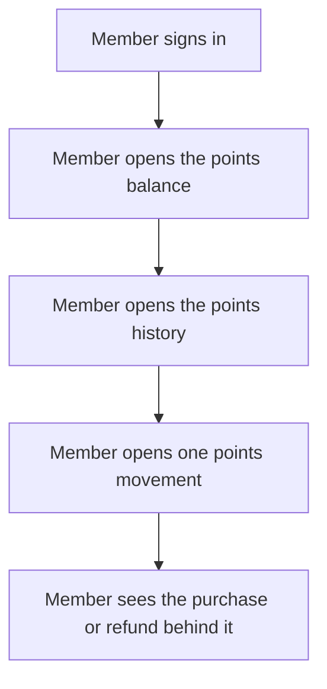

<!--
CHUNK: 05
TITLE: User Journeys & Use Cases - Overview
PROJECT: Loyalty Points
VERSION: 1.5
DEPENDS_ON: 04
PART OF: BRD - Loyalty Points
LANGUAGE: Business language only. No technology names, protocols, or implementation terminology - the how is owned by the SDD.
-->

# User Journeys & Use Cases

## User Journeys

### Member Journey

The member signs in and sees their points balance. The member then opens the history. The history shows which purchases earned points and which refunds took points back.

## Summarized Workflow

1. The member opens their points balance ([UC-01](./06a-use-cases-member.md#uc-01-view-points-balance)).
2. The member opens the history of points movements ([UC-02](./06a-use-cases-member.md#uc-02-view-points-history)).

### Figure 1 - Summarized Workflow: Member

**Summary:** The member signs in, checks the points balance, then opens the history. From the history, the member opens one movement to see the purchase or refund it came from.

## Use Case Summary

**Table 4 - Use Case Summary**

| UC ID | Use Case | Primary Actor | Description |
|-------|----------|---------------|-------------|
| **Member** | | | |
| UC-01 | View Points Balance | Member | The member sees their current points balance. |
| UC-02 | View Points History | Member | The member sees every points movement, including points taken back after a refund. |

Earning points on a purchase ([04 / In Scope](./04-scope-and-personas.md#in-scope)) has no use case, because the member takes no action in it. [03 / Earning points](./03-definitions-and-domain-concepts.md#earning-points) holds its rules, and the acceptance tests for earning trace to that section.

<!-- MASTER: loyalty-points-brd-master.md | PREV: 04-scope-and-personas.md | NEXT: 06a-use-cases-member.md -->
