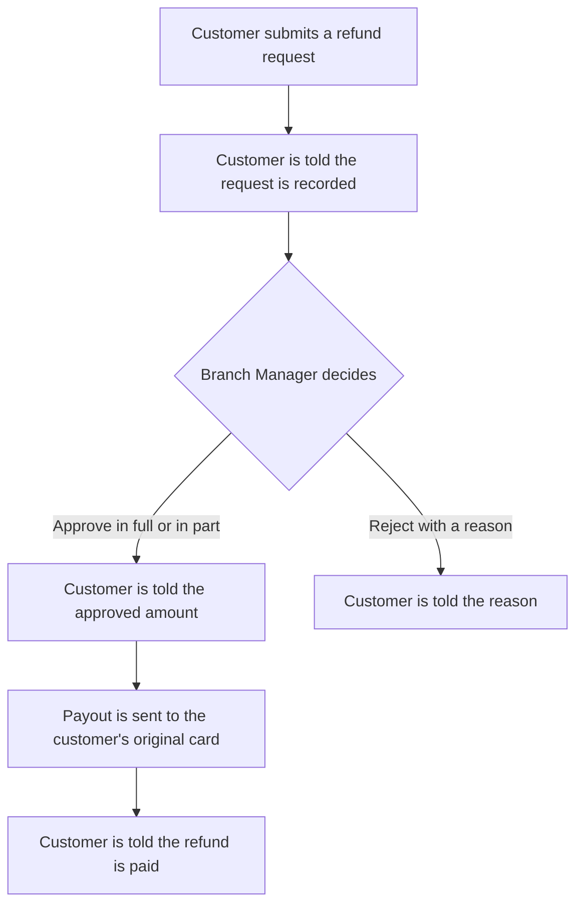

<!--
CHUNK: 05
TITLE: User Journeys & Use Cases - Overview
PROJECT: Refunds Portal
VERSION: 1.3
DEPENDS_ON: 04
PART OF: BRD - Refunds Portal
LANGUAGE: Business language only. No technology names, protocols, or implementation terminology - the how is owned by the SDD.
-->

# User Journeys & Use Cases

## User Journeys

### Customer Journey

The customer enters the receipt number, picks the items and a reason, and submits the request. They follow the request until the money is back on their card. They can cancel it while it waits for a decision.

### Branch Manager Journey

The branch manager sees the requests waiting for their branch and checks each one. They approve it in full or in part, or reject it with a reason. They also open the [branch refund report](./09-reporting-and-analytics.md#reporting--analytics) to see how their branch is doing.

## Summarized Workflow

1. The customer submits a refund request.
2. The branch manager approves or rejects it.
3. On approval, the payout is sent to the customer's original card.
4. The customer is told about the request as [03 / Customer messages](./03-definitions-and-domain-concepts.md#customer-messages) sets out.

### Figure 1 - Summarized refund workflow

**Summary:** The customer submits a refund request and is told it is recorded. The branch manager approves it in full or in part, and the customer is told the approved amount, or rejects it with a reason; an approved refund is paid to the original card and the customer is told.

## Use Case Summary

| UC ID | Use Case | Primary Actor | Description |
|-------|----------|---------------|-------------|
| **Customer** | | | |
| UC-01 | Request a Refund | Customer | The customer asks for money back for items on a receipt, within the refund window. |
| UC-02 | Track Refund Status | Customer | The customer sees where each of their requests stands. |
| UC-03 | Cancel a Refund Request | Customer | The customer withdraws a request that has not been decided yet. |
| **Branch Manager** | | | |
| UC-04 | Approve / Reject Refund | Branch Manager | The branch manager approves a request in full or in part, or rejects it with a reason. |
| UC-05 | Issue Partial Refund | Branch Manager | Merged into UC-04. |

<!-- MASTER: refunds-portal-brd-master.md | PREV: 04-scope-and-personas.md | NEXT: 06a-use-cases-customer.md -->
