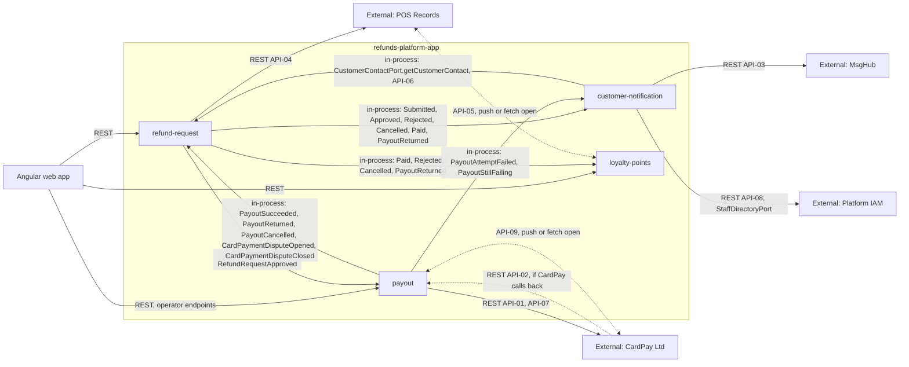

<!--
CHUNK: 02
TITLE: Context - Bounded Context & System Neighbours
PROJECT: Refunds Platform
VERSION: 1.1
PART OF: LLD - Refunds Platform
-->

# 5. Context

## 5.1 Bounded Context

This LLD covers the whole `refunds-platform-app` deployable: the refund request lifecycle with its decision record and its copy of the card disputes (`refund-request`), payouts to the original card in rounds, held while a card dispute is open and resolved by hand by payout operators (`payout`), customer and branch-manager messages (`customer-notification`), and the members' points ledger with the refund outcomes it is told (`loyalty-points`). The system context is SDD [§8.2](../sdd-refunds-platform/04-architecture-style-and-diagrams.md#82-context-diagram) (Figure 2) and the integration topology SDD [§12](../sdd-refunds-platform/08-integrations.md#12-integrations) (Figure 12); this chunk adds only the implementation view of each edge.

## 5.2 Upstream Producers (callers / event-publishers into this system)

| Upstream | Interaction | Protocol | Notes |
|----------|-------------|----------|-------|
| Angular web app (customers, members, branch managers, payout operators) | Sync REST | HTTPS, bearer access token from the platform IAM | `/v1` endpoints of `refund-request`, `payout` (operator endpoints), and `loyalty-points` (`06-api-contracts.md` § 9.1); a switched-off product answers 404 (SDD [§11.5](../sdd-refunds-platform/07-cross-cutting-concerns.md#115-configuration-management-default)) |
| CardPay Ltd | Sync REST (inbound callback, API-02) | HTTPS, provider signature (`TBD - external`) | Only if CardPay calls back (SDD [§17.2 Integrations](../sdd-refunds-platform/13b-service-payout.md#integrations) marker); otherwise the result comes in the API-01 response |
| CardPay Ltd | Sync REST (inbound card dispute notices, API-09) or a fetch by `payout` | HTTPS, provider signature (`TBD - external`) | Only if CardPay can report disputes; push or fetch open (SDD [§17.2 Disputes](../sdd-refunds-platform/13b-service-payout.md#business-logic) marker) |
| POS Records | Sync REST (inbound, API-05) or a fetch by `loyalty-points` | HTTPS (`TBD - external`) | Delivery mechanism open (SDD [§17.4 Input](../sdd-refunds-platform/13d-service-loyalty-points.md#input) marker) |
| Membership source | Leave date of a member | Open | Owner and channel open (SDD [§16.6](../sdd-refunds-platform/12-centralized-user-roles.md#166-grant--invitation-authority-who-can-create-whom) marker); `MembershipService.recordLeave` in `loyalty-points` |
| Platform scheduler (in the deployable) | Schedule | In-process | Jobs of each module, run per tenant (`10-operations.md` § 13.1, SDD [§11.2](../sdd-refunds-platform/07-cross-cutting-concerns.md#112-multi-tenancy-default)) |

## 5.3 Downstream Consumers (systems this LLD's services call / publish to)

| Downstream | Interaction | Protocol | Notes |
|------------|-------------|----------|-------|
| CardPay Ltd | Sync REST (API-01, API-07; API-09 only if `payout` fetches dispute notices) | HTTPS | Called only by `payout`, outside any database transaction (SDD §12 INT-01) |
| MsgHub | Sync REST (API-03) | HTTPS | Called only by `customer-notification`'s `message-sender` (SDD §12 INT-02) |
| Point-of-Sale Records | Sync REST (API-04; API-05 only if `loyalty-points` fetches purchases) | HTTPS | Receipt lookup by `refund-request`, in the customer's request path (SDD §12 INT-03) |
| Platform IAM (staff directory) | Sync REST (API-08) | HTTPS (IAM scheme `TBD - external`, ADR-07) | `customer-notification` finds the branch managers of a branch at send time through `StaffDirectoryPort`, with the IAM client of SDD [§11.6](../sdd-refunds-platform/07-cross-cutting-concerns.md#116-security-default) (SDD §12 INT-04) |
| Platform IAM (token validation) | Sync REST (token signing keys) | HTTPS (OIDC) | Operational infrastructure, not an `API-NN` (SDD [§15.1](../sdd-refunds-platform/11-api-contracts.md#151-contract-conventions-platform-defaults)) |
| PostgreSQL 17 | JDBC | TLS | One database, one schema and one role per module |

## 5.4 Cross-Service Dependencies (within this LLD)

**Summary:** `refund-request` is the hub: its six events drive `payout`, `customer-notification`, and `loyalty-points` (which gets the four refund outcomes, short names of the `RefundRequest*` events), and `payout` closes the loop with its payout and card dispute facts; the one synchronous module call is `customer-notification` reading contact details through API-06, one hop deep (SDD [ADR-05](../sdd-refunds-platform/06-principles-and-decisions.md#10-architectural-decisions)), and the dotted edges are the provider directions the SDD leaves open.

> **Convention:** module-to-module edges are in-process events (SDD [§14.10](../sdd-refunds-platform/10-events-hub.md#1410-in-process-domain-events-modular-monolith--hybrid-core)) or the one in-process port (SDD §15 API-06), never REST or topics; `StaffDirectoryPort` is an outbound port to the platform IAM (API-08, External outbound), not a module port. The SDD e2e view (chunk 19) is not written (gate `Locked`), so this map is built from SDD §8.2 (Figure 2), §8.3 (Figure 3), §12 (Figure 12), §14.10, and §15.

## 5.5 Shared Conventions (apply to every service in scope)

- **Auth:** OIDC access tokens from the platform IAM (Keycloak, SDD [ADR-07](../sdd-refunds-platform/06-principles-and-decisions.md#10-architectural-decisions) Proposed), one realm for every person, validated by the deployable as an OAuth2 resource server; a staff role requires a second sign-in factor; details `09-cross-cutting.md` § 12.1.
- **Tenant resolution:** `tenant_id` claim of the access token; jobs and listeners take it from the row or event; inbound provider calls (API-02, API-05, API-09) from the verification secret that matches (SDD [§11.2](../sdd-refunds-platform/07-cross-cutting-concerns.md#112-multi-tenancy-default)).
- **Correlation ID:** `X-Correlation-Id` and `traceparent` are required on our bearer endpoints (SDD §15.1); the server generates them only when a caller omits them (provider callbacks API-02, API-05, and API-09), logs `correlation_generated=true`, and never rejects a request for their absence. Both are carried into listeners through the publication-log row (SDD §11.4).
- **Product enablement:** `REFUNDS_PORTAL_ENABLED` and `LOYALTY_POINTS_ENABLED` switch each product on; while a product is off its endpoints answer 404 `NOT_FOUND` through the product-enablement guard and its listeners are not dispatched, so their listener rows wait in the publisher's publication log (SDD §11.1, [§11.5](../sdd-refunds-platform/07-cross-cutting-concerns.md#115-configuration-management-default)).
- **Time zone:** UTC for all timestamps (CLAUDE.md default, SDD §6); the branch-local date only where a BRD rule counts days.
- **ID strategy:** UUIDv7 generated at the service layer (CLAUDE.md default, SDD §11.1).

<!-- MASTER: refunds-platform-lld-master.md | PREV: 01-purpose-and-scope.md | NEXT: 03-architecture.md -->
