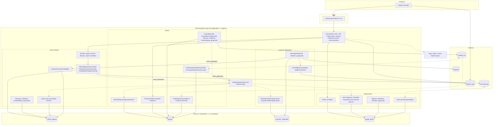

<!--
CHUNK: 03
TITLE: Architecture Overview - Components & Deployment
PROJECT: Refunds Platform
VERSION: 1.1
PART OF: LLD - Refunds Platform
-->

# 6. Architecture Overview

> **Note:** this chunk is a high-level orientation. Per-module detail lives in `04-implementation/<module>.md`.

## 6.1 Component Topology

**Summary:** One deployable holds the four modules behind one security filter chain, whose product-enablement guard answers 404 for a switched-off product; each module writes only its own schema, events flow through the publication logs of `refund-request` and `payout` to the listeners of the other modules, and each provider is reached by exactly one module's adapters (POS Records by two: lookup and intake), with the CardPay callback, the card dispute notices, and the POS Records purchases drawn dotted where the SDD leaves the direction open.

## 6.2 Deployment Topology

| Concern | Choice | Source / Rationale |
|---------|--------|--------------------|
| Container | One OCI image for `refunds-platform-app`, built once and promoted unchanged | SDD [§11.3](../sdd-refunds-platform/07-cross-cutting-concerns.md#113-deployment-default), ADR-09 |
| Orchestrator | Managed container service (open, SDD §6 marker; Proposed until approved); no Kubernetes or Helm chart for this release | SDD [ADR-09](../sdd-refunds-platform/06-principles-and-decisions.md#10-architectural-decisions) (overrides the CLAUDE.md Kubernetes and Helm default) |
| Namespace strategy | One environment per stage (Dev, SIT, UAT, Prod), each with its own IAM realm and secrets scope | SDD [§19](../sdd-refunds-platform/15-environments.md#19-environments) |
| Service mesh / Ingress | None: TLS terminates at the hosting load balancer | SDD §6 Service Mesh / Ingress row |
| Replicas (per deployable, baseline) | 2 minimum; maximum per the SDD §11.3 resource marker | SDD §11.3 |
| Deployment strategy | Rolling update; readiness `/actuator/health/readiness`, liveness `/actuator/health/liveness`; migrations run before the new version takes traffic and are backward compatible | SDD §11.3, AP-10 |
| Promotion and product rollout | Dev, SIT, UAT, Prod; each product has its own Prod gate and is switched on in Prod by its own enablement setting, a configuration change rolled out by restart; the Refunds Portal starts in the pilot branches of `REFUNDS_PORTAL_BRANCHES` | SDD §11.3, [§11.5](../sdd-refunds-platform/07-cross-cutting-concerns.md#115-configuration-management-default), [§20.1.8](../sdd-refunds-platform/16-operations-runbook.md#2018-switch-on-a-product-or-start-more-branches) |

> TODO: CPU and memory requests, limits, and autoscaling bounds are the SDD §11.3 [NEEDS CLARIFICATION] (platform team); best guess 1 vCPU / 1.5 GiB per replica, 2 to 6 replicas - verify.

## 6.3 Runtime Stack

| Layer | Technology | Version | Source |
|-------|-----------|---------|--------|
| Language | Java | 21 | [SDD §6](../sdd-refunds-platform/02-ecosystem-overview.md#6-ecosystem-overview) Backend Runtime row |
| Framework | Spring Boot (Web, Security OAuth2 resource server, Data JDBC, Actuator, Validation) | 3.5+ | [SDD §6](../sdd-refunds-platform/02-ecosystem-overview.md#6-ecosystem-overview) Backend Runtime row |
| Build | Maven | Not pinned | LLD (not in SDD §6) |
| Compute | Managed container service, at least 2 replicas; proposed, needs approval (ADR-09) | Provider tier: pin at build | [SDD §6](../sdd-refunds-platform/02-ecosystem-overview.md#6-ecosystem-overview) Compute / Infra row |
| Database | PostgreSQL | 17+ | [SDD §6](../sdd-refunds-platform/02-ecosystem-overview.md#6-ecosystem-overview) Primary RDBMS row |
| Message Broker | None (durable in-process events, publication log) | n/a | [SDD §6](../sdd-refunds-platform/02-ecosystem-overview.md#6-ecosystem-overview) Event Broker row, ADR-02 |
| Cache | None | n/a | [SDD §6](../sdd-refunds-platform/02-ecosystem-overview.md#6-ecosystem-overview) Caching row |
| Auth | Keycloak (OIDC), one realm for end customers and staff; proposed, needs approval (ADR-07) | Pin at build | [SDD §6](../sdd-refunds-platform/02-ecosystem-overview.md#6-ecosystem-overview) IAM / AuthN row |
| Secrets | Secrets manager of the hosting environment | Pin at build | [SDD §6](../sdd-refunds-platform/02-ecosystem-overview.md#6-ecosystem-overview) Secrets Management row |
| Migrations | Flyway; proposed, needs approval (ADR-10) | Not pinned | [SDD ADR-10](../sdd-refunds-platform/06-principles-and-decisions.md#10-architectural-decisions) (not a §6 row) |
| Resilience | Resilience4j; proposed, needs approval (ADR-10) | Not pinned | [SDD ADR-10](../sdd-refunds-platform/06-principles-and-decisions.md#10-architectural-decisions) (not a §6 row) |
| Observability: metrics | Micrometer through Spring Boot Actuator | Spring Boot managed | [SDD §6](../sdd-refunds-platform/02-ecosystem-overview.md#6-ecosystem-overview) Observability: Metrics row |
| Observability: tracing | OpenTelemetry instrumentation, W3C trace context; proposed, needs approval (ADR-10) | Pin at build | [SDD §6](../sdd-refunds-platform/02-ecosystem-overview.md#6-ecosystem-overview) Observability: Tracing row |
| Observability: logging | Structured JSON to stdout | Pin at build | [SDD §6](../sdd-refunds-platform/02-ecosystem-overview.md#6-ecosystem-overview) Observability: Logging row |
| Testing | JUnit 5 and Mockito (Spring Boot test starter); ArchUnit and Testcontainers proposed, need approval (ADR-12) | Pin at build | [SDD §6](../sdd-refunds-platform/02-ecosystem-overview.md#6-ecosystem-overview) Testing row |
| Frontend | Angular standalone components; proposed, needs approval (ADR-11) | 17+ | [SDD §6](../sdd-refunds-platform/02-ecosystem-overview.md#6-ecosystem-overview) Frontend Stack row |

> Confirm: Maven as the build tool is an LLD choice; neither SDD §6 nor the project rules name one (Gradle fits equally).

> TODO: version pins missing from the resolved stack, owned by [SDD §6](../sdd-refunds-platform/02-ecosystem-overview.md#6-ecosystem-overview) (its "Pin at build" [NEEDS CLARIFICATION], platform team; ADR-10 names no version for its libraries): the managed container service tier, Keycloak, the secrets manager, Flyway, Resilience4j, OpenTelemetry, the JSON logging encoder, ArchUnit, Testcontainers, and the Maven version; best guess: the latest stable release of each at build time - pin them in SDD §6 through sdd-unifier and verify.

> **Convention:** each Source cell links the SDD §6 row (or ADR) it derives from; a value that disagrees with SDD §6 is drift to flag. A row marked "proposed, needs approval" is a new dependency under the project rules (`AGENTS.md`): it is not adopted until the product owner approves it, and until then the SDD fallback applies (hand-written migrations runner and resilience in the adapters, ADR-10; boundary rules in code review and a CI PostgreSQL service, ADR-12).

## 6.4 Architectural Style - As Operationalised

> **Inherits from:** SDD [§8.1 Architecture Style](../sdd-refunds-platform/04-architecture-style-and-diagrams.md#81-architecture-style) (modular monolith, ADR-01).
>
> **What this section adds:** the module boundaries, the ports, the in-process events, and the product switches as code.

- **Module boundary rule:** one module = one package root (`refundsplatform.<module>`) with `api`, `domain`, `adapter.in`, `adapter.out`; one PostgreSQL schema and one database role; another module may import only its `api` package. ArchUnit rules (proposed, ADR-12) fail the build on any other import or a cross-schema SQL string.
- **Inter-module async:** in-process domain events only (`07-event-contracts.md` § 10.6), durable through each publishing module's publication log (`event_publication`, `event_publication_listener`, SDD [§11.1](../sdd-refunds-platform/07-cross-cutting-concerns.md#111-db-modeling-default)); no topics, no broker (`07-event-contracts.md` § 10.1). Delivery order is not guaranteed; every listener orders by the event's `sequence` (SDD [§14.10](../sdd-refunds-platform/10-events-hub.md#1410-in-process-domain-events-modular-monolith--hybrid-core) Ordering).
- **Inter-module sync:** one port, `CustomerContactPort` (API-06, `06-api-contracts.md` § 9.6); no port calls another port (one hop). `StaffDirectoryPort` (API-08) is an outbound port to the platform IAM, not a module port.
- **Outbox pattern:** the publication log is the outbox for in-process events; `payout.payout` and `customer_notification.message` rows are the outbox for provider writes (`09-cross-cutting.md` § 12.4).
- **Saga choreography vs orchestration:** choreography for the one cross-module flow, the refund saga of SDD [§14.7](../sdd-refunds-platform/10-events-hub.md#147-universal-subscribers--cross-service-doctrines) (approve, pay out or hold for a card dispute, mark Paid, take back points), driven by the durable events, with its two compensating steps (a payout cancelled after a refunded dispute makes the request Rejected; a payout sent back returns a Paid request to Approved and `payout` to a new round); no orchestrator ([refund-request § 7.4](./04-implementation/refund-request.md#pattern-saga-choreography---refund-lifecycle-with-payout-and-take-back), `08-state-and-rules.md` § 11.2).
- **Product enablement (SDD [§11.5](../sdd-refunds-platform/07-cross-cutting-concerns.md#115-configuration-management-default)):** `REFUNDS_PORTAL_ENABLED` switches on the `refund-request` endpoints, the payout operator endpoints, and the `refund-request`, `payout`, and `customer-notification` listeners (never the CardPay callbacks or the dispute fetch); `LOYALTY_POINTS_ENABLED` switches on the LOYALTY endpoints, purchase intake (API-05), and the `loyalty-points` listeners. A switched-off product's endpoints answer 404 through the platform product-enablement guard, and the `ListenerRegistry` neither dispatches nor redelivers its listeners, so their rows wait in the publisher's publication log. `REFUNDS_PORTAL_BRANCHES` is the started-branch setting of the eligibility chain (`BRANCH_NOT_STARTED`), and `LOYALTY_REFUND_REPORTING_START_DATE` the take-back cut-off; a start with both products on and no start date fails.
- **Hexagonal layering inside a module:** the CLAUDE.md layered default (controller, service, service impl, repository) is kept as names inside the SDD's hexagonal packages: controllers, listeners, and jobs are inbound adapters; `*Service` interfaces are inbound ports; `*Port`/`*Gateway` interfaces are outbound ports with `*Adapter` implementations.

<!-- MASTER: refunds-platform-lld-master.md | PREV: 02-context.md | NEXT: 04-implementation/customer-notification.md -->
