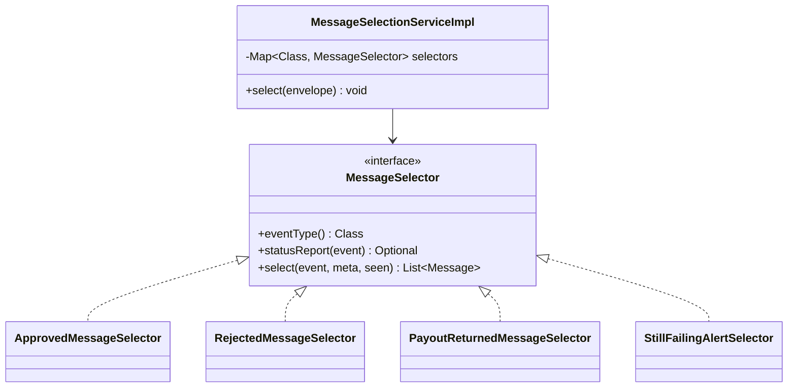
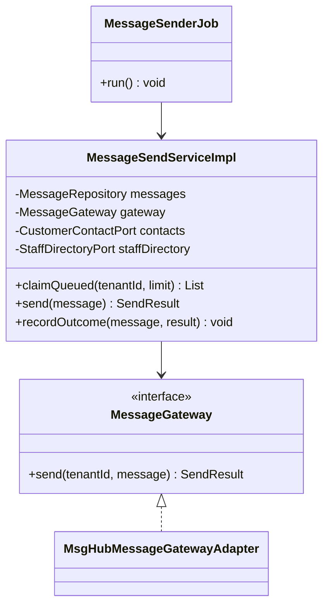
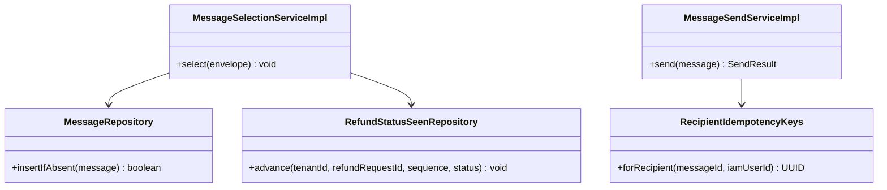
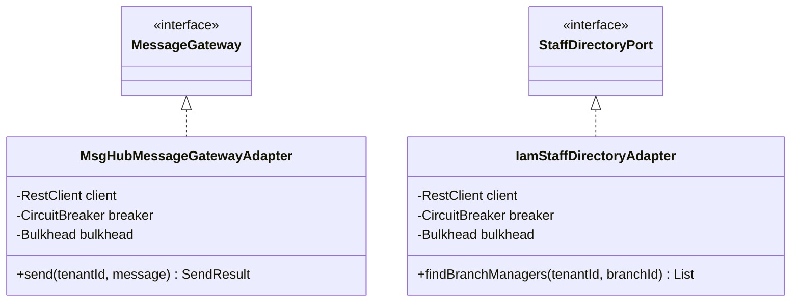
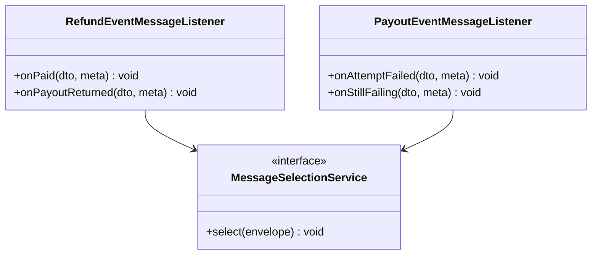
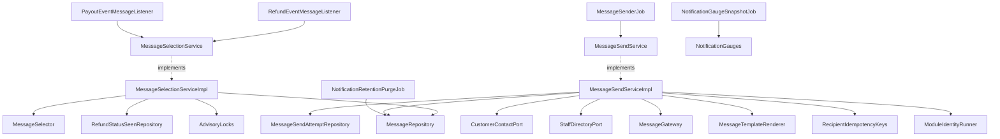
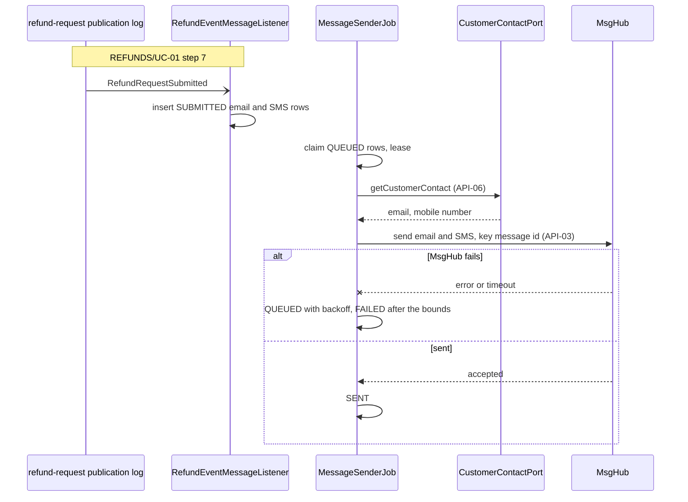
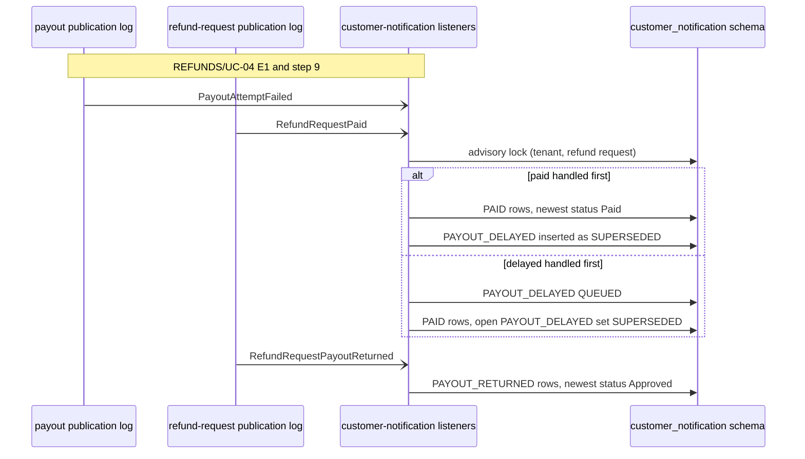
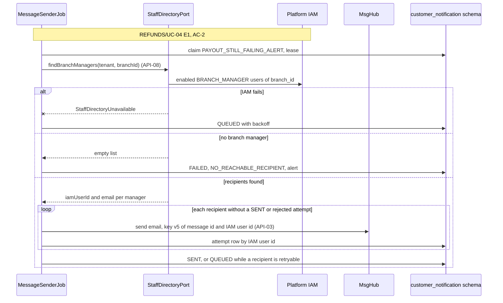
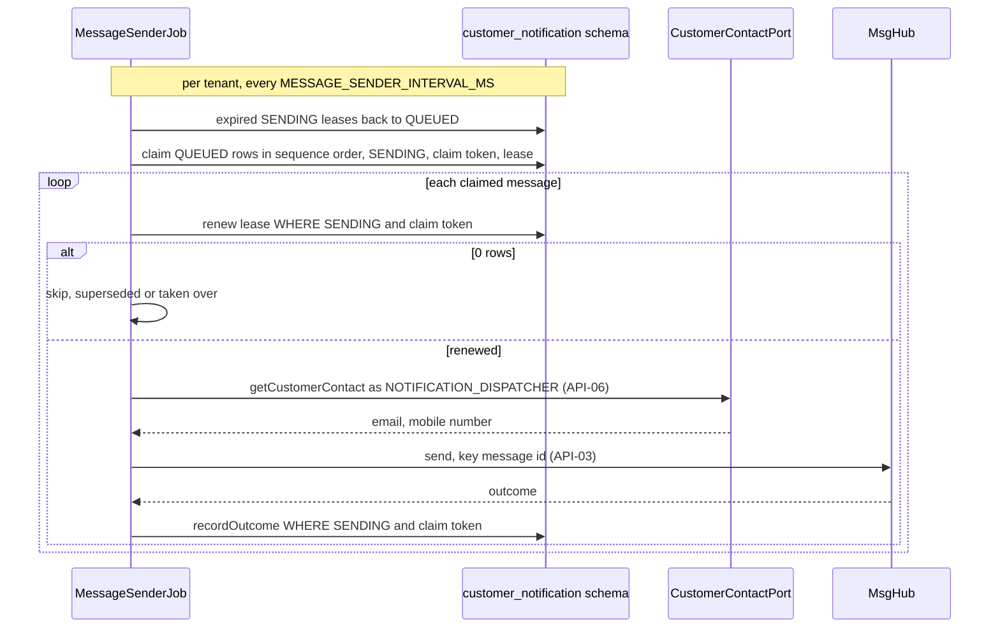

<!--
CHUNK: 04
TITLE: Per-Service Implementation - customer-notification
PROJECT: Refunds Platform
VERSION: 1.1
DEPENDS_ON: 03, 09
PART OF: LLD - Refunds Platform
-->

# 7. Per-Service Implementation - customer-notification

> **Bounded context:** SDD [§13 customer-notification row](../../sdd-refunds-platform/09-services-summary.md#13-services-decomposition-summary) and [§17.3 Boundaries](../../sdd-refunds-platform/13c-service-customer-notification.md#boundaries)
>
> **Type:** module (SDD §13 Type)
>
> **Source code:** `refunds-platform-app/src/main/java/refundsplatform/customernotification/` (not written yet; from-sdd build target)
>
> **Owns use cases (SDD 09):** None - sends the customer messages of [REFUNDS 03 § Customer messages](../../brd-refunds-portal/03-definitions-and-domain-concepts.md#customer-messages) and the branch-manager alert of [REFUNDS/UC-04](../../brd-refunds-portal/06b-use-cases-branch-manager.md#uc-04-approve--reject-refund) E1
>
> **Participates in:** REFUNDS/UC-01, REFUNDS/UC-03, REFUNDS/UC-04 (owner: refund-request)

---

## 7.1 Responsibility

`customer-notification` turns refund and payout events into the email and SMS messages REFUNDS 03 sets out, plus the branch-manager email for a payout still failing after one day, and sends them through MsgHub (API-03). It owns the message records (one per event and channel), their send attempts (one per recipient for the branch-manager alert), the newest refund status it has seen per refund request (the highest `sequence`, SDD [§14.10 Ordering](../../sdd-refunds-platform/10-events-hub.md#1410-in-process-domain-events-modular-monolith--hybrid-core)), and the message templates. It listens to eight events (`RefundRequestSubmitted`, `RefundRequestApproved`, `RefundRequestRejected`, `RefundRequestCancelled`, `RefundRequestPaid`, `RefundRequestPayoutReturned` from `refund-request`; `PayoutAttemptFailed`, `PayoutStillFailing` from `payout`), publishes none, reads customer contact details at send time through `CustomerContactPort` (API-06) as `NOTIFICATION_DISPATCHER`, and reads the branch managers of a branch at send time through `StaffDirectoryPort` (API-08) with the IAM client of SDD [§11.6](../../sdd-refunds-platform/07-cross-cutting-concerns.md#116-security-default), not a module role. It stores no contact detail, a message failure never changes a refund request, and, as part of the Refunds Portal product, its listeners are dispatched only while `REFUNDS_PORTAL_ENABLED` is on (SDD [§11.5](../../sdd-refunds-platform/07-cross-cutting-concerns.md#115-configuration-management-default)).

---

## 7.2 Class & Interface Map

> **Package layout:** `refundsplatform.customernotification.domain`, `.adapter.in` (listeners, jobs), `.adapter.out` (repositories, MsgHub client, IAM staff directory adapter); it imports `refundsplatform.refundrequest.api` (`CustomerContactPort`, event DTOs) and `refundsplatform.payout.api` (event DTOs) only.

> Confirm: class names follow CLAUDE.md conventions; `MessageGateway` is the SDD [§17.3 Developer Notes](../../sdd-refunds-platform/13c-service-customer-notification.md#developer-notes) name and `StaffDirectoryPort` the SDD [API-08](../../sdd-refunds-platform/11-api-contracts.md#api-08-find-the-branch-managers-of-a-branch-customer-notification---platform-iam) name; verify the rest with the team.

### Controllers

| Class | Endpoints | Notes |
|-------|-----------|-------|
| `RefundEventMessageListener` | `Event: RefundRequestSubmitted`, `Event: RefundRequestApproved`, `Event: RefundRequestRejected`, `Event: RefundRequestCancelled`, `Event: RefundRequestPaid`, `Event: RefundRequestPayoutReturned` | One method and one listener id per event (`onSubmitted` `customer-notification.refund-request-submitted`, `onApproved`, `onRejected`, `onCancelled`, `onPaid`, `onPayoutReturned` `customer-notification.refund-request-payout-returned`); no `@UseCase` (SDD §7.3 lists no `Event:` trigger for them) |
| `PayoutEventMessageListener` | `Event: PayoutAttemptFailed`, `Event: PayoutStillFailing` | `onAttemptFailed` (`customer-notification.payout-attempt-failed`), `onStillFailing` (`customer-notification.payout-still-failing`); no `@UseCase` |
| `MessageSenderJob` | `Schedule: message-sender` | Serves `### Workflow: Message sender`; no `@UseCase` |
| `NotificationRetentionPurgeJob` | `Schedule: notification-retention-purge` | Serves `### Workflow: Notification retention purge`; no `@UseCase` |
| `NotificationGaugeSnapshotJob` | `Schedule: notification-gauge-snapshot` | Serves `### Workflow: Gauge snapshot (customer-notification)`; no `@UseCase` |

### Services (interfaces)

| Interface | Purpose | Implementations |
|-----------|---------|-----------------|
| `MessageSelectionService` | Creates the message records for one event and keeps the newest refund status seen | `MessageSelectionServiceImpl` |
| `MessageSendService` | Expires leases, claims in `sequence` order, sends, records outcomes | `MessageSendServiceImpl` |
| `MessageSelector` (Strategy) | One selection rule per event type | `SubmittedMessageSelector`, `ApprovedMessageSelector`, `RejectedMessageSelector`, `CancelledMessageSelector`, `PaidMessageSelector`, `PayoutReturnedMessageSelector`, `PayoutDelayedMessageSelector`, `StillFailingAlertSelector` |
| `MessageGateway` (outbound) | API-03 send email or SMS | `MsgHubMessageGatewayAdapter` |
| `CustomerContactPort` (outbound, provided by refund-request) | API-06 | `CustomerContactPortAdapter` in refund-request |
| `StaffDirectoryPort` (outbound, anti-corruption layer) | API-08: enabled staff accounts with `BRANCH_MANAGER` and the given `branch_id`, in the tenant | `IamStaffDirectoryAdapter` |
| `MessageTemplateRenderer` | Text per message type, channel, and language | `MessageTemplateRendererImpl` |

### Service Implementations

| Class | Implements | Key methods |
|-------|------------|-------------|
| `MessageSelectionServiceImpl` | `MessageSelectionService` | `select(DomainEventEnvelope event)` |
| `MessageSendServiceImpl` | `MessageSendService` | `expireLeases(UUID tenantId)`, `claimQueued(UUID tenantId, int limit)`, `send(ClaimedMessage)`, `recordOutcome(ClaimedMessage, SendResult)` |
| `RecipientIdempotencyKeys` | - | `forRecipient(UUID messageId, String iamUserId)`: name-based UUID (RFC 9562 version 5), namespace = message id, name = IAM user id (hand-written SHA-1 v5, no library) |
| `NotificationGauges` | `MeterBinder` (Micrometer) | Holds the gauge values the snapshot job computes, per tenant; a scrape reads the cached values, never the database |

### Repositories

| Class | Entity | Notes |
|-------|--------|-------|
| `MessageRepository` | `Message` | `insertIfAbsent` on `(tenant_id, event_id, channel)`; `expireLeases`; `claimQueued` (`FOR UPDATE SKIP LOCKED`, `sequence` order per refund request); `renewLease`; `supersedeOpenPayoutMessages(tenantId, refundRequestId)`; `recordOutcome` (conditional on `SENDING` and the claim token) |
| `MessageSendAttemptRepository` | `MessageSendAttempt` | Per recipient for the alert; `doneRecipients(messageId)` (IAM user ids with a `SENT` or `REJECTED_INVALID_RECIPIENT` attempt) |
| `RefundStatusSeenRepository` | `RefundStatusSeen` | `find(tenantId, refundRequestId)`; `advance(tenantId, refundRequestId, sequence, status)`: insert, or update only when `sequence` is higher than the stored one |
| `ProcessedEventRepository` | `ProcessedEvent` | Not used: dedup is the `(tenant_id, event_id, channel)` key (SDD §17.3 Error Handling, Async consumers) |
| `AdvisoryLocks` (platform) | - | `lockTx(namespace, tenantId, refundRequestId)`: `pg_advisory_xact_lock(hashtextextended(...))` |

### Domain Types (records)

| Type | Kind | Purpose |
|------|------|---------|
| `Message` | entity | One message for one event and channel: type, channel, status, refund request id, `sequence` (status messages only), branch id (alert only), template values |
| `MessageSendAttempt` | entity | One MsgHub call: recipient (IAM user id for the alert, `CUSTOMER` otherwise), outcome, provider message id |
| `RefundStatusSeen` | entity | Per refund request: the highest `sequence` handled and the status it reported |
| `MessageType` | enum | Status messages: `SUBMITTED`, `APPROVED_IN_PART`, `APPROVED_IN_FULL`, `REJECTED`, `REJECTED_DISPUTE_REFUNDED`, `CANCELLED`, `PAID`, `PAYOUT_RETURNED`; payout messages: `PAYOUT_DELAYED`, `PAYOUT_STILL_FAILING_ALERT`. `alwaysSent()` is true for `SUBMITTED`, `APPROVED_IN_PART`, `APPROVED_IN_FULL` |
| `RefundStatus` | enum | `SUBMITTED`, `APPROVED`, `REJECTED`, `CANCELLED`, `PAID` (the status a refund event reports) |
| `StatusReport` | record | `sequence` and `RefundStatus` of one `refund-request` event |
| `Channel` | enum | `EMAIL`, `SMS` |
| `MessageStatus` | enum | `QUEUED`, `SENDING`, `SENT`, `FAILED`, `SUPERSEDED` |
| `OutgoingMessage` | record | API-03 request built by our side: channel, recipient address, text, idempotency key |
| `StaffRecipient` | record | API-08 result row: `iamUserId`, `email` (`pii`, used for the send and never stored) |
| `SendResult` | record | `outcome` (`SENT`, `REJECTED_INVALID_RECIPIENT`, `RETRYABLE`, `AUTH_FAILED`, `NOT_SENT` (no call made: breaker open or bulkhead full), `CONFIG_DEFECT` (API-06 `AccessDenied`)), provider message id |

### Method Signatures (key methods only)

```java
public interface MessageSelector {
  Class<?> eventType();
  Optional<StatusReport> statusReport(Object eventDto);                       // empty for the payout events
  List<Message> select(Object eventDto, EventMetadata meta, Optional<RefundStatusSeen> seen); // pure: no I/O
}

public interface MessageGateway {                              // API-03, provider contract TBD - external
  SendResult send(UUID tenantId, OutgoingMessage message);
}

public interface StaffDirectoryPort {                          // API-08, provider contract TBD - external
  List<StaffRecipient> findBranchManagers(UUID tenantId, String branchId);  // throws StaffDirectoryUnavailable
}
```

> Confirm: SDD [API-08](../../sdd-refunds-platform/11-api-contracts.md#api-08-find-the-branch-managers-of-a-branch-customer-notification---platform-iam) writes the operation as `findBranchManagers(branchId)`, with the tenant as the caller's tenant; the LLD passes the tenant explicitly, as every LLD port and service call does (`09-cross-cutting.md` § 12.1, Tenant ID propagation), and the adapter uses it to pick the tenant's IAM client credentials (SDD §11.2). `branchId` is a string, as SDD §14.10 types it.

> TODO: `IamStaffDirectoryAdapter` asks the IAM for the enabled users holding `BRANCH_MANAGER` whose `branch_id` attribute equals `branchId` and whose `tenant_id` equals the tenant, reads only `iamUserId` and `email`, and maps any failure to `StaffDirectoryUnavailable`; the query, URI, auth scheme, response, and the staff-only read limit are the SDD API-08 `TBD - external` marker (ADR-07 Proposed) - verify once ADR-07 is settled and the IAM documentation is supplied.

### Ports and Adapters (in-process contracts)

| Port interface | Operation | API ID (§15) | Role here | Adapter class |
|----------------|-----------|--------------|-----------|---------------|
| `CustomerContactPort` | `getCustomerContact` | [API-06](../../sdd-refunds-platform/11-api-contracts.md#api-06-get-customer-contact-details-customer-notification---refund-request) | Caller (as `NOTIFICATION_DISPATCHER`) | - (provider side: `CustomerContactPortAdapter` in [refund-request](./refund-request.md#ports-and-adapters-in-process-contracts)) |

`StaffDirectoryPort` is not an in-process contract: API-08 is External outbound to the platform IAM; its adapter is listed under Services above and its resilience instance in § 7.4.

### Authorization

| Entry point | Kind | Permission token (SDD §16, verbatim) | Enforcement point |
|-------------|------|--------------------------------------|-------------------|
| `RefundEventMessageListener.*` | Listener | None - system consumer | Tenant from the event |
| `PayoutEventMessageListener.*` | Listener | None - system consumer | Tenant from the event |
| `MessageSenderJob.run` | Job | None - system job | Per-tenant run; calls API-06 under the module identity `NOTIFICATION_DISPATCHER`, which holds `refund.contact.read` (checked by the provider at the port); calls API-08 with the IAM client of SDD §11.6, never under a module role (SDD [§16.1](../../sdd-refunds-platform/12-centralized-user-roles.md#161-business-overview)) |
| `NotificationRetentionPurgeJob.run` | Job | None - system job | Per-tenant run |
| `NotificationGaugeSnapshotJob.run` | Job | None - system job | Per-tenant run |

---

## 7.3 Method-Level Pseudocode (non-trivial logic only)

### `MessageSelectionServiceImpl.select` (each listener)

```text
1. BEGIN TX (customerNotificationTx)
2. advisoryLocks.lockTx("cn-refund", tenant, event.refundRequestId)          -- every listener of this module
3. seen = refundStatusSeenRepository.find(tenant, event.refundRequestId)    -- empty before the first refund event
4. selector = selectors[event class]; report = selector.statusReport(event)
   stale = report present AND seen present AND report.sequence < seen.highestSequence
5. messages = selector.select(event, meta, seen)                           -- Strategy, § 7.4, rules below
6. stale -> every message whose type is not alwaysSent() is created SUPERSEDED (SDD §17.3 Select, stale status messages)
7. for each m: messageRepository.insertIfAbsent(m)          -- key (tenant_id, event_id, channel), conflict = duplicate delivery
8. report present AND not stale: refundStatusSeenRepository.advance(tenant, refundRequestId, report.sequence, report.status)
9. (RefundRequestPaid, or RefundRequestRejected with rejectionKind DISPUTE_REFUNDED) AND not stale:
      messageRepository.supersedeOpenPayoutMessages(tenant, refundRequestId)
      -> every PAYOUT_DELAYED and PAYOUT_STILL_FAILING_ALERT message of that request in QUEUED or SENDING becomes
         SUPERSEDED (claim_token kept, so the sender's conditional writes no longer match it)
10. COMMIT
```

> Confirm: SDD §17.3 Select names only `RefundRequestPaid`; the dispute-refunded rejection is the other end of a payout (SDD §17.2 Disputes) and takes the same rule - record it in SDD §17.3 through sdd-unifier.

> Confirm: SDD [§17.3 Select](../../sdd-refunds-platform/13c-service-customer-notification.md#business-logic) names the advisory lock for the `PayoutAttemptFailed`, `PayoutStillFailing`, `RefundRequestPaid`, and `RefundRequestPayoutReturned` listeners; the LLD takes it in all eight listeners, because the other four refund listeners read and write the same `refund_status_seen` row. A stale `RefundRequestPaid` (a higher `sequence` already seen, for example after `RefundRequestPayoutReturned`) supersedes no payout message, so a later round's still-failing alert is not hidden by an old paid event; verify both with the team.

### Selection rules (one `MessageSelector` per event)

| Event | Messages created | Rule source |
|-------|------------------|-------------|
| `RefundRequestSubmitted` | `SUBMITTED` x {EMAIL, SMS}, with the reference number; always sent | REFUNDS/UC-01 step 7 |
| `RefundRequestApproved` | `partial = true`: `APPROVED_IN_PART` x {EMAIL, SMS} with the approved amount and the reason; otherwise `APPROVED_IN_FULL` x {EMAIL, SMS} with the approved amount; always sent | REFUNDS/UC-04 A1, AC-6: customer told the approved amount and the reason; REFUNDS/UC-04 step 8, AC-10: customer told of a full approval before Paid |
| `RefundRequestRejected` | `rejectionKind = DECISION`: `REJECTED` x {EMAIL, SMS} with the reason; `rejectionKind = DISPUTE_REFUNDED`: `REJECTED_DISPUTE_REFUNDED` x {EMAIL, SMS}, saying the bank has already refunded the payment; `DISPUTE_REFUNDED`: supersedes open payout messages (step 9) | REFUNDS/UC-04 A2; REFUNDS/UC-04 BR-8: payout waits for a card dispute, AC-13: customer told the reason after a refunded dispute |
| `RefundRequestCancelled` | `CANCELLED` x {EMAIL} | REFUNDS/UC-03 step 5 |
| `RefundRequestPaid` | `PAID` x {EMAIL, SMS}, saying when the money usually shows on the card; supersedes open payout messages (step 9 above) | REFUNDS/UC-04 step 9 |
| `RefundRequestPayoutReturned` | `PAYOUT_RETURNED` x {EMAIL, SMS}, saying the payout is delayed; the newest status seen becomes Approved again, so later payout messages are created normally | REFUNDS/UC-04 E1, AC-11: customer told payout is delayed after a payout is sent back |
| `PayoutAttemptFailed` | `PAYOUT_DELAYED` x {EMAIL, SMS}; created `SUPERSEDED` when the newest status seen is Paid or Rejected | REFUNDS/UC-04 E1, AC-8: customer told payout is delayed |
| `PayoutStillFailing` | `PAYOUT_STILL_FAILING_ALERT` x {EMAIL} with `branch_id` from `PayoutStillFailingDto.branchId`, recipients resolved at send time (API-08), text marked for information only; created `SUPERSEDED` when the newest status seen is Paid or Rejected | REFUNDS/UC-04 E1, AC-2: still failing after one day |

Status messages (all but the two payout messages) carry the event's `sequence`; a refund status event whose `sequence` is lower than the highest seen creates its messages `SUPERSEDED`, except the `alwaysSent()` types (SDD [§17.3 Select](../../sdd-refunds-platform/13c-service-customer-notification.md#business-logic)).

> TODO: the Paid template states the number of days the money usually takes to show on the card statement; that number is the open [NEEDS CLARIFICATION] of [REFUNDS 03 § Customer messages](../../brd-refunds-portal/03-definitions-and-domain-concepts.md#customer-messages) (Paid row), which SDD §17.3 does not carry yet; best guess: the template omits the number until it is answered - verify once the REFUNDS BRD owner answers.

### `MessageSendServiceImpl` (`message-sender`, per tenant)

```text
1. expireLeases (own TX): SENDING messages with lease_expires_at < now -> QUEUED, only WHERE status = 'SENDING',
             lease_expiry_count += 1, claim_token = NULL (alert LeaseExpiredTwice when the count reaches 2)
2. claimed = TX: SELECT m FROM message m
               WHERE m.tenant_id = :t AND m.status = 'QUEUED' AND m.next_attempt_at <= now
                 AND (m.sequence IS NULL OR NOT EXISTS (SELECT 1 FROM message p
                      WHERE p.tenant_id = m.tenant_id AND p.refund_request_id = m.refund_request_id
                        AND p.sequence < m.sequence AND p.status IN ('QUEUED', 'SENDING')))
               ORDER BY m.next_attempt_at, m.sequence LIMIT 50 FOR UPDATE OF m SKIP LOCKED
             -> SENDING, claim_token = new UUIDv7, lease_expires_at = now + MSGHUB_TIMEOUT + 1 min; COMMIT
             (a status message waits while a lower-sequence status message of its request is QUEUED or SENDING)
3. for each claimed message (outside TX, bulkhead msghubSend):
   before each MsgHub call, renewLease(m): UPDATE message SET lease_expires_at = now() + MSGHUB_TIMEOUT + interval '1 minute'
     WHERE tenant_id = :t AND id = :id AND status = 'SENDING' AND lease_expires_at > now() AND claim_token = :claimToken
     in its own short transaction; 0 rows -> skip the message: when it is now SUPERSEDED (a listener superseded it,
     SDD §17.3 Send) nothing more is logged, otherwise log lease_lost and increment lease_expired_total
   customer message:
     contact = moduleIdentityRunner.runAs(NOTIFICATION_DISPATCHER, m.tenantId,
                 () -> customerContactPort.getCustomerContact(CustomerContactQuery(refundRequestId)))
       RefundRequestNotFound | ContactDetailsErased -> FAILED (no retry)
       AccessDenied -> outcome CONFIG_DEFECT (step 4)
     address = channel == EMAIL ? contact.email : contact.mobileNumber
       absent -> FAILED with reason CONTACT_NOT_GIVEN (channel skipped, SDD §17.3 Send), no alert
     result = messageGateway.send(tenant, OutgoingMessage(channel, address, render(m), key = m.id))
   branch-manager alert:
     recipients = staffDirectoryPort.findBranchManagers(tenant, m.branchId)   (API-08)
       a failed IAM call (StaffDirectoryUnavailable, call made) -> RETRYABLE;
       iamUserQuery breaker open or bulkhead full (StaffDirectoryUnavailable, no call made) -> NOT_SENT
       only enabled staff accounts whose tenant (the tenant_id the realm issues, SDD §11.2) equals tenant;
       an account of another tenant is dropped and logged at WARN with its IAM user id only
       none -> FAILED with last_error_code = NO_REACHABLE_RECIPIENT, messages_total{outcome="no_reachable_recipient"}
         incremented (alert NoBranchManagerForAlert; branch id and refund request id logged at WARN)
     for each recipient of the current result without a SENT or REJECTED_INVALID_RECIPIENT attempt:
       result_r = messageGateway.send(tenant, OutgoingMessage(EMAIL, r.email, render(m), key = v5(m.id, r.iamUserId)))
       record attempt(recipient = r.iamUserId, outcome) for every call made; a NOT_SENT recipient gets no attempt row
     message outcome: SENT when every current recipient has a SENT or REJECTED_INVALID_RECIPIENT attempt and at least
       one has SENT; FAILED with last_error_code = NO_REACHABLE_RECIPIENT, messages_total{outcome="no_reachable_recipient"}
       incremented and the NoBranchManagerForAlert alert when every current recipient is REJECTED_INVALID_RECIPIENT;
       otherwise RETRYABLE when a remaining recipient's call was made and failed, else NOT_SENT (only no-call
       recipients remain), each handled as in step 4. Recipients that left the result since the last try are not
       retried and do not block the outcome. Each REJECTED_INVALID_RECIPIENT recipient is logged at WARN with its
       IAM user id (never the address)
4. recordOutcome (TX), applied only WHERE status = 'SENDING' AND claim_token = :claimToken (zero rows: the outcome is
   recorded on the attempt row and logged as stale; a message a listener superseded meanwhile stays SUPERSEDED):
   SENT -> SENT, sent_at;
   RETRYABLE (a call was made) -> QUEUED with backoff + jitter, attempts += 1, or FAILED when attempts reach
     MSGHUB_MAX_ATTEMPTS; REJECTED_INVALID_RECIPIENT -> FAILED (no retry);
   NOT_SENT (breaker open or bulkhead full, no call made) and AUTH_FAILED -> QUEUED, next_attempt_at = now + 30 s
     + jitter(0, 30 s) (the open wait of the breaker, 09 § 12.3), attempts unchanged, no message_send_attempt row;
     AUTH_FAILED also opens the circuit and raises MsgHubAuthFailed;
   CONFIG_DEFECT (API-06 AccessDenied) -> QUEUED with next_attempt_at = now + MSGHUB_RETRY_MAX_DELAY, attempts
     unchanged, api06_access_denied_total incremented (ApiContactAccessDenied alert)
5. a SUPERSEDED message is never claimed (step 2 selects QUEUED only); a call already in flight when its message is
   superseded can still reach the recipient, which SDD §17.3 Send accepts
```

> Confirm: medium confidence, seeded by SDD [§17.3 Send](../../sdd-refunds-platform/13c-service-customer-notification.md#business-logic).

> TODO: `MSGHUB_MAX_ATTEMPTS` 8 with backoff base 30 s, factor 2, cap 30 min, and the MsgHub call timeout 5 s are best guesses; the bounds are the SDD [§12 INT-02](../../sdd-refunds-platform/08-integrations.md#12-integrations) [NEEDS CLARIFICATION] - verify once MsgHub's documentation is supplied.

> TODO: templates are keyed by message type, channel, and language; the languages and wording are the SDD §17.3 [NEEDS CLARIFICATION] (REFUNDS 11 Language & Locale); best guess one language per tenant from `NOTIFICATION_DEFAULT_LOCALE` - verify once the REFUNDS BRD owner answers.

---

## 7.4 Design Patterns Applied

### Pattern: Strategy (message selection per event)

> **Applied:** Strategy pattern (CLAUDE.md: "Strategy for runtime variants")
>
> **Rationale (this service):** Each of the eight events needs its own message types, channels, and conditions (partial or full approval, decision or refunded-dispute rejection, cancellation by email only, the newest-status rules of the payout messages). Hard-coding them in one switch would couple every new message rule to one method. One `MessageSelector` per event type, picked at runtime by the event's class, keeps each rule testable alone (SDD [§17.3 Developer Notes](../../sdd-refunds-platform/13c-service-customer-notification.md#developer-notes): one test per row of REFUNDS 03 Customer messages). The context applies the rules every event shares (lock, stale check, dedup insert, newest status).

> Confirm: CLAUDE.md guideline applied (the SDD describes the rules, not the pattern).

**Roles:**

| Role | Class / Component |
|------|-------------------|
| Strategy interface | `MessageSelector` |
| Concrete strategies | `SubmittedMessageSelector`, `ApprovedMessageSelector`, `RejectedMessageSelector`, `CancelledMessageSelector`, `PaidMessageSelector`, `PayoutReturnedMessageSelector`, `PayoutDelayedMessageSelector`, `StillFailingAlertSelector` |
| Context | `MessageSelectionServiceImpl` (`Map<Class<?>, MessageSelector>` built from the injected list) |

**Class diagram:**



**Summary:** The selection service looks up the selector for the event's type, gives it the newest refund status seen, and stores the messages it returns; the four selectors not drawn follow the same shape.

**Pseudocode skeleton:**

```text
class ApprovedMessageSelector implements MessageSelector {
  Optional<StatusReport> statusReport(dto) { return Optional.of(new StatusReport(dto.sequence(), APPROVED)); }
  List<Message> select(dto, meta, seen) {
    type = dto.partial() ? APPROVED_IN_PART : APPROVED_IN_FULL;
    return [Message.queued(meta, EMAIL, type, dto), Message.queued(meta, SMS, type, dto)];
  }
}
class PayoutDelayedMessageSelector implements MessageSelector {
  Optional<StatusReport> statusReport(dto) { return Optional.empty(); }
  List<Message> select(dto, meta, seen) {
    status = seen.map(s -> s.newestStatus() == PAID || s.newestStatus() == REJECTED ? SUPERSEDED : QUEUED).orElse(QUEUED);
    return [Message.of(meta, EMAIL, PAYOUT_DELAYED, status), Message.of(meta, SMS, PAYOUT_DELAYED, status)];
  }
}
```

### Pattern: Outbox (message rows as queued provider work)

> **Applied:** Outbox pattern (CLAUDE.md: "Outbox pattern is mandatory for any state change that must produce an event. No dual-writes to DB and Kafka.")
>
> **Rationale (this service):** A message is a provider write that must follow a refund state change and must not be lost. The message row is written in the listener's transaction (the "state change" here), and the `message-sender` job is the separate publisher that calls MsgHub after commit; the row becomes `SENT` only on MsgHub's success answer (SDD [ADR-02](../../sdd-refunds-platform/06-principles-and-decisions.md#10-architectural-decisions)).

**Roles:**

| Role | Class / Component | Notes |
|------|-------------------|-------|
| Outbox table | `customer_notification.message` (+ `message_send_attempt`) | SDD unique key `(tenant_id, event_id, channel)` |
| Outbox writer | `MessageSelectionServiceImpl.select` | In the listener's transaction |
| Outbox publisher | `MessageSenderJob` -> `MessageSendServiceImpl` | `FOR UPDATE SKIP LOCKED` claim in `sequence` order, lease, MsgHub call outside the transaction |

**Class diagram:**



**Summary:** Listeners only queue message rows; the sender claims them in order, reads contact details or branch managers, calls MsgHub, and records the outcome.

**Pseudocode skeleton:**

```text
@Scheduled(fixedDelayString = "${MESSAGE_SENDER_INTERVAL_MS:5000}")
void run() {
  for tenant in tenants:
    service.expireLeases(tenant)                   // TX: expired SENDING -> QUEUED
    for m in service.claimQueued(tenant, 50):      // TX: QUEUED -> SENDING + claim token + lease, commit
      result = service.send(m)                     // outside TX: renew lease, API-06 or API-08, API-03
      service.recordOutcome(m, result)             // TX: SENT only after MsgHub's success answer, WHERE SENDING and claim token
}
```

**Delivery rules:** a failed or timed-out MsgHub call leaves the message retryable (`QUEUED` with backoff) or `FAILED` after the bounds; a crash after the claim returns it to `QUEUED` when the lease expires. The message id (or the per-recipient v5 key) is the MsgHub idempotency key; while MsgHub's support for it is unconfirmed (API-03), a duplicate message after a crash is accepted (SDD §17.3 Send). Every outcome write is conditional on `SENDING` and the claim token, so a message a listener superseded while its call was in flight stays `SUPERSEDED` and is never retried.

### Pattern: Idempotency (listeners and provider calls)

> **Applied:** Idempotency (CLAUDE.md: "Idempotency keys on all write endpoints touching money/ wallet/ notifications or external providers.")
>
> **Rationale (this service):** Each event is delivered at least once and each MsgHub call may be repeated; the `(tenant_id, event_id, channel)` key makes a redelivered event a no-op, `refund_status_seen` only moves forward on a higher `sequence`, and the stable MsgHub key (message id, or the v5 UUID per recipient for the alert) lets MsgHub drop a repeat.

**Roles:**

| Role | Class / Component | Notes |
|------|-------------------|-------|
| Idempotency record table | `message` unique key; `message_send_attempt` (per recipient, `SENT` and `REJECTED_INVALID_RECIPIENT` rows); `refund_status_seen` (highest `sequence`) | No `idempotency_record`: no inbound endpoint |
| Idempotency check | `MessageRepository.insertIfAbsent`; `RefundStatusSeenRepository.advance`; `doneRecipients` before re-sending the alert | |
| Cached-response storage | Not applicable | |

**Class diagram:**



**Summary:** Duplicate events hit the unique key and leave the newest status unchanged; repeated sends reuse the same provider key.

**Pseudocode skeleton:**

```text
UUID forRecipient(messageId, iamUserId):            // RFC 9562 section 5.5
  bytes = sha1(toBytes(messageId) ++ utf8(iamUserId))[0..15]; set version 5 and variant bits; return uuid(bytes)

advance(t, r, seq, status):
  INSERT INTO refund_status_seen (tenant_id, refund_request_id, highest_sequence, newest_status, updated_at)
  VALUES (:t, :r, :seq, :status, now())
  ON CONFLICT (tenant_id, refund_request_id) DO UPDATE SET highest_sequence = EXCLUDED.highest_sequence,
    newest_status = EXCLUDED.newest_status, updated_at = now()
  WHERE refund_status_seen.highest_sequence < EXCLUDED.highest_sequence
```

### Pattern: Resilience4j (MsgHub and IAM calls)

> **Applied:** Resilience (CLAUDE.md: "Resilience defaults: timeouts, retries with exponential backoff and jitter, circuit breakers (Resilience4j), bulkheads for downstream provider calls (e.g., eSIM, payment, SMS).")
>
> **Rationale (this service):** MsgHub is an SMS and email provider; instance `msghubSend` gives each call a timeout, a circuit breaker (opened at once by an authentication failure, SDD [§17.3 Error Handling](../../sdd-refunds-platform/13c-service-customer-notification.md#error-handling)), and a bulkhead. The API-08 staff query uses instance `iamUserQuery`; its timeout stays below the message lease (SDD [§12 INT-04](../../sdd-refunds-platform/08-integrations.md#12-integrations)), and a failure is retried like a MsgHub failure within the INT-02 bounds. Retries happen between claims, not inside the call. Resilience4j is SDD ADR-10 Proposed; until approved the adapters hand-write the same behaviour.

**Roles:** instances `msghubSend`, `iamUserQuery` (`09-cross-cutting.md` § 12.3) on `MsgHubMessageGatewayAdapter.send` and `IamStaffDirectoryAdapter.findBranchManagers`.

**Class diagram:**



**Summary:** One adapter per provider wraps the call; the MsgHub adapter maps failures to `RETRYABLE`, `REJECTED_INVALID_RECIPIENT`, `AUTH_FAILED`, or `NOT_SENT`, and the IAM adapter to `StaffDirectoryUnavailable` with or without a call made.

**Pseudocode skeleton:**

```text
send(tenant, msg) = bulkhead(breaker(timeLimiter(() -> client.post(credentials(tenant), toProviderBody(msg)))))
  401/403 from MsgHub -> breaker.transitionToOpenState(); return AUTH_FAILED
  4xx invalid recipient -> REJECTED_INVALID_RECIPIENT; 5xx, 429, timeout -> RETRYABLE;
  open breaker or full bulkhead (no call made) -> NOT_SENT, which does not count as an attempt

findBranchManagers(tenant, branchId) = bulkhead(breaker(timeLimiter(() -> client.get(iamClient(tenant), staffQuery(branchId)))))
  CallNotPermittedException or BulkheadFullException -> throw StaffDirectoryUnavailable(callMade = false)
  any other failure -> throw StaffDirectoryUnavailable(callMade = true)
  result -> enabled accounts of this tenant only, mapped to StaffRecipient(iamUserId, email); empty list is not an error
```

### Pattern: Saga (choreography participant)

> **Applied:** Saga, choreography (CLAUDE.md: "Sagas (choreography by default, orchestration when the flow is complex or needs central visibility) for cross-service business transactions. No distributed 2PC.")
>
> **Rationale (this service):** The refund saga is choreographed over the in-process events of SDD §14.10 (SDD [§14.7 Saga doctrine](../../sdd-refunds-platform/10-events-hub.md#147-universal-subscribers--cross-service-doctrines)). `customer-notification` listens to steps 1 to 3 (approval, payout failures, paid) and to the compensating steps' events (`RefundRequestRejected` after a refunded dispute, `RefundRequestPayoutReturned`), and never changes the saga: it publishes nothing, needs no compensation, and feeds no send result back to a refund. Because events can arrive out of order, it orders the customer's view of the saga by `sequence` instead of by arrival.

**Roles:**

| Role | Class / Component | Notes |
|------|-------------------|-------|
| Saga step listeners | `RefundEventMessageListener`, `PayoutEventMessageListener` | Each reaction is local to the module's schema |
| Ordering guard | `RefundStatusSeenRepository`, the `sequence` claim condition of § 7.3 step 2 | Stale status messages superseded, the rest sent in order |
| Compensation | None | A message cannot be recalled; nothing upstream depends on it |

**Class diagram:**



**Summary:** Both listeners hand every saga event to the one selection service; the saga's state is never written here.

**Pseudocode skeleton:**

```text
@DomainEventListener(id = "customer-notification.refund-request-payout-returned")
void onPayoutReturned(RefundRequestPayoutReturnedDto dto, EventMetadata meta) {
  selectionService.select(new DomainEventEnvelope(dto, meta));   // dispatcher transaction, § 7.6
}
```

---

## 7.5 Dependency Injection Graph



**Summary:** Listeners reach only the selection service; the sender is the most connected class and reaches both providers, the contact port, and the staff directory. `ModuleIdentityRunner` sets the `NOTIFICATION_DISPATCHER` call context for API-06 only.

---

## 7.6 Transaction Boundaries

| Method | Propagation | Isolation | Rollback rules |
|--------|-------------|-----------|----------------|
| `MessageSelectionServiceImpl.select` | `REQUIRES_NEW` (dispatcher) | `READ_COMMITTED` + transaction-scoped advisory lock per refund request in every listener | rollback on any exception; the listener row stays incomplete |
| `MessageSendServiceImpl.expireLeases` | `REQUIRES_NEW` | `READ_COMMITTED` | rollback on any exception |
| `MessageSendServiceImpl.claimQueued` | `REQUIRES_NEW`, committed before the MsgHub call | `READ_COMMITTED` + `FOR UPDATE OF m SKIP LOCKED` with the `sequence` condition | rollback on any exception |
| `MessageSendServiceImpl.send` | none (no transaction during the API-06 read, the API-08 query, or the MsgHub call; API-06 runs its own read-only transaction in refund-request; each `renewLease` is its own short transaction) | - | - |
| `MessageSendServiceImpl.recordOutcome` | `REQUIRES_NEW` | `READ_COMMITTED` | rollback on any exception; the lease returns the message to `QUEUED` |
| `NotificationGaugeSnapshotJob.run` | one read-only `REQUIRES_NEW` `TransactionTemplate` per tenant | `READ_COMMITTED` | rollback of that tenant's snapshot only; previous values kept |

> **Convention:** `REQUIRES_NEW` per row, per batch, or per page means a `TransactionTemplate` (propagation `REQUIRES_NEW`, `READ_COMMITTED`, built on the module's transaction manager) called inside the loop, never an annotation on a method of the same class; `@Transactional` is used only on public methods called from another bean. No method that calls `MessageGateway`, `StaffDirectoryPort`, or `CustomerContactPort` carries `@Transactional`; the retention purge runs one `TransactionTemplate` per batch.

> Confirm: transaction propagation default applied; verify per method.

---

## 7.7 Error Handling

| Exception | RFC 9457 type | `errorCode` (SDD §15.1) | HTTP Status | When thrown | Caller action |
|-----------|---------------|-------------------------|-------------|-------------|---------------|
| `RefundRequestNotFound` (from API-06) | - | `NOT_FOUND` | - | Contact lookup for an unknown request | Message `FAILED`, no retry |
| `ContactDetailsErased` (from API-06) | - | `CONTACT_DETAILS_ERASED` | - | Contact details purged | Message `FAILED`, no retry |
| `AccessDenied` (from API-06) | - | `FORBIDDEN` | - | Module identity lacks `refund.contact.read` | Message stays `QUEUED`; alert (configuration defect) |
| `StaffDirectoryUnavailable` (from API-08, `callMade = true`) | - | - | - | The IAM staff query fails | `RETRYABLE`: `QUEUED` with backoff, `FAILED` after the INT-02 bounds |
| `StaffDirectoryUnavailable` (from API-08, `callMade = false`) | - | - | - | `iamUserQuery` breaker open or bulkhead full: no call made | `NOT_SENT`: `QUEUED` after the open wait (30 s + jitter); attempts unchanged |
| Empty API-08 result (not an exception) | - | - | - | No enabled branch manager for the branch | Message `FAILED` with `NO_REACHABLE_RECIPIENT`; alert `NoBranchManagerForAlert` |
| `MsgHubInvalidRecipientException` | - | - | - | MsgHub rejects the address | That channel's message (or that alert recipient) `FAILED`, no retry |
| `MsgHubAuthenticationException` | - | - | - | MsgHub rejects our credentials | Breaker opens; alert `MsgHubAuthFailed`; retried after |
| `MsgHubUnavailableException` | - | - | - | 5xx, 429, timeout | `QUEUED` with backoff, `FAILED` after the bounds |
| `CallNotPermittedException` / `BulkheadFullException` (internal, `msghubSend`) | - | - | - | Breaker open or bulkhead full: no call made | `QUEUED` after the open wait (30 s + jitter); attempts unchanged |

> **Convention:** the module has no inbound API, so nothing here is rendered as Problem Details (SDD [§17.3 Error Handling](../../sdd-refunds-platform/13c-service-customer-notification.md#error-handling)); typed errors still extend `ServiceException`. Nothing is reported back to `refund-request`.

---

## 7.8 Use-Case Workflows

### Participates in REFUNDS/UC-01: Request a Refund

> **Owner's block:** [refund-request § REFUNDS/UC-01](./refund-request.md#refundsuc-01-request-a-refund) · Part realised here: [REFUNDS/UC-01](../../brd-refunds-portal/06a-use-cases-customer.md#uc-01-request-a-refund) step 7 (tells the customer by email and SMS), AC-4: request recorded even if messages fail · Entry points here: None

**Control flow:**

```text
1. RefundRequestSubmitted -> SubmittedMessageSelector: SUBMITTED x {EMAIL, SMS} QUEUED (with the reference number and
   the event's sequence), newest status Submitted
2. message-sender: claimed first among the request's status messages (lowest sequence), API-06 contact read at send
   time, MsgHub send with key = message id (API-03)
3. failure -> retried within INT-02 bounds, then FAILED; the refund request is never touched
```

**Sequence diagram:**



**Summary:** The submission event queues one email and one SMS; the sender reads the contact details at send time and retries a failed send without ever touching the request.

**Idempotency points:** `(tenant_id, event_id, channel)`; MsgHub key = message id.

**Outbox emission points:** the two message rows in the listener's transaction.

**Retry / timeout policy:** `msghubSend` instance; backoff between claims, bounds per INT-02 (TODO in § 7.3).

**Error handling:** contact not given -> that channel `FAILED` (skipped); erased or unknown request -> `FAILED`.

### Participates in REFUNDS/UC-03: Cancel a Refund Request

> **Owner's block:** [refund-request § REFUNDS/UC-03](./refund-request.md#refundsuc-03-cancel-a-refund-request) · Part realised here: [REFUNDS/UC-03](../../brd-refunds-portal/06a-use-cases-customer.md#uc-03-cancel-a-refund-request) step 5 (tells the customer by email) · Entry points here: None

**Control flow:** `RefundRequestCancelled` -> `CancelledMessageSelector`: `CANCELLED` x {EMAIL} only, with the event's `sequence`; newest status Cancelled; sent as in REFUNDS/UC-01 above, after the submission message.

### Participates in REFUNDS/UC-04: Approve / Reject Refund

> **Owner's block:** [refund-request § REFUNDS/UC-04](./refund-request.md#refundsuc-04-approve--reject-refund) · Part realised here: [REFUNDS/UC-04](../../brd-refunds-portal/06b-use-cases-branch-manager.md#uc-04-approve--reject-refund) step 8 (full-approval message), step 9 (paid message), A1 (partial-approval message), A2 (rejection message), E1 (payout-delayed and back-to-Approved messages; branch manager told after one day, for information only), BR-8: payout waits for a card dispute (rejection message when the bank refunded the payment), AC-1: customer told when Paid, AC-2: still failing after one day, AC-6: customer told the approved amount and the reason, AC-7: customer told the rejection reason, AC-8: customer told payout is delayed, AC-10: customer told of a full approval before Paid, AC-11: customer told payout is delayed after a payout is sent back, AC-13: customer told the reason after a refunded dispute · Entry points here: None

**Control flow:**

```text
1. RefundRequestApproved   partial = true  -> APPROVED_IN_PART x {EMAIL, SMS}, amount and reason   (A1, AC-6)
                           partial = false -> APPROVED_IN_FULL x {EMAIL, SMS}, amount              (step 8, AC-10)
                           always sent, and claimed before any later status message of the request
2. RefundRequestRejected   DECISION         -> REJECTED x {EMAIL, SMS} with the reason             (A2, AC-7)
                           DISPUTE_REFUNDED -> REJECTED_DISPUTE_REFUNDED x {EMAIL, SMS}; open PAYOUT_DELAYED
                                               and alert messages SUPERSEDED                       (BR-8, AC-13)
3. PayoutAttemptFailed     -> PAYOUT_DELAYED x {EMAIL, SMS}, SUPERSEDED if the newest status is Paid or
                              Rejected                                                             (E1, AC-8)
4. RefundRequestPaid       -> PAID x {EMAIL, SMS}; open PAYOUT_DELAYED and alert messages SUPERSEDED   (step 9, AC-1)
5. RefundRequestPayoutReturned -> PAYOUT_RETURNED x {EMAIL, SMS}; newest status Approved again       (E1, AC-11)
6. PayoutStillFailing      -> PAYOUT_STILL_FAILING_ALERT x {EMAIL}, SUPERSEDED if the newest status is Paid or Rejected;
                              at send time one MsgHub call per enabled BRANCH_MANAGER of branch_id (API-08),
                              key v5(message id, IAM user id); none -> FAILED + alert NoBranchManagerForAlert (E1, AC-2)
7. steps 1, 2, 4, 5 carry sequence: a lower sequence than the highest seen creates the message SUPERSEDED, except step 1
```

**Sequence diagram (paid versus payout-delayed race, then a payout sent back):**



**Summary:** All listeners serialise on one advisory lock per refund request and read the newest status seen, so a payout-delayed message never follows the paid one, and after a payout is sent back the next round's messages are created normally.

**Sequence diagram (still-failing alert at send time):**



**Summary:** The alert's recipients are read from the IAM at send time and never stored; each manager gets one keyed call, and the message is sent once every current manager is reached or rejected with at least one reached.

**Idempotency points:** `(tenant_id, event_id, channel)`; `refund_status_seen` advances only on a higher `sequence`; per-recipient v5 key for the alert; recipients with a `SENT` attempt are skipped on retry.

**Outbox emission points:** message rows in each listener's transaction.

**Retry / timeout policy:** `msghubSend` and `iamUserQuery` instances; an IAM failure is retried like a MsgHub failure within the INT-02 bounds; an open breaker on either is `NOT_SENT` and burns no attempt.

**Error handling:** no branch manager account, or every manager rejected by MsgHub -> `FAILED` with `NO_REACHABLE_RECIPIENT` + alert naming the branch and refund request; who covers an absent branch manager is the open question of SDD [§16.4.2](../../sdd-refunds-platform/12-centralized-user-roles.md#1642-staff-roles).

### Workflow: Message sender

> **Traceability:** No BRD use case - realises [SDD §17.3 Send](../../sdd-refunds-platform/13c-service-customer-notification.md#business-logic) · Entry points: `Schedule: message-sender`

**Trigger:** `MessageSenderJob.run`, every `MESSAGE_SENDER_INTERVAL_MS`, on every replica (claims are `SKIP LOCKED`), once per configured tenant (SDD [§11.2](../../sdd-refunds-platform/07-cross-cutting-concerns.md#112-multi-tenancy-default)).

**Pre-conditions:** `QUEUED` messages whose `next_attempt_at` has passed.

**Post-conditions:** each claimed message is `SENT`, `FAILED`, back in `QUEUED` with a later `next_attempt_at`, or left as a listener set it (`SUPERSEDED`).

**Control flow:** `MessageSendServiceImpl` steps 1 to 5 (§ 7.3): expire leases, claim in `sequence` order, renew the lease before each call, read contacts (API-06) or branch managers (API-08), send (API-03), record the outcome conditionally.

**Sequence diagram:**



**Summary:** The sender claims only messages whose earlier status messages are done, renews the lease before each call, and writes every outcome only while it still holds the claim.

**Idempotency points:** MsgHub key = message id (per recipient v5 for the alert); conditional outcome writes on the claim token.

**Outbox emission points:** none here: this job is the publisher of the rows the listeners wrote.

**Retry / timeout policy:** backoff with jitter between claims within the INT-02 bounds (TODO in § 7.3); `NOT_SENT`, `AUTH_FAILED`, and `CONFIG_DEFECT` keep `attempts` unchanged.

**Error handling:** per § 7.7; a `FAILED` message is re-driven only through the operations runbook (`10-operations.md` [§ 13.8](../10-operations.md#138-runbook-procedures), SDD [§20.1.3](../../sdd-refunds-platform/16-operations-runbook.md#2013-replay-dlq-messages)).

### Workflow: Notification retention purge

> **Traceability:** No BRD use case - realises [SDD §17.3 Retention Policy](../../sdd-refunds-platform/13c-service-customer-notification.md#retention-policy) · Entry points: `Schedule: notification-retention-purge`

**Control flow:** per tenant, daily (03:15 UTC, LLD choice): while `NOTIFICATION_RETENTION_PERIOD` is unset, log and return; else delete `SENT`, `FAILED`, and `SUPERSEDED` messages older than the period with their attempts, then `refund_status_seen` rows not updated within the period that no remaining message references, in batches of 500, one transaction per batch.

> TODO: the period is the refund-request period of the SDD §17.1 Retention Policy [NEEDS CLARIFICATION] (REFUNDS/NFR-06) - verify.

### Workflow: Gauge snapshot (customer-notification)

> **Traceability:** No BRD use case - realises [SDD §17.3 Metrics](../../sdd-refunds-platform/13c-service-customer-notification.md#metrics) (`message_queue_age_seconds`) · Entry points: `Schedule: notification-gauge-snapshot`

> Confirm: the job name `notification-gauge-snapshot` and its 60-second cadence are LLD choices (the cadence follows the 60-second snapshot rule of `10-operations.md` § 13.3); the SDD names no job for the gauges.

**Control flow:** per tenant, every 60 s, on any replica, `NotificationGaugeSnapshotJob.run` in one read-only transaction per tenant (§ 7.6) replaces the cached values in `NotificationGauges`: `message_queue_age_seconds{channel}` = max(now - `created_at`) over `QUEUED` messages, per channel, 0 when none. A failed snapshot keeps the previous values and logs WARN; a scrape never queries the database.

<!-- MASTER: refunds-platform-lld-master.md | PREV: 03-architecture.md | NEXT: 04-implementation/loyalty-points.md -->
