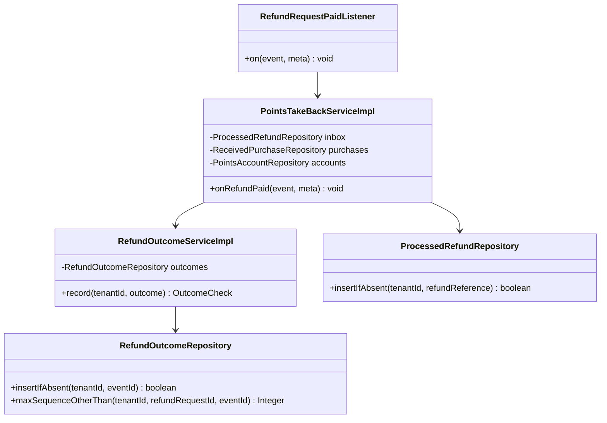
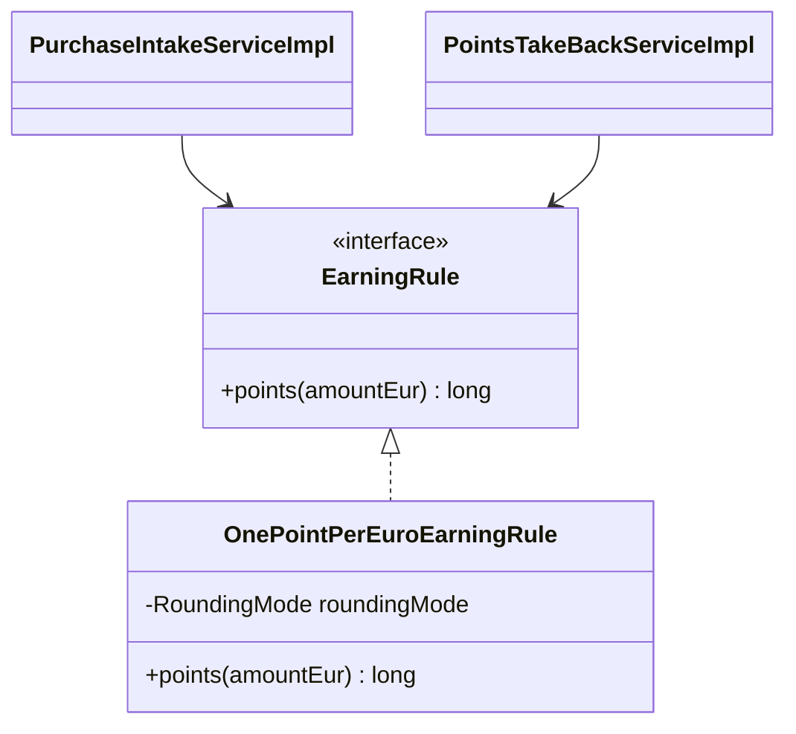
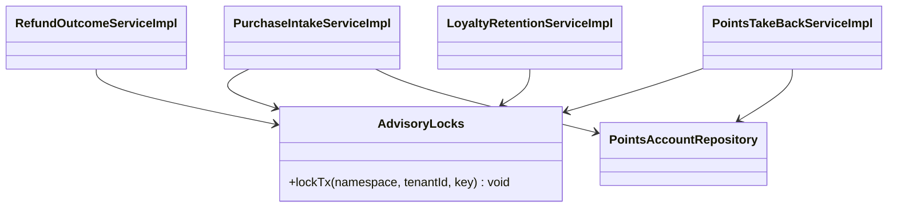
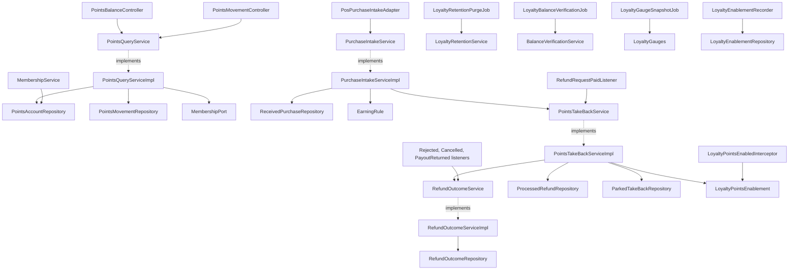
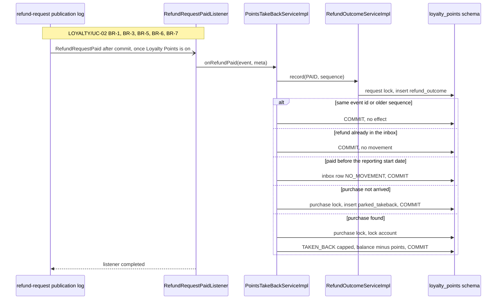
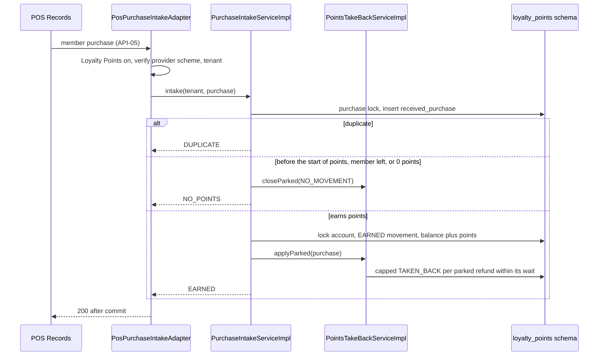

<!--
CHUNK: 04
TITLE: Per-Service Implementation - loyalty-points
PROJECT: Refunds Platform
VERSION: 1.2
DEPENDS_ON: 03, 09
PART OF: LLD - Refunds Platform
-->

# 7. Per-Service Implementation - loyalty-points

> **Bounded context:** SDD [§13 loyalty-points row](../../sdd-refunds-platform/09-services-summary.md#13-services-decomposition-summary) and [§17.4 Boundaries](../../sdd-refunds-platform/13d-service-loyalty-points.md#boundaries)
>
> **Type:** module (SDD §13 Type)
>
> **Source code:** `refunds-platform-app/src/main/java/refundsplatform/loyaltypoints/` (not written yet; from-sdd build target)
>
> **Owns use cases (SDD 09):** [LOYALTY/UC-01](../../brd-loyalty-points/06a-use-cases-member.md#uc-01-view-points-balance), [LOYALTY/UC-02](../../brd-loyalty-points/06a-use-cases-member.md#uc-02-view-points-history)
>
> **Participates in:** REFUNDS/UC-04 (owner: refund-request)

---

## 7.1 Responsibility

`loyalty-points` owns the points ledger of each member: the points account (one per member, holding the balance, the open or closed state, and the copy of the member's leave date), the append-only points movements (`EARNED`, `TAKEN_BACK`), the purchases received from POS Records with their details, the processed-refund inbox keyed by refund reference, the refund-outcome log keyed by event id, and the take-backs parked until their purchase arrives or the parking period of [LOYALTY/UC-02](../../brd-loyalty-points/06a-use-cases-member.md#uc-02-view-points-history) BR-5: refund paid before earning ends them. The balance always equals the sum of the movements ([LOYALTY/NFR-01](../../brd-loyalty-points/10-nfrs.md#non-functional-requirements)), kept by an account row lock and checked daily. It receives member purchases from POS Records (API-05, pushed or fetched: open), and listens to the four refund outcomes `refund-request` reports (SDD [§14.7](../../sdd-refunds-platform/10-events-hub.md#147-universal-subscribers--cross-service-doctrines)): `RefundRequestPaid` takes points back from the refund-reporting start date on, `RefundRequestRejected` and `RefundRequestCancelled` are recorded with no movement, and `RefundRequestPayoutReturned` is recorded with no movement while its effect on points is open; it applies the outcomes of one refund request in `sequence` order. It publishes no event and sends no message (BR-8: no message on take-back). It serves the member's balance, history, and movement detail, all switched on by `LOYALTY_POINTS_ENABLED`; while that setting is off the member endpoints and purchase intake answer 404 and the refund outcomes wait in `refund-request`'s publication log. It does not own refunds, payouts, member sign-in, or the membership record (platform IAM and the membership source of SDD §16.6).

---

## 7.2 Class & Interface Map

> **Package layout:** `refundsplatform.loyaltypoints.domain`, `.adapter.in` (controllers, the four outcome listeners, purchase intake, jobs, the enablement interceptor and recorder), `.adapter.out` (repositories, membership source); it imports `refundsplatform.refundrequest.api` (`RefundRequestPaidDto`, `RefundRequestRejectedDto`, `RefundRequestCancelledDto`, `RefundRequestPayoutReturnedDto`) only.

> Confirm: class names follow CLAUDE.md conventions; `PointsAccount` is the SDD [§17.4 Developer Notes](../../sdd-refunds-platform/13d-service-loyalty-points.md#developer-notes) aggregate name; verify the rest with the team.

### Controllers

| Class | Endpoints | Notes |
|-------|-----------|-------|
| `PointsBalanceController` | `GET /v1/members/me/points-balance` | `@UseCase("LOYALTY/UC-01")`; `loyalty.points.read-own` |
| `PointsMovementController` | `GET /v1/members/me/points-movements`, `GET /v1/members/me/points-movements/{movementId}` | `listMovements` and `getMovement`: `@UseCase("LOYALTY/UC-02")`; `loyalty.points.read-own` |
| `RefundRequestPaidListener` | `Event: RefundRequestPaid` | `@UseCase("LOYALTY/UC-02")`; listener id `loyalty-points.refund-request-paid` |
| `RefundRequestRejectedListener` | `Event: RefundRequestRejected` | `@UseCase("LOYALTY/UC-02")`; listener id `loyalty-points.refund-request-rejected` |
| `RefundRequestCancelledListener` | `Event: RefundRequestCancelled` | `@UseCase("LOYALTY/UC-02")`; listener id `loyalty-points.refund-request-cancelled` |
| `RefundRequestPayoutReturnedListener` | `Event: RefundRequestPayoutReturned` | Serves the payout-sent-back part of `### Participates in REFUNDS/UC-04`; no `@UseCase` (not a SDD §7.3 entry point); listener id `loyalty-points.refund-request-payout-returned` |
| `PosPurchaseIntakeAdapter` | API-05, method and path TBD (`TBD - external`), only if POS Records pushes | Serves `### Workflow: Purchase intake and earning`; no `@UseCase`; no §16 token |
| `LoyaltyBalanceVerificationJob` | `Schedule: loyalty-balance-verification` | Serves `### Workflow: Loyalty balance verification` |
| `LoyaltyRetentionPurgeJob` | `Schedule: loyalty-retention-purge` | Serves `### Workflow: Loyalty retention purge` |
| `LoyaltyGaugeSnapshotJob` | `Schedule: loyalty-gauge-snapshot` | Serves `### Workflow: Gauge snapshot (loyalty-points)`; no `@UseCase` |

The movement-detail endpoint is a LOYALTY/UC-02 entry point: SDD [§7.3](../../sdd-refunds-platform/03-users-and-use-cases.md#73-use-case-traceability-brd--sdd) lists `GET /v1/members/me/points-movements/{movementId}` with the history list and the three outcome events, so `getMovement` carries `@UseCase("LOYALTY/UC-02")` like `listMovements`.

> TODO: API-05 is `TBD - external` and whether POS Records pushes each purchase or `loyalty-points` fetches the day's purchases is the SDD [§17.4 Input](../../sdd-refunds-platform/13d-service-loyalty-points.md#input) [NEEDS CLARIFICATION] (Retail IT team). Best guess: POS Records pushes each purchase to `POST /v1/providers/pos-records/member-purchases`, served by `PosPurchaseIntakeAdapter`; a fetch would replace it with a `Schedule: loyalty-purchase-fetch` job (`LoyaltyPurchaseFetchJob`, LLD name) that runs per tenant (SDD §11.2), calls the same `PurchaseIntakeService.intake` per purchase, skips and counts an invalid purchase instead of answering 400 (SDD [§17.4 Error Handling](../../sdd-refunds-platform/13d-service-loyalty-points.md#error-handling)), and does nothing while `LOYALTY_POINTS_ENABLED` is off - verify once the POS Records feed description is supplied.

### Services (interfaces)

| Interface | Purpose | Implementations |
|-----------|---------|-----------------|
| `PointsQueryService` | Balance, history page, movement detail | `PointsQueryServiceImpl` |
| `PurchaseIntakeService` | Record a purchase once, earn, apply or end the take-backs parked for it | `PurchaseIntakeServiceImpl` |
| `PointsTakeBackService` | Paid outcome: order check, inbox, start-date cut-off, match, park or take back | `PointsTakeBackServiceImpl` |
| `RefundOutcomeService` | Refund-outcome log and `sequence` order for all four outcomes; the Rejected, Cancelled, and Payout-returned listeners | `RefundOutcomeServiceImpl` |
| `MembershipService` | Leave-date copy: store the leave date, close the account once the leave date has passed | `MembershipServiceImpl` |
| `LoyaltyRetentionService` | Close the accounts whose leave date has passed, end parked take-backs past the parking period, purge details, purge the history of members who left | `LoyaltyRetentionServiceImpl` |
| `BalanceVerificationService` | Daily balance check | `BalanceVerificationServiceImpl` |
| `MembershipPort` (outbound) | Member identifier from the caller | `IamClaimsMembershipAdapter` |
| `EarningRule` | Points for an amount in EUR, used for earning and for the take-back | `OnePointPerEuroEarningRule` |

### Service Implementations

| Class | Implements | Key methods |
|-------|------------|-------------|
| `PointsQueryServiceImpl` | `PointsQueryService` | `balance(CallerContext)`, `movements(CallerContext, PageCursor)`, `movement(CallerContext, UUID movementId)` |
| `PurchaseIntakeServiceImpl` | `PurchaseIntakeService` | `intake(UUID tenantId, MemberPurchase purchase)` |
| `PointsTakeBackServiceImpl` | `PointsTakeBackService` | `onRefundPaid(RefundRequestPaidDto, EventMetadata)`, `applyParked(UUID tenantId, ReceivedPurchase purchase)`, `closeParked(UUID tenantId, String purchaseReference, Outcome outcome)` |
| `RefundOutcomeServiceImpl` | `RefundOutcomeService` | `record(UUID tenantId, RefundOutcomeRecord outcome)`, `onRejected(RefundRequestRejectedDto, EventMetadata)`, `onCancelled(RefundRequestCancelledDto, EventMetadata)`, `onPayoutReturned(RefundRequestPayoutReturnedDto, EventMetadata)` |
| `MembershipServiceImpl` | `MembershipService` | `recordLeave(UUID tenantId, String memberId, LocalDate leaveDate)` |
| `LoyaltyRetentionServiceImpl` | `LoyaltyRetentionService` | `closeLeft(UUID tenantId)`, `endExpiredParked(UUID tenantId)`, `purgeDetails(UUID tenantId)`, `purgeLeftMembers(UUID tenantId)` |
| `BalanceVerificationServiceImpl` | `BalanceVerificationService` | `verifyTenant(UUID tenantId)` |
| `LoyaltyPointsEnablement` | (component) | `isEnabled()`, `firstEnabledAt(UUID tenantId)`: reads `LOYALTY_POINTS_ENABLED` and `loyalty_enablement` |
| `LoyaltyPointsEnabledInterceptor` | `HandlerInterceptor` | `preHandle`: on the member endpoints and API-05, throws `ProductNotEnabledException` while Loyalty Points is off |
| `LoyaltyEnablementRecorder` | (component, `ApplicationReadyEvent` listener) | `recordFirstSwitchOn()`: per configured tenant, records the first switch-on time |
| `LoyaltyGauges` | `MeterBinder` (Micrometer) | Holds the gauge value the snapshot job computes, per tenant; a scrape reads the cached value, never the database |

### Repositories

| Class | Entity | Notes |
|-------|--------|-------|
| `PointsAccountRepository` | `PointsAccount` | `findOrCreateForUpdate`, `findByMemberIdForUpdate`, `findByMemberId`, `findLeftBefore(tenantId, date, limit)`; tenant predicate |
| `PointsMovementRepository` | `PointsMovement` | Insert only, `findPage(accountId, cursor)` newest first, `findByIdAndAccount`, `sumByAccount`, `newestMovementDate` |
| `ReceivedPurchaseRepository` | `ReceivedPurchase` | `insertIfAbsent` on `(tenant_id, purchase_reference)`, `findForUpdate`, `findByMemberForUpdate` |
| `ProcessedRefundRepository` | `ProcessedRefund` | `insertIfAbsent` on `(tenant_id, refund_reference)` (the inbox), `setOutcome` |
| `RefundOutcomeRepository` | `RefundOutcome` | `insertIfAbsent` on `(tenant_id, event_id)`, `maxSequenceOtherThan(tenantId, refundRequestId, eventId)`, `markNoEffect` |
| `ParkedTakeBackRepository` | `ParkedTakeBack` | `findOpenByPurchase`, `findOpenPaidBefore(tenantId, date, limit)`, `oldestParkedAt(tenantId, purchaseReference)`, `markApplied` |
| `LoyaltyEnablementRepository` | `LoyaltyEnablement` | `insertIfAbsent(tenantId, now)`, `firstEnabledAt(tenantId)` |

### Domain Types (records)

| Type | Kind | Purpose |
|------|------|---------|
| `PointsAccount` | entity (aggregate root) | Balance, status `OPEN`/`CLOSED`, `leaveDate`; `earn(...)`, `takeBack(...)` append movements and update the balance; `recordLeave(leaveDate)` |
| `PointsMovement` | entity | `kind`, signed `points`, `movementDate`, purchase or refund reference, details purged flag |
| `MovementKind` | enum | `EARNED`, `TAKEN_BACK` (the only two, SDD §17.4 Developer Notes) |
| `ReceivedPurchase` | entity | Purchase reference, member id, purchase date, branch, amount, points earned, points taken back, received at |
| `ProcessedRefund` | entity | Inbox row: internal id, refund reference, purchase reference, refunded amount, paid date, outcome |
| `Outcome` | enum | `TAKEN_BACK`, `NO_MOVEMENT`, `PARKED` (the inbox outcome) |
| `ParkedTakeBack` | entity | Take-back waiting for its purchase: refund reference, purchase reference, refunded amount, paid date, event `occurredAt`, parked at, applied at |
| `RefundOutcome` | entity | Refund-outcome log row: event id, refund request id, kind, `sequence`, `rejectionKind`, `effective` |
| `RefundOutcomeKind` | enum | `PAID`, `REJECTED`, `CANCELLED`, `PAYOUT_RETURNED` |
| `RefundOutcomeRecord` | record | What a listener hands to `RefundOutcomeService.record`, built from the event DTO |
| `OutcomeCheck` | enum | `APPLY`, `STALE`, `DUPLICATE` |
| `LoyaltyEnablement` | entity | First switch-on time per tenant |
| `MemberPurchase` | record | API-05 purchase as our side reads it (fields of LOYALTY 08 Integrations) |
| `PointsBalance`, `PointsMovementPage`, `PointsMovementDetail` | record (Response) | Response records named in SDD §17.4 List of APIs |

### Method Signatures (key methods only)

```java
public interface PointsQueryService {
  PointsBalance balance(CallerContext caller);
  PointsMovementPage movements(CallerContext caller, PageCursor cursor);
  PointsMovementDetail movement(CallerContext caller, UUID movementId);
}

public interface PurchaseIntakeService {
  IntakeOutcome intake(UUID tenantId, MemberPurchase purchase);   // EARNED, NO_POINTS, DUPLICATE
}

public interface PointsTakeBackService {
  void onRefundPaid(RefundRequestPaidDto event, EventMetadata meta);
  void applyParked(UUID tenantId, ReceivedPurchase purchase);
  void closeParked(UUID tenantId, String purchaseReference, Outcome outcome);
}

public interface RefundOutcomeService {
  OutcomeCheck record(UUID tenantId, RefundOutcomeRecord outcome);
  void onRejected(RefundRequestRejectedDto event, EventMetadata meta);
  void onCancelled(RefundRequestCancelledDto event, EventMetadata meta);
  void onPayoutReturned(RefundRequestPayoutReturnedDto event, EventMetadata meta);
}

public interface MembershipService {
  void recordLeave(UUID tenantId, String memberId, LocalDate leaveDate);
}

public interface LoyaltyRetentionService {
  int closeLeft(UUID tenantId);
  int endExpiredParked(UUID tenantId);
  int purgeDetails(UUID tenantId);
  int purgeLeftMembers(UUID tenantId);
}

public interface EarningRule {
  long points(BigDecimal amountEur);
}
```

### Ports and Adapters (in-process contracts)

Not applicable - no in-process contracts (loyalty-points provides and calls no SDD §15 `Internal (in-process)` port).

### Authorization

| Entry point | Kind | Permission token (SDD §16, verbatim) | Enforcement point |
|-------------|------|--------------------------------------|-------------------|
| `GET /v1/members/me/points-balance` | REST | `loyalty.points.read-own` | `@PreAuthorize` on `PointsBalanceController.balance`; member gate (own account, account `OPEN`, leave date not passed) in `PointsQueryServiceImpl` |
| `GET /v1/members/me/points-movements` | REST | `loyalty.points.read-own` | `@PreAuthorize` on `listMovements`; member gate |
| `GET /v1/members/me/points-movements/{movementId}` | REST | `loyalty.points.read-own` | `@PreAuthorize` on `getMovement`; member gate (before the movement lookup); another member's movement -> 404 |
| API-05 (`PosPurchaseIntakeAdapter.receive`) | REST | None | Provider scheme verified against each tenant's secret; no match -> 401 `UNAUTHENTICATED` (SDD §11.2) |
| `RefundRequestPaidListener.on` | Listener | None - system consumer | Tenant from the event |
| `RefundRequestRejectedListener.on` | Listener | None - system consumer | Tenant from the event |
| `RefundRequestCancelledListener.on` | Listener | None - system consumer | Tenant from the event |
| `RefundRequestPayoutReturnedListener.on` | Listener | None - system consumer | Tenant from the event |
| `LoyaltyBalanceVerificationJob.run` | Job | None - system job | Per-tenant run |
| `LoyaltyRetentionPurgeJob.run` | Job | None - system job | Per-tenant run |
| `LoyaltyGaugeSnapshotJob.run` | Job | None - system job | Per-tenant run |
| `LoyaltyEnablementRecorder.recordFirstSwitchOn` | Job | None - system job | Per-tenant run at start-up |
| `MembershipService.recordLeave` | (trigger open, SDD §16.6) | None - system consumer | Tenant from the membership source's delivery |

Every member endpoint and API-05 first pass `LoyaltyPointsEnabledInterceptor`: while `LOYALTY_POINTS_ENABLED` is off they answer 404 `NOT_FOUND` before any token or provider check ([SDD §11.5](../../sdd-refunds-platform/07-cross-cutting-concerns.md#115-configuration-management-default)).

---

## 7.3 Method-Level Pseudocode (non-trivial logic only)

> BR, AC, A, and E positions below are [LOYALTY/UC-02](../../brd-loyalty-points/06a-use-cases-member.md#uc-02-view-points-history)'s unless the text names [LOYALTY/UC-01](../../brd-loyalty-points/06a-use-cases-member.md#uc-01-view-points-balance). Logs carry `movement_id`, `received_purchase_id`, `processed_refund_id`, and `event_id`, never a purchase reference or a refund reference, and no member data (SDD [§17.4 Logging](../../sdd-refunds-platform/13d-service-loyalty-points.md#logging)).

### `PointsQueryServiceImpl.balance`

```text
1. memberId = membershipPort.memberId(caller)        -> no member identifier: 403 FORBIDDEN
2. read-only TX: account = accountRepository.findByMemberId(tenant, memberId)
     absent -> PointsBalance(balance 0, lastMovementDate null, hasMovements false, timing note)   (LOYALTY/UC-01 A1)
     memberGate(account)                                                                         (LOYALTY/UC-01 AC-7: person who left sees no balance)
3. newest = movementRepository.newestMovementDate(account.id)  -- max(movement_date), LOYALTY/UC-01 BR-3: last movement date, AC-8
4. return PointsBalance(account.balance, newest, hasMovements = newest != null, timingNote)      (LOYALTY/UC-01 step 2, BR-1, BR-2)
   any DataAccessException -> 503 UNAVAILABLE, never 0                                           (LOYALTY/UC-01 E1)
   movements and movement: any DataAccessException -> PointsUnavailableException (503 UNAVAILABLE), never an empty page
memberGate(account): account CLOSED, or account.leave_date < today (UTC date) -> 403 MEMBERSHIP_ENDED (LOYALTY/UC-01 AC-7: person who left sees no balance, LOYALTY/UC-02 AC-13: person who left sees no history); balance step 2, movements, and movement read the caller's account (memberId as step 1) and call it before any movement read; an absent account: balance per A1, an empty first page, 404 for a movement
```

The "points cannot be used yet" line of [LOYALTY/UC-01](../../brd-loyalty-points/06a-use-cases-member.md#uc-01-view-points-balance) AC-9: points cannot be used yet line is fixed screen text in the web app, not a field of `PointsBalance` (SDD [§17.4 Balance](../../sdd-refunds-platform/13d-service-loyalty-points.md#business-logic)).

> TODO: the member identifier is read from a token claim (`member_id`) by `IamClaimsMembershipAdapter`; which system records membership, which member identifier links a POS Records purchase to the signed-in member, how Loyalty Points learns both, and how late the leave date can reach it are the SDD [§16.6](../../sdd-refunds-platform/12-centralized-user-roles.md#166-grant--invitation-authority-who-can-create-whom) [NEEDS CLARIFICATION] - verify once the LOYALTY BRD owner answers.

### `PurchaseIntakeServiceImpl.intake`

```text
0. PosPurchaseIntakeAdapter: Loyalty Points off -> 404 NOT_FOUND; provider scheme verified, tenant from the matching secret
1. validate purchase (reference, member id, date, branch, amount > 0, currency EUR)
     push -> 400 VALIDATION_FAILED; fetch -> skipped, loyalty_purchase_intake_total{outcome="invalid"} += 1
     logged with the failing field names only, never the purchase reference
2. BEGIN TX (loyaltyPointsTx)
3. advisoryLocks.lockTx("lp-purchase", tenant, purchase.reference)           (SDD §17.4 Concurrency)
4. inserted = receivedPurchaseRepository.insertIfAbsent(purchase, received_at = now)   -> duplicate: COMMIT, return DUPLICATE
5. oldest = parkedTakeBackRepository.oldestParkedAt(tenant, purchase.reference)   -- open or ended rows
   if oldest != null and received_at - oldest > LOYALTY_LATE_PURCHASE_ALERT_AFTER -> latePurchase = true   (SDD §11.4 alert)
6. account = accountRepository.findOrCreateForUpdate(tenant, memberId):
     INSERT INTO points_account (tenant_id, id, member_id, balance, status, created_at, updated_at, created_by, updated_by)
     VALUES (:t, :uuidv7, :memberId, 0, 'OPEN', now(), now(), 'system:loyalty-points', 'system:loyalty-points')
     ON CONFLICT (tenant_id, member_id) DO NOTHING,
     then SELECT ... FROM points_account WHERE tenant_id = :t AND member_id = :memberId FOR UPDATE
7. points = earningRule.points(purchase.amount)                              (1 point per 1 EUR, rounding open)
8. if purchase.date < START_OF_POINTS_DATE or (account.leave_date != null and the UTC date of received_at > account.leave_date)
   or points == 0 -> record the purchase with 0 points;
   pointsTakeBackService.closeParked(tenant, purchase.reference, NO_MOVEMENT); COMMIT, return NO_POINTS
   (leave date: the purchase arrived after the member left, LOYALTY 03 Member leaves; points == 0: BR-4: only purchases that earned points)
9. account.earn(points, movementDate = purchase.date, purchaseReference)  -> EARNED movement, balance += points
10. pointsTakeBackService.applyParked(tenant, purchase) in the same TX       (BR-5: refund paid before earning)
11. COMMIT, return EARNED; after commit: loyalty_purchase_intake_total{outcome}, loyalty_movements_total{kind="earned"},
    loyalty_late_purchase_for_parked_takeback_total += 1 if latePurchase; acknowledge to POS Records only after commit (SDD API-05)
```

> TODO: points = floor(amount in EUR) and `START_OF_POINTS_DATE` with no opening balance are best guesses; rounding, the start date, and any opening balance are the SDD [§17.4 Business Logic](../../sdd-refunds-platform/13d-service-loyalty-points.md#business-logic) [NEEDS CLARIFICATION] on LOYALTY 03 Earning points and Start of points, and the take-back rounds the same way (SDD §17.4 Take-back) - verify once the LOYALTY BRD owner answers.

> TODO: an account is created `OPEN` on the first purchase of a member identifier; how joining reaches Loyalty Points is the SDD §16.6 [NEEDS CLARIFICATION] (the membership source owns joining and leaving) - verify.

### `PointsTakeBackServiceImpl.onRefundPaid` (listener `loyalty-points.refund-request-paid`)

```text
1. BEGIN TX (loyaltyPointsTx)
2. check = refundOutcomeService.record(tenant, RefundOutcomeRecord(event, PAID))     (SDD §17.4 Other refund outcomes)
     DUPLICATE (same event id) -> COMMIT, return
     STALE (an outcome with a higher sequence is already recorded for the request) -> COMMIT, return
           (recorded with no effect, never enters the inbox)
3. inbox = processedRefundRepository.insertIfAbsent(tenant, event.referenceNumber)    -> conflict: COMMIT, return (BR-3: once per paid refund)
4. if event.paidDate < LOYALTY_REFUND_REPORTING_START_DATE (branch-local dates)
     -> inbox.outcome = NO_MOVEMENT; COMMIT                                             (BR-7: refund paid before reporting starts takes back nothing)
5. purchaseRef = matchPurchase(event)                                                     (SDD §5 marker)
6. advisoryLocks.lockTx("lp-purchase", tenant, purchaseRef)
7. purchase = receivedPurchaseRepository.findForUpdate(tenant, purchaseRef)
     absent -> parkedTakeBackRepository.insert(event, purchaseRef, event_occurred_at = event.occurredAt);
               inbox.outcome = PARKED; COMMIT                                             (BR-5: refund paid before earning)
8. outcome = applyTakeBack(purchase, event.referenceNumber, event.refundedAmount, event.paidDate); inbox.outcome = outcome
9. COMMIT; after commit, when outcome == TAKEN_BACK:
     loyalty_takeback_lag_seconds.record(now - max(event.occurredAt, enablement.firstEnabledAt(tenant)))
     loyalty_movements_total{kind="taken_back"} += 1

applyTakeBack(purchase, refundReference, refundedAmount, paidDate):        -- inside the caller's TX, purchase lock held
  a. if purchase.pointsEarned == 0 -> NO_MOVEMENT                                          (BR-4: only purchases that earned points)
  b. account = accountRepository.findByMemberIdForUpdate(tenant, purchase.memberId)
     if account.leaveDate != null and paidDate > account.leaveDate -> NO_MOVEMENT (the paid date decides whenever the outcome is processed: a refund paid on or before the leave date takes points back from an account closed since)
                                                                                            (LOYALTY 03 Member leaves: paid date)
  c. points = earningRule.points(refundedAmount.amount)                                   (BR-1: partial refund takes back 1 point per 1 EUR refunded)
     points = min(points, purchase.pointsEarned - purchase.pointsTakenBack)               (BR-6: take-back never exceeds earned)
     if points == 0 -> NO_MOVEMENT
  d. account.takeBack(points, movementDate = paidDate, refundReference, purchase.reference) -> TAKEN_BACK, balance -= points
     purchase.pointsTakenBack += points; return TAKEN_BACK
```

The points to take back are 1 per 1 EUR of the refunded amount, rounded as earning is rounded, within the cap of [LOYALTY/UC-02](../../brd-loyalty-points/06a-use-cases-member.md#uc-02-view-points-history) BR-6: take-back never exceeds earned, so a full refund takes back what the purchase earned (SDD [§17.4 Take-back](../../sdd-refunds-platform/13d-service-loyalty-points.md#business-logic)); `refundedAmount` is the approved amount paid back (SDD [§14.10](../../sdd-refunds-platform/10-events-hub.md#1410-in-process-domain-events-modular-monolith--hybrid-core) `RefundRequestPaidDto`).

> TODO: `matchPurchase` uses `event.receiptNumber` as the purchase reference; whether the LOYALTY purchase reference is the REFUNDS receipt number is the SDD [§5 Glossary](../../sdd-refunds-platform/01-executive-summary-scope-risks.md#5-glossary) [NEEDS CLARIFICATION] - verify once the REFUNDS and LOYALTY BRD owners and Retail IT answer.

### `RefundOutcomeServiceImpl.record` (first step of every outcome listener)

```text
-- MANDATORY: joins the listener's TX
1. advisoryLocks.lockTx("lp-request", tenant, outcome.refundRequestId)     -- outcomes of one request serialise
2. inserted = refundOutcomeRepository.insertIfAbsent(tenant, outcome.eventId, refundRequestId, kind,
                                                    sequence, rejectionKind, effective = true, recorded_at = now)
     conflict -> return DUPLICATE                                         (a redelivered event: same event id)
3. newest = refundOutcomeRepository.maxSequenceOtherThan(tenant, refundRequestId, outcome.eventId)
4. if newest != null and outcome.sequence < newest -> markNoEffect(eventId); return STALE
5. return APPLY
```

`sequence` is the number of the decision-record row the event reports (SDD [§14.10](../../sdd-refunds-platform/10-events-hub.md#1410-in-process-domain-events-modular-monolith--hybrid-core) Ordering), so a redelivered older outcome never undoes a newer one.

### `RefundOutcomeServiceImpl.onRejected`, `onCancelled`, `onPayoutReturned`

```text
1. BEGIN TX (loyaltyPointsTx)
2. check = record(tenant, RefundOutcomeRecord(event, REJECTED | CANCELLED | PAYOUT_RETURNED))
     Rejected: rejectionKind = event.rejectionKind (DECISION or DISPUTE_REFUNDED)
3. DUPLICATE, STALE, or APPLY: no movement, no inbox row                  (BR-1: rejected or cancelled takes back nothing)
4. COMMIT
```

> TODO: a request Rejected with `rejectionKind` `DISPUTE_REFUNDED` takes back no points here; whether it takes points back like a paid refund, and for which amount, is the SDD [§5 Glossary](../../sdd-refunds-platform/01-executive-summary-scope-risks.md#5-glossary) [NEEDS CLARIFICATION] (a yes adds the receipt number, amount, and date to `RefundRequestRejectedDto`, SDD §17.4 Other refund outcomes) - verify once the LOYALTY and REFUNDS BRD owners answer.

> TODO: `RefundRequestPayoutReturned` is recorded with no movement, and a later `RefundRequestPaid` of the same refund stops at the inbox (BR-3: once per paid refund), so the points taken back stay taken back once; whether the points come back when the payout is sent back, and are taken back again when the refund is paid again, is the SDD [§17.4 Other refund outcomes](../../sdd-refunds-platform/13d-service-loyalty-points.md#business-logic) [NEEDS CLARIFICATION]; a parked Paid take-back is still applied when its purchase arrives after a payout sent back - verify once the LOYALTY BRD owner answers.

### `PointsTakeBackServiceImpl.applyParked` (inside intake, step 10)

```text
for parked in parkedTakeBackRepository.findOpenByPurchase(tenant, purchase.reference) ordered by parked_at:
  if today > parked.paid_date + LOYALTY_TAKEBACK_PARKING_PERIOD
     -> no movement, as closeParked does                                (BR-5: the wait passed, the purchase keeps its points)
  else outcome = applyTakeBack(purchase, parked.refund_reference, parked.refunded_amount, parked.paid_date)
  parked.applied_at = now; set the processed_refund row of its refund reference to the outcome reached (TAKEN_BACK or NO_MOVEMENT)
  after commit, when TAKEN_BACK: loyalty_takeback_lag_seconds.record(now - max(parked.event_occurred_at,
     enablement.firstEnabledAt(tenant), commit of this TX))   -- the earned movement commits in the same TX
closeParked(tenant, purchaseReference, NO_MOVEMENT): the same for every open parked row of the purchase, with outcome
  NO_MOVEMENT and no movement written
  (the movement keeps the date the refund was paid, step 2 of LOYALTY/UC-02; LOYALTY/NFR-02 counts from the earning)
```

> Confirm: date comparisons are an LLD choice: `paid_date` is branch-local (SDD §14.10) and is compared with `LOYALTY_REFUND_REPORTING_START_DATE` and the leave date as dates; "today" for the parking period, and the arrival day of a purchase against the leave date, are UTC dates, which can differ from the branch-local day around midnight.

### `MembershipServiceImpl.recordLeave`

```text
1. BEGIN TX; account = accountRepository.findOrCreateForUpdate(tenant, memberId)
2. account.recordLeave(leaveDate): leave_date = leaveDate (an earlier date already stored wins); if leaveDate < today
   (UTC date): status = CLOSED, closed_at = now
3. COMMIT                                                (SDD §17.4 Membership: 403 MEMBERSHIP_ENDED once the account is CLOSED or its leave date has passed)
```

### `LoyaltyRetentionServiceImpl` (job `loyalty-retention-purge`)

```text
closeLeft(tenant):                                                      -- runs every day, first
  batches of 200, one REQUIRES_NEW TransactionTemplate per batch: UPDATE points_account SET status = 'CLOSED',
  closed_at = now() WHERE tenant_id = :t AND status = 'OPEN' AND leave_date < (now() AT TIME ZONE 'UTC')::date
endExpiredParked(tenant):                                               -- runs every day, the period is known
  batches of 200 from findOpenPaidBefore(tenant, today - LOYALTY_TAKEBACK_PARKING_PERIOD), one REQUIRES_NEW
  TransactionTemplate per row: lock lp-purchase (tenant, parked.purchase_reference); re-read the row FOR UPDATE
  WHERE applied_at IS NULL (applied meanwhile: skip); applied_at = now; processed_refund outcome NO_MOVEMENT;
  no movement and no lag observation                                   (BR-5, AC-17: refund with no take-back after the wait)
purgeDetails(tenant):                                                   -- only while LOYALTY_DETAILS_RETENTION_PERIOD is set
  batches of 200, one REQUIRES_NEW TransactionTemplate per batch: clear the detail columns of received_purchase and
  processed_refund older than the period (details_purged_at = now); movements keep date, reference, and points (A2);
  delete refund_outcome and ended parked_takeback rows older than the period
purgeLeftMembers(tenant):                                               -- only while LOYALTY_LEFT_MEMBER_RETENTION_PERIOD is set
  per account from findLeftBefore(tenant, today - period, 200), one REQUIRES_NEW TransactionTemplate per member:
  received_purchase rows of the member FOR UPDATE, then the account FOR UPDATE (the take-back lock order);
  delete parked_takeback and processed_refund of those purchases, received_purchase, points_movement, points_account
a period that is unset: that step is skipped with a DEBUG log
```

### `BalanceVerificationServiceImpl.verifyTenant`

```text
per account (pages of 500, one read-only REPEATABLE_READ TransactionTemplate per page): diff = account.balance - sum(movements.points)
diff != 0 -> alert LoyaltyBalanceMismatch (account id only, no member data), loyalty_balance_mismatch_total += 1
```

---

## 7.4 Design Patterns Applied

### Pattern: Idempotency (inbox, refund-outcome log, and purchase intake)

> **Applied:** Idempotency (CLAUDE.md: "Idempotency on every consumer and every write endpoint. Assume at-least-once delivery everywhere.")
>
> **Rationale (this service):** The four refund outcomes are redelivered until each listener completes, in any order, and POS Records may deliver a purchase twice; a second take-back, a stale outcome applied over a newer one, or a second earned movement would break LOYALTY/NFR-01. The SDD sets the keys: the refund-outcome log on the event id with the `sequence` order, the processed-refund inbox on the refund reference for paid refunds, and the purchase reference for intake (SDD [§17.4 Business Logic](../../sdd-refunds-platform/13d-service-loyalty-points.md#business-logic) and [Error Handling](../../sdd-refunds-platform/13d-service-loyalty-points.md#error-handling)).

**Roles:**

| Role | Class / Component | Notes |
|------|-------------------|-------|
| Idempotency record table | `loyalty_points.refund_outcome`, `loyalty_points.processed_refund` (inbox), `loyalty_points.received_purchase` | Unique `(tenant_id, event_id)`, `(tenant_id, refund_reference)`, and `(tenant_id, purchase_reference)` |
| Idempotency check | `RefundOutcomeRepository.insertIfAbsent` (with the `sequence` check), `ProcessedRefundRepository.insertIfAbsent`, `ReceivedPurchaseRepository.insertIfAbsent` | First writes in each transaction; a stale Paid outcome never reaches the inbox |
| Cached-response storage | Not applicable: a duplicate purchase is acknowledged 200 with no change | |

**Class diagram:**



**Summary:** Every outcome is first written to the refund-outcome log, which stops a redelivered event and marks an older outcome as having no effect; only a current Paid outcome reaches the inbox, which stops a second report of the same paid refund.

**Pseudocode skeleton:**

```text
check = outcomes.record(tenant, outcome);              // DUPLICATE or STALE: return
if (check != APPLY) return;
if (!inbox.insertIfAbsent(tenant, refundReference)) return;   // BR-3: once per paid refund
```

### Pattern: Strategy (earning rule)

> **Applied:** Strategy pattern (CLAUDE.md: "Strategy for runtime variants")
>
> **Rationale (this service):** The earning rounding is an open business rule (SDD §17.4 marker) with three plausible variants (round down, up, or nearest), and the take-back rounds the same way (SDD [§17.4 Take-back](../../sdd-refunds-platform/13d-service-loyalty-points.md#business-logic)). One `EarningRule` used by both intake and take-back keeps the two roundings equal by construction and makes the answer one configuration value, without touching the ledger code.

> Confirm: CLAUDE.md guideline applied; the variants are an open answer, not runtime variants chosen per tenant today. The partial take-back rule is fixed by the SDD (1 point per 1 EUR refunded, within the cap), so the take-back has no strategy of its own and uses `EarningRule`; once the rounding is answered, collapse `EarningRule` to one class.

**Roles:**

| Role | Class / Component |
|------|-------------------|
| Strategy interface | `EarningRule` |
| Concrete strategy | `OnePointPerEuroEarningRule` (rounding mode from `LOYALTY_EARNING_ROUNDING`) |
| Context | `PurchaseIntakeServiceImpl` (earning), `PointsTakeBackServiceImpl` (take-back, before the LOYALTY/UC-02 BR-6 cap: take-back never exceeds earned) |

**Class diagram:**



**Summary:** Both writers delegate the euro-to-points arithmetic to one injected rule, so earning and take-back always round alike.

**Pseudocode skeleton:**

```text
OnePointPerEuroEarningRule.points(amount) = amount.setScale(0, roundingMode).longValueExact()
take-back points = min(earningRule.points(refundedAmount), purchase.pointsEarned - purchase.pointsTakenBack)
```

### Pattern: Pessimistic ledger lock (concurrency)

> **Applied:** account row lock and advisory locks per purchase and per refund request (SDD §17.4 Concurrency). This is not a CLAUDE.md pattern slot; it is recorded here because every movement depends on it: `SELECT ... FOR UPDATE` on `points_account` before any movement; `pg_advisory_xact_lock` on `(tenant_id, purchase_reference)` in intake, take-back, and the parked-take-back ending, so a refund paid while its purchase arrives is never stranded as parked; and `pg_advisory_xact_lock` on `(tenant_id, refund_request_id)` in every outcome listener, so two outcomes of one request are ordered by `sequence` one at a time.

**Roles:**

| Role | Class / Component |
|------|-------------------|
| Request lock | `AdvisoryLocks.lockTx("lp-request", tenantId, refundRequestId)` in `RefundOutcomeServiceImpl.record` |
| Purchase lock | `AdvisoryLocks.lockTx("lp-purchase", tenantId, purchaseReference)` |
| Account lock | `PointsAccountRepository.findByMemberIdForUpdate`, `findOrCreateForUpdate` |

**Class diagram:**



**Summary:** Every writer takes the locks in one order, request, then purchase, then account, so they serialise without deadlock; intake never takes the request lock.

**Pseudocode skeleton:**

```text
lock order in every loyalty-points write transaction:
  request advisory lock -> refund_outcome insert -> inbox insert -> purchase advisory lock -> purchase row -> account row
(account creation: findOrCreateForUpdate inserts with ON CONFLICT DO NOTHING, then locks the row;
 leaver purge: the member's purchase rows, then the account row)
```

### Pattern: RFC 9457 error model

> **Applied:** Problem Details (CLAUDE.md: "Global @RestControllerAdvice, Problem Details (RFC 9457)."). Member endpoints and API-05 return the SDD §15.1 error model through `GlobalProblemHandler`; roles, diagram, and skeleton as in [refund-request § 7.4](./refund-request.md#pattern-rfc-9457-error-model).

---

## 7.5 Dependency Injection Graph



**Summary:** Reads go through `PointsQueryServiceImpl`; the writers (intake, the four outcome listeners, the retention job, and the leave-date recording) share the repositories, the advisory locks, and the refund-outcome log, and intake calls the take-back service to apply or end parked take-backs in its own transaction.

---

## 7.6 Transaction Boundaries

| Method | Propagation | Isolation | Rollback rules |
|--------|-------------|-----------|----------------|
| `PointsQueryServiceImpl.*` | `REQUIRED`, read-only | `READ_COMMITTED` (`REPEATABLE_READ` for `balance` so balance and newest date come from one snapshot) | rollback on any exception; data errors -> 503 |
| `PurchaseIntakeServiceImpl.intake` | `REQUIRED` | `READ_COMMITTED` + advisory lock + account `FOR UPDATE` | rollback on any exception; POS Records gets no acknowledgement |
| `PointsTakeBackServiceImpl.onRefundPaid` | `REQUIRES_NEW` (dispatcher) | `READ_COMMITTED` + request and purchase advisory locks + account `FOR UPDATE` | rollback on any exception; listener row stays incomplete |
| `RefundOutcomeServiceImpl.onRejected`, `onCancelled`, `onPayoutReturned` | `REQUIRES_NEW` (dispatcher) | `READ_COMMITTED` + request advisory lock | rollback on any exception; listener row stays incomplete |
| `RefundOutcomeServiceImpl.record` | `MANDATORY` (joins the listener's transaction) | as the listener | rollback with the listener |
| `PointsTakeBackServiceImpl.applyParked`, `closeParked` | `MANDATORY` (joins intake's transaction) | as intake | rollback with intake |
| `MembershipServiceImpl.recordLeave` | `REQUIRED` | `READ_COMMITTED` + account `FOR UPDATE` | rollback on any exception |
| `LoyaltyRetentionServiceImpl.closeLeft` | `REQUIRES_NEW` per batch | `READ_COMMITTED` | the failed batch rolls back; the next run retries it |
| `LoyaltyRetentionServiceImpl.endExpiredParked` | `REQUIRES_NEW` per row | `READ_COMMITTED` + purchase advisory lock | the failed row rolls back; the next run retries it |
| `LoyaltyRetentionServiceImpl.purgeDetails`, `purgeLeftMembers` | `REQUIRES_NEW` per batch or per member | `READ_COMMITTED` | the failed batch or member rolls back; the next run retries it |
| `BalanceVerificationServiceImpl.verifyTenant` | `REQUIRES_NEW`, read-only per page | `REPEATABLE_READ` | none (read) |
| `LoyaltyEnablementRecorder.recordFirstSwitchOn` | `REQUIRED` per tenant | `READ_COMMITTED` (`INSERT ... ON CONFLICT DO NOTHING`) | rollback on any exception; the next start retries it |
| `LoyaltyGaugeSnapshotJob.run` | one read-only `REQUIRES_NEW` `TransactionTemplate` per tenant | `READ_COMMITTED` | rollback of that tenant's snapshot only; previous values kept |

> **Convention:** `REQUIRES_NEW` per row, per batch, or per page means a `TransactionTemplate` (propagation `REQUIRES_NEW`, the isolation of the method's row, built on the module's transaction manager) called inside the loop, never an annotation on a method of the same class; `@Transactional` is used only on public methods called from another bean.

> Confirm: transaction propagation default applied; verify per method.

---

## 7.7 Error Handling

| Exception | RFC 9457 type | `errorCode` (SDD §15.1) | HTTP Status | When thrown | Caller action |
|-----------|---------------|-------------------------|-------------|-------------|---------------|
| `PointsUnavailableException` | `{problemBase}/unavailable` | `UNAVAILABLE` | 503 | Store cannot be read (LOYALTY/UC-01 E1, LOYALTY/UC-02 E1); never a 0 balance or an empty list | Try again later |
| `MembershipEndedException` | `{problemBase}/membership-ended` | `MEMBERSHIP_ENDED` | 403 | Account `CLOSED`, or its leave date has passed (LOYALTY/UC-01 AC-7: person who left sees no balance, LOYALTY/UC-02 AC-13: person who left sees no history) | None |
| `MovementNotFoundException` | `{problemBase}/not-found` | `NOT_FOUND` | 404 | Unknown movement or another member's movement | None |
| `ProductNotEnabledException` | `{problemBase}/not-found` | `NOT_FOUND` | 404 | `LOYALTY_POINTS_ENABLED` off: member endpoints and API-05 (SDD §11.5) | None |
| `AccessDeniedException` | `{problemBase}/forbidden` | `FORBIDDEN` | 403 | Missing permission token or no member identifier | Do not retry |
| `PurchaseValidationException` | `{problemBase}/validation-failed` | `VALIDATION_FAILED` | 400 | API-05 delivery fails validation (push); logged with the failing field names for the POS Records owner, never the purchase reference | POS Records corrects it |
| `InvalidProviderSignatureException` | `{problemBase}/unauthenticated` | `UNAUTHENTICATED` | 401 | API-05 call matches no tenant's secret | None |
| (any other) | `{problemBase}/internal-error` | `INTERNAL_ERROR` | 500 | Unexpected failure | Retry later |

> **Convention:** all exceptions extend `ServiceException`; `GlobalProblemHandler` renders them (`09-cross-cutting.md` § 12.6). A listener exception is not an HTTP error: the transaction rolls back and the listener row stays incomplete for redelivery.

---

## 7.8 Use-Case Workflows

### LOYALTY/UC-01: View Points Balance

> **Traceability:** BRD [LOYALTY/UC-01](../../brd-loyalty-points/06a-use-cases-member.md#uc-01-view-points-balance) · SDD [§7.3](../../sdd-refunds-platform/03-users-and-use-cases.md#73-use-case-traceability-brd--sdd) · Owner: loyalty-points · Entry points: `GET /v1/members/me/points-balance` · UAT/BAT: Pending (BRD 16 not written) · Screens: [LOYALTY/MK-01](../../brd-loyalty-points/14-todo.md#mockup-coverage) via `/points`

**Trigger:** `PointsBalanceController.balance` with `@UseCase("LOYALTY/UC-01")`.

**Pre-conditions:** Loyalty Points switched on (`LOYALTY_POINTS_ENABLED`, otherwise 404); token with `loyalty.points.read-own` (role `MEMBER`) carrying the member identifier; the member has not left the program.

**Post-conditions:** none (read only).

**Control flow:**

```text
1. member gate: member identifier from the token; CLOSED account, or a leave date before today (UTC) -> 403 MEMBERSHIP_ENDED (LOYALTY/UC-01 step 1, AC-7)
2. balance from the account row, newest movement date from points_movement                         (step 2, BR-3, AC-8)
3. hasMovements = false -> the screen shows 0 and how points are earned                             (A1)
   hasMovements = true and balance 0 -> 0 with the last movement date and no explanation            (AC-6)
4. timing note: purchases by LOYALTY/NFR-03, take-backs within LOYALTY/NFR-02 (configured text keys) (BR-2)
5. the screen adds the fixed "points cannot be used yet" line                                       (step 2, AC-9)
6. read failure -> 503 UNAVAILABLE                                                                  (E1)
```

Positions in this block are [LOYALTY/UC-01](../../brd-loyalty-points/06a-use-cases-member.md#uc-01-view-points-balance)'s: AC-6: zero sum shows 0 and the last date, AC-7: person who left sees no balance, AC-8: last movement date is the newest, AC-9: points cannot be used yet line.

**Sequence diagram:** none: a single read (`mermaid-diagrams.md` § When NOT to draw a diagram); the system sequence is SDD [§8.5.4](../../sdd-refunds-platform/05-workflows-and-sequences.md#854-sequence-view-own-refund-requests-and-points).

**Idempotency points:** not applicable (read).

**Outbox emission points:** none.

**Retry / timeout policy:** none server-side; the client offers "try again".

**Error handling:** E1 -> 503 `UNAVAILABLE`; left the program -> 403 `MEMBERSHIP_ENDED`; Loyalty Points off -> 404 `NOT_FOUND`.

> TODO: the timing note's LOYALTY/NFR-03 time is the SDD [§18.5](../../sdd-refunds-platform/14-performance-and-capacity.md#185-nfr-targets) [NEEDS CLARIFICATION]; best guess "by the end of the day of the purchase" (LOYALTY 10 proposal) - verify once the LOYALTY BRD owner confirms.

### LOYALTY/UC-02: View Points History

> **Traceability:** BRD [LOYALTY/UC-02](../../brd-loyalty-points/06a-use-cases-member.md#uc-02-view-points-history) · SDD [§7.3](../../sdd-refunds-platform/03-users-and-use-cases.md#73-use-case-traceability-brd--sdd) · Owner: loyalty-points · Entry points: `GET /v1/members/me/points-movements`, `GET /v1/members/me/points-movements/{movementId}`, `Event: RefundRequestPaid`, `Event: RefundRequestRejected`, `Event: RefundRequestCancelled` · UAT/BAT: Pending (BRD 16 not written) · Screens: [LOYALTY/MK-02](../../brd-loyalty-points/14-todo.md#mockup-coverage) via `/points/history`, `/points/history/:movementId`

**Trigger:** `PointsMovementController.listMovements`, `PointsMovementController.getMovement`, `RefundRequestPaidListener.on`, `RefundRequestRejectedListener.on`, and `RefundRequestCancelledListener.on`, all `@UseCase("LOYALTY/UC-02")`.

**Pre-conditions:** read: as LOYALTY/UC-01. Outcomes: the event committed by `refund-request` and Loyalty Points switched on (while it is off, the listener rows wait in `refund-request`'s publication log and are dispatched at switch-on, SDD [§11.1](../../sdd-refunds-platform/07-cross-cutting-concerns.md#111-db-modeling-default) and [§11.3](../../sdd-refunds-platform/07-cross-cutting-concerns.md#113-deployment-default)).

**Post-conditions:** read: none. Paid: one `TAKEN_BACK` movement per paid refund of a purchase that earned points, capped, or a parked take-back, or no movement; balance updated in the same transaction. Rejected and Cancelled: one refund-outcome log row, no movement.

**Control flow (history):**

```text
1. member gate as LOYALTY/UC-01                                                          (step 1, AC-13)
2. movements newest first by (movement_date DESC, created_at DESC, id DESC), cursor page,
   each with date, purchase or refund reference, points, plus the timing note            (step 2, AC-14, AC-15)
3. detail: purchase details (date, branch, reference, amount EUR, points) or refund details
   (paid date, refund reference, purchase reference, refunded amount EUR, points taken back) (steps 3-4)
4. details purged -> detailsAvailable = false with date, reference, points                (A2)
5. read failure -> 503 UNAVAILABLE, never an empty list or detail                         (E1, AC-6, AC-8)
```

**Control flow (refund outcomes):**

```text
1. every outcome: refund-outcome log on the event id, then the sequence order;
   an older outcome than one recorded for the request has no effect                     (SDD §17.4 Other refund outcomes)
2. RefundRequestPaid: PointsTakeBackServiceImpl.onRefundPaid (§ 7.3): inbox (BR-3, AC-5), refund-reporting
   start date (BR-7, AC-18, AC-19), match, park (BR-5, AC-11), no movement (BR-4, AC-10, member left),
   capped TAKEN_BACK of 1 point per 1 EUR refunded dated with the paid date (BR-1, BR-6, A1, AC-1, AC-12, AC-16)
3. RefundRequestRejected, RefundRequestCancelled: recorded, no movement                   (BR-1, AC-4, AC-9)
4. a parked take-back whose purchase has not earned points within 30 days of the paid date ends
   with no movement (Workflow: Loyalty retention purge, intake applyParked)               (BR-5, AC-17)
5. no message to the member                                                               (BR-8)
```

Positions in this block are [LOYALTY/UC-02](../../brd-loyalty-points/06a-use-cases-member.md#uc-02-view-points-history)'s: BR-1: paid refund takes points back, partial by 1 point per 1 EUR, rejected or cancelled takes back nothing; BR-3: once per paid refund; BR-4: only purchases that earned points; BR-5: refund paid before earning waits up to 30 days; BR-6: take-back never exceeds earned; BR-7: only refunds the Refunds Portal reports, from its reporting start date; BR-8: no message on take-back.

**Sequence diagram (take-back):**



**Summary:** Each Paid outcome is first checked against the outcomes already recorded for its request, then handled once per refund reference; it takes nothing back when paid before the reporting start date, waits for a purchase that has not arrived, or writes one capped taken-back movement together with the balance change.

**Idempotency points:** refund-outcome log `(tenant_id, event_id)` with the `sequence` check; inbox `(tenant_id, refund_reference)`; purchase `(tenant_id, purchase_reference)`.

**Outbox emission points:** none (the module publishes no event).

**Retry / timeout policy:** each listener is redelivered with backoff by `refund-request`'s publication log; `loyalty_takeback_lag_seconds` (from the latest of the event's `occurredAt`, the first switch-on, and for a parked take-back the earned movement's commit) and the 30-minute listener alert, counted from the later of the event's publication and the switch-on (SDD [§11.4](../../sdd-refunds-platform/07-cross-cutting-concerns.md#114-observability-default)), watch LOYALTY/NFR-02 (1 hour, SDD [§18.5](../../sdd-refunds-platform/14-performance-and-capacity.md#185-nfr-targets)).

**Error handling:** read E1 -> 503 `UNAVAILABLE`; another member's movement -> 404 `NOT_FOUND`; left the program -> 403 `MEMBERSHIP_ENDED`; Loyalty Points off -> 404 `NOT_FOUND`; a listener failure keeps the listener row incomplete (never dropped).

### Participates in REFUNDS/UC-04: Approve / Reject Refund

> **Owner's block:** [refund-request § REFUNDS/UC-04](./refund-request.md#refundsuc-04-approve--reject-refund) · Part realised here: [REFUNDS/UC-04](../../brd-refunds-portal/06b-use-cases-branch-manager.md#uc-04-approve--reject-refund) BR-9: Loyalty Points told the outcome, AC-14: Loyalty Points told, AC-17: outcome kept before Loyalty Points starts (the Paid and Rejected outcomes are recorded by the [LOYALTY/UC-02](#loyaltyuc-02-view-points-history) listeners, whose entry points they are; the payout-sent-back outcome is recorded below) · Entry points here: None

**Payout sent back outcome** (SDD [§17.4 Input](../../sdd-refunds-platform/13d-service-loyalty-points.md#input) `RefundRequestPayoutReturned` row, [§17.4 Business Logic](../../sdd-refunds-platform/13d-service-loyalty-points.md#business-logic) Other refund outcomes, [§14.7](../../sdd-refunds-platform/10-events-hub.md#147-universal-subscribers--cross-service-doctrines)).

**Trigger:** `RefundRequestPayoutReturnedListener.on` (listener `loyalty-points.refund-request-payout-returned`) for `Event: RefundRequestPayoutReturned`; no `@UseCase`, as SDD §7.3 lists this event as an entry point of no use case.

**Control flow:** `RefundOutcomeServiceImpl.onPayoutReturned` (§ 7.3): refund-outcome log on the event id with the `sequence` check; no movement, no inbox change. Its later effect on points is the § 7.3 TODO.

**Idempotency points:** refund-outcome log `(tenant_id, event_id)`.

**Error handling:** a failure keeps the listener row incomplete for redelivery.

### Workflow: Purchase intake and earning

> **Traceability:** No BRD use case - realises [SDD §8.4.4](../../sdd-refunds-platform/05-workflows-and-sequences.md#844-workflow-earning-points-from-pos-purchases) and [LOYALTY 03 § Earning points](../../brd-loyalty-points/03-definitions-and-domain-concepts.md#earning-points) · Entry points: API-05 (method and path `TBD - external`; a `Schedule` fetch job instead if `loyalty-points` fetches, SDD §17.4 Input)

**Control flow:** `PurchaseIntakeServiceImpl.intake` (§ 7.3): 404 while Loyalty Points is off; record once; earn per the earning rule, dated with the purchase date, when the purchase date is on or after the start of points and the member had not left when the purchase arrived; apply the take-backs parked for it within their 30-day wait, or end them with no movement; count a purchase that arrives more than `LOYALTY_LATE_PURCHASE_ALERT_AFTER` after a take-back for it was parked; acknowledge after commit.

**Sequence diagram:**



**Summary:** A purchase is recorded once, earns its points with the purchase date, and releases or ends any take-back that was waiting for it, all before POS Records gets its acknowledgement.

**Idempotency points:** purchase `(tenant_id, purchase_reference)`; a duplicate is acknowledged 200 with no change.

**Error handling:** validation -> 400 `VALIDATION_FAILED` (push) or skipped and counted (fetch); no matching secret -> 401 `UNAUTHENTICATED`; Loyalty Points off -> 404 `NOT_FOUND`; any other failure rolls back and POS Records gets no acknowledgement.

### Workflow: Member leaves the loyalty program

> **Traceability:** No BRD use case - realises [SDD §17.4 Business Logic](../../sdd-refunds-platform/13d-service-loyalty-points.md#business-logic) (Membership) and [LOYALTY 03 § Member leaves the loyalty program](../../brd-loyalty-points/03-definitions-and-domain-concepts.md#member-leaves-the-loyalty-program) · Entry points: `MembershipService.recordLeave` (LLD name; the SDD names no trigger)

**Control flow:** `MembershipServiceImpl.recordLeave` (§ 7.3) stores the leave date and closes the account once the leave date has passed (at once for a leave date before today, otherwise by `closeLeft`, the first step of the daily retention job); from the day after the leave date every loyalty endpoint answers 403 `MEMBERSHIP_ENDED`, a purchase that arrives after the leave date earns no points, and a refund paid after the leave date takes back none, while a refund paid on or before it takes points back even when its outcome is processed after the account closed; the history is deleted by `purgeLeftMembers` once `LOYALTY_LEFT_MEMBER_RETENTION_PERIOD` has passed.

> TODO: how the leave date reaches `loyalty-points` (a membership-source feed, an event, or an IAM attribute) and how late it can arrive is the SDD [§16.6](../../sdd-refunds-platform/12-centralized-user-roles.md#166-grant--invitation-authority-who-can-create-whom) [NEEDS CLARIFICATION]; best guess: an inbound adapter for the membership source calls `MembershipService.recordLeave` per member, idempotent on `(tenant_id, member_id)` - verify once the LOYALTY BRD owner names the membership source.

### Workflow: Loyalty Points switch-on

> **Traceability:** No BRD use case - realises [SDD §11.5](../../sdd-refunds-platform/07-cross-cutting-concerns.md#115-configuration-management-default) and [SDD §17.4 Business Logic](../../sdd-refunds-platform/13d-service-loyalty-points.md#business-logic) (Other refund outcomes: the first switch-on time) · Entry points: `Startup: loyalty-enablement-recorder` (LLD name)

**Control flow:** at application start, when `LOYALTY_POINTS_ENABLED` is on, `LoyaltyEnablementRecorder` inserts `loyalty_enablement (tenant_id, first_enabled_at = now)` per configured tenant with `ON CONFLICT DO NOTHING`, so the first switch-on time is kept for the LOYALTY/NFR-02 measure; the start fails when Loyalty Points and the Refunds Portal are both on and `LOYALTY_REFUND_REPORTING_START_DATE` is not set (SDD §11.5 sets it in the same configuration change). The switch-on itself follows SDD [§20.1.8](../../sdd-refunds-platform/16-operations-runbook.md#2018-switch-on-a-product-or-start-more-branches).

> Confirm: the `loyalty_enablement` table, the start-up recorder and its entry point name, and the start-up check of `LOYALTY_REFUND_REPORTING_START_DATE` are this LLD's design for "records the time it is first switched on" (SDD §17.4) and the setting of SDD §11.5; verify with the team.

### Workflow: Loyalty balance verification

> **Traceability:** No BRD use case - realises [LOYALTY/NFR-01](../../brd-loyalty-points/10-nfrs.md#non-functional-requirements) and [SDD §17.4 Concurrency](../../sdd-refunds-platform/13d-service-loyalty-points.md#business-logic) · Entry points: `Schedule: loyalty-balance-verification`

> Confirm: the schedule (daily at 01:00 UTC) is this LLD's choice; the SDD says "daily".

**Control flow:** per tenant, a first short transaction takes `pg_try_advisory_xact_lock(hashtextextended('lp-verify:' || tenant_id || ':' || current_date, 0))` and inserts `balance_verification_run(tenant_id, run_day)` with `ON CONFLICT DO NOTHING`; the tenant is skipped when no row was inserted (another replica runs it today). Then `BalanceVerificationServiceImpl.verifyTenant` (§ 7.3); a difference raises `LoyaltyBalanceMismatch`.

### Workflow: Loyalty retention purge

> **Traceability:** No BRD use case - realises [SDD §17.4 Retention Policy](../../sdd-refunds-platform/13d-service-loyalty-points.md#retention-policy) and [SDD §17.4 Take-back](../../sdd-refunds-platform/13d-service-loyalty-points.md#business-logic) (parked take-backs end after the parking period) · Entry points: `Schedule: loyalty-retention-purge`

**Control flow:** per tenant, daily (03:45 UTC, LLD choice), `LoyaltyRetentionServiceImpl` (§ 7.3): first `closeLeft`, which closes every open account whose leave date has passed (it always runs); then `endExpiredParked`, which ends every open parked take-back whose refund was paid more than `LOYALTY_TAKEBACK_PARKING_PERIOD` ago with no movement (it always runs: the period is the 30 days of [LOYALTY/UC-02](../../brd-loyalty-points/06a-use-cases-member.md#uc-02-view-points-history) BR-5: refund paid before earning); then `purgeDetails` while `LOYALTY_DETAILS_RETENTION_PERIOD` is set (movements keep date, reference, and points, LOYALTY/UC-02 A2); then `purgeLeftMembers` while `LOYALTY_LEFT_MEMBER_RETENTION_PERIOD` is set, which deletes the history of members who left once the period has passed (SDD [§17.4 Constraints](../../sdd-refunds-platform/13d-service-loyalty-points.md#constraints)). Batches of 200, one transaction per row, batch, or member.

> TODO: the details period and the left-member period are the SDD [§17.4 Retention Policy](../../sdd-refunds-platform/13d-service-loyalty-points.md#retention-policy) [NEEDS CLARIFICATION] (LOYALTY 03 Keeping points history and Member leaves); until they are set, only the accounts whose leave date has passed are closed and the parked take-backs are ended - verify once the LOYALTY BRD owner answers.

### Workflow: Gauge snapshot (loyalty-points)

> **Traceability:** No BRD use case - realises [SDD §17.4 Metrics](../../sdd-refunds-platform/13d-service-loyalty-points.md#metrics) (`loyalty_parked_takebacks`) · Entry points: `Schedule: loyalty-gauge-snapshot`

> Confirm: the job name `loyalty-gauge-snapshot` and its 60-second cadence are LLD choices (the cadence follows the 60-second snapshot rule of `10-operations.md` § 13.3); the SDD names no job for the gauges.

**Control flow:** per tenant, every 60 s, on any replica, `LoyaltyGaugeSnapshotJob.run` in one read-only transaction per tenant (§ 7.6) replaces the cached value in `LoyaltyGauges`: `loyalty_parked_takebacks` = count of `parked_takeback` rows with `applied_at` NULL. A failed snapshot keeps the previous value and logs WARN; a scrape never queries the database.

<!-- MASTER: refunds-platform-lld-master.md | PREV: 04-implementation/customer-notification.md | NEXT: 04-implementation/payout.md -->
