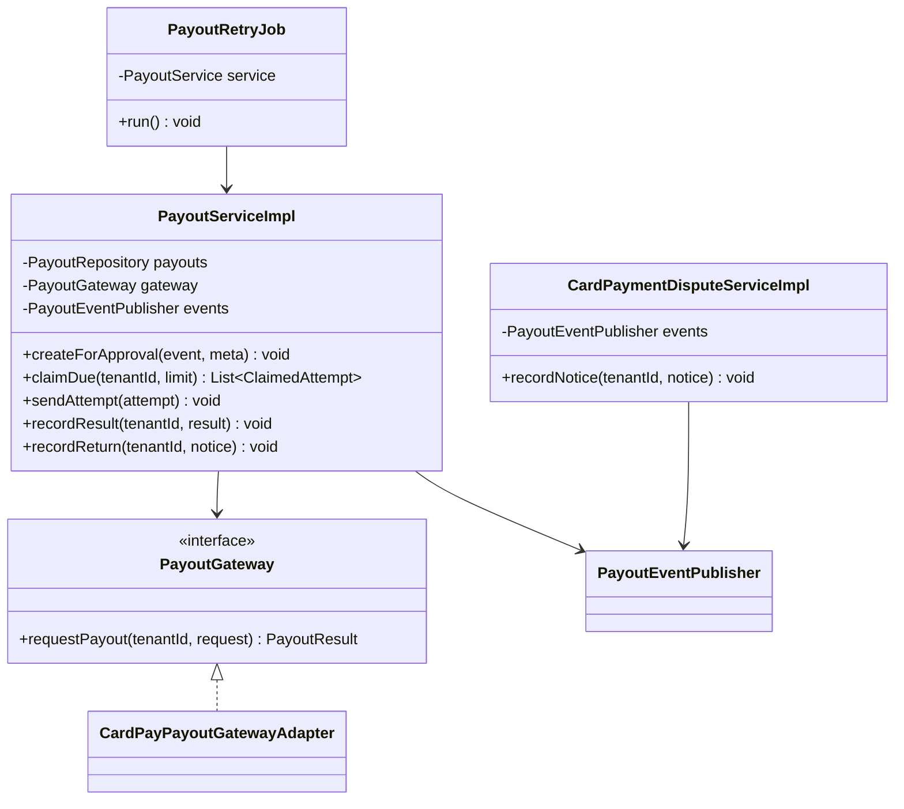
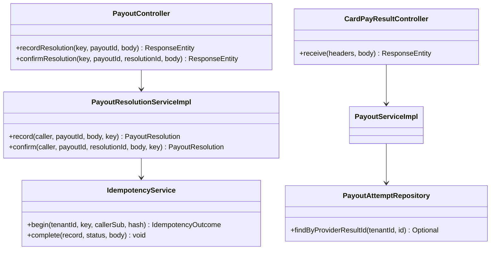
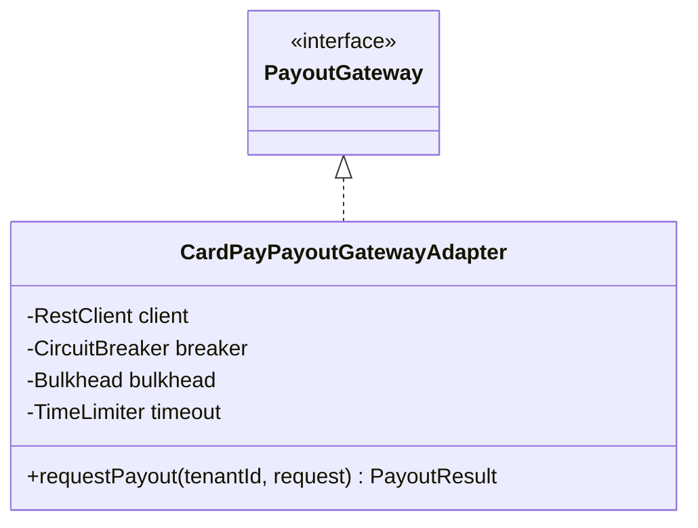
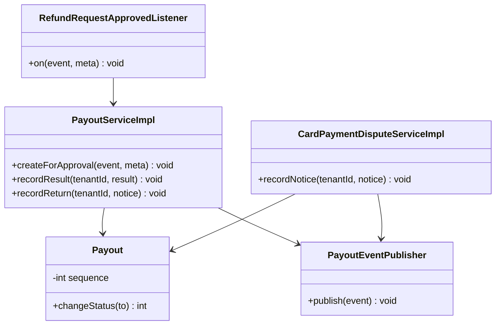
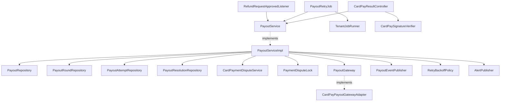
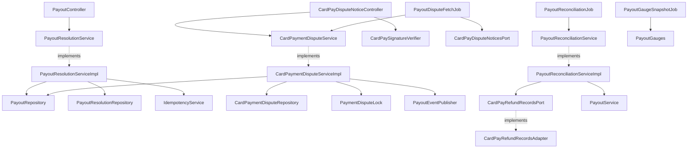
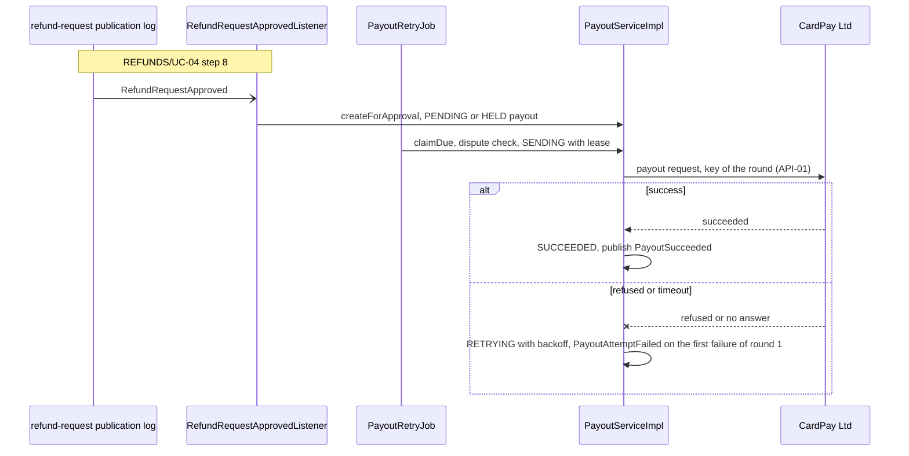
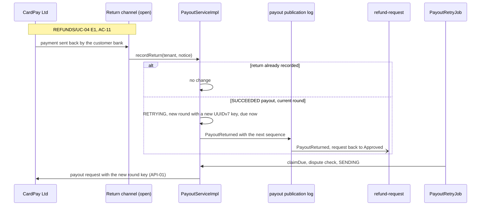
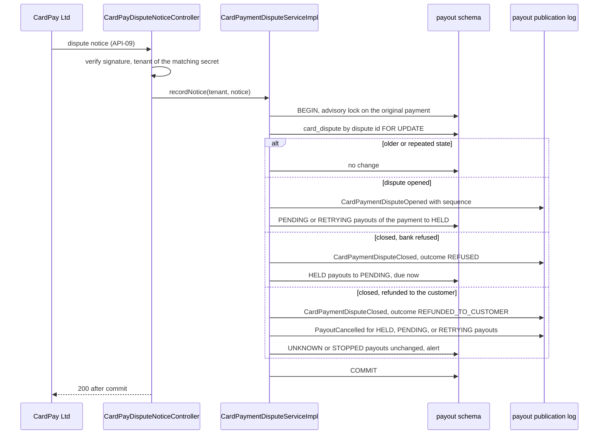
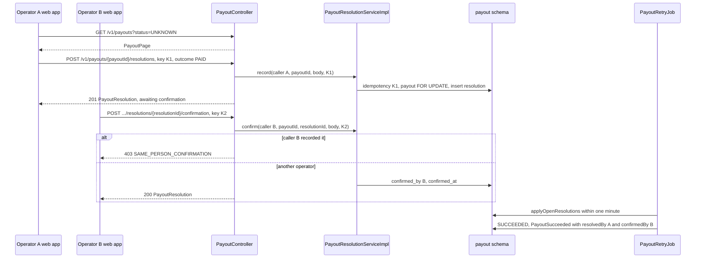

<!--
CHUNK: 04
TITLE: Per-Service Implementation - payout
PROJECT: Refunds Platform
VERSION: 1.2
DEPENDS_ON: 03, 09
PART OF: LLD - Refunds Platform
-->

# 7. Per-Service Implementation - payout

> **Bounded context:** SDD [§13 payout row](../../sdd-refunds-platform/09-services-summary.md#13-services-decomposition-summary) and [§17.2 Boundaries](../../sdd-refunds-platform/13b-service-payout.md#boundaries)
>
> **Type:** module (SDD §13 Type)
>
> **Source code:** `refunds-platform-app/src/main/java/refundsplatform/payout/` (not written yet; from-sdd build target)
>
> **Owns use cases (SDD 09):** None - realises the payout steps of [REFUNDS/UC-04](../../brd-refunds-portal/06b-use-cases-branch-manager.md#uc-04-approve--reject-refund) owned by refund-request
>
> **Participates in:** REFUNDS/UC-04 (owner: refund-request)

---

## 7.1 Responsibility

`payout` owns the payout bounded context (SDD [§17.2 What](../../sdd-refunds-platform/13b-service-payout.md#what)): one payout per approved refund request, its rounds and their attempts with CardPay Ltd, the payout resolutions that payout operators record and confirm for an `Unknown` or `Stopped` payout, the card disputes CardPay reports for an original card payment, and the daily reconciliation against CardPay's refund records. It is the only module that talks to CardPay Ltd: API-01 payout request, API-02 payout result callback (only if CardPay calls back), API-07 refund records, API-09 card dispute notices (pushed or fetched, open). It listens to one event (`RefundRequestApproved`, whose `branchId` it keeps with the payout) and publishes seven into its own publication log: `PayoutSucceeded`, `PayoutReturned`, `PayoutCancelled`, `CardPaymentDisputeOpened`, and `CardPaymentDisputeClosed` (to `refund-request`, which turns them into Paid, back to Approved, Rejected, and its dispute copy), and `PayoutAttemptFailed` and `PayoutStillFailing` (to `customer-notification`). Its only user-facing API is the three `PAYOUT_OPERATOR` endpoints of the operator screens. It never changes a refund request's status and never changes the approved amount.

---

## 7.2 Class & Interface Map

> **Package layout:** `refundsplatform.payout.api` (the seven event DTO records), `.domain`, `.adapter.in` (listener, jobs, `PayoutController`, CardPay callback and dispute-notice controllers), `.adapter.out` (repositories, CardPay clients).

> Confirm: class names follow CLAUDE.md conventions inside the SDD's hexagonal packages; `PayoutGateway` is the SDD [§17.2 Developer Notes](../../sdd-refunds-platform/13b-service-payout.md#developer-notes) name, and `PayoutPage`, `RecordPayoutResolution`, `ConfirmPayoutResolution`, and `PayoutResolution` are the SDD [§17.2 List of APIs](../../sdd-refunds-platform/13b-service-payout.md#list-of-apis-swagger-friendly) body names, used verbatim as records, so the resolution entity is `PayoutResolutionEntity`; verify the rest with the team.

### Controllers

| Class | Endpoints | Notes |
|-------|-----------|-------|
| `PayoutController` | `GET /v1/payouts`, `POST /v1/payouts/{payoutId}/resolutions`, `POST /v1/payouts/{payoutId}/resolutions/{resolutionId}/confirmation` | Serves `### Workflow: Payout resolution`; no `@UseCase` (SDD §7.3 lists none for these endpoints); `Idempotency-Key` required on both POSTs, cursor pagination on the list (SDD [§17.2 API Standards](../../sdd-refunds-platform/13b-service-payout.md#api-standards)) |
| `RefundRequestApprovedListener` | `Event: RefundRequestApproved` | Listener id `payout.refund-request-approved`; creates the payout; no `@UseCase` (SDD §7.3 lists no `Event:` trigger for it) |
| `PayoutRetryJob` | `Schedule: payout-retry` | `@UseCase("REFUNDS/UC-04")` (an SDD §7.3 entry point of REFUNDS/UC-04); every minute; applies resolutions, handles expired leases, checks disputes and claims due payouts, sends attempts, raises still-failing and stop |
| `CardPayResultController` | API-02, method and path TBD (`TBD - external`) | Only if CardPay calls back; verifies the provider signature; no `@UseCase` (§7.3 lists none for API-02); no §16 token (SDD §15.1 External inbound) |
| `CardPayDisputeNoticeController` | API-09, method and path TBD (`TBD - external`) | Only if CardPay pushes dispute notices; serves the card dispute intake part of `### Participates in REFUNDS/UC-04`; signature verified; no `@UseCase` (§7.3 lists none for API-09); no §16 token |
| `PayoutDisputeFetchJob` | `Schedule: payout-dispute-fetch` | Only if `payout` fetches dispute notices (it then replaces the controller row, SDD [§17.2 Input](../../sdd-refunds-platform/13b-service-payout.md#input)); serves the card dispute intake part of `### Participates in REFUNDS/UC-04`; no `@UseCase` (not an SDD §7.3 entry point) |
| `PayoutReconciliationJob` | `Schedule: payout-reconciliation`, `Schedule: payout-month-end-count` | Serves `### Workflow: Payout reconciliation`; no `@UseCase` |
| `PayoutRetentionPurgeJob` | `Schedule: payout-retention-purge` | Serves `### Workflow: Payout retention purge`; no `@UseCase` |
| `PayoutPublicationRedeliveryJob` | `Schedule: payout-publication-redelivery` | Serves `### Workflow: Publication-log redelivery (payout)`; no `@UseCase` |
| `PayoutHousekeepingJob` | `Schedule: payout-housekeeping` | Serves `### Workflow: Housekeeping (payout)`; no `@UseCase` |
| `PayoutGaugeSnapshotJob` | `Schedule: payout-gauge-snapshot` | Serves `### Workflow: Gauge snapshot (payout)`; no `@UseCase` |

> **Convention:** while `REFUNDS_PORTAL_ENABLED` is off, the three `PayoutController` endpoints answer 404 `NOT_FOUND` through the product-enablement guard; `CardPayResultController`, `CardPayDisputeNoticeController`, and `PayoutDisputeFetchJob` run regardless.

> TODO: the API-02 callback path is `TBD - external` (SDD [API-02](../../sdd-refunds-platform/11-api-contracts.md#api-02-receive-a-payout-result-cardpay-ltd---payout)); best guess `POST /v1/providers/cardpay/payout-results`, set once CardPay's callback documentation is supplied, and only if CardPay calls back at all (SDD §17.2 Integrations [NEEDS CLARIFICATION]).

> TODO: API-09 is `TBD - external` (SDD [API-09](../../sdd-refunds-platform/11-api-contracts.md#api-09-receive-card-dispute-notices-cardpay-ltd---payout)), and whether CardPay reports disputes at all, and pushes them or lets `payout` fetch them, is the SDD [§17.2 Disputes](../../sdd-refunds-platform/13b-service-payout.md#business-logic) [NEEDS CLARIFICATION]; best guess for a push `POST /v1/providers/cardpay/dispute-notices`, for a fetch `PayoutDisputeFetchJob` asking every 5 minutes for the disputes changed since its last successful fetch. Until answered, neither entry point is enabled and no payout is held (SDD API-09 Fallback: a payout is not held for a dispute the platform has not received) - verify once CardPay documents dispute reporting.

### Services (interfaces)

| Interface | Purpose | Implementations |
|-----------|---------|-----------------|
| `PayoutService` | Create from an approval, claim and send due attempts, record results and payments sent back, apply resolutions | `PayoutServiceImpl` |
| `PayoutResolutionService` | List payouts for resolution, record and confirm resolutions (operator endpoints) | `PayoutResolutionServiceImpl` |
| `CardPaymentDisputeService` | Record card dispute notices and apply them to the payouts of the payment | `CardPaymentDisputeServiceImpl` |
| `PayoutReconciliationService` | Daily comparison with CardPay's refund records, month-end count | `PayoutReconciliationServiceImpl` |
| `PayoutRetentionService` | Retention purge once the period is set | `PayoutRetentionServiceImpl` |
| `PayoutGateway` (outbound) | API-01 payout request | `CardPayPayoutGatewayAdapter` |
| `CardPayRefundRecordsPort` (outbound) | API-07 refund records | `CardPayRefundRecordsAdapter` |
| `CardPayDisputeNoticesPort` (outbound, fetch only) | API-09 dispute notices, if `payout` fetches them | `CardPayDisputeNoticesAdapter` |
| `CardPaySignatureVerifier` | API-02 and API-09 signature check per tenant secret | `CardPaySignatureVerifierImpl` |

### Service Implementations

| Class | Implements | Key methods |
|-------|------------|-------------|
| `PayoutServiceImpl` | `PayoutService` | `createForApproval(RefundRequestApprovedDto, EventMetadata)`, `claimDue(UUID tenantId, int limit)`, `sendAttempt(ClaimedAttempt)`, `recordResult(UUID tenantId, PayoutResult)`, `recordReturn(UUID tenantId, PayoutReturnNotice)`, `applyOpenResolutions(UUID tenantId)`, `expireLeases(UUID tenantId)`, `raiseStillFailing(UUID tenantId)`, `stopExpired(UUID tenantId)` |
| `PayoutResolutionServiceImpl` | `PayoutResolutionService` | `listForResolution(CallerContext, PayoutListQuery)`, `record(CallerContext, UUID payoutId, RecordPayoutResolution, IdempotencyKey)`, `confirm(CallerContext, UUID payoutId, UUID resolutionId, ConfirmPayoutResolution, IdempotencyKey)` |
| `CardPaymentDisputeServiceImpl` | `CardPaymentDisputeService` | `recordNotice(UUID tenantId, DisputeNotice)`, `disputesOf(UUID tenantId, String originalPaymentReference)` |
| `PayoutReconciliationServiceImpl` | `PayoutReconciliationService` | `reconcile(UUID tenantId, LocalDate day)`, `countMonthEnd(UUID tenantId, YearMonth month)` |
| `PayoutEventPublisher` | `DomainEventPublisher` (platform) | `publish(PayoutDomainEvent)` |
| `PaymentDisputeLock` | - | `lock(UUID tenantId, String originalPaymentReference)`, `tryLock(UUID tenantId, String originalPaymentReference)`: transaction-scoped advisory lock (`pg_advisory_xact_lock`, or `pg_try_advisory_xact_lock` for `tryLock`) on `hashtextextended` of the text `payout-dispute:<tenant_id>:<original_payment_reference>` |
| `RetryBackoffPolicy` | - | `nextAttemptAt(int attemptNo, Instant now)`: exponential with full jitter within the INT-01 bounds |
| `IdempotencyService` (platform, bound to this module's DataSource) | - | `begin(tenantId, key, callerSub, requestHash)`, `complete(record, status, body)`, as in [refund-request § 7.4 Idempotency](./refund-request.md#pattern-idempotency-write-endpoints) |
| `PayoutGauges` | `MeterBinder` (Micrometer) | Holds the gauge values the snapshot job computes, per tenant; a scrape reads the cached values, never the database |

### Repositories

| Class | Entity | Notes |
|-------|--------|-------|
| `PayoutRepository` | `Payout` | `insertIfAbsent` on `(tenant_id, refund_request_id)`; `claimDue` (`FOR UPDATE SKIP LOCKED`); `findExpiredLeases`; `findByIdForUpdate`; `findByPaymentForUpdate(tenantId, originalPaymentReference, statuses)`; `findPageForResolution(tenantId, statuses, cursor, limit)` |
| `PayoutRoundRepository` | `PayoutRound` | Insert; `findCurrent(tenantId, payoutId)`; `findByReturnedReference(tenantId, reference)` |
| `PayoutAttemptRepository` | `PayoutAttempt` | Insert; `findByProviderResultId`; `findByProviderReference`; `findLatest(tenantId, payoutId)` |
| `PayoutResolutionRepository` | `PayoutResolutionEntity` | `findApplicable` (ids of rows with `applied_at IS NULL`, no lock); `findOpenForUpdate(tenantId, payoutId)`; `findByIdForUpdate`; `findAppliedPaidByReference(tenantId, cardPayReference)`; inserted only by `PayoutResolutionServiceImpl.record` (never by a database role, SDD [§16.4.3](../../sdd-refunds-platform/12-centralized-user-roles.md#1643-platform-plane-operator---outside-tenant-tenancy)) |
| `CardPaymentDisputeRepository` | `CardPaymentDispute` | `findByDisputeIdForUpdate`; insert; `findByPayment(tenantId, originalPaymentReference)` |
| `ReconciliationRepository` | `ReconciliationRun`, `ReconciliationMismatch`, `ReconciliationMonthEnd` | Insert-only results |
| `ProcessedEventRepository` | `ProcessedEvent` | Listener dedup |
| `IdempotencyRecordRepository` | `IdempotencyRecord` | `payout.idempotency_record`, as in `refund-request` |

### Domain Types (records)

| Type | Kind | Purpose |
|------|------|---------|
| `Payout` | entity (aggregate root) | State machine of `08-state-and-rules.md` § 11.1 (SDD [Figure 17](../../sdd-refunds-platform/13b-service-payout.md#business-logic)); holds `branchId`, `currentRoundNo`, `sequence`, `heldSince` |
| `PayoutRound` | entity | One round: round number, its idempotency key (round 1: the payout id; later rounds: a new UUIDv7), its first attempt, the time it was held after that, its still-failing flag, and CardPay's reference of its payment sent back |
| `PayoutAttempt` | entity | One CardPay call: attempt number (per payout, across rounds), round number, outcome, provider references |
| `PayoutResolutionEntity` | entity | A payout operator's recorded check: outcome `PAID` / `NOT_PAID`, CardPay reference checked, recorded by and at, confirmed by and at, applied at and result |
| `CardPaymentDispute` | entity | One CardPay dispute of an original card payment: dispute id, original-payment reference, state, outcome, `sequence` |
| `PayoutStatus` | enum | `PENDING`, `HELD`, `SENDING`, `RETRYING`, `UNKNOWN`, `SUCCEEDED`, `STOPPED`, `CANCELLED` |
| `AttemptOutcome` | enum | `SUCCEEDED`, `REFUSED`, `UNKNOWN`, `NOT_SENT` (no call made: breaker open or bulkhead full) |
| `DisputeState`, `DisputeOutcome` | enum | `OPEN`, `CLOSED`; `REFUNDED_TO_CUSTOMER`, `REFUSED` (SDD [§14.10](../../sdd-refunds-platform/10-events-hub.md#1410-in-process-domain-events-modular-monolith--hybrid-core) `outcome` values) |
| `ClaimedAttempt` | record | `payoutId`, `attemptNo`, `roundNo`, `roundKey`, `amount` (`Money`), `originalPaymentReference`, `branchId` |
| `PayoutRequest` | record | API-01 request built by our side: amount, currency, original-payment reference, payout id, the round's idempotency key, branch id |
| `PayoutResult` | record | Normalised result from the API-01 response or the API-02 callback: `payoutId`, `providerResultId`, `outcome`, `providerReference` |
| `PayoutReturnNotice` | record | A payment the customer's bank sent back: `returnedProviderReference` (CardPay's reference of that payment), `returnedAt` |
| `DisputeNotice` | record | API-09 notice: `disputeId`, `originalPaymentReference`, `state`, `outcome` (provider fields `TBD - external`) |
| `CardPayRefundRecord` | record | API-07 record: provider id, our payout id or round key, amount, result, sent back or not |
| `PayoutListQuery` | record | `statuses` (default `STOPPED`, `UNKNOWN`), `cursor` (`PageCursor`), `limit` |
| `PayoutPage`, `RecordPayoutResolution`, `ConfirmPayoutResolution`, `PayoutResolution` | record (`adapter.in`) | Operator endpoint bodies named in SDD §17.2 List of APIs (method signatures below) |
| `PayoutSucceededDto`, `PayoutReturnedDto`, `PayoutCancelledDto`, `CardPaymentDisputeOpenedDto`, `CardPaymentDisputeClosedDto`, `PayoutAttemptFailedDto`, `PayoutStillFailingDto` | record (`api`) | Event DTOs, fields per SDD §14.10 (`07-event-contracts.md` § 10.6) |

### Method Signatures (key methods only)

```java
public interface PayoutService {
  void createForApproval(RefundRequestApprovedDto event, EventMetadata meta);
  List<ClaimedAttempt> claimDue(UUID tenantId, int limit);
  void sendAttempt(ClaimedAttempt attempt);
  void recordResult(UUID tenantId, PayoutResult result);
  void recordReturn(UUID tenantId, PayoutReturnNotice notice);
  void applyOpenResolutions(UUID tenantId);
  void expireLeases(UUID tenantId);
  void raiseStillFailing(UUID tenantId);
  void stopExpired(UUID tenantId);
}

public interface PayoutResolutionService {
  PayoutPage listForResolution(CallerContext caller, PayoutListQuery query);
  PayoutResolution record(CallerContext caller, UUID payoutId, RecordPayoutResolution body, IdempotencyKey key);
  PayoutResolution confirm(CallerContext caller, UUID payoutId, UUID resolutionId,
                           ConfirmPayoutResolution body, IdempotencyKey key);
}

public interface CardPaymentDisputeService {
  void recordNotice(UUID tenantId, DisputeNotice notice);
  List<CardPaymentDispute> disputesOf(UUID tenantId, String originalPaymentReference);
}

public interface PayoutGateway {                  // API-01, provider contract TBD - external
  PayoutResult requestPayout(UUID tenantId, PayoutRequest request); // throws PayoutGatewayTimeoutException
}

public record RecordPayoutResolution(ResolutionOutcome outcome, String cardPayReferenceChecked) {}
public record ConfirmPayoutResolution(String cardPayReferenceChecked) {}
public record PayoutResolution(UUID resolutionId, UUID payoutId, ResolutionOutcome outcome, String cardPayReferenceChecked,
                               String recordedBy, Instant recordedAt, String confirmedBy, Instant confirmedAt,
                               ResolutionStatus status) {}        // AWAITING_CONFIRMATION, AWAITING_APPLICATION, APPLIED, NOT_APPLIED, SUPERSEDED
public record PayoutPage(List<PayoutForResolution> items, String nextCursor) {}
public record PayoutForResolution(UUID payoutId, UUID refundRequestId, String branchId, PayoutStatus status, Money amount,
                                  int roundNo, UUID roundKey, int attemptCount, Instant firstAttemptAt,
                                  Instant lastAttemptAt, PayoutResolution openResolution) {}
```

> TODO: the request and response fields of the three operator endpoints are the SDD [§17.2 List of APIs](../../sdd-refunds-platform/13b-service-payout.md#list-of-apis-swagger-friendly) [NEEDS CLARIFICATION] (solution architect); the records above are a best guess built from what an operator needs to check CardPay (the round keys and the attempts) and what SDD §17.2 Send records (outcome, CardPay reference checked, who, when, who confirmed), with no customer personal data - verify and record the fields in SDD §17.2.

> **Convention:** records for every DTO (CLAUDE.md). Constructor injection only; no `@Autowired` on fields.

### Ports and Adapters (in-process contracts)

Not applicable - no in-process contracts (payout provides and calls no SDD §15 `Internal (in-process)` port).

### Authorization

| Entry point | Kind | Permission token (SDD §16, verbatim) | Enforcement point |
|-------------|------|--------------------------------------|-------------------|
| `GET /v1/payouts` | REST | `payout.read` | `@PreAuthorize("hasAuthority('payout.read')")` on `PayoutController.list`; tenant from the token claim, all branches of the tenant (SDD [§16.4.2](../../sdd-refunds-platform/12-centralized-user-roles.md#1642-staff-roles)) |
| `POST /v1/payouts/{payoutId}/resolutions` | REST | `payout.resolution.record` | `@PreAuthorize` on `PayoutController.recordResolution` |
| `POST /v1/payouts/{payoutId}/resolutions/{resolutionId}/confirmation` | REST | `payout.resolution.confirm` | `@PreAuthorize` on `PayoutController.confirmResolution`; the own-resolution gate (caller `sub` equals `recorded_by` -> 403 `SAME_PERSON_CONFIRMATION`) in `PayoutResolutionServiceImpl.confirm` (SDD [§16.5](../../sdd-refunds-platform/12-centralized-user-roles.md#165-capability-matrix-canonical) footnote 5, ADR-08) |
| `RefundRequestApprovedListener.on` | Listener | None - system consumer | Tenant from the event |
| `PayoutRetryJob.run` | Job | None - system job | Per-tenant run |
| API-02 callback (`CardPayResultController.receive`) | REST | None | Provider signature verified by `CardPaySignatureVerifier` against each tenant's secret; no match -> 401 `UNAUTHENTICATED` (SDD [§11.2](../../sdd-refunds-platform/07-cross-cutting-concerns.md#112-multi-tenancy-default)); permitted in the security filter chain without a bearer token |
| API-09 notice (`CardPayDisputeNoticeController.receive`) | REST | None | As the API-02 row, against each tenant's dispute-notice secret |
| `PayoutDisputeFetchJob.run` | Job | None - system job | Per-tenant run |
| `PayoutReconciliationJob.run`, `PayoutReconciliationJob.countMonthEnd` | Job | None - system job | Per-tenant run |
| `PayoutRetentionPurgeJob.run` | Job | None - system job | Per-tenant run |
| `PayoutPublicationRedeliveryJob.run` | Job | None - system job | Per-tenant run |
| `PayoutHousekeepingJob.run` | Job | None - system job | Per-tenant run |
| `PayoutGaugeSnapshotJob.run` | Job | None - system job | Per-tenant run |

---

## 7.3 Method-Level Pseudocode (non-trivial logic only)

> **Lock order:** every path that changes payouts for a card dispute takes the `PaymentDisputeLock` of the original payment before any payout row lock; the claim, which already holds payout rows, only tries it and skips the row when it is taken. No path waits for the advisory lock while holding a payout row lock. A payout row is always locked before any of its `payout_resolution` rows.

### `PayoutServiceImpl.createForApproval` (listener `payout.refund-request-approved`)

```text
1. BEGIN TX (payoutTx)
2. processedEvent.insertIfAbsent(tenant, meta.eventId, "payout.refund-request-approved"); conflict -> COMMIT, return
3. ref = event.originalPaymentReference; if ref != null: disputeLock.lock(tenant, ref); disputes = disputesOf(tenant, ref)
4. status = a dispute CLOSED with REFUNDED_TO_CUSTOMER -> CANCELLED      (SDD §17.2 Disputes, whatever the order)
            else an OPEN dispute                      -> HELD, held_since = now, no attempt due
            else                                      -> PENDING, next_attempt_at = now
5. inserted = payoutRepository.insertIfAbsent(Payout.create(id = UUIDv7, tenant, event.refundRequestId,
       event.branchId, event.approvedAmount, ref, status, current_round_no = 1, sequence = 1))
   conflict on ux_payout_refund_request -> no change, COMMIT, return (a second event for the same request, SDD §17.2 Create)
6. payoutRoundRepository.insert(payout, round_no = 1, idempotency_key = payout.id, started_at = now)
7. status CANCELLED -> publish PayoutCancelled(payoutId, refundRequestId, reason = DISPUTE_REFUNDED, sequence = 1)
8. COMMIT   (no CardPay call here: the first attempt is sent by payout-retry within one minute)
```

> Confirm: medium confidence, seeded by SDD [§17.2 Create and Disputes](../../sdd-refunds-platform/13b-service-payout.md#business-logic); a refunded dispute wins over an open one of the same payment, because the customer already has the money back.

> TODO: `originalPaymentReference` is taken from `RefundRequestApprovedDto`, which `refund-request` fills from the API-04 receipt; whether POS Records returns that reference at all is the SDD §17.2 [NEEDS CLARIFICATION] (Retail IT with CardPay) - verify; until answered a payout without it is created and moved straight to `STOPPED` with an operations alert.

### `PayoutRetryJob.run` (per tenant, every minute)

```text
for each tenant (TenantJobRunner):
 1. payoutService.applyOpenResolutions(tenant)
 2. payoutService.expireLeases(tenant): payouts in SENDING with lease_expires_at < now (FOR UPDATE SKIP LOCKED,
      one REQUIRES_NEW TransactionTemplate per row): the in-flight attempt (attempt_no = attempt_count) gets outcome
      UNKNOWN and finished_at = now when it has no outcome yet; lease_expiry_count += 1, and when the count reaches 2
      lease_expired_twice_total += 1 (alert LeaseExpiredTwice); then if CARDPAY_IDEMPOTENCY_CONFIRMED: status RETRYING,
      next_attempt_at = now (same round key on the next attempt); else: status UNKNOWN, payout_unknown_total += 1,
      alert PayoutUnknown; sequence += 1; in both branches, when current_round_no = 1 and first_failure_published =
      false: publish PayoutAttemptFailed(payoutId, refundRequestId, sequence) and set first_failure_published = true
      (an expired lease is an unknown outcome, SDD §17.2 Send and Result)
 3. claimed = payoutService.claimDue(tenant, 20):
      TX: SELECT payouts WHERE status IN (PENDING, RETRYING) AND next_attempt_at <= now
          ORDER BY next_attempt_at LIMIT 20 FOR UPDATE SKIP LOCKED
          for each row, the dispute check before every attempt (SDD §17.2 Disputes):
            ref != null and not disputeLock.tryLock(tenant, ref) -> skip the row (a notice is being recorded)
            a dispute of ref CLOSED with REFUNDED_TO_CUSTOMER -> status CANCELLED, publish PayoutCancelled
            an OPEN dispute of ref                           -> status HELD, held_since = now
            otherwise -> status SENDING, attempt_count += 1,
                         round.first_attempt_at = coalesce(round.first_attempt_at, now),
                         lease_expires_at = now + CARDPAY_PAYOUT_TIMEOUT + 1 min,
                         insert payout_attempt(attempt_no = attempt_count, round_no = current_round_no, started_at)
            every status change: sequence += 1
          COMMIT
 4. for each claimed (outside any TX, bulkhead cardpayPayout): payoutService.sendAttempt(attempt);
    before each CardPay call, renewLease(row): UPDATE payout SET lease_expires_at = now() + CARDPAY_PAYOUT_TIMEOUT + interval '1 minute'
    WHERE tenant_id = :t AND id = :id AND status = 'SENDING' AND lease_expires_at > now() AND attempt_count = :attemptNo
    in its own short transaction; 0 rows -> skip the row (another run has taken it over), log lease_lost, increment lease_expired_total
 5. payoutService.raiseStillFailing(tenant); payoutService.stopExpired(tenant)
```

### `PayoutServiceImpl.sendAttempt`

```text
1. result = payoutGateway.requestPayout(tenant, PayoutRequest(amount, currency, originalPaymentReference, payoutId,
                                                               idempotencyKey = attempt.roundKey, branchId))
     timeout / connection error -> result = UNKNOWN (no answer); circuit open or bulkhead full -> unknown(notSent = true)
2. payoutTxNew.execute(s -> doRecordResult(tenant, result))   -- TransactionTemplate (REQUIRES_NEW), never a self-invoked
   @Transactional; the API-02 callback reaches the same doRecordResult through the public recordResult
```

> TODO: whether CardPay refunds a branch card purchase through one merchant account for all branches or through the selling branch's account is the SDD [§17.2 Multi-Tenancy Specifications](../../sdd-refunds-platform/13b-service-payout.md#multi-tenancy-specifications) [NEEDS CLARIFICATION]; best guess: one account per tenant, so `CardPayPayoutGatewayAdapter` resolves credentials by tenant only and ignores `PayoutRequest.branchId`, which the payout keeps for this answer and for `PayoutStillFailing`; if per branch, credentials are keyed by tenant and branch - verify.

### `PayoutServiceImpl.recordResult`

```text
1. BEGIN TX (payoutTx); payout = findByIdForUpdate(tenant, result.payoutId) -> unknown id: 404 NOT_FOUND (callback), log
2. if result.providerResultId != null and an attempt already holds it -> COMMIT, return (callback idempotency)
3. attempt = for an API-01 response, the claimed attempt (ClaimedAttempt.attemptNo); for an API-02 callback, the attempt
   whose provider_reference equals result.providerReference, else the latest attempt; update that attempt row
   (outcome, provider reference, provider result id, finished_at)
4. SUCCEEDED:
     if payout.status == SUCCEEDED -> COMMIT, return
     if attempt.round_no < payout.current_round_no -> log payout_id with stale_result=true, COMMIT, return
        (a success of a round whose payment was sent back is not paid again, SDD §17.2 Payout sent back)
     if payout.status == CANCELLED -> keep CANCELLED, log payout_id at WARN, payout_succeeded_after_stop_total += 1, COMMIT
     wasStopped = payout.status == STOPPED
     payout.status = SUCCEEDED, succeeded_at = now, sequence += 1; publish PayoutSucceeded (once: only on this transition)
     if wasStopped -> payout_succeeded_after_stop_total += 1, alert PayoutSucceededAfterStop (no other payment may be
        made, SDD §17.2 Result)
5. REFUSED or UNKNOWN: the transition applies only to the attempt in flight:
     UPDATE payout SET status = 'RETRYING', next_attempt_at = :next, sequence = sequence + 1, version = version + 1
     WHERE tenant_id = :t AND id = :id AND status = 'SENDING' AND attempt_count = :attemptNo
     (attemptNo of the attempt chosen in step 3; for an API-02 callback only while lease_expires_at <= now(), so a
      callback never pre-empts an attempt still in flight; :next = retryBackoffPolicy.nextAttemptAt(attempt_count, now))
     one row updated: publish PayoutAttemptFailed if current_round_no = 1 and first_failure_published = false, then set it
      true (first failure of the first round only, SDD §17.2 Result)
     zero rows: write the outcome and provider ids on the attempt row (finished_at if empty), log payout_id with
      stale_result=true, change no status, publish nothing; for a STOPPED or UNKNOWN payout the logged refusal is
      evidence for the SDD §20.1.7 check
   NOT_SENT (unknown(notSent = true), breaker open or bulkhead full, no call made): attempt outcome NOT_SENT, payout
     RETRYING (same conditional update) with next_attempt_at = now + 30 s + jitter(0, 30 s); PayoutAttemptFailed still
     published on the first failure of the first round (the payout is delayed); payout_attempts_total and reconciliation
     count only attempts with an outcome other than NOT_SENT
6. COMMIT
```

> Confirm: medium confidence, seeded by SDD [§17.2 Send and Result](../../sdd-refunds-platform/13b-service-payout.md#business-logic). A late success on a `HELD` payout sets `SUCCEEDED` (the money left; neither SDD Figure 17 nor the Result prose lists `Held`), and on a `CANCELLED` payout it keeps `CANCELLED` and pages through `PayoutSucceededAfterStop` (Figure 17 has no edge out of `Cancelled`, and the customer's bank has refunded the payment); both are this LLD's reading.

### `PayoutServiceImpl.recordReturn`

```text
1. BEGIN TX (payoutTx)
2. if payoutRoundRepository.findByReturnedReference(tenant, notice.returnedProviderReference) exists
     -> COMMIT, return (a second report of the same return changes nothing, SDD §17.2 Payout sent back)
3. attempt = payoutAttemptRepository.findByProviderReference(tenant, notice.returnedProviderReference) with outcome SUCCEEDED;
     none -> resolution = payoutResolutionRepository.findAppliedPaidByReference(tenant, notice.returnedProviderReference)
     (outcome PAID, applied_result APPLIED), whose payout_id and round_no stand for the attempt's;
     neither -> log returned_reference_unknown at WARN, COMMIT, return (the reconciliation reports the payment)
4. payout = findByIdForUpdate(tenant, the matched payout id);
     payout.status != SUCCEEDED or the matched round_no != payout.current_round_no -> log stale_return, COMMIT, return
5. current round: returned_reference = notice.returnedProviderReference, returned_at = notice.returnedAt
6. payoutRoundRepository.insert(round_no = current_round_no + 1, idempotency_key = UUIDv7, started_at = now);
   payout.current_round_no += 1
7. payout.status = RETRYING, next_attempt_at = now, sequence += 1 (the round's first attempt is due at once; payout-retry
   runs the dispute check before it)
8. publish PayoutReturned(payoutId, refundRequestId, sequence); payouts_returned_total += 1
   (no PayoutAttemptFailed in this round: the customer hears from the back-to-Approved message, SDD §17.3)
9. COMMIT
```

> TODO: how CardPay reports a payout the customer's bank sent back is the SDD [§17.2 Payout sent back](../../sdd-refunds-platform/13b-service-payout.md#business-logic) [NEEDS CLARIFICATION] (API-02, API-07, or another way); best guess: `CardPayResultController` maps a sent-back result to `recordReturn`, and `PayoutReconciliationServiceImpl` calls `recordReturn` for each API-07 record marked sent back; `recordReturn` dedupes either way - verify once CardPay answers.

> Confirm: the CardPay reference an operator records is the reference CardPay gives the payment, the one a return report carries (`TBD - external`, SDD API-01 and the SDD §17.2 Payout sent back marker) - verify once CardPay documents both.

### `PayoutServiceImpl.raiseStillFailing` and `stopExpired`

```text
raiseStillFailing: TX per row: payouts in RETRYING, UNKNOWN whose current round has
                   first_attempt_at + held_duration <= now - PAYOUT_STILL_FAILING_AFTER (1 day)
                   AND still_failing_published = false (FOR UPDATE SKIP LOCKED)
                   -> publish PayoutStillFailing(branchId from the payout, current sequence);
                      round.still_failing_published = true (once per round)
stopExpired:       TX per row: payouts in RETRYING whose current round has
                   first_attempt_at + held_duration <= now - PAYOUT_RETRY_STOP_AFTER
                   -> status STOPPED, stopped_at = now, sequence += 1; alert PayoutStopped; payouts_stopped_total += 1
                   (skipped entirely while PAYOUT_RETRY_STOP_AFTER is unset)
held_duration:     the round's time in HELD after its first attempt, added when the payout leaves HELD
                   (SDD §17.2 Disputes: held time counts toward neither the one-day event nor the stop time)
```

> TODO: `PAYOUT_RETRY_STOP_AFTER` has no default, so payouts are retried until they succeed while it is unset; the stop time is the SDD [§17.2](../../sdd-refunds-platform/13b-service-payout.md#business-logic) [NEEDS CLARIFICATION] on REFUNDS/UC-04 E1 - verify once the REFUNDS BRD owner answers.

> TODO: how a customer is paid when the payout can never succeed (for example a closed card) is the SDD [§17.2 Result](../../sdd-refunds-platform/13b-service-payout.md#business-logic) never-succeeds [NEEDS CLARIFICATION] (REFUNDS BRD owner); until it is answered a `STOPPED` payout is paid no other way, leaves its request Approved, and no terminal outcome, event, or claim release is built; the answer adds a payout outcome, an SDD §14.10 event, and a refund request status - verify.

### `PayoutServiceImpl.applyOpenResolutions`

```text
candidates = ids of resolution rows with applied_at IS NULL (no lock; ix_payout_resolution_applicable);
per candidate, one REQUIRES_NEW TransactionTemplate:
  NOT_PAID: disputeLock.lock(tenant, payout.original_payment_reference) first (the reference is read without a lock;
    it never changes);
  then the payout FOR UPDATE SKIP LOCKED (locked: skip, next run);
  then the resolution FOR UPDATE, re-read with applied_at IS NULL (applied or superseded meanwhile: skip);
  a PAID row with confirmed_at NULL: payout not UNKNOWN or STOPPED -> applied_at = now, applied_result = NOT_APPLIED,
    no alert; otherwise no change (it waits for a second operator);
  every other row:
    PAID:     payout UNKNOWN or STOPPED -> SUCCEEDED, sequence += 1, publish PayoutSucceeded(resolvedBy = recorded_by,
              confirmedBy = confirmed_by); (SUCCEEDED already -> no change)
    NOT_PAID: a dispute of the payment CLOSED with REFUNDED_TO_CUSTOMER: payout UNKNOWN or STOPPED -> CANCELLED,
              sequence += 1, publish PayoutCancelled (reason DISPUTE_REFUNDED)
              otherwise: payout UNKNOWN -> RETRYING, next_attempt_at = now (same round key), sequence += 1; STOPPED stays STOPPED
    any other payout status -> no change, alert ResolutionNotApplicable
    set applied_at = now, applied_result
A PAID row without confirmed_at is never applied: it waits for a second operator (SDD §17.2 Send), until the rule
above for a PAID row with confirmed_at NULL closes it or a new resolution supersedes it (PayoutResolutionServiceImpl.record step 4).
```

> Confirm: medium confidence, seeded by SDD [§17.2 Send and Disputes](../../sdd-refunds-platform/13b-service-payout.md#business-logic) (resolution rows applied by `payout-retry`, a paid one only once confirmed).

### `PayoutResolutionServiceImpl.record` (`POST /v1/payouts/{payoutId}/resolutions`)

```text
1. BEGIN TX (payoutTx); idempotency begin(tenant, key, caller.sub, hash(method, path, body))
   replay -> return the stored 201 response; other caller or body -> 409 CONFLICT
2. payout = payoutRepository.findByIdForUpdate(tenant, payoutId)            -> 404 NOT_FOUND
3. payout.status not in (UNKNOWN, STOPPED)                                    -> 409 CONFLICT (SDD §17.2 Error Handling)
4. open = resolutionRepository.findOpenForUpdate(tenant, payoutId): none -> continue; a PAID row with confirmed_at NULL
     -> applied_at = now, applied_result = SUPERSEDED, continue (a PAID no second operator confirmed is replaced by the
     new check); any other open row (a NOT_PAID row or a confirmed PAID row, both waiting for payout-retry) -> 409 CONFLICT
5. insert payout_resolution(id = UUIDv7, payout_id, round_no = current_round_no, outcome, cardpay_reference_checked,
                            recorded_by = caller.sub, recorded_at = now)
6. response = PayoutResolution(status = PAID ? AWAITING_CONFIRMATION : AWAITING_APPLICATION)
7. idempotency complete(201, response); COMMIT  (payout-retry applies a NOT_PAID row within one minute)
```

### `PayoutResolutionServiceImpl.confirm` (`POST /v1/payouts/{payoutId}/resolutions/{resolutionId}/confirmation`)

```text
1. BEGIN TX (payoutTx); idempotency begin(tenant, key, caller.sub, hash(method, path, body))
   replay -> return the stored 200 response; other caller or body -> 409 CONFLICT
2. payout = payoutRepository.findByIdForUpdate(tenant, payoutId) -> 404 NOT_FOUND; resolution = resolutionRepository.findByIdForUpdate(tenant, resolutionId) with payout_id = payoutId -> 404 NOT_FOUND
3. resolution.outcome != PAID or confirmed_at != null or applied_at != null -> 409 CONFLICT
3a. body.cardPayReferenceChecked != resolution.cardpay_reference_checked -> 409 CONFLICT (the confirmer checked another payment)
4. resolution.recorded_by == caller.sub -> 403 SAME_PERSON_CONFIRMATION (REFUNDS 03 Decision record: a second staff member)
5. payout.status not in (UNKNOWN, STOPPED) -> 409 CONFLICT
6. confirmed_by = caller.sub, confirmed_at = now; response = PayoutResolution(status = AWAITING_APPLICATION)
7. idempotency complete(200, response); COMMIT  (payout-retry applies it within one minute)
```

> Confirm: medium confidence, seeded by SDD [§17.2 Send, API Standards, and Error Handling](../../sdd-refunds-platform/13b-service-payout.md#error-handling); one open resolution per payout (a partial unique index) and the check order of steps 3 to 5 are this LLD's choices.

### `CardPaymentDisputeServiceImpl.recordNotice` (API-09, pushed or fetched)

```text
1. BEGIN TX (payoutTx); disputeLock.lock(tenant, notice.originalPaymentReference)
2. dispute = disputeRepository.findByDisputeIdForUpdate(tenant, notice.disputeId)
3. absent: insert card_dispute(state OPEN, sequence 1, opened_at = now); publish CardPaymentDisputeOpened(sequence 1);
           apply OPEN (step 4); notice CLOSED -> continue with step 5 (recorded as opened and closed, SDD §17.2 Error Handling)
   present: rank(notice.state) <= rank(dispute.state) (OPEN 1, CLOSED 2) -> COMMIT, return (older or repeated notice: no change)
4. OPEN: payouts of the payment in PENDING or RETRYING (FOR UPDATE) -> HELD, held_since = now, sequence += 1
5. CLOSED: dispute state CLOSED, outcome, closed_at = now, sequence += 1; publish CardPaymentDisputeClosed(outcome, sequence)
   REFUSED: payouts of the payment in HELD with no other OPEN dispute of the payment -> PENDING, next_attempt_at = now,
            round.held_duration += now - held_since when the round has a first attempt, sequence += 1
   REFUNDED_TO_CUSTOMER: payouts in HELD, PENDING, or RETRYING -> CANCELLED, sequence += 1, publish PayoutCancelled
            (reason DISPUTE_REFUNDED); payouts in UNKNOWN or STOPPED -> unchanged, payout_dispute_refunded_unresolved_total
            += 1 (alert PayoutDisputeRefundedUnresolved), payout_id at WARN (a NOT_PAID resolution then cancels it);
            SUCCEEDED -> unchanged (R-09);
            SENDING -> unchanged, checked again at its next claim if the attempt fails
6. COMMIT; the push endpoint answers 200 only after commit
```

> Confirm: medium confidence, seeded by SDD [§17.2 Disputes](../../sdd-refunds-platform/13b-service-payout.md#business-logic) and [API-09](../../sdd-refunds-platform/11-api-contracts.md#api-09-receive-card-dispute-notices-cardpay-ltd---payout); the per-payment advisory lock, the state rank (a dispute never reopens), and leaving a `SENDING` payout to its next claim are this LLD's choices. A refunded dispute that closes while an attempt is in flight that then succeeds pays the customer twice (SDD R-09); it is left to the daily reconciliation.

---

## 7.4 Design Patterns Applied

### Pattern: Outbox (publication log and queued provider work)

> **Applied:** Outbox pattern (CLAUDE.md: "Outbox pattern is mandatory for any state change that must produce an event. No dual-writes to DB and Kafka.")
>
> **Rationale (this service):** Two side effects must follow a state change and must not be lost: the seven in-process events `PayoutSucceeded`, `PayoutReturned`, `PayoutCancelled`, `CardPaymentDisputeOpened`, `CardPaymentDisputeClosed`, `PayoutAttemptFailed`, `PayoutStillFailing` (durable Delivery line, SDD [§14.10](../../sdd-refunds-platform/10-events-hub.md#1410-in-process-domain-events-modular-monolith--hybrid-core)), and the CardPay payout call (a provider write). The events go through `payout.event_publication` exactly as in `refund-request`. The provider write uses the payout row itself as its outbox (SDD [ADR-02](../../sdd-refunds-platform/06-principles-and-decisions.md#10-architectural-decisions)): the approval listener, a released dispute, a not-paid resolution, or a payment sent back commits a due payout; the `payout-retry` job is the separate publisher, and the payout leaves `SENDING` only when CardPay answers or its lease expires.

**Roles:**

| Role | Class / Component | Notes |
|------|-------------------|-------|
| Outbox table | `payout.payout` (provider work) and `payout.event_publication` + `event_publication_listener` (events) | SDD names; `05-data-model.md` § 8.2 |
| Outbox writer | `PayoutServiceImpl.createForApproval`, `claimDue`, `recordResult`, `recordReturn`, `expireLeases`, `raiseStillFailing`, `applyOpenResolutions`; `CardPaymentDisputeServiceImpl.recordNotice` | Same `payoutTx` as the state change |
| Outbox publisher | `PayoutRetryJob` (CardPay); `PublicationDispatcher` + `PayoutPublicationRedeliveryJob` (events) | Rows claimed with `FOR UPDATE SKIP LOCKED`, so any replica runs it |

**Class diagram:**



**Summary:** The listener, the dispute service, and the result paths only write rows; the retry job claims due payouts, calls CardPay outside any transaction, and records the result, which in turn writes the outcome events into the publication log.

**Pseudocode skeleton:**

```text
@Scheduled(cron = "0 * * * * *")            // payout-retry, every minute
void run() {
  for tenant in tenants:
    attempts = service.claimDue(tenant, 20)                 // TX: dispute check, then PENDING/RETRYING due -> SENDING + lease
    for a in attempts:
      service.sendAttempt(a)        // renews the lease, calls CardPay outside TX with the round key, then records the
                                    // result in its own REQUIRES_NEW TransactionTemplate: SUCCEEDED or RETRYING + events
}
```

**Delivery rules** (per `09-cross-cutting.md` § 12.4):

- The payout leaves `SENDING` for `SUCCEEDED` only on CardPay's success answer (API-01 response or API-02 callback).
- A refused, failed, or timed-out call leaves the payout retryable (`RETRYING` with backoff); a crash after the claim leaves it `SENDING` until its lease expires, then `RETRYING` (CardPay idempotency confirmed) or `UNKNOWN` (not confirmed).
- A `HELD` payout has no attempt due and is never claimed; `CANCELLED` is final (SDD [§17.2 Constraints](../../sdd-refunds-platform/13b-service-payout.md#constraints): no attempt while a dispute is open or after one closed as refunded to the customer).
- Duplicates: every attempt of a round carries the round's idempotency key (the payout id in round 1), so a re-send after an unknown outcome can be recognised by CardPay; CardPay's support for it is `TBD - external` (API-01), which is why an expired lease goes to `UNKNOWN` until it is confirmed. A new key is generated only for a new round, after a payment is sent back (SDD Developer Notes: never a new key for a retry within a round).

### Pattern: Idempotency (operator writes, provider calls, inbound callbacks)

> **Applied:** Idempotency (CLAUDE.md: "Idempotency keys on all write endpoints touching money/ wallet/ notifications or external providers.")
>
> **Rationale (this service):** The payout moves money: the unique key `(tenant_id, refund_request_id)` stops a second payout, the round key is the CardPay idempotency key on every attempt of a round, the API-02 callback is idempotent on the provider result id, dispute notices on the dispute id and state, and a payment sent back on CardPay's reference of it. The two operator writes decide whether money is paid again, so they require `Idempotency-Key` (SDD [§17.2 API Standards](../../sdd-refunds-platform/13b-service-payout.md#api-standards)): a replay with the same key and body returns the first response.

**Roles:**

| Role | Class / Component | Notes |
|------|-------------------|-------|
| Idempotency record table | `payout.idempotency_record` (operator writes, key `(tenant_id, idempotency_key)`, bound to `caller_sub` and the request hash); `payout.payout` (unique per refund request), `payout.payout_round` (unique round key, unique returned reference), `payout.payout_attempt` (unique provider result id), `payout.card_dispute` (unique dispute id), `payout.processed_event` | `05-data-model.md` § 8.2 |
| Idempotency check | `IdempotencyService.begin` in `PayoutResolutionServiceImpl.record` and `confirm`; `PayoutRepository.insertIfAbsent`; `PayoutAttemptRepository.findByProviderResultId`; `CardPaymentDisputeRepository.findByDisputeIdForUpdate` with the state rank; `PayoutRoundRepository.findByReturnedReference` | |
| Cached-response storage | `idempotency_record.response_status`, `response_body` (2xx only; a domain error rolls the record back with the transaction) | A repeated callback or notice returns 200 with no change |

**Class diagram:**



**Summary:** Operator writes open an idempotency record in their business transaction, as in `refund-request`; callbacks and dispute notices are verified, handed to the service, and recognised by their provider ids, and are acknowledged only after commit.

**Pseudocode skeleton:**

```text
recordResolution(key, payoutId, body):                      // POST /v1/payouts/{payoutId}/resolutions
  outcome = idempotency.begin(tenant, key, caller.sub, hash(method, path, body))   // inside payoutTx
  if REPLAY: return outcome.storedResponse                  // 201 and the first body
  resolution = ...business steps of § 7.3...
  idempotency.complete(outcome.record, 201, resolution)     // same transaction as the resolution row
receive(request):                                           // API-02 (and API-09 with disputes.recordNotice)
  tenant = signatureVerifier.verify(request) or 401 UNAUTHENTICATED
  result = mapper.toPayoutResult(request.body)              // fields TBD - external
  service.recordResult(tenant, result)                      // commits before the acknowledgement
  return 200                                                // SDD API-02: acknowledge only after commit
```

### Pattern: Resilience4j (CardPay calls)

> **Applied:** Resilience (CLAUDE.md: "Resilience defaults: timeouts, retries with exponential backoff and jitter, circuit breakers (Resilience4j), bulkheads for downstream provider calls (e.g., eSIM, payment, SMS).")
>
> **Rationale (this service):** CardPay may fail or slow down; per SDD [§17.2 Integrations](../../sdd-refunds-platform/13b-service-payout.md#integrations) the CardPay calls get a timeout, a circuit breaker, and a bulkhead, and attempts wait while the breaker is open ([§17.2 Error Handling](../../sdd-refunds-platform/13b-service-payout.md#error-handling)). Retries are not done inside the call: the next attempt is a new `payout-retry` claim with the backoff of `RetryBackoffPolicy`, so a retry is always visible as a `payout_attempt` row. Resilience4j is SDD [ADR-10](../../sdd-refunds-platform/06-principles-and-decisions.md#10-architectural-decisions) Proposed; until the product owner approves it, the adapter hand-writes the same timeout, breaker, and bulkhead behaviour.

**Roles:**

| Role | Class / Component |
|------|-------------------|
| Instances | `cardpayPayout` (API-01), `cardpayRefundRecords` (API-07), `cardpayDisputeNotices` (API-09, only if fetched); configuration in `09-cross-cutting.md` § 12.3 |
| Decorated calls | `CardPayPayoutGatewayAdapter.requestPayout`, `CardPayRefundRecordsAdapter.fetchDay`, `CardPayDisputeNoticesAdapter.fetchChanged` |

**Class diagram:**



**Summary:** One adapter wraps the CardPay call in a bulkhead, a time limit, and a circuit breaker and turns every failure into an `UNKNOWN` or `REFUSED` result, or a not-sent result when no call was made.

**Pseudocode skeleton:**

```text
requestPayout(tenant, req):
  return bulkhead.execute(() -> breaker.execute(() -> timeLimiter.execute(() -> client.post(credentials(tenant), req))))
  CallNotPermittedException (open breaker) or BulkheadFullException (bulkhead full)
                                           -> PayoutResult.unknown(notSent = true)   // no call made; next claim retries
  timeout / IOException                    -> PayoutResult.unknown(notSent = false)
  provider refusal                         -> PayoutResult.refused(code)
```

### Pattern: Saga (choreography participant) - refund saga step 2

> **Applied:** Saga (CLAUDE.md: "Sagas (choreography by default, orchestration when the flow is complex or needs central visibility) for cross-service business transactions. No distributed 2PC.")
>
> **Rationale (this service):** `payout` is step 2 of the refund saga of SDD [§14.7 Saga doctrine](../../sdd-refunds-platform/10-events-hub.md#147-universal-subscribers--cross-service-doctrines): it reacts to `RefundRequestApproved`, owns the retry stop time, and reports payout facts back to `refund-request`, which alone publishes refund status facts; no module orchestrates it. Its compensating steps are the SDD's: a payout that has not paid, whose payment's dispute the bank refunded to the customer, is cancelled (`PayoutCancelled`, the request becomes Rejected), and a paid payout the customer's bank sends back returns the saga to this step (`PayoutReturned`, a new round). Events can arrive out of order (SDD §14.10 Ordering), so each payout event carries the payout's `sequence` and `refund-request` ignores an older one. The saga overview lives in [refund-request § 7.4 Saga](./refund-request.md#pattern-saga-choreography---refund-lifecycle-with-payout-and-take-back).

**Roles:**

| Role | Class / Component |
|------|-------------------|
| Step trigger | `RefundRequestApprovedListener` (`RefundRequestApproved`) |
| Step work | `PayoutRetryJob` + `PayoutServiceImpl` (send, result, stop) |
| Outcome facts | `PayoutEventPublisher`: `PayoutSucceeded`, `PayoutReturned`, `PayoutCancelled` (to `refund-request`), `PayoutAttemptFailed`, `PayoutStillFailing` (to `customer-notification`) |
| Compensation trigger | `CardPaymentDisputeServiceImpl.recordNotice` and `applyOpenResolutions` (`PayoutCancelled`); `PayoutServiceImpl.recordReturn` (`PayoutReturned`) |
| Ordering | `payout.sequence`: the creation is status change 1, every later status change adds 1; each payout event carries the value after the change it reports, and `PayoutStillFailing` the current value |

**Class diagram:**



**Summary:** The listener starts the step, the services move the payout through `Payout.changeStatus`, which returns the new `sequence`, and the publisher records each fact with that number in the same transaction.

**Pseudocode skeleton:**

```text
on RefundRequestApproved        -> createForApproval: PENDING, HELD, or CANCELLED + PayoutCancelled (sequence 1)
on CardPay success              -> SUCCEEDED, publish PayoutSucceeded(sequence = payout.changeStatus(SUCCEEDED))
on payment sent back            -> new round, publish PayoutReturned(sequence = payout.changeStatus(RETRYING))
on dispute refunded, not paid   -> publish PayoutCancelled(reason DISPUTE_REFUNDED, sequence = payout.changeStatus(CANCELLED))
on retry stop time              -> STOPPED and alert, no event: the request stays Approved (SDD §17.2 Result)
no step undoes another module's work: refund-request turns each fact into its own status change
```

### Pattern: RFC 9457 error model

> **Applied:** Problem Details (CLAUDE.md: "Global @RestControllerAdvice, Problem Details (RFC 9457)."). The operator endpoints, API-02, and API-09 return the SDD §15.1 error model through the platform `GlobalProblemHandler`; the § 7.7 exceptions extend `ServiceException`; roles, diagram, and skeleton as in [refund-request § 7.4](./refund-request.md#pattern-rfc-9457-error-model).

---

## 7.5 Dependency Injection Graph



**Summary:** `PayoutServiceImpl` is the hub of the send path: the listener, the retry job, and the callback controller reach it through `PayoutService`; it reads disputes through `CardPaymentDisputeService` and CardPay is behind `PayoutGateway`. `AlertPublisher` increments the alert counters of `10-operations.md` § 13.7.



**Summary:** The operator controller reaches the resolution service, which shares the payout and resolution repositories with the send path and the platform `IdempotencyService`; both dispute entry points feed `CardPaymentDisputeService`, the reconciliation reads CardPay's records and hands payments sent back to `PayoutService`, and the gauge snapshot job fills `PayoutGauges`.

---

## 7.6 Transaction Boundaries

| Method | Propagation | Isolation | Rollback rules |
|--------|-------------|-----------|----------------|
| `PayoutServiceImpl.createForApproval` | `REQUIRES_NEW` (dispatcher) | `READ_COMMITTED` + payment advisory lock | rollback on any exception; duplicate key is not an error |
| `PayoutServiceImpl.claimDue` | `REQUIRES_NEW`, committed before the CardPay call | `READ_COMMITTED` + `FOR UPDATE SKIP LOCKED` + `pg_try_advisory_xact_lock` per row | rollback on any exception |
| `PayoutServiceImpl.sendAttempt` | none (no transaction during the provider call, SDD §17.2 Constraints) | - | - |
| `PayoutServiceImpl.recordResult` | `REQUIRES_NEW` | `READ_COMMITTED` + `SELECT ... FOR UPDATE` on the payout | rollback on any exception; a callback then returns 500 and CardPay retries |
| `PayoutServiceImpl.recordReturn` | `REQUIRED` (public, called from the callback controller or the reconciliation) | `READ_COMMITTED` + `FOR UPDATE` on the payout | rollback on any exception; the report is retried by its channel |
| `applyOpenResolutions` | one `REQUIRES_NEW` per candidate row | `READ_COMMITTED` + payment advisory lock (`NOT_PAID`) + payout `FOR UPDATE SKIP LOCKED` + resolution `FOR UPDATE` | rollback of that row only |
| `expireLeases`, `raiseStillFailing`, `stopExpired` | one `REQUIRES_NEW` per row | `READ_COMMITTED` + `FOR UPDATE SKIP LOCKED` | rollback of that row only |
| `PayoutResolutionServiceImpl.record`, `confirm` | `REQUIRED` (`@Transactional` on the public method called by `PayoutController`) | `READ_COMMITTED` + `FOR UPDATE` on the payout (and the resolution) | rollback on `ServiceException`, with the idempotency record |
| `PayoutResolutionServiceImpl.listForResolution` | `REQUIRED`, read-only | `READ_COMMITTED` | - |
| `CardPaymentDisputeServiceImpl.recordNotice` | `REQUIRED` (public, one transaction per notice) | `READ_COMMITTED` + payment advisory lock + `FOR UPDATE` | rollback on any exception; a push then returns 500 and CardPay retries, a fetch retries the notice on its next run |
| `PayoutDisputeFetchJob.run` | none on the method; statements (1), (2), and (4) each in its own short `REQUIRES_NEW` `TransactionTemplate`; the fetch with no transaction; `recordNotice` per notice in its own transaction | `READ_COMMITTED` | rollback of that statement only; a failure before (4) leaves `fetched_until` unchanged and clears the lease |
| `PayoutReconciliationServiceImpl.reconcile` | one `TransactionTemplate` per day for steps 3-5; the claim and a step 2 failure in their own | `READ_COMMITTED` | rollback of that day only |
| `PayoutGaugeSnapshotJob.run` | one read-only `REQUIRES_NEW` `TransactionTemplate` per tenant | `READ_COMMITTED` | rollback of that tenant's snapshot only; previous values kept |

> **Convention:** `REQUIRES_NEW` per row means a `TransactionTemplate` (propagation `REQUIRES_NEW`, `READ_COMMITTED`, built on `payoutTx`) called inside the loop, never an annotation on a method of the same class; `@Transactional` is used only on public methods called from another bean. No method that calls `PayoutGateway`, `CardPayRefundRecordsPort`, or `CardPayDisputeNoticesPort` carries `@Transactional`.

> Confirm: transaction propagation default applied; verify per method.

---

## 7.7 Error Handling

| Exception | RFC 9457 type | `errorCode` (SDD §15.1) | HTTP Status | When thrown | Caller action |
|-----------|---------------|-------------------------|-------------|-------------|---------------|
| `InvalidProviderSignatureException` | `{problemBase}/unauthenticated` | `UNAUTHENTICATED` | 401 | API-02 or API-09 signature matches no tenant's secret | CardPay fixes its signing; nothing processed |
| `PayoutNotFoundException` | `{problemBase}/not-found` | `NOT_FOUND` | 404 | Operator endpoint or API-02 for an unknown payout id (API-02: logged for reconciliation) | None |
| `ResolutionNotFoundException` | `{problemBase}/not-found` | `NOT_FOUND` | 404 | Confirmation of an unknown resolution id for this payout | Re-read the payout |
| `ResolutionConflictException` | `{problemBase}/conflict` | `CONFLICT` | 409 | Resolution for a payout not `UNKNOWN` or `STOPPED`, or with an open `NOT_PAID` or confirmed `PAID` resolution; confirmation of a resolution that is not a `PAID` one awaiting confirmation, whose CardPay reference checked differs from the recorder's, or whose payout left `UNKNOWN` and `STOPPED` | Re-read the payout |
| `SamePersonConfirmationException` | `{problemBase}/same-person-confirmation` | `SAME_PERSON_CONFIRMATION` | 403 | Confirmation by the operator who recorded the resolution (SDD §17.2 Send) | Another payout operator confirms |
| `IdempotencyConflictException` | `{problemBase}/conflict` | `CONFLICT` | 409 | `Idempotency-Key` reused with a different body or by another caller | New key for a new request |
| `RequestValidationException` | `{problemBase}/validation-failed` | `VALIDATION_FAILED` | 400 | Operator body invalid (missing outcome or CardPay reference checked), missing or malformed `Idempotency-Key`, malformed cursor or status filter | Fix the field named in `errors[]` |
| `AccessDeniedException` (Spring) | `{problemBase}/forbidden` | `FORBIDDEN` | 403 | Missing permission token on an operator endpoint | Do not retry |
| `CallbackValidationException` | `{problemBase}/validation-failed` | `VALIDATION_FAILED` | 400 | API-02 or API-09 body cannot be mapped (fields `TBD - external`) | CardPay corrects the body |
| `PayoutGatewayTimeoutException` (internal) | - | - | - | API-01 timeout or no answer | Result `UNKNOWN`, next attempt with the same round key |
| `CallNotPermittedException` / `BulkheadFullException` (internal) | - | - | - | `cardpayPayout` breaker open or bulkhead full: no call made | Attempt `NOT_SENT`, next claim after 30 s + jitter |
| (any other) | `{problemBase}/internal-error` | `INTERNAL_ERROR` | 500 | Unexpected failure before commit | Operator retries with the same key; CardPay retries the callback or notice |

> **Convention:** a refused payout is not an error to anyone (SDD [§17.2 Error Handling](../../sdd-refunds-platform/13b-service-payout.md#error-handling)): it moves the payout to `RETRYING` and publishes `PayoutAttemptFailed` once. A dispute notice older than or equal to the recorded state is 200 with no change, and a notice that closes an unrecorded dispute is recorded as opened and closed (same section).

> TODO: the mapping of each CardPay error to a platform `errorCode` and to `REFUSED` versus `UNKNOWN` is `TBD - external` (SDD API-01 Error codes); best guess: 4xx business refusals are `REFUSED`, 5xx, 429, and timeouts are `UNKNOWN` - verify once the CardPay documentation is supplied.

---

## 7.8 Use-Case Workflows

### Participates in REFUNDS/UC-04: Approve / Reject Refund

> **Owner's block:** [refund-request § REFUNDS/UC-04](./refund-request.md#refundsuc-04-approve--reject-refund) · Part realised here: [REFUNDS/UC-04](../../brd-refunds-portal/06b-use-cases-branch-manager.md#uc-04-approve--reject-refund) step 8 (send the payout), step 9 (payout succeeds), E1 (payout fails or is sent back), E3 (original payment disputed: the disputes `refund-request` shows), BR-8: payout waits for a card dispute, AC-2: still failing after one day, AC-8: refused payout, request stays Approved, AC-11: Paid payout sent back, request back to Approved, AC-12: no payout while the payment is disputed, AC-13: dispute refunded, request Rejected, AC-16: payout sent after a refused dispute · Entry points here: `Schedule: payout-retry`

**Control flow:**

```text
1. RefundRequestApproved -> createForApproval: one payout per refund request, PENDING, HELD when the
   payment has an open dispute, CANCELLED when a dispute of it was refunded to the customer       (step 8, BR-8)
2. payout-retry (every minute): dispute check, claim due payouts, call CardPay API-01 with the
   round key (the payout id in round 1)                                                          (step 8, AC-12)
3. success (API-01 response or API-02 callback) -> SUCCEEDED, publish PayoutSucceeded            (step 9)
   refund-request marks the request Paid and publishes RefundRequestPaid
4. refused or no answer -> RETRYING with backoff; the first failure of round 1 publishes
   PayoutAttemptFailed                                                                           (E1, AC-8)
5. failing one day after the round's first attempt, held time excluded -> PayoutStillFailing
   once per round                                                                                (E1, AC-2)
6. retry stop time reached -> STOPPED, operations alert; resolved by Workflow: Payout resolution (E1, open stop time)
7. lease expired without an answer -> RETRYING (idempotency confirmed) or UNKNOWN + alert (not confirmed);
   the first failure of round 1 publishes PayoutAttemptFailed                                   (E1, AC-8)
8. dispute opens (Card dispute intake below) -> PENDING or RETRYING payout HELD; bank refused -> PENDING,
   sent at once                                                                                  (E3, BR-8, AC-16)
   bank refunded the customer -> CANCELLED, publish PayoutCancelled; refund-request marks the
   request Rejected                                                                              (BR-8, AC-13)
9. paid payout sent back -> RETRYING in a new round with a new key, publish PayoutReturned;
   refund-request moves the request back to Approved                                             (E1, AC-11)
```

**Sequence diagram (send and result):**



**Summary:** The approval creates one payout; the retry job checks the payment's disputes and sends attempts with one idempotency key per round until CardPay reports success, publishing the delay event on the first failure and the still-failing event one day into the round.

**Sequence diagram (payout sent back):**



**Summary:** A payment the customer's bank sent back reopens the payout in a new round with a new key, so CardPay pays again instead of returning the first result; `refund-request` moves the request back to Approved and the customer hears from the back-to-Approved message, not from `PayoutAttemptFailed`.

> Miro: none (no board exists).

**Idempotency points:** unique payout per refund request; `processed_event` for the approval event; the round key on every attempt of a round; API-02 deduped on the provider result id; a payment sent back deduped on CardPay's reference of it.

**Outbox emission points:** payout row in the approval listener's transaction (provider work); `PayoutSucceeded`, `PayoutReturned`, `PayoutCancelled`, `PayoutAttemptFailed`, `PayoutStillFailing` in the transaction of the state change that raises them, each with the payout's `sequence`.

**Retry / timeout policy:** per attempt: `cardpayPayout` timeout, breaker, bulkhead (`09-cross-cutting.md` § 12.3); between attempts: exponential backoff with jitter (`RetryBackoffPolicy`), bounds per INT-01.

> TODO: backoff base 1 minute, factor 2, cap 1 hour, full jitter, and the CardPay call timeout 10 s are best guesses; the bounds are the SDD [§12 INT-01](../../sdd-refunds-platform/08-integrations.md#12-integrations) [NEEDS CLARIFICATION] - verify once CardPay's documentation is supplied.

**Error handling:** refused -> `RETRYING` (no error to anyone); unknown -> `RETRYING` or `UNKNOWN`; late success from `STOPPED` -> `SUCCEEDED` plus alert; late success on `CANCELLED` -> stays, alert; late failure on `SUCCEEDED` -> logged only; a success of a round already sent back -> logged only.

**Card dispute intake** ([REFUNDS/UC-04](../../brd-refunds-portal/06b-use-cases-branch-manager.md#uc-04-approve--reject-refund) E3, BR-8: payout waits for a card dispute, AC-12: no payout while the payment is disputed, AC-13: dispute refunded, request Rejected, AC-16: payout sent after a refused dispute; SDD [§17.2 Disputes](../../sdd-refunds-platform/13b-service-payout.md#business-logic), [API-09](../../sdd-refunds-platform/11-api-contracts.md#api-09-receive-card-dispute-notices-cardpay-ltd---payout)). Triggers: API-09 (method and path `TBD - external`, if CardPay sends notices) or `Schedule: payout-dispute-fetch` (if `payout` fetches them); neither is an SDD §7.3 entry point, so neither carries `@UseCase`.

> Confirm: the job name `payout-dispute-fetch` and its 5-minute cadence are LLD choices; the SDD names only "a `Schedule` row for the fetch job" (SDD §17.2 Input).

**Trigger:** `CardPayDisputeNoticeController.receive` (push), or for a fetch `PayoutDisputeFetchJob.run`, per tenant: (1) INSERT INTO dispute_fetch_cursor (tenant_id, fetched_until, audit columns) VALUES (:t, now() - PAYOUT_DISPUTE_FETCH_INITIAL_LOOKBACK, ...) ON CONFLICT DO NOTHING; (2) claim: UPDATE dispute_fetch_cursor SET lease_expires_at = now() + interval '10 minutes' WHERE tenant_id = :t AND (lease_expires_at IS NULL OR lease_expires_at < now()) RETURNING fetched_until, now() AS fetch_upper_bound; no row -> another replica runs it, return; (3) CardPayDisputeNoticesPort.fetchChanged(tenant, fetched_until - interval '5 minutes') outside any transaction (the overlap re-reads notices the state rank makes no-ops), then recordNotice per notice in API order, each in its own transaction; a notice the adapter cannot map (`CallbackValidationException`) or whose recordNotice throws is logged at WARN with its dispute id only, counted in `payout_dispute_notices_failed_total`, and skipped, and the loop goes on with the next notice (the state rank makes the order of one dispute's notices irrelevant); (4) when every notice of the fetch committed: UPDATE dispute_fetch_cursor SET fetched_until = greatest(fetched_until, :fetch_upper_bound) (the database time of the claim, read before the call), lease_expires_at = NULL WHERE tenant_id = :t; when the fetch failed or a notice was skipped: UPDATE dispute_fetch_cursor SET lease_expires_at = NULL WHERE tenant_id = :t, fetched_until unchanged, so the next run re-reads the same period and retries the skipped notices.

> Confirm: the 60-day first lookback (REFUNDS/UC-01 BR-1: 30-day refund window, plus decision and payout time) and the 5-minute overlap are LLD choices; verify against how far back CardPay reports disputes once API-09 is documented.

**Pre-conditions:** the tenant is known from the matching secret (push) or the job's per-tenant run (fetch).

**Post-conditions:** the dispute is recorded with its state, outcome, and `sequence`; `refund-request` has the event for its dispute copy; the payouts of the payment are held, released, or cancelled.

**Control flow:** as [`CardPaymentDisputeServiceImpl.recordNotice`](#cardpaymentdisputeserviceimplrecordnotice-api-09-pushed-or-fetched).



**Summary:** Each notice is recorded once per dispute state under a lock on the original payment, published to `refund-request`, and applied to the payouts of that payment: an open dispute holds them, a refused one releases them, and a refunded one cancels every payout that has not paid.

**Idempotency points:** unique `(tenant_id, dispute_id)`; the state rank makes a repeated or older notice a no-op (SDD API Standards: idempotent on the dispute id and state).

**Outbox emission points:** `CardPaymentDisputeOpened`, `CardPaymentDisputeClosed`, and `PayoutCancelled` in the notice's transaction.

**Retry / timeout policy:** push: CardPay's own retry on a non-200; fetch: `cardpayDisputeNotices` instance (`09-cross-cutting.md` § 12.3), a failed fetch or a skipped notice retried on the next run from the same cursor; `DisputeFetchStalled` pages when the cursor stops moving.

**Error handling:** invalid signature -> 401 `UNAUTHENTICATED`, nothing processed; unmappable body -> 400 `VALIDATION_FAILED`; a dispute closed as refunded while its payout is `UNKNOWN` or `STOPPED` -> alert `PayoutDisputeRefundedUnresolved` naming the payout (SDD [§11.4 Alerting](../../sdd-refunds-platform/07-cross-cutting-concerns.md#114-observability-default)).

### Workflow: Payout resolution

> **Traceability:** No BRD use case - realises [REFUNDS 03 § Decision record](../../brd-refunds-portal/03-definitions-and-domain-concepts.md#decision-record) (a payout result recorded by hand, confirmed by a second staff member) and [SDD §17.2 Send](../../sdd-refunds-platform/13b-service-payout.md#business-logic) · Entry points: `GET /v1/payouts`, `POST /v1/payouts/{payoutId}/resolutions`, `POST /v1/payouts/{payoutId}/resolutions/{resolutionId}/confirmation`

**Trigger:** a `PAYOUT_OPERATOR` on the operator screens (`PayoutController`), after a `PayoutStopped` or `PayoutUnknown` alert (SDD [§20.1.7](../../sdd-refunds-platform/16-operations-runbook.md#2017-resolve-a-stopped-payout)).

**Pre-conditions:** the payout is `UNKNOWN` or `STOPPED`; the operator has checked every attempt at CardPay with the round keys.

**Post-conditions:** a `NOT_PAID` resolution, or a `PAID` one confirmed by a second operator, is applied by `payout-retry` within one minute: `SUCCEEDED` with `PayoutSucceeded` carrying `resolvedBy` and `confirmedBy`, `RETRYING` with the same round key, `CANCELLED` with `PayoutCancelled`, or `STOPPED` unchanged. No other way to pay a `STOPPED` payout exists until REFUNDS answers the never-succeeds marker (SDD §20.1.7).

**Control flow:**

```text
1. GET /v1/payouts?status=STOPPED,UNKNOWN&cursor=...: page ordered by payout id (UUIDv7), limit 50 (max 200)
2. POST .../resolutions (Idempotency-Key): PayoutResolutionServiceImpl.record (§ 7.3) -> 201, AWAITING_CONFIRMATION (PAID)
   or AWAITING_APPLICATION (NOT_PAID)
3. PAID only: a second operator POSTs .../confirmation (Idempotency-Key): PayoutResolutionServiceImpl.confirm (§ 7.3)
   -> 200, or 403 SAME_PERSON_CONFIRMATION for the recorder
4. payout-retry step 1: applyOpenResolutions (§ 7.3) applies the row and sets applied_at
```

> Confirm: the page size (50, max 200), the default status filter (`STOPPED` and `UNKNOWN`), and ordering by payout id are LLD choices; the SDD fixes only cursor pagination and the two statuses.



**Summary:** One operator records the result of the CardPay check and a second one confirms a paid result; the retry job applies the confirmed row, so the payout status changes only in the job, under the same rules as a CardPay result.

**Idempotency points:** `Idempotency-Key` on both POSTs (`payout.idempotency_record`, bound to the caller and the request hash); one open resolution per payout.

**Outbox emission points:** `PayoutSucceeded` or `PayoutCancelled` in the transaction that applies the resolution (`applyOpenResolutions`).

**Retry / timeout policy:** none server-side; an operator retry with the same key returns the first response.

**Error handling:** per § 7.7: 404 `NOT_FOUND`, 409 `CONFLICT`, 403 `SAME_PERSON_CONFIRMATION`, 403 `FORBIDDEN`, 400 `VALIDATION_FAILED`.

### Workflow: Payout reconciliation

> **Traceability:** No BRD use case - realises [REFUNDS/NFR-01](../../brd-refunds-portal/10-nfrs.md#non-functional-requirements) and [SDD §17.2 Reconciliation](../../sdd-refunds-platform/13b-service-payout.md#business-logic) · Entry points: `Schedule: payout-reconciliation`, `Schedule: payout-month-end-count`

> Confirm: the schedule (daily at 04:00 UTC, previous UTC day) is this LLD's choice; the SDD says "daily".

> Confirm: the job name `payout-month-end-count` and its run at 00:00 UTC on the first day of each month are LLD choices; the SDD says only that a payout `Stopped` or `Unknown` at month end counts as missing, and `Held` as waiting.

**Control flow:**

```text
per tenant:
1. for each day from the earliest day after the last OK, MISMATCH, or SKIPPED run (at most
   PAYOUT_RECONCILIATION_CATCHUP_DAYS, default 7) up to yesterday:
   INSERT INTO reconciliation_run (tenant_id, day, status, started_at, ...) VALUES (?, ?, 'RUNNING', now(), ...)
   ON CONFLICT (tenant_id, day) DO UPDATE SET status = 'RUNNING', started_at = now()
   WHERE reconciliation_run.status = 'FAILED'
      OR (reconciliation_run.status = 'RUNNING' AND reconciliation_run.started_at < now() - interval '1 hour')
   no row returned -> another replica owns the day, continue
2. records = cardPayRefundRecordsPort.fetchDay(tenant, day)              (API-07; failure -> run FAILED, re-run next time)
3. ours = payouts, rounds, and attempts with activity that day (attempts with outcome NOT_SENT excluded)
4. mismatches: a payout CardPay paid more than once, not counting a payment its bank sent back (the round that
   pays again is not a duplicate); a SUCCEEDED payout with no CardPay record; a CardPay refund with no payout
                                                                         -> reconciliation_mismatch rows + alert
5. reconciliation_run status and counts
```

Steps 3-5 of one day run in one `TransactionTemplate`, so the mismatch rows and the final status commit together; a step 2 failure sets `FAILED` in its own transaction; `payout_reconciliation_mismatches_total` is incremented after that commit.

**Month-end count** (`payout-month-end-count`, per tenant): `INSERT INTO reconciliation_month_end (tenant_id, month, missing_count, waiting_count, delayed_count, taken_at) ... ON CONFLICT (tenant_id, month) DO NOTHING`, counting `STOPPED` and `UNKNOWN` payouts as missing, `HELD` as waiting, and `PENDING`, `SENDING`, and `RETRYING` as delayed (SDD §17.2 Reconciliation, REFUNDS/NFR-01). The REFUNDS/NFR-01 monthly measure is the month's `PAID_TWICE` and `MISSING_AT_CARDPAY` mismatches plus that row's `missing_count`.

> TODO: while API-07 is `TBD - external`, `CardPayRefundRecordsAdapter` is not built and the job records a `SKIPPED` run; the comparison is done by hand monthly (SDD §17.2) - verify once CardPay documents refund records.

### Workflow: Payout retention purge

> **Traceability:** No BRD use case - realises [SDD §17.2 Retention Policy](../../sdd-refunds-platform/13b-service-payout.md#retention-policy) · Entry points: `Schedule: payout-retention-purge`

**Control flow:** per tenant, daily (03:00 UTC, LLD choice): while `PAYOUT_RETENTION_PERIOD` is unset, log and return; else delete, in batches of 200 with one transaction per batch, `SUCCEEDED` and `CANCELLED` payouts older than the period with their rounds, attempts, resolution rows, and completed publication-log rows, and `CLOSED` card disputes closed before the period. `STOPPED`, `UNKNOWN`, and `HELD` payouts, and open disputes, are never purged.

> TODO: the period is the payout-result period of the SDD §17.1 Retention Policy [NEEDS CLARIFICATION] (REFUNDS/NFR-06) - verify.

### Workflow: Publication-log redelivery (payout)

> **Traceability:** No BRD use case - realises [SDD §11.1 Publication log](../../sdd-refunds-platform/07-cross-cutting-concerns.md#111-db-modeling-default) · Entry points: `Schedule: payout-publication-redelivery`

> Confirm: the job name `payout-publication-redelivery` and its 10-second cadence are LLD choices; the SDD names "a scheduled job" per publishing module.

**Control flow:**

```text
per tenant: SELECT payout.event_publication_listener rows WHERE completed_at IS NULL AND next_attempt_at <= now
            ORDER BY next_attempt_at LIMIT 100 FOR UPDATE SKIP LOCKED
            -> set next_attempt_at = now + lease (60 s), commit (the job's own claim)
            -> then deliver(row) per row, as in the refund-request § 7.4 Outbox skeleton; never claimThenDeliver,
               which is the dispatcher's only (its next_attempt_at <= now() check fails on a row this job just claimed)
```

### Workflow: Housekeeping (payout)

> **Traceability:** No BRD use case - realises [SDD §17.2 API Standards](../../sdd-refunds-platform/13b-service-payout.md#api-standards) (idempotency replay window) and [SDD AP-02](../../sdd-refunds-platform/06-principles-and-decisions.md#9-architecture-principles) (listener dedup) · Entry points: `Schedule: payout-housekeeping`

> Confirm: the job name `payout-housekeeping` and its hourly cadence are LLD choices; the SDD names no job for these technical tables.

**Control flow:** per tenant, hourly, batches of 1,000 rows, one transaction per batch (`TransactionTemplate`): delete `idempotency_record` rows with `created_at < now - IDEMPOTENCY_TTL`; delete `processed_event` rows with `created_at < now - PROCESSED_EVENT_RETENTION` (default `P30D`; a later duplicate `RefundRequestApproved` is still stopped by the unique payout key). It runs whether or not the business retention period is set.

### Workflow: Gauge snapshot (payout)

> **Traceability:** No BRD use case - realises [SDD §17.2 Metrics](../../sdd-refunds-platform/13b-service-payout.md#metrics) (`payout_open_age_seconds`, `payouts_held`) and [SDD §11.4](../../sdd-refunds-platform/07-cross-cutting-concerns.md#114-observability-default) (`publication_incomplete_oldest_seconds` per listener) · Entry points: `Schedule: payout-gauge-snapshot`

> Confirm: the job name `payout-gauge-snapshot` and its 60-second cadence are LLD choices (the cadence follows the 60-second snapshot rule of `10-operations.md` § 13.3); the SDD names no job for the gauges.

**Control flow:** per tenant, every 60 s, on any replica, `PayoutGaugeSnapshotJob.run` in one read-only transaction per tenant (§ 7.6) replaces the cached values in `PayoutGauges`: `payout_open_age_seconds{status}` = max(now - the current round's `started_at`) over payouts in `PENDING` and in `RETRYING`, per status, 0 when none; `payouts_held` = count of `HELD` payouts; `payout_dispute_fetch_lag_seconds` = now - `dispute_fetch_cursor.fetched_until`, 0 when the tenant has no cursor row (dispute notices not fetched); `publication_incomplete_oldest_seconds{listener_id}` over this module's `event_publication_listener` rows with `completed_at` NULL whose listener is enabled, with the age `10-operations.md` § 13.7 defines, 0 when none. A failed snapshot keeps the previous values and logs WARN; a scrape never queries the database.

<!-- MASTER: refunds-platform-lld-master.md | PREV: 04-implementation/loyalty-points.md | NEXT: 04-implementation/refund-request.md -->
