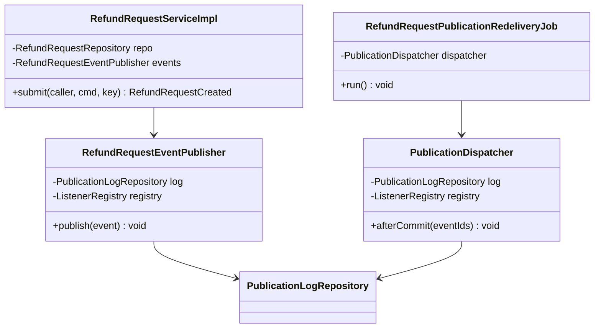
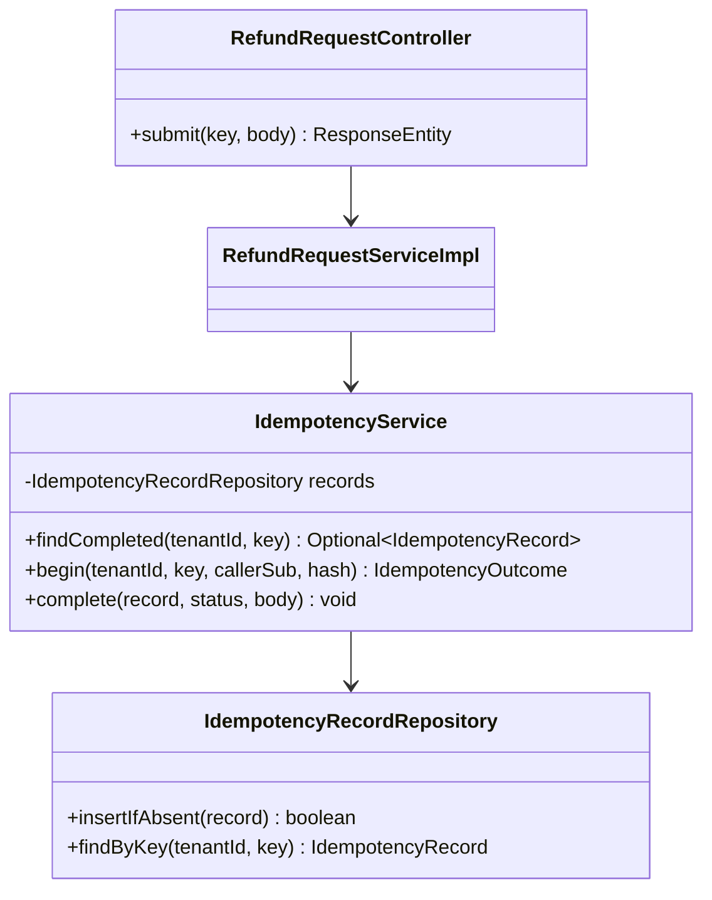
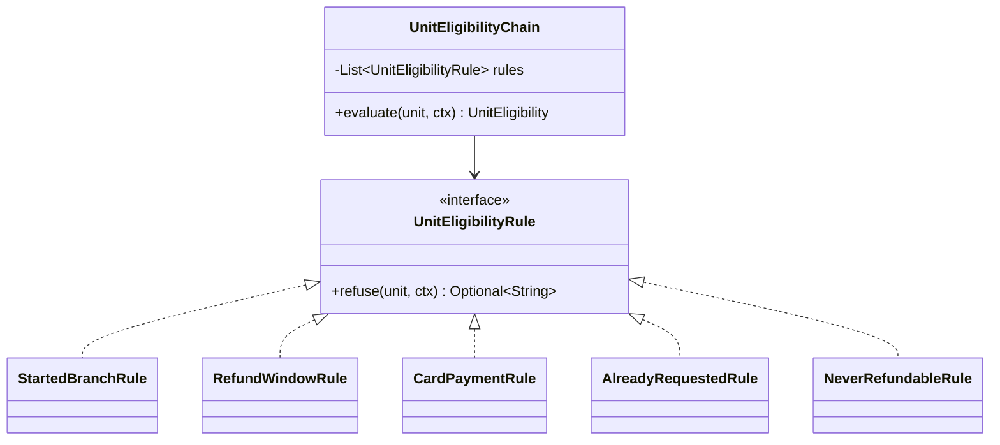
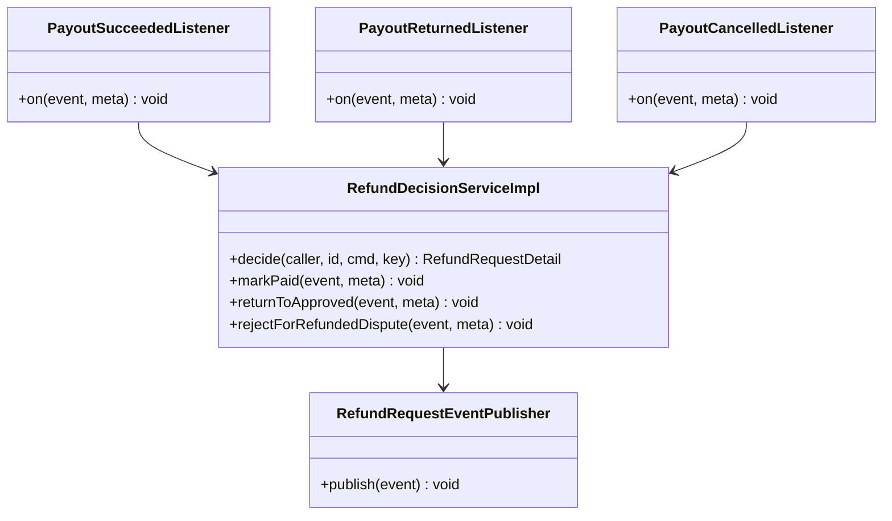
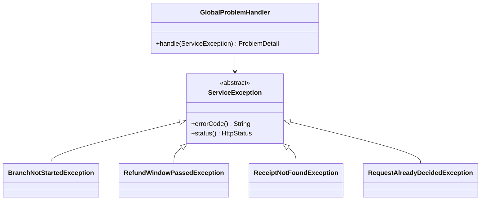
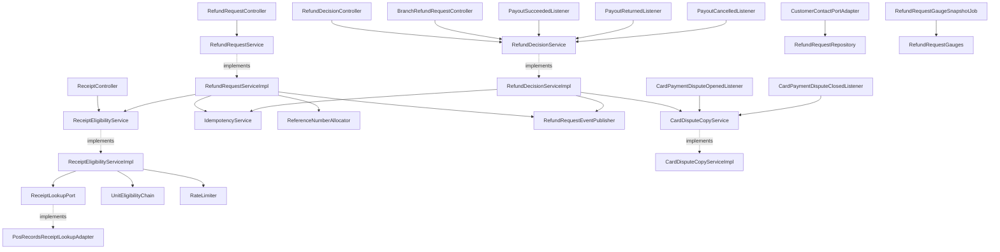
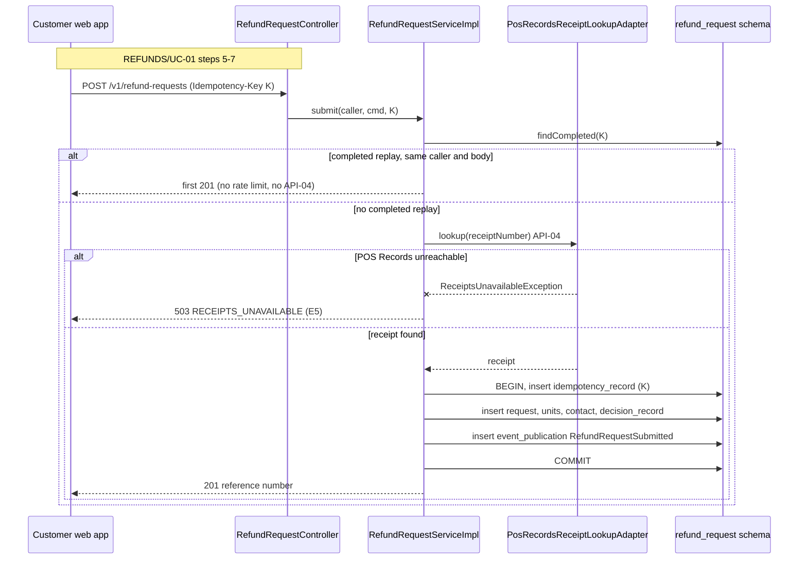
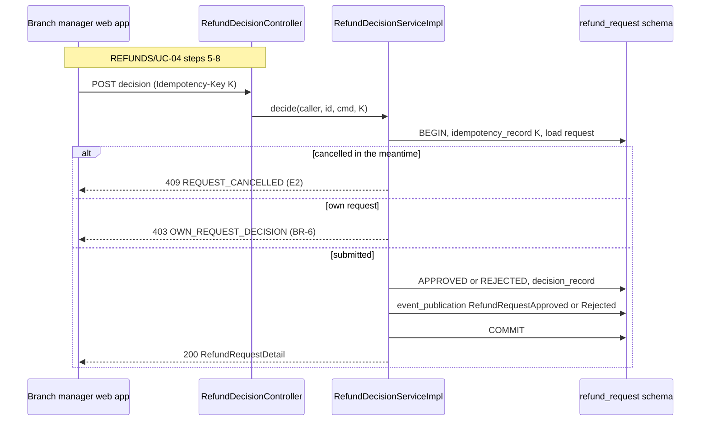
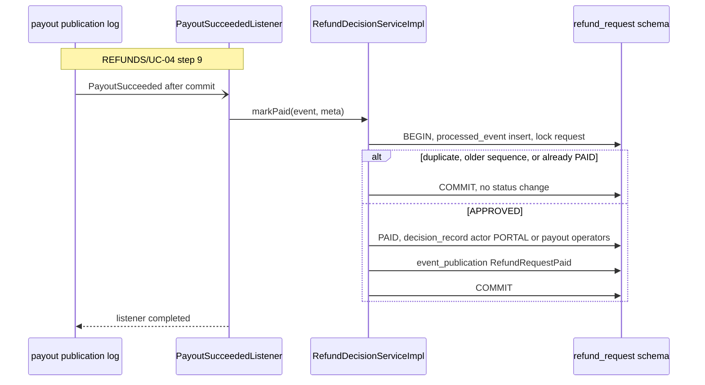
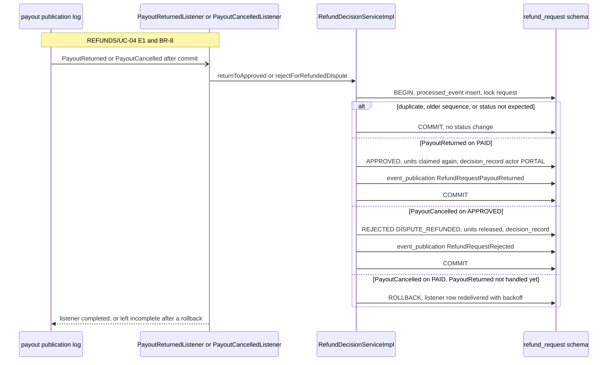

<!--
CHUNK: 04
TITLE: Per-Service Implementation - refund-request
PROJECT: Refunds Platform
VERSION: 1.2
DEPENDS_ON: 03, 09
PART OF: LLD - Refunds Platform
-->

# 7. Per-Service Implementation - refund-request

> **Bounded context:** SDD [§13 refund-request row](../../sdd-refunds-platform/09-services-summary.md#13-services-decomposition-summary) and [§17.1 Boundaries](../../sdd-refunds-platform/13a-service-refund-request.md#boundaries)
>
> **Type:** module (SDD §13 Type; one part of the single deployable `refunds-platform-app`)
>
> **Source code:** `refunds-platform-app/src/main/java/refundsplatform/refundrequest/` (not written yet; from-sdd build target)
>
> **Owns use cases (SDD 09):** [REFUNDS/UC-01](../../brd-refunds-portal/06a-use-cases-customer.md#uc-01-request-a-refund), [REFUNDS/UC-02](../../brd-refunds-portal/06a-use-cases-customer.md#uc-02-track-refund-status), [REFUNDS/UC-03](../../brd-refunds-portal/06a-use-cases-customer.md#uc-03-cancel-a-refund-request), [REFUNDS/UC-04](../../brd-refunds-portal/06b-use-cases-branch-manager.md#uc-04-approve--reject-refund)
>
> **Participates in:** None (the payout steps of REFUNDS/UC-04 run in [payout](./payout.md#participates-in-refundsuc-04-approve--reject-refund), the messages in [customer-notification](./customer-notification.md#participates-in-refundsuc-04-approve--reject-refund), and the outcome record in [loyalty-points](./loyalty-points.md#participates-in-refundsuc-04-approve--reject-refund); all are this module's own use case)

---

## 7.1 Responsibility

`refund-request` owns the refund request aggregate from submission to Paid, Rejected, or Cancelled, including the two moves it makes without a person (a Paid request back to Approved when the customer's bank sends the payout back, and an Approved request to Rejected when the bank has refunded a disputed card payment): the request with the original-payment reference of its receipt, one unit row per refundable unit, the append-only decision record (numbered per request), the per-tenant reference number sequence, the customer contact details given at submission, a copy of the card disputes `payout` reports (state and highest `sequence` per dispute), the idempotency records of its three write endpoints, and the per-caller rate-limit counters. It is the only writer of refund status (SDD [§14.7 refund status doctrine](../../sdd-refunds-platform/10-events-hub.md#147-universal-subscribers--cross-service-doctrines)). It publishes six in-process domain events into its own publication log (`RefundRequestSubmitted`, `RefundRequestApproved`, `RefundRequestRejected`, `RefundRequestCancelled`, `RefundRequestPaid`, `RefundRequestPayoutReturned`), listens to five from `payout` (`PayoutSucceeded`, `PayoutReturned`, `PayoutCancelled`, `CardPaymentDisputeOpened`, `CardPaymentDisputeClosed`), provides one port (`CustomerContactPort`, API-06) to `customer-notification`, and calls one provider (Point-of-Sale Records receipt lookup, API-04). It does not own payouts and the card disputes themselves (`payout`), messages (`customer-notification`), points (`loyalty-points`), receipts (POS Records), or staff accounts and branch assignment (platform IAM).

---

## 7.2 Class & Interface Map

> **Package layout (SDD [ADR-01](../../sdd-refunds-platform/06-principles-and-decisions.md#10-architectural-decisions)):** `refundsplatform.refundrequest.api` (ports other modules may import: `CustomerContactPort`, its DTO records, the six published event DTO records), `refundsplatform.refundrequest.domain` (aggregate, rules, inbound application services), `refundsplatform.refundrequest.adapter.in` (controllers, listeners, jobs, port adapter), `refundsplatform.refundrequest.adapter.out` (repositories, POS Records client). Shared platform classes (`ServiceException`, `@UseCase`, publication log, tenant context) live in `refundsplatform.platform` (`09-cross-cutting.md`).

> Confirm: class names follow CLAUDE.md conventions (`*Controller`, `*Service`, `*ServiceImpl`, `*Repository`) inside the SDD's hexagonal packages; the root package `refundsplatform` is an LLD choice; verify with the team.

### Controllers

| Class | Endpoints | Notes |
|-------|-----------|-------|
| `ReceiptController` | `GET /v1/receipts/{receiptNumber}/refundable-items` | `@UseCase("REFUNDS/UC-01")`; `refund.receipt.read`; per-caller rate limit (SDD [§17.1 API Standards](../../sdd-refunds-platform/13a-service-refund-request.md#api-standards)) |
| `RefundRequestController` | `POST /v1/refund-requests`, `GET /v1/refund-requests`, `GET /v1/refund-requests/{refundRequestId}`, `POST /v1/refund-requests/{refundRequestId}/cancellation` | `submit`: `@UseCase("REFUNDS/UC-01")`, `Idempotency-Key` required, rate limited. `listOwn` and `getOwn`: `@UseCase("REFUNDS/UC-02")`. `cancel`: `@UseCase("REFUNDS/UC-03")`, `Idempotency-Key` required |
| `BranchRefundRequestController` | `GET /v1/branches/{branchId}/refund-requests`, `GET /v1/branches/{branchId}/refund-requests/{refundRequestId}` | `listBranch` and `getBranchDetail`: `@UseCase("REFUNDS/UC-04")` |
| `RefundDecisionController` | `POST /v1/refund-requests/{refundRequestId}/decision` | `@UseCase("REFUNDS/UC-04")`; `refund.request.decide`; `Idempotency-Key` required |
| `BranchRefundReportController` | `GET /v1/branches/{branchId}/refund-report` | Serves `### Workflow: Branch refund report`; no `@UseCase` |
| `PayoutSucceededListener` | `Event: PayoutSucceeded` | Listener id `refund-request.payout-succeeded`; no `@UseCase` (see the flag below) |
| `PayoutReturnedListener` | `Event: PayoutReturned` | Listener id `refund-request.payout-returned`; no `@UseCase` |
| `PayoutCancelledListener` | `Event: PayoutCancelled` | Listener id `refund-request.payout-cancelled`; no `@UseCase` |
| `CardPaymentDisputeOpenedListener` | `Event: CardPaymentDisputeOpened` | Listener id `refund-request.card-payment-dispute-opened`; no `@UseCase` |
| `CardPaymentDisputeClosedListener` | `Event: CardPaymentDisputeClosed` | Listener id `refund-request.card-payment-dispute-closed`; no `@UseCase` |
| `CustomerContactPortAdapter` | Port `CustomerContactPort.getCustomerContact` (API-06) | Implements the port; token checked at the port |
| `RefundRetentionPurgeJob` | `Schedule: refund-retention-purge` | Serves `### Workflow: Refund retention purge`; no `@UseCase` |
| `RefundRequestPublicationRedeliveryJob` | `Schedule: refund-request-publication-redelivery` | Serves `### Workflow: Publication-log redelivery (refund-request)`; no `@UseCase` |
| `RefundRequestHousekeepingJob` | `Schedule: refund-request-housekeeping` | Serves `### Workflow: Housekeeping (refund-request)`; no `@UseCase` |
| `RefundRequestGaugeSnapshotJob` | `Schedule: refund-request-gauge-snapshot` | Serves `### Workflow: Gauge snapshot (refund-request)`; no `@UseCase` |

> **Convention:** while `REFUNDS_PORTAL_ENABLED` is off, every REST endpoint above answers 404 `NOT_FOUND` before its controller runs (SDD [§11.5 Feature flags](../../sdd-refunds-platform/07-cross-cutting-concerns.md#115-configuration-management-default)); the check is the platform product-enablement guard of `09-cross-cutting.md`, not code in each controller.

> Confirm: SDD [§7.3](../../sdd-refunds-platform/03-users-and-use-cases.md#73-use-case-traceability-brd--sdd) names no `Event:` entry point for REFUNDS/UC-04: its row lists `PayoutSucceeded`, `PayoutReturned`, `PayoutCancelled`, `CardPaymentDisputeOpened`, and `CardPaymentDisputeClosed` under Events only, although they realise REFUNDS/UC-04 step 9, E1, E3, and BR-8. Following the §7.3 mapping, the five listeners carry no `@UseCase`; adding them to §7.3 Entry points is an SDD change (sdd-unifier).

### Services (interfaces)

| Interface | Purpose | Implementations |
|-----------|---------|-----------------|
| `ReceiptEligibilityService` | Receipt lookup and per-unit eligibility (REFUNDS/UC-01 steps 1-4) | `ReceiptEligibilityServiceImpl` |
| `RefundRequestService` | Submit, list own, open own, cancel own | `RefundRequestServiceImpl` |
| `RefundDecisionService` | Branch list, branch detail, approve, reject, and the payout outcomes: Paid, payout sent back, dispute refunded | `RefundDecisionServiceImpl` |
| `CardDisputeCopyService` | The module's copy of the card disputes: record opened and closed disputes, answer whether a payment has an open one | `CardDisputeCopyServiceImpl` |
| `BranchRefundReportService` | Branch refund report for a period | `BranchRefundReportServiceImpl` |
| `RefundRetentionService` | Applies the retention periods once set | `RefundRetentionServiceImpl` |
| `ReceiptLookupPort` (outbound) | Receipt by number from POS Records (API-04) | `PosRecordsReceiptLookupAdapter` |
| `CustomerContactPort` (inbound port, `api` package) | API-06 for `customer-notification` | `CustomerContactPortAdapter` |

### Service Implementations

| Class | Implements | Key methods |
|-------|------------|-------------|
| `ReceiptEligibilityServiceImpl` | `ReceiptEligibilityService` | `refundableItems(CallerContext, String receiptNumber)`, `evaluate(UUID tenantId, Receipt, Set<UnitKey>, EligibilityPhase)` |
| `RefundRequestServiceImpl` | `RefundRequestService` | `submit(CallerContext, SubmitRefundRequest, IdempotencyKey)`, `listOwn(CallerContext, PageCursor)`, `getOwn(CallerContext, UUID)`, `cancel(CallerContext, UUID, CancelRefundRequest, IdempotencyKey)` |
| `RefundDecisionServiceImpl` | `RefundDecisionService` | `listBranch(CallerContext, String branchId, PageCursor)`, `getBranchDetail(CallerContext, String branchId, UUID id)`, `decide(CallerContext, UUID id, RefundDecision, IdempotencyKey)`, `markPaid(PayoutSucceededDto, EventMetadata)`, `returnToApproved(PayoutReturnedDto, EventMetadata)`, `rejectForRefundedDispute(PayoutCancelledDto, EventMetadata)` |
| `CardDisputeCopyServiceImpl` | `CardDisputeCopyService` | `recordOpened(CardPaymentDisputeOpenedDto, EventMetadata)`, `recordClosed(CardPaymentDisputeClosedDto, EventMetadata)`, `hasOpenDispute(UUID tenantId, String originalPaymentReference)` |
| `BranchRefundReportServiceImpl` | `BranchRefundReportService` | `report(CallerContext, String branchId, LocalDate from, LocalDate to)` |
| `RefundRetentionServiceImpl` | `RefundRetentionService` | `purgeTenant(UUID tenantId, Instant now)` |
| `RefundRequestEventPublisher` | `DomainEventPublisher` (platform) | `publish(RefundRequestDomainEvent)`: builds the SDD §14.10 DTO with `sequence` = the number of the decision-record row the event reports, and writes the `event_publication` row and one `event_publication_listener` row per registered listener in the caller's transaction |
| `UnitEligibilityChain` | (Chain of Responsibility, § 7.4) | `evaluate(ReceiptUnit, EligibilityContext)` |
| `ReferenceNumberAllocator` | - | `next(UUID tenantId)`: `INSERT INTO reference_number_sequence (tenant_id, next_value, created_at, updated_at, created_by, updated_by) VALUES (:tenantId, 2, now(), now(), 'system:refund-request', 'system:refund-request') ON CONFLICT (tenant_id) DO UPDATE SET next_value = reference_number_sequence.next_value + 1, updated_at = now() RETURNING next_value - 1`; the row lock is held until the submit transaction ends, so a rolled-back submission leaves no gap |
| `IdempotencyService` (platform, bound to this module's DataSource) | - | `findCompleted(tenantId, key)`, `begin(tenantId, key, callerSub, requestHash)`, `complete(record, status, body)` |
| `RateLimiter` | - | `acquire(tenantId, subject, endpoint)`: counter in `rate_limit_counter`, in its own `REQUIRES_NEW` transaction; the hourly counters of `refundableItems` step 8 use the same path |
| `RefundRequestGauges` | `MeterBinder` (Micrometer) | Holds the gauge values the snapshot job computes, per branch, and the publication-lag gauge per listener; a scrape reads the cached values, never the database |

### Repositories

| Class | Entity | Notes |
|-------|--------|-------|
| `RefundRequestRepository` | `RefundRequest` (+ units, contact) | Spring Data JDBC aggregate repository; every query carries the `tenant_id` predicate (`09-cross-cutting.md` § 12.1); custom `findOwnPage`, `findBranchSubmittedPage` (oldest first), `findByIdForUpdate`, `findContact`, `gaugeSnapshot(tenantId, now)` |
| `DecisionRecordRepository` | `DecisionRecordEntry` | Insert and read only; the module role has no `UPDATE`/`DELETE` on `decision_record`; rows read in `sequence` order |
| `CardDisputeCopyRepository` | `CardDisputeCopy` | `upsertIfNewer(row)` (`INSERT ... ON CONFLICT (tenant_id, dispute_id) DO UPDATE ... WHERE` newer, § 7.3), `existsOpen(tenantId, originalPaymentReference)` |
| `IdempotencyRecordRepository` | `IdempotencyRecord` | `insertIfAbsent` (`ON CONFLICT DO NOTHING`), `findByKey` |
| `RateLimitCounterRepository` | `RateLimitCounter` | `incrementAndGet` (`INSERT ... ON CONFLICT DO UPDATE ... RETURNING count`) |
| `ProcessedEventRepository` | `ProcessedEvent` | Listener dedup on `(tenant_id, event_id, listener_id)` for the five listeners |
| `PublicationLogRepository` (platform class, this schema) | `event_publication`, `event_publication_listener` | See `09-cross-cutting.md` § 12.4 |

> Confirm: Spring Data JDBC with `JdbcClient` for the row-lock and `ON CONFLICT` queries is an LLD choice (both ship with Spring Boot, SDD [§6 Backend Runtime](../../sdd-refunds-platform/02-ecosystem-overview.md#6-ecosystem-overview)); JPA would also fit.

### Domain Types (records)

| Type | Kind | Purpose |
|------|------|---------|
| `RefundRequest` | entity (aggregate root) | Status machine of `08-state-and-rules.md` § 11.1 (SDD Figure 16, including Paid to Approved and Approved to Rejected); every transition appends a `DecisionRecordEntry` with the next `sequence` and registers a domain event; holds `lastDecisionSequence`, `lastPayoutSequence`, `originalPaymentReference`, `approvedAt` |
| `RefundRequestUnit` | entity | One unit of one receipt line: `itemLine`, `unitNo`, requested and approved amounts, `claimed` flag, `refundState` |
| `DecisionRecordEntry` | entity | Append-only status change: `sequence` (per request, from 1), actor type and actor, confirming operator (payout resolved by hand), time, amount, reason, `rejectionKind` |
| `CardDisputeCopy` | entity | `disputeId` (CardPay's), `originalPaymentReference`, `state`, `outcome`, `lastSequence` (SDD [§17.1 Decide](../../sdd-refunds-platform/13a-service-refund-request.md#business-logic)) |
| `RefundRequestStatus` | enum | `SUBMITTED`, `APPROVED`, `REJECTED`, `PAID`, `CANCELLED` |
| `ActorType` | enum | `CUSTOMER`, `BRANCH_MANAGER`, `PORTAL`, `PAYOUT_OPERATOR` (SDD [§17.1 Decision record](../../sdd-refunds-platform/13a-service-refund-request.md#business-logic)) |
| `RejectionKind` | enum | `DECISION`, `DISPUTE_REFUNDED` (SDD [§14.10](../../sdd-refunds-platform/10-events-hub.md#1410-in-process-domain-events-modular-monolith--hybrid-core)) |
| `DisputeState` | enum | `OPEN`, `CLOSED` |
| `EligibilityPhase` | enum | `LOOKUP`, `SUBMIT` (the window rule at `SUBMIT` follows `REFUND_WINDOW_CHECK_AT_SUBMIT`) |
| `Money` | record | `amount` `BigDecimal` (scale 4), `currency` ISO-4217 (SDD [§14.9.0](../../sdd-refunds-platform/10-events-hub.md#1490-common-value-objects)) |
| `Receipt`, `ReceiptLine`, `ReceiptUnit` | record | Anti-corruption view of the API-04 response: branch id, purchase date, payment method, original-payment reference, lines and units |
| `UnitEligibility` | record | `unitKey`, `refundable`, `reasonCode` (`BRANCH_NOT_STARTED`, `REFUND_WINDOW_PASSED`, `NOT_PAID_BY_CARD`, `ALREADY_REQUESTED`, `NOT_REFUNDABLE`) |
| `EligibilitySettings` | record | `startedBranches` (`REFUNDS_PORTAL_BRANCHES`), `windowDays`, `windowCheckAtSubmit`, `allowRequestAfterRejection`, `allowRestAfterPartialRefund`, `neverRefundableItemTypes`, `contactDetailsRequired` (`BOTH` or `AT_LEAST_ONE`) |
| `SubmitRefundRequest` | record (Dto) | Inbound body of `POST /v1/refund-requests` (`06-api-contracts.md` § 9.2) |
| `CancelRefundRequest` | record (Dto) | Inbound body of the cancellation (empty or a free-text note) |
| `RefundDecision` | record (Dto) | `outcome` (`APPROVE`/`REJECT`), `loweredUnits` (`unitId`, `amount`), `reason` |
| `RefundableItemsResponse`, `RefundRequestCreated`, `RefundRequestPage`, `RefundRequestDetail`, `BranchRefundRequestPage`, `BranchRefundRequestDetail`, `BranchRefundReport` | record (Response) | Response records named in SDD §17.1 List of APIs; `BranchRefundRequestDetail` carries whether the original payment has an open card dispute (`06-api-contracts.md` § 9.2) |
| `CustomerContactQuery`, `CustomerContactDto` | record (`api`) | API-06 DTOs, fields per SDD [API-06](../../sdd-refunds-platform/11-api-contracts.md#api-06-get-customer-contact-details-customer-notification---refund-request) |
| `RefundRequestSubmittedDto`, `RefundRequestApprovedDto`, `RefundRequestRejectedDto`, `RefundRequestCancelledDto`, `RefundRequestPaidDto`, `RefundRequestPayoutReturnedDto` | record (`api`) | Published event DTOs, fields per SDD [§14.10](../../sdd-refunds-platform/10-events-hub.md#1410-in-process-domain-events-modular-monolith--hybrid-core) (`07-event-contracts.md` § 10.6) |
| `PayoutSucceededDto`, `PayoutReturnedDto`, `PayoutCancelledDto`, `CardPaymentDisputeOpenedDto`, `CardPaymentDisputeClosedDto` | record (`payout` `api` package) | Consumed event DTOs, fields per SDD §14.10 |

### Method Signatures (key methods only)

```java
public interface RefundRequestService {
  RefundRequestCreated submit(CallerContext caller, SubmitRefundRequest cmd, IdempotencyKey key);
  RefundRequestPage listOwn(CallerContext caller, PageCursor cursor);
  RefundRequestDetail getOwn(CallerContext caller, UUID refundRequestId);
  RefundRequestDetail cancel(CallerContext caller, UUID refundRequestId, CancelRefundRequest cmd, IdempotencyKey key);
}

public interface RefundDecisionService {
  BranchRefundRequestPage listBranch(CallerContext caller, String branchId, PageCursor cursor);
  BranchRefundRequestDetail getBranchDetail(CallerContext caller, String branchId, UUID refundRequestId);
  RefundRequestDetail decide(CallerContext caller, UUID refundRequestId, RefundDecision cmd, IdempotencyKey key);
  void markPaid(PayoutSucceededDto event, EventMetadata meta);
  void returnToApproved(PayoutReturnedDto event, EventMetadata meta);
  void rejectForRefundedDispute(PayoutCancelledDto event, EventMetadata meta);
}

public interface CardDisputeCopyService {
  void recordOpened(CardPaymentDisputeOpenedDto event, EventMetadata meta);
  void recordClosed(CardPaymentDisputeClosedDto event, EventMetadata meta);
  boolean hasOpenDispute(UUID tenantId, String originalPaymentReference);
}

public interface ReceiptEligibilityService {
  RefundableItemsResponse refundableItems(CallerContext caller, String receiptNumber);
  List<UnitEligibility> evaluate(UUID tenantId, Receipt receipt, Set<UnitKey> selected, EligibilityPhase phase);
}

public interface ReceiptLookupPort {
  Receipt lookup(UUID tenantId, String receiptNumber); // throws ReceiptNotFoundException, ReceiptsUnavailableException
}

public interface CustomerContactPort {           // refundsplatform.refundrequest.api, API-06
  CustomerContactDto getCustomerContact(CustomerContactQuery query);
}
```

> **Convention:** records for every DTO (CLAUDE.md). Constructor injection only; no `@Autowired` on fields. A branch id is a `String`, as POS Records gives it (SDD [§14.10](../../sdd-refunds-platform/10-events-hub.md#1410-in-process-domain-events-modular-monolith--hybrid-core) field types).

### Ports and Adapters (in-process contracts)

| Port interface | Operation | API ID (§15) | Role here | Adapter class |
|----------------|-----------|--------------|-----------|---------------|
| `CustomerContactPort` | `getCustomerContact` | [API-06](../../sdd-refunds-platform/11-api-contracts.md#api-06-get-customer-contact-details-customer-notification---refund-request) | Provider | `CustomerContactPortAdapter` |

### Authorization

| Entry point | Kind | Permission token (SDD §16, verbatim) | Enforcement point |
|-------------|------|--------------------------------------|-------------------|
| `GET /v1/receipts/{receiptNumber}/refundable-items` | REST | `refund.receipt.read` | `@PreAuthorize("hasAuthority('refund.receipt.read')")` on `ReceiptController.refundableItems` |
| `POST /v1/refund-requests` | REST | `refund.request.create` | `@PreAuthorize` on `RefundRequestController.submit` |
| `GET /v1/refund-requests` | REST | `refund.request.read-own` | `@PreAuthorize` on `RefundRequestController.listOwn`; owner predicate (`customer_sub = sub`) in `RefundRequestRepository.findOwnPage` |
| `GET /v1/refund-requests/{refundRequestId}` | REST | `refund.request.read-own` | `@PreAuthorize` on `getOwn`; owner predicate; another owner's id is 404 |
| `POST /v1/refund-requests/{refundRequestId}/cancellation` | REST | `refund.request.cancel-own` | `@PreAuthorize` on `cancel`; owner gate in the domain |
| `GET /v1/branches/{branchId}/refund-requests` | REST | `refund.request.read-branch` | `@PreAuthorize` on `listBranch`; `branchId` path value must equal the `branch_id` claim, else 403 |
| `GET /v1/branches/{branchId}/refund-requests/{refundRequestId}` | REST | `refund.request.read-branch` | `@PreAuthorize` on `getBranchDetail`; branch predicate |
| `POST /v1/refund-requests/{refundRequestId}/decision` | REST | `refund.request.decide` | `@PreAuthorize` on `decide`; branch gate and own-request gate in `RefundRequest.approve`/`reject` |
| `GET /v1/branches/{branchId}/refund-report` | REST | `refund.report.read-branch` | `@PreAuthorize` on `BranchRefundReportController.report`; branch gate |
| `CustomerContactPort.getCustomerContact` | Port | `refund.contact.read` | At the port (SDD [§15.1](../../sdd-refunds-platform/11-api-contracts.md#151-contract-conventions-platform-defaults)): `@PreAuthorize("hasAuthority('refund.contact.read')")` on `CustomerContactPortAdapter.getCustomerContact`; the adapter reads `tenantId` from the `ModuleAuthentication` (absent or not a module authentication -> `AccessDenied`) and calls `RefundRequestRepository.findContact(tenantId, query.refundRequestId())` |
| `PayoutSucceededListener.on` | Listener | None - system consumer | Tenant from the event (SDD [§11.2](../../sdd-refunds-platform/07-cross-cutting-concerns.md#112-multi-tenancy-default)) |
| `PayoutReturnedListener.on` | Listener | None - system consumer | Tenant from the event (SDD §11.2) |
| `PayoutCancelledListener.on` | Listener | None - system consumer | Tenant from the event (SDD §11.2) |
| `CardPaymentDisputeOpenedListener.on` | Listener | None - system consumer | Tenant from the event (SDD §11.2) |
| `CardPaymentDisputeClosedListener.on` | Listener | None - system consumer | Tenant from the event (SDD §11.2) |
| `RefundRetentionPurgeJob.run` | Job | None - system job | Per-tenant run (SDD §11.2) |
| `RefundRequestPublicationRedeliveryJob.run` | Job | None - system job | Per-tenant run (SDD §11.2) |
| `RefundRequestHousekeepingJob.run` | Job | None - system job | Per-tenant run |
| `RefundRequestGaugeSnapshotJob.run` | Job | None - system job | Per-tenant run (SDD §11.2) |

---

## 7.3 Method-Level Pseudocode (non-trivial logic only)

> **Convention:** every status-changing method below appends one `DecisionRecordEntry` whose `sequence` is `request.lastDecisionSequence + 1` and publishes one event carrying that `sequence` (SDD [§14.10 Ordering](../../sdd-refunds-platform/10-events-hub.md#1410-in-process-domain-events-modular-monolith--hybrid-core)); the event DTOs carry exactly the SDD §14.10 committed fields. Logs carry `refund_request_id`, never the reference number, the receipt number, a contact detail, or receipt items (SDD [§17.1 Logging](../../sdd-refunds-platform/13a-service-refund-request.md#logging)).

### `ReceiptEligibilityServiceImpl.refundableItems`

```text
1. rateLimiter.acquire(tenant, caller.sub, "receipt-lookup") -> 429 RATE_LIMITED with Retry-After when over the limit.
2. receipt = receiptLookupPort.lookup(tenant, receiptNumber)      (no DB transaction is open; the adapter records
                                                                  refund_receipt_lookup_seconds{outcome})
     ReceiptNotFoundException      -> 404 RECEIPT_NOT_FOUND      (REFUNDS/UC-01 E2)
     ReceiptsUnavailableException  -> 503 RECEIPTS_UNAVAILABLE   (REFUNDS/UC-01 E5; never RECEIPT_NOT_FOUND)
3. if receipt.branchId is not in REFUNDS_PORTAL_BRANCHES -> 422 BRANCH_NOT_STARTED (whole receipt, E6)
4. if receipt.purchaseDate is outside the refund window  -> 422 REFUND_WINDOW_PASSED (whole receipt, E1)
5. if receipt.paymentMethod is not card                  -> 422 NOT_PAID_BY_CARD (E4)
6. claims = units of this receipt on SUBMITTED or APPROVED requests, and paid units (one read-only query, tenant predicate)
7. for each unit of each line: unitEligibilityChain.evaluate(unit, context(claims, settings, LOOKUP)) -> refundable flag + reason
8. count the lookup, and a RECEIPT_NOT_FOUND outcome, per caller and hour in rate_limit_counter under the endpoints
   receipt-lookup-hourly and receipt-lookup-not-found-hourly (window_start truncated to the hour; the per-minute rate-limit
   rows keep the endpoint receipt-lookup), through RateLimitCounterRepository.incrementAndGet in its own REQUIRES_NEW
   transaction as RateLimiter.acquire; an E2 outcome is counted before the 404 is returned; when the hourly lookups reach 10
   and the not-found share exceeds 50%, increment refund_unusual_receipt_not_found_total once for that caller-hour and log
   the caller sub at WARN (10 § 13.3, § 13.7)
9. return RefundableItemsResponse(receiptNumber, purchaseDate, currency, units with amounts, flags, reason codes)
```

> Confirm: medium confidence, seeded by SDD [§17.1 Business Logic, Eligibility](../../sdd-refunds-platform/13a-service-refund-request.md#business-logic); steps 3-5 refuse the whole receipt in the SDD order (started branch, window, card) as its error table does (422), while unit reasons go in the response.

> TODO: refund window counted as `purchaseDate + 30 days >= today` in the branch-local date of the receipt's branch (SDD §6 rule: branch-local date only where a BRD rule counts days); how the window is counted is the SDD §17.1 [NEEDS CLARIFICATION] on REFUNDS/UC-01 BR-3 and BR-5 - verify once the REFUNDS BRD owner answers.

> TODO: one refund window (`REFUND_WINDOW_DAYS`) for every purchase and a free-text customer reason (max 500); whether some periods or item types have another window and whether the reason is picked from a list are the SDD [§17.1 Eligibility](../../sdd-refunds-platform/13a-service-refund-request.md#business-logic) [NEEDS CLARIFICATION] on [REFUNDS/UC-01](../../brd-refunds-portal/06a-use-cases-customer.md#uc-01-request-a-refund) BR-9: other refund windows and BR-10: reason list (the window would become a setting per period or item type, the reason a field with a list) - verify once the REFUNDS BRD owner answers.

> TODO: the receipt number alone identifies one purchase in the tenant, so the API-04 lookup takes the receipt number only and `ux_refund_request_unit_claim` stays on `(tenant_id, receipt_number, item_line, unit_no)`; whether it is unique across branches and days, and how soon after a purchase POS Records finds its receipt (a new receipt may be E2 for a while), are the SDD [§17.1 Eligibility](../../sdd-refunds-platform/13a-service-refund-request.md#business-logic) [NEEDS CLARIFICATION] for the Retail IT team; if it is not unique, both the lookup and the index also take the branch and the purchase date - verify.

### `RefundRequestServiceImpl.submit`

```text
0. replay = idempotencyService.findCompleted(tenant, key)                 (read-only, own short transaction)
   present: replay.callerSub != caller.sub or replay.requestHash != hash(method, path, body) -> 409 CONFLICT;
            otherwise return replay.responseStatus and replay.responseBody, without consuming a rate-limit unit
            and without calling API-04
1. rateLimiter.acquire(tenant, caller.sub, "submit")                      -> 429 RATE_LIMITED
2. validate body (Bean Validation): units not empty; email RFC 5322 max 254; mobile E.164 max 16;
   REFUND_CONTACT_DETAILS_REQUIRED = BOTH: both present; AT_LEAST_ONE: one of them present
                                                                           -> 400 VALIDATION_FAILED (REFUNDS/UC-01 E3)
3. receipt = receiptLookupPort.lookup(tenant, cmd.receiptNumber)           (outside the transaction; E2, E5 as above)
4. BEGIN TX (refundRequestTx, READ_COMMITTED)
5.   idem = idempotencyService.begin(tenant, key, caller.sub, hash(method, path, body))  -- INSERT ... ON CONFLICT DO NOTHING
       existing COMPLETED, same hash  -> ROLLBACK, return cached 201 body
       existing, different hash or caller -> ROLLBACK, 409 CONFLICT
6.   eligibility = evaluate(tenant, receipt, cmd.units, SUBMIT)  (re-run at submission, SDD §17.1 Submit: the started-branch
       and card rules always, the window rule only when REFUND_WINDOW_CHECK_AT_SUBMIT is true)
       a selected unit refused -> BRANCH_NOT_STARTED, REFUND_WINDOW_PASSED, NOT_PAID_BY_CARD: 422 with that code;
       ALREADY_REQUESTED: 409 ITEM_ALREADY_REQUESTED; NOT_REFUNDABLE: 422 BUSINESS_RULE_VIOLATION
7.   ref = referenceNumberAllocator.next(tenant)          -- upsert on reference_number_sequence, row-locked until commit
8.   request = RefundRequest.submit(id = UUIDv7, ref, caller.sub, receipt.branchId, receipt.originalPaymentReference,
                                    receipt, units, reason, contact)
       -> status SUBMITTED, requested amount = sum of selected unit amounts (REFUNDS/UC-01 step 4)
       -> appends DecisionRecordEntry(sequence 1, actor CUSTOMER, to SUBMITTED, amount)
       -> registers RefundRequestSubmitted(sequence 1)
9.   INSERT refund_request, refund_request_unit (claimed = true), refund_request_contact, decision_record
       unique violation on ux_refund_request_unit_claim -> 409 ITEM_ALREADY_REQUESTED (concurrent claim)
10.  eventPublisher.publish(RefundRequestSubmitted)   -- event_publication + listener rows, same TX
11.  idempotencyService.complete(idem, 201, RefundRequestCreated(id, ref))
12. COMMIT; after commit the dispatcher delivers the event (09 § 12.4); message failure never affects the request (AC-4);
    increment refund_requests_total{status = SUBMITTED, branch_id}
13. return 201 RefundRequestCreated
```

> Confirm: medium confidence, seeded by SDD [§17.1 Submit](../../sdd-refunds-platform/13a-service-refund-request.md#business-logic).

> TODO: `REFUND_CONTACT_DETAILS_REQUIRED` (`BOTH` or `AT_LEAST_ONE`) and `REFUND_WINDOW_CHECK_AT_SUBMIT` (`true` or `false`) have no default in code: each environment sets them, so the design takes no side, as SDD [§17.1 Submit](../../sdd-refunds-platform/13a-service-refund-request.md#business-logic) says; best guess for Dev and SIT `AT_LEAST_ONE` and `true`; the values are the SDD §17.1 [NEEDS CLARIFICATION] on [REFUNDS/UC-01](../../brd-refunds-portal/06a-use-cases-customer.md#uc-01-request-a-refund) BR-4: email and mobile and on REFUNDS/OI-11 (window checked at submission) - verify once the REFUNDS BRD owner answers.

> Confirm: `refund_requests_total` carries `branch_id` besides the SDD [§17.1 Metrics](../../sdd-refunds-platform/13a-service-refund-request.md#metrics) label `status`, because the same section measures the portal's part of REFUNDS Business Objective 5 as the Submitted requests per branch; 40 branches keep the label set small - confirm the label with the solution architect.

> TODO: reference number format `RF-` + 8-digit zero-padded per-tenant sequence (for example `RF-00001234`); the SDD fixes only "a per-tenant sequence" - verify the format with the REFUNDS BRD owner.

### `RefundRequestServiceImpl.cancel`

```text
1. BEGIN TX; idempotency begin with caller.sub as in submit (cached 200 on replay, 409 on a different body or caller)
2. request = repository.findById(tenant, id) with owner predicate customer_sub = caller.sub -> 404 NOT_FOUND if absent
3. request.cancel(caller)  -- only from SUBMITTED, else 409 REQUEST_ALREADY_DECIDED (REFUNDS/UC-03 E1)
     -> units claimed = false; DecisionRecordEntry(next sequence, actor CUSTOMER, to CANCELLED); registers RefundRequestCancelled
4. UPDATE refund_request SET status, last_decision_sequence, version = version + 1 WHERE tenant_id = ? AND id = ? AND version = ?
     0 rows (a decision committed meanwhile) -> 409 REQUEST_ALREADY_DECIDED
5. publish RefundRequestCancelled; idempotency complete(200, detail); COMMIT; increment refund_requests_total{status = CANCELLED}
```

> Confirm: medium confidence, seeded by SDD [§17.1 Cancel](../../sdd-refunds-platform/13a-service-refund-request.md#business-logic) (optimistic version check).

### `RefundDecisionServiceImpl.getBranchDetail`

```text
1. read-only TX: request = repository.findById(tenant, id) with branch predicate branch_id = path branchId = caller.branchId
     absent -> 404 NOT_FOUND
2. openCardDispute = request.originalPaymentReference != null
                     and cardDisputeCopyService.hasOpenDispute(tenant, request.originalPaymentReference)
     (open rows only, SDD §17.1 Decide; REFUNDS/UC-04 E3, AC-15: dispute shown)
3. return BranchRefundRequestDetail(receipt number, purchase date, units with amounts, total, reason, openCardDispute)
```

### `RefundDecisionServiceImpl.decide`

```text
1. validate: REJECT needs reason (400 VALIDATION_FAILED, REFUNDS/UC-04 BR-3: rejection always has a reason);
   APPROVE with loweredUnits needs reason (400 VALIDATION_FAILED, A1)
2. BEGIN TX; idempotency begin with caller.sub (cached 200 on replay, 409 on a different body or caller)
3. request = repository.findById(tenant, id)                 -> 404 NOT_FOUND
4. if request.branchId != caller.branchId                     -> 403 FORBIDDEN (BR-1: own branch only)
5. if request.customerSub.equals(caller.sub)                  -> 403 OWN_REQUEST_DECISION (BR-6; one identity per person)
6. if request.status == CANCELLED                             -> 409 REQUEST_CANCELLED, record nothing (E2)
   if request.status != SUBMITTED                             -> 409 CONFLICT
7. APPROVE: for each lowered unit: 0 < amount < unit.requestedAmount else 422 INVALID_LOWERED_AMOUNT (BR-2)
            approvedAmount = sum(unit approved amounts)  (AC-9); an open card dispute does not block it (BR-8: payout waits for a card dispute, E3)
            request.approve(caller, lowered, reason) -> APPROVED, approvedAt = now,
            DecisionRecordEntry(next sequence, BRANCH_MANAGER, amount, reason),
            registers RefundRequestApproved(partial = lowered not empty, originalPaymentReference, branchId)
   REJECT:  request.reject(caller, reason) -> REJECTED, units claimed = false,
            DecisionRecordEntry(next sequence, BRANCH_MANAGER, reason, rejectionKind DECISION),
            registers RefundRequestRejected(rejectionKind DECISION)
8. optimistic UPDATE ... AND version = ?; 0 rows -> re-read: CANCELLED -> 409 REQUEST_CANCELLED, else 409 CONFLICT
9. publish the event; idempotency complete(200, detail); COMMIT;
   observe refund_decision_wait_seconds{branch_id} (decided_at - submitted_at); increment refund_requests_total{status}
10. payout sends the payout after commit, or holds it while a dispute is open (step 8 of REFUNDS/UC-04, BR-8, in payout)
```

> Confirm: medium confidence, seeded by SDD [§17.1 Decide](../../sdd-refunds-platform/13a-service-refund-request.md#business-logic).

Step 5 compares the request's customer `sub` with the caller's `sub`: every person has one identity in the one IAM realm, and staff provisioning adds `BRANCH_MANAGER` to that same identity, so a branch manager's own request is found by this comparison (SDD [ADR-07](../../sdd-refunds-platform/06-principles-and-decisions.md#10-architectural-decisions), [§17.1 Decide](../../sdd-refunds-platform/13a-service-refund-request.md#business-logic)).

### `RefundDecisionServiceImpl.markPaid` (listener `refund-request.payout-succeeded`)

```text
1. BEGIN TX (refundRequestTx)
2. processedEvent.insertIfAbsent(tenant, meta.eventId, "refund-request.payout-succeeded"); conflict -> COMMIT, return (dedup)
3. request = repository.findByIdForUpdate(tenant, event.refundRequestId)
     absent -> log WARN with refund_request_id, COMMIT (nothing to mark; reconciliation reports it)
4. if event.sequence <= request.lastPayoutSequence -> COMMIT, return (older payout fact: handled, no change;
     SDD §17.1 Ordering of payout events)
   request.lastPayoutSequence = event.sequence
5. if request.status == PAID -> UPDATE last_payout_sequence, COMMIT, return (SDD §17.1 Async consumers)
   if request.status != APPROVED -> throw IllegalStateTransitionException (listener row stays incomplete, alert at 30 min)
6. firstPaid = request.paidAt == null
   request.markPaid(event.payoutId, event.occurredAt, event.resolvedBy, event.confirmedBy) -> PAID, paidAt set once,
     units refunded (FULL, or PARTIAL when lowered) and claimed = false,
     DecisionRecordEntry(next sequence, actor PORTAL with the payout result; actor PAYOUT_OPERATOR with actor_sub = resolvedBy
       and confirmed_by_sub = confirmedBy when the payout was resolved by hand, amount = approved amount),
     registers RefundRequestPaid(paidDate = branch-local date of event.occurredAt, refundedAmount = approved amount,
       per-unit refunded amounts, receiptNumber)
7. UPDATE (optimistic), publish RefundRequestPaid, COMMIT
8. after commit: if firstPaid, observe refund_submitted_to_paid_seconds{branch_id} (event.occurredAt - submitted_at);
   increment refund_requests_total{status = PAID}
```

> Confirm: medium confidence, seeded by SDD [§17.1 Paid](../../sdd-refunds-platform/13a-service-refund-request.md#business-logic).

Steps 4-5 follow SDD §17.1 Ordering of payout events, and step 8 observes `refund_submitted_to_paid_seconds` only when a request first becomes Paid (SDD [§17.1 Metrics](../../sdd-refunds-platform/13a-service-refund-request.md#metrics)); `paid_at` keeps that first Paid time, and the branch refund report reads the latest Paid row from the decision record.

### `RefundDecisionServiceImpl.returnToApproved` (listener `refund-request.payout-returned`)

```text
1. BEGIN TX; processed_event dedup with listener id "refund-request.payout-returned"; conflict -> COMMIT, return
2. request = repository.findByIdForUpdate(tenant, event.refundRequestId); absent -> log WARN with refund_request_id, COMMIT
3. if event.sequence <= request.lastPayoutSequence -> COMMIT, return (older payout fact, no change)
   request.lastPayoutSequence = event.sequence
4. if request.status != PAID -> UPDATE last_payout_sequence, COMMIT, return (SDD §17.1 Async consumers)
5. request.returnToApproved(event.payoutId, event.occurredAt) -> APPROVED, approvedAt = event.occurredAt,
     units claimed = true and refundState = NONE (units stay claimed as for any Approved request),
     DecisionRecordEntry(next sequence, actor PORTAL, payout result: sent back), registers RefundRequestPayoutReturned
6. UPDATE (optimistic) and the unit rows
     unique violation on ux_refund_request_unit_claim -> see the flag below
7. publish RefundRequestPayoutReturned, COMMIT; increment refund_requests_total{status = APPROVED}
```

> Confirm: medium confidence, seeded by SDD [§17.1 Payout sent back](../../sdd-refunds-platform/13a-service-refund-request.md#business-logic) ([REFUNDS/UC-04](../../brd-refunds-portal/06b-use-cases-branch-manager.md#uc-04-approve--reject-refund) E1, AC-11: Paid payout sent back, request back to Approved).

> TODO: when the rest of a partly refunded unit was claimed by another request while this one was Paid (possible only with `REFUND_ALLOW_REST_AFTER_PARTIAL_REFUND` true), re-claiming that unit violates `ux_refund_request_unit_claim`; best guess: that unit stays unclaimed (the payout is paid again for the approved amount either way), the request still moves to Approved, and the case is logged at WARN with `refund_request_id`; the SDD says only that the units stay claimed - verify with the REFUNDS BRD owner.

### `RefundDecisionServiceImpl.rejectForRefundedDispute` (listener `refund-request.payout-cancelled`)

```text
1. BEGIN TX; processed_event dedup with listener id "refund-request.payout-cancelled"; conflict -> COMMIT, return
2. request = repository.findByIdForUpdate(tenant, event.refundRequestId); absent -> log WARN with refund_request_id, COMMIT
3. if event.sequence <= request.lastPayoutSequence -> COMMIT, return (older payout fact, no change)
   request.lastPayoutSequence = event.sequence
4. if request.status == PAID -> throw PayoutFactNotYetApplicableException before last_payout_sequence is changed
     (the transaction rolls back and the listener row is redelivered with backoff; a cancelled payout of a Paid request
     always follows a PayoutReturned with a lower sequence, which moves the request to APPROVED first);
   if request.status != APPROVED -> UPDATE last_payout_sequence, COMMIT, return (SDD §17.1 Async consumers)
5. request.rejectForRefundedDispute(event.payoutId, event.reason, event.occurredAt) -> REJECTED,
     units claimed = false (the Rejected rule of Eligibility then applies),
     DecisionRecordEntry(next sequence, actor PORTAL, dispute outcome, reason = event.reason, rejectionKind DISPUTE_REFUNDED),
     registers RefundRequestRejected(rejectionKind DISPUTE_REFUNDED, reason)
6. UPDATE (optimistic), publish RefundRequestRejected, COMMIT; increment refund_requests_total{status = REJECTED}
```

> Confirm: medium confidence, seeded by SDD [§17.1 Dispute outcome](../../sdd-refunds-platform/13a-service-refund-request.md#business-logic) ([REFUNDS/UC-04](../../brd-refunds-portal/06b-use-cases-branch-manager.md#uc-04-approve--reject-refund) BR-8: payout waits for a card dispute, AC-13: dispute refunded, request Rejected).

### `CardDisputeCopyServiceImpl.recordOpened` and `recordClosed` (listeners `refund-request.card-payment-dispute-opened`, `refund-request.card-payment-dispute-closed`)

```text
1. BEGIN TX; processed_event dedup with the listener id; conflict -> COMMIT, return
2. recordOpened: INSERT INTO card_dispute_copy (tenant_id, dispute_id, original_payment_reference, state, outcome,
                   last_sequence, opened_at, closed_at, audit columns)
                 VALUES (:t, :disputeId, :ref, 'OPEN', NULL, :sequence, :occurredAt, NULL, ...)
                 ON CONFLICT (tenant_id, dispute_id) DO UPDATE SET state = 'OPEN', last_sequence = EXCLUDED.last_sequence,
                   updated_at = now()
                 WHERE card_dispute_copy.last_sequence < EXCLUDED.last_sequence AND card_dispute_copy.state = 'OPEN'
   recordClosed: the same insert with state 'CLOSED', outcome = event.outcome, closed_at = event.occurredAt;
                 ON CONFLICT ... DO UPDATE SET state = 'CLOSED', outcome, closed_at, last_sequence, updated_at
                 WHERE card_dispute_copy.last_sequence < EXCLUDED.last_sequence
3. 0 rows changed on conflict -> an older or late dispute event: handled (the processed_event row stays), no change,
   so a late Opened never reopens a closed row (SDD §17.1 Decide)
4. COMMIT; no event is published
```

> Confirm: medium confidence, seeded by SDD [§17.1 Decide](../../sdd-refunds-platform/13a-service-refund-request.md#business-logic) and [Tables Design](../../sdd-refunds-platform/13a-service-refund-request.md#tables-design) (dispute copy keyed by `(tenant_id, dispute_id)`, state and highest `sequence`, indexed on `(tenant_id, original_payment_reference)`); the table name `card_dispute_copy` is this LLD's.

### `RefundRetentionServiceImpl.purgeTenant`

```text
1. if REFUND_RETENTION_PERIOD or REFUND_CONTACT_RETENTION_PERIOD is unset -> log INFO "retention periods not set", return
2. contact erasure (shorter period): UPDATE refund_request_contact SET email = NULL, mobile_number = NULL, erased_at = now
   WHERE tenant_id = ? AND erased_at IS NULL AND request ended (CANCELLED, REJECTED, PAID) before now - contactPeriod
   in batches of 500 rows, one transaction per batch
3. request purge: for ended requests older than the request period, in batches of 200, one TX per batch, child rows first:
   decision_record (purge role), refund_request_unit, refund_request_contact, refund_request
4. dispute copy purge: DELETE card_dispute_copy rows with state CLOSED and closed_at before now - request period,
   in batches of 500 rows, one TX per batch (open rows stay)
5. publication log purge: DELETE event_publication_listener rows completed before the period, then event_publication rows
   with no remaining listener row
```

> TODO: both retention periods are the SDD [§17.1 Retention Policy](../../sdd-refunds-platform/13a-service-refund-request.md#retention-policy) [NEEDS CLARIFICATION] (REFUNDS/NFR-06); until set the job only logs - verify once the REFUNDS BRD owner answers.

### `RefundRequestGaugeSnapshotJob.run` (per tenant, every 60 s)

```text
1. read-only TransactionTemplate per tenant: repository.gaugeSnapshot(tenant, now) returns per branch_id:
   a. lateCount            = count of SUBMITTED with submitted_at + REFUND_DECISION_LATE_AFTER_DAYS < now
   b. oldestSubmittedAge   = max(now - submitted_at) over SUBMITTED, 0 when the branch has none
   c. oldestApprovedUnpaid = max(now - approved_at) over APPROVED requests whose original_payment_reference has no OPEN
                             card_dispute_copy row, 0 when the branch has none
   and, per listener_id, in the same transaction:
   d. publication_incomplete_oldest_seconds{listener_id} over this module's event_publication_listener rows with
      completed_at NULL whose listener is enabled, with the age 10-operations.md § 13.7 defines, 0 when none
2. refundRequestGauges.replace(tenant, values): refund_requests_late{branch_id} (SDD §17.1 Metrics),
   refund_request_oldest_submitted_age_seconds{branch_id} (10 § 13.3),
   refund_request_oldest_approved_unpaid_age_seconds{branch_id} (10 § 13.3, for the SDD §11.4 approved-to-paid alert),
   publication_incomplete_oldest_seconds{listener_id} (SDD §11.4, for the PublicationListenerLag alert)
3. a failed snapshot keeps the previous values and logs WARN; the next run replaces them
```

> Confirm: the gauge `refund_request_oldest_approved_unpaid_age_seconds` and its exclusion of requests with an open card dispute implement the SDD [§11.4 Alerting](../../sdd-refunds-platform/07-cross-cutting-concerns.md#114-observability-default) rule "any refund request Approved for more than 3 days and not yet Paid, except a request whose original card payment has an open card dispute" (owner `refund-request`); the gauge name and measuring from the latest move to Approved (`approved_at`, also set when a payout is sent back) are this LLD's choices - confirm.

---

## 7.4 Design Patterns Applied

### Pattern: Outbox (publication log for durable in-process events)

> **Applied:** Outbox pattern (CLAUDE.md: "Outbox pattern is mandatory for any state change that must produce an event. No dual-writes to DB and Kafka.")
>
> **Rationale (this service):** Every refund status change produces an in-process domain event that `payout`, `customer-notification`, and `loyalty-points` must not miss; the SDD [§14.10](../../sdd-refunds-platform/10-events-hub.md#1410-in-process-domain-events-modular-monolith--hybrid-core) Delivery line is durable, and the refund outcomes wait in this module's publication log while Loyalty Points is switched off (SDD [§11.1](../../sdd-refunds-platform/07-cross-cutting-concerns.md#111-db-modeling-default)). The `event_publication` row and one `event_publication_listener` row per listener commit in the same transaction as the status change; the dispatcher (after commit) and the redelivery job deliver each listener row at least once and set `completed_at` only after that listener's transaction has committed. The SDD names the tables (`event_publication`, `event_publication_listener`, `completed_at`), so this LLD uses those names, not `outbox`/`processed_at` (`09-cross-cutting.md` § 12.4).

**Roles:**

| Role | Class / Component | Notes |
|------|-------------------|-------|
| Outbox table | `refund_request.event_publication` + `refund_request.event_publication_listener` | SDD [§11.1](../../sdd-refunds-platform/07-cross-cutting-concerns.md#111-db-modeling-default) columns; `05-data-model.md` § 8.2 |
| Outbox writer | `RefundRequestEventPublisher.publish`, called inside `submit`, `cancel`, `decide`, `markPaid`, `returnToApproved`, `rejectForRefundedDispute` | Same `refundRequestTx` as the aggregate write |
| Outbox publisher | `PublicationDispatcher` (after commit) and `RefundRequestPublicationRedeliveryJob` (scheduled) | Delivers to each listener in the listener module's own transaction, then marks the listener row completed; never claims or delivers a row of a listener whose product is switched off |

**Class diagram:**



**Summary:** The service writes the aggregate and asks the publisher to append the event and its listener rows in the same transaction; the dispatcher and the redelivery job deliver each listener row and mark it completed after the listener commits.

**Pseudocode skeleton:**

```text
afterCommit(eventIds):                                   // no listener work on the committing thread
  for row in listenerRows(eventIds) where registry.isEnabled(row.listenerId):
    publicationDispatchExecutor.submit(() -> claimThenDeliver(row))
  (rejected task: row left to the redelivery job; any Throwable caught per row, never thrown to commit())

claimThenDeliver(row):                                   // dispatcher task only
  claimed = newTx(publisherTx).execute(UPDATE ... SET next_attempt_at = now() + 60 s WHERE ... completed_at IS NULL
                                       AND next_attempt_at <= now())      // 0 rows: another replica holds it
  if (claimed) deliver(row)

redelivery job: claims due rows in its own SELECT ... FOR UPDATE SKIP LOCKED with the 60 s lease, commits, then calls
  deliver(row) directly, never claimThenDeliver

deliver(listenerRow) {
  listener = registry.get(listenerRow.listenerId)
  outcome = listener.module.transactionTemplate(REQUIRES_NEW).execute(
              () -> listener.handle(deserialize(row.payload), metadata(row)))   // listener commit = acknowledgement
  if (outcome != COMMITTED) {
    log.attemptFailed(row, attempts + 1, lastError, nextAttemptAt = backoffWithJitter(attempts))   // new REQUIRES_NEW tx
    return                                               // completed_at stays NULL; redelivery retries it
  }
  log.markCompleted(row)                                 // new REQUIRES_NEW refundRequestTx, after the listener committed
}
```

**Delivery rules** (per `09-cross-cutting.md` § 12.4):

- `markCompleted` runs only after the listener's transaction has committed.
- A listener that throws or times out leaves `completed_at = NULL`; `attempts` and `last_error` are updated and `next_attempt_at` set with exponential backoff and jitter; the redelivery job retries it. Rows are retried per listener, independently: a failing listener does not block other listeners or later events, because no listener here depends on delivery order: each reads the event's `sequence` and treats an older status as stale (SDD [§14.10 Ordering](../../sdd-refunds-platform/10-events-hub.md#1410-in-process-domain-events-modular-monolith--hybrid-core): `customer-notification` supersedes stale messages, `loyalty-points` applies refund outcomes in `sequence` order).
- A listener of a product that is switched off (the `loyalty-points` listeners while `LOYALTY_POINTS_ENABLED` is off) is neither dispatched nor redelivered: its rows stay incomplete and are delivered once the product is switched on (SDD [§11.1](../../sdd-refunds-platform/07-cross-cutting-concerns.md#111-db-modeling-default), [§11.5](../../sdd-refunds-platform/07-cross-cutting-concerns.md#115-configuration-management-default)).
- Duplicate delivery: if the listener commits but `markCompleted` fails or the process stops, the next redelivery delivers again; every listener dedupes (`07-event-contracts.md` § 10.6).

### Pattern: Idempotency (write endpoints)

> **Applied:** Idempotency (CLAUDE.md: "Idempotency keys on all write endpoints touching money/ wallet/ notifications or external providers.")
>
> **Rationale (this service):** Submit, cancel, and decide each trigger notifications and, for an approval, a payout; SDD [§17.1 API Standards](../../sdd-refunds-platform/13a-service-refund-request.md#api-standards) requires `Idempotency-Key` on all three and a replay with the same key and body returns the first response.

**Roles:**

| Role | Class / Component | Notes |
|------|-------------------|-------|
| Idempotency record table | `refund_request.idempotency_record` | Key `(tenant_id, idempotency_key)` |
| Replay read | `IdempotencyService.findCompleted` (`submit` step 0) | Read-only, own short transaction, before the rate limit and API-04; caller and request hash compared |
| Idempotency check | `IdempotencyService.begin` inside the business transaction | `INSERT ... ON CONFLICT DO NOTHING`; a concurrent duplicate waits on the key until the first commits |
| Cached-response storage | `idempotency_record.response_status`, `response_body` | Only 2xx responses are stored; a domain error rolls the record back with the transaction |

**Class diagram:**



**Summary:** The service answers a completed replay before any other step, then opens the idempotency record inside the business transaction; a replay by the same caller with the same body returns the stored response, and another caller or body under the same key is a conflict.

**Pseudocode skeleton:**

```text
begin(tenant, key, callerSub, hash):
  inserted = records.insertIfAbsent(tenant, key, callerSub, hash, status = IN_PROGRESS)   // blocks behind a concurrent twin
  if inserted: return NEW(record)
  existing = records.findByKey(tenant, key)
  if (!existing.callerSub.equals(callerSub)) throw IdempotencyConflictException   // 409 CONFLICT
  if existing.hash != hash: throw IdempotencyConflictException      // 409 CONFLICT
  return REPLAY(existing.responseStatus, existing.responseBody)
```

### Pattern: Chain of Responsibility (unit eligibility)

> **Applied:** Chain of Responsibility (CLAUDE.md: "Chain of Responsibility for pipelines")
>
> **Rationale (this service):** A unit's eligibility is an ordered set of independent rules (started branch, refund window, card payment, already requested or refunded, never-refundable list, and the two open settings of REFUNDS/UC-01 BR-6 and BR-7); each rule either refuses the unit with its reason code or passes it on. Separate handlers let the open rules be added or changed without touching the others, and the same chain serves the receipt lookup and the re-check at submission (`EligibilityPhase`).

> Confirm: CLAUDE.md guideline applied (the SDD lists the rules but does not name the pattern).

**Roles:**

| Role | Class / Component |
|------|-------------------|
| Handler interface | `UnitEligibilityRule` (`Optional<String> refuse(ReceiptUnit, EligibilityContext)`) |
| Concrete handlers (in order) | `StartedBranchRule`, `RefundWindowRule`, `CardPaymentRule`, `AlreadyRequestedRule`, `NeverRefundableRule` |
| Chain | `UnitEligibilityChain` (ordered `List<UnitEligibilityRule>` injected by `@Order`) |

**Class diagram:**



**Summary:** The chain runs the rules in order and returns the first refusal reason, or `refundable` when every rule passes.

**Pseudocode skeleton:**

```text
UnitEligibility evaluate(unit, ctx) {
  for rule in rules: reason = rule.refuse(unit, ctx); if reason.isPresent(): return refused(unit, reason.get())
  return refundable(unit)
}
StartedBranchRule.refuse: receipt branch not in settings.startedBranches (REFUNDS_PORTAL_BRANCHES) -> BRANCH_NOT_STARTED
RefundWindowRule.refuse: ctx.phase == SUBMIT and !settings.windowCheckAtSubmit -> pass;
  purchase outside the window -> REFUND_WINDOW_PASSED
AlreadyRequestedRule.refuse: unit claimed on a SUBMITTED/APPROVED request, or refunded in full -> ALREADY_REQUESTED;
  unit on a REJECTED request -> ALREADY_REQUESTED unless settings.allowRequestAfterRejection;
  rest of a partly refunded unit -> ALREADY_REQUESTED unless settings.allowRestAfterPartialRefund
NeverRefundableRule.refuse: item type in settings.neverRefundableItemTypes -> NOT_REFUNDABLE
```

> TODO: the two settings default to `false` (a rejected unit and the rest of a partly refunded unit cannot be requested again) and the never-refundable list defaults to empty; the values are the SDD §17.1 [NEEDS CLARIFICATION] on REFUNDS/UC-01 BR-3, BR-6, and BR-7 - verify once the REFUNDS BRD owner answers.

### Pattern: Saga (choreography) - refund lifecycle with payout and take-back

> **Applied:** Saga, choreography (CLAUDE.md: "Sagas (choreography by default, orchestration when the flow is complex or needs central visibility) for cross-service business transactions. No distributed 2PC.")
>
> **Rationale (this service):** Approving a refund changes state in `refund-request` (Approved), `payout` (payout created, held while a card dispute is open, and sent), back in `refund-request` (Paid), and in `loyalty-points` (take-back). Each step reacts to the previous module's durable event, as the SDD [§14.7 saga doctrine](../../sdd-refunds-platform/10-events-hub.md#147-universal-subscribers--cross-service-doctrines) sets it. A refused payout is retried and leaves the request Approved (SDD [§8.4.2](../../sdd-refunds-platform/05-workflows-and-sequences.md#842-workflow-payout-with-retries)); a stopped payout is resolved by operations (SDD [§20.1.7](../../sdd-refunds-platform/16-operations-runbook.md#2017-resolve-a-stopped-payout)). Two compensating steps end here: a payout cancelled because the bank refunded the disputed payment makes the request Rejected, and a payout the customer's bank sends back makes a Paid request Approved again while `payout` pays it in a new round. This module owns the timeouts of steps 1 and 3: the decision time (the `late` flag) and the approved-to-paid deadline of 3 days (the gauge of the Gauge snapshot workflow).

**Roles:**

| Role | Class / Component |
|------|-------------------|
| Step 1 (approve) | `RefundDecisionServiceImpl.decide` publishes `RefundRequestApproved` |
| Step 2 (pay out) | `payout`: `RefundRequestApprovedListener`, `PayoutRetryJob` publish `PayoutSucceeded` |
| Step 3 (mark Paid) | `PayoutSucceededListener` -> `RefundDecisionServiceImpl.markPaid` publishes `RefundRequestPaid` |
| Step 4 (take back points) | `loyalty-points`: listens to `RefundRequestPaid` (and records the other outcomes) |
| Compensation (dispute refunded) | `PayoutCancelledListener` -> `RefundDecisionServiceImpl.rejectForRefundedDispute` publishes `RefundRequestRejected` (`DISPUTE_REFUNDED`) |
| Compensation (payout sent back) | `PayoutReturnedListener` -> `RefundDecisionServiceImpl.returnToApproved` publishes `RefundRequestPayoutReturned`; `payout` returns to step 2 |

**Class diagram:**



**Summary:** This module starts the saga with the approval, continues it when `payout` reports success, and runs both compensations when `payout` reports a cancelled or sent-back payout; every hand-off is a durable in-process event.

**Pseudocode skeleton:**

```text
decide(APPROVE)    -> TX { APPROVED + decision record + publish RefundRequestApproved }
on PayoutSucceeded -> TX { dedup; sequence check; APPROVED -> PAID + decision record + publish RefundRequestPaid }
on PayoutCancelled -> TX { dedup; sequence check; APPROVED -> REJECTED (DISPUTE_REFUNDED) + publish RefundRequestRejected }
on PayoutReturned  -> TX { dedup; sequence check; PAID -> APPROVED + publish RefundRequestPayoutReturned }
a refused payout keeps the request APPROVED; PayoutAttemptFailed / PayoutStillFailing go to customer-notification only
```

### Pattern: RFC 9457 error model

> **Applied:** Problem Details (CLAUDE.md: "Global @RestControllerAdvice, Problem Details (RFC 9457). Business exceptions extend a base ServiceException with error code.")
>
> **Rationale (this service):** Every endpoint returns the SDD §15.1 error model; the domain errors of § 7.7 extend `ServiceException` and the platform `GlobalProblemHandler` maps them (`09-cross-cutting.md` § 12.6).

**Roles:**

| Role | Class / Component |
|------|-------------------|
| Base exception | `ServiceException` (platform) |
| Subclasses | the § 7.7 exceptions |
| Translator | `GlobalProblemHandler` (`@RestControllerAdvice`) |

**Class diagram:**



**Summary:** Domain exceptions carry the SDD error code and status; one advice turns each into a Problem Details body.

**Pseudocode skeleton:**

```text
ProblemDetail handle(ServiceException ex, request):
  pd = ProblemDetail.forStatus(ex.status()); pd.type = problemBase + kebab(ex.errorCode()); pd.title = ex.title()
  pd.detail = ex.userMessage(); pd.instance = request.path; pd.errorCode = ex.errorCode(); pd.traceId = currentTraceId()
```

---

## 7.5 Dependency Injection Graph



**Summary:** Controllers and listeners depend on service interfaces only; `RefundDecisionServiceImpl` is the most connected, serving the branch screens and the three payout listeners and reading the dispute copy for the decision view. The repositories (`RefundRequestRepository`, `DecisionRecordRepository`, `CardDisputeCopyRepository`), `Clock`, and `IdGenerator` are injected into every service implementation and not drawn for each. Composition over inheritance: no class hierarchy except the exception tree.

---

## 7.6 Transaction Boundaries

| Method | Propagation | Isolation | Rollback rules |
|--------|-------------|-----------|----------------|
| `ReceiptEligibilityServiceImpl.refundableItems` | none on the method; `RateLimiter.acquire` runs in its own `REQUIRES_NEW` read-write transaction (separate bean); API-04 runs with no transaction; the claims query runs in a read-only `TransactionTemplate` | `READ_COMMITTED` | rollback of the failing step only |
| `refundableItems` step 8 counters | `REQUIRES_NEW` (separate bean, as `RateLimiter.acquire`) | `READ_COMMITTED` | rollback on any exception (the request fails with 500) |
| `RefundRequestServiceImpl.submit` | none on the method; rate limit as above; API-04 with no transaction; steps 4-12 run in `refundRequestTx.execute(...)` (`TransactionTemplate`, `REQUIRED`) | `READ_COMMITTED` | rollback on `ServiceException` and `DuplicateKeyException`; a replay returns at step 0 before any write |
| `RateLimiter.acquire` | `REQUIRES_NEW` | `READ_COMMITTED` | rollback on any exception (the request fails with 500, no unit consumed) |
| `RefundRequestServiceImpl.cancel` | `REQUIRED` | `READ_COMMITTED` + optimistic `version` | rollback on `ServiceException` |
| `RefundDecisionServiceImpl.getBranchDetail` | `REQUIRED`, read-only | `READ_COMMITTED` | rollback on any exception |
| `RefundDecisionServiceImpl.decide` | `REQUIRED` | `READ_COMMITTED` + optimistic `version` | rollback on `ServiceException` |
| `RefundDecisionServiceImpl.markPaid`, `returnToApproved`, `rejectForRefundedDispute` | `REQUIRES_NEW` (started by the dispatcher in the listener's module) | `READ_COMMITTED` + `SELECT ... FOR UPDATE` | rollback on any exception; the listener row stays incomplete |
| `CardDisputeCopyServiceImpl.recordOpened`, `recordClosed` | `REQUIRES_NEW` (started by the dispatcher) | `READ_COMMITTED`; the conditional upsert serialises on the key | rollback on any exception; the listener row stays incomplete |
| `CustomerContactPortAdapter.getCustomerContact` | `REQUIRES_NEW`, read-only | `READ_COMMITTED` | never joins the caller's transaction (SDD API-06 Behaviour) |
| `RefundRetentionServiceImpl.purgeTenant` | one `REQUIRES_NEW` per batch, through a `TransactionTemplate` inside the loop | `READ_COMMITTED` | rollback of the failing batch only |
| `RefundRequestGaugeSnapshotJob.run` | one read-only `REQUIRES_NEW` per tenant (`TransactionTemplate`) | `READ_COMMITTED` | rollback of that tenant's snapshot only; previous values kept |

> **Convention:** the publication-log rows are inserted inside the same transaction as the aggregate write; no `REQUIRES_NEW` for them.

> **Convention:** no method that calls an outbound provider port (`ReceiptLookupPort`, `PayoutGateway`, `MessageGateway`, `StaffDirectoryPort`) carries `@Transactional`; its transactional steps use a `TransactionTemplate`. `REQUIRES_NEW` per row, per batch, or per page means a `TransactionTemplate` (propagation `REQUIRES_NEW`, `READ_COMMITTED`, built on the module's transaction manager) called inside the loop, never an annotation on a method of the same class. `@Transactional` is used only on public methods called from another bean.

> Confirm: transaction propagation default applied; verify per method.

---

## 7.7 Error Handling

| Exception | RFC 9457 type | `errorCode` (SDD §15.1) | HTTP Status | When thrown | Caller action |
|-----------|---------------|-------------------------|-------------|-------------|---------------|
| `RequestValidationException` (Bean Validation) | `{problemBase}/validation-failed` | `VALIDATION_FAILED` | 400 | Invalid email or mobile, or the contact details `REFUND_CONTACT_DETAILS_REQUIRED` asks for missing (REFUNDS/UC-01 E3), missing rejection or partial-approval reason | Fix the field named in `errors[]` |
| `ReceiptNotFoundException` | `{problemBase}/receipt-not-found` | `RECEIPT_NOT_FOUND` | 404 | POS Records does not know the receipt (E2) | Check the number and try again |
| `BranchNotStartedException` | `{problemBase}/branch-not-started` | `BRANCH_NOT_STARTED` | 422 | The receipt's branch is not in `REFUNDS_PORTAL_BRANCHES` (E6) | Ask for the refund at that branch |
| `RefundWindowPassedException` | `{problemBase}/refund-window-passed` | `REFUND_WINDOW_PASSED` | 422 | Purchase older than the window (E1) | Visit the branch |
| `NotPaidByCardException` | `{problemBase}/not-paid-by-card` | `NOT_PAID_BY_CARD` | 422 | Purchase not paid by card (E4) | Visit the branch |
| `ItemNotRefundableException` | `{problemBase}/business-rule-violation` | `BUSINESS_RULE_VIOLATION` | 422 | A submitted unit is on the never-refundable list (the screen does not let it be selected, A2) | Re-open the receipt |
| `ReceiptsUnavailableException` | `{problemBase}/receipts-unavailable` | `RECEIPTS_UNAVAILABLE` | 503 | POS Records unreachable, timeout, or circuit open (E5) | Try again later |
| `ItemAlreadyRequestedException` | `{problemBase}/item-already-requested` | `ITEM_ALREADY_REQUESTED` | 409 | A selected unit claimed concurrently or no longer refundable at submission | Re-open the receipt |
| `RequestAlreadyDecidedException` | `{problemBase}/request-already-decided` | `REQUEST_ALREADY_DECIDED` | 409 | Cancel of a non-Submitted request (REFUNDS/UC-03 E1) | Re-read the request |
| `RequestCancelledException` | `{problemBase}/request-cancelled` | `REQUEST_CANCELLED` | 409 | Decision on a request cancelled meanwhile (REFUNDS/UC-04 E2) | Return to the list |
| `InvalidLoweredAmountException` | `{problemBase}/invalid-lowered-amount` | `INVALID_LOWERED_AMOUNT` | 422 | Lowered amount not between 0 and the requested amount (BR-2) | Correct the amount |
| `OwnRequestDecisionException` | `{problemBase}/own-request-decision` | `OWN_REQUEST_DECISION` | 403 | Decider's own request (BR-6) | Another decider acts |
| `AccessDeniedException` (Spring) | `{problemBase}/forbidden` | `FORBIDDEN` | 403 | Missing permission token, or another branch's request for a branch manager | Do not retry |
| `RefundRequestNotFoundException` | `{problemBase}/not-found` | `NOT_FOUND` | 404 | Unknown id, or another customer's request (never revealed) | None |
| `IdempotencyConflictException` | `{problemBase}/conflict` | `CONFLICT` | 409 | Key reused by another caller or with a different body, or a decision on a non-Submitted, non-cancelled request | New key for a new request |
| `RateLimitedException` | `{problemBase}/rate-limited` | `RATE_LIMITED` | 429 | Per-caller limit exceeded (sets `Retry-After`) | Wait `Retry-After` |
| (any other) | `{problemBase}/internal-error` | `INTERNAL_ERROR` | 500 | Unexpected failure; body carries the correlation id only | Retry later |
| Port: `RefundRequestNotFound` | - (typed error) | `NOT_FOUND` | - | API-06: no request with this id in the tenant | Caller marks the message `Failed` |
| Port: `ContactDetailsErased` | - (typed error) | `CONTACT_DETAILS_ERASED` | - | API-06: contact details erased by retention | Caller marks the message `Failed` |
| Port: `AccessDenied` | - (typed error) | `FORBIDDEN` | - | API-06: caller lacks `refund.contact.read` | Alert; configuration defect |
| Listener: `IllegalStateTransitionException` | - | - | - | `PayoutSucceeded` (newer than any handled) for a request neither Approved nor Paid | The listener row stays incomplete; `PublicationListenerLag` fires (`10-operations.md` § 13.7) |
| Listener: `PayoutFactNotYetApplicableException` | - | - | - | `PayoutCancelled` (newer than any handled) for a `PAID` request whose `PayoutReturned` has not been handled yet | The listener row stays incomplete and is redelivered; `PublicationListenerLag` fires after 30 minutes (`10-operations.md` § 13.7) |

> **Convention:** all exceptions extend `ServiceException` (CLAUDE.md base class). `GlobalProblemHandler` translates to Problem Details; the user-facing text tells the user what to do next without codes (SDD [§17.1 Error Handling](../../sdd-refunds-platform/13a-service-refund-request.md#error-handling)). `{problemBase}` is the configured `PROBLEM_TYPE_BASE_URI` (`10-operations.md` § 13.1). While `REFUNDS_PORTAL_ENABLED` is off, the platform product-enablement guard answers 404 `NOT_FOUND` on every endpoint of this module (§ 7.2 Controllers). The payout and dispute listeners raise nothing for a duplicate, an older `sequence`, or a status the SDD tells them to ignore: they commit with no change (SDD §17.1 Error Handling, Async consumers); the one exception is a `PayoutCancelled` for a `PAID` request, which waits for its `PayoutReturned` (`PayoutFactNotYetApplicableException` above).

---

## 7.8 Use-Case Workflows

### REFUNDS/UC-01: Request a Refund

> **Traceability:** BRD [REFUNDS/UC-01](../../brd-refunds-portal/06a-use-cases-customer.md#uc-01-request-a-refund) · SDD [§7.3](../../sdd-refunds-platform/03-users-and-use-cases.md#73-use-case-traceability-brd--sdd) · Owner: refund-request · Entry points: `GET /v1/receipts/{receiptNumber}/refundable-items`, `POST /v1/refund-requests` · UAT/BAT: Pending (BRD 16 not written) · Screens: [REFUNDS/MK-01](../../brd-refunds-portal/14-todo.md#mockup-coverage) via `/refunds/new`

**Trigger:** `ReceiptController.refundableItems` and `RefundRequestController.submit`, both `@UseCase("REFUNDS/UC-01")`.

**Pre-conditions:** valid access token with `refund.receipt.read` and `refund.request.create` (role `CUSTOMER`); `REFUNDS_PORTAL_ENABLED` on; the customer's sign-in method is the SDD §16.2 open question.

**Post-conditions:** request `SUBMITTED` with its units claimed, the first decision-record row (`sequence` 1), a reference number, and `RefundRequestSubmitted` in the publication log, all in one commit.

**Control flow:**

```text
1. GET refundable-items: rate limit, POS Records lookup (API-04)                (REFUNDS/UC-01 step 1)
2. whole-receipt refusals E6, E1, E4; E2, E5 from the lookup; eligibility chain per unit
                                                           (step 2, A1, A2, E1, E2, E4, E5, E6, AC-10: branch not started)
3. client selects units and a reason; the response already carries unit amounts  (steps 3-4)
4. POST refund-requests with Idempotency-Key: a completed replay by the same caller with the same body returns the first
   201 before the rate limit and the POS Records lookup; another caller or body -> 409 CONFLICT
5. rate limit, validate contact details (steps 5-6, E3), POS Records lookup
6. re-run eligibility (SUBMIT phase), allocate reference number, insert request, units (claim), contact, decision record (step 7)
7. outbox emission point: RefundRequestSubmitted into refund_request.event_publication
8. commit, return 201 with the reference number                                     (step 7, AC-4)
```

**Sequence diagram:**



**Summary:** A completed replay is answered from the idempotency record before anything else; otherwise the receipt is looked up before the transaction opens, and the request, its claims, its first decision-record row, and its event commit together, so the reference number is returned whatever happens to the messages.

**Idempotency points:** `Idempotency-Key` required on `POST /v1/refund-requests`; dedup tuple `(tenant_id, idempotency_key)`, bound to the caller and the request hash; a completed replay is answered at `submit` step 0, before the rate limit and API-04; record kept for the § 12.2 TTL; the GET is read-only.

**Outbox emission points:** `RefundRequestSubmitted` (step 7 above, `sequence` 1), to the listener modules SDD §14.10 names (`customer-notification`; listener ids in `07-event-contracts.md` § 10.6).

**Retry / timeout policy:** POS Records lookup: timeout and one quick retry on a connection error only (SDD [§12 INT-03](../../sdd-refunds-platform/08-integrations.md#12-integrations)), circuit breaker `posReceiptLookup` (`09-cross-cutting.md` § 12.3). The client may retry the POST with the same key.

**Error handling:** E1 -> 422 `REFUND_WINDOW_PASSED`; E2 -> 404 `RECEIPT_NOT_FOUND`; E3 -> 400 `VALIDATION_FAILED`; E4 -> 422 `NOT_PAID_BY_CARD`; E5 -> 503 `RECEIPTS_UNAVAILABLE`; E6 -> 422 `BRANCH_NOT_STARTED`; concurrent claim or a unit no longer free -> 409 `ITEM_ALREADY_REQUESTED`; over the limit -> 429 `RATE_LIMITED`.

### REFUNDS/UC-02: Track Refund Status

> **Traceability:** BRD [REFUNDS/UC-02](../../brd-refunds-portal/06a-use-cases-customer.md#uc-02-track-refund-status) · SDD [§7.3](../../sdd-refunds-platform/03-users-and-use-cases.md#73-use-case-traceability-brd--sdd) · Owner: refund-request · Entry points: `GET /v1/refund-requests`, `GET /v1/refund-requests/{refundRequestId}` · UAT/BAT: Pending (BRD 16 not written) · Screens: [REFUNDS/MK-02](../../brd-refunds-portal/14-todo.md#mockup-coverage) via `/refunds`, `/refunds/:refundRequestId`

**Trigger:** `RefundRequestController.listOwn` (steps 1-2) and `RefundRequestController.getOwn` (steps 3-4), both `@UseCase("REFUNDS/UC-02")`.

**Pre-conditions:** token with `refund.request.read-own`.

**Post-conditions:** none (read only).

**Control flow:**

```text
1. listOwn: SELECT requests WHERE tenant_id = ? AND customer_sub = ? ORDER BY submitted_at DESC, id DESC, cursor page
   -> reference number, amount (approved if set, else requested), status                    (REFUNDS/UC-02 steps 1-2)
2. empty page -> 200 with an empty list; the screen shows "no refund requests"               (A1)
3. getOwn: request by id with owner predicate (404 otherwise) + decision_record rows ordered by sequence
   -> each status change with date, requested and approved amounts, reasons, including a move back to Approved
      after a payout was sent back and a rejection because the bank refunded a disputed payment   (steps 3-4)
```

**Sequence diagram:** none: a pure read (`mermaid-diagrams.md` § When NOT to draw a diagram); the system sequence is SDD [§8.5.4](../../sdd-refunds-platform/05-workflows-and-sequences.md#854-sequence-view-own-refund-requests-and-points).

**Idempotency points:** not applicable (reads).

**Outbox emission points:** none.

**Retry / timeout policy:** none server-side; a database error returns 500 `INTERNAL_ERROR`.

**Error handling:** another customer's id -> 404 `NOT_FOUND`; missing or invalid access token -> 401 `UNAUTHENTICATED`; missing permission token -> 403 `FORBIDDEN`.

### REFUNDS/UC-03: Cancel a Refund Request

> **Traceability:** BRD [REFUNDS/UC-03](../../brd-refunds-portal/06a-use-cases-customer.md#uc-03-cancel-a-refund-request) · SDD [§7.3](../../sdd-refunds-platform/03-users-and-use-cases.md#73-use-case-traceability-brd--sdd) · Owner: refund-request · Entry points: `POST /v1/refund-requests/{refundRequestId}/cancellation` · UAT/BAT: Pending (BRD 16 not written) · Screens: [REFUNDS/MK-02](../../brd-refunds-portal/14-todo.md#mockup-coverage) via `/refunds`, `/refunds/:refundRequestId`

**Trigger:** `RefundRequestController.cancel` with `@UseCase("REFUNDS/UC-03")`.

**Pre-conditions:** token with `refund.request.cancel-own`; the request is the caller's and `SUBMITTED`. The confirmation of steps 3-4 is a client-side two-step dialog (`14-frontend.md` § 17.8).

**Post-conditions:** request `CANCELLED`, units free to request again within the window, decision-record row, `RefundRequestCancelled` published.

**Control flow:**

```text
1. client confirms (REFUNDS/UC-03 steps 2-4), then POST cancellation with Idempotency-Key
2. owner predicate -> 404 for another customer's request
3. state check SUBMITTED, optimistic version -> 409 REQUEST_ALREADY_DECIDED on a race with a decision   (E1)
4. CANCELLED, units claimed = false, decision-record row with the next sequence
5. outbox emission point: RefundRequestCancelled -> customer-notification sends the cancellation email  (step 5)
   and loyalty-points is told the outcome (BR-3: Loyalty Points told on cancellation,
   AC-3: Loyalty Points told, AC-4: outcome kept before Loyalty Points starts)
```

**Sequence diagram:** none: a one-transaction state change with one branch, described above; the lifecycle is SDD [§8.4.1](../../sdd-refunds-platform/05-workflows-and-sequences.md#841-workflow-refund-request-lifecycle).

**Idempotency points:** `Idempotency-Key` required; a replay returns the first 200.

**Outbox emission points:** `RefundRequestCancelled` in the cancel transaction, to the listener modules SDD §14.10 names (`customer-notification`, `loyalty-points`); while Loyalty Points is switched off its listener row waits in this module's publication log ([REFUNDS/UC-03](../../brd-refunds-portal/06a-use-cases-customer.md#uc-03-cancel-a-refund-request) AC-4: outcome kept before Loyalty Points starts; § 7.4 Outbox).

**Retry / timeout policy:** client may retry with the same key; no provider call.

**Error handling:** E1 -> 409 `REQUEST_ALREADY_DECIDED`; another owner -> 404 `NOT_FOUND`.

### REFUNDS/UC-04: Approve / Reject Refund

> **Traceability:** BRD [REFUNDS/UC-04](../../brd-refunds-portal/06b-use-cases-branch-manager.md#uc-04-approve--reject-refund) · SDD [§7.3](../../sdd-refunds-platform/03-users-and-use-cases.md#73-use-case-traceability-brd--sdd) · Owner: refund-request · Entry points: `GET /v1/branches/{branchId}/refund-requests`, `GET /v1/branches/{branchId}/refund-requests/{refundRequestId}`, `POST /v1/refund-requests/{refundRequestId}/decision`, `Schedule: payout-retry` (payout) · UAT/BAT: Pending (BRD 16 not written) · Screens: [REFUNDS/MK-03](../../brd-refunds-portal/14-todo.md#mockup-coverage) via `/manager/refund-requests`, `/manager/refund-requests/:refundRequestId`

**Trigger:** `BranchRefundRequestController.listBranch`, `BranchRefundRequestController.getBranchDetail`, and `RefundDecisionController.decide`, all `@UseCase("REFUNDS/UC-04")`; `PayoutRetryJob.run` in [payout](./payout.md#participates-in-refundsuc-04-approve--reject-refund) carries `@UseCase("REFUNDS/UC-04")` too. The five payout and dispute listeners of § 7.2 realise step 9, E1, E3, and BR-8 here with no `@UseCase` (§ 7.2 flag).

**Pre-conditions:** token with `refund.request.read-branch` and `refund.request.decide` (role `BRANCH_MANAGER`) and a `branch_id` claim; the request is `SUBMITTED` in that branch.

**Post-conditions:** approve: `APPROVED`, approved amount, decision-record row, `RefundRequestApproved`; later `PAID` with `RefundRequestPaid` when `payout` reports success, back to `APPROVED` with `RefundRequestPayoutReturned` when the bank sends the payout back, or `REJECTED` (`DISPUTE_REFUNDED`) with `RefundRequestRejected` when the bank refunded a disputed payment. Reject: `REJECTED` (`DECISION`), decision-record row, `RefundRequestRejected`.

**Control flow:**

```text
1. listBranch: SUBMITTED requests of branch_id, oldest first, with late = submitted_at + lateAfterDays < now (steps 1-2)
2. getBranchDetail: receipt number, purchase date, units with amounts, total, reason, and whether the original
   payment has an open card dispute in the dispute copy                     (steps 3-4, E3, AC-15: dispute shown)
3. POST decision with Idempotency-Key: validate reasons, branch gate (BR-1), own-request gate (BR-6)    (steps 5-7)
4. cancelled meanwhile -> 409 REQUEST_CANCELLED, nothing recorded                                       (E2)
5. APPROVE: lowered units 0 < amount < requested (BR-2), approved = sum (AC-9), APPROVED, decision record (step 8, A1);
   an open card dispute does not block it: payout holds the payout until the bank decides (BR-8, AC-12: no payout while disputed)
   REJECT: REJECTED with reason, rejectionKind DECISION, decision record                                 (A2)
6. outbox emission point: RefundRequestApproved or RefundRequestRejected
7. payout (participant): creates the payout and sends it via Schedule payout-retry                       (step 8)
8. PayoutSucceeded -> markPaid: sequence check, PAID, decision record (actor PORTAL or the payout operators),
   RefundRequestPaid                                                                                     (step 9)
9. refused payout: request stays APPROVED; customer and branch manager are told by customer-notification (E1, AC-8: customer told payout is delayed)
10. PayoutReturned -> returnToApproved: PAID back to APPROVED, units claimed again, RefundRequestPayoutReturned
                                                                                          (E1, AC-11: sent back)
11. PayoutCancelled -> rejectForRefundedDispute: APPROVED to REJECTED, rejectionKind DISPUTE_REFUNDED,
    RefundRequestRejected                                                       (BR-8, AC-13: dispute refunded)
12. CardPaymentDisputeOpened / Closed -> dispute copy upsert by sequence, no status change   (E3, BR-8: payout waits for a card dispute)
13. Paid, Rejected, and PayoutReturned events reach loyalty-points; while Loyalty Points is off they wait in the
    publication log                                     (BR-9: Loyalty Points told the outcome,
    AC-14: Loyalty Points told, AC-17: outcome kept before Loyalty Points starts)
```

**Sequence diagram (decision):**



**Summary:** The decision is validated against branch, own-request, and state gates, then the status, its decision-record row, and its event commit together.

**Sequence diagram (paid):**



**Summary:** A succeeded payout moves the request from Approved to Paid exactly once, ignoring a payout fact older than one already handled, and publishes `RefundRequestPaid` for the paid message and the points take-back.

**Sequence diagram (payout sent back or dispute refunded):**



**Summary:** A payout the customer's bank sends back puts a Paid request back to Approved, and a payout cancelled because the bank refunded the disputed payment makes an Approved request Rejected; each change commits with its decision-record row and its event, a stale or unexpected event changes nothing, and a cancellation that reaches a Paid request before its `PayoutReturned` waits for it through redelivery.

**Idempotency points:** `Idempotency-Key` on the decision; `processed_event` on `(tenant_id, event_id, listener_id)` for the five payout and dispute listeners; `last_payout_sequence` per request makes an older payout fact a no-op, and `card_dispute_copy.last_sequence` an older dispute fact; the status checks make a repeated `PayoutSucceeded` a no-op.

**Outbox emission points:** `RefundRequestApproved` / `RefundRequestRejected` in the decision transaction; `RefundRequestPaid` in the paid transaction; `RefundRequestPayoutReturned` in the sent-back transaction; `RefundRequestRejected` (`DISPUTE_REFUNDED`) in the dispute transaction; each to the listener modules SDD §14.10 names (listener ids in `07-event-contracts.md` § 10.6).

**Retry / timeout policy:** the listeners are redelivered with backoff until they complete; the 30-minute listener-lag alert fires if one does not (`10-operations.md` § 13.7). Payout retries and holds: [payout](./payout.md#participates-in-refundsuc-04-approve--reject-refund). A request Approved for more than 3 days and not Paid, without an open card dispute, raises the SDD §11.4 alert through the gauge of `### Workflow: Gauge snapshot (refund-request)`.

**Error handling:** BR-1 -> 403 `FORBIDDEN`; BR-2 -> 422 `INVALID_LOWERED_AMOUNT`; BR-3 / A1 reason missing -> 400 `VALIDATION_FAILED`; BR-6 -> 403 `OWN_REQUEST_DECISION`; E2 -> 409 `REQUEST_CANCELLED`.

> TODO: the `late` flag uses `REFUND_DECISION_LATE_AFTER_DAYS`, best guess 3 days; the number of days is the SDD §17.1 [NEEDS CLARIFICATION] on REFUNDS/UC-04 BR-5: decide within the decision time - verify once the REFUNDS BRD owner answers.

### Workflow: Branch refund report

> **Traceability:** No BRD use case - realises [REFUNDS 09 § Reporting / Analytics](../../brd-refunds-portal/09-reporting-and-analytics.md#reporting--analytics) · Entry points: `GET /v1/branches/{branchId}/refund-report`

**Trigger:** `BranchRefundReportController.report` (no `@UseCase`), token `refund.report.read-branch`, branch gate. The screen is [REFUNDS/MK-04](../../brd-refunds-portal/14-todo.md#mockup-coverage) (BRD use cases: none).

**Control flow:**

```text
1. validate from <= to, both dates required (400 VALIDATION_FAILED otherwise); end = to + 1 day (UTC)
2. read-only TX over decision_record and refund_request of branch_id: the requests with a decision-record row in
   [from, end); each counted once, by the to_status of its latest row before end (its status at the end of the period)
3. requests per status; amounts paid = sum of the approved amounts of the requests PAID at end (a payout sent back
   counts as paid only once it is paid again); avg(first decision row - SUBMITTED row) over the requests decided before
   end; avg(latest PAID row - SUBMITTED row) over the requests PAID at end
4. return BranchRefundReport(branchId, from, to, countsByStatus, paidAmount Money, averageHoursToDecision, averageHoursToPaid)
```

> Confirm: steps 2-3 follow SDD [§17.1 Branch refund report](../../sdd-refunds-platform/13a-service-refund-request.md#business-logic) (each request counted once by its status at the end of the period, time to Paid measured to its latest Paid row); taking the requests that have a decision-record row in the period is this LLD's reading of "for a period" - confirm.

> TODO: the period and format are REFUNDS 09 [NEEDS CLARIFICATION] markers; the endpoint takes `from` and `to` as the SDD [§17.1 Branch refund report](../../sdd-refunds-platform/13a-service-refund-request.md#business-logic) says, and the screen shows the month so far by default - verify once REFUNDS 09 settles period and format.

### Workflow: Refund retention purge

> **Traceability:** No BRD use case - realises [SDD §17.1 Retention Policy](../../sdd-refunds-platform/13a-service-refund-request.md#retention-policy) · Entry points: `Schedule: refund-retention-purge`

> Confirm: the schedule (daily at 02:30 UTC) is this LLD's choice; the SDD names the job but not its time.

**Control flow:** per-tenant run of `RefundRetentionServiceImpl.purgeTenant` (§ 7.3), including the closed rows of the dispute copy; rows are claimed in batches with `FOR UPDATE SKIP LOCKED`, so any replica can run it (SDD [AP-01](../../sdd-refunds-platform/06-principles-and-decisions.md#9-architecture-principles)).

### Workflow: Publication-log redelivery (refund-request)

> **Traceability:** No BRD use case - realises [SDD §11.1 Publication log](../../sdd-refunds-platform/07-cross-cutting-concerns.md#111-db-modeling-default) · Entry points: `Schedule: refund-request-publication-redelivery`

> Confirm: the job name `refund-request-publication-redelivery` and its 10-second cadence are LLD choices; the SDD names "a scheduled job" per publishing module.

**Control flow:**

```text
per tenant: SELECT listener rows WHERE completed_at IS NULL AND next_attempt_at <= now
            AND listener_id is enabled (no listener of a switched-off product, SDD §11.1)
            ORDER BY next_attempt_at LIMIT 100 FOR UPDATE SKIP LOCKED
            -> set next_attempt_at = now + lease (60 s), commit, then deliver(row) directly per § 7.4 Outbox skeleton,
               never claimThenDeliver
```

### Workflow: Housekeeping (refund-request)

> **Traceability:** No BRD use case - realises [SDD §17.1 API Standards](../../sdd-refunds-platform/13a-service-refund-request.md#api-standards) (idempotency replay window, per-caller rate limit) and [SDD AP-02](../../sdd-refunds-platform/06-principles-and-decisions.md#9-architecture-principles) (listener dedup) · Entry points: `Schedule: refund-request-housekeeping`

> Confirm: the job name `refund-request-housekeeping` and its hourly cadence are LLD choices; the SDD names no job for these technical tables.

**Control flow:** per tenant, hourly, batches of 1,000 rows, one transaction per batch (`TransactionTemplate`): delete `idempotency_record` rows with `created_at < now - IDEMPOTENCY_TTL`; delete `rate_limit_counter` rows with `window_start < now - P1D`; delete `processed_event` rows with `created_at < now - PROCESSED_EVENT_RETENTION` (default `P30D`, far beyond the 30-minute `PublicationListenerLag` alert; a later duplicate is still stopped by the status and `sequence` checks of the payout listeners and the `last_sequence` check of the dispute copy). It runs whether or not the business retention periods are set.

### Workflow: Gauge snapshot (refund-request)

> **Traceability:** No BRD use case - realises [SDD §11.4 Alerting](../../sdd-refunds-platform/07-cross-cutting-concerns.md#114-observability-default) (approved-to-paid deadline of 3 days, owner `refund-request`; `publication_incomplete_oldest_seconds` per listener) and [SDD §17.1 Metrics](../../sdd-refunds-platform/13a-service-refund-request.md#metrics) (`refund_requests_late`) · Entry points: `Schedule: refund-request-gauge-snapshot`

> Confirm: the job name `refund-request-gauge-snapshot` and its 60-second cadence are LLD choices (the cadence follows the 60-second snapshot rule of `10-operations.md` § 13.3); the SDD names no job for the gauges.

**Control flow:** per tenant, every 60 s, `RefundRequestGaugeSnapshotJob.run` (§ 7.3): one read-only query per tenant computes the late count, the oldest Submitted age, and the oldest Approved-not-Paid age without an open card dispute per branch, and the publication-lag age per listener, and replaces the cached values in `RefundRequestGauges`; a scrape never queries the database. Any replica may run it: the values are read-only and identical across replicas.

<!-- MASTER: refunds-platform-lld-master.md | PREV: 04-implementation/payout.md | NEXT: 05-data-model.md -->
