<!--
CHUNK: 05
TITLE: Data Model
PROJECT: Refunds Platform
VERSION: 1.2
DEPENDS_ON: 04
PART OF: LLD - Refunds Platform
-->

# 8. Data Model

> **Per-module ownership:** one PostgreSQL 17 database; each module owns one schema and one database role with rights on that schema only (SDD [ADR-06](../sdd-refunds-platform/06-principles-and-decisions.md#10-architectural-decisions), [§11.1](../sdd-refunds-platform/07-cross-cutting-concerns.md#111-db-modeling-default)). This chunk covers all four schemas.

## 8.1 Entity Relationship (system-wide)

The SDD draws no ERD: each module's Entity Relationship is still an SDD [NEEDS CLARIFICATION] (solution architect); its Tables Design rows fix only some keys and indexes. The diagram below is this LLD's proposal (keys and relationships only; columns in § 8.2). Solid lines are foreign keys inside one schema; dotted lines are matches by value with no foreign key; no line crosses a schema except as a match by value. `IDEMPOTENCY_RECORD`, `PROCESSED_EVENT`, `EVENT_PUBLICATION`, `EVENT_PUBLICATION_LISTENER`, and `LISTENER_ENABLEMENT` exist in both `refund_request` and `payout` (`IDEMPOTENCY_RECORD` in no other schema) and are drawn once.

```mermaid
erDiagram
  REFUND_REQUEST ||--|{ REFUND_REQUEST_UNIT : has
  REFUND_REQUEST ||--|| REFUND_REQUEST_CONTACT : has
  REFUND_REQUEST ||--|{ DECISION_RECORD : records
  CARD_DISPUTE_COPY }o..o{ REFUND_REQUEST : "same original_payment_reference"
  EVENT_PUBLICATION ||--|{ EVENT_PUBLICATION_LISTENER : delivers
  REFUND_REQUEST {
    uuid tenant_id PK
    uuid id PK
    text reference_number UK
  }
  REFUND_REQUEST_UNIT {
    uuid tenant_id PK
    uuid id PK
    uuid refund_request_id FK
  }
  REFUND_REQUEST_CONTACT {
    uuid tenant_id PK
    uuid refund_request_id PK
  }
  DECISION_RECORD {
    uuid tenant_id PK
    uuid id PK
    uuid refund_request_id FK
    int sequence UK
  }
  CARD_DISPUTE_COPY {
    uuid tenant_id PK
    text dispute_id PK
  }
  REFERENCE_NUMBER_SEQUENCE {
    uuid tenant_id PK
  }
  IDEMPOTENCY_RECORD {
    uuid tenant_id PK
    text idempotency_key PK
  }
  RATE_LIMIT_COUNTER {
    uuid tenant_id PK
    text subject PK
    text endpoint PK
    timestamptz window_start PK
  }
  PROCESSED_EVENT {
    uuid tenant_id PK
    uuid event_id PK
    text listener_id PK
  }
  EVENT_PUBLICATION {
    uuid tenant_id PK
    uuid id PK
  }
  EVENT_PUBLICATION_LISTENER {
    uuid tenant_id PK
    uuid event_id PK
    text listener_id PK
  }
  LISTENER_ENABLEMENT {
    uuid tenant_id PK
    text listener_id PK
  }
  PAYOUT ||--|{ PAYOUT_ROUND : "pays in"
  PAYOUT_ROUND ||--o{ PAYOUT_ATTEMPT : has
  PAYOUT ||--o{ PAYOUT_RESOLUTION : "resolved by"
  CARD_DISPUTE }o..o{ PAYOUT : "same original_payment_reference"
  RECONCILIATION_RUN ||--o{ RECONCILIATION_MISMATCH : finds
  PAYOUT {
    uuid tenant_id PK
    uuid id PK
    uuid refund_request_id UK
  }
  PAYOUT_ROUND {
    uuid tenant_id PK
    uuid payout_id PK
    int round_no PK
    uuid idempotency_key UK
  }
  PAYOUT_ATTEMPT {
    uuid tenant_id PK
    uuid id PK
    uuid payout_id FK
    int round_no FK
  }
  PAYOUT_RESOLUTION {
    uuid tenant_id PK
    uuid id PK
    uuid payout_id FK
  }
  CARD_DISPUTE {
    uuid tenant_id PK
    text dispute_id PK
  }
  RECONCILIATION_RUN {
    uuid tenant_id PK
    date day PK
  }
  RECONCILIATION_MISMATCH {
    uuid tenant_id PK
    uuid id PK
    date day FK
  }
  RECONCILIATION_MONTH_END {
    uuid tenant_id PK
    date month PK
  }
  DISPUTE_FETCH_CURSOR {
    uuid tenant_id PK
  }
  MESSAGE ||--o{ MESSAGE_SEND_ATTEMPT : has
  MESSAGE {
    uuid tenant_id PK
    uuid id PK
    uuid event_id UK
    text channel UK
  }
  MESSAGE_SEND_ATTEMPT {
    uuid tenant_id PK
    uuid id PK
    uuid message_id FK
  }
  REFUND_STATUS_SEEN {
    uuid tenant_id PK
    uuid refund_request_id PK
  }
  POINTS_ACCOUNT ||--o{ POINTS_MOVEMENT : has
  RECEIVED_PURCHASE |o..o{ PARKED_TAKEBACK : "same purchase_reference"
  RECEIVED_PURCHASE |o..o{ PROCESSED_REFUND : "same purchase_reference"
  POINTS_ACCOUNT {
    uuid tenant_id PK
    uuid id PK
    text member_id UK
  }
  POINTS_MOVEMENT {
    uuid tenant_id PK
    uuid id PK
    uuid account_id FK
  }
  RECEIVED_PURCHASE {
    uuid tenant_id PK
    uuid id PK
    text purchase_reference UK
  }
  PROCESSED_REFUND {
    uuid tenant_id PK
    uuid id PK
    text refund_reference UK
  }
  REFUND_OUTCOME {
    uuid tenant_id PK
    uuid event_id PK
  }
  PARKED_TAKEBACK {
    uuid tenant_id PK
    uuid id PK
    text refund_reference UK
  }
  BALANCE_VERIFICATION_RUN {
    uuid tenant_id PK
    date run_day PK
  }
  LOYALTY_ENABLEMENT {
    uuid tenant_id PK
  }
```

**Summary:** `refund-request` holds the request with its units, contact, numbered decision record, and its copy of the card disputes; `payout` holds one payout per request with its rounds, attempts, resolutions, the card disputes CardPay reports, the dispute fetch cursor, and the reconciliation results; `customer-notification` holds messages, their send attempts, and the newest refund status seen per request; `loyalty-points` holds accounts with movements, received purchases, the processed-refund inbox, the refund-outcome log, parked take-backs, the daily verification runs, and the first switch-on time. `refund-request` and `payout` each also hold a publication log with its listener switch-on rows, a `processed_event` table (listener dedup by event id), and an `idempotency_record` table; `customer-notification` dedups on its message key and `loyalty-points` on its refund-outcome log and inbox, so neither has `processed_event`.

> TODO: every table, column type, constraint, and index below is this LLD's proposal for the SDD Entity Relationship [NEEDS CLARIFICATION] of [§17.1](../sdd-refunds-platform/13a-service-refund-request.md#entity-relationship), [§17.2](../sdd-refunds-platform/13b-service-payout.md#entity-relationship), [§17.3](../sdd-refunds-platform/13c-service-customer-notification.md#entity-relationship), and [§17.4](../sdd-refunds-platform/13d-service-loyalty-points.md#entity-relationship), except the rows whose Source links an SDD fact (a Tables Design row, SDD §11.1, or SDD §14.10); verify with the solution architect and record the result in the SDD.

## 8.2 Tables (per service)

> **Audit columns:** every table below also has `created_at timestamptz NOT NULL`, `updated_at timestamptz NOT NULL`, `created_by text NOT NULL`, `updated_by text NOT NULL` (the token subject, or `system:<module>` for jobs and listeners), Source [SDD §11.1](../sdd-refunds-platform/07-cross-cutting-concerns.md#111-db-modeling-default); they are not repeated per table.

### Service: `refund-request` - schema `refund_request`

| Table | Column | Type | Constraints | Notes | Source |
|-------|--------|------|-------------|-------|--------|
| `refund_request` | `tenant_id` | `uuid` | PK part 1, NOT NULL | Leads every key and index | [SDD §11.1](../sdd-refunds-platform/07-cross-cutting-concerns.md#111-db-modeling-default) |
| `refund_request` | `id` | `uuid` | PK part 2 | UUIDv7 | [SDD §11.1](../sdd-refunds-platform/07-cross-cutting-concerns.md#111-db-modeling-default) |
| `refund_request` | `reference_number` | `text` | NOT NULL, UNIQUE (`tenant_id`, `reference_number`) | Shown to the customer; the LOYALTY refund reference; never logged | LLD (from [SDD §17.1 Submit](../sdd-refunds-platform/13a-service-refund-request.md#business-logic), [§5](../sdd-refunds-platform/01-executive-summary-scope-risks.md#5-glossary)) |
| `refund_request` | `customer_sub` | `text` | NOT NULL | Token subject of the submitting customer (owner gate, own-request gate of ADR-07) | LLD |
| `refund_request` | `branch_id` | `text` | NOT NULL | Branch of the receipt, as POS Records gives it (branch gate) | [SDD §14.10](../sdd-refunds-platform/10-events-hub.md#1410-in-process-domain-events-modular-monolith--hybrid-core) (`branchId` string) |
| `refund_request` | `receipt_number` | `text` | NOT NULL | From the customer, checked by API-04; carried in `RefundRequestPaidDto`; never logged | LLD (from SDD §14.10 `receiptNumber`) |
| `refund_request` | `purchase_date` | `date` | NOT NULL | Branch-local purchase date from API-04 | LLD |
| `refund_request` | `original_payment_reference` | `text` | NULL | From API-04; carried in `RefundRequestApprovedDto`; key of the dispute copy lookup; not a card number; masked in logs | LLD (from [SDD §17.1 Boundaries](../sdd-refunds-platform/13a-service-refund-request.md#boundaries)) |
| `refund_request` | `currency` | `char(3)` | NOT NULL | Receipt currency | LLD (from [SDD §17.1 Refund amount](../sdd-refunds-platform/13a-service-refund-request.md#business-logic)) |
| `refund_request` | `requested_amount` | `numeric(19,4)` | NOT NULL, > 0 | Sum of the selected units | LLD (from [SDD §17.1 Refund amount](../sdd-refunds-platform/13a-service-refund-request.md#business-logic): `decimal(19,4)`) |
| `refund_request` | `approved_amount` | `numeric(19,4)` | NULL, > 0 | Sum after lowering (REFUNDS/UC-04 AC-9: two items, one lowered) | LLD (from [SDD §17.1 Decide](../sdd-refunds-platform/13a-service-refund-request.md#business-logic)) |
| `refund_request` | `customer_reason` | `text` | NOT NULL, max 500 | Reason given at submission | LLD |
| `refund_request` | `status` | `text` | NOT NULL, CHECK in (`SUBMITTED`, `APPROVED`, `REJECTED`, `PAID`, `CANCELLED`) | State machine (`08-state-and-rules.md` § 11.1) | LLD (from [SDD §17.1 State machine](../sdd-refunds-platform/13a-service-refund-request.md#business-logic), Figure 16) |
| `refund_request` | `submitted_at`, `decided_at`, `approved_at`, `paid_at`, `cancelled_at` | `timestamptz` | `submitted_at` NOT NULL | UTC; `approved_at` is the latest move to Approved (also after a payout sent back, the approved-to-paid gauge); `paid_at` keeps the first Paid time | LLD |
| `refund_request` | `last_decision_sequence` | `int` | NOT NULL, default 0 | Number of the newest `decision_record` row; each event carries it as `sequence` | LLD (from [SDD §14.10](../sdd-refunds-platform/10-events-hub.md#1410-in-process-domain-events-modular-monolith--hybrid-core) Ordering) |
| `refund_request` | `last_payout_sequence` | `int` | NOT NULL, default 0 | Highest payout `sequence` handled; an older payout event changes nothing | LLD (from [SDD §17.1 Ordering of payout events](../sdd-refunds-platform/13a-service-refund-request.md#business-logic)) |
| `refund_request` | `version` | `bigint` | NOT NULL, default 0 | Optimistic lock for cancel versus decide | LLD (from [SDD §17.1 Cancel](../sdd-refunds-platform/13a-service-refund-request.md#business-logic)) |
| `refund_request_unit` | `tenant_id`, `id` | `uuid` | PK | UUIDv7 | [SDD §11.1](../sdd-refunds-platform/07-cross-cutting-concerns.md#111-db-modeling-default) |
| `refund_request_unit` | `refund_request_id` | `uuid` | NOT NULL, FK (`tenant_id`, `refund_request_id`) | | LLD |
| `refund_request_unit` | `receipt_number`, `item_line`, `unit_no` | `text`, `int`, `int` | NOT NULL | One row per unit (REFUNDS/UC-01 BR-2: each unit counts as one item); key of the unit-claim index | [SDD §17.1 Tables Design](../sdd-refunds-platform/13a-service-refund-request.md#tables-design) (unit-claim index) |
| `refund_request_unit` | `item_type_code` | `text` | NOT NULL | For the never-refundable rule | LLD |
| `refund_request_unit` | `requested_amount`, `approved_amount` | `numeric(19,4)` | `requested_amount` NOT NULL | `approved_amount` lower than requested when lowered; the per-unit amounts of `RefundRequestApprovedDto` and `RefundRequestPaidDto` | LLD (from [SDD §17.1 Decide](../sdd-refunds-platform/13a-service-refund-request.md#business-logic)) |
| `refund_request_unit` | `claimed` | `boolean` | NOT NULL | True while the request is `SUBMITTED` or `APPROVED` (again after a payout sent back); drives the unit-claim index | [SDD §17.1 Tables Design](../sdd-refunds-platform/13a-service-refund-request.md#tables-design) (unit-claim index over Submitted or Approved requests, as LLD column) |
| `refund_request_unit` | `refund_state` | `text` | NOT NULL, CHECK in (`NONE`, `FULL`, `PARTIAL`) | Set at Paid (REFUNDS/UC-04 BR-2: lowered amount between 0 and requested); back to `NONE` when the payout is sent back | LLD |
| `refund_request_contact` | `tenant_id`, `refund_request_id` | `uuid` | PK, FK | One row per request | LLD |
| `refund_request_contact` | `email` | `text` | NULL, max 254 | PII; erased by retention | LLD (from [SDD §17.1 Data Encryption](../sdd-refunds-platform/13a-service-refund-request.md#data-encryption)) |
| `refund_request_contact` | `mobile_number` | `text` | NULL, max 16 (E.164) | PII; erased by retention | LLD (from [SDD §17.1 Data Encryption](../sdd-refunds-platform/13a-service-refund-request.md#data-encryption)) |
| `refund_request_contact` | `erased_at` | `timestamptz` | NULL | Set by the contact purge; API-06 then raises `ContactDetailsErased` | LLD |
| `decision_record` | `tenant_id`, `id` | `uuid` | PK | Append-only; no `UPDATE`/`DELETE` grant except the purge role | [SDD §17.1 Tables Design](../sdd-refunds-platform/13a-service-refund-request.md#tables-design) (append-only) |
| `decision_record` | `refund_request_id` | `uuid` | NOT NULL, FK | | LLD |
| `decision_record` | `sequence` | `int` | NOT NULL, UNIQUE (`tenant_id`, `refund_request_id`, `sequence`) | Number of the status change, from 1 per request; the `sequence` of the event that reports it | LLD (from [SDD §14.10](../sdd-refunds-platform/10-events-hub.md#1410-in-process-domain-events-modular-monolith--hybrid-core) Ordering) |
| `decision_record` | `from_status`, `to_status` | `text` | `to_status` NOT NULL | One row per status change | LLD (from [SDD §17.1 Decision record](../sdd-refunds-platform/13a-service-refund-request.md#business-logic)) |
| `decision_record` | `actor_type`, `actor_sub` | `text` | NOT NULL | `CUSTOMER`, `BRANCH_MANAGER`, `PORTAL` (payout result or dispute outcome), `PAYOUT_OPERATOR` (payout resolved by hand: the operator who recorded it) | LLD (from [SDD §17.1 Decision record](../sdd-refunds-platform/13a-service-refund-request.md#business-logic)) |
| `decision_record` | `confirmed_by_sub` | `text` | NULL | The second payout operator, for a payout resolved by hand (`PayoutSucceededDto.confirmedBy`) | LLD (from [SDD §17.1 Paid](../sdd-refunds-platform/13a-service-refund-request.md#business-logic)) |
| `decision_record` | `amount`, `currency`, `reason`, `payout_id` | `numeric(19,4)`, `char(3)`, `text`, `uuid` | NULL | Amount and reason when given; payout id for Paid, sent back, and dispute refunded | LLD |
| `decision_record` | `rejection_kind` | `text` | NULL, CHECK in (`DECISION`, `DISPUTE_REFUNDED`) | Rejected rows only | LLD (from [SDD §14.10](../sdd-refunds-platform/10-events-hub.md#1410-in-process-domain-events-modular-monolith--hybrid-core) `rejectionKind`) |
| `decision_record` | `occurred_at` | `timestamptz` | NOT NULL | | LLD |
| `card_dispute_copy` | `tenant_id`, `dispute_id` | `uuid`, `text` | PK | One row per dispute (CardPay's id) | [SDD §17.1 Tables Design](../sdd-refunds-platform/13a-service-refund-request.md#tables-design) (keyed by `(tenant_id, dispute_id)`) |
| `card_dispute_copy` | `original_payment_reference` | `text` | NOT NULL, indexed | The request's payment; open rows read at decision time | [SDD §17.1 Tables Design](../sdd-refunds-platform/13a-service-refund-request.md#tables-design) |
| `card_dispute_copy` | `state`, `last_sequence` | `text`, `int` | NOT NULL; `state` CHECK in (`OPEN`, `CLOSED`) | Highest dispute `sequence` handled; a closed row never reopens | [SDD §17.1 Tables Design](../sdd-refunds-platform/13a-service-refund-request.md#tables-design) (state and highest `sequence`) |
| `card_dispute_copy` | `outcome`, `opened_at`, `closed_at` | `text`, `timestamptz`, `timestamptz` | NULL; `outcome` CHECK in (`REFUNDED_TO_CUSTOMER`, `REFUSED`) | Set when the dispute closes | LLD (from SDD §14.10 `outcome`) |
| `reference_number_sequence` | `tenant_id` | `uuid` | PK | Per-tenant sequence row, created by the first submission's upsert and row-locked until commit | LLD (from [SDD §17.1 Submit](../sdd-refunds-platform/13a-service-refund-request.md#business-logic)) |
| `reference_number_sequence` | `next_value` | `bigint` | NOT NULL | | LLD |
| `idempotency_record` | `tenant_id`, `idempotency_key` | `uuid`, `text` | PK | From `Idempotency-Key` (UUID per SDD §15.1) | LLD (from [SDD §17.1 API Standards](../sdd-refunds-platform/13a-service-refund-request.md#api-standards)) |
| `idempotency_record` | `caller_sub`, `request_hash` | `text` | NOT NULL | SHA-256 of method, path, and body | LLD |
| `idempotency_record` | `status`, `response_status`, `response_body` | `text`, `int`, `jsonb` | | `IN_PROGRESS` then `COMPLETED`; 2xx only | LLD (deviation: `jsonb` beyond SDD §11.1's JSON rule, see Confirm below) |
| `rate_limit_counter` | `tenant_id`, `subject`, `endpoint`, `window_start` | `uuid`, `text`, `text`, `timestamptz` | PK | Counts across replicas: per-minute rows (`receipt-lookup`, `submit`) and hourly rows (`receipt-lookup-hourly`, `receipt-lookup-not-found-hourly`) | LLD (from [SDD §17.1 API Standards](../sdd-refunds-platform/13a-service-refund-request.md#api-standards)) |
| `rate_limit_counter` | `count` | `int` | NOT NULL | | LLD |
| `event_publication` | `tenant_id`, `id` | `uuid` | PK | `id` is the event id (UUIDv7) | [SDD §11.1](../sdd-refunds-platform/07-cross-cutting-concerns.md#111-db-modeling-default) |
| `event_publication` | `event_type`, `payload`, `trace_context`, `published_at` | `text`, `jsonb`, `text`, `timestamptz` | NOT NULL (`trace_context` NULL) | Payload: the SDD §14.10 DTO, fixed at write time | [SDD §11.1](../sdd-refunds-platform/07-cross-cutting-concerns.md#111-db-modeling-default) |
| `event_publication` | `schema_version` | `int` | NOT NULL, no default (always written by the publisher) | Version of the DTO the payload was written with (`07-event-contracts.md` header) | LLD |
| `event_publication` | `correlation_id` | `text` | NULL | Carried into the listener's MDC | LLD |
| `event_publication_listener` | `tenant_id`, `event_id`, `listener_id` | `uuid`, `uuid`, `text` | PK | One row per listener | [SDD §11.1](../sdd-refunds-platform/07-cross-cutting-concerns.md#111-db-modeling-default) |
| `event_publication_listener` | `completed_at`, `attempts`, `last_error` | `timestamptz`, `int`, `text` | `attempts` NOT NULL default 0 | `completed_at` set only after the listener committed | [SDD §11.1](../sdd-refunds-platform/07-cross-cutting-concerns.md#111-db-modeling-default) |
| `event_publication_listener` | `next_attempt_at` | `timestamptz` | NOT NULL | Backoff and claim lease for the dispatcher and the redelivery job | LLD |
| `processed_event` | `tenant_id`, `event_id`, `listener_id` | `uuid`, `uuid`, `text` | PK | Listener dedup for the five payout and dispute listeners | LLD (from SDD [AP-02](../sdd-refunds-platform/06-principles-and-decisions.md#9-architecture-principles)) |
| `listener_enablement` | `tenant_id`, `listener_id` | `uuid`, `text` | PK | One row per listener of this module's publication log | LLD |
| `listener_enablement` | `enabled_since` | `timestamptz` | NOT NULL | First start with the listener's product switched on | LLD |

> Confirm: `idempotency_record.response_body` is `jsonb`, while SDD §11.1 allows JSON columns only for `event_publication.payload`; a cached HTTP response is not domain data, but a `text` column satisfies the SDD rule equally - verify which the team prefers.

### Service: `payout` - schema `payout`

| Table | Column | Type | Constraints | Notes | Source |
|-------|--------|------|-------------|-------|--------|
| `payout` | `tenant_id`, `id` | `uuid` | PK | `id` is also the CardPay idempotency key of round 1 | LLD (from [SDD §17.2 Send](../sdd-refunds-platform/13b-service-payout.md#business-logic)) |
| `payout` | `refund_request_id` | `uuid` | NOT NULL, UNIQUE (`tenant_id`, `refund_request_id`) | One payout per refund request | [SDD §17.2 Tables Design](../sdd-refunds-platform/13b-service-payout.md#tables-design) |
| `payout` | `branch_id` | `text` | NOT NULL | Branch of the request, kept from `RefundRequestApprovedDto` for `PayoutStillFailing` | [SDD §14.10](../sdd-refunds-platform/10-events-hub.md#1410-in-process-domain-events-modular-monolith--hybrid-core) (`branchId` string; `payout` keeps it) |
| `payout` | `amount`, `currency` | `numeric(19,4)`, `char(3)` | NOT NULL | Approved amount; never changed | LLD (from [SDD §17.2 Create](../sdd-refunds-platform/13b-service-payout.md#business-logic)) |
| `payout` | `original_payment_reference` | `text` | NULL, indexed | Masked in logs; matches the card disputes of the payment | LLD (from [SDD §17.2 Create](../sdd-refunds-platform/13b-service-payout.md#business-logic)) |
| `payout` | `status` | `text` | NOT NULL, CHECK in (`PENDING`, `HELD`, `SENDING`, `RETRYING`, `UNKNOWN`, `SUCCEEDED`, `STOPPED`, `CANCELLED`) | `08-state-and-rules.md` § 11.1 | LLD (from [SDD §17.2 State machine](../sdd-refunds-platform/13b-service-payout.md#business-logic), Figure 17) |
| `payout` | `next_attempt_at`, `lease_expires_at` | `timestamptz` | NULL | Due time (NULL while no attempt is due: `HELD`, `CANCELLED`, `SUCCEEDED`, `STOPPED`) and claim lease | LLD (from [SDD §17.2 Send](../sdd-refunds-platform/13b-service-payout.md#business-logic)) |
| `payout` | `current_round_no` | `int` | NOT NULL, default 1 | Round in progress | LLD (from [SDD §17.2 Payout sent back](../sdd-refunds-platform/13b-service-payout.md#business-logic)) |
| `payout` | `sequence` | `int` | NOT NULL, default 1 | Number of the payout's status change, carried by every payout event | LLD (from [SDD §14.10](../sdd-refunds-platform/10-events-hub.md#1410-in-process-domain-events-modular-monolith--hybrid-core) Ordering) |
| `payout` | `held_since` | `timestamptz` | NULL | Start of the current `HELD` period | LLD (from [SDD §17.2 Disputes](../sdd-refunds-platform/13b-service-payout.md#business-logic)) |
| `payout` | `succeeded_at`, `stopped_at` | `timestamptz` | NULL | | LLD |
| `payout` | `attempt_count`, `lease_expiry_count` | `int` | NOT NULL default 0 | `attempt_count` numbers attempts across rounds; lease expired twice -> alert | LLD (from SDD §11.4 alert) |
| `payout` | `first_failure_published` | `boolean` | NOT NULL default false | `PayoutAttemptFailed` once, on the first failure of round 1 | LLD (from [SDD §17.2 Result](../sdd-refunds-platform/13b-service-payout.md#business-logic)) |
| `payout` | `version` | `bigint` | NOT NULL default 0 | | LLD |
| `payout_round` | `tenant_id`, `payout_id`, `round_no` | `uuid`, `uuid`, `int` | PK; FK (`tenant_id`, `payout_id`) | One row per round, from 1 | LLD (from [SDD §17.2 Send](../sdd-refunds-platform/13b-service-payout.md#business-logic)) |
| `payout_round` | `idempotency_key` | `uuid` | NOT NULL, UNIQUE (`tenant_id`, `idempotency_key`) | Round 1: the payout id; later rounds: a new UUIDv7 | LLD (from [SDD §17.2 Payout sent back](../sdd-refunds-platform/13b-service-payout.md#business-logic)) |
| `payout_round` | `started_at`, `first_attempt_at` | `timestamptz` | `started_at` NOT NULL | The one-day still-failing event and the stop time count from `first_attempt_at` | LLD (from [SDD §17.2 Result](../sdd-refunds-platform/13b-service-payout.md#business-logic)) |
| `payout_round` | `held_duration` | `interval` | NOT NULL, default `'0'` | Time held after the round's first attempt; counts toward neither the one-day event nor the stop time | LLD (from [SDD §17.2 Disputes](../sdd-refunds-platform/13b-service-payout.md#business-logic)) |
| `payout_round` | `still_failing_published` | `boolean` | NOT NULL, default false | `PayoutStillFailing` once per round | LLD (from [SDD §17.2 Result](../sdd-refunds-platform/13b-service-payout.md#business-logic)) |
| `payout_round` | `returned_reference`, `returned_at` | `text`, `timestamptz` | NULL; `returned_reference` UNIQUE (`tenant_id`, `returned_reference`) WHERE NOT NULL | CardPay's reference of the payment sent back; a second report of the same return changes nothing | LLD (from [SDD §17.2 Payout sent back](../sdd-refunds-platform/13b-service-payout.md#business-logic)) |
| `payout_attempt` | `tenant_id`, `id` | `uuid` | PK | | LLD |
| `payout_attempt` | `payout_id`, `attempt_no`, `round_no` | `uuid`, `int`, `int` | NOT NULL, UNIQUE (`tenant_id`, `payout_id`, `attempt_no`); FK (`tenant_id`, `payout_id`, `round_no`) | Attempt number across rounds | LLD |
| `payout_attempt` | `started_at`, `finished_at` | `timestamptz` | `started_at` NOT NULL | | LLD |
| `payout_attempt` | `outcome` | `text` | NULL, CHECK in (`SUCCEEDED`, `REFUSED`, `UNKNOWN`, `NOT_SENT`) | `NOT_SENT`: no call made (breaker open or bulkhead full); not counted as a CardPay call | LLD |
| `payout_attempt` | `provider_reference`, `provider_result_id`, `provider_error_code` | `text` | `provider_result_id` UNIQUE (`tenant_id`, `provider_result_id`) WHERE NOT NULL | Callback idempotency; `provider_reference` matches a payment sent back | LLD (from [SDD §17.2 Integrations](../sdd-refunds-platform/13b-service-payout.md#integrations)) |
| `payout_resolution` | `tenant_id`, `id` | `uuid` | PK | Inserted only by the operator endpoint (SDD §16.4.3), applied by `payout-retry` | LLD (from [SDD §17.2 Send](../sdd-refunds-platform/13b-service-payout.md#business-logic)) |
| `payout_resolution` | `payout_id`, `round_no`, `outcome`, `cardpay_reference_checked`, `recorded_by`, `recorded_at` | `uuid`, `int`, `text`, `text`, `text`, `timestamptz` | NOT NULL; `outcome` CHECK in (`PAID`, `NOT_PAID`); one open row per payout (partial unique index, § 8.3) | `recorded_by`: the operator's token subject | LLD (from [SDD §17.2 Send](../sdd-refunds-platform/13b-service-payout.md#business-logic)) |
| `payout_resolution` | `confirmed_by`, `confirmed_at` | `text`, `timestamptz` | NULL; `confirmed_by` differs from `recorded_by` | Second operator, `PAID` only | LLD (from [SDD §17.2 Send](../sdd-refunds-platform/13b-service-payout.md#business-logic)) |
| `payout_resolution` | `applied_at`, `applied_result` | `timestamptz`, `text` | NULL | Set by the job, or by a later resolution; `applied_result` in (`APPLIED`, `NOT_APPLIED`, `SUPERSEDED`) | LLD |
| `card_dispute` | `tenant_id`, `dispute_id` | `uuid`, `text` | PK | One row per CardPay dispute | [SDD §17.2 Tables Design](../sdd-refunds-platform/13b-service-payout.md#tables-design) (unique key `(tenant_id, dispute_id)`) |
| `card_dispute` | `original_payment_reference` | `text` | NOT NULL, indexed | | [SDD §17.2 Tables Design](../sdd-refunds-platform/13b-service-payout.md#tables-design) |
| `card_dispute` | `state`, `outcome`, `sequence` | `text`, `text`, `int` | NOT NULL (`outcome` NULL); `state` CHECK in (`OPEN`, `CLOSED`); `outcome` CHECK in (`REFUNDED_TO_CUSTOMER`, `REFUSED`) | `sequence`: the dispute's state change, carried by both dispute events | LLD (from [SDD §17.2 Disputes](../sdd-refunds-platform/13b-service-payout.md#business-logic), §14.10) |
| `card_dispute` | `opened_at`, `closed_at` | `timestamptz` | `opened_at` NOT NULL | Kept after it closes | LLD |
| `reconciliation_run` | `tenant_id`, `day` | `uuid`, `date` | PK | `status` (`RUNNING`, `OK`, `MISMATCH`, `FAILED`, `SKIPPED`), `started_at`, counts; a `FAILED` day or a `RUNNING` day older than one hour is re-claimed | LLD (from [SDD §17.2 Reconciliation](../sdd-refunds-platform/13b-service-payout.md#business-logic)) |
| `reconciliation_mismatch` | `tenant_id`, `id`, `day`, `kind`, `payout_id`, `provider_refund_id`, `detail` | `uuid`, `uuid`, `date`, `text`, `uuid`, `text`, `text` | PK (`tenant_id`, `id`); FK (`tenant_id`, `day`) | `kind` in (`PAID_TWICE`, `MISSING_AT_CARDPAY`, `NO_PAYOUT`); committed with the day's status | LLD (from [SDD §17.2 Reconciliation](../sdd-refunds-platform/13b-service-payout.md#business-logic)) |
| `reconciliation_month_end` | `tenant_id`, `month` | `uuid`, `date` | PK | `month`: first day of the month | LLD (from [SDD §17.2 Reconciliation](../sdd-refunds-platform/13b-service-payout.md#business-logic)) |
| `reconciliation_month_end` | `missing_count`, `waiting_count`, `delayed_count`, `taken_at` | `int`, `int`, `int`, `timestamptz` | NOT NULL | `STOPPED` and `UNKNOWN` count as missing, `HELD` as waiting, `PENDING`, `SENDING`, `RETRYING` as delayed (REFUNDS/NFR-01) | LLD (from [SDD §17.2 Reconciliation](../sdd-refunds-platform/13b-service-payout.md#business-logic)) |
| `idempotency_record` | as in `refund_request` | | | The two operator writes | LLD (from [SDD §17.2 API Standards](../sdd-refunds-platform/13b-service-payout.md#api-standards)) |
| `event_publication`, `event_publication_listener` | as in `refund_request` | | | | [SDD §11.1](../sdd-refunds-platform/07-cross-cutting-concerns.md#111-db-modeling-default), [§17.2 Tables Design](../sdd-refunds-platform/13b-service-payout.md#tables-design) |
| `processed_event` | as in `refund_request` | | | `RefundRequestApproved` dedup | LLD |
| `listener_enablement` | `tenant_id`, `listener_id` | `uuid`, `text` | PK | One row per listener of this module's publication log | LLD |
| `listener_enablement` | `enabled_since` | `timestamptz` | NOT NULL | First start with the listener's product switched on | LLD |
| `dispute_fetch_cursor` | `tenant_id` | `uuid` | PK | One row per tenant; used only if `payout` fetches dispute notices | LLD |
| `dispute_fetch_cursor` | `fetched_until`, `lease_expires_at` | `timestamptz` | `fetched_until` NOT NULL | Upper bound of the last fully committed fetch; run lease | LLD |

### Service: `customer-notification` - schema `customer_notification`

| Table | Column | Type | Constraints | Notes | Source |
|-------|--------|------|-------------|-------|--------|
| `message` | `tenant_id`, `id` | `uuid` | PK | `id` is the MsgHub idempotency key (the alert: a version 5 UUID per recipient) | LLD (from [SDD §17.3 Send](../sdd-refunds-platform/13c-service-customer-notification.md#business-logic)) |
| `message` | `event_id`, `channel` | `uuid`, `text` | UNIQUE (`tenant_id`, `event_id`, `channel`); `channel` in (`EMAIL`, `SMS`) | Listener dedup | [SDD §17.3 Tables Design](../sdd-refunds-platform/13c-service-customer-notification.md#tables-design) |
| `message` | `message_type` | `text` | NOT NULL, CHECK in (`SUBMITTED`, `APPROVED_IN_PART`, `APPROVED_IN_FULL`, `REJECTED`, `REJECTED_DISPUTE_REFUNDED`, `CANCELLED`, `PAID`, `PAYOUT_RETURNED`, `PAYOUT_DELAYED`, `PAYOUT_STILL_FAILING_ALERT`) | `customer-notification.md` § 7.3 selection rules | LLD |
| `message` | `refund_request_id`, `sequence` | `uuid`, `int` | `refund_request_id` NOT NULL; `sequence` NULL | `sequence` of the refund event, status messages only; the sender claims them in `sequence` order | LLD (from [SDD §17.3 Select](../sdd-refunds-platform/13c-service-customer-notification.md#business-logic)) |
| `message` | `branch_id` | `text` | NULL | Branch of the still-failing alert, from `PayoutStillFailingDto` | [SDD §14.10](../sdd-refunds-platform/10-events-hub.md#1410-in-process-domain-events-modular-monolith--hybrid-core) (`branchId` string) |
| `message` | `reference_number`, `amount`, `currency`, `reason` | `text`, `numeric(19,4)`, `char(3)`, `text` | NULL | Template values from the event; no email address or mobile number is ever stored | [SDD §17.3 Tables Design](../sdd-refunds-platform/13c-service-customer-notification.md#tables-design) (no contact column), LLD columns |
| `message` | `status` | `text` | NOT NULL, CHECK in (`QUEUED`, `SENDING`, `SENT`, `FAILED`, `SUPERSEDED`) | `08-state-and-rules.md` § 11.1 | LLD (from [SDD §17.3 Select](../sdd-refunds-platform/13c-service-customer-notification.md#business-logic)) |
| `message` | `claim_token` | `uuid` | NULL | New UUIDv7 at each claim; lease renewal and outcome writes check it | LLD |
| `message` | `attempts`, `lease_expiry_count`, `next_attempt_at`, `lease_expires_at`, `sent_at`, `last_error_code` | `int`, `int`, `timestamptz`, `timestamptz`, `timestamptz`, `text` | `attempts`, `lease_expiry_count`, `next_attempt_at` NOT NULL | `last_error_code` includes `NO_REACHABLE_RECIPIENT` and `CONTACT_NOT_GIVEN` | LLD (from [SDD §17.3 Send](../sdd-refunds-platform/13c-service-customer-notification.md#business-logic)) |
| `message_send_attempt` | `tenant_id`, `id` | `uuid` | PK | One row per call made; none for `NOT_SENT` | LLD |
| `message_send_attempt` | `message_id`, `recipient`, `attempt_no`, `outcome`, `provider_message_id`, `error_code`, `attempted_at` | `uuid`, `text`, `int`, `text`, `text`, `text`, `timestamptz` | `message_id` NOT NULL | `recipient`: the IAM user id for the alert, `CUSTOMER` otherwise, never an address | LLD (from [SDD §17.3 Select](../sdd-refunds-platform/13c-service-customer-notification.md#business-logic)) |
| `refund_status_seen` | `tenant_id`, `refund_request_id` | `uuid` | PK | Newest refund status seen per request | LLD (from [SDD §17.3 Select](../sdd-refunds-platform/13c-service-customer-notification.md#business-logic)) |
| `refund_status_seen` | `highest_sequence`, `newest_status` | `int`, `text` | NOT NULL; `newest_status` CHECK in (`SUBMITTED`, `APPROVED`, `REJECTED`, `CANCELLED`, `PAID`) | Only moves forward on a higher `sequence` | LLD (from [SDD §14.10](../sdd-refunds-platform/10-events-hub.md#1410-in-process-domain-events-modular-monolith--hybrid-core) Ordering) |

### Service: `loyalty-points` - schema `loyalty_points`

| Table | Column | Type | Constraints | Notes | Source |
|-------|--------|------|-------------|-------|--------|
| `points_account` | `tenant_id`, `id` | `uuid` | PK | | LLD |
| `points_account` | `member_id` | `text` | NOT NULL, UNIQUE (`tenant_id`, `member_id`) | PII; source open (SDD §16.6) | LLD (from [SDD §17.4 Data Encryption](../sdd-refunds-platform/13d-service-loyalty-points.md#data-encryption)) |
| `points_account` | `balance` | `bigint` | NOT NULL default 0 | Equal to the sum of movements | LLD (from [SDD §17.4 Balance](../sdd-refunds-platform/13d-service-loyalty-points.md#business-logic)) |
| `points_account` | `status`, `closed_at`, `leave_date` | `text`, `timestamptz`, `date` | `status` CHECK in (`OPEN`, `CLOSED`) | `leave_date`: the copy of the member's leave date | LLD (from [SDD §17.4 Membership](../sdd-refunds-platform/13d-service-loyalty-points.md#business-logic)) |
| `points_movement` | `tenant_id`, `id` | `uuid` | PK | Never updated or deleted, except by the retention purge | LLD (from [SDD §17.4 Constraints](../sdd-refunds-platform/13d-service-loyalty-points.md#constraints)) |
| `points_movement` | `account_id`, `kind`, `points`, `movement_date` | `uuid`, `text`, `bigint`, `date` | NOT NULL; `kind` in (`EARNED`, `TAKEN_BACK`); `points` > 0 for `EARNED`, < 0 for `TAKEN_BACK` | Purchase date or paid date | LLD (from [SDD §17.4](../sdd-refunds-platform/13d-service-loyalty-points.md#business-logic)) |
| `points_movement` | `purchase_reference`, `refund_reference` | `text` | one NOT NULL per kind | | LLD (from [SDD §17.4 History](../sdd-refunds-platform/13d-service-loyalty-points.md#business-logic)) |
| `received_purchase` | `tenant_id`, `id` | `uuid` | PK | Its id is the one logged | LLD |
| `received_purchase` | `purchase_reference` | `text` | NOT NULL, UNIQUE (`tenant_id`, `purchase_reference`) | Intake idempotency | [SDD §17.4 Tables Design](../sdd-refunds-platform/13d-service-loyalty-points.md#tables-design) |
| `received_purchase` | `member_id`, `purchase_date`, `branch_id`, `amount`, `currency` | `text`, `date`, `text`, `numeric(19,4)`, `char(3)` | detail columns NULL after purge | PII (member id, purchase details) | LLD (from [SDD §17.4 Data Encryption](../sdd-refunds-platform/13d-service-loyalty-points.md#data-encryption)) |
| `received_purchase` | `points_earned`, `points_taken_back` | `bigint` | NOT NULL default 0 | Cap of [LOYALTY/UC-02](../brd-loyalty-points/06a-use-cases-member.md#uc-02-view-points-history) BR-6: take-back never exceeds earned | LLD (from [SDD §17.4 Developer Notes](../sdd-refunds-platform/13d-service-loyalty-points.md#developer-notes)) |
| `received_purchase` | `received_at`, `details_purged_at` | `timestamptz` | `received_at` NOT NULL | | LLD |
| `processed_refund` | `tenant_id`, `id` | `uuid` | PK | The inbox; its id is the one logged | LLD |
| `processed_refund` | `refund_reference` | `text` | NOT NULL, UNIQUE (`tenant_id`, `refund_reference`) | Once per paid refund | [SDD §17.4 Tables Design](../sdd-refunds-platform/13d-service-loyalty-points.md#tables-design) |
| `processed_refund` | `purchase_reference`, `refunded_amount`, `currency`, `paid_date`, `outcome`, `processed_at`, `details_purged_at` | `text`, `numeric(19,4)`, `char(3)`, `date`, `text`, `timestamptz`, `timestamptz` | `outcome` in (`TAKEN_BACK`, `NO_MOVEMENT`, `PARKED`) | Refund details for the movement detail | LLD |
| `refund_outcome` | `tenant_id`, `event_id` | `uuid` | PK | The refund-outcome log; a redelivered event stops here | [SDD §17.4 Tables Design](../sdd-refunds-platform/13d-service-loyalty-points.md#tables-design) (unique key `(tenant_id, event_id)`) |
| `refund_outcome` | `refund_request_id`, `kind`, `sequence`, `rejection_kind`, `effective`, `recorded_at` | `uuid`, `text`, `int`, `text`, `boolean`, `timestamptz` | NOT NULL (`rejection_kind` NULL); `kind` in (`PAID`, `REJECTED`, `CANCELLED`, `PAYOUT_RETURNED`) | `effective` false for an outcome older than one recorded for the request | LLD (from [SDD §17.4 Other refund outcomes](../sdd-refunds-platform/13d-service-loyalty-points.md#business-logic)) |
| `parked_takeback` | `tenant_id`, `id` | `uuid` | PK | | LLD |
| `parked_takeback` | `refund_reference`, `purchase_reference`, `refunded_amount`, `currency`, `paid_date`, `event_occurred_at`, `parked_at`, `applied_at` | `text`, `text`, `numeric(19,4)`, `char(3)`, `date`, `timestamptz`, `timestamptz`, `timestamptz` | `refund_reference` UNIQUE (`tenant_id`, `refund_reference`) | `applied_at` set when applied or ended with no movement after the parking period | LLD (from [SDD §17.4 Boundaries](../sdd-refunds-platform/13d-service-loyalty-points.md#boundaries), Take-back) |
| `balance_verification_run` | `tenant_id`, `run_day` | `uuid`, `date` | PK | One verification run per tenant and day across replicas | LLD (from [SDD §17.4 Tables Design](../sdd-refunds-platform/13d-service-loyalty-points.md#tables-design): daily balance verification) |
| `loyalty_enablement` | `tenant_id` | `uuid` | PK | One row per tenant | LLD (from [SDD §17.4 Other refund outcomes](../sdd-refunds-platform/13d-service-loyalty-points.md#business-logic): the first switch-on time) |
| `loyalty_enablement` | `first_enabled_at` | `timestamptz` | NOT NULL | Inserted once at the first start with Loyalty Points on; the LOYALTY/NFR-02 measure | LLD |

> **Source:** each row restates the SDD row it comes from and links it (a Tables Design row, SDD §11.1, or SDD §14.10); `LLD` marks a table or column this LLD adds, with the SDD section it implements in parentheses. A value that differs from the SDD is drift to flag.

## 8.3 Indexes

| Index | Table | Columns | Type | Rationale |
|-------|-------|---------|------|-----------|
| `ux_refund_request_unit_claim` | `refund_request_unit` | `(tenant_id, receipt_number, item_line, unit_no) WHERE claimed` | partial unique | SDD [§17.1 Tables Design](../sdd-refunds-platform/13a-service-refund-request.md#tables-design): two concurrent submissions cannot claim one unit |
| `ix_refund_request_owner` | `refund_request` | `(tenant_id, customer_sub, submitted_at DESC, id DESC)` | btree | REFUNDS/UC-02 list, newest first |
| `ix_refund_request_branch_submitted` | `refund_request` | `(tenant_id, branch_id, submitted_at, id) WHERE status = 'SUBMITTED'` | partial btree | REFUNDS/UC-04 list, oldest first; late and oldest-Submitted gauges |
| `ix_refund_request_branch_approved` | `refund_request` | `(tenant_id, branch_id, approved_at) WHERE status = 'APPROVED'` | partial btree | Approved-to-paid gauge (SDD §11.4 alert) |
| `ix_refund_request_unit_request` | `refund_request_unit` | `(tenant_id, refund_request_id)` | btree | FK |
| `ix_refund_request_unit_receipt` | `refund_request_unit` | `(tenant_id, receipt_number)` | btree | Eligibility claims read |
| `ux_decision_record_sequence` | `decision_record` | `(tenant_id, refund_request_id, sequence)` | unique btree | History in `sequence` order, FK, one row per status change |
| `ix_decision_record_report` | `decision_record` | `(tenant_id, to_status, occurred_at)` | btree | Branch report period scan |
| `ix_card_dispute_copy_payment` | `card_dispute_copy` | `(tenant_id, original_payment_reference)` | btree | SDD [§17.1 Tables Design](../sdd-refunds-platform/13a-service-refund-request.md#tables-design): open disputes at decision time |
| `ix_idempotency_created` | `idempotency_record` (both schemas) | `(tenant_id, created_at)` | btree | TTL cleanup (housekeeping) |
| `ix_rate_limit_window` | `rate_limit_counter` | `(tenant_id, window_start)` | btree | Housekeeping |
| `ix_processed_event_created` | `processed_event` (both schemas) | `(tenant_id, created_at)` | btree | Housekeeping |
| `ix_epl_incomplete` | `event_publication_listener` (both schemas) | `(tenant_id, completed_at)` | btree | SDD [§11.1](../sdd-refunds-platform/07-cross-cutting-concerns.md#111-db-modeling-default) (redelivery job) |
| `ix_epl_due` | `event_publication_listener` (both schemas) | `(tenant_id, next_attempt_at) WHERE completed_at IS NULL` | partial btree | Dispatcher and redelivery claim |
| `ux_payout_refund_request` | `payout` | `(tenant_id, refund_request_id)` | unique btree | SDD [§17.2 Tables Design](../sdd-refunds-platform/13b-service-payout.md#tables-design) |
| `ix_payout_due` | `payout` | `(tenant_id, next_attempt_at) WHERE status IN ('PENDING','RETRYING')` | partial btree | `payout-retry` claim |
| `ix_payout_lease` | `payout` | `(tenant_id, lease_expires_at) WHERE status = 'SENDING'` | partial btree | Expired leases |
| `ix_payout_payment` | `payout` | `(tenant_id, original_payment_reference)` | btree | Payouts of a disputed payment |
| `ix_payout_status` | `payout` | `(tenant_id, status, id)` | btree | Operator list (`STOPPED`, `UNKNOWN`), cursor on the id; still-failing and stop scans |
| `ux_payout_round_key` | `payout_round` | `(tenant_id, idempotency_key)` | unique btree | One key per round |
| `ux_payout_round_returned` | `payout_round` | `(tenant_id, returned_reference) WHERE returned_reference IS NOT NULL` | partial unique | A payment sent back is recorded once |
| `ix_payout_attempt_payout` | `payout_attempt` | `(tenant_id, payout_id, round_no)` | btree | FK |
| `ux_payout_attempt_provider_result` | `payout_attempt` | `(tenant_id, provider_result_id) WHERE provider_result_id IS NOT NULL` | partial unique | Callback idempotency |
| `ix_payout_attempt_provider_reference` | `payout_attempt` | `(tenant_id, provider_reference)` | btree | Match a callback or a payment sent back |
| `ux_payout_resolution_open` | `payout_resolution` | `(tenant_id, payout_id) WHERE applied_at IS NULL` | partial unique | One open resolution per payout |
| `ix_payout_resolution_applicable` | `payout_resolution` | `(tenant_id, recorded_at) WHERE applied_at IS NULL` | partial btree | `applyOpenResolutions` |
| `ix_payout_resolution_reference` | `payout_resolution` | `(tenant_id, cardpay_reference_checked) WHERE outcome = 'PAID'` | partial btree | Match a payment sent back after a hand-resolved payout |
| `ix_card_dispute_payment` | `card_dispute` | `(tenant_id, original_payment_reference)` | btree | SDD [§17.2 Tables Design](../sdd-refunds-platform/13b-service-payout.md#tables-design) |
| `ix_reconciliation_mismatch_day` | `reconciliation_mismatch` | `(tenant_id, day)` | btree | FK, monthly measure |
| `ix_message_queued` | `message` | `(tenant_id, next_attempt_at) WHERE status = 'QUEUED'` | partial btree | `message-sender` claim |
| `ix_message_lease` | `message` | `(tenant_id, lease_expires_at) WHERE status = 'SENDING'` | partial btree | Expired message leases |
| `ix_message_request_open` | `message` | `(tenant_id, refund_request_id, sequence) WHERE status IN ('QUEUED','SENDING')` | partial btree | Claim in `sequence` order (no lower open status message) and the supersede by the paid listener or the dispute-refunded rejection |
| `ix_message_send_attempt_message` | `message_send_attempt` | `(tenant_id, message_id)` | btree | FK, recipients already reached |
| `ix_points_movement_account` | `points_movement` | `(tenant_id, account_id, movement_date DESC, created_at DESC, id DESC)` | btree | History, newest movement date |
| `ix_received_purchase_member` | `received_purchase` | `(tenant_id, member_id)` | btree | Left-member purge |
| `ix_points_account_left` | `points_account` | `(tenant_id, leave_date) WHERE status = 'CLOSED'` | partial btree | Left-member purge |
| `ix_points_account_leave_pending` | `points_account` | `(tenant_id, leave_date) WHERE status = 'OPEN' AND leave_date IS NOT NULL` | partial btree | Close accounts whose leave date has passed |
| `ix_refund_outcome_request` | `refund_outcome` | `(tenant_id, refund_request_id, sequence)` | btree | Newest outcome of a request |
| `ix_parked_takeback_purchase` | `parked_takeback` | `(tenant_id, purchase_reference) WHERE applied_at IS NULL` | partial btree | Release on intake |
| `ix_parked_takeback_open_paid` | `parked_takeback` | `(tenant_id, paid_date) WHERE applied_at IS NULL` | partial btree | End after the parking period |

> **Convention:** every index and unique key leads with `tenant_id` (SDD ADR-03, [§11.1](../sdd-refunds-platform/07-cross-cutting-concerns.md#111-db-modeling-default), CLAUDE.md); foreign keys are indexed; no index spans schemas. The SDD unique keys on `processed_refund`, `received_purchase`, `refund_outcome`, `card_dispute`, `card_dispute_copy`, and `message` are the constraints of § 8.2.

## 8.4 Multi-Tenancy Strategy

| Service | Strategy | Rationale |
|---------|----------|-----------|
| `refund-request` | Shared schema with `tenant_id` | SDD [ADR-03](../sdd-refunds-platform/06-principles-and-decisions.md#10-architectural-decisions): low volume, one tenant today |
| `payout` | Shared schema with `tenant_id` | ADR-03 |
| `customer-notification` | Shared schema with `tenant_id` | ADR-03 |
| `loyalty-points` | Shared schema with `tenant_id` | ADR-03 |

**Tenant filter enforcement:** query helper. Every repository method takes `tenantId` as its first parameter and every SQL statement has `tenant_id = :tenantId`; the `TenantPredicateRule` ArchUnit test (proposed, ADR-12) fails a repository SQL string without it (SDD [§11.2](../sdd-refunds-platform/07-cross-cutting-concerns.md#112-multi-tenancy-default)).

**Cross-tenant queries:** forbidden at the application layer; jobs loop over configured tenants and query one tenant at a time; an inbound provider call (API-02, API-05, API-09) sets the tenant of the verification secret that matches before any repository call.

## 8.5 Migration Plan (Flyway)

Flyway is proposed (SDD ADR-10); until approved, the same versioned SQL files are applied by a small start-up runner in the platform package that records applied versions per schema (the SDD fallback). One migration location per schema, run with that module's role. No code exists yet, so the tables and columns of this version are part of the first migrations below, not later versions.

| Version | File | Purpose |
|---------|------|---------|
| `V1__create_refund_request.sql` | `db/migration/refund_request` | `refund_request`, `refund_request_unit`, `refund_request_contact`, `decision_record`, `card_dispute_copy`, `reference_number_sequence` (no seed row: the first submission's upsert creates it) |
| `V2__create_idempotency_and_rate_limit.sql` | `db/migration/refund_request` | `idempotency_record`, `rate_limit_counter` |
| `V3__create_publication_log.sql` | `db/migration/refund_request` | `event_publication`, `event_publication_listener`, `processed_event`, `listener_enablement` |
| `V4__grants.sql` | `db/migration/refund_request` | Revoke `UPDATE`, `DELETE` on `decision_record` from the module role; grant them to the purge role |
| `V1__create_payout.sql` | `db/migration/payout` | `payout`, `payout_round`, `payout_attempt`, `payout_resolution`, `card_dispute`, `idempotency_record`, `dispute_fetch_cursor` |
| `V2__create_reconciliation.sql` | `db/migration/payout` | `reconciliation_run`, `reconciliation_mismatch`, `reconciliation_month_end` |
| `V3__create_publication_log.sql` | `db/migration/payout` | `event_publication`, `event_publication_listener`, `processed_event`, `listener_enablement` |
| `V1__create_message.sql` | `db/migration/customer_notification` | `message`, `message_send_attempt`, `refund_status_seen` |
| `V1__create_points.sql` | `db/migration/loyalty_points` | `points_account`, `points_movement`, `received_purchase`, `processed_refund`, `refund_outcome`, `parked_takeback`, `balance_verification_run`, `loyalty_enablement` |

> **Convention per CLAUDE.md and SDD Migration Strategy ([§17.1](../sdd-refunds-platform/13a-service-refund-request.md#migration-strategy), [§17.2](../sdd-refunds-platform/13b-service-payout.md#migration-strategy), [§17.3](../sdd-refunds-platform/13c-service-customer-notification.md#migration-strategy), [§17.4](../sdd-refunds-platform/13d-service-loyalty-points.md#migration-strategy)):** versioned SQL only; additive changes; expand-and-contract for renames and type changes; backfills in a separate batched script (an opening-balance load, if the SDD §17.4 marker needs one, is a one-time versioned script); roll forward with a corrective script.

## 8.6 Retention & Archival

No module archives (SDD §17.1 to §17.4 Archival: not applicable); each owner's purge workflow applies its periods.

| Table | Hot retention | Archival destination | Restore SLA |
|-------|---------------|---------------------|-------------|
| `refund_request` (+ units, decision record) | SDD [§17.1 Retention Policy](../sdd-refunds-platform/13a-service-refund-request.md#retention-policy) period (open), ended requests only, applied by `refund-retention-purge` ([Workflow](./04-implementation/refund-request.md#workflow-refund-retention-purge)) | None | N/A |
| `refund_request_contact` | Shorter SDD §17.1 contact period (open); columns erased by the same workflow | None | N/A |
| `card_dispute_copy` | `CLOSED` rows after the SDD §17.1 period, same workflow; open rows stay | None | N/A |
| `reference_number_sequence` | Kept (one row per tenant) | None | N/A |
| `payout`, `payout_round`, `payout_attempt`, `payout_resolution` | SDD [§17.2 Retention Policy](../sdd-refunds-platform/13b-service-payout.md#retention-policy) period (open) for `SUCCEEDED` and `CANCELLED` payouts, applied by `payout-retention-purge` ([Workflow](./04-implementation/payout.md#workflow-payout-retention-purge)); `STOPPED`, `UNKNOWN`, and `HELD` kept | None | N/A |
| `card_dispute` | `CLOSED` disputes after the SDD §17.2 period, same workflow; open disputes stay | None | N/A |
| `dispute_fetch_cursor` | Kept (one row per tenant) | None | N/A |
| `reconciliation_run`, `reconciliation_mismatch`, `reconciliation_month_end` | SDD §17.2 period ("all tables"); see the Confirm below | None | N/A |
| `message`, `message_send_attempt`, `refund_status_seen` | SDD [§17.3 Retention Policy](../sdd-refunds-platform/13c-service-customer-notification.md#retention-policy) period (open) for `SENT`, `FAILED`, and `SUPERSEDED` messages, applied by `notification-retention-purge` ([Workflow](./04-implementation/customer-notification.md#workflow-notification-retention-purge)) | None | N/A |
| `received_purchase`, `processed_refund` details | SDD [§17.4 Retention Policy](../sdd-refunds-platform/13d-service-loyalty-points.md#retention-policy) details period (open); detail columns cleared by `loyalty-retention-purge` ([Workflow](./04-implementation/loyalty-points.md#workflow-loyalty-retention-purge)) | None | N/A |
| `refund_outcome`, ended `parked_takeback` | Deleted after the SDD §17.4 details period, same workflow | None | N/A |
| Open `parked_takeback` | Ended with no movement once the parking period of [LOYALTY/UC-02](../brd-loyalty-points/06a-use-cases-member.md#uc-02-view-points-history) BR-5: refund paid before earning has passed, same workflow (always runs) | None | N/A |
| `points_account`, `points_movement` | While the member is in the program; deleted after the SDD §17.4 left-member period (open), same workflow | None | N/A |
| `loyalty_enablement` | Kept (the first switch-on time) | None | N/A |
| `balance_verification_run` | See the Confirm below | None | N/A |
| `event_publication`, `event_publication_listener` (both schemas) | Completed rows follow the module's purge; incomplete rows are never deleted (SDD §11.1) | Cleanup (delete) | N/A |
| `listener_enablement` (both schemas) | Kept (one row per listener, the first switch-on time) | None | N/A |
| `idempotency_record` (both schemas) | `09-cross-cutting.md` § 12.2 TTL | Cleanup (delete) in [Housekeeping (refund-request)](./04-implementation/refund-request.md#workflow-housekeeping-refund-request) and [Housekeeping (payout)](./04-implementation/payout.md#workflow-housekeeping-payout) | N/A |
| `rate_limit_counter` | 1 day after `window_start` | Cleanup (delete) in Housekeeping (refund-request) | N/A |
| `processed_event` (both schemas) | `PROCESSED_EVENT_RETENTION` (30 days) | Cleanup (delete) in both housekeeping workflows | N/A |

> Every period marked "open" is an SDD Retention Policy [NEEDS CLARIFICATION]; the jobs' TODO flags are in the module files.

> Confirm: SDD §17.2 and §17.4 Retention Policy put "all tables" under the module's period, but the payout and loyalty purge workflows name no step for `reconciliation_run`, `reconciliation_mismatch`, `reconciliation_month_end`, and `balance_verification_run`; best guess: `payout-retention-purge` deletes reconciliation rows older than the payout period, and `loyalty-retention-purge` deletes `balance_verification_run` rows older than 30 days (a technical table) - confirm and add the steps to the two workflows.

## 8.7 Encryption

| Concern | Approach |
|---------|----------|
| At rest | Storage encryption of the PostgreSQL offering (SDD §17.1 to §17.4 Data Encryption); no column-level encryption |
| In transit | TLS 1.2+ to PostgreSQL and every provider, the platform IAM (API-08) included (SDD [§11.6](../sdd-refunds-platform/07-cross-cutting-concerns.md#116-security-default), [§17.3 Data Encryption](../sdd-refunds-platform/13c-service-customer-notification.md#data-encryption)) |
| Key management | The hosting environment's key service, through the PostgreSQL offering |
| PII columns | `refund_request_contact.email`, `refund_request_contact.mobile_number`, `points_account.member_id`, `received_purchase` member and purchase detail columns; masked in every non-production environment; never logged (`11-security.md` § 14.2) |
| Purchase and payment data | `refund_request.receipt_number`, `refund_request.reference_number`, `original_payment_reference` (`refund_request`, `payout`, `card_dispute`, `card_dispute_copy`), the `processed_refund` and `parked_takeback` refund details, and `event_publication.payload` of `refund_request` and `payout` (the receipt number, amounts, and original-payment reference of SDD [§14.10](../sdd-refunds-platform/10-events-hub.md#1410-in-process-domain-events-modular-monolith--hybrid-core)): never in logs; the Prod operations role has no `SELECT` on the PII columns or on either `payload` column (SDD [§16.4.3](../sdd-refunds-platform/12-centralized-user-roles.md#1643-platform-plane-operator---outside-tenant-tenancy)) |

<!-- MASTER: refunds-platform-lld-master.md | PREV: 04-implementation/refund-request.md | NEXT: 06-api-contracts.md -->
