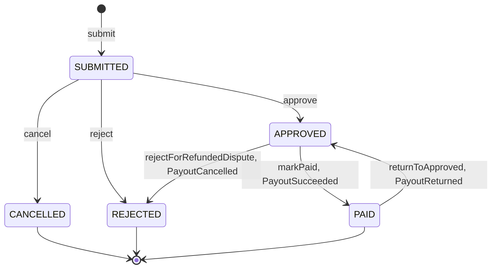
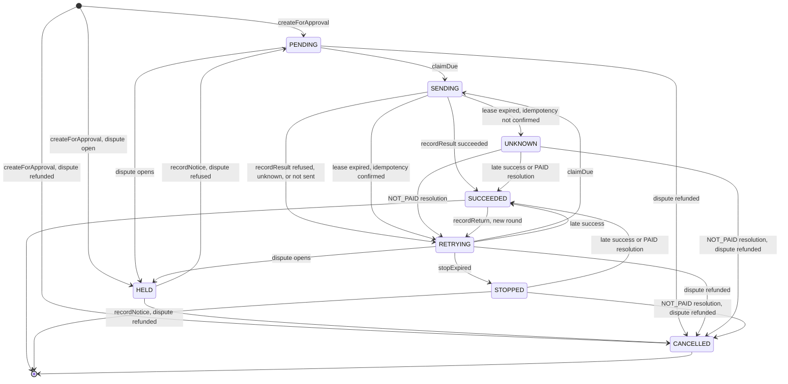
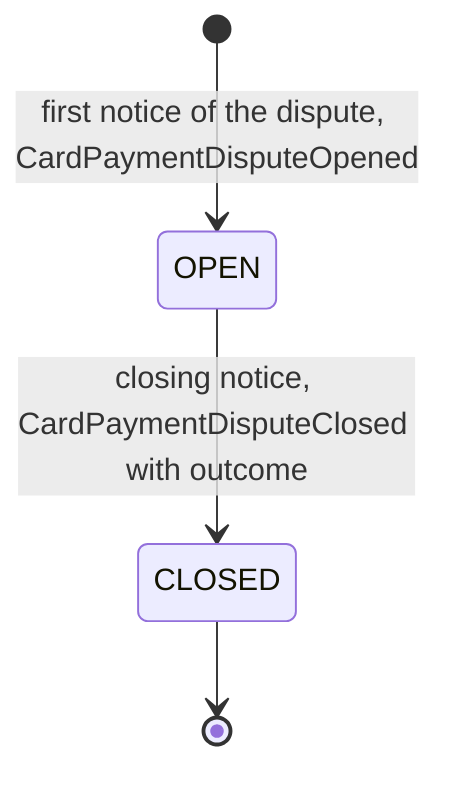
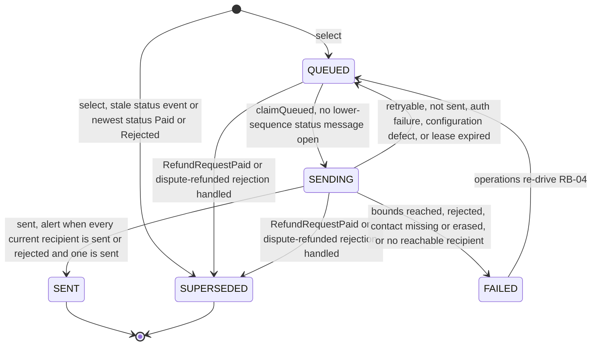

<!--
CHUNK: 08
TITLE: State Machines & Business Rules
PROJECT: Refunds Platform
VERSION: 1.1
DEPENDS_ON: 04
PART OF: LLD - Refunds Platform
-->

# 11. State Machines & Business Rules

> **Convention:** the state machines are the SDD's (Figure 16, Figure 17, the §17.2 card disputes, the §17.3 message statuses) in their implementation form: enum values, the method that fires each transition, its guard, and its side effect. Module-local rules stay in the module files.

## 11.1 Aggregate State Machines

### `RefundRequest` aggregate (in `refund-request`)

**States:** `SUBMITTED`, `APPROVED`, `REJECTED`, `PAID`, `CANCELLED` (SDD [§17.1 State machine](../sdd-refunds-platform/13a-service-refund-request.md#business-logic), Figure 16).



**Summary:** A request starts `SUBMITTED`; `cancel`, `approve`, and `reject` are allowed only from there; an `APPROVED` request becomes `PAID` when `payout` reports success or `REJECTED` when the bank refunded a disputed payment, and a `PAID` request goes back to `APPROVED` when the customer's bank sends the payout back.

**Transition rules:**

| From | Event | To | Guard | Side effect |
|------|-------|----|----|-------------|
| - | `submit` | `SUBMITTED` | All selected units eligible (started branch, window, card, not claimed, refundable); unit-claim index free | Units claimed; decision record `sequence` 1 (CUSTOMER); publish `RefundRequestSubmitted` |
| `SUBMITTED` | `cancel` | `CANCELLED` | Caller owns the request; version matches | Units unclaimed; decision record (CUSTOMER); publish `RefundRequestCancelled` |
| `SUBMITTED` | `approve` | `APPROVED` | Caller's branch; not own request; lowered amounts valid; reason when lowered; version matches; an open card dispute does not block it | Approved amount, `approved_at`; decision record (BRANCH_MANAGER); publish `RefundRequestApproved` |
| `SUBMITTED` | `reject` | `REJECTED` | Caller's branch; not own request; reason present; version matches | Units unclaimed; decision record (BRANCH_MANAGER, `DECISION`); publish `RefundRequestRejected` (`DECISION`) |
| `APPROVED` | `markPaid` (`PayoutSucceeded`) | `PAID` | Event not yet processed; `sequence` above `last_payout_sequence`; a `PAID` request records the sequence and changes nothing | Units refunded (`FULL` or `PARTIAL`) and unclaimed; `paid_at` set once; decision record (PORTAL, or PAYOUT_OPERATOR with the confirming operator); publish `RefundRequestPaid` |
| `APPROVED` | `rejectForRefundedDispute` (`PayoutCancelled`) | `REJECTED` | Event not yet processed; `sequence` above `last_payout_sequence`; a `PAID` request waits (listener redelivered) until its `PayoutReturned` is handled; any other status records the sequence and changes nothing | Units unclaimed; decision record (PORTAL, dispute outcome, `DISPUTE_REFUNDED`); publish `RefundRequestRejected` (`DISPUTE_REFUNDED`) |
| `PAID` | `returnToApproved` (`PayoutReturned`) | `APPROVED` | Event not yet processed; `sequence` above `last_payout_sequence`; any other status records the sequence and changes nothing | Units claimed again, `refund_state` `NONE`; `approved_at` reset; decision record (PORTAL, payout sent back); publish `RefundRequestPayoutReturned` |

> **Invariants enforced at every transition:** optimistic `version` must match (the listeners also lock the row `FOR UPDATE`); `tenant_id`, `customer_sub`, `branch_id`, and `requested_amount` are immutable; every transition writes exactly one `decision_record` row with the next `sequence` and registers exactly one event carrying that `sequence` (SDD [§14.10](../sdd-refunds-platform/10-events-hub.md#1410-in-process-domain-events-modular-monolith--hybrid-core) Ordering); `CardPaymentDisputeOpened` and `CardPaymentDisputeClosed` change only the dispute copy, never the status.

### `Payout` aggregate (in `payout`)

**States:** `PENDING`, `HELD`, `SENDING`, `RETRYING`, `UNKNOWN`, `SUCCEEDED`, `STOPPED`, `CANCELLED` (SDD [§17.2 State machine](../sdd-refunds-platform/13b-service-payout.md#business-logic), Figure 17).



**Summary:** The retry job moves a payout between `SENDING` and `RETRYING` until CardPay reports success, an open card dispute holds it and a dispute the bank refunded to the customer cancels it, an expired claim goes to `UNKNOWN` while CardPay's idempotency is unconfirmed, operators' resolutions close `UNKNOWN` and `STOPPED` payouts, and a payment the customer's bank sends back reopens a `SUCCEEDED` payout in a new round.

**Transition rules:**

| From | Event | To | Guard | Side effect |
|------|-------|----|----|-------------|
| - | `createForApproval` | `PENDING`, `HELD`, or `CANCELLED` | No payout for this refund request (unique key); payment advisory lock held | Round 1 with key = payout id; `PENDING`: `next_attempt_at = now`; `HELD`: `held_since`; `CANCELLED`: publish `PayoutCancelled` |
| `PENDING`, `RETRYING` | `claimDue` | `SENDING`, `HELD`, or `CANCELLED` | `next_attempt_at <= now`; row not locked; payment lock taken with `tryLock` (else skipped) | Dispute check first: refunded dispute -> `CANCELLED` + `PayoutCancelled`; open dispute -> `HELD`; else attempt row, lease, round `first_attempt_at` |
| `PENDING`, `HELD`, `SENDING`, `RETRYING`, `UNKNOWN`, `STOPPED` | `recordResult` succeeded | `SUCCEEDED` | Not already `SUCCEEDED`; the attempt's round is the current round | Publish `PayoutSucceeded`; from `STOPPED`, alert `PayoutSucceededAfterStop`; on `CANCELLED` it stays `CANCELLED` and alerts |
| `SENDING` | `recordResult` refused, unknown, or not sent | `RETRYING` | Result belongs to the attempt in flight (`attempt_count` matches; a callback only after the lease expired) | Backoff (not sent: 30 s + jitter); the first failure of round 1 publishes `PayoutAttemptFailed` |
| `PENDING`, `RETRYING`, `UNKNOWN`, `STOPPED` | `recordResult` refused or unknown | (unchanged) | - | Attempt row updated, logged `stale_result` |
| `SENDING` | lease expired | `RETRYING` or `UNKNOWN` | `CARDPAY_IDEMPOTENCY_CONFIRMED` | In-flight attempt closed `UNKNOWN`; the first failure of round 1 publishes `PayoutAttemptFailed`; `UNKNOWN`: alert `PayoutUnknown`; lease expired twice: alert `LeaseExpiredTwice` |
| `PENDING`, `RETRYING` | `recordNotice` dispute opened | `HELD` | Payment advisory lock | `held_since = now` |
| `HELD` | `recordNotice` dispute closed, refused | `PENDING` | No other open dispute of the payment | `next_attempt_at = now`; held time added to the round's `held_duration` |
| `HELD`, `PENDING`, `RETRYING` | `recordNotice` dispute closed, refunded to the customer | `CANCELLED` | Payment advisory lock | Publish `PayoutCancelled` (`DISPUTE_REFUNDED`); `UNKNOWN` or `STOPPED` payouts unchanged with alert `PayoutDisputeRefundedUnresolved`; `SUCCEEDED` unchanged (R-09) |
| `UNKNOWN`, `STOPPED` | resolution `PAID` (confirmed by a second operator) | `SUCCEEDED` | Open resolution row, `confirmed_at` set | Publish `PayoutSucceeded` with `resolvedBy` and `confirmedBy` |
| `UNKNOWN` | resolution `NOT_PAID` | `RETRYING` | Open resolution row; no dispute of the payment refunded to the customer | `next_attempt_at = now`, same round key |
| `UNKNOWN`, `STOPPED` | resolution `NOT_PAID` | `CANCELLED` | A dispute of the payment closed as refunded to the customer | Publish `PayoutCancelled` |
| `RETRYING` | `stopExpired` | `STOPPED` | Round `first_attempt_at` plus held time older than the stop time (once set) | Alert `PayoutStopped` |
| `RETRYING`, `UNKNOWN` | `raiseStillFailing` | (unchanged) | One day since the round's first attempt, held time excluded; not yet published in this round | Publish `PayoutStillFailing` once per round |
| `SUCCEEDED` | `recordReturn` | `RETRYING` | The returned payment belongs to the current round; not recorded before | New round with a new UUIDv7 key, due now; publish `PayoutReturned`; no `PayoutAttemptFailed` in that round |

> **Invariants:** `amount`, `currency`, and `refund_request_id` never change; every attempt of a round carries the round's idempotency key (round 1: the payout id), and a new key exists only for a new round; every status change adds 1 to `sequence`, which the event reporting it carries; no transition runs during a CardPay call; no attempt is sent while a dispute of the payment is open or after one closed as refunded to the customer (SDD [§17.2 Constraints](../sdd-refunds-platform/13b-service-payout.md#constraints)).

> Confirm: SDD §17.2 Result (prose) accepts a succeeded result from `Pending`, `Sending`, `Retrying`, `Unknown`, or `Stopped`, while SDD Figure 17 draws no `Pending` to `Succeeded` edge, and neither lists `Held`; this LLD follows the prose and also accepts a late success on `HELD` (`04-implementation/payout.md` § 7.3 `recordResult`: the money left), and draws the diagram as the SDD does.

### `CardPaymentDispute` (in `payout`) and its copy (in `refund-request`)

**States:** `OPEN`, `CLOSED` with an outcome `REFUNDED_TO_CUSTOMER` or `REFUSED` (SDD [§17.2 Disputes](../sdd-refunds-platform/13b-service-payout.md#business-logic), §17.1 Decide).



**Summary:** `payout` records each dispute once per state, keyed by CardPay's dispute id, and never reopens a closed one; `refund-request` keeps a copy by the dispute's `sequence`, so a late Opened never reopens a closed copy row, and only open rows are shown at decision time and excluded from the approved-to-paid alert.

| From | Event | To | Guard | Side effect |
|------|-------|----|----|-------------|
| - | First API-09 notice of the dispute | `OPEN` | No row for the dispute id; payment advisory lock | `sequence` 1; publish `CardPaymentDisputeOpened`; `PENDING` and `RETRYING` payouts of the payment -> `HELD`; a first notice that already closes the dispute continues to `CLOSED` in the same transaction (recorded as opened and closed, SDD §17.2 Error Handling) |
| `OPEN` | API-09 notice, state closed | `CLOSED` | State rank higher than the recorded one | `sequence` + 1; publish `CardPaymentDisputeClosed`; payouts released or cancelled (`Payout` table above) |
| `OPEN`, `CLOSED` | Older or repeated notice | (unchanged) | State rank not higher | None |

### `Message` (in `customer-notification`)

**States:** `QUEUED`, `SENDING`, `SENT`, `FAILED`, `SUPERSEDED` (SDD [§17.3](../sdd-refunds-platform/13c-service-customer-notification.md#business-logic)).



**Summary:** A message is queued by a listener, or created `SUPERSEDED` when its status event is stale or, for a payout message, the newest status seen is Paid or Rejected; it is claimed in `sequence` order and sent by `message-sender`, retried until its bounds, and a payout-delayed message or still-failing alert of a request is superseded by the paid listener or the dispute-refunded rejection while it is `QUEUED` or `SENDING`, whichever event comes first.

> Confirm: the SDD names the statuses `Queued`, `Sending`, `Sent`, `Failed`, `Superseded` but draws no message state machine; the transitions above are this LLD's reading of SDD §17.3 Select and Send, as `04-implementation/customer-notification.md` § 7.3 builds them. The paid listener and the dispute-refunded rejection supersede a payout-delayed message or a still-failing alert that is `QUEUED` or `SENDING`; a call already in flight can still reach the recipient (SDD §17.3 Send accepts it), and the sender's outcome write, conditional on `SENDING` and the claim token, leaves the message `SUPERSEDED`.

## 11.2 Cross-Service Business Rules

### Rule: Only refund-request writes refund status

**Statement:** a refund request's status changes only inside `refund-request`; `payout` reports payout facts (`PayoutSucceeded`, `PayoutReturned`, `PayoutCancelled`, `PayoutAttemptFailed`, `PayoutStillFailing`) and card dispute facts, and `refund-request` turns `PayoutSucceeded`, `PayoutReturned`, and `PayoutCancelled` into `RefundRequestPaid`, `RefundRequestPayoutReturned`, and `RefundRequestRejected`.

**Source of truth:** `refund-request` (SDD [§14.7 Refund status doctrine](../sdd-refunds-platform/10-events-hub.md#147-universal-subscribers--cross-service-doctrines)).

**Enforcement points:** ArchUnit (proposed): no class outside `refundsplatform.refundrequest` writes the `refund_request` schema (the module role also denies it); `loyalty-points` and `customer-notification` listen to the `refund-request` events, never to `PayoutSucceeded`, `PayoutReturned`, or `PayoutCancelled`.

**Validation matrix:**

| Input condition | Expected outcome |
|-----------------|------------------|
| `PayoutSucceeded` for an `APPROVED` request | `PAID`, `RefundRequestPaid` published once |
| `PayoutSucceeded` redelivered, or older than a handled payout event | No change |
| `PayoutReturned` for a `PAID` request | `APPROVED`, units claimed again, `RefundRequestPayoutReturned` |
| `PayoutCancelled` for an `APPROVED` request | `REJECTED` (`DISPUTE_REFUNDED`), units released, `RefundRequestRejected` |
| `PayoutAttemptFailed` | Request stays `APPROVED`; no `refund-request` listener exists |

### Rule: The refund saga is choreographed, with two compensating steps

**Statement:** the refund saga runs as durable in-process events with no orchestrator: (1) `refund-request` approves (`RefundRequestApproved`); (2) `payout` pays out (`PayoutSucceeded`, or `PayoutAttemptFailed` and `PayoutStillFailing`), holding the payout while the original card payment has an open card dispute; (3) `refund-request` marks the request Paid (`RefundRequestPaid`); (4) `loyalty-points` takes points back. A payout that has not paid, whose payment's dispute the bank refunded to the customer, is cancelled and the request becomes Rejected; a Paid refund whose payout the customer's bank sends back returns to step 2 in a new round ([REFUNDS/UC-04](../brd-refunds-portal/06b-use-cases-branch-manager.md#uc-04-approve--reject-refund) BR-8: payout waits for a card dispute, E1).

**Source of truth:** SDD [§14.7 Saga doctrine](../sdd-refunds-platform/10-events-hub.md#147-universal-subscribers--cross-service-doctrines); each module owns its step and its timeout.

**Enforcement points:** steps 1 and 3 and the compensations in `RefundDecisionServiceImpl` ([refund-request § 7.4](./04-implementation/refund-request.md#pattern-saga-choreography---refund-lifecycle-with-payout-and-take-back)); step 2 in `PayoutServiceImpl` and `CardPaymentDisputeServiceImpl`; step 4 in `PointsTakeBackServiceImpl`. Timeout owners: `refund-request` for the decision time (`late` flag) and the approved-to-paid deadline of 3 days (gauge `refund_request_oldest_approved_unpaid_age_seconds`, excluding requests with an open card dispute); `payout` for the retry stop time (open); `loyalty-points` for the LOYALTY/NFR-02 budget (`loyalty_takeback_lag_seconds`).

| Input condition | Expected outcome |
|-----------------|------------------|
| Approved, no dispute, CardPay pays | `PAID`, points taken back once |
| Approved while the payment has an open dispute | Payout `HELD`; request stays `APPROVED`, not counted by the 3-day alert |
| Dispute closes refunded to the customer before the payout paid | Payout `CANCELLED`, request `REJECTED` (`DISPUTE_REFUNDED`), no payout, no take-back |
| Paid payout sent back by the customer's bank | Request back to `APPROVED`, payout paid again in a new round; the points effect is the SDD §17.4 open question |
| Payout never succeeds | `STOPPED` and alert; request stays `APPROVED` until the SDD §17.2 never-succeeds marker is answered |

### Rule: One payout per approved refund request, one key per payout round

**Statement:** at most one payout exists per refund request, its amount is the approved amount, and every attempt of a round carries the round's idempotency key: the payout id in round 1, a new key only for a round after a payment sent back (REFUNDS/NFR-01).

**Source of truth:** `payout` (SDD [§17.2 Create, Send, Payout sent back](../sdd-refunds-platform/13b-service-payout.md#business-logic)).

**Enforcement points:** unique `(tenant_id, refund_request_id)`; `PayoutGateway` takes the key from the current `payout_round` only; unique `(tenant_id, idempotency_key)` on `payout_round`; reconciliation daily.

| Input condition | Expected outcome |
|-----------------|------------------|
| `RefundRequestApproved` delivered twice | One payout |
| Timeout on attempt 3 | Attempt 4 uses the same round key |
| Payment sent back by the customer's bank | Round 2 with a new key; the paying-again round is not a duplicate in reconciliation |
| CardPay reports two refunds for one round | Reconciliation mismatch `PAID_TWICE` and alert |

### Rule: A payout waits for a card dispute of the original payment

**Statement:** no attempt is sent while the original card payment has an open card dispute, or after one closed as refunded to the customer; the held time counts toward neither the one-day still-failing event nor the retry stop time ([REFUNDS/UC-04](../brd-refunds-portal/06b-use-cases-branch-manager.md#uc-04-approve--reject-refund) BR-8: payout waits for a card dispute, AC-12: no payout while the payment is disputed, AC-16: payout sent after a refused dispute).

**Source of truth:** `payout` (SDD [§17.2 Disputes](../sdd-refunds-platform/13b-service-payout.md#business-logic)); `refund-request` shows the open disputes at decision time from its copy.

**Enforcement points:** the dispute check in `createForApproval` and before every claim, under the payment advisory lock; `CardPaymentDisputeServiceImpl.recordNotice`; until CardPay can report disputes (API-09 open), no payout is held (SDD API-09 Fallback).

| Input condition | Expected outcome |
|-----------------|------------------|
| Open dispute when the approval arrives | Payout created `HELD` |
| Dispute opens on a `RETRYING` payout | `HELD` before its next attempt |
| Dispute closes refused | `PENDING`, sent at once |
| Dispute closes refunded while the payout is `UNKNOWN` or `STOPPED` | Unchanged, alert; a `NOT_PAID` resolution then cancels it |
| Dispute opens after the payout succeeded | Payout unchanged (R-09) |

### Rule: A message never changes a refund request

**Statement:** message outcomes are never reported back to `refund-request` (REFUNDS 03 Customer messages, [REFUNDS/UC-01](../brd-refunds-portal/06a-use-cases-customer.md#uc-01-request-a-refund) AC-4: request recorded even if messages fail); the customer's messages follow the request's `sequence`, not the arrival order of events.

**Source of truth:** `customer-notification` (SDD [§17.3 Select](../sdd-refunds-platform/13c-service-customer-notification.md#business-logic)).

**Enforcement points:** `customer-notification` publishes no event and calls only the read-only API-06 and the staff query API-08.

| Input condition | Expected outcome |
|-----------------|------------------|
| MsgHub down at submission | Request `SUBMITTED`, 201 returned; messages retried |
| Contact details erased | Message `FAILED`; request unchanged |
| `RefundRequestPaid` handled before a delayed `RefundRequestApproved` | Approval message still sent first (always sent, claimed in `sequence` order) |
| No branch manager found for a still-failing alert | Message `FAILED`, operations alert; request unchanged |

### Rule: Refund outcomes reach Loyalty Points in order, and only a paid refund takes points back

**Statement:** `loyalty-points` is told every refund outcome (`RefundRequestPaid`, `RefundRequestRejected`, `RefundRequestCancelled`, `RefundRequestPayoutReturned`), applies the outcomes of one request in `sequence` order, and takes points back only for a paid refund from the refund-reporting start date on; the other outcomes add no movement ([LOYALTY/UC-02](../brd-loyalty-points/06a-use-cases-member.md#uc-02-view-points-history) BR-1: rejected or cancelled takes back nothing, BR-7: only refunds the Refunds Portal reports; [REFUNDS/UC-04](../brd-refunds-portal/06b-use-cases-branch-manager.md#uc-04-approve--reject-refund) BR-9: Loyalty Points told the outcome).

**Source of truth:** `refund-request` for the outcomes (SDD [§17.1 Outcomes for Loyalty Points](../sdd-refunds-platform/13a-service-refund-request.md#business-logic)); `loyalty-points` for their effect (SDD [§17.4 Other refund outcomes](../sdd-refunds-platform/13d-service-loyalty-points.md#business-logic)).

**Enforcement points:** the `refund_outcome` log on the event id with the `sequence` check; `LOYALTY_REFUND_REPORTING_START_DATE`; while `LOYALTY_POINTS_ENABLED` is off the outcomes wait in the `refund-request` publication log (SDD [§11.3](../sdd-refunds-platform/07-cross-cutting-concerns.md#113-deployment-default)).

| Input condition | Expected outcome |
|-----------------|------------------|
| Paid before the refund-reporting start date | Recorded, no movement |
| Rejected or Cancelled | Recorded, no movement |
| Paid redelivered after a newer outcome of the request | Recorded with no effect |
| Outcomes while Loyalty Points is off | Delivered at switch-on, in any order, applied by `sequence` |

### Rule: Take-back once per paid refund, capped per purchase

**Statement:** each paid refund takes points back at most once, only for a purchase that earned points, 1 point per 1 EUR refunded, never more than the purchase earned; a refund paid before its purchase arrives waits up to the parking period ([LOYALTY/UC-02](../brd-loyalty-points/06a-use-cases-member.md#uc-02-view-points-history) BR-3: once per paid refund, BR-4: only purchases that earned points, BR-5: refund paid before earning, BR-6: take-back never exceeds earned).

**Source of truth:** `loyalty-points` (SDD [§17.4 Take-back](../sdd-refunds-platform/13d-service-loyalty-points.md#business-logic)).

**Enforcement points:** `processed_refund` inbox; `received_purchase.points_taken_back` cap inside the account-locked transaction; the purchase advisory lock shared by intake and take-back.

| Input condition | Expected outcome |
|-----------------|------------------|
| Purchase earned 50, two paid refunds of 30 and 30 points' worth | 30 then 20 taken back (cap 50) |
| `RefundRequestPaid` redelivered | No second movement |
| Refund paid before the purchase arrives | Parked; applied when the purchase earns within the parking period, else ended with no movement |

## 11.3 Algorithm Pseudocode (non-trivial only)

### Algorithm: Payout retry backoff

**Input:** `attemptNo` (the payout's `attempt_count`, 1-based, across rounds), `now`, the attempt's outcome.

**Output:** `nextAttemptAt`.

```text
if outcome == NOT_SENT: return now + 30 s + random_uniform(0, 30 s)   // no call made: the breaker's open wait
cap = PAYOUT_RETRY_MAX_DELAY; base = PAYOUT_RETRY_BASE_DELAY
exp = min(cap, base * 2^(attemptNo - 1))
return now + random_uniform(0, exp)                                     // full jitter
```

**Edge cases:** very large `attemptNo` (overflow) is cut at the cap before multiplying; the stop time is checked separately (`stopExpired`), from the round's first attempt with held time excluded; a payout released from `HELD` or reopened in a new round is due at once, not by this formula.

**Complexity:** O(1).

> TODO: base and cap (1 minute, 1 hour) are best guesses for the SDD [§12 INT-01](../sdd-refunds-platform/08-integrations.md#12-integrations) [NEEDS CLARIFICATION] on CardPay retry bounds - verify.

<!-- MASTER: refunds-platform-lld-master.md | PREV: 07-event-contracts.md | NEXT: 09-cross-cutting.md -->
