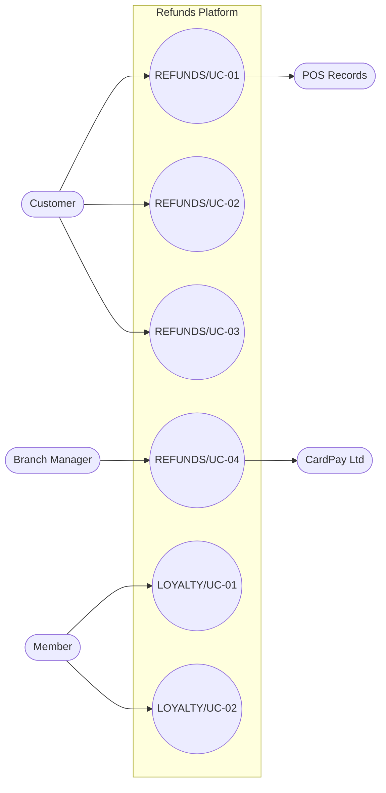

<!--
CHUNK: 03
TITLE: System Users & Use Cases
PROJECT: Refunds Platform
VERSION: 1.3
DEPENDS_ON: 01 (§7.3 also reads 05, 09, 10, 11, and 13x)
PART OF: SDD - Refunds Platform
-->

# 7. System Users & Use Cases

## 7.1 Actors

| Actor | Type (Human / System) | Description | Primary Interface |
|-------|-----------------------|-------------|-------------------|
| Customer | Human | REFUNDS Customer persona ([REFUNDS 04 § Personas / Actors](../brd-refunds-portal/04-scope-and-personas.md#personas--actors)): requests, tracks, and cancels refunds for their own branch purchases. | Web frontend, customer screens |
| Branch Manager | Human | REFUNDS Branch Manager persona ([REFUNDS 04 § Personas / Actors](../brd-refunds-portal/04-scope-and-personas.md#personas--actors)): decides on the refund requests of their own branch. | Web frontend, branch manager screens |
| Member | Human | LOYALTY Member persona ([LOYALTY 04 § Personas / Actors](../brd-loyalty-points/04-scope-and-personas.md#personas--actors)): sees their own points balance and history. A member is a customer who joined the loyalty program (LOYALTY 02 Glossary), but the role differs from the REFUNDS Customer, so it is a separate actor; whether one sign-in serves both is open (§16.2). | Web frontend, member screens |
| CardPay Ltd | System | Payment Provider ([REFUNDS 08 § Integrations](../brd-refunds-portal/08-integrations.md#integrations)); reports payout results in the API-01 response and, if CardPay calls back, through API-02 (open, §15.6); reports disputes of the original card payment, if it can, by push or fetch (API-09, open, §17.2 Disputes). | External; inbound API-02 only if CardPay calls back; API-09 direction open |
| Payout operator | Human | Retailer staff who record and confirm payout results by hand ([REFUNDS 03 § Decision record](../brd-refunds-portal/03-definitions-and-domain-concepts.md#decision-record)); no REFUNDS persona yet (§16.4.2 marker). | Web frontend, operator screens |
| POS Records | System | Point-of-Sale Records ([REFUNDS 08 § Integrations](../brd-refunds-portal/08-integrations.md#integrations), [LOYALTY 08 § Integrations](../brd-loyalty-points/08-integrations.md#integrations)); gives `loyalty-points` the member purchases (API-05), by pushing them or by `loyalty-points` fetching them (open, §17.4 Input). | External; API-05 direction open |

## 7.2 Use Case Diagram

**Figure 1: Use Case Diagram**

**Summary:** The Customer drives [REFUNDS/UC-01](../brd-refunds-portal/06a-use-cases-customer.md#uc-01-request-a-refund), [REFUNDS/UC-02](../brd-refunds-portal/06a-use-cases-customer.md#uc-02-track-refund-status), and [REFUNDS/UC-03](../brd-refunds-portal/06a-use-cases-customer.md#uc-03-cancel-a-refund-request); the Branch Manager drives [REFUNDS/UC-04](../brd-refunds-portal/06b-use-cases-branch-manager.md#uc-04-approve--reject-refund), which uses CardPay Ltd; the Member drives [LOYALTY/UC-01](../brd-loyalty-points/06a-use-cases-member.md#uc-01-view-points-balance) and [LOYALTY/UC-02](../brd-loyalty-points/06a-use-cases-member.md#uc-02-view-points-history). [REFUNDS/UC-01](../brd-refunds-portal/06a-use-cases-customer.md#uc-01-request-a-refund) uses POS Records for the receipt; [REFUNDS/UC-05](../brd-refunds-portal/05-user-journeys-overview.md#use-case-summary) is merged into [REFUNDS/UC-04](../brd-refunds-portal/06b-use-cases-branch-manager.md#uc-04-approve--reject-refund) and is not drawn.

## 7.3 Use Case Traceability (BRD → SDD)

| Use case (BRD) | Title | Owner (§17.X) | Entry points | Flows (§8.4 / §8.5) | APIs (§15) | Events (§14) | Status |
|----------------|-------|---------------|--------------|---------------------|------------|--------------|--------|
| **[Refunds Portal v1.5](../brd-refunds-portal/refunds-portal-brd-master.md) (REFUNDS)** | | | | | | | |
| [REFUNDS/UC-01](../brd-refunds-portal/06a-use-cases-customer.md#uc-01-request-a-refund) | Request a Refund | [refund-request](./13a-service-refund-request.md) | `GET /v1/receipts/{receiptNumber}/refundable-items`, `POST /v1/refund-requests` | [§8.4.1](./05-workflows-and-sequences.md#841-workflow-refund-request-lifecycle), [§8.5.1](./05-workflows-and-sequences.md#851-sequence-submit-a-refund-request) | API-03, API-04, API-06 | `RefundRequestSubmitted` | Active |
| [REFUNDS/UC-02](../brd-refunds-portal/06a-use-cases-customer.md#uc-02-track-refund-status) | Track Refund Status | [refund-request](./13a-service-refund-request.md) | `GET /v1/refund-requests`, `GET /v1/refund-requests/{refundRequestId}` | [§8.5.4](./05-workflows-and-sequences.md#854-sequence-view-own-refund-requests-and-points) | - | - | Active |
| [REFUNDS/UC-03](../brd-refunds-portal/06a-use-cases-customer.md#uc-03-cancel-a-refund-request) | Cancel a Refund Request | [refund-request](./13a-service-refund-request.md) | `POST /v1/refund-requests/{refundRequestId}/cancellation` | [§8.4.1](./05-workflows-and-sequences.md#841-workflow-refund-request-lifecycle) | API-03, API-06 | `RefundRequestCancelled` | Active |
| [REFUNDS/UC-04](../brd-refunds-portal/06b-use-cases-branch-manager.md#uc-04-approve--reject-refund) | Approve / Reject Refund | [refund-request](./13a-service-refund-request.md) | `GET /v1/branches/{branchId}/refund-requests`, `GET /v1/branches/{branchId}/refund-requests/{refundRequestId}`, `POST /v1/refund-requests/{refundRequestId}/decision`, `Schedule: payout-retry` (payout) | [§8.4.1](./05-workflows-and-sequences.md#841-workflow-refund-request-lifecycle), [§8.4.2](./05-workflows-and-sequences.md#842-workflow-payout-with-retries), [§8.4.3](./05-workflows-and-sequences.md#843-workflow-points-take-back-after-a-paid-refund), [§8.5.2](./05-workflows-and-sequences.md#852-sequence-decide-and-pay-out-a-refund), [§8.5.3](./05-workflows-and-sequences.md#853-sequence-take-back-points-for-a-paid-refund) | API-01, API-02, API-03, API-06, API-08, API-09 | `RefundRequestApproved`, `RefundRequestRejected`, `PayoutSucceeded`, `RefundRequestPaid`, `PayoutAttemptFailed`, `PayoutStillFailing`, `PayoutReturned`, `RefundRequestPayoutReturned`, `PayoutCancelled`, `CardPaymentDisputeOpened`, `CardPaymentDisputeClosed` | Active |
| [REFUNDS/UC-05](../brd-refunds-portal/05-user-journeys-overview.md#use-case-summary) | Issue Partial Refund | - | - | - | - | - | Merged into REFUNDS/UC-04 |
| **[Loyalty Points v1.7](../brd-loyalty-points/loyalty-points-brd-master.md) (LOYALTY)** | | | | | | | |
| [LOYALTY/UC-01](../brd-loyalty-points/06a-use-cases-member.md#uc-01-view-points-balance) | View Points Balance | [loyalty-points](./13d-service-loyalty-points.md) | `GET /v1/members/me/points-balance` | [§8.5.4](./05-workflows-and-sequences.md#854-sequence-view-own-refund-requests-and-points) | - | - | Active |
| [LOYALTY/UC-02](../brd-loyalty-points/06a-use-cases-member.md#uc-02-view-points-history) | View Points History | [loyalty-points](./13d-service-loyalty-points.md) | `GET /v1/members/me/points-movements`, `GET /v1/members/me/points-movements/{movementId}`, `Event: RefundRequestPaid`, `Event: RefundRequestRejected`, `Event: RefundRequestCancelled` | [§8.4.3](./05-workflows-and-sequences.md#843-workflow-points-take-back-after-a-paid-refund), [§8.5.3](./05-workflows-and-sequences.md#853-sequence-take-back-points-for-a-paid-refund), [§8.5.4](./05-workflows-and-sequences.md#854-sequence-view-own-refund-requests-and-points) | - | - | Active |

<!-- MASTER: refunds-platform-sdd-master.md | PREV: 02-ecosystem-overview.md | NEXT: 04-architecture-style-and-diagrams.md -->
