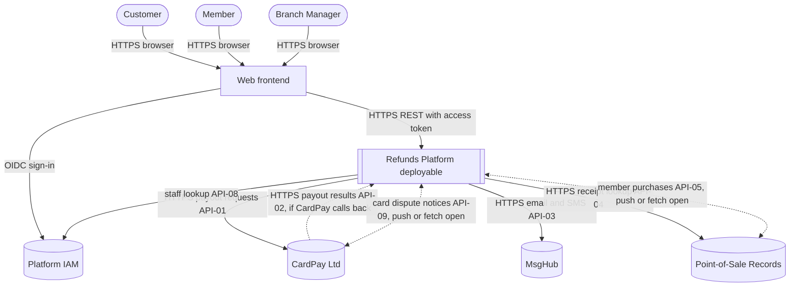
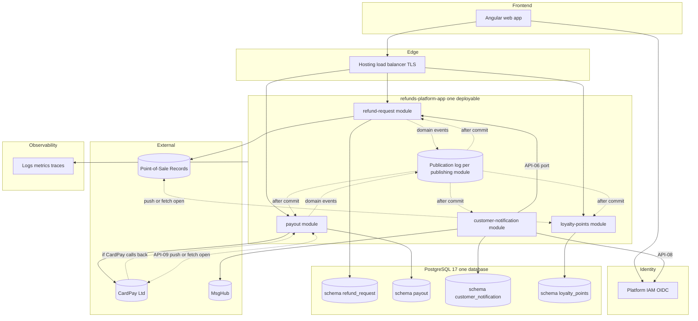

<!--
CHUNK: 04
TITLE: System Design - Architecture Style, Context & HLA Diagrams
PROJECT: Refunds Platform
VERSION: 1.3
DEPENDS_ON: 01, 02
PART OF: SDD - Refunds Platform
-->

# 8. System Design / High-Level Architecture

## 8.1 Architecture Style

### 8.1.1 What

A modular monolith (ADR-01): one Spring Boot deployable, `refunds-platform-app`, containing four modules (`refund-request`, `payout`, `customer-notification`, `loyalty-points`). Each module is a DDD bounded context with hexagonal structure and its own PostgreSQL schema. Modules exchange state changes as durable in-process domain events recorded in a publication log (§14.10, ADR-02) and make synchronous calls to each other only through in-process ports, one hop at most (§15, ADR-05). Payouts to CardPay Ltd and messages through MsgHub are queued in the owning module's tables in the same transaction as the state change and sent after commit; the receipt lookup in Point-of-Sale Records is a synchronous query (API-04). There is no message broker and no service-to-service HTTP inside the platform.

### 8.1.2 Why

- **Stage and team:** both BRDs describe a first production release (the Refunds Portal replaces paper and phone approvals: [REFUNDS 01 § Background and Context / Problem Statement](../brd-refunds-portal/01-executive-summary-and-context.md#background-and-context--problem-statement); Loyalty Points goes live for members with redeeming points left for later: [LOYALTY 04 § Out of Scope](../brd-loyalty-points/04-scope-and-personas.md#out-of-scope)), built by one team (assumed: §3 assumption 6). One deployable keeps delivery and operations simple for one team.
- **Load:** the load of §18.1, with the seasonal peak of REFUNDS/NFR-03. No BRD NFR or Technical Input states a separate scaling, failure, or release need for one part, so no part is extracted.
- **Money safety (REFUNDS/NFR-01):** a single database transaction covers the refund status change, its decision-record row, and the queued payout or event, which removes the dual-write risk without a broker.
- **Cross-BRD link (LOYALTY/NFR-02):** points are taken back within the LOYALTY/NFR-02 budget (§18.5); an in-process event redelivered from the publication log meets this without a broker.
- **Mandates:** Java 21 / Spring Boot and PostgreSQL are BRD-mandated ([REFUNDS 12 TI-01](../brd-refunds-portal/12-appendix-and-wishlist.md#technical-inputs-for-the-sdd), [REFUNDS 12 TI-02](../brd-refunds-portal/12-appendix-and-wishlist.md#technical-inputs-for-the-sdd)).

### 8.1.3 How

- **Bounded contexts:** `refund-request` (refund request, items, status, decision record, branch report), `payout` (payouts and attempts with CardPay), `customer-notification` (customer and branch-manager messages through MsgHub), `loyalty-points` (points account, movements, purchase intake).
- **Inter-module communication:** in-process domain events, delivered after commit from a durable publication log, for every state change another module needs (§14.10); one `Internal (in-process)` port call (`CustomerContactPort`, API-06) for a query; no chain deeper than one hop.
- **External communication:** HTTPS to CardPay Ltd, MsgHub, and Point-of-Sale Records through anti-corruption adapters (§12); provider-owned contract fields stay `TBD - external` (§15.6).
- **Data ownership:** one PostgreSQL database; schemas `refund_request`, `payout`, `customer_notification`, `loyalty_points`; a module reads only its own schema; architecture tests fail the build on a cross-schema query or a cross-module import outside a port.
- **Deployment model:** one OCI container image on a managed container service, at least 2 replicas, rolling deployments (ADR-09, §11.3).
- **Frontend:** one Angular web app (ADR-11, Proposed) calls the deployable's REST API with an OIDC access token from the IAM (ADR-07, Proposed).

## 8.2 Context Diagram

**Figure 2: System Context Diagram**

**Summary:** Customers, members, and branch managers use one web frontend that signs them in through the platform IAM and calls the Refunds Platform deployable. The deployable sends payouts to CardPay Ltd and receives their results in the API-01 response or, if CardPay calls back, through API-02, and gets the card disputes of original payments from CardPay by push or fetch, if CardPay can report them (API-09, open, §17.2 Disputes); it sends messages through MsgHub, looks up receipts in Point-of-Sale Records and gets member purchases from it by push or fetch (open, §17.4 Input), and finds the branch managers of a branch through the platform IAM (API-08).

## 8.3 High-Level Architecture Diagram

**Figure 3: High-Level Architecture**

**Summary:** The web app reaches the deployable through the hosting load balancer; `refund-request` and `loyalty-points` serve the user-facing REST APIs, and `payout` the operator endpoints. Modules publish domain events into their publication logs and listeners run after commit; `customer-notification` reads contact details through the `CustomerContactPort` (API-06) and finds branch managers through the platform IAM (API-08); each module owns one schema, and only `payout`, `customer-notification`, `refund-request`, and `loyalty-points` talk to their own providers.

<!-- MASTER: refunds-platform-sdd-master.md | PREV: 03-users-and-use-cases.md | NEXT: 05-workflows-and-sequences.md -->
