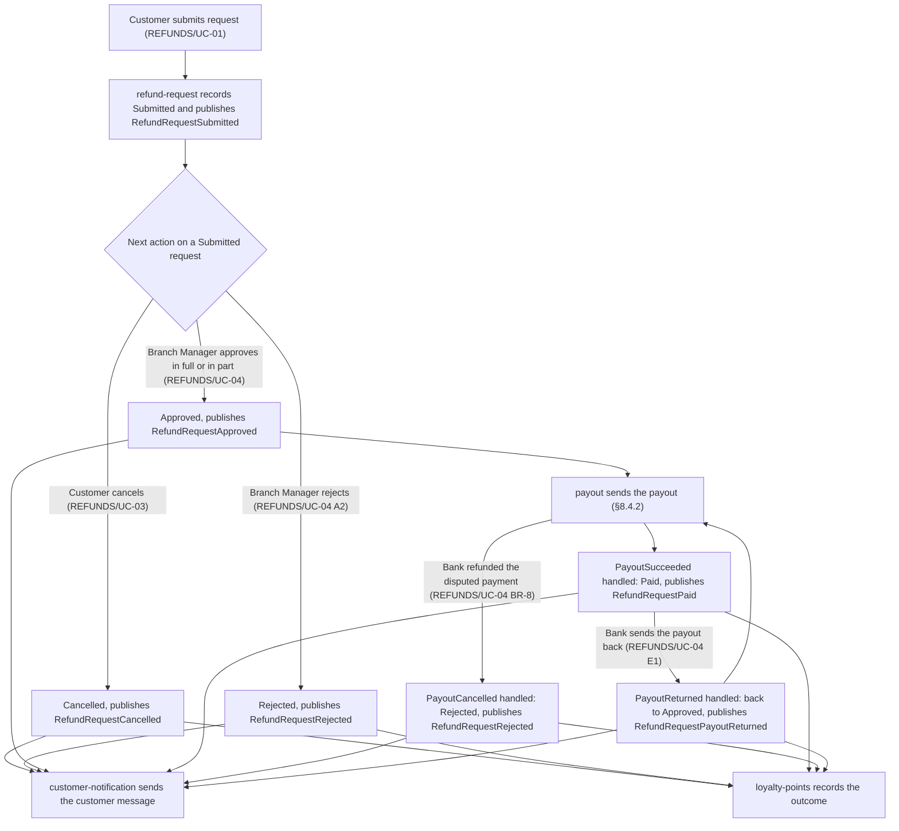
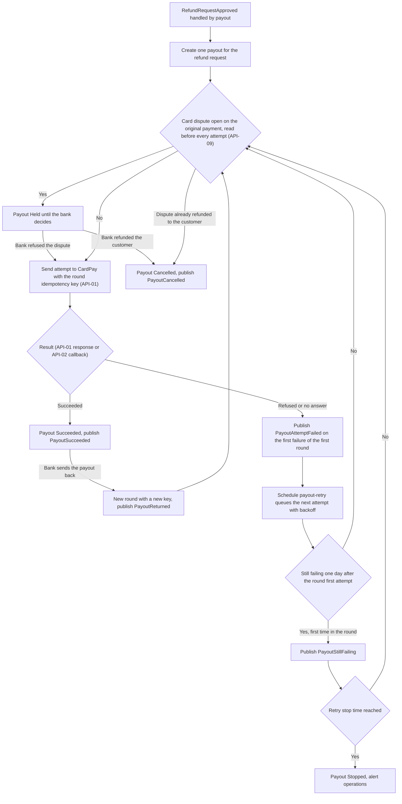
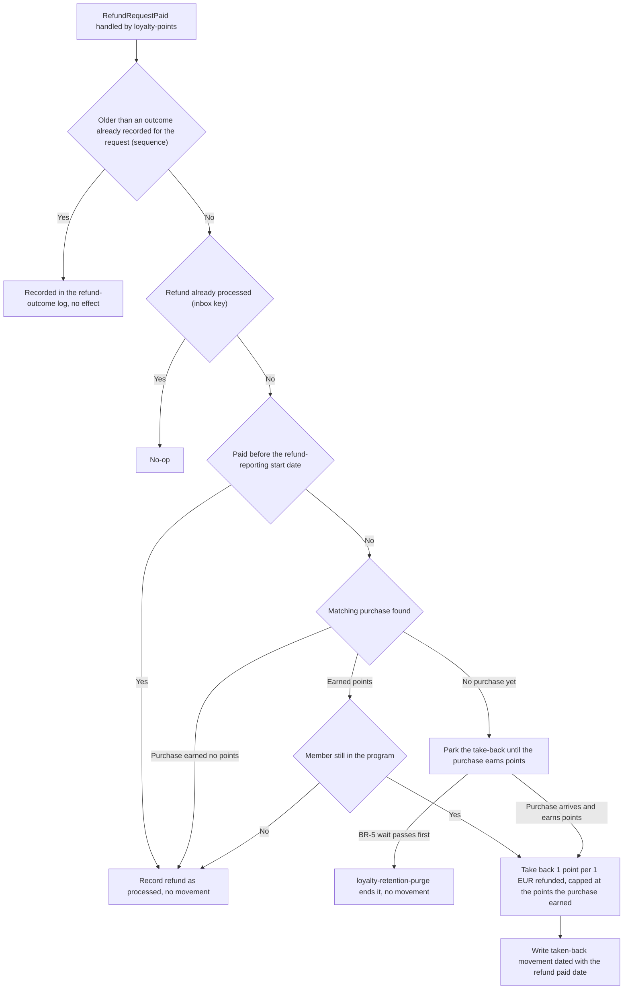
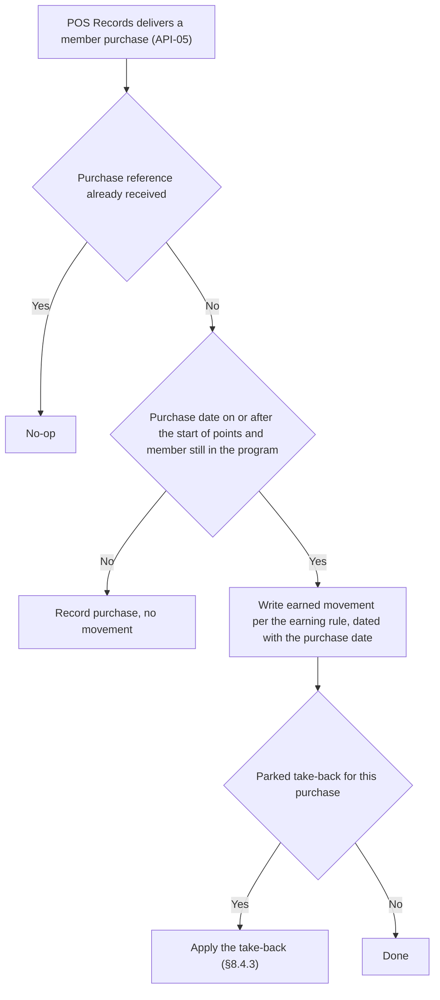
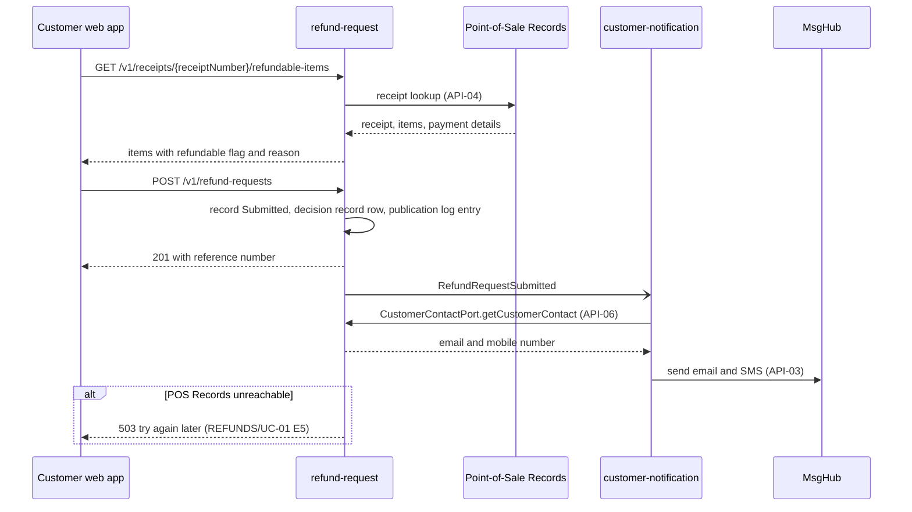
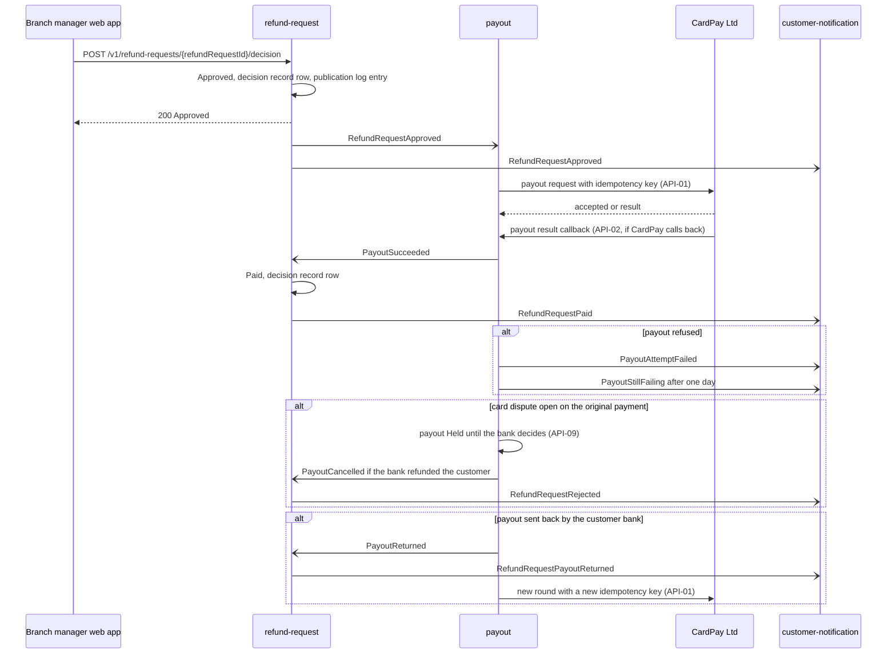
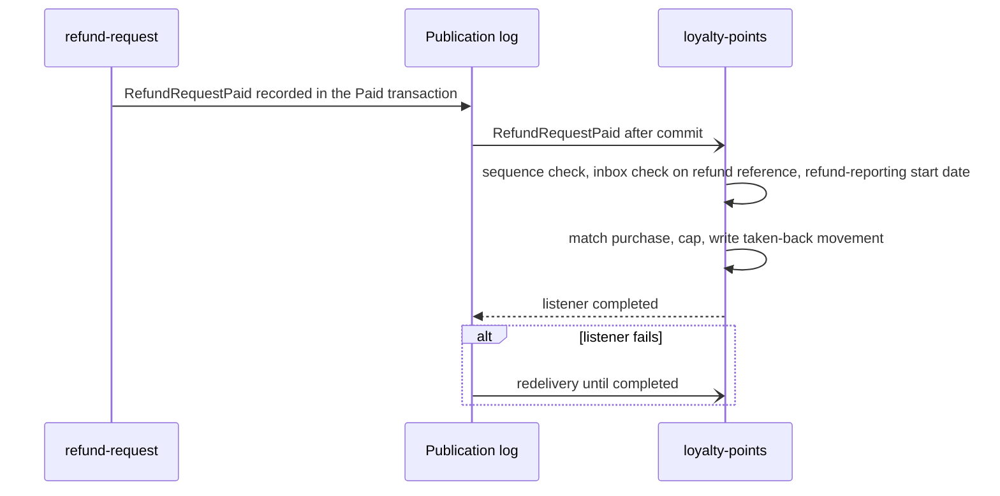
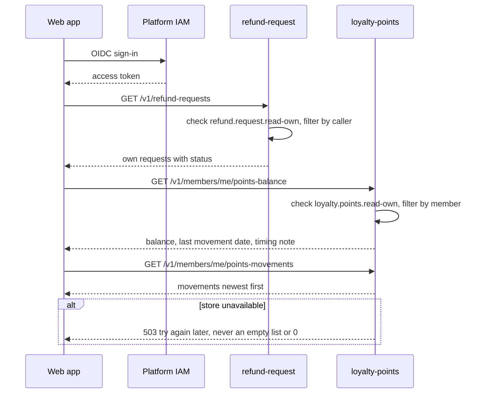

<!--
CHUNK: 05
TITLE: System Design - Workflow & Sequence Diagrams
PROJECT: Refunds Platform
VERSION: 1.3
DEPENDS_ON: 04
PART OF: SDD - Refunds Platform
-->

## 8.4 Workflow Diagrams

<!-- This chunk continues the System Design section from chunk 04 (Architecture Style & Diagrams). -->

### 8.4.1 Workflow: Refund request lifecycle

**Use cases:** [REFUNDS/UC-01](../brd-refunds-portal/06a-use-cases-customer.md#uc-01-request-a-refund), [REFUNDS/UC-03](../brd-refunds-portal/06a-use-cases-customer.md#uc-03-cancel-a-refund-request), [REFUNDS/UC-04](../brd-refunds-portal/06b-use-cases-branch-manager.md#uc-04-approve--reject-refund)

**Figure 4: Refund request lifecycle**

**Summary:** A Submitted request ends Cancelled (customer), Rejected (branch manager), or Approved; an approved request becomes Paid when `payout` reports success, becomes Rejected when the customer's bank has refunded a disputed card payment, and a Paid request goes back to Approved when the bank sends the payout back. Every status change publishes one in-process domain event, `customer-notification` sends the message REFUNDS 03 sets for it, and `loyalty-points` is told every outcome REFUNDS 08 names.

### 8.4.2 Workflow: Payout with retries

**Use cases:** [REFUNDS/UC-04](../brd-refunds-portal/06b-use-cases-branch-manager.md#uc-04-approve--reject-refund)

**Figure 5: Payout with retries**

**Summary:** `payout` creates exactly one payout per approved refund request, reads the original card payment's disputes before every attempt, holds the payout while one is open, and sends attempts to CardPay with the same idempotency key per round until one succeeds; a dispute the bank refunds to the customer cancels a payout that has not paid, and a payout the customer's bank sends back starts a new round with a new key. The first failure tells the customer the payout is delayed, a payout still failing one day after its round's first attempt tells the branch manager, and the retry stop time and the never-succeeds path are open (§17.2).

### 8.4.3 Workflow: Points take-back after a paid refund

**Use cases:** [LOYALTY/UC-02](../brd-loyalty-points/06a-use-cases-member.md#uc-02-view-points-history), [REFUNDS/UC-04](../brd-refunds-portal/06b-use-cases-branch-manager.md#uc-04-approve--reject-refund)

**Figure 6: Points take-back after a paid refund**

**Summary:** `loyalty-points` ignores a Paid outcome older than one already recorded for the request, handles each paid refund once, matches it to the purchase that earned points, and writes a taken-back movement of 1 point per 1 EUR refunded, capped at what the purchase earned; a refund paid before its purchase earns points waits and is applied when the purchase arrives, or ends with no movement when the wait of BR-5 passes first, and a refund paid before the refund-reporting start date takes back nothing (§17.4 Take-back). The rules are those of [LOYALTY/UC-02](../brd-loyalty-points/06a-use-cases-member.md#uc-02-view-points-history) BR-1: paid refund takes points back, BR-3: once per paid refund, BR-4: only purchases that earned points, BR-5: refund paid before earning, BR-6: take-back never exceeds earned, and BR-7: only refunds the Refunds Portal reports; how the purchase is matched is open (§5).

### 8.4.4 Workflow: Earning points from POS purchases

**Use cases:** None - platform flow

**Figure 7: Earning points from POS purchases**

**Summary:** Each member purchase from POS Records is recorded once; a purchase on or after the start of points earns points per [LOYALTY 03 § Earning points](../brd-loyalty-points/03-definitions-and-domain-concepts.md#earning-points) as a movement dated with the purchase date, and a parked take-back for it is then applied. How POS Records delivers purchases is open (§17.4 Input).

## 8.5 Sequence Diagrams

### 8.5.1 Sequence: Submit a refund request

**Use cases:** [REFUNDS/UC-01](../brd-refunds-portal/06a-use-cases-customer.md#uc-01-request-a-refund)

**Figure 8: Submit a refund request**

**Summary:** The customer's receipt lookup goes to Point-of-Sale Records through API-04, and submission records the request and its domain event in one transaction before the reference number is returned. `customer-notification` handles `RefundRequestSubmitted` after commit, reads the contact details through API-06, and sends the email and SMS through API-03; a message failure never affects the request.

### 8.5.2 Sequence: Decide and pay out a refund

**Use cases:** [REFUNDS/UC-04](../brd-refunds-portal/06b-use-cases-branch-manager.md#uc-04-approve--reject-refund)

**Figure 9: Decide and pay out a refund**

**Summary:** The branch manager's approval commits the Approved status and `RefundRequestApproved`, which `payout` turns into one CardPay payout and `customer-notification` into the approval message: partial when a unit was lowered, full otherwise. A succeeded payout makes `refund-request` mark the request Paid and publish `RefundRequestPaid`; a refused payout publishes the delay and still-failing events. A payout whose original card payment has an open dispute is held until the bank decides, and is cancelled, with the request Rejected, when the bank refunds the customer; a Paid payout the customer's bank sends back puts the request back to Approved and is paid again in a new round. Whether CardPay returns the result in the API-01 response or through the API-02 callback, and how it reports disputes and payouts sent back, is open (§17.2).

### 8.5.3 Sequence: Take back points for a paid refund

**Use cases:** [LOYALTY/UC-02](../brd-loyalty-points/06a-use-cases-member.md#uc-02-view-points-history), [REFUNDS/UC-04](../brd-refunds-portal/06b-use-cases-branch-manager.md#uc-04-approve--reject-refund)

**Figure 10: Take back points for a paid refund**

**Summary:** `RefundRequestPaid` is recorded in the publication log in the same transaction that marks the refund Paid, then delivered to `loyalty-points`, which ignores it if it is older than an outcome already recorded for the request, and otherwise applies the take-back once per refund reference, unless the refund was paid before the refund-reporting start date, and marks its listener completed; a failed listener is redelivered until it completes, within the LOYALTY/NFR-02 budget (§18.5).

### 8.5.4 Sequence: View own refund requests and points

**Use cases:** [REFUNDS/UC-02](../brd-refunds-portal/06a-use-cases-customer.md#uc-02-track-refund-status), [LOYALTY/UC-01](../brd-loyalty-points/06a-use-cases-member.md#uc-01-view-points-balance), [LOYALTY/UC-02](../brd-loyalty-points/06a-use-cases-member.md#uc-02-view-points-history)

**Figure 11: View own refund requests and points**

**Summary:** After the OIDC sign-in, each read call carries the access token; `refund-request` and `loyalty-points` check the permission token and filter by the signed-in caller, so a caller only ever sees their own requests and points. When the data cannot be read, the API returns an error and never an empty list or a zero balance ([LOYALTY/UC-01](../brd-loyalty-points/06a-use-cases-member.md#uc-01-view-points-balance) E1, [LOYALTY/UC-02](../brd-loyalty-points/06a-use-cases-member.md#uc-02-view-points-history) E1).

<!-- MASTER: refunds-platform-sdd-master.md | PREV: 04-architecture-style-and-diagrams.md | NEXT: 06-principles-and-decisions.md -->
