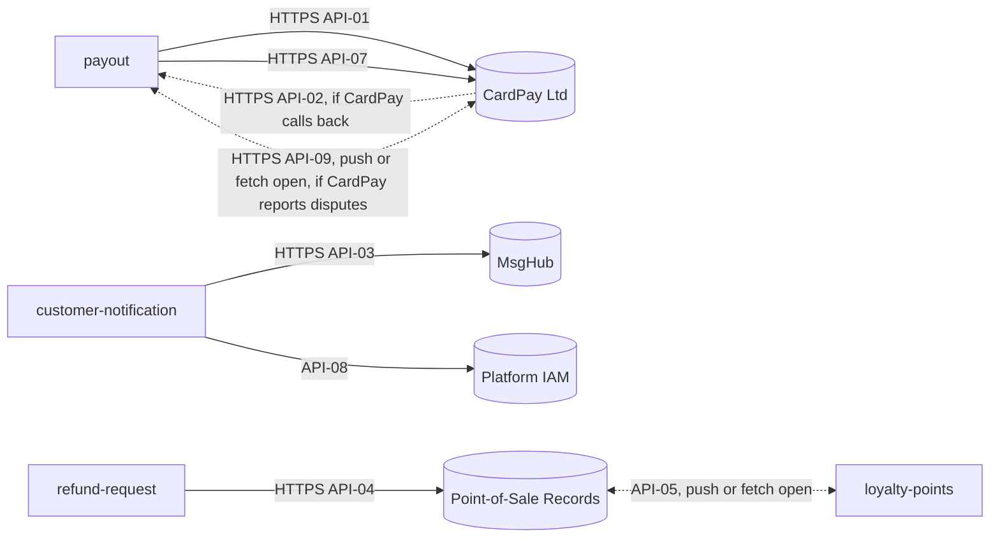

<!--
CHUNK: 08
TITLE: Integrations
PROJECT: Refunds Platform
VERSION: 1.3
DEPENDS_ON: 04, 02
PART OF: SDD - Refunds Platform
-->

# 12. Integrations

What each partner exchanges, its direction, and its criticality are in [REFUNDS 08 § Integrations](../brd-refunds-portal/08-integrations.md#integrations) and [LOYALTY 08 § Integrations](../brd-loyalty-points/08-integrations.md#integrations). Provider-owned values (protocol details, authentication scheme, rate limits) are `TBD - external` until the provider's documentation is supplied (§15.6).

| Integration ID | What (System) | Purpose | How (Protocol / Mode) | When (Trigger) | Auth | Timeout | Rate Limit | Retries & Backoff | Fallback | Notes |
|----------------|---------------|---------|------------------------|----------------|------|---------|------------|--------------------|-----------| ------|
| INT-01 | CardPay Ltd (Payment Provider) | Send refund payouts to the customer's original card, receive their results, including a payout the customer's bank sends back, receive disputes of the original card payment and their outcomes, and read CardPay's refund records for the daily reconciliation | HTTPS; outbound payout request (API-01), payout results in the API-01 response or, if CardPay calls back, inbound (API-02; open, §17.2 Integrations), card dispute notices, pushed or fetched (API-09; open, §17.2 Disputes), outbound refund-records read (API-07); provider data format `TBD - external` | A payout attempt picked up by the `payout` sender; a result in the API-01 response, or whenever CardPay calls back (API-02); a dispute notice as CardPay reports it (API-09); the daily `payout-reconciliation` job (API-07) | `TBD - external` (API-01, API-02, API-07, API-09); credentials in the secrets manager | **[NEEDS CLARIFICATION: What timeout, retry count, and backoff bounds apply to CardPay payout calls, within the provider's limits? Owner: solution architect, once CardPay's documentation is supplied.]** | `TBD - external` | Exponential backoff with jitter on the same idempotency key, bounds per the Timeout cell; retry stop time open (§17.2) | Payout stays Approved and is retried; the customer is told it is delayed ([REFUNDS/UC-04](../brd-refunds-portal/06b-use-cases-branch-manager.md#uc-04-approve--reject-refund) E1) | Owner: `payout`. [REFUNDS 08 § Integrations](../brd-refunds-portal/08-integrations.md#integrations) Payment Provider. API-01, API-02, API-07, API-09. |
| INT-02 | MsgHub (Notification Partner) | Tell customers, and branch managers for a still-failing payout, about refunds by email and SMS | HTTPS; outbound send request (API-03); provider data format `TBD - external` | A queued message picked up by the `customer-notification` sender | `TBD - external` (API-03); credentials in the secrets manager | **[NEEDS CLARIFICATION: What timeout, retry count, and backoff bounds apply to MsgHub message calls? Owner: solution architect, once MsgHub's documentation is supplied.]** | `TBD - external` | Exponential backoff with jitter on the same message key, bounds per the Timeout cell | The message stays queued; a message that cannot be sent never stops or changes a refund request ([REFUNDS 03 § Customer messages](../brd-refunds-portal/03-definitions-and-domain-concepts.md#customer-messages)) | Owner: `customer-notification`. [REFUNDS 08 § Integrations](../brd-refunds-portal/08-integrations.md#integrations) Notification Partner. API-03. |
| INT-03 | Point-of-Sale Records (POS Records) | Look up a receipt and its items for a refund request; receive member purchases that earn points | HTTPS; outbound receipt lookup (API-04, synchronous); member purchases to `loyalty-points` (API-05; delivery mechanism open, §17.4 Input) | Receipt lookup at [REFUNDS/UC-01](../brd-refunds-portal/06a-use-cases-customer.md#uc-01-request-a-refund) step 2; purchases as POS Records delivers them | `TBD - external` (API-04, API-05); credentials in the secrets manager | **[NEEDS CLARIFICATION: What timeout and retry bounds apply to the receipt lookup, which the customer waits for? Owner: solution architect, once the POS Records documentation is supplied.]** | `TBD - external` | Receipt lookup: no automatic retry beyond one quick retry on a connection error, since the customer is waiting; purchase intake: per API-05 once known | Receipt lookup: the customer is told receipts cannot be checked now ([REFUNDS/UC-01](../brd-refunds-portal/06a-use-cases-customer.md#uc-01-request-a-refund) E5); purchase intake: late purchases still earn points ([LOYALTY 03 § Earning points](../brd-loyalty-points/03-definitions-and-domain-concepts.md#earning-points)) | Owners: `refund-request` (receipt lookup), `loyalty-points` (member purchases). [REFUNDS 08 § Integrations](../brd-refunds-portal/08-integrations.md#integrations) Point-of-Sale Records (owner: Retail IT team); [LOYALTY 08 § Integrations](../brd-loyalty-points/08-integrations.md#integrations) POS Records. API-04, API-05. |
| INT-04 | Platform IAM (staff directory) | Find the branch managers of a branch for the still-failing payout alert ([REFUNDS/UC-04](../brd-refunds-portal/06b-use-cases-branch-manager.md#uc-04-approve--reject-refund) E1) | Outbound staff query (API-08), per ADR-07 | A still-failing alert picked up by the `customer-notification` sender | Confidential IAM client whose only right is reading the users that hold a staff role (§11.6); credentials in the secrets manager | TBD (ADR-07), bounded by the message lease of §17.3 | Not applicable (one query per alert) | Retried like a MsgHub failure, within the INT-02 bounds | When no branch manager is found, the message is marked `Failed` and an operations alert names the branch (§17.3) | Owner: `customer-notification`. API-08. Not in either BRD's 08: the IAM is a platform component, not a business partner. |

The REFUNDS 08 Loyalty Points row and the LOYALTY 08 Refunds Portal row are not external integrations in this SDD: both BRDs are realised in one deployable, and the refund outcomes reach `loyalty-points` as the in-process events `RefundRequestPaid`, `RefundRequestRejected`, `RefundRequestCancelled`, and `RefundRequestPayoutReturned` (§14.10). Only a paid refund takes points back ([LOYALTY/UC-02](../brd-loyalty-points/06a-use-cases-member.md#uc-02-view-points-history) BR-1: rejected or cancelled takes back nothing); the other outcomes are recorded (§17.4 Other refund outcomes).

Token validation by the platform IAM (§6) is operational infrastructure, configured in §11.6 and not contracted in §15. The one business read from the IAM, finding the branch managers of a branch for the still-failing alert, is a domain integration: INT-04, contract API-08 (§15.2).

**Figure 12: Integration topology**

**Summary:** Each provider is reached by exactly one module, except Point-of-Sale Records, whose receipt lookup belongs to `refund-request` and whose member purchases go to `loyalty-points`; CardPay's card dispute notices (API-09) go to `payout`, if CardPay can report them; the platform IAM's staff lookup (INT-04) belongs to `customer-notification`. All provider-owned contract fields are `TBD - external`.

<!-- MASTER: refunds-platform-sdd-master.md | PREV: 07-cross-cutting-concerns.md | NEXT: 09-services-summary.md -->
