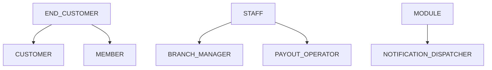
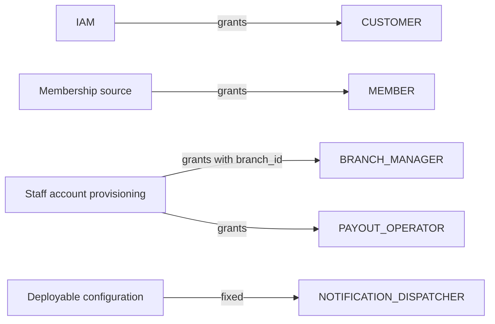
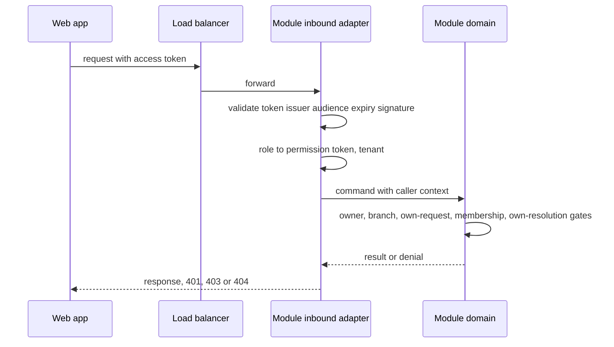

<!--
CHUNK: 12
TITLE: Centralized User Roles & Authorities (Platform-Wide)
PROJECT: Refunds Platform
VERSION: 1.3
DEPENDS_ON: 03, 07, 09 (+ per-service chunks 13a, 13b, 13c, 13d for per-service authorization notes)
PART OF: SDD - Refunds Platform
PURPOSE: Single platform-wide reference for user types, roles, and their authorities. Consolidates the REFUNDS and LOYALTY Users & Use Cases Matrices and the per-module authorization notes into one catalogue.
CONSISTENCY_RULE: Role names, permission tokens, and per-module authorization notes in the 13x chunks MUST match this catalogue verbatim. Divergences are flagged in §16.12.3, never silently reconciled.
-->

# 16. Centralized User Roles & Authorities (Platform-Wide)

> **What this chunk is.** The one place that answers what user types exist, what each role may do, who grants which role, and which modules each role touches.

---

## 16.1 Business Overview

The platform serves one retailer (ADR-03). People who buy in its branches use the customer screens to request and follow refunds ([REFUNDS 07](../brd-refunds-portal/07-users-use-cases-matrix.md#users--use-cases-matrix)) and, when they are loyalty members, the member screens to see their points ([LOYALTY 07](../brd-loyalty-points/07-users-use-cases-matrix.md#users--use-cases-matrix)). Branch managers, who are retailer staff, decide on their own branch's refund requests; payout operators, also staff, record and confirm payout results by hand ([REFUNDS 03 § Decision record](../brd-refunds-portal/03-definitions-and-domain-concepts.md#decision-record)). Every end-customer and member authority is limited to the person's own records; every branch manager authority is limited to their own branch. One module, `customer-notification`, acts without a user and holds a module role for the one module port it calls (API-06); its staff lookup (API-08) uses the IAM client of §11.6, not a module role.

## 16.2 Resolution Model - How a Role Becomes an Allowed Action

1. **Identity:** the web app signs the person in through the platform IAM (ADR-07, Proposed) and receives an access token. **[NEEDS CLARIFICATION: How do customers and members prove who they are, and does one end-customer sign-in serve both the refund and the loyalty screens? REFUNDS 03 § Customer identity and the [LOYALTY/UC-01](../brd-loyalty-points/06a-use-cases-member.md#uc-01-view-points-balance) precondition leave it open. Owner: REFUNDS and LOYALTY BRD owners.]**
2. **Claims:** the token carries `sub` (the person), `tenant_id`, `roles` (§16.4), and, for staff, `branch_id`; for members, the member identifier of §16.6.
3. **Permission lookup:** each role maps to the permission tokens of §16.11.
4. **Contextual gates:** tenant (every query, §11.2); owner (`sub` equals the request's customer, or the account's member) for `CUSTOMER` and `MEMBER`; branch (`branch_id` equals the request's branch) for `BRANCH_MANAGER`; not the decider's own request (the request's customer `sub` equals the caller's `sub`: [REFUNDS/UC-04](../brd-refunds-portal/06b-use-cases-branch-manager.md#uc-04-approve--reject-refund) BR-6: no decision on own request); membership active for `MEMBER`; for `PAYOUT_OPERATOR`, not the confirmation of a resolution the caller recorded (§16.5 footnote ⁵).
5. **Enforcement point:** ADR-08: each module's inbound adapter (REST controller or port) checks the permission token; the module's domain applies the contextual gates of item 4.

## 16.3 User Types (Tier 1)

| User type | Tenancy plane | Identity source | Description |
|---|---|---|---|
| `END_CUSTOMER` | End-customer | Platform IAM, one realm (ADR-07) | A person who buys in the retailer's branches; holds `CUSTOMER` and, once they join the loyalty program, `MEMBER`, which they keep after leaving (§16.8). |
| `STAFF` | Tenant (retailer staff) | Platform IAM, one realm (ADR-07) | Retailer staff; holds `BRANCH_MANAGER`, or `PAYOUT_OPERATOR` for the staff who record and confirm payout results by hand. |
| `MODULE` | Platform (in-process) | Module identity set in the in-process call context | A module acting without a user; holds `NOTIFICATION_DISPATCHER`. |

## 16.4 Role Catalogue - Authorities & Related Services

### 16.4.1 END_CUSTOMER Roles

| Role | Scope | Core authorities | Related services |
|---|---|---|---|
| `CUSTOMER` | own requests | Look up a receipt, submit a refund request, list and open own requests, cancel an own Submitted request | refund-request |
| `MEMBER` | own points | Open own balance, history, and movement details | loyalty-points |

### 16.4.2 STAFF Roles

| Role | Scope | Core authorities | Related services |
|---|---|---|---|
| `BRANCH_MANAGER` | own branch | List and open the branch's Submitted requests, approve in full or in part, reject, read the branch refund report | refund-request |
| `PAYOUT_OPERATOR` | all branches of the tenant | List `Stopped` and `Unknown` payouts, record a payout result found by checking CardPay, confirm a paid result another operator recorded | payout |

Who else may read a request's decision record, who decides when the branch manager is away, who decides on a branch manager's own request, whether the decision view shows the customer's earlier requests, whether a second person approves large refunds, whether customer care sees refund requests, and which team holds `PAYOUT_OPERATOR` are open:

- **[NEEDS CLARIFICATION: Which role, besides the branch manager of the branch, may read a refund request's decision record? REFUNDS 03 § Decision record leaves it open. Owner: REFUNDS BRD owner.]**
- **[NEEDS CLARIFICATION: Which role decides on a branch's refund requests when its branch manager is away or the post is vacant, and with which scope? REFUNDS 03 § Branch ownership leaves it open. Owner: REFUNDS BRD owner.]**
- **[NEEDS CLARIFICATION: Which role decides on a refund request that a branch manager submits for a purchase at their own branch? [REFUNDS/UC-04](../brd-refunds-portal/06b-use-cases-branch-manager.md#uc-04-approve--reject-refund) BR-6: no decision on own request leaves the decider open. Owner: REFUNDS BRD owner.]**
- **[NEEDS CLARIFICATION: Does the decision view show the customer's earlier refund requests, and from which branches? [REFUNDS/UC-04](../brd-refunds-portal/06b-use-cases-branch-manager.md#uc-04-approve--reject-refund) BR-4: earlier requests leaves it open, and the answer widens the branch manager's read scope. Owner: REFUNDS BRD owner.]**
- **[NEEDS CLARIFICATION: Above which refund amount, if any, must a second person also approve a refund, and which role is that person? [REFUNDS/UC-04](../brd-refunds-portal/06b-use-cases-branch-manager.md#uc-04-approve--reject-refund) BR-7: second approval above an amount leaves it open; a yes adds a role, a permission token, and an approval step before Approved. Owner: REFUNDS BRD owner.]**
- **[NEEDS CLARIFICATION: Do customer care agents get a read-only view of a customer's refund requests? [REFUNDS 04 § Personas / Actors](../brd-refunds-portal/04-scope-and-personas.md#personas--actors) leaves it open; a yes adds a staff role with a read permission token and widens who may see a request under REFUNDS/NFR-04. Owner: REFUNDS BRD owner.]**
- **[NEEDS CLARIFICATION: Which team holds `PAYOUT_OPERATOR`, recording and confirming payout results by hand and checking every month that no payout is missing or paid twice? [REFUNDS 04 § Personas / Actors](../brd-refunds-portal/04-scope-and-personas.md#personas--actors) leaves it open. Owner: REFUNDS BRD owner.]**

### 16.4.3 Platform Plane (operator - outside tenant tenancy)

| Role | Scope | Core authorities | Related services |
|---|---|---|---|
| `NOTIFICATION_DISPATCHER` | own tenant (the tenant of the event being processed), in process | Read a refund request's customer contact details to send a message | refund-request (provider of API-06), customer-notification (holder) |

No operator role is named by either BRD; operations act through infrastructure access under these rules: the Prod operations database role has no `SELECT` on personal-data columns (customer email address and mobile number in `refund_request`; member identifier and purchase details in `loyalty_points`; the `payload` column of each module's `event_publication` table, which holds the purchase and payment data of `RefundRequestPaid` and the card dispute events, §14.10) and may update only operational columns (publication-log listener rows and message status); payout resolutions are recorded only through the `PAYOUT_OPERATOR` endpoints of §17.2, never by a database role; any wider access is break-glass, granted for a limited time, and logged with who, when, and why.

## 16.5 Capability Matrix (canonical)

| Capability | `CUSTOMER` | `MEMBER` | `BRANCH_MANAGER` | `PAYOUT_OPERATOR` | `NOTIFICATION_DISPATCHER` |
|---|---|---|---|---|---|
| Request a refund | Yes | - | - | - | - |
| Track refund status | Yes¹ | - | - | - | - |
| Cancel a refund request | Yes¹ | - | - | - | - |
| Decide on a refund request | - | - | Yes²³ | - | - |
| Read the branch refund report | - | - | Yes² | - | - |
| Read payouts for resolution | - | - | - | Yes | - |
| Record a payout result by hand | - | - | - | Yes | - |
| Confirm a paid payout result | - | - | - | Yes⁵ | - |
| View points balance | - | Yes⁴ | - | - | - |
| View points history | - | Yes⁴ | - | - | - |
| Read customer contact details | - | - | - | - | Yes |

¹ Own requests only ([REFUNDS 07](../brd-refunds-portal/07-users-use-cases-matrix.md#users--use-cases-matrix) footnote 2).
² Own branch only ([REFUNDS 07](../brd-refunds-portal/07-users-use-cases-matrix.md#users--use-cases-matrix) footnote 1).
³ Never on a request the branch manager submitted as a customer ([REFUNDS/UC-04](../brd-refunds-portal/06b-use-cases-branch-manager.md#uc-04-approve--reject-refund) BR-6: no decision on own request).
⁴ Own points only ([LOYALTY 07](../brd-loyalty-points/07-users-use-cases-matrix.md#users--use-cases-matrix) footnote 1); a closed account is refused by `loyalty-points` (§17.4).
⁵ Never a result the same person recorded ([REFUNDS 03 § Decision record](../brd-refunds-portal/03-definitions-and-domain-concepts.md#decision-record)).

## 16.6 Grant / Invitation Authority (who can create whom)

| Grantor role | May create / invite | Constraints |
|---|---|---|
| Platform IAM | `CUSTOMER` | Granted to every signed-in end customer; the sign-in method is the §16.2 marker. |
| Membership source | `MEMBER` | **[NEEDS CLARIFICATION: Which system records that a person joins or leaves the loyalty program, which member identifier links a POS Records purchase to the signed-in member, how does Loyalty Points learn both, and how long after a member leaves can the leave date reach Loyalty Points? The membership source owns joining and leaving; `loyalty-points` keeps a copy of the leave date (§17.4 Membership), so a late leave date can earn or take back points that LOYALTY 03 rules out. LOYALTY 03 § Member leaves the loyalty program leaves the leaving record open. Owner: LOYALTY BRD owner.]** |
| Staff account provisioning | `BRANCH_MANAGER` | **[NEEDS CLARIFICATION: Who creates branch manager accounts and assigns each one's branch, and from which source of record? Owner: product owner with the Retail IT team.]** |
| Staff account provisioning | `PAYOUT_OPERATOR` | The provisioning source of the `BRANCH_MANAGER` row. |
| Deployable configuration | `NOTIFICATION_DISPATCHER` | Fixed in code for `customer-notification`; no person holds it. |

## 16.7 Role → Related-Services Matrix (platform-wide)

| Role | refund-request | payout | customer-notification | loyalty-points |
|---|---|---|---|---|
| `CUSTOMER` | write | - | - | - |
| `MEMBER` | - | - | - | read |
| `BRANCH_MANAGER` | write | - | - | - |
| `PAYOUT_OPERATOR` | - | write | - | - |
| `NOTIFICATION_DISPATCHER` | read | - | - | - |

## 16.8 Lifecycle, Scope & Revocation Rules

1. **Grant:** `CUSTOMER` with the end-customer account; `MEMBER` once the membership source records that the person joined the program; it is not removed when they leave; `BRANCH_MANAGER` with its `branch_id`, or `PAYOUT_OPERATOR`, when staff provisioning adds it to the person's identity (§16.6, ADR-07).
2. **Change:** a branch reassignment changes `branch_id` in the IAM and takes effect at the next token; a decision in flight is checked against the token it carries.
3. **Suspension / revocation:** a disabled account cannot get a new token; access tokens are short-lived, so access ends at token expiry. A person who leaves a staff role loses that role, and its `branch_id`, in the IAM and keeps their identity, so their `CUSTOMER` and `MEMBER` access stays; the staff role's access ends at token expiry. A member who leaves keeps `MEMBER`; `loyalty-points` closes their account and answers 403 `MEMBERSHIP_ENDED` on every loyalty endpoint (§17.4). A refund request in progress is not affected by its customer's account being disabled: the payout and messages continue.
4. **Erasure:** personal data is erased by the retention purges of §17.1 and §17.4 once their periods are set.

## 16.9 Diagrams

### 16.9.1 Role Taxonomy (user types → roles → sub-roles)

**Figure 13: Role taxonomy**

**Summary:** End customers hold `CUSTOMER` and, once they join the loyalty program, `MEMBER`; staff hold `BRANCH_MANAGER` or `PAYOUT_OPERATOR`; the `customer-notification` module holds `NOTIFICATION_DISPATCHER`.

### 16.9.2 Grant / Invitation Authority (who may create whom)

**Figure 14: Grant authority**

**Summary:** No user invites another user: the IAM grants `CUSTOMER`, the membership source grants `MEMBER`, staff provisioning grants `BRANCH_MANAGER` with its branch and `PAYOUT_OPERATOR`, and configuration fixes the module role; the membership source and staff provisioning are open (§16.6).

### 16.9.3 Per-Request Authorization (how a role yields a decision)

**Figure 15: Per-request authorization**

**Summary:** The module's inbound adapter validates the token and maps roles to permission tokens; the domain applies the owner, branch, own-request, membership, and own-resolution gates; a missing permission is 403, and another person's record is 404 so its existence is not revealed. Where each check runs is settled by ADR-08.

## 16.10 Traceability

| Capability / rule | Source (BRD UC / matrix row / ADR / 13x chunk) |
|---|---|
| Request a refund | [REFUNDS/UC-01](../brd-refunds-portal/06a-use-cases-customer.md#uc-01-request-a-refund); matrix row in [REFUNDS 07](../brd-refunds-portal/07-users-use-cases-matrix.md#users--use-cases-matrix); 13a |
| Track refund status | [REFUNDS/UC-02](../brd-refunds-portal/06a-use-cases-customer.md#uc-02-track-refund-status); matrix row in [REFUNDS 07](../brd-refunds-portal/07-users-use-cases-matrix.md#users--use-cases-matrix); 13a |
| Cancel a refund request | [REFUNDS/UC-03](../brd-refunds-portal/06a-use-cases-customer.md#uc-03-cancel-a-refund-request); matrix row in [REFUNDS 07](../brd-refunds-portal/07-users-use-cases-matrix.md#users--use-cases-matrix); 13a |
| Decide on a refund request | [REFUNDS/UC-04](../brd-refunds-portal/06b-use-cases-branch-manager.md#uc-04-approve--reject-refund); matrix row in [REFUNDS 07](../brd-refunds-portal/07-users-use-cases-matrix.md#users--use-cases-matrix); 13a |
| Read the branch refund report | [REFUNDS 09 § Reporting / Analytics](../brd-refunds-portal/09-reporting-and-analytics.md#reporting--analytics) (audience: Branch Manager); 13a |
| View points balance | [LOYALTY/UC-01](../brd-loyalty-points/06a-use-cases-member.md#uc-01-view-points-balance); matrix row in [LOYALTY 07](../brd-loyalty-points/07-users-use-cases-matrix.md#users--use-cases-matrix); 13d |
| View points history | [LOYALTY/UC-02](../brd-loyalty-points/06a-use-cases-member.md#uc-02-view-points-history); matrix row in [LOYALTY 07](../brd-loyalty-points/07-users-use-cases-matrix.md#users--use-cases-matrix); 13d |
| Read payouts for resolution | [REFUNDS 03 § Decision record](../brd-refunds-portal/03-definitions-and-domain-concepts.md#decision-record) (staff who record a payout result by hand); 13b |
| Record a payout result by hand | [REFUNDS 03 § Decision record](../brd-refunds-portal/03-definitions-and-domain-concepts.md#decision-record); 13b |
| Confirm a paid payout result | [REFUNDS 03 § Decision record](../brd-refunds-portal/03-definitions-and-domain-concepts.md#decision-record) (a second staff member confirms); 13b |
| Read customer contact details | ADR-05 (port API-06); 13a, 13c |

## 16.11 Permission × Role Matrix (platform-wide)

| Permission token | `CUSTOMER` | `MEMBER` | `BRANCH_MANAGER` | `PAYOUT_OPERATOR` | `NOTIFICATION_DISPATCHER` |
|---|---|---|---|---|---|
| `refund.receipt.read` | ✓ | - | - | - | - |
| `refund.request.create` | ✓ | - | - | - | - |
| `refund.request.read-own` | ✓¹ | - | - | - | - |
| `refund.request.cancel-own` | ✓¹ | - | - | - | - |
| `refund.request.read-branch` | - | - | ✓² | - | - |
| `refund.request.decide` | - | - | ✓²³ | - | - |
| `refund.report.read-branch` | - | - | ✓² | - | - |
| `payout.read` | - | - | - | ✓ | - |
| `payout.resolution.record` | - | - | - | ✓ | - |
| `payout.resolution.confirm` | - | - | - | ✓⁵ | - |
| `refund.contact.read` | - | - | - | - | ✓ |
| `loyalty.points.read-own` | - | ✓⁴ | - | - | - |

Footnotes as §16.5.

## 16.12 Implementation Seed & Reconciliation

### 16.12.1 Seed Strategy

The role-to-permission map is code in the deployable (one map, read by every module's inbound adapter), versioned with the code; roles themselves live in the IAM realm. A role change is a code change plus an IAM realm change in the same release.

### 16.12.2 Per-Role Action Counts (drift baseline)

| Role | Seeded permission count |
|---|---|
| `CUSTOMER` | 4 |
| `MEMBER` | 1 |
| `BRANCH_MANAGER` | 3 |
| `PAYOUT_OPERATOR` | 3 |
| `NOTIFICATION_DISPATCHER` | 1 |

### 16.12.3 Drift & Reconciliation Register

Role names and permission tokens in §17.1 to §17.4 and in chunk 11 match this catalogue; the per-module authorization notes agree with [REFUNDS 07](../brd-refunds-portal/07-users-use-cases-matrix.md#users--use-cases-matrix) and [LOYALTY 07](../brd-loyalty-points/07-users-use-cases-matrix.md#users--use-cases-matrix).

| # | Where | Divergence | Resolution / flag | Status |
|---|---|---|---|---|
| - | - | None | - | - |

<!-- MASTER: refunds-platform-sdd-master.md | PREV: 11-api-contracts.md | NEXT: 13a-service-refund-request.md -->
