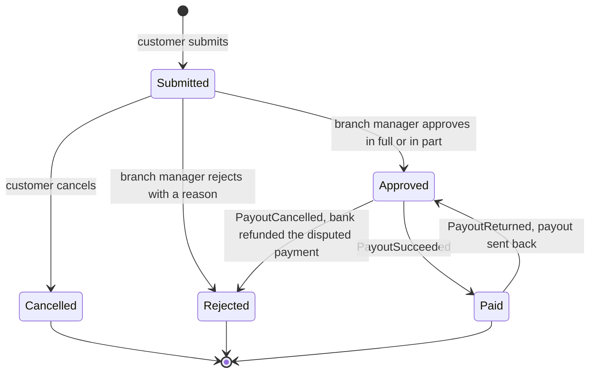

<!--
CHUNK: 13a
TITLE: Detailed Service Spec - refund-request
PROJECT: Refunds Platform
VERSION: 1.3
DEPENDS_ON: 09, 07, 10 (event hub - in-process event names must match chunk 10 verbatim), 11 (API contracts - integration endpoints carry their API ID and match chunk 11 verbatim), 12 (roles - permission tokens match chunk 12 verbatim)
PART OF: SDD - Refunds Platform
-->

# 17. Detailed Service Specs

---

## 17.1 refund-request

### What

The `refund-request` module of `refunds-platform-app` owns the refund request bounded context: a customer's request for money back on branch-receipt items, its lifecycle (Submitted, Approved, Rejected, Paid, Cancelled, including a Paid request that goes back to Approved and an Approved request that becomes Rejected after a card dispute: [REFUNDS 03 § Refund request lifecycle](../brd-refunds-portal/03-definitions-and-domain-concepts.md#refund-request-lifecycle)), and its decision record. It is the only writer of a refund request's status.

### Boundaries

- **Owns:** refund requests, their items (one row per unit), the original-payment reference of each request's receipt (from the receipt lookup), the decision record (one row per status change), the reference number sequence, the customer contact details given at submission, the branch refund report, and a copy of the card disputes, each with its state and highest `sequence`, by original-payment reference (from the dispute events of `payout`).
- **Does not own:** payouts, payout attempts, and card disputes (`payout`), messages (`customer-notification`), receipts and purchases (Point-of-Sale Records), user accounts and branch assignments (platform IAM), points (`loyalty-points`).
- **Upstream consumers:** the web app (customer and branch manager screens); `customer-notification` through `CustomerContactPort` (API-06); `payout` and `customer-notification` and `loyalty-points` as listeners of its events.
- **Downstream dependencies:** Point-of-Sale Records (API-04); `PayoutSucceeded`, `PayoutReturned`, `PayoutCancelled`, `CardPaymentDisputeOpened`, and `CardPaymentDisputeClosed` from `payout`.

### Input

| Type | Source | Description |
|------|--------|-------------|
| REST | Customer web app | Receipt lookup, submit, list own, open own, cancel own (List of APIs). |
| REST | Branch manager web app | Branch request list, request detail, decision, branch refund report (List of APIs). |
| Event | payout | `PayoutSucceeded` marks the request Paid ([REFUNDS/UC-04](../brd-refunds-portal/06b-use-cases-branch-manager.md#uc-04-approve--reject-refund) step 9). |
| Event | payout | `PayoutReturned` moves a Paid request back to Approved ([REFUNDS/UC-04](../brd-refunds-portal/06b-use-cases-branch-manager.md#uc-04-approve--reject-refund) E1). |
| Event | payout | `PayoutCancelled` marks an Approved request Rejected ([REFUNDS/UC-04](../brd-refunds-portal/06b-use-cases-branch-manager.md#uc-04-approve--reject-refund) BR-8: dispute refunded by the bank). |
| Event | payout | `CardPaymentDisputeOpened` adds an open dispute to the copy shown at decision time ([REFUNDS/UC-04](../brd-refunds-portal/06b-use-cases-branch-manager.md#uc-04-approve--reject-refund) E3). |
| Event | payout | `CardPaymentDisputeClosed` marks it closed in that copy ([REFUNDS/UC-04](../brd-refunds-portal/06b-use-cases-branch-manager.md#uc-04-approve--reject-refund) E3). |
| Internal (in-process) | customer-notification | `CustomerContactPort.getCustomerContact` (API-06). |
| Schedule | refund-retention-purge | Removes rows past the retention periods (Retention Policy); platform job, no use case. |

### Business Logic

**Eligibility of receipt items** ([REFUNDS/UC-01](../brd-refunds-portal/06a-use-cases-customer.md#uc-01-request-a-refund) steps 1-4, A1, A2, E1, E2, E4, E5, E6). `GET /v1/receipts/{receiptNumber}/refundable-items` calls Point-of-Sale Records through the receipt lookup port (API-04) and returns every unit of every item with a `refundable` flag and, when not refundable, a reason code. A unit is refundable only when all of these hold:

- the purchase was made at a branch that has started using the portal (the started-branch setting of §11.5, which follows the pilot of [REFUNDS 04 § Project Scope](../brd-refunds-portal/04-scope-and-personas.md#project-scope)), else the whole receipt is refused with `BRANCH_NOT_STARTED` and the customer is told to ask for the refund at that branch (E6);
- the purchase is within the refund window ([REFUNDS/UC-01](../brd-refunds-portal/06a-use-cases-customer.md#uc-01-request-a-refund) BR-1: 30 days from purchase), else the whole receipt is refused with `REFUND_WINDOW_PASSED` (E1);
- the purchase was paid by card ([REFUNDS/UC-01](../brd-refunds-portal/06a-use-cases-customer.md#uc-01-request-a-refund) BR-5: card purchases only), else `NOT_PAID_BY_CARD` (E4);
- the unit is not on a Submitted or Approved request and has not been refunded in full ([REFUNDS/UC-01](../brd-refunds-portal/06a-use-cases-customer.md#uc-01-request-a-refund) BR-2: each unit counts as one item), else shown with reason `ALREADY_REQUESTED` (A1); a unit on a Rejected request, and the rest of a unit refunded in part, are refundable or not according to two eligibility settings that follow the BRD answers. **[NEEDS CLARIFICATION: Can a unit on a Rejected request be requested again, and can the rest of a unit refunded in part be requested? [REFUNDS/UC-01](../brd-refunds-portal/06a-use-cases-customer.md#uc-01-request-a-refund) BR-6: request again after rejection and [REFUNDS/UC-01](../brd-refunds-portal/06a-use-cases-customer.md#uc-01-request-a-refund) BR-7: rest after partial refund leave both open. Owner: REFUNDS BRD owner.]**
- the item type is not on the never-refundable list ([REFUNDS/UC-01](../brd-refunds-portal/06a-use-cases-customer.md#uc-01-request-a-refund) BR-3: items that can never be refunded), else shown with reason `NOT_REFUNDABLE` (A2).

**[NEEDS CLARIFICATION: Do purchases made in some periods or some item types have a refund window other than 30 days, and must the customer pick the reason from a list that separates a change of mind from a faulty item, with another window or remedy for a faulty item? [REFUNDS/UC-01](../brd-refunds-portal/06a-use-cases-customer.md#uc-01-request-a-refund) BR-9: other refund windows and [REFUNDS/UC-01](../brd-refunds-portal/06a-use-cases-customer.md#uc-01-request-a-refund) BR-10: reason list leave both open; the window becomes an eligibility setting per period or item type, and the reason a field with a list. Owner: REFUNDS BRD owner.]**

A receipt POS Records does not know is `RECEIPT_NOT_FOUND` (E2); POS Records unreachable or timing out is `RECEIPTS_UNAVAILABLE` and never `RECEIPT_NOT_FOUND` (E5). **[NEEDS CLARIFICATION: Which items can never be refunded, how is the 30-day window counted, and how is a purchase paid partly by card refunded? [REFUNDS/UC-01](../brd-refunds-portal/06a-use-cases-customer.md#uc-01-request-a-refund) BR-3: never-refundable items, [REFUNDS/UC-01](../brd-refunds-portal/06a-use-cases-customer.md#uc-01-request-a-refund) BR-5: card purchases only, and REFUNDS/OI-11 leave these open, and store refund policy v3 is not attached. Owner: REFUNDS BRD owner.]** **[NEEDS CLARIFICATION: Does the receipt number alone identify one purchase across all branches and days, and how soon after a purchase can Point-of-Sale Records find its receipt? The receipt lookup (API-04) and the unit-claim index on `(tenant_id, receipt_number, item_line, unit_no)` assume a unique receipt number; if it is not unique, both take the branch and purchase date as well. [REFUNDS 02 § Assumptions / Constraints](../brd-refunds-portal/02-glossary-assumptions-facts.md#assumptions--constraints) 3 and 4 leave both open. Owner: Retail IT team (Point-of-Sale Records) with the REFUNDS BRD owner.]**

**Refund amount** ([REFUNDS/UC-01](../brd-refunds-portal/06a-use-cases-customer.md#uc-01-request-a-refund) step 4). The amount of a request is the sum of the selected units' amounts as the receipt lookup returns them; amounts are `decimal(19,4)` with the currency of the receipt. **[NEEDS CLARIFICATION: How is the refund amount of a unit worked out when a discount applies to it or to the whole receipt? REFUNDS/OI-10 keeps this open in the BRD. Owner: REFUNDS BRD owner.]**

**Submit** ([REFUNDS/UC-01](../brd-refunds-portal/06a-use-cases-customer.md#uc-01-request-a-refund) steps 5-7, E3). `POST /v1/refund-requests` (with `Idempotency-Key`) re-runs the item checks at submission (a unit claimed in the meantime is refused); whether the refund window is checked again at submission is an eligibility setting that follows the BRD answer **[NEEDS CLARIFICATION: Is the 30-day refund window checked when the customer submits, or only when the customer enters the receipt? REFUNDS/OI-11 is still open on this. Owner: REFUNDS BRD owner.]**; it validates the email address and mobile number formats (E3), and in one transaction: inserts the request (status Submitted) and its units, claims each unit in a unique index on `(tenant_id, receipt_number, item_line, unit_no)` over requests that are Submitted or Approved (so two concurrent submissions cannot claim the same unit), writes the first decision-record row (actor: customer), assigns the reference number from a per-tenant sequence, and records `RefundRequestSubmitted` in the publication log. The response returns the reference number; the message is sent after commit and its failure never affects the request ([REFUNDS/UC-01](../brd-refunds-portal/06a-use-cases-customer.md#uc-01-request-a-refund) AC-4: recorded even if messages fail). Whether both contact details are required is a setting (both required, or at least one) that follows the BRD answer; the design takes no side until it is answered. **[NEEDS CLARIFICATION: Must the customer give both an email address and a mobile number, or is one enough? If one is enough, a customer who gives no email address gets no cancellation message, because [REFUNDS 03 § Customer messages](../brd-refunds-portal/03-definitions-and-domain-concepts.md#customer-messages) sends it by email only. [REFUNDS/UC-01](../brd-refunds-portal/06a-use-cases-customer.md#uc-01-request-a-refund) BR-4: email and mobile leaves it open. Owner: REFUNDS BRD owner.]**

**Track** ([REFUNDS/UC-02](../brd-refunds-portal/06a-use-cases-customer.md#uc-02-track-refund-status) steps 1-4, A1). The list returns the caller's requests only, newest first, with reference number, amount, and status; a caller with none gets an empty list (A1). The detail returns the history from the decision record: each status change with its date, the requested and approved amounts, and the reason of a rejection or partial approval.

**Cancel** ([REFUNDS/UC-03](../brd-refunds-portal/06a-use-cases-customer.md#uc-03-cancel-a-refund-request) steps 2-5, E1). `POST /v1/refund-requests/{refundRequestId}/cancellation` succeeds only on a Submitted request owned by the caller; the status change uses an optimistic version check, so a decision committed in the meantime returns `REQUEST_ALREADY_DECIDED` (E1). On success: status Cancelled, a decision-record row, `RefundRequestCancelled` in the publication log; the units become free to request again within the refund window ([REFUNDS/UC-01](../brd-refunds-portal/06a-use-cases-customer.md#uc-01-request-a-refund) BR-2: cancelled items can be requested again).

**Decide** ([REFUNDS/UC-04](../brd-refunds-portal/06b-use-cases-branch-manager.md#uc-04-approve--reject-refund) steps 1-8, A1, A2, E2). The branch list returns the Submitted requests of the caller's branch, oldest first, each with a `late` flag when it has waited longer than the decision time ([REFUNDS/UC-04](../brd-refunds-portal/06b-use-cases-branch-manager.md#uc-04-approve--reject-refund) BR-5: decide within the decision time) **[NEEDS CLARIFICATION: How many days after submission is a request flagged late? [REFUNDS/UC-04](../brd-refunds-portal/06b-use-cases-branch-manager.md#uc-04-approve--reject-refund) BR-5: decide within the decision time leaves the number of days open. Owner: REFUNDS BRD owner.]** The detail shows the receipt number, purchase date, units with amounts, total, and reason (step 4), and whether the original card payment has an open card dispute, read from the open rows of the module's dispute copy by the request's original-payment reference (E3; [REFUNDS/UC-04](../brd-refunds-portal/06b-use-cases-branch-manager.md#uc-04-approve--reject-refund) AC-15: dispute shown). The copy keeps one row per dispute id with its state and the highest `sequence` handled; an older dispute event is recorded as handled with no change, and a closed row stays until the retention purge, so a late Opened cannot reopen it; the decision view and the §11.4 alert exception read only open rows. An approval with an open dispute is accepted; `payout` holds the payout until the bank decides (§17.2 Disputes). `POST /v1/refund-requests/{refundRequestId}/decision` (with `Idempotency-Key`) takes either an approval with optional lowered unit amounts and a reason (A1), or a rejection with a reason (A2):

- every lowered amount is more than 0 and less than that unit's requested amount ([REFUNDS/UC-04](../brd-refunds-portal/06b-use-cases-branch-manager.md#uc-04-approve--reject-refund) BR-2: lowered amount between 0 and requested), else `INVALID_LOWERED_AMOUNT`; a partial approval needs a reason;
- the approved amount is the sum of the unit amounts after lowering ([REFUNDS/UC-04](../brd-refunds-portal/06b-use-cases-branch-manager.md#uc-04-approve--reject-refund) AC-9: two items, one lowered);
- a rejection without a reason is `VALIDATION_FAILED` ([REFUNDS/UC-04](../brd-refunds-portal/06b-use-cases-branch-manager.md#uc-04-approve--reject-refund) BR-3: rejection always has a reason);
- the request must belong to the caller's branch ([REFUNDS/UC-04](../brd-refunds-portal/06b-use-cases-branch-manager.md#uc-04-approve--reject-refund) BR-1: own branch only) and must not be the caller's own request ([REFUNDS/UC-04](../brd-refunds-portal/06b-use-cases-branch-manager.md#uc-04-approve--reject-refund) BR-6: no decision on own request), else `FORBIDDEN` and `OWN_REQUEST_DECISION`; the request's customer `sub` must differ from the caller's `sub` (ADR-07: one identity per person);
- a request cancelled in the meantime returns `REQUEST_CANCELLED` and records nothing (E2).

On approval, in one transaction: status Approved, the approved amount and lowered units, a decision-record row (actor: branch manager, amount, reason), and `RefundRequestApproved` in the publication log; `payout` sends the payout after commit (step 8). On rejection: status Rejected, a decision-record row, `RefundRequestRejected` with `rejectionKind` `DECISION`.

**Item return and in-person requests.** **[NEEDS CLARIFICATION: Must the customer return the items to the branch before the branch manager approves a refund? A yes adds an items-received step before Approved to the state machine and a branch action that records it. [REFUNDS 03 § Refund request](../brd-refunds-portal/03-definitions-and-domain-concepts.md#refund-request) leaves it open. Owner: REFUNDS BRD owner.]** **[NEEDS CLARIFICATION: Are refund requests made in person at a branch after go-live recorded in the portal? A yes adds a staff-assisted submission entry point and a staff role that acts for the customer. [REFUNDS 04 § Project Scope](../brd-refunds-portal/04-scope-and-personas.md#project-scope) leaves it open. Owner: REFUNDS BRD owner.]**

**Paid** ([REFUNDS/UC-04](../brd-refunds-portal/06b-use-cases-branch-manager.md#uc-04-approve--reject-refund) step 9). The `PayoutSucceeded` listener (deduplicated on the event id) moves an Approved request to Paid with a decision-record row (actor: portal, payout result; for a payout resolved by hand, the payout operator who recorded the result and the one who confirmed it, from `PayoutSucceededDto`) and records `RefundRequestPaid`. A refused payout leaves the request Approved ([REFUNDS/UC-04](../brd-refunds-portal/06b-use-cases-branch-manager.md#uc-04-approve--reject-refund) E1); `refund-request` does not handle the payout failure events.

**Payout sent back** ([REFUNDS/UC-04](../brd-refunds-portal/06b-use-cases-branch-manager.md#uc-04-approve--reject-refund) E1). The `PayoutReturned` listener moves a Paid request back to Approved with a decision-record row (actor: portal, payout result) and records `RefundRequestPayoutReturned`; the customer is told the payout is delayed (§17.3), and the payout is tried again (§17.2 Payout sent back). The request's units stay claimed, as for any Approved request.

**Dispute outcome** ([REFUNDS/UC-04](../brd-refunds-portal/06b-use-cases-branch-manager.md#uc-04-approve--reject-refund) BR-8: payout waits for a card dispute, AC-13: dispute refunded, request Rejected). The `PayoutCancelled` listener moves an Approved request to Rejected with a decision-record row (actor: portal, dispute outcome; reason: the customer's bank has already refunded the payment) and records `RefundRequestRejected` with `rejectionKind` `DISPUTE_REFUNDED`; the customer is told the reason (§17.3), and the request's units follow the Rejected rule of Eligibility.

**Ordering of payout events.** Every payout event carries the payout's `sequence` (§14.10 Ordering); the module keeps the highest one it has handled per refund request and records an older payout event as handled with no status change, so a redelivered `PayoutSucceeded` that arrives after `PayoutReturned` does not mark the request Paid again.

**Outcomes for Loyalty Points** ([REFUNDS/UC-03](../brd-refunds-portal/06a-use-cases-customer.md#uc-03-cancel-a-refund-request) BR-3: Loyalty Points told on cancellation, [REFUNDS/UC-04](../brd-refunds-portal/06b-use-cases-branch-manager.md#uc-04-approve--reject-refund) BR-9: Loyalty Points told the outcome). `RefundRequestPaid`, `RefundRequestRejected`, `RefundRequestCancelled`, and `RefundRequestPayoutReturned` are the refund outcomes Loyalty Points is told: `loyalty-points` listens to each of them (§17.4). While Loyalty Points is switched off, they wait in this module's publication log and reach `loyalty-points` when it is switched on (§11.1, §11.3).

**Decision record** ([REFUNDS 03 § Decision record](../brd-refunds-portal/03-definitions-and-domain-concepts.md#decision-record)). Append-only: the module's database role has no `UPDATE` or `DELETE` grant on `decision_record` except for the retention purge job's role. Each row records its actor: the customer, the branch manager, the portal for a payout result or a dispute outcome, or the staff members who record and confirm a payout result by hand (§17.2 Send). Who may read it beyond the branch manager is open (§16.4).

**Branch refund report** ([REFUNDS 09 § Reporting / Analytics](../brd-refunds-portal/09-reporting-and-analytics.md#reporting--analytics)). `GET /v1/branches/{branchId}/refund-report` computes, for a period given as `from` and `to` dates, requests per status, amounts paid, average time from Submitted to decision, and average time from Submitted to Paid, from the decision record; the period parameters serve whichever period and format REFUNDS 09 settles. Each request counts once: by its status at the end of the period, with amounts paid from the requests Paid at that time, and its time from Submitted to Paid measured to its latest Paid row; a payout the customer's bank sent back counts as paid only once it is paid again.

**State machine:**

**Figure 16: Refund request state machine**

**Summary:** A request starts Submitted; the customer can cancel it, or the branch manager approves or rejects it; an approved request becomes Paid only when `payout` reports success, and it stays Approved while the payout is retried or held for a card dispute. A Paid request goes back to Approved when the customer's bank sends the payout back, and an Approved request becomes Rejected when the bank refunds a disputed card payment to the customer.

### Output

| Type | Destination | Description |
|------|-------------|-------------|
| REST response | Web app | Items, requests, history, decision result, branch report (List of APIs). |
| In-process event | customer-notification, payout, loyalty-points | `RefundRequestSubmitted`, `RefundRequestApproved`, `RefundRequestRejected`, `RefundRequestCancelled`, `RefundRequestPaid`, `RefundRequestPayoutReturned` (§14.10). |
| In-process port response | customer-notification | `CustomerContactDto` (API-06). |

### Integrations

| Integration | Direction | Protocol | Purpose | Contract | Failure Handling |
|-------------|-----------|----------|---------|----------|------------------|
| Point-of-Sale Records | Outbound, sync | HTTPS | Receipt lookup for eligibility | API-04 (§15) | `RECEIPTS_UNAVAILABLE` to the customer ([REFUNDS/UC-01](../brd-refunds-portal/06a-use-cases-customer.md#uc-01-request-a-refund) E5); bounds per INT-03 |
| customer-notification | Inbound, sync in-process | Port call | Contact details for a message | API-06 (§15) | Typed errors per API-06 |
| payout | Inbound, async in-process | Domain events | Payout outcomes and card disputes | `PayoutSucceeded`, `PayoutReturned`, `PayoutCancelled`, `CardPaymentDisputeOpened`, `CardPaymentDisputeClosed` (§14.10) | Redelivered from the publication log until completed |
| payout, customer-notification, loyalty-points | Outbound, async in-process | Domain events | Status changes | `RefundRequestSubmitted`, `RefundRequestApproved`, `RefundRequestRejected`, `RefundRequestCancelled`, `RefundRequestPaid`, `RefundRequestPayoutReturned` (§14.10) | Publication log redelivery |

### DB Modeling

#### Entity Relationship

The concepts are the refund request, its units, the decision record, the contact details, and the copy of the card disputes. **[NEEDS CLARIFICATION: ERD, table list, column types, constraints, and indexes for the refund request, its units, the decision record, the contact details, and the copy of the card disputes of refund-request. The BRD describes the concepts but does not commit to a relational schema. Owner: solution architect.]**

#### Tables Design

Per the Entity Relationship marker. Fixed so far: `tenant_id` leads every key and index (§11.1); the unit-claim unique index of Business Logic; `decision_record` is append-only; the dispute copy is keyed by `(tenant_id, dispute_id)`, holds the dispute's state and highest `sequence`, and is indexed on `(tenant_id, original_payment_reference)`; `event_publication` and `event_publication_listener` per §11.1.

#### Migration Strategy

- **Tool:** per ADR-10 (Proposed); versioned SQL scripts for schema `refund_request`.
- **Backward compatibility:** additive changes; expand-and-contract for renames and type changes (AP-10).
- **Data backfill:** in a separate versioned script, batched, after the expand step.
- **Rollback:** roll forward with a corrective script; the previous image runs on the expanded schema.

#### Retention Policy

- All tables: **[NEEDS CLARIFICATION: How long are refund requests, decisions, and payout results kept, and how long are customer contact details kept after a request ends? REFUNDS/NFR-06 leaves both periods open. Owner: REFUNDS BRD owner.]** The `refund-retention-purge` job applies the answer; contact details are erased separately from the request when their shorter period ends.
- `event_publication`, `event_publication_listener`: completed rows follow the same purge.

#### Archival

- **Cold storage:** not applicable for this release (no archive is required by either BRD).
- **Format:** not applicable.
- **Schedule:** not applicable.
- **Restore SLA:** not applicable.

#### Data Encryption

- **At rest:** storage encryption of the PostgreSQL offering (§6).
- **In transit:** TLS 1.2+ to PostgreSQL and to Point-of-Sale Records.
- **Key management:** the hosting environment's key service, through the PostgreSQL offering.
- **PII columns:** customer email address and mobile number; masked in every non-production environment; never logged.

### Multi-Tenancy Specifications

- **Strategy override:** none (shared schema with `tenant_id`, §11.2).
- **Tenant filter:** mandatory `tenant_id` predicate in the persistence adapter; owner filter (token subject) for customer endpoints; branch filter (`branch_id` claim) for branch manager endpoints.
- **Cross-tenant queries:** none.

### API Standards

- **Style:** REST, JSON (ADR-04).
- **Versioning:** URI prefix `/v1`.
- **Authentication:** OIDC access token (§11.6).
- **Idempotency:** `Idempotency-Key` required on `POST /v1/refund-requests`, `POST /v1/refund-requests/{refundRequestId}/cancellation`, and `POST /v1/refund-requests/{refundRequestId}/decision`; a replay with the same key and body returns the first response.
- **Pagination:** cursor-based on list endpoints.
- **Rate limits:** `GET /v1/receipts/{receiptNumber}/refundable-items` and `POST /v1/refund-requests` are limited per caller (token subject), counted in the `refund_request` schema so that the limit holds across replicas; above the limit the caller gets 429 `RATE_LIMITED` with `Retry-After`. The limit is a configuration value the solution architect sets against the volumes of §18.1. An operations alert fires when one caller's lookups return an unusual share of `RECEIPT_NOT_FOUND`. **[NEEDS CLARIFICATION: Must a customer prove that a receipt is theirs (for example with details of the card used) before its items are shown? [REFUNDS 03 § Customer identity](../brd-refunds-portal/03-definitions-and-domain-concepts.md#customer-identity) requires only that the customer proves who they are. Owner: REFUNDS BRD owner.]**
- **Error envelope:** §15.1 error model.

#### List of APIs (Swagger-friendly)

These endpoints are proposals for the use cases' entry points; their request and response fields are open. **[NEEDS CLARIFICATION: Request and response fields of each refund-request endpoint; the use cases' acceptance criteria imply them but do not specify them. Owner: solution architect.]**

| Method | Path | Summary | Request Body | Response | Permission token (§16) | API ID (§15) |
|--------|------|---------|--------------|----------|------------------------|--------------|
| GET | `/v1/receipts/{receiptNumber}/refundable-items` | Receipt units with refundable flag and reason | - | `RefundableItemsResponse` | `refund.receipt.read` | - |
| POST | `/v1/refund-requests` | Submit a refund request | `SubmitRefundRequest` | `RefundRequestCreated` | `refund.request.create` | - |
| GET | `/v1/refund-requests` | List own refund requests | - | `RefundRequestPage` | `refund.request.read-own` | - |
| GET | `/v1/refund-requests/{refundRequestId}` | Own request with its history | - | `RefundRequestDetail` | `refund.request.read-own` | - |
| POST | `/v1/refund-requests/{refundRequestId}/cancellation` | Cancel an own Submitted request | `CancelRefundRequest` | `RefundRequestDetail` | `refund.request.cancel-own` | - |
| GET | `/v1/branches/{branchId}/refund-requests` | Branch's Submitted requests, oldest first, late flag | - | `BranchRefundRequestPage` | `refund.request.read-branch` | - |
| GET | `/v1/branches/{branchId}/refund-requests/{refundRequestId}` | Branch request detail for a decision | - | `BranchRefundRequestDetail` | `refund.request.read-branch` | - |
| POST | `/v1/refund-requests/{refundRequestId}/decision` | Approve (full or partial) or reject | `RefundDecision` | `RefundRequestDetail` | `refund.request.decide` | - |
| GET | `/v1/branches/{branchId}/refund-report` | Branch refund report for a period | - | `BranchRefundReport` | `refund.report.read-branch` | - |

### Event-Driven Architecture (If Applicable)

#### Event Model

**Published events:** Not applicable - no integration events.

**Consumed events:** Not applicable - no integration events.

**In-process domain events (modules only):**

| Event | Publisher module | Listener modules | Transaction phase (before commit / after commit) | Payload (DTO) | Notes |
|---|---|---|---|---|---|
| `RefundRequestSubmitted` | refund-request | customer-notification | after commit | `RefundRequestSubmittedDto`: fields per §14.10 | Durable (§11.1) |
| `RefundRequestApproved` | refund-request | payout, customer-notification | after commit | `RefundRequestApprovedDto`: fields per §14.10 | Durable |
| `RefundRequestRejected` | refund-request | customer-notification, loyalty-points | after commit | `RefundRequestRejectedDto`: fields per §14.10 | Durable |
| `RefundRequestCancelled` | refund-request | customer-notification, loyalty-points | after commit | `RefundRequestCancelledDto`: fields per §14.10 | Durable |
| `RefundRequestPaid` | refund-request | customer-notification, loyalty-points | after commit | `RefundRequestPaidDto`: fields per §14.10 | Durable |
| `RefundRequestPayoutReturned` | refund-request | customer-notification, loyalty-points | after commit | `RefundRequestPayoutReturnedDto`: fields per §14.10 | Durable |
| `PayoutSucceeded` | payout | refund-request | after commit | `PayoutSucceededDto`: fields per §14.10 | Handled here: marks Paid |
| `PayoutReturned` | payout | refund-request | after commit | `PayoutReturnedDto`: fields per §14.10 | Handled here: back to Approved |
| `PayoutCancelled` | payout | refund-request | after commit | `PayoutCancelledDto`: fields per §14.10 | Handled here: marks Rejected |
| `CardPaymentDisputeOpened` | payout | refund-request | after commit | `CardPaymentDisputeOpenedDto`: fields per §14.10 | Handled here: dispute copy |
| `CardPaymentDisputeClosed` | payout | refund-request | after commit | `CardPaymentDisputeClosedDto`: fields per §14.10 | Handled here: dispute copy |

#### Messaging Infra

Not applicable - no integration events.

### Constraints

- [REFUNDS/UC-01](../brd-refunds-portal/06a-use-cases-customer.md#uc-01-request-a-refund): role `CUSTOMER`, tokens `refund.receipt.read` and `refund.request.create`.
- [REFUNDS/UC-02](../brd-refunds-portal/06a-use-cases-customer.md#uc-02-track-refund-status): role `CUSTOMER`, token `refund.request.read-own`, own requests only ([REFUNDS 07](../brd-refunds-portal/07-users-use-cases-matrix.md#users--use-cases-matrix) footnote 2).
- [REFUNDS/UC-03](../brd-refunds-portal/06a-use-cases-customer.md#uc-03-cancel-a-refund-request): role `CUSTOMER`, token `refund.request.cancel-own`, own requests only (footnote 2).
- [REFUNDS/UC-04](../brd-refunds-portal/06b-use-cases-branch-manager.md#uc-04-approve--reject-refund): role `BRANCH_MANAGER`, tokens `refund.request.read-branch` and `refund.request.decide`, own branch only ([REFUNDS 07](../brd-refunds-portal/07-users-use-cases-matrix.md#users--use-cases-matrix) footnote 1), never on own request.
- Branch refund report: role `BRANCH_MANAGER`, token `refund.report.read-branch`, own branch only.
- `CustomerContactPort`: role `NOTIFICATION_DISPATCHER`, token `refund.contact.read`.
- Only Submitted requests can be cancelled or decided; only Approved requests can become Paid; an Approved request becomes Rejected without a decision only on `PayoutCancelled`, and a Paid request goes back to Approved only on `PayoutReturned`.

### Error Handling

- **Synchronous APIs:** §15.1 error model; domain codes below.
- **Validation errors:** 400 `VALIDATION_FAILED` with `errors[]`: invalid email or mobile ([REFUNDS/UC-01](../brd-refunds-portal/06a-use-cases-customer.md#uc-01-request-a-refund) E3), missing rejection or partial-approval reason.
- **Domain errors:** [REFUNDS/UC-01](../brd-refunds-portal/06a-use-cases-customer.md#uc-01-request-a-refund) E1 -> 422 `REFUND_WINDOW_PASSED`; E2 -> 404 `RECEIPT_NOT_FOUND`; E4 -> 422 `NOT_PAID_BY_CARD`; E5 -> 503 `RECEIPTS_UNAVAILABLE`; E6 -> 422 `BRANCH_NOT_STARTED`; a unit claimed concurrently -> 409 `ITEM_ALREADY_REQUESTED`. [REFUNDS/UC-03](../brd-refunds-portal/06a-use-cases-customer.md#uc-03-cancel-a-refund-request) E1 -> 409 `REQUEST_ALREADY_DECIDED`. [REFUNDS/UC-04](../brd-refunds-portal/06b-use-cases-branch-manager.md#uc-04-approve--reject-refund) E2 -> 409 `REQUEST_CANCELLED`; BR-2 -> 422 `INVALID_LOWERED_AMOUNT`; BR-6 -> 403 `OWN_REQUEST_DECISION`. Every message tells the user what to do next in plain language, without codes ([REFUNDS 11 § UI/UX Expectations](../brd-refunds-portal/11-summary-and-uiux.md#uiux-expectations)).
- **Auth errors:** 401 `UNAUTHENTICATED`; 403 `FORBIDDEN` for a missing token or another owner's or branch's request, reported as 404 `NOT_FOUND` to customers so a reference number never reveals another customer's request.
- **Server errors:** 500 `INTERNAL_ERROR` with the correlation id; no internals in the body.
- **Async consumers:** the payout and dispute listeners are idempotent (event id); the `PayoutSucceeded` listener ignores an event for a request already Paid, the `PayoutReturned` listener one for a request not Paid, the `PayoutCancelled` listener one for a request not Approved, and each ignores a payout event older than one already handled (Ordering of payout events); the dispute listeners ignore a dispute event older than one already handled for that dispute.
- **Poison messages:** a listener that keeps failing stays incomplete in the publication log, is redelivered with backoff, and raises the 30-minute alert (§11.4); it is never dropped.

### Observability & Monitoring

#### Logging

- JSON per §11.4, with `refund_request_id`; never the reference number or the receipt number (§11.6).
- No email address, mobile number, or receipt items.
- Retention per the logging backend (§6).

#### Metrics

| Metric | Type | Labels | Purpose |
|--------|------|--------|---------|
| `refund_requests_total` | counter | `status` | Status changes per status |
| `refund_receipt_lookup_seconds` | histogram | `outcome` | POS Records lookup latency and failures (E5) |
| `refund_decision_wait_seconds` | histogram | `branch_id` | Submitted to decision time (the decision part of BRD Objective 1, REFUNDS 01; REFUNDS 09 average time to decision) |
| `refund_submitted_to_paid_seconds` | histogram | `branch_id` | Submitted to Paid time: the measure of BRD Objective 1 (request to payout, REFUNDS 01), across all branches and per branch; observed when a request first becomes Paid; a request paid again after its payout was sent back is counted by `payouts_returned_total` (§17.2) |
| `refund_requests_late` | gauge | `branch_id` | Submitted requests past the decision time |

REFUNDS Business Objectives 4 and 5 ([REFUNDS 01 § Business Objectives](../brd-refunds-portal/01-executive-summary-and-context.md#business-objectives)) are measured outside the platform: complaints about refunds are counted by customer care, and requests made at a branch are counted by the branches. The platform gives the portal's part of Objective 5: the requests submitted through the portal per branch (`refund_requests_total` with `status` Submitted, by the request's branch).

#### Tracing

- Spans per endpoint, per POS Records call, and per listener.
- The trace context is stored with each publication-log row and continued in the listener.
- 100% sampling (§11.4).

### Developer Notes

- **Recommended patterns:** aggregate `RefundRequest` with units as entities; status changes only through aggregate methods that append the decision-record row and register the domain event; repositories add the `tenant_id` predicate.
- **Avoid:** reading another module's schema; calling a provider inside the database transaction; updating `decision_record`.
- **Testing:** unit tests per state transition and eligibility rule (one per BRD acceptance criterion); module tests with the POS Records adapter stubbed; architecture tests for module boundaries and the `tenant_id` predicate; integration tests against a real PostgreSQL container, including the concurrent-claim test for the unit unique index, the started-branch check, and the payout and dispute listeners (sent-back payout, dispute refunded, events out of order).

### Service-Level Diagrams

#### Implementation Flow Chart

Not applicable: the module's flows are §8.4.1 and the state machine above.

#### Sequence Diagram (Service-Internal)

Not applicable: the submit and decision sequences are §8.5.1 and §8.5.2.

### Compliance

- **GDPR:** **[NEEDS CLARIFICATION: Which data-protection law applies to customer and member personal data, and what lawful basis and erasure duties follow from it? REFUNDS/NFR-04 and LOYALTY 03 § Member leaves the loyalty program leave it open. Owner: REFUNDS and LOYALTY BRD owners.]**
- **PCI-DSS:** not applicable to this module: it stores no card number; the card payment is referenced only by the payment reference POS Records returns (§17.2).
- **ISO 27001 / SOC 2:** not applicable for this release (no source names one).
- **Local regulations:** consumer refund rights are open in the BRD ([REFUNDS/UC-01](../brd-refunds-portal/06a-use-cases-customer.md#uc-01-request-a-refund) BR-8: consumer law); the tax and accounting records of each paid refund (REFUNDS/NFR-07) are open (§18.5).

### Deployment Strategy

- **Service-specific override:** none (one deployable, §11.3).
- **Replicas:** per §11.3.
- **Strategy:** per §11.3.
- **Health checks:** per §11.3; readiness also checks the database.
- **Rollback:** previous image; migrations are backward compatible.

### Future Enhancements

- Bulk approval of small refunds ([REFUNDS/UC-04](../brd-refunds-portal/06b-use-cases-branch-manager.md#uc-04-approve--reject-refund) Future Enhancements).

<!-- MASTER: refunds-platform-sdd-master.md | PREV: 12-centralized-user-roles.md | NEXT: 13b-service-payout.md -->
