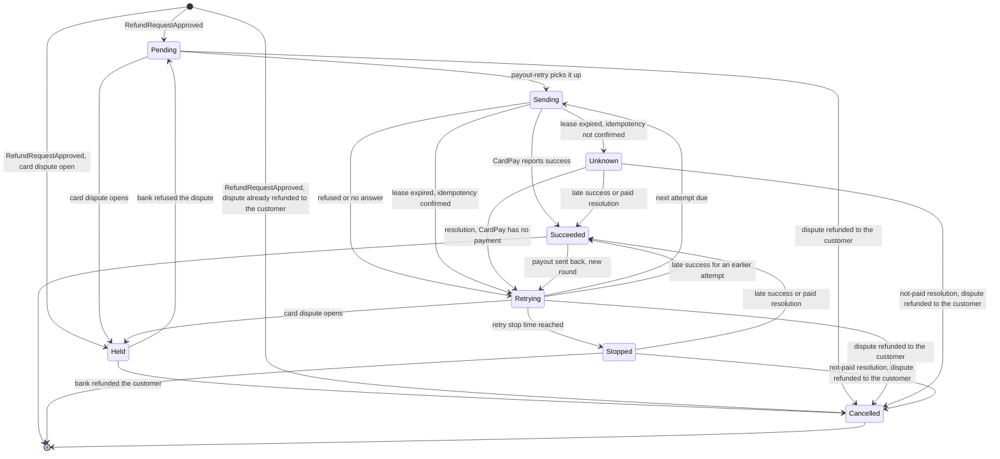

<!--
CHUNK: 13b
TITLE: Detailed Service Spec - payout
PROJECT: Refunds Platform
VERSION: 1.4
DEPENDS_ON: 09, 07, 10 (event hub - in-process event names must match chunk 10 verbatim), 11 (API contracts - integration endpoints carry their API ID and match chunk 11 verbatim), 12 (roles - permission tokens match chunk 12 verbatim)
PART OF: SDD - Refunds Platform
-->

# 17. Detailed Service Specs

---

## 17.2 payout

### What

The `payout` module of `refunds-platform-app` owns the payout bounded context: sending the approved amount of a refund request back to the customer's original card through CardPay Ltd, exactly once, retrying until it succeeds or stops, holding it while the original card payment has an open card dispute, and paying again when the customer's bank sends a paid payout back. It is the only module that talks to CardPay Ltd.

### Boundaries

- **Owns:** payouts (one per approved refund request), their rounds and payout attempts, with their CardPay references and results, the payout resolutions that payout operators record and confirm (Send), and the card disputes CardPay reports, by original-payment reference (Disputes).
- **Does not own:** the refund request and its status (`refund-request`), customer and branch-manager messages (`customer-notification`).
- **Upstream consumers:** the web app's operator screens (`PAYOUT_OPERATOR`, List of APIs); `refund-request` and `customer-notification` as listeners of its events; CardPay Ltd calling in with payout results, if CardPay calls back (API-02; open, §17.2 Integrations), and with card dispute notices, if CardPay sends them (API-09; open, Disputes).
- **Downstream dependencies:** CardPay Ltd (API-01); `RefundRequestApproved` from `refund-request`.

### Input

| Type | Source | Description |
|------|--------|-------------|
| REST | Operator web app | List payouts by status, record a payout resolution, confirm a paid resolution (List of APIs; [REFUNDS 03 § Decision record](../brd-refunds-portal/03-definitions-and-domain-concepts.md#decision-record)). |
| Event | refund-request | `RefundRequestApproved` creates the payout ([REFUNDS/UC-04](../brd-refunds-portal/06b-use-cases-branch-manager.md#uc-04-approve--reject-refund) step 8). |
| Schedule | payout-retry | Every minute, sends every payout attempt that is due, first attempts and retries, and raises the one-day still-failing event ([REFUNDS/UC-04](../brd-refunds-portal/06b-use-cases-branch-manager.md#uc-04-approve--reject-refund) step 8, E1). |
| Schedule | payout-reconciliation | Daily comparison with CardPay's refund records (REFUNDS/NFR-01); platform job, no use case. |
| Schedule | payout-retention-purge | Removes rows past the retention period (Retention Policy); platform job, no use case. |
| REST (external inbound) | CardPay Ltd | Payout result (API-02), only if CardPay calls back; otherwise the result comes in the API-01 response (open, §17.2 Integrations). |
| REST (external; inbound push or outbound fetch) | CardPay Ltd | Card dispute notices of original card payments (API-09), if CardPay can report them; whether CardPay sends them or `payout` fetches them is open (Disputes). If `payout` fetches, a `Schedule` row for the fetch job replaces this row, and the job runs per tenant (§11.2). |

### Business Logic

**Create** ([REFUNDS/UC-04](../brd-refunds-portal/06b-use-cases-branch-manager.md#uc-04-approve--reject-refund) step 8). The `RefundRequestApproved` listener (deduplicated on the event id) inserts one payout for the refund request, guarded by a unique key on `(tenant_id, refund_request_id)`, with the approved amount, the currency, the original-payment reference, the branch of the request (for `PayoutStillFailing`, §14.10), status `Pending`, and `next_attempt_at` set to now; when the original payment has an open card dispute, the payout is created `Held` instead, with no attempt due (Disputes). A second delivery of the same event, or a second event for the same request, finds the existing payout and changes nothing; this is how REFUNDS/NFR-01 rules out a duplicate payout on our side. **[NEEDS CLARIFICATION: Does Point-of-Sale Records return, for a card purchase, the payment reference CardPay Ltd needs to refund the original card, and if not, where does the payout get it? Owner: Retail IT team (POS Records) with CardPay Ltd.]**

**Send** (step 8). The `payout-retry` job selects due payouts with `FOR UPDATE SKIP LOCKED`, marks the attempt `Sending`, commits, then calls CardPay (API-01) outside any database transaction, with the key of the payout's current round as the idempotency key on every attempt of that round (the first round's key is the payout id; a new round starts only when a paid payout is sent back: Payout sent back). A timeout or a missing answer leaves the outcome unknown; the next attempt reuses the same key, so CardPay can return the first result instead of paying again (CardPay's idempotency support is `TBD - external`, API-01). The claim sets `Sending` with `lease_expires_at` = now + the CardPay call timeout (INT-01) + 1 minute. The `payout-retry` job also selects `Sending` payouts whose lease has expired and treats them as an unknown outcome: once the API-01 documentation confirms that CardPay honours the idempotency key, it sends the next attempt with the same key; until then it moves the payout to `Unknown` and raises an operations alert, and the payout is resolved by the §20.1.7 procedure after checking CardPay. A `PAYOUT_OPERATOR` records the result of that check as a payout resolution (outcome `paid` or `not paid`, the CardPay reference checked, who, and when) for a payout in `Unknown` or `Stopped`; a `paid` resolution waits until a second `PAYOUT_OPERATOR` confirms it, and a confirmation by the person who recorded it is refused (403 `SAME_PERSON_CONFIRMATION`: [REFUNDS 03 § Decision record](../brd-refunds-portal/03-definitions-and-domain-concepts.md#decision-record)); the `payout-retry` job applies a `not paid` resolution, or a confirmed `paid` one, in its own transaction through the Result rules: `paid` sets `Succeeded` and records `PayoutSucceeded` with who recorded and who confirmed the result; `not paid` sets an `Unknown` payout to `Retrying` with the next attempt due at once under the same idempotency key, and leaves a `Stopped` payout `Stopped`, unless a dispute of the original payment closed as refunded to the customer, which moves the payout to `Cancelled` (Disputes).

**Result** (step 9, E1). A succeeded result (in the API-01 response or through the API-02 callback, matched on the payout id) sets the payout `Succeeded` and records `PayoutSucceeded`, which `refund-request` turns into Paid. A refused result or an unknown outcome:

- on the payout's first failure in its first round, records `PayoutAttemptFailed` (the customer is told the payout is delayed: [REFUNDS/UC-04](../brd-refunds-portal/06b-use-cases-branch-manager.md#uc-04-approve--reject-refund) E1);
- schedules the next attempt with exponential backoff and jitter, bounded per INT-01;
- once the payout has failed for one day since the first attempt of its current round, records `PayoutStillFailing` once per round (the branch manager is told: [REFUNDS/UC-04](../brd-refunds-portal/06b-use-cases-branch-manager.md#uc-04-approve--reject-refund) AC-2: still failing after one day);
- stops retrying at the retry stop time, sets `Stopped`, and raises an operations alert. **[NEEDS CLARIFICATION: How long does the payout module keep retrying a refused payout before it stops? [REFUNDS/UC-04](../brd-refunds-portal/06b-use-cases-branch-manager.md#uc-04-approve--reject-refund) E1 leaves it open. Owner: REFUNDS BRD owner.]**

A succeeded result for any attempt of the payout sets it `Succeeded` from `Pending`, `Sending`, `Retrying`, `Unknown`, or `Stopped`, records `PayoutSucceeded` once, and, from `Stopped`, raises an operations alert so that no other payment is made. A refused or unknown result that arrives for a payout already `Succeeded` changes nothing and is logged for reconciliation. REFUNDS pays only to the original card ([REFUNDS 02 § Assumptions / Constraints](../brd-refunds-portal/02-glossary-assumptions-facts.md#assumptions--constraints) 2), so the design pays a `Stopped` payout no other way until the BRD answers the marker below; until then a `Stopped` payout leaves its refund request Approved. Only `PayoutSucceeded` (Paid) and `PayoutCancelled` (Rejected, Disputes) move an Approved refund request on.

A payout that can never succeed (for example a closed card) has no ending yet. **[NEEDS CLARIFICATION: How is a customer paid when the payout to the original card can never succeed? [REFUNDS/UC-04](../brd-refunds-portal/06b-use-cases-branch-manager.md#uc-04-approve--reject-refund) E1 leaves it open. The answer adds a terminal payout outcome that `payout` reports to `refund-request` (a new event in §14.10), a refund request status after Approved (§17.1 Figure 16), the release of the request's unit claims, the customer message, and whether `loyalty-points` takes points back (§8.4.3). Owner: REFUNDS BRD owner.]**

**Disputes** ([REFUNDS/UC-04](../brd-refunds-portal/06b-use-cases-branch-manager.md#uc-04-approve--reject-refund) E3, BR-8: payout waits for a card dispute). `payout` records each card dispute CardPay reports for an original card payment (API-09), keyed by CardPay's dispute id, with the original-payment reference; it records `CardPaymentDisputeOpened` when a dispute opens and `CardPaymentDisputeClosed`, with the bank's outcome, when it closes, and `refund-request` keeps a copy of each dispute with its state and highest `sequence`, and shows the open ones at decision time (§17.1 Boundaries, Decide). A payout whose original payment has an open dispute is `Held`: it is created `Held` (Create), and a `Pending` or `Retrying` payout moves to `Held` before its next attempt ([REFUNDS/UC-04](../brd-refunds-portal/06b-use-cases-branch-manager.md#uc-04-approve--reject-refund) AC-12: no payout while the payment is disputed). `payout` keeps each dispute with its state and outcome after it closes. At Create and before every attempt, it reads the original payment's disputes: an open dispute holds the payout; a dispute closed as refunded to the customer moves the payout to `Cancelled` and records `PayoutCancelled`, whatever the order in which the dispute and the approval arrived ([REFUNDS/UC-04](../brd-refunds-portal/06b-use-cases-branch-manager.md#uc-04-approve--reject-refund) BR-8: payout waits for a card dispute). A dispute that closes as refunded to the customer while the payout is `Unknown` or `Stopped` raises an operations alert naming the payout, and a `not paid` resolution of that payout (Send) moves it to `Cancelled` and records `PayoutCancelled` instead of returning it to `Retrying` or leaving it `Stopped`. A `Held` payout has no attempt due, and the time it is held counts toward neither the one-day still-failing event nor the retry stop time. When the dispute closes and the bank refused it, the payout moves to `Pending` with its next attempt due at once ([REFUNDS/UC-04](../brd-refunds-portal/06b-use-cases-branch-manager.md#uc-04-approve--reject-refund) AC-16: payout sent after a refused dispute). When the bank gave the money back to the customer, the payout moves to `Cancelled` and records `PayoutCancelled`, which `refund-request` turns into Rejected ([REFUNDS/UC-04](../brd-refunds-portal/06b-use-cases-branch-manager.md#uc-04-approve--reject-refund) AC-13: dispute refunded, request Rejected). A dispute that opens after a payout succeeded does not change the payout (R-09). **[NEEDS CLARIFICATION: Can CardPay Ltd report a dispute of the original card payment and its outcome, and does it send each dispute notice to the platform or does the platform fetch them? [REFUNDS 02 § Dependencies](../brd-refunds-portal/02-glossary-assumptions-facts.md#dependencies) asks whether CardPay can report them. Owner: CardPay Ltd, through the REFUNDS BRD owner.]**

**Payout sent back** ([REFUNDS/UC-04](../brd-refunds-portal/06b-use-cases-branch-manager.md#uc-04-approve--reject-refund) E1). When CardPay reports that the customer's bank sent back a payout CardPay had accepted (for example because the card is closed: [REFUNDS 03 § Refund request lifecycle](../brd-refunds-portal/03-definitions-and-domain-concepts.md#refund-request-lifecycle)), the `Succeeded` payout moves to `Retrying`, starts a new round with a new idempotency key (a UUIDv7 kept for every attempt of that round, so that CardPay pays again instead of returning the result of the payment that was sent back), and records `PayoutReturned`, which `refund-request` turns back into Approved ([REFUNDS/UC-04](../brd-refunds-portal/06b-use-cases-branch-manager.md#uc-04-approve--reject-refund) AC-11: Paid payout sent back, request back to Approved). The round's first attempt is due at once, and the round follows the Result rules: the one-day still-failing event and the retry stop time count from the round's first attempt. The customer hears of the return from the back-to-Approved message (§17.3), so the round records no `PayoutAttemptFailed`. A second report of the same return changes nothing (matched on CardPay's reference of the payment sent back). **[NEEDS CLARIFICATION: How does CardPay Ltd tell the platform that the customer's bank sent back a payout CardPay had accepted: in a payout result callback (API-02), in its refund records (API-07), or another way? Owner: CardPay Ltd, through the product owner.]**

**Reconciliation** (REFUNDS/NFR-01). A daily `payout-reconciliation` job compares the previous day's payouts and attempts with CardPay's records of refunds to the original card (API-07) and reports each payout CardPay paid more than once, each `Succeeded` payout CardPay has no record of, and each CardPay refund with no payout; any mismatch raises an operations alert, and the monthly count of missing and duplicate payouts is the REFUNDS/NFR-01 measure; a payout `Stopped` or `Unknown` at month end counts as missing, because it is no longer being tried again ([REFUNDS 10 § Non-Functional Requirements](../brd-refunds-portal/10-nfrs.md#non-functional-requirements) REFUNDS/NFR-01: only a payout still being tried again counts as delayed), and a payout `Held` at month end counts as waiting, not missing (REFUNDS/NFR-01: a payout that waits for a card dispute is waiting). A payment the customer's bank sent back is not counted as paid, so the round that pays again is not a duplicate. Until API-07 is documented, the same comparison is made by hand each month from CardPay's statements.

**State machine:**

**Figure 17: Payout state machine**

**Summary:** A payout is created Pending, or Held while the original payment has an open card dispute, sent by the `payout-retry` job, and ends Succeeded when CardPay reports success, including a late success after it moved to Retrying, Unknown, or Stopped, or a confirmed paid resolution recorded by a payout operator for an Unknown or Stopped payout; a not-paid resolution returns an Unknown payout to Retrying; refused or unanswered attempts move it to Retrying until the next attempt, an expired claim lease moves it to Retrying or, while CardPay's idempotency is unconfirmed, to Unknown, and it stops at the retry stop time. A dispute that opens holds a Pending or Retrying payout; a refused dispute releases it, and a dispute the bank refunded to the customer cancels a payout that has not paid, whenever the dispute closed; a Succeeded payout that the customer's bank sends back returns to Retrying with a new round.

### Output

| Type | Destination | Description |
|------|-------------|-------------|
| REST response | Operator web app | Payouts, payout resolutions (List of APIs). |
| REST call | CardPay Ltd | Payout request (API-01). |
| REST response | CardPay Ltd | Acknowledgement of a payout result (API-02), if CardPay calls back. |
| REST call | CardPay Ltd | Refund records for reconciliation (API-07). |
| REST response or call | CardPay Ltd | Acknowledgement of a card dispute notice (API-09), if CardPay sends them; if `payout` fetches them, the fetch request instead. |
| In-process event | refund-request | `PayoutSucceeded`, `PayoutReturned`, `PayoutCancelled`, `CardPaymentDisputeOpened`, `CardPaymentDisputeClosed` (§14.10). |
| In-process event | customer-notification | `PayoutAttemptFailed`, `PayoutStillFailing` (§14.10). |

### Integrations

| Integration | Direction | Protocol | Purpose | Contract | Failure Handling |
|-------------|-----------|----------|---------|----------|------------------|
| CardPay Ltd | Outbound, sync | HTTPS | Payout request | API-01 (§15) | Retry with the same idempotency key, backoff per INT-01, bulkhead for CardPay calls |
| CardPay Ltd | Outbound, sync | HTTPS | Refund records for reconciliation | API-07 (§15) | Retried the next day; mismatches alert operations |
| CardPay Ltd | Inbound, sync | HTTPS | Payout result | API-02 (§15) | Signature verified; idempotent on the payout id and the provider result id. **[NEEDS CLARIFICATION: Does CardPay Ltd return the payout result in the response to the payout request, or later through a callback to the platform? Owner: CardPay Ltd, through the product owner.]** |
| CardPay Ltd | Inbound push or outbound fetch (open, Disputes), sync | HTTPS | Card dispute notices | API-09 (§15) | Idempotent on CardPay's dispute id and state; signature verified if CardPay sends them |
| refund-request | Inbound, async in-process | Domain event | Payout to create | `RefundRequestApproved` (§14.10) | Publication log redelivery |
| refund-request, customer-notification | Outbound, async in-process | Domain events | Payout outcomes and card disputes | `PayoutSucceeded`, `PayoutReturned`, `PayoutCancelled`, `CardPaymentDisputeOpened`, `CardPaymentDisputeClosed`, `PayoutAttemptFailed`, `PayoutStillFailing` (§14.10) | Publication log redelivery |

### DB Modeling

#### Entity Relationship

The concepts are the payout, its rounds and attempts, its resolution rows, and the card disputes. **[NEEDS CLARIFICATION: ERD, table list, column types, constraints, and indexes for the payout, its rounds and attempts, its resolution rows, and the card disputes. The BRD describes the payout but does not commit to a relational schema. Owner: solution architect.]**

#### Tables Design

Per the Entity Relationship marker. Fixed so far: the unique key `(tenant_id, refund_request_id)` on the payout; the unique key `(tenant_id, dispute_id)` on the card dispute, with an index on `(tenant_id, original_payment_reference)`; `tenant_id` leads every key and index; `event_publication` and `event_publication_listener` per §11.1.

#### Migration Strategy

- **Tool:** per ADR-10 (Proposed); versioned SQL scripts for schema `payout`.
- **Backward compatibility:** additive; expand-and-contract (AP-10).
- **Data backfill:** separate batched script.
- **Rollback:** roll forward with a corrective script.

#### Retention Policy

- All tables: the payout-result period of the §17.1 Retention Policy marker (REFUNDS/NFR-06), applied by the `payout-retention-purge` job.

#### Archival

- **Cold storage:** not applicable for this release.
- **Format:** not applicable.
- **Schedule:** not applicable.
- **Restore SLA:** not applicable.

#### Data Encryption

- **At rest:** storage encryption of the PostgreSQL offering (§6).
- **In transit:** TLS 1.2+ to PostgreSQL and CardPay Ltd.
- **Key management:** the hosting environment's key service.
- **PII columns:** none; the original-payment reference is not a card number and is masked in logs.

### Multi-Tenancy Specifications

- **Strategy override:** none.
- **Tenant filter:** the `tenant_id` claim of the access token on the operator endpoints, or the tenant of the event, of the job's per-tenant run, or of the API-02 or API-09 verification secret that matches (§11.2); CardPay credentials per tenant. **[NEEDS CLARIFICATION: Does CardPay Ltd refund a branch card purchase through one merchant account for all branches or through the merchant account of the branch that made the sale? If per branch, the credentials and the payout carry the branch. [REFUNDS 02 § Dependencies](../brd-refunds-portal/02-glossary-assumptions-facts.md#dependencies) asks it. Owner: CardPay Ltd, through the REFUNDS BRD owner.]**
- **Cross-tenant queries:** none.

### API Standards

- **Style:** REST, JSON (ADR-04) for the operator endpoints and the inbound callbacks (API-02, and API-09 if CardPay sends dispute notices); provider format `TBD - external`.
- **Versioning:** URI prefix `/v1` on every endpoint; the callback paths are set once the provider's scheme is known.
- **Authentication:** OIDC access token for the operator endpoints (§11.6); the provider's signature scheme on API-02 and API-09 (`TBD - external`).
- **Idempotency:** `Idempotency-Key` required on `POST /v1/payouts/{payoutId}/resolutions` and `POST /v1/payouts/{payoutId}/resolutions/{resolutionId}/confirmation`; the current round's key as the CardPay idempotency key (Send); the callback is idempotent on the provider result id; dispute notices are idempotent on CardPay's dispute id and the dispute's state.
- **Pagination:** cursor-based on `GET /v1/payouts`.
- **Error envelope:** §15.1 error model on every endpoint.

#### List of APIs (Swagger-friendly)

The operator endpoints serve the payout resolutions of [REFUNDS 03 § Decision record](../brd-refunds-portal/03-definitions-and-domain-concepts.md#decision-record), which no REFUNDS use case covers yet; their request and response fields are open. **[NEEDS CLARIFICATION: Request and response fields of each payout operator endpoint. Owner: solution architect.]**

| Method | Path | Summary | Request Body | Response | Permission token (§16) | API ID (§15) |
|--------|------|---------|--------------|----------|------------------------|--------------|
| GET | `/v1/payouts` | Payouts by status (`Stopped`, `Unknown`) for resolution | - | `PayoutPage` | `payout.read` | - |
| POST | `/v1/payouts/{payoutId}/resolutions` | Record a payout result found by checking CardPay | `RecordPayoutResolution` | `PayoutResolution` | `payout.resolution.record` | - |
| POST | `/v1/payouts/{payoutId}/resolutions/{resolutionId}/confirmation` | Confirm a paid resolution another operator recorded | `ConfirmPayoutResolution` | `PayoutResolution` | `payout.resolution.confirm` | - |
| TBD | TBD | Receive a payout result from CardPay Ltd | `TBD - external` | `TBD - external` | - | API-02 |
| TBD | TBD | Receive card dispute notices from CardPay Ltd (only if CardPay sends them; a fetch has no inbound endpoint) | `TBD - external` | `TBD - external` | - | API-09 |

### Event-Driven Architecture (If Applicable)

#### Event Model

**Published events:** Not applicable - no integration events.

**Consumed events:** Not applicable - no integration events.

**In-process domain events (modules only):**

| Event | Publisher module | Listener modules | Transaction phase (before commit / after commit) | Payload (DTO) | Notes |
|---|---|---|---|---|---|
| `RefundRequestApproved` | refund-request | payout, customer-notification | after commit | `RefundRequestApprovedDto`: fields per §14.10 | Handled here: creates the payout |
| `PayoutSucceeded` | payout | refund-request | after commit | `PayoutSucceededDto`: fields per §14.10 | Durable (§11.1) |
| `PayoutReturned` | payout | refund-request | after commit | `PayoutReturnedDto`: fields per §14.10 | Once per payment the customer's bank sends back |
| `PayoutCancelled` | payout | refund-request | after commit | `PayoutCancelledDto`: fields per §14.10 | A payout whose original payment's dispute the bank refunded to the customer before the payout paid; `refund-request` marks the request Rejected |
| `CardPaymentDisputeOpened` | payout | refund-request | after commit | `CardPaymentDisputeOpenedDto`: fields per §14.10 | Durable |
| `CardPaymentDisputeClosed` | payout | refund-request | after commit | `CardPaymentDisputeClosedDto`: fields per §14.10 | Durable |
| `PayoutAttemptFailed` | payout | customer-notification | after commit | `PayoutAttemptFailedDto`: fields per §14.10 | First failure of a payout's first round only |
| `PayoutStillFailing` | payout | customer-notification | after commit | `PayoutStillFailingDto`: fields per §14.10 | Once per round, one day after the round's first attempt |

#### Messaging Infra

Not applicable - no integration events.

### Constraints

- `PAYOUT_OPERATOR` lists payouts (`payout.read`), records resolutions (`payout.resolution.record`), and confirms paid resolutions (`payout.resolution.confirm`, never one the same person recorded); no other user role calls `payout`. The CardPay callbacks carry no §16 permission token (§15.1).
- Exactly one payout per refund request; the amount is the approved amount and is never changed by `payout`.
- No attempt is sent while the original payment has an open card dispute, or after a dispute of it closed as refunded to the customer ([REFUNDS/UC-04](../brd-refunds-portal/06b-use-cases-branch-manager.md#uc-04-approve--reject-refund) BR-8: payout waits for a card dispute).
- No CardPay call runs inside a database transaction.

### Error Handling

- **Synchronous APIs:** the operator endpoints, API-02, and API-09 return the §15.1 error model; an invalid signature on API-02 or API-09 is 401 `UNAUTHENTICATED` and is not processed.
- **Validation errors:** a dispute notice older than one already recorded for that dispute changes nothing; a resolution for a payout that is not `Unknown` or `Stopped` is 409 `CONFLICT`; a confirmation by the recorder is 403 `SAME_PERSON_CONFIRMATION`; a callback for an unknown payout id is 404 `NOT_FOUND` and is logged for reconciliation; a dispute notice that closes a dispute `payout` never recorded is recorded as opened and closed.
- **Domain errors:** [REFUNDS/UC-04](../brd-refunds-portal/06b-use-cases-branch-manager.md#uc-04-approve--reject-refund) E1: a refused payout is not an error to anyone; it moves the payout to Retrying and publishes `PayoutAttemptFailed`.
- **Auth errors:** on the operator endpoints, 401 `UNAUTHENTICATED`, and 403 `FORBIDDEN` for a missing permission token (§15.1); on API-02 and API-09, see Synchronous APIs.
- **Server errors:** CardPay 5xx and timeouts follow the Result rules; the circuit breaker opens per INT-01 and attempts wait until it closes.
- **Async consumers:** the `RefundRequestApproved` listener is idempotent on the event id and the unique key.
- **Poison messages:** per §17.1 (publication log redelivery, 30-minute alert).

### Observability & Monitoring

#### Logging

- JSON per §11.4, with `payout_id` and `refund_request_id`.
- No card or payment reference in clear.
- Retention per the logging backend (§6).

#### Metrics

| Metric | Type | Labels | Purpose |
|--------|------|--------|---------|
| `payout_attempts_total` | counter | `outcome` | Succeeded, refused, unknown |
| `payout_open_age_seconds` | gauge | `status` | Oldest Pending or Retrying payout |
| `payouts_held` | gauge | - | Payouts waiting for a card dispute (dashboard, not an alert) |
| `payouts_returned_total` | counter | - | Paid payouts the customer's bank sent back |
| `payouts_stopped_total` | counter | - | Stopped payouts (alert) |
| `cardpay_call_seconds` | histogram | `outcome` | Provider latency |

#### Tracing

- Spans per attempt and per callback; the trace continues from `RefundRequestApproved`.
- 100% sampling (§11.4).

### Developer Notes

- **Recommended patterns:** a `PayoutGateway` port with the CardPay adapter behind it; the job claims rows with `SKIP LOCKED`, so any replica can run it.
- **Avoid:** creating a payout from anything but `RefundRequestApproved`; generating a new idempotency key for a retry within a round.
- **Testing:** contract tests against the CardPay sandbox once documented; integration tests for duplicate events, unknown outcomes, the one-day alert, the stop time, a dispute that holds, releases, or cancels a payout, and a payout sent back, against a real PostgreSQL.

### Service-Level Diagrams

#### Implementation Flow Chart

Not applicable: the payout flow is §8.4.2.

#### Sequence Diagram (Service-Internal)

Not applicable: the payout sequence is §8.5.2.

### Compliance

- **GDPR:** per the §17.1 Compliance marker.
- **PCI-DSS:** not applicable as long as no card number is stored or passed; the payout uses the original-payment reference only.
- **ISO 27001 / SOC 2:** not applicable for this release.
- **Local regulations:** the tax and accounting records of each paid refund (REFUNDS/NFR-07) are open (§18.5).

### Deployment Strategy

- **Service-specific override:** none (one deployable, §11.3).
- **Replicas:** per §11.3; the job runs on any replica.
- **Strategy:** per §11.3.
- **Health checks:** per §11.3; CardPay availability is not part of readiness.
- **Rollback:** previous image; in-flight attempts resume from their rows.

### Future Enhancements

- None identified at this time.

<!-- MASTER: refunds-platform-sdd-master.md | PREV: 13a-service-refund-request.md | NEXT: 13c-service-customer-notification.md -->
