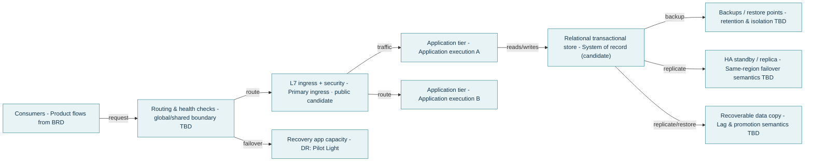
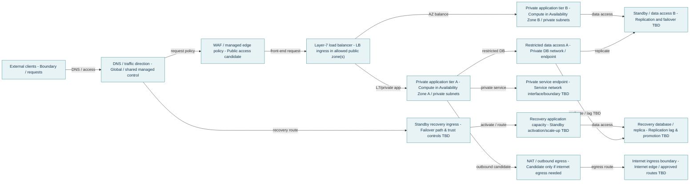
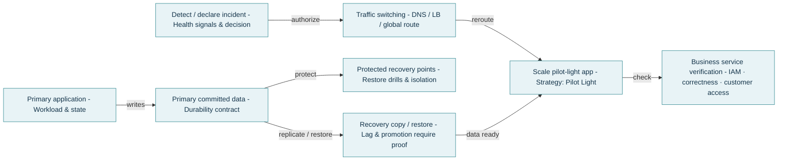
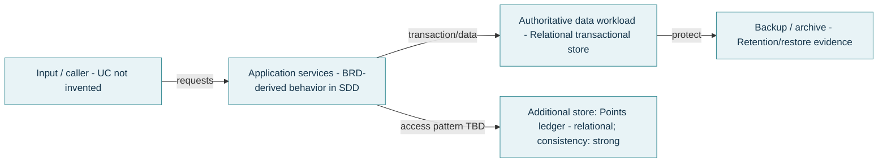

<!--
CHUNK: 05
TITLE: Target Shape
PROJECT: Refunds Platform
VERSION: 1.0
DEPENDS_ON: 02, 03a-03h, 04
PART OF: Pre-SDD - Refunds Platform
-->

# 5. Target Shape

## 5.1 Shape

<!-- ENGINE-FRAGMENT: 05-target-shape.md -->
| Aspect | Shape | Basis |
|---|---|---|
| Hosting | cloud | HDR-08.1 |
| Topology | Primary + independent recovery location (regional) | REL-05.1 |
| DR strategy, scope region | Pilot Light (pilot), replication asynchronous | REL-05.1, REL-03.1, REL-04.1 |
| DR strategy, scope az | Local HA only · broader DR not scoped (localHA), replication asynchronous | REL-05.2, REL-03.2, REL-04.2 |
| Data | kind relational, consistency strong, replication asynchronous (region), asynchronous (az) | DAT-01.1, DAT-05.1, REL-04.1 |
| Network | public | INT-08.1 |
<!-- /ENGINE-FRAGMENT -->

## 5.2 Diagrams

### 5.2.1 Infrastructure

The infrastructure is one primary cloud region with application capacity in two zones and a relational store with a same-region standby, plus a recovery region that holds a recoverable data copy and pilot-light application capacity reached by failover routing. Backups sit beside the primary store; their retention and isolation are left to the SDD.

### 5.2.2 Network

Customers, members and branch managers reach the platform over a public ingress with an edge policy and a layer-7 balancer that spreads traffic over two zones of private application and data networks. A separate recovery ingress, application and data path waits in the recovery region; outbound egress exists only where a partner call needs it.

### 5.2.3 Disaster Recovery

A declared region incident switches traffic to the recovery region, where the pilot-light application scales up on the replicated data copy and the business service is verified before customers return. The lag of the copy and its promotion must be proven in a drill.

### 5.2.4 Data

The refund workload (DAT-01.1) is the authoritative relational store with backup and archive, and the points ledger (DAT-01.2) is a second relational, strongly consistent store. How the application reaches the ledger is left to the SDD.

## 5.3 Reading the Shape

The shape follows the register: the cloud target (HDR-08.1, rule ARCH-01) with two failure scopes, region (REL-05.1) and az (REL-05.2). For scope region, REL-03.1 and REL-04.1 give a pilot-light recovery region with asynchronous replication (rule DR-03@region); for scope az, REL-03.2 and REL-04.2 give local high availability with asynchronous replication (rule DATA-08@az measures the replication lag against REL-04.2). Both data workloads are relational and strongly consistent (DAT-01.1, DAT-01.2, DAT-05.1, DAT-05.2; rule DB-10), and the network is public (INT-08.1). Residency keeps both regions within the European Union (DAT-04.1, rule SEC-11). The shape has no conflict (chunk 10). The products, the provider, the number of zones beyond the shape, and the failover mechanics are left to the SDD.

<!-- MASTER: refunds-platform-pre-sdd-master.md | PREV: 04-targets-and-calculations.md | NEXT: 07-options-and-economics.md -->
