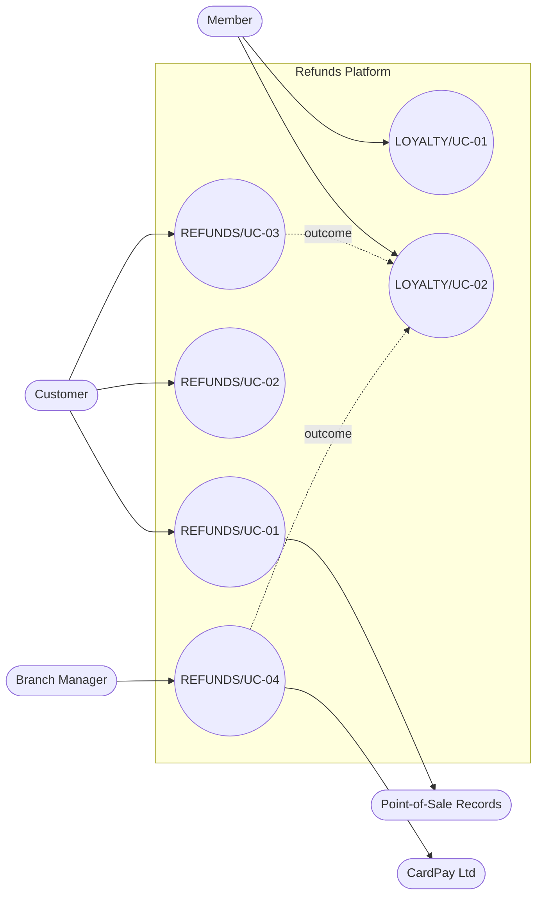

<!--
CHUNK: 03
TITLE: System Users & Use Cases
PROJECT: Refunds Platform
VERSION: 1.0
DEPENDS_ON: 01 (§7.3 also reads 05, 09, 10, 11, and 13x)
PART OF: SDD - Refunds Platform
-->

# 7. System Users & Use Cases

## 7.1 Actors

Trace each actor to its source. Describe existing authentication capability only with source proof; otherwise keep the proof question flagged and identify any proposed flow/reuse as Proposed. Persona presence alone proves neither sign-in nor permission grants.

| Actor | Type (Human / System) | Description | Primary Interface |
|-------|-----------------------|-------------|-------------------|
| Customer | Human | REFUNDS Customer ([REFUNDS 04 § Personas / Actors](../brd-refunds-portal/04-scope-and-personas.md#personas--actors)): requests, follows, and cancels refunds for branch purchases, on their own requests only. No source proves an existing sign-in; how the customer proves who they are is open ([REFUNDS 03 § Customer identity](../brd-refunds-portal/03-definitions-and-domain-concepts.md#customer-identity)), and the identity flow is Proposed (§16.2). | Web frontend, customer area (phones and computers) |
| Branch Manager | Human | REFUNDS Branch Manager ([REFUNDS 04 § Personas / Actors](../brd-refunds-portal/04-scope-and-personas.md#personas--actors)): decides on the refund requests of their own branch and reads the branch refund report. No source names how branch managers sign in; the staff sign-in is Proposed (§16.2). | Web frontend, branch area |
| Member | Human | LOYALTY Member ([LOYALTY 04 § Personas / Actors](../brd-loyalty-points/04-scope-and-personas.md#personas--actors)): a customer who joined the loyalty program ([LOYALTY 02 § Glossary](../brd-loyalty-points/02-glossary-assumptions-facts.md#glossary)), sees their own points only. A separate actor from Customer: the role differs (points versus refunds), and whether one sign-in serves both is open; who signs the member in is open ([LOYALTY/UC-01](../brd-loyalty-points/06a-use-cases-member.md#uc-01-view-points-balance) Preconditions). | Web frontend, member area |
| Payout staff member | Human | The staff member who records by hand whether a stopped payout was paid, and the second staff member who confirms it ([REFUNDS 03 § Decision record](../brd-refunds-portal/03-definitions-and-domain-concepts.md#decision-record); [REFUNDS/NFR-04](../brd-refunds-portal/10-nfrs.md#non-functional-requirements)). No BRD persona or team holds this work: **[NEEDS CLARIFICATION: Which team records payout results by hand and confirms them? Owner: Refunds and Loyalty Product Owner.]** | Web frontend, payout area |
| CardPay Ltd | System | Payment provider: receives payouts to the original card, reports payout results and card disputes ([REFUNDS 08 § Integrations](../brd-refunds-portal/08-integrations.md#integrations)). | Provider API and provider notifications ([INT-01](./08-integrations.md#12-integrations)) |
| MsgHub | System | Notification partner: delivers customer emails and SMS ([REFUNDS 08 § Integrations](../brd-refunds-portal/08-integrations.md#integrations)). | Provider API ([INT-02](./08-integrations.md#12-integrations)) |
| Point-of-Sale Records | System | The business's records of branch purchases, owned by the Retail IT team: answers receipt lookups ([REFUNDS 08 § Integrations](../brd-refunds-portal/08-integrations.md#integrations)) and gives the member purchases that earn points ([LOYALTY 08 § Integrations](../brd-loyalty-points/08-integrations.md#integrations)). | Receipt lookup API and purchase feed ([INT-03](./08-integrations.md#12-integrations)) |

## 7.2 Use Case Diagram

**Figure 1: Use Case Diagram**

**Summary:** The Customer drives [REFUNDS/UC-01](../brd-refunds-portal/06a-use-cases-customer.md#uc-01-request-a-refund), [REFUNDS/UC-02](../brd-refunds-portal/06a-use-cases-customer.md#uc-02-track-refund-status), and [REFUNDS/UC-03](../brd-refunds-portal/06a-use-cases-customer.md#uc-03-cancel-a-refund-request) (the receipt lookup reaches Point-of-Sale Records), the Branch Manager drives [REFUNDS/UC-04](../brd-refunds-portal/06b-use-cases-branch-manager.md#uc-04-approve--reject-refund) (the payout reaches CardPay Ltd), and the Member drives [LOYALTY/UC-01](../brd-loyalty-points/06a-use-cases-member.md#uc-01-view-points-balance) and [LOYALTY/UC-02](../brd-loyalty-points/06a-use-cases-member.md#uc-02-view-points-history); the outcomes of cancelled, rejected, paid, and returned refunds flow into the points history. [REFUNDS/UC-05](../brd-refunds-portal/05-user-journeys-overview.md#use-case-summary) is merged into [REFUNDS/UC-04](../brd-refunds-portal/06b-use-cases-branch-manager.md#uc-04-approve--reject-refund).

## 7.3 Use Case Traceability (BRD → SDD)

| Use case (BRD) | Title | Owner (§17.X) | Entry points | Flows (§8.4 / §8.5) | APIs (§15) | Events (§14) | Status |
|----------------|-------|---------------|--------------|---------------------|------------|--------------|--------|
| **[Refunds Portal v1.5](../brd-refunds-portal/refunds-portal-brd-master.md) (REFUNDS)** | | | | | | | |
| [REFUNDS/UC-01](../brd-refunds-portal/06a-use-cases-customer.md#uc-01-request-a-refund) | Request a Refund | [refund-request](./13a-service-refund-request.md) | `GET /v1/receipts/{receiptNumber}/refundable-items`, `POST /v1/refund-requests` | [§8.4.1](./05-workflows-and-sequences.md#841-workflow-refund-request-lifecycle), [§8.5.1](./05-workflows-and-sequences.md#851-sequence-submit-a-refund-request) | API-01, API-03, API-07 | `RefundRequestSubmitted` | Active |
| [REFUNDS/UC-02](../brd-refunds-portal/06a-use-cases-customer.md#uc-02-track-refund-status) | Track Refund Status | [refund-request](./13a-service-refund-request.md) | `GET /v1/refund-requests`, `GET /v1/refund-requests/{refundRequestId}` | [§8.5.5](./05-workflows-and-sequences.md#855-sequence-track-refund-status) | - | - | Active |
| [REFUNDS/UC-03](../brd-refunds-portal/06a-use-cases-customer.md#uc-03-cancel-a-refund-request) | Cancel a Refund Request | [refund-request](./13a-service-refund-request.md) | `POST /v1/refund-requests/{refundRequestId}/cancellation` | [§8.4.1](./05-workflows-and-sequences.md#841-workflow-refund-request-lifecycle), [§8.4.3](./05-workflows-and-sequences.md#843-workflow-points-earned-and-taken-back), [§8.5.4](./05-workflows-and-sequences.md#854-sequence-cancel-a-refund-request) | API-03, API-07 | `RefundRequestCancelled` | Active |
| [REFUNDS/UC-04](../brd-refunds-portal/06b-use-cases-branch-manager.md#uc-04-approve--reject-refund) | Approve / Reject Refund | [refund-request](./13a-service-refund-request.md) | `GET /v1/branches/{branchId}/refund-requests`, `GET /v1/branches/{branchId}/refund-requests/{refundRequestId}`, `POST /v1/refund-requests/{refundRequestId}/decision`, `Schedule: payout-retry` (payout) | [§8.4.1](./05-workflows-and-sequences.md#841-workflow-refund-request-lifecycle), [§8.4.2](./05-workflows-and-sequences.md#842-workflow-payout-retry-and-card-dispute), [§8.4.3](./05-workflows-and-sequences.md#843-workflow-points-earned-and-taken-back), [§8.5.2](./05-workflows-and-sequences.md#852-sequence-approve-a-refund-request-and-pay-it-out), [§8.5.3](./05-workflows-and-sequences.md#853-sequence-payout-fails-and-the-branch-manager-is-told), [§8.5.7](./05-workflows-and-sequences.md#857-sequence-refund-outcome-to-loyalty-points) | API-02, API-03, API-04, API-05, API-06, API-07, API-09 | `RefundRequestApproved`, `RefundRequestRejected`, `RefundRequestPaid`, `RefundRequestReturnedToApproved`, `RefundPayoutDelayed`, `PayoutSucceeded`, `PayoutFailed`, `PayoutStillFailing`, `CardDisputeDecided` | Active |
| [REFUNDS/UC-05](../brd-refunds-portal/05-user-journeys-overview.md#use-case-summary) | Issue Partial Refund | - | - | - | - | - | Merged into REFUNDS/UC-04 |
| **[Loyalty Points v1.7](../brd-loyalty-points/loyalty-points-brd-master.md) (LOYALTY)** | | | | | | | |
| [LOYALTY/UC-01](../brd-loyalty-points/06a-use-cases-member.md#uc-01-view-points-balance) | View Points Balance | [loyalty-points](./13d-service-loyalty-points.md) | `GET /v1/members/me/points-balance` | [§8.5.6](./05-workflows-and-sequences.md#856-sequence-points-balance-and-history) | - | - | Active |
| [LOYALTY/UC-02](../brd-loyalty-points/06a-use-cases-member.md#uc-02-view-points-history) | View Points History | [loyalty-points](./13d-service-loyalty-points.md) | `GET /v1/members/me/points-movements`, `GET /v1/members/me/points-movements/{movementId}`, `Event: RefundRequestPaid`, `Event: RefundRequestRejected`, `Event: RefundRequestCancelled`, `Schedule: take-back-wait-expiry` | [§8.4.3](./05-workflows-and-sequences.md#843-workflow-points-earned-and-taken-back), [§8.5.6](./05-workflows-and-sequences.md#856-sequence-points-balance-and-history), [§8.5.7](./05-workflows-and-sequences.md#857-sequence-refund-outcome-to-loyalty-points) | - | - | Active |

<!-- MASTER: refunds-platform-sdd-master.md | PREV: 02-ecosystem-overview.md | NEXT: 04-architecture-style-and-diagrams.md -->
