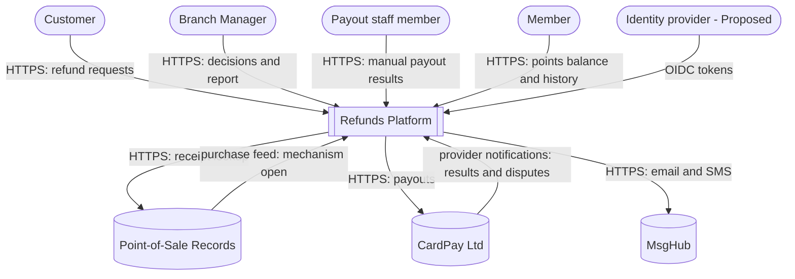
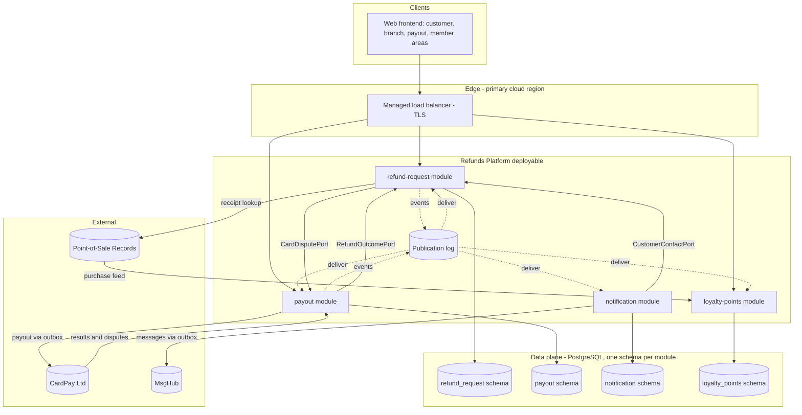

<!--
CHUNK: 04
TITLE: System Design - Architecture Style, Context & HLA Diagrams
PROJECT: Refunds Platform
VERSION: 1.0
DEPENDS_ON: 01, 02
PART OF: SDD - Refunds Platform
-->

# 8. System Design / High-Level Architecture

## 8.1 Architecture Style

### 8.1.1 What

A modular monolith: one Java 21 / Spring Boot deployable holding four modules (refund-request, payout, notification, loyalty-points), each owning one bounded context and one schema in the one PostgreSQL database. Modules call each other only through in-process module ports for queries (one hop, `Internal (in-process)` contracts in §15) and publish state changes as durable in-process domain events that are recorded in a publication log in the publisher's transaction and delivered after commit to each listener at least once (§14.10). There is no broker and no module-to-module HTTP. Every provider write that must follow a state change (a payout to CardPay Ltd, a message through MsgHub) is written to the module's outbox in the same transaction and performed by a relay after commit; synchronous provider reads (the receipt lookup to Point-of-Sale Records) are plain calls with a timeout and a fallback. A developer can tell from this alone: module to module is an in-process event or a port call, never a shared table; module to provider is an outbox relay or a synchronous read through an adapter.

### 8.1.2 Why

- **Release stage and team:** both products are first production releases (the Refunds Portal starts with a pilot group of branches, [REFUNDS 04 § Project Scope](../brd-refunds-portal/04-scope-and-personas.md#project-scope); Loyalty Points leaves redeeming for a later phase, [LOYALTY 04 § Out of Scope](../brd-loyalty-points/04-scope-and-personas.md#out-of-scope)), built by one team (assumption, BRDs silent; [decision log](./decision-log.md#architecture-questionnaire-record)). One deployable keeps one pipeline, one database, and one release while the products settle.
- **Load is modest and steady:** [PSDD/CAP-01.2](../pre-sdd-refunds-platform/03b-register-capacity.md#cap-01) refund requests and [PSDD/CAP-01.1](../pre-sdd-refunds-platform/03b-register-capacity.md#cap-01) points movements a day, a peak of [PSDD/CAP-02.1](../pre-sdd-refunds-platform/03b-register-capacity.md#cap-02) and [PSDD/CAP-03.1](../pre-sdd-refunds-platform/03b-register-capacity.md#cap-03), and a seasonal multiplier of [PSDD/CAP-04.1](../pre-sdd-refunds-platform/03b-register-capacity.md#cap-04) ([REFUNDS/NFR-03](../brd-refunds-portal/10-nfrs.md#non-functional-requirements)). No part needs to scale on its own; no BRD NFR or Technical Input states a separate scaling, failure, or release need ([ADR-01](./06-principles-and-decisions.md#10-architectural-decisions)).
- **Money correctness and atomic outcomes:** refund money is never lost or paid twice ([REFUNDS/NFR-01](../brd-refunds-portal/10-nfrs.md#non-functional-requirements), [PSDD/REL-10.1](../pre-sdd-refunds-platform/03c-register-reliability.md#rel-10)) and each paid refund takes points back once ([PSDD/INT-05.1](../pre-sdd-refunds-platform/03f-register-integration.md#int-05)). A state change, its decision-record row, its publication-log row, and its outbox row commit in one PostgreSQL transaction with strong consistency ([PSDD/DAT-05.1](../pre-sdd-refunds-platform/03d-register-data.md#dat-05), [PSDD/DAT-05.2](../pre-sdd-refunds-platform/03d-register-data.md#dat-05)), which a single database gives without distributed transactions.
- **The mandated stack fits one deployable:** [REFUNDS 12 TI-01](../brd-refunds-portal/12-appendix-and-wishlist.md#technical-inputs-for-the-sdd) (Java 21 and Spring Boot) and [REFUNDS 12 TI-02](../brd-refunds-portal/12-appendix-and-wishlist.md#technical-inputs-for-the-sdd) (PostgreSQL for all data).

### 8.1.3 How

- **Bounded contexts:** refund-request (refund requests, their lifecycle, the decision record, the branch report), payout (payouts, retries, card disputes, manual results, the monthly payout check), notification (customer and branch manager messages), loyalty-points (points movements, balance, history, purchase intake, take-back); one module each ([§13](./09-services-summary.md#13-services-decomposition-summary)).
- **Inter-module communication:** state changes as durable in-process domain events (§14.10), queries through module ports (`CardDisputePort`, `CustomerContactPort`, `RefundOutcomePort`; §15.2), each port checking a permission token (§16.11). Module boundaries are enforced by package rules checked in the build ([AP-04](./06-principles-and-decisions.md#9-architecture-principles)).
- **Provider communication:** anti-corruption adapters per provider; outbound writes through each module's outbox relay with idempotency keys, timeouts, retries with exponential backoff and jitter, and a circuit breaker ([ADR-08](./06-principles-and-decisions.md#10-architectural-decisions); §12); inbound provider notifications verified and deduplicated before any state change ([API-05](./11-api-contracts.md#api-05-payout-result-notification-cardpay-ltd---payout), [API-06](./11-api-contracts.md#api-06-card-dispute-notification-cardpay-ltd---payout)).
- **Data ownership:** one PostgreSQL database, schemas `refund_request`, `payout`, `notification`, `loyalty_points`; a module's database role can read and write only its own schema and the shared `event_publication` table ([ADR-04](./06-principles-and-decisions.md#10-architectural-decisions); §11.1).
- **Deployment model:** one container image of the deployable plus the web frontend, on the cloud provider's managed container service in one primary region across availability zones, with a pilot-light recovery region ([ADR-10](./06-principles-and-decisions.md#10-architectural-decisions); [§8.6](./05a-infrastructure-and-network.md#86-infrastructure-architecture)).

## 8.2 Context Diagram

**Figure 2: System Context Diagram**

**Summary:** Customers, branch managers, payout staff, and members reach the platform over HTTPS with tokens from the Proposed identity provider; the platform looks up receipts in Point-of-Sale Records and receives member purchases from it, sends payouts to CardPay Ltd and receives its results and disputes, and sends customer messages through MsgHub.

## 8.3 High-Level Architecture Diagram

**Figure 3: High-Level Architecture**

**Summary:** Browsers reach the one deployable through the managed load balancer; refund-request and payout publish durable in-process events that the publication log delivers to their listeners, three module ports carry the dispute, contact, and approved-refund lookups, each module keeps its own schema, and the provider adapters sit at the edge of their modules (receipt lookup and purchase feed with Point-of-Sale Records, payouts and notifications with CardPay Ltd, messages with MsgHub).

**Shape the diagram follows (locked by the Pre-SDD, [PSDD 12 § 12.2 Locked Items](../pre-sdd-refunds-platform/12-sdd-handoff-guide.md#122-locked-items)):**

| Locked item | What it fixes in this architecture | Where the design realises it |
|-------------|------------------------------------|------------------------------|
| [PSDD/HDR-08.1](../pre-sdd-refunds-platform/02-classification-and-path.md#21-classification) | Cloud hosting: the deployable, the database, and the edge run in a cloud region | [§8.6.1](./05a-infrastructure-and-network.md#861-deployment-topology) |
| [PSDD/DAT-01.1](../pre-sdd-refunds-platform/03d-register-data.md#dat-01), [PSDD/DAT-01.2](../pre-sdd-refunds-platform/03d-register-data.md#dat-01) | Two data workloads, both relational: refund requests with their decision record (system of record: the Refunds Portal) and points movements with the balance as their sum | `refund_request` and `loyalty_points` schemas ([§17.1](./13a-service-refund-request.md#db-modeling), [§17.4](./13d-service-loyalty-points.md#db-modeling)) |
| [PSDD/DAT-05.1](../pre-sdd-refunds-platform/03d-register-data.md#dat-05), [PSDD/DAT-05.2](../pre-sdd-refunds-platform/03d-register-data.md#dat-05) | Strong consistency for both workloads | One PostgreSQL primary; every state change and its publication-log and outbox rows in one transaction |
| [PSDD/INT-02.1](../pre-sdd-refunds-platform/03f-register-integration.md#int-02) | The receipt lookup answers while the customer enters a receipt number; refund outcomes go to Loyalty Points when they happen and are kept until it starts; member purchases are known the same day; customer messages follow each status change | Synchronous lookup (API-01); in-process events with the publication log and the loyalty-points inbox (§14.10); purchase feed (API-08); notification module |
| [PSDD/INT-03.1](../pre-sdd-refunds-platform/03f-register-integration.md#int-03), [PSDD/INT-03.2](../pre-sdd-refunds-platform/03f-register-integration.md#int-03), [PSDD/INT-03.3](../pre-sdd-refunds-platform/03f-register-integration.md#int-03) | The partner quotas, latencies, SLAs, maintenance windows, and rate limits the external dependencies impose: open in the Pre-SDD | Each provider adapter sits behind its port with its limits as configuration. **[NEEDS CLARIFICATION: Which value does the Pre-SDD set for PSDD/INT-03.1, the limits CardPay Ltd imposes? Owner: E2E Architect (pre-sdd-unifier), with CardPay Ltd ([PSDD/QD-04](../pre-sdd-refunds-platform/10-validation-risks-unknowns.md#101-validation-and-unknowns)).]** **[NEEDS CLARIFICATION: Which value does the Pre-SDD set for PSDD/INT-03.2, the limits Point-of-Sale Records imposes? Owner: E2E Architect (pre-sdd-unifier), with the Retail IT team ([PSDD/QD-05](../pre-sdd-refunds-platform/10-validation-risks-unknowns.md#101-validation-and-unknowns)).]** **[NEEDS CLARIFICATION: Which value does the Pre-SDD set for PSDD/INT-03.3, open in its lock list? Owner: E2E Architect (pre-sdd-unifier).]** |
| [PSDD/INT-04.1](../pre-sdd-refunds-platform/03f-register-integration.md#int-04) | Failure behaviour per dependency: Point-of-Sale Records unreachable, payout refused or sent back, card dispute open, a failed message, Loyalty Points not started | API-01 fallback; payout retry and dispute hold ([§17.2](./13b-service-payout.md#business-logic)); messages outside the request's transaction; the loyalty-points inbox |
| [PSDD/INT-05.1](../pre-sdd-refunds-platform/03f-register-integration.md#int-05) | Take-back once per paid refund, a 30-day wait for a late purchase, within 1 hour, the late purchase's own date | Inbox deduplication and the pending take-back table ([§17.4](./13d-service-loyalty-points.md#business-logic)) |
| [PSDD/INT-08.1](../pre-sdd-refunds-platform/03f-register-integration.md#int-08) | Public network connectivity | Public ingress through the managed load balancer; provider egress over the internet ([§8.7](./05a-infrastructure-and-network.md#87-network-architecture)) |

<!-- MASTER: refunds-platform-sdd-master.md | PREV: 03-users-and-use-cases.md | NEXT: 05-workflows-and-sequences.md -->
