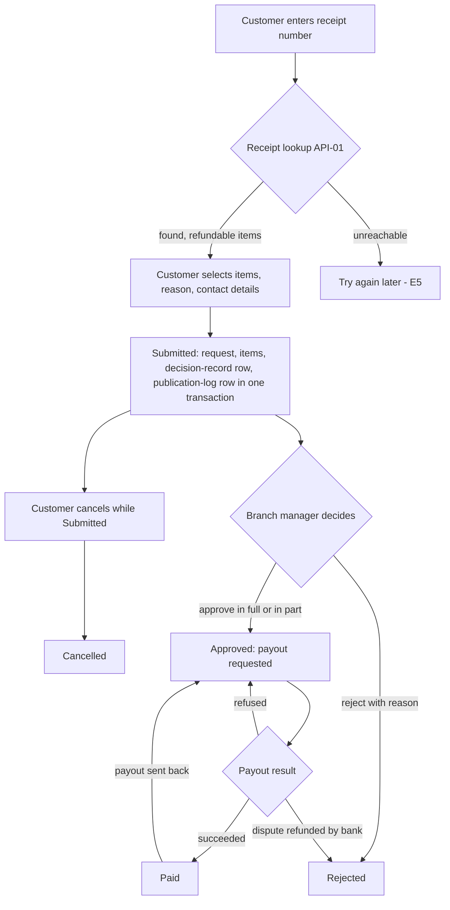
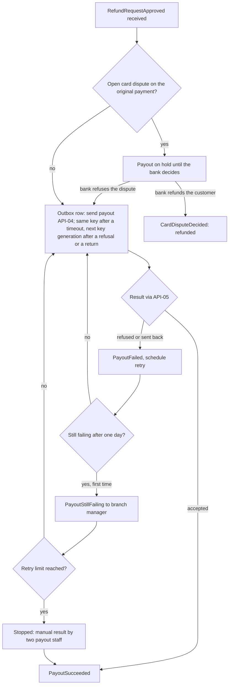
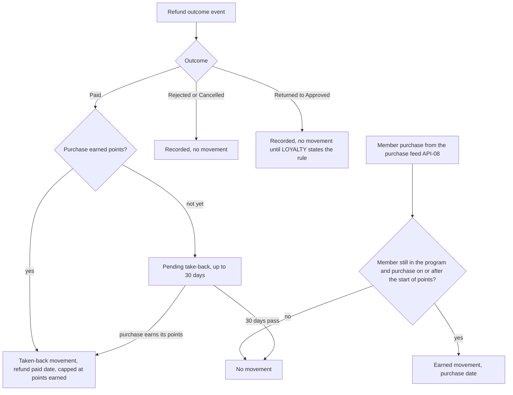
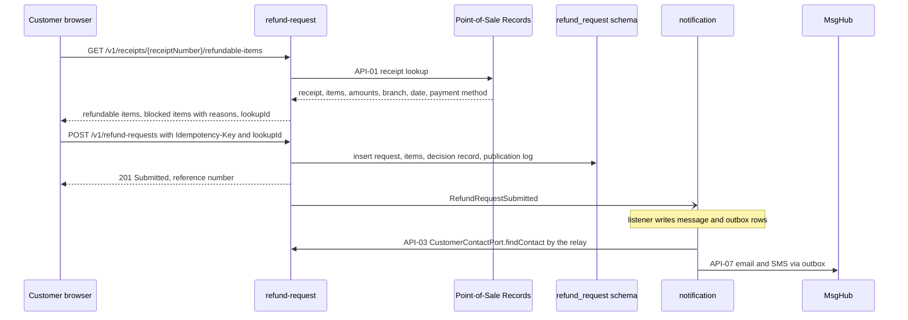
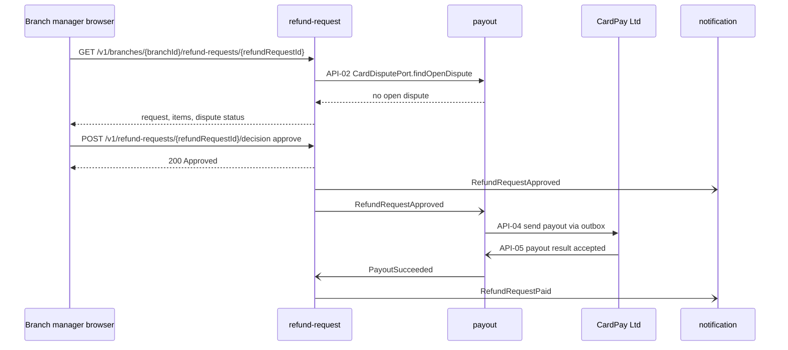
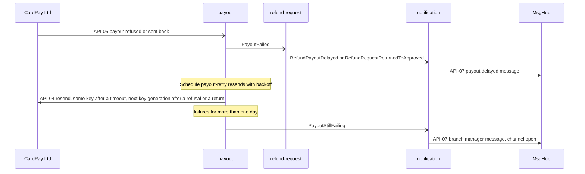
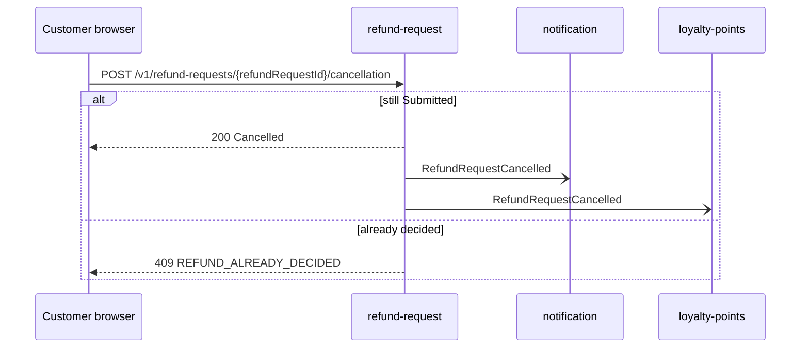
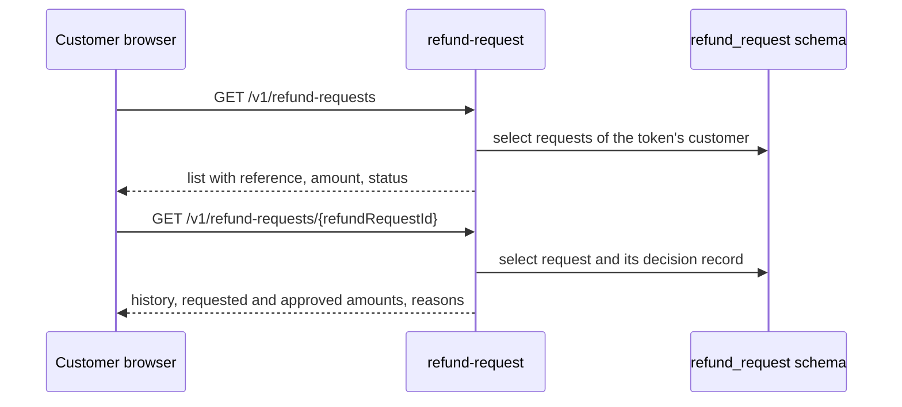
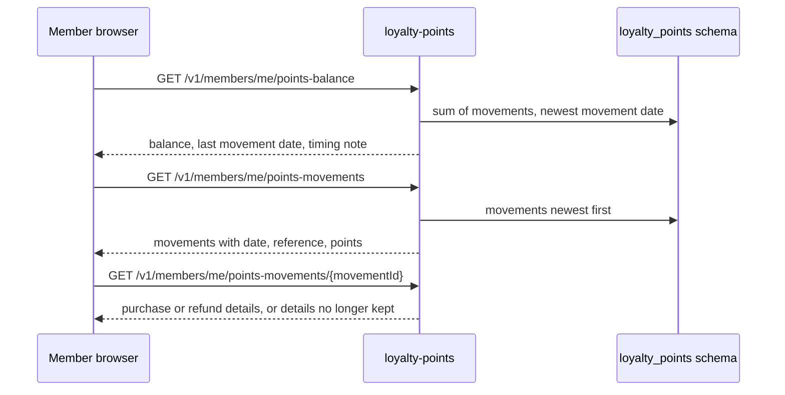
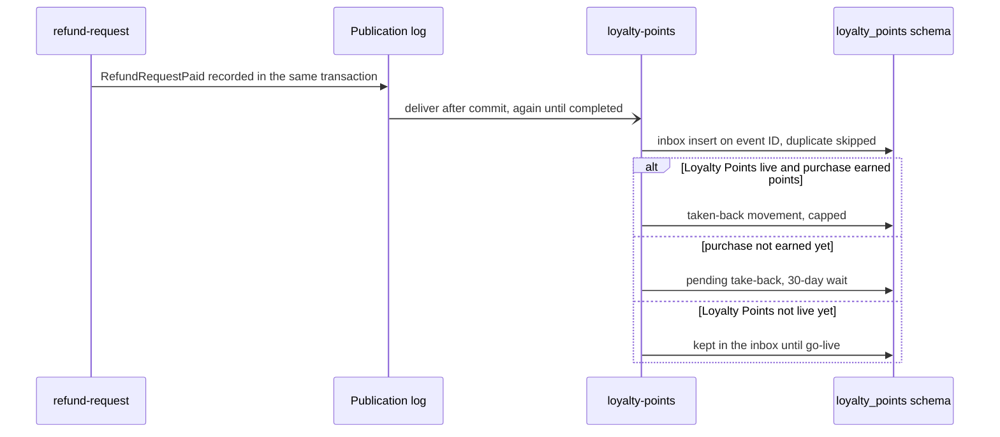

<!--
CHUNK: 05
TITLE: System Design - Workflow & Sequence Diagrams
PROJECT: Refunds Platform
VERSION: 1.0
DEPENDS_ON: 04
PART OF: SDD - Refunds Platform
-->

## 8.4 Workflow Diagrams

<!-- This chunk continues the System Design section from chunk 04 (Architecture Style & Diagrams). Event names are the §14.10 registry's; API IDs are §15.2's. -->

### 8.4.1 Workflow: Refund request lifecycle

**Use cases:** [REFUNDS/UC-01](../brd-refunds-portal/06a-use-cases-customer.md#uc-01-request-a-refund), [REFUNDS/UC-03](../brd-refunds-portal/06a-use-cases-customer.md#uc-03-cancel-a-refund-request), [REFUNDS/UC-04](../brd-refunds-portal/06b-use-cases-branch-manager.md#uc-04-approve--reject-refund)

**Summary:** A refund request starts with a receipt lookup, is recorded as Submitted with its decision-record row in one transaction, and is cancelled by the customer or decided by the branch manager; an approved request becomes Paid when its payout succeeds, stays Approved while the payout is retried, becomes Rejected when the bank refunds a disputed payment, and goes back to Approved when a paid payout is sent back.

### 8.4.2 Workflow: Payout, retry, and card dispute

**Use cases:** [REFUNDS/UC-04](../brd-refunds-portal/06b-use-cases-branch-manager.md#uc-04-approve--reject-refund)

**Summary:** An approved refund's payout waits while the original card payment is disputed, is otherwise sent through the outbox with a key built from its own ID, and is retried with backoff when refused or sent back; after one day of failures the branch manager is told, and a payout that reaches the retry limit stops for a manual result recorded and confirmed by two payout staff members.

### 8.4.3 Workflow: Points earned and taken back

**Use cases:** [LOYALTY/UC-02](../brd-loyalty-points/06a-use-cases-member.md#uc-02-view-points-history), [REFUNDS/UC-03](../brd-refunds-portal/06a-use-cases-customer.md#uc-03-cancel-a-refund-request), [REFUNDS/UC-04](../brd-refunds-portal/06b-use-cases-branch-manager.md#uc-04-approve--reject-refund)

**Summary:** A member purchase earns points as an earned movement; a paid refund takes points back once, capped at what its purchase earned, or waits up to 30 days for a purchase that has not earned yet; rejected, cancelled, and returned outcomes are recorded and add no movement.

## 8.5 Sequence Diagrams

### 8.5.1 Sequence: Submit a refund request

**Use cases:** [REFUNDS/UC-01](../brd-refunds-portal/06a-use-cases-customer.md#uc-01-request-a-refund)

**Summary:** The customer's receipt lookup calls Point-of-Sale Records synchronously; the submit commits the request, its items, its decision-record row, and its publication-log row in one transaction and answers with the reference number, and only then does the notification module write its messages, whose relay reads the contact details and sends the email and SMS.

### 8.5.2 Sequence: Approve a refund request and pay it out

**Use cases:** [REFUNDS/UC-04](../brd-refunds-portal/06b-use-cases-branch-manager.md#uc-04-approve--reject-refund)

**Summary:** The decision screen asks the payout module for an open card dispute; the approval commits the Approved status and answers at once, the payout module sends the payout through its outbox, and the provider's result turns into PayoutSucceeded, which marks the request Paid and tells the customer.

### 8.5.3 Sequence: Payout fails and the branch manager is told

**Use cases:** [REFUNDS/UC-04](../brd-refunds-portal/06b-use-cases-branch-manager.md#uc-04-approve--reject-refund)

**Summary:** A refused or returned payout keeps the request Approved (or moves it back from Paid), the customer is told the payout is delayed, and the payout-retry schedule resends with the same key after a timeout and the next key generation after a refusal or a return; once failures last more than one day the branch manager gets an information message.

### 8.5.4 Sequence: Cancel a refund request

**Use cases:** [REFUNDS/UC-03](../brd-refunds-portal/06a-use-cases-customer.md#uc-03-cancel-a-refund-request)

**Summary:** A cancellation succeeds only while the request is Submitted, after which the customer is emailed and Loyalty Points records the outcome; a request decided in the meantime answers 409.

### 8.5.5 Sequence: Track refund status

**Use cases:** [REFUNDS/UC-02](../brd-refunds-portal/06a-use-cases-customer.md#uc-02-track-refund-status)

**Summary:** The customer lists and opens only their own requests; the detail reads the decision record for the history of status changes.

### 8.5.6 Sequence: Points balance and history

**Use cases:** [LOYALTY/UC-01](../brd-loyalty-points/06a-use-cases-member.md#uc-01-view-points-balance), [LOYALTY/UC-02](../brd-loyalty-points/06a-use-cases-member.md#uc-02-view-points-history)

**Summary:** The member's balance is the sum of their movements read from the loyalty_points schema, the history lists movements newest first, and a movement's detail shows its purchase or refund, or says that older details are no longer kept.

### 8.5.7 Sequence: Refund outcome to Loyalty Points

**Use cases:** [LOYALTY/UC-02](../brd-loyalty-points/06a-use-cases-member.md#uc-02-view-points-history), [REFUNDS/UC-04](../brd-refunds-portal/06b-use-cases-branch-manager.md#uc-04-approve--reject-refund)

**Summary:** A paid refund is recorded in the publication log with its status change and delivered to loyalty-points after commit until the listener completes; the inbox drops duplicates, and the take-back is applied, held for up to 30 days, or kept until Loyalty Points goes live.

<!-- MASTER: refunds-platform-sdd-master.md | PREV: 04-architecture-style-and-diagrams.md | NEXT: 05a-infrastructure-and-network.md -->
