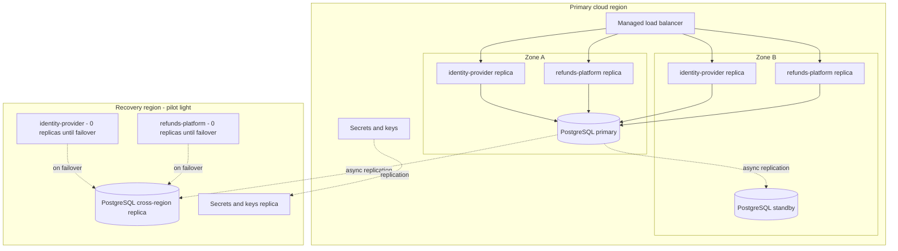
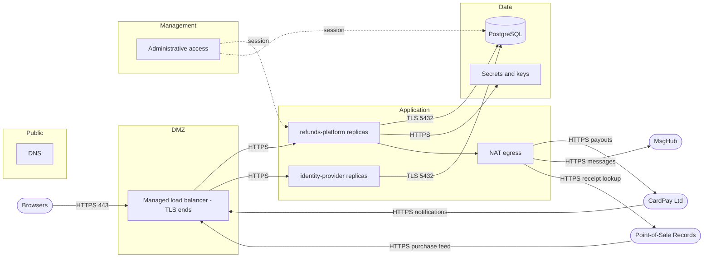

<!--
CHUNK: 05a
TITLE: System Design - Infrastructure & Network Architecture
PROJECT: Refunds Platform
VERSION: 1.0
DEPENDS_ON: 02 (§6 rows), 04 (§8.1), 06 (ADRs), 07 (§11.2, §11.3, §11.6), 08 (§8.7 links the §12 rows), 09 (the §13 rows behind the deployables); also reads 10 (§14.2), 11 (§15.2), 12 (§16.4.3), 13x (§17.X), 14 (§18), 15 (§19), and 16 (§20.1.5)
PART OF: SDD - Refunds Platform
-->

## 8.6 Infrastructure Architecture

<!-- This chunk continues the System Design section from chunk 05 (Workflow & Sequence Diagrams). Homes: the technologies are their §6 rows; the deployment target is the §6 Compute / Infra and Container Runtime rows and ADR-10; the deployables follow ADR-01 and §13; tenancy is §11.2; deployment and security defaults are §11.3 and §11.6; environments are §19; each provider's protocol, auth, and timeouts are its §12 row and §15 contract. The topology, the HA, the DR strategy per failure scope, the RPO and RTO, and the connectivity are locked by the Pre-SDD and cited as PSDD/<ID>. -->

### 8.6.1 Deployment Topology

**Deployment target:** [§6 Compute / Infra and Container Runtime](./02-ecosystem-overview.md#6-ecosystem-overview) (questionnaire Q8; hosting locked by [PSDD/HDR-08.1](../pre-sdd-refunds-platform/02-classification-and-path.md#21-classification)), recorded in [ADR-10](./06-principles-and-decisions.md#10-architectural-decisions); the deployable follows [ADR-01](./06-principles-and-decisions.md#10-architectural-decisions) and [§13](./09-services-summary.md#13-services-decomposition-summary).

| Concern | Design | Source |
|---------|--------|--------|
| Clusters | Not applicable: the managed container service runs the deployable; one service definition per environment | [§6 Container Runtime](./02-ecosystem-overview.md#6-ecosystem-overview) |
| Regions or sites | One primary cloud region and one recovery region; the provider and the region names are open (§6 Compute / Infra marker). Both regions must lie where data residency allows: **[NEEDS CLARIFICATION: In which countries or regions must the platform's data stay, given that data residency applies (PSDD/DAT-04.1 reads yes)? Owner: E2E Architect (pre-sdd-unifier).]** Clients are browsers on phones and computers, including branch managers in 40 branches, with no offline operation ([PSDD/INT-07.1](../pre-sdd-refunds-platform/03f-register-integration.md#int-07)). | [PSDD/HDR-08.1](../pre-sdd-refunds-platform/02-classification-and-path.md#21-classification), [PSDD/REL-05.1](../pre-sdd-refunds-platform/03c-register-reliability.md#rel-05), [PSDD/DAT-04.1](../pre-sdd-refunds-platform/03d-register-data.md#dat-04), [PSDD/INT-07.1](../pre-sdd-refunds-platform/03f-register-integration.md#int-07) |
| Availability zones | In the primary region the deployable runs at least two replicas spread over two availability zones, and the database runs a primary with a standby in a second zone (local HA, asynchronous replication); losing one zone leaves the platform running from the other within the AZ RTO of §8.6.4. The targets: 99.9 % for the Refunds Portal ([PSDD/REL-01.1](../pre-sdd-refunds-platform/03c-register-reliability.md#rel-01)) and 99.9 % for the points screens ([PSDD/REL-01.2](../pre-sdd-refunds-platform/03c-register-reliability.md#rel-01)). | [PSDD/REL-05.2](../pre-sdd-refunds-platform/03c-register-reliability.md#rel-05), [PSDD/REL-01.1](../pre-sdd-refunds-platform/03c-register-reliability.md#rel-01), [PSDD/REL-01.2](../pre-sdd-refunds-platform/03c-register-reliability.md#rel-01) |
| Node pools | Not applicable: the managed container service | [§6 Container Runtime](./02-ecosystem-overview.md#6-ecosystem-overview) |

### 8.6.2 Deployables per Environment

| Deployable | §13 rows or source | dev | test | stage | prod | dr |
|------------|--------------------|-----|------|-------|------|----|
| refunds-platform (backend modules and the web frontend's static files in one image) | [refund-request, payout, notification, loyalty-points](./09-services-summary.md#13-services-decomposition-summary); [§6 Frontend Stack](./02-ecosystem-overview.md#6-ecosystem-overview) | Managed container service, 1 replica | Managed container service, 1 replica | Managed container service, 2 replicas over 2 zones | Managed container service, 2 or more replicas over 2 zones | Managed container service, 0 replicas while idle (pilot light), scaled to the prod count on failover |
| identity-provider (Keycloak, Proposed: §6 IAM / AuthN marker) | [§6 IAM / AuthN](./02-ecosystem-overview.md#6-ecosystem-overview) | Managed container service, 1 replica | Managed container service, 1 replica | Managed container service, 2 replicas over 2 zones | Managed container service, 2 replicas over 2 zones | Managed container service, 0 replicas while idle, scaled on failover |

stage-dr: created only for a region recovery drill ([§19](./15-environments.md#19-environments)), shaped as the dr column.

### 8.6.3 Data Stores, Broker, and Storage

| Component | §6 row | Topology | Placement | Used by |
|-----------|--------|----------|-----------|---------|
| Primary database (schemas `refund_request`, `payout`, `notification`, `loyalty_points`, and the shared `event_publication` table) | [Primary RDBMS](./02-ecosystem-overview.md#6-ecosystem-overview) | One primary and one standby with asynchronous replication in the primary region; one cross-region asynchronous replica in the recovery region | Primary region: two zones; recovery region: one zone | refunds-platform |
| Identity database (database `identity` on the same PostgreSQL service, separate from the platform database) | [Primary RDBMS](./02-ecosystem-overview.md#6-ecosystem-overview) | As the primary database: standby in a second zone, cross-region replica | As the primary database | identity-provider |
| Broker | [Event Broker / Streaming](./02-ecosystem-overview.md#6-ecosystem-overview) | Not applicable: no broker ([ADR-02](./06-principles-and-decisions.md#10-architectural-decisions)) | - | - |
| Cache | [Caching](./02-ecosystem-overview.md#6-ecosystem-overview) | Not applicable | - | - |
| Object storage | [Object Storage](./02-ecosystem-overview.md#6-ecosystem-overview) | Not applicable | - | - |
| Secrets and keys | [Secrets Management](./02-ecosystem-overview.md#6-ecosystem-overview) | The provider's managed secrets and key service, replicated to the recovery region | Both regions | refunds-platform, primary database (encryption keys) |

The schema split per module is [§11.1](./07-cross-cutting-concerns.md#111-db-modeling-default) and [ADR-04](./06-principles-and-decisions.md#10-architectural-decisions); the tenancy split is open ([§11.2](./07-cross-cutting-concerns.md#112-multi-tenancy-default)). The replication meets the durability and correctness target: no refund money lost or paid twice, and an unchangeable decision record ([PSDD/REL-10.1](../pre-sdd-refunds-platform/03c-register-reliability.md#rel-10)); every committed payout state and its outbox row survive a zone loss up to the AZ RPO and a region loss up to the region RPO below, and the payout idempotency key makes a resend of a surviving payout safe; payouts lost in the data-loss window are reconciled before sending resumes ([§20.1.5](./16-operations-runbook.md#2015-database-failover)).

### 8.6.4 Backup and Disaster Recovery

The failure scopes and their strategies are locked: region loss, Pilot Light with asynchronous replication ([PSDD/REL-05.1](../pre-sdd-refunds-platform/03c-register-reliability.md#rel-05)); zone loss, local HA only with asynchronous replication ([PSDD/REL-05.2](../pre-sdd-refunds-platform/03c-register-reliability.md#rel-05)); the decisions are [PSDD/ADR-DR-001](../pre-sdd-refunds-platform/09-decisions.md#94-pre-sdd-adrs). This table is the home of the RPO and RTO; the §18.5 rows of [REFUNDS/NFR-02](../brd-refunds-portal/10-nfrs.md#non-functional-requirements) and [LOYALTY/NFR-04](../brd-loyalty-points/10-nfrs.md#non-functional-requirements) link here.

| Component | Backup | RPO | RTO | Recovery | Source |
|-----------|--------|-----|-----|----------|--------|
| Primary database, zone loss | Standby in a second zone, asynchronous replication; continuous write-ahead-log archiving and daily snapshots, encrypted with the business-held keys ([PSDD/SEC-04.1](../pre-sdd-refunds-platform/03e-register-security.md#sec-04)) | 5 s ([PSDD/REL-04.2](../pre-sdd-refunds-platform/03c-register-reliability.md#rel-04)) | 300 s ([PSDD/REL-03.2](../pre-sdd-refunds-platform/03c-register-reliability.md#rel-03)) | The managed database promotes the standby; the deployable reconnects; procedure [§20.1.5](./16-operations-runbook.md#2015-database-failover) | [PSDD/REL-05.2](../pre-sdd-refunds-platform/03c-register-reliability.md#rel-05), [PSDD/REL-04.2](../pre-sdd-refunds-platform/03c-register-reliability.md#rel-04), [PSDD/REL-03.2](../pre-sdd-refunds-platform/03c-register-reliability.md#rel-03) |
| Primary database, region loss | Cross-region asynchronous replica in the recovery region; snapshots copied to the recovery region | 900 s ([PSDD/REL-04.1](../pre-sdd-refunds-platform/03c-register-reliability.md#rel-04)) | 14,400 s ([PSDD/REL-03.1](../pre-sdd-refunds-platform/03c-register-reliability.md#rel-03)) | Pilot light: promote the replica, scale the dr deployable from 0, repoint DNS, re-run the outbox and publication-log relays; procedure [§20.1.5](./16-operations-runbook.md#2015-database-failover) | [PSDD/REL-05.1](../pre-sdd-refunds-platform/03c-register-reliability.md#rel-05), [PSDD/REL-04.1](../pre-sdd-refunds-platform/03c-register-reliability.md#rel-04), [PSDD/REL-03.1](../pre-sdd-refunds-platform/03c-register-reliability.md#rel-03) |
| Secrets and keys | Replicated by the provider's service to the recovery region | As the primary database | As the primary database | Read by the dr deployable at start-up | [PSDD/SEC-04.1](../pre-sdd-refunds-platform/03e-register-security.md#sec-04) |
| Identity database and identity-provider | As the primary database | As the primary database | As the primary database | Promoted and scaled with the platform in [§20.1.5](./16-operations-runbook.md#2015-database-failover) | [PSDD/REL-05.1](../pre-sdd-refunds-platform/03c-register-reliability.md#rel-05), [PSDD/REL-05.2](../pre-sdd-refunds-platform/03c-register-reliability.md#rel-05) |
| refunds-platform deployable | Stateless; the image is kept in the provider's registry in both regions | Not applicable: no state | Within the database RTO of its scope | Redeploy or scale in the surviving zone or region | [ADR-01](./06-principles-and-decisions.md#10-architectural-decisions) |

The exposure of the region RPO at the peak is [PSDD/CALC-15](../pre-sdd-refunds-platform/04-targets-and-calculations.md#42-calculations) (62.5 transactions).

Restore granularity and backup retention follow the Pre-SDD entry still open for them: **[NEEDS CLARIFICATION: Which value does the Pre-SDD set for PSDD/DAT-09.1, open in its lock list, which §8.6.4 and the restore procedure of §20.1.5 design to? Owner: E2E Architect (pre-sdd-unifier).]** Whether a declared region disaster counts toward the [REFUNDS/NFR-02](../brd-refunds-portal/10-nfrs.md#non-functional-requirements) limit and the [PSDD/REL-01.1](../pre-sdd-refunds-platform/03c-register-reliability.md#rel-01) target is the Pre-SDD unknown [PSDD/QD-07](../pre-sdd-refunds-platform/10-validation-risks-unknowns.md#101-validation-and-unknowns) (open, owner Refunds and Loyalty Product Owner, due 2026-11-20); the region RTO above stands as locked.

### 8.6.5 Scaling Model

- **Deployables:** horizontal; the managed container service adds replicas when CPU stays above the target of [§11.3](./07-cross-cutting-concerns.md#113-deployment-default), within the seasonal peak of [§18.3](./14-performance-and-capacity.md#183-peak-scenarios) and the hub topology of [§14.2](./10-events-hub.md#142-hub-topology-decision) (no broker); module sizing is per [§17.X Deployment Strategy](./13a-service-refund-request.md#deployment-strategy).
- **Data stores:** vertical scaling of the primary; the daily data growth of [PSDD/DAT-02.1](../pre-sdd-refunds-platform/03d-register-data.md#dat-02) fits one primary for the horizon [PSDD/ECO-03.1](../pre-sdd-refunds-platform/03h-register-economics.md#eco-03); no read replica in this release.
- **Broker:** Not applicable: no broker.
- **Limits:** the scheduled jobs (payout retry, the monthly payout check, the take-back wait, retention purges) run on one replica at a time under a PostgreSQL advisory lock; the outbox and publication-log relays poll with row locks (`FOR UPDATE SKIP LOCKED`) so replicas share the work without duplicates.

### 8.6.6 Deployment Diagram

**Figure 4: Infrastructure Deployment**

**Summary:** The primary region runs two replicas each of refunds-platform and identity-provider behind the managed load balancer in two zones, with the PostgreSQL primary and its standby in different zones; the recovery region holds an asynchronous cross-region replica and idle deployables that are scaled up on failover, meeting the AZ and region rows of §8.6.4.

## 8.7 Network Architecture

<!-- The minimum TLS version, the certificates, and module authorization are §11.6; the DNS naming and per-environment access are §19. The network constraints of the Pre-SDD are cited as PSDD/<ID>. -->

### 8.7.1 Network Zones

| Zone | Holds | Reached from | Source |
|------|-------|--------------|--------|
| Public | DNS for the platform's host name | Internet | [PSDD/INT-08.1](../pre-sdd-refunds-platform/03f-register-integration.md#int-08) |
| DMZ | The managed load balancer, which ends TLS | Public | [§6 Service Mesh / Ingress](./02-ecosystem-overview.md#6-ecosystem-overview) |
| Application | The refunds-platform replicas (§8.6.2), in private subnets with outbound internet through NAT | DMZ | recommended: no public address on a replica |
| Data | The PostgreSQL primary, standby, and replica; the secrets and key service endpoints | Application | recommended: the database accepts connections only from the application zone |
| Management | Administrative access, the CI/CD pipeline, and the managed observability services | The path of §8.7.6 | [§6 CI/CD and Observability](./02-ecosystem-overview.md#6-ecosystem-overview) |

Data flows to the recovery region, to the providers, and to the managed services only where data residency allows ([PSDD/DAT-04.1](../pre-sdd-refunds-platform/03d-register-data.md#dat-04); the residency marker is in §8.6.1). Clients are browsers on phones and computers on the public internet, with no offline operation ([PSDD/INT-07.1](../pre-sdd-refunds-platform/03f-register-integration.md#int-07), [PSDD/INT-08.1](../pre-sdd-refunds-platform/03f-register-integration.md#int-08)).

### 8.7.2 Ingress Path

| # | Hop | Component | Zone | Source |
|---|-----|-----------|------|--------|
| 1 | DNS | The provider's DNS service, one record per environment ([§19](./15-environments.md#19-environments)) | Public | [PSDD/INT-08.1](../pre-sdd-refunds-platform/03f-register-integration.md#int-08) |
| 2 | CDN or WAF | Not applicable for this release: no source requires one; **[NEEDS CLARIFICATION: Which threat protection does the Pre-SDD set for the public edge, open as PSDD/SEC-03.1? Owner: E2E Architect (pre-sdd-unifier).]** | Public | [PSDD/SEC-03.1](../pre-sdd-refunds-platform/03e-register-security.md#sec-03) |
| 3 | Load balancer | The managed load balancer of the container service, TLS ending here | DMZ | [§6 Service Mesh / Ingress](./02-ecosystem-overview.md#6-ecosystem-overview) |
| 4 | API gateway | Not applicable ([§6 API Gateway](./02-ecosystem-overview.md#6-ecosystem-overview)) | DMZ | [ADR-01](./06-principles-and-decisions.md#10-architectural-decisions) |
| 5 | Service | refunds-platform (§8.6.2): the REST endpoints of the four modules, and the provider notifications of CardPay Ltd ([API-05](./11-api-contracts.md#api-05-payout-result-notification-cardpay-ltd---payout), [API-06](./11-api-contracts.md#api-06-card-dispute-notification-cardpay-ltd---payout)) and the purchase feed of Point-of-Sale Records ([API-08](./11-api-contracts.md#api-08-member-purchase-feed-point-of-sale-records---loyalty-points)), on their own paths; and the identity provider's sign-in pages, on their own host name behind the same load balancer | Application | [§13](./09-services-summary.md#13-services-decomposition-summary) |
| 6 | Frontend | The web frontend's static files, served by refunds-platform, reached from hop 3 | Application | [§6 Frontend Stack](./02-ecosystem-overview.md#6-ecosystem-overview) |

An allow-list for the provider notifications is set only from the providers' documents ([§15.6](./11-api-contracts.md#156-external-contracts-awaiting-the-user)).

### 8.7.3 Egress to External Systems

| §12 row | System | Egress path | Provider requirement | Source |
|---------|--------|-------------|----------------------|--------|
| [INT-01](./08-integrations.md#12-integrations) | CardPay Ltd | NAT through the application zone's fixed egress addresses | **[NEEDS CLARIFICATION: Does CardPay Ltd require an IP allow-list, a private link, or a VPN for the payout API? Owner: CardPay Ltd.]** | [PSDD/INT-06.1](../pre-sdd-refunds-platform/03f-register-integration.md#int-06) (open) |
| [INT-02](./08-integrations.md#12-integrations) | MsgHub | NAT through the application zone's fixed egress addresses | **[NEEDS CLARIFICATION: Does MsgHub require an IP allow-list for its messaging API? Owner: MsgHub.]** | [PSDD/INT-06.1](../pre-sdd-refunds-platform/03f-register-integration.md#int-06) (open) |
| [INT-03](./08-integrations.md#12-integrations) | Point-of-Sale Records | NAT for the receipt lookup; the purchase feed arrives inbound (§8.7.2) | **[NEEDS CLARIFICATION: Is Point-of-Sale Records reachable over the internet, or only over a private connection to the business's network? Owner: Retail IT team.]** | [PSDD/INT-06.1](../pre-sdd-refunds-platform/03f-register-integration.md#int-06) (open), [PSDD/INT-08.1](../pre-sdd-refunds-platform/03f-register-integration.md#int-08) |

The recovery region's NAT egress addresses are registered with every provider that requires an allow-list at the same time as the primary region's.

The private connectivity, allow-lists, and network dependencies the Pre-SDD settles are its entry [PSDD/INT-06.1](../pre-sdd-refunds-platform/03f-register-integration.md#int-06), open in its lock list: **[NEEDS CLARIFICATION: Which value does the Pre-SDD set for PSDD/INT-06.1, which §8.7.3 designs the egress paths to? Owner: E2E Architect (pre-sdd-unifier).]**

### 8.7.4 TLS Termination and mTLS

| Connection | TLS ends at | mTLS | Source |
|------------|-------------|------|--------|
| Client to platform | The managed load balancer; the load balancer re-encrypts to the replicas | No | [§11.6](./07-cross-cutting-concerns.md#116-security-default), [PSDD/SEC-04.1](../pre-sdd-refunds-platform/03e-register-security.md#sec-04) |
| Service to service | Not applicable: one deployable | No | [§6 Service Mesh / Ingress](./02-ecosystem-overview.md#6-ecosystem-overview) |
| Service to data store | The PostgreSQL server, TLS required on every connection | No | [PSDD/SEC-04.1](../pre-sdd-refunds-platform/03e-register-security.md#sec-04) |
| Platform to external system | The provider's endpoint | As each provider requires (open, §15.6) | [INT-01](./08-integrations.md#12-integrations), [INT-02](./08-integrations.md#12-integrations), [INT-03](./08-integrations.md#12-integrations) |

### 8.7.5 Service-to-Service Network Policies

- **Default:** deny all; allow only the flows of §8.7.7.
- **Enforced by:** the cloud provider's security groups or firewall rules on the application and data zones (recommended).
- **Tenant isolation:** None at the network level: isolation is in the application and its data model, open with the tenancy model ([§11.2](./07-cross-cutting-concerns.md#112-multi-tenancy-default)).

### 8.7.6 Administrative Access

- **Path:** the cloud provider's console and command-line access with single sign-on, and a short-lived database session through the provider's managed bastion or session service (recommended); no standing network path from the internet to the data zone.
- **Who:** the platform-plane role `PLATFORM_OPERATOR` of [§16.4.3](./12-centralized-user-roles.md#1643-platform-plane-operator---outside-tenant-tenancy).
- **Grant and audit:** time-limited grants; access to production data needs a second person's approval, in line with the separation of duties of [PSDD/SEC-07.1](../pre-sdd-refunds-platform/03e-register-security.md#sec-07); every session logged in the managed log service.

### 8.7.7 Ports and Protocols

| From | To | Port | Protocol | Purpose | Source |
|------|----|------|----------|---------|--------|
| Internet | Managed load balancer | 443 | HTTPS | Browsers, provider notifications (API-05, API-06), purchase feed (API-08) | registered port |
| Managed load balancer | refunds-platform | **[NEEDS CLARIFICATION: Which container port does the managed container service map to the deployable? Owner: Software Architect.]** | HTTPS | Requests to the modules | [PSDD/SEC-04.1](../pre-sdd-refunds-platform/03e-register-security.md#sec-04) |
| Managed load balancer | identity-provider | As the refunds-platform row (container port marker) | HTTPS | Sign-in and tokens | [PSDD/SEC-04.1](../pre-sdd-refunds-platform/03e-register-security.md#sec-04) |
| refunds-platform | PostgreSQL primary | 5432 | PostgreSQL over TLS | Module schemas, publication log, outboxes | registered port |
| refunds-platform | CardPay Ltd | 443 | HTTPS | API-04 send payout | registered port |
| refunds-platform | MsgHub | 443 | HTTPS | API-07 send message | registered port |
| refunds-platform | Point-of-Sale Records | 443 | HTTPS | API-01 receipt lookup | registered port |
| refunds-platform | Secrets and key service | 443 | HTTPS | Secrets and keys at start-up | registered port |
| Administrative access | refunds-platform | Management port: as the container port marker above | HTTPS | Operations endpoint (§20.1.3) | [§8.7.6](./05a-infrastructure-and-network.md#876-administrative-access) |
| PostgreSQL primary | PostgreSQL standby and replica | 5432 | PostgreSQL replication over TLS | Asynchronous replication | registered port |

### 8.7.8 Network Diagram

**Figure 5: Network Architecture**

**Summary:** Browsers and provider notifications enter over HTTPS at the managed load balancer, where TLS ends before the private application zone, and the load balancer also serves the identity provider's sign-in pages; the replicas reach PostgreSQL and the key service in the data zone over TLS and leave through NAT for CardPay Ltd, MsgHub, and Point-of-Sale Records; administrators reach the application and data zones only through short-lived sessions.

<!-- MASTER: refunds-platform-sdd-master.md | PREV: 05-workflows-and-sequences.md | NEXT: 06-principles-and-decisions.md -->
