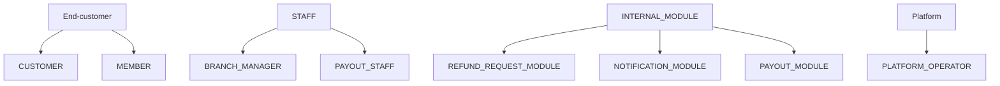
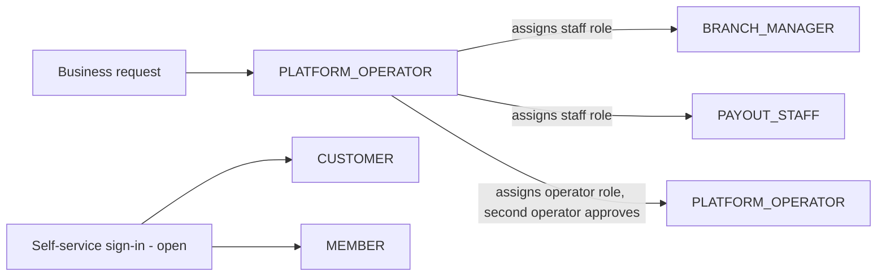
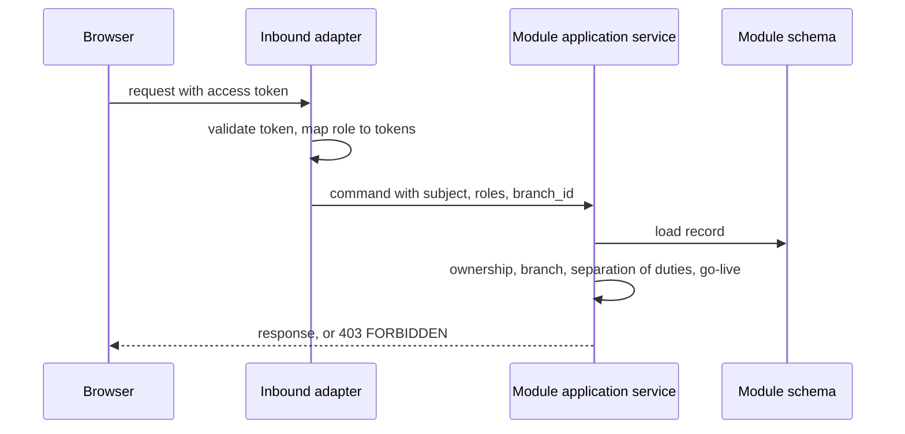

<!--
CHUNK: 12
TITLE: Centralized User Roles & Authorities (Platform-Wide)
PROJECT: Refunds Platform
VERSION: 1.0
DEPENDS_ON: 03, 07, 09 (+ per-service chunks 13a, 13b, 13c, 13d for per-service authorization notes)
PART OF: SDD - Refunds Platform
PURPOSE: Single platform-wide reference for user types, roles, and their authorities, consolidated from the two BRDs' Users & Use Cases Matrices and the per-module authorization notes.
CONSISTENCY_RULE: Role names, permission tokens, and per-module authorization notes in the 13x chunks MUST match this catalogue verbatim. Divergences are flagged in §16.12.3.
-->

# 16. Centralized User Roles & Authorities (Platform-Wide)

> **What this chunk is.** The one place that answers what user types exist, what each role may do, who grants whom, and which modules each role reaches. It consolidates [REFUNDS 07 § Users & Use Cases Matrix](../brd-refunds-portal/07-users-use-cases-matrix.md#users--use-cases-matrix) and [LOYALTY 07 § Users & Use Cases Matrix](../brd-loyalty-points/07-users-use-cases-matrix.md#users--use-cases-matrix), the actors of [§7.1](./03-users-and-use-cases.md#71-actors), and the access rules locked by the Pre-SDD ([PSDD/SEC-02.1](../pre-sdd-refunds-platform/03e-register-security.md#sec-02), [PSDD/SEC-07.1](../pre-sdd-refunds-platform/03e-register-security.md#sec-07)).

---

## 16.1 Business Overview

The platform serves one retail business. Its users are end customers in two roles, a customer asking for refunds and a member checking points; the business's staff in two roles, a branch manager deciding on their own branch's refunds and a payout staff member recording and confirming manual payout results; and three internal module identities that call module ports. A platform operator runs the infrastructure and holds no business permission. Every business permission is scoped to the person's own records (own requests, own branch, own points), as the BRDs' matrices state with their footnotes.

## 16.2 Resolution Model - How a Role Becomes an Allowed Action

1. **Identity:** the browser signs in with the Proposed identity provider (OIDC, [ADR-06](./06-principles-and-decisions.md#10-architectural-decisions)) and calls the platform with an access token. How a customer proves who they are ([REFUNDS 03 § Customer identity](../brd-refunds-portal/03-definitions-and-domain-concepts.md#customer-identity)) and who signs the member in ([LOYALTY/UC-01](../brd-loyalty-points/06a-use-cases-member.md#uc-01-view-points-balance) Preconditions) are open; this model holds for any issuer whose token carries the claims below.
2. **Role:** the token's `roles` claim gives the role (`CUSTOMER`, `MEMBER`, `BRANCH_MANAGER`, `PAYOUT_STAFF`, or `PLATFORM_OPERATOR` for the operations endpoint); staff tokens carry `branch_id` for a branch manager, and member tokens carry `member_ref` (ADR-06).
3. **Permission:** the deployable maps each role to its permission tokens (§16.11) from the seed of §16.12.1; every endpoint checks its token (the 13x List of APIs).
4. **Contextual gates, in the module:** ownership (`customer_subject` equals the token's subject; the member row's subject equals it), branch scope (the request's `branch_id` equals the token's), separation of duties (the decider is not the request's customer; the confirmer is not the recorder: [PSDD/SEC-07.1](../pre-sdd-refunds-platform/03e-register-security.md#sec-07)), membership (a member who left is refused; a first sign-in links the member row through `member_ref`, §17.4), and go-live (a branch switch and the Loyalty Points switch, §11.5).
5. **Module ports:** a port call carries the calling module's identity (`REFUND_REQUEST_MODULE`, `NOTIFICATION_MODULE`, `PAYOUT_MODULE`), and the port checks its token (§15.1).

Enforcement points: token validation and the permission check in the deployable's inbound adapter; the contextual gates in each module's application service; there is no gateway (§6).

## 16.3 User Types (Tier 1)

| User type | Tenancy plane | Identity source | Description |
|---|---|---|---|
| `CUSTOMER` | End-customer | Proposed identity provider, customer client (method open) | A buyer who requests and follows refunds ([REFUNDS 04 § Personas / Actors](../brd-refunds-portal/04-scope-and-personas.md#personas--actors)) |
| `MEMBER` | End-customer | Proposed identity provider, member client (sign-in party open) | A customer in the loyalty program ([LOYALTY 04 § Personas / Actors](../brd-loyalty-points/04-scope-and-personas.md#personas--actors)) |
| `STAFF` | Business | Proposed identity provider, staff client | Branch managers ([REFUNDS 04 § Personas / Actors](../brd-refunds-portal/04-scope-and-personas.md#personas--actors)) and payout staff members ([REFUNDS 03 § Decision record](../brd-refunds-portal/03-definitions-and-domain-concepts.md#decision-record)) |
| `INTERNAL_MODULE` | Platform | The deployable's module identities (in process) | Modules that call another module's port with no user context |
| `PLATFORM_OPERATOR` | Platform | The cloud provider's single sign-on for infrastructure; the identity provider's staff client for the operations endpoint | Operators of the infrastructure, outside the business data |

## 16.4 Role Catalogue - Authorities & Related Services

### 16.4.1 End-customer Roles

| Role | Scope | Core authorities | Related services |
|---|---|---|---|
| `CUSTOMER` | Own refund requests | Look up a receipt, submit a refund request, list and open own requests, cancel an own Submitted request | refund-request |
| `MEMBER` | Own points | Open own points balance, history, and movement details | loyalty-points |

### 16.4.2 Staff Sub-Roles

| Sub-role | Scope | Core authorities | Related services |
|---|---|---|---|
| `BRANCH_MANAGER` | Own branch | List and open the branch's requests, approve in full or in part, reject, read the branch refund report; never decide on an own request | refund-request |
| `PAYOUT_STAFF` | All stopped payouts | List stopped payouts, record a manual result, confirm another staff member's manual result | payout |

### 16.4.3 Platform Plane (operator - outside tenant tenancy)

| Role | Scope | Core authorities | Related services |
|---|---|---|---|
| `PLATFORM_OPERATOR` | global | Deploy, operate, fail over, rotate secrets, run the runbook procedures of §20; redeliver one incomplete event (§20.1.3), audited; no permission token on business data; production data access only with a second person's approval (§8.7.6) | All modules, infrastructure only |
| `REFUND_REQUEST_MODULE` | In process | Read open card disputes through `CardDisputePort` | payout |
| `NOTIFICATION_MODULE` | In process | Read a request's contact details through `CustomerContactPort` | refund-request |
| `PAYOUT_MODULE` | In process | Read approved refunds through `RefundOutcomePort` | refund-request |

## 16.5 Capability Matrix (canonical)

| Capability | `CUSTOMER` | `MEMBER` | `BRANCH_MANAGER` | `PAYOUT_STAFF` |
|---|---|---|---|---|
| Request a refund | Yes | - | - | - |
| Track own refund status | Yes¹ | - | - | - |
| Cancel own refund request | Yes¹ | - | - | - |
| Decide on a refund request | - | - | Yes²³ | - |
| Read the branch refund report | - | - | Yes² | - |
| Record a manual payout result | - | - | - | Yes |
| Confirm a manual payout result | - | - | - | Yes⁴ |
| View own points balance | - | Yes⁵ | - | - |
| View own points history | - | Yes⁵ | - | - |

¹ Own requests only ([REFUNDS 07 § Users & Use Cases Matrix](../brd-refunds-portal/07-users-use-cases-matrix.md#users--use-cases-matrix) footnote 2).
² Own branch only ([REFUNDS 07 § Users & Use Cases Matrix](../brd-refunds-portal/07-users-use-cases-matrix.md#users--use-cases-matrix) footnote 1).
³ Never on a request the branch manager submitted as a customer ([REFUNDS/UC-04](../brd-refunds-portal/06b-use-cases-branch-manager.md#uc-04-approve--reject-refund) BR-6: no decision on one's own request).
⁴ Never one's own record ([REFUNDS 03 § Decision record](../brd-refunds-portal/03-definitions-and-domain-concepts.md#decision-record); [PSDD/SEC-07.1](../pre-sdd-refunds-platform/03e-register-security.md#sec-07)).
⁵ Own points only ([LOYALTY 07 § Users & Use Cases Matrix](../brd-loyalty-points/07-users-use-cases-matrix.md#users--use-cases-matrix) footnote 1).

## 16.6 Grant / Invitation Authority (who can create whom)

| Grantor role | May create / invite | Constraints |
|---|---|---|
| `PLATFORM_OPERATOR` | `BRANCH_MANAGER`, `PAYOUT_STAFF` (staff role assignment in the identity provider) | Only on the business's written request; who in the business requests it is open: **[NEEDS CLARIFICATION: Who in the business approves giving a staff member the branch manager or payout staff role, and who removes it? Owner: Refunds and Loyalty Product Owner.]** |
| `PLATFORM_OPERATOR` | `PLATFORM_OPERATOR` (operator role in the identity provider's staff client) | A second operator approves each assignment (§8.7.6); who in the business requests it follows the staff-role marker above |
| (self-service) | `CUSTOMER`, `MEMBER` | As the open identity flows allow ([REFUNDS 03 § Customer identity](../brd-refunds-portal/03-definitions-and-domain-concepts.md#customer-identity); [LOYALTY/UC-01](../brd-loyalty-points/06a-use-cases-member.md#uc-01-view-points-balance) Preconditions) |

## 16.7 Role → Related-Services Matrix (platform-wide)

| Role | refund-request | payout | notification | loyalty-points |
|---|---|---|---|---|
| `CUSTOMER` | write | - | - | - |
| `MEMBER` | - | - | - | read |
| `BRANCH_MANAGER` | write | - | - | - |
| `PAYOUT_STAFF` | - | write | - | - |
| `REFUND_REQUEST_MODULE` | - | read | - | - |
| `NOTIFICATION_MODULE` | read | - | - | - |
| `PAYOUT_MODULE` | read | - | - | - |
| `PLATFORM_OPERATOR` | write (operations endpoint only) | - | - | - |

## 16.8 Lifecycle, Scope & Revocation Rules

1. **Grant:** customer and member identities are created by their open sign-in flows; staff roles are assigned in the identity provider per §16.6, with `branch_id` for a branch manager.
2. **Change:** a branch manager moving branches gets a new `branch_id`; the old branch's requests leave their scope at the next token.
3. **Suspension / revocation:** removing a staff role takes effect at the next token refresh (access tokens of 5 minutes, recommended); a decision already committed stays in the decision record with its actor.
4. **Erasure:** contact details are deleted 90 days after a request ends and member data within 30 days after the membership ends ([PSDD/DAT-06.1](../pre-sdd-refunds-platform/03d-register-data.md#dat-06)); the decision record keeps the pseudonymous subject for its 10 years.
5. **Branch manager away:** who decides when the branch manager is away is open in the BRD ([REFUNDS 03 § Branch ownership](../brd-refunds-portal/03-definitions-and-domain-concepts.md#branch-ownership)); no delegation exists in this release.

## 16.9 Diagrams

### 16.9.1 Role Taxonomy (user types → roles → sub-roles)

**Summary:** End customers are customers or members, staff are branch managers or payout staff, three module identities call ports, and the platform operator stands outside the business roles.

### 16.9.2 Grant / Invitation Authority (who may create whom)

**Summary:** Staff roles are assigned by the platform operator on the business's request; customers and members come from their open self-service sign-in flows.

### 16.9.3 Per-Request Authorization (how a role yields a decision)

**Summary:** The inbound adapter validates the token and checks the endpoint's permission token, and the module's application service applies the contextual gates on the loaded record before it answers or refuses with 403.

## 16.10 Traceability

| Capability / rule | Source (BRD UC / matrix row / ADR / 13x chunk) |
|---|---|
| Request a refund | [REFUNDS/UC-01](../brd-refunds-portal/06a-use-cases-customer.md#uc-01-request-a-refund); matrix row in [REFUNDS 07](../brd-refunds-portal/07-users-use-cases-matrix.md#users--use-cases-matrix); [13a](./13a-service-refund-request.md#constraints) |
| Track own refund status | [REFUNDS/UC-02](../brd-refunds-portal/06a-use-cases-customer.md#uc-02-track-refund-status); matrix row and footnote 2 in [REFUNDS 07](../brd-refunds-portal/07-users-use-cases-matrix.md#users--use-cases-matrix); [13a](./13a-service-refund-request.md#constraints) |
| Cancel own refund request | [REFUNDS/UC-03](../brd-refunds-portal/06a-use-cases-customer.md#uc-03-cancel-a-refund-request); matrix row and footnote 2 in [REFUNDS 07](../brd-refunds-portal/07-users-use-cases-matrix.md#users--use-cases-matrix); [13a](./13a-service-refund-request.md#constraints) |
| Decide on a refund request | [REFUNDS/UC-04](../brd-refunds-portal/06b-use-cases-branch-manager.md#uc-04-approve--reject-refund); matrix row and footnote 1 in [REFUNDS 07](../brd-refunds-portal/07-users-use-cases-matrix.md#users--use-cases-matrix); [13a](./13a-service-refund-request.md#constraints) |
| Read the branch refund report | [REFUNDS 09 § Reporting / Analytics](../brd-refunds-portal/09-reporting-and-analytics.md#reporting--analytics); [13a](./13a-service-refund-request.md#constraints) |
| Record and confirm a manual payout result | [REFUNDS 03 § Decision record](../brd-refunds-portal/03-definitions-and-domain-concepts.md#decision-record); [PSDD/SEC-07.1](../pre-sdd-refunds-platform/03e-register-security.md#sec-07); [13b](./13b-service-payout.md#constraints) |
| View own points balance | [LOYALTY/UC-01](../brd-loyalty-points/06a-use-cases-member.md#uc-01-view-points-balance); matrix row and footnote 1 in [LOYALTY 07](../brd-loyalty-points/07-users-use-cases-matrix.md#users--use-cases-matrix); [13d](./13d-service-loyalty-points.md#constraints) |
| View own points history | [LOYALTY/UC-02](../brd-loyalty-points/06a-use-cases-member.md#uc-02-view-points-history); matrix row and footnote 1 in [LOYALTY 07](../brd-loyalty-points/07-users-use-cases-matrix.md#users--use-cases-matrix); [13d](./13d-service-loyalty-points.md#constraints) |
| Module port access | [ADR-03](./06-principles-and-decisions.md#10-architectural-decisions); [13a](./13a-service-refund-request.md#constraints), [13b](./13b-service-payout.md#constraints), [13c](./13c-service-notification.md#constraints) |

## 16.11 Permission × Role Matrix (platform-wide)

| Permission token | `CUSTOMER` | `MEMBER` | `BRANCH_MANAGER` | `PAYOUT_STAFF` | `REFUND_REQUEST_MODULE` | `NOTIFICATION_MODULE` | `PAYOUT_MODULE` | `PLATFORM_OPERATOR` |
|---|---|---|---|---|---|---|---|---|
| `refund-request.receipt.lookup` | ✓ | - | - | - | - | - | - | - |
| `refund-request.refund-request.create` | ✓ | - | - | - | - | - | - | - |
| `refund-request.refund-request.read-own` | ✓¹ | - | - | - | - | - | - | - |
| `refund-request.refund-request.cancel-own` | ✓¹ | - | - | - | - | - | - | - |
| `refund-request.refund-request.read-branch` | - | - | ✓² | - | - | - | - | - |
| `refund-request.refund-request.decide` | - | - | ✓²³ | - | - | - | - | - |
| `refund-request.branch-report.read` | - | - | ✓² | - | - | - | - | - |
| `refund-request.customer-contact.read` | - | - | - | - | - | ✓ | - | - |
| `payout.card-dispute.read` | - | - | - | - | ✓ | - | - | - |
| `payout.manual-result.record` | - | - | - | ✓ | - | - | - | - |
| `payout.manual-result.confirm` | - | - | - | ✓⁴ | - | - | - | - |
| `loyalty-points.points-balance.read-own` | - | ✓⁵ | - | - | - | - | - | - |
| `loyalty-points.points-history.read-own` | - | ✓⁵ | - | - | - | - | - | - |
| `refund-request.approved-refund.read` | - | - | - | - | - | - | ✓ | - |
| `platform.event-publication.redeliver` | - | - | - | - | - | - | - | ✓⁶ |

Footnotes as §16.5. ⁶ Management port only. `PLATFORM_OPERATOR` holds only `platform.event-publication.redeliver`.

## 16.12 Implementation Seed & Reconciliation

### 16.12.1 Seed Strategy

The role-to-token map is a versioned migration of a `role_permission` table in each owning module's schema, seeded from §16.11; a change to roles is a migration plus a change to this chunk in the same update.

### 16.12.2 Per-Role Action Counts (drift baseline)

| Role | Seeded permission count |
|---|---|
| `CUSTOMER` | 4 |
| `MEMBER` | 2 |
| `BRANCH_MANAGER` | 3 |
| `PAYOUT_STAFF` | 2 |
| `REFUND_REQUEST_MODULE` | 1 |
| `NOTIFICATION_MODULE` | 1 |
| `PAYOUT_MODULE` | 1 |
| `PLATFORM_OPERATOR` | 1 |

### 16.12.3 Drift & Reconciliation Register

No divergence is open: every token in the List of APIs and Constraints of §17.1 to §17.4 and in the internal contracts of §15 matches §16.11, and every role matches the BRD matrices with their footnotes.

<!-- MASTER: refunds-platform-sdd-master.md | PREV: 11-api-contracts.md | NEXT: 13a-service-refund-request.md -->
