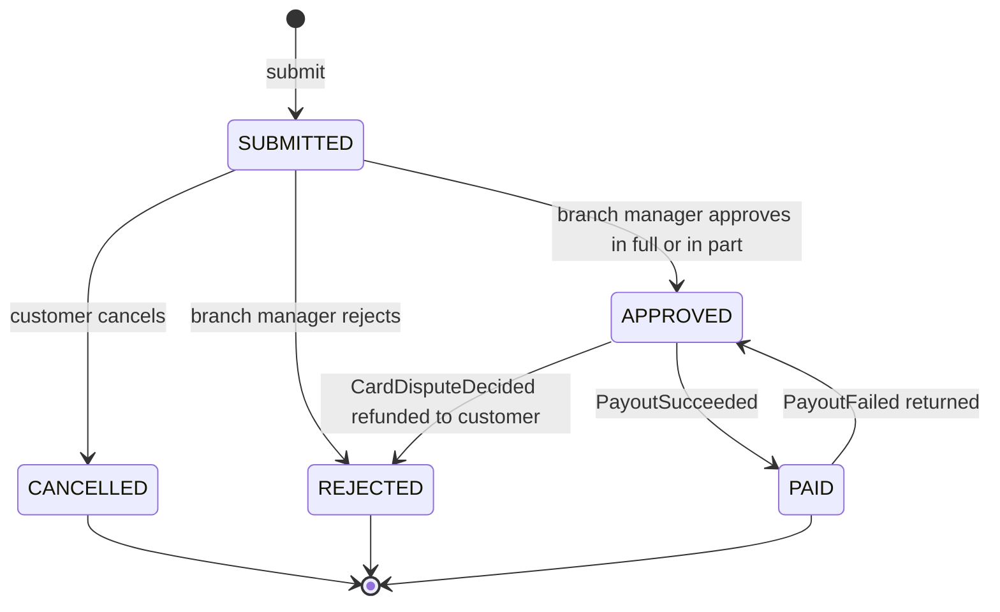
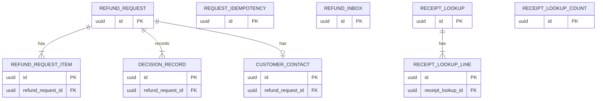
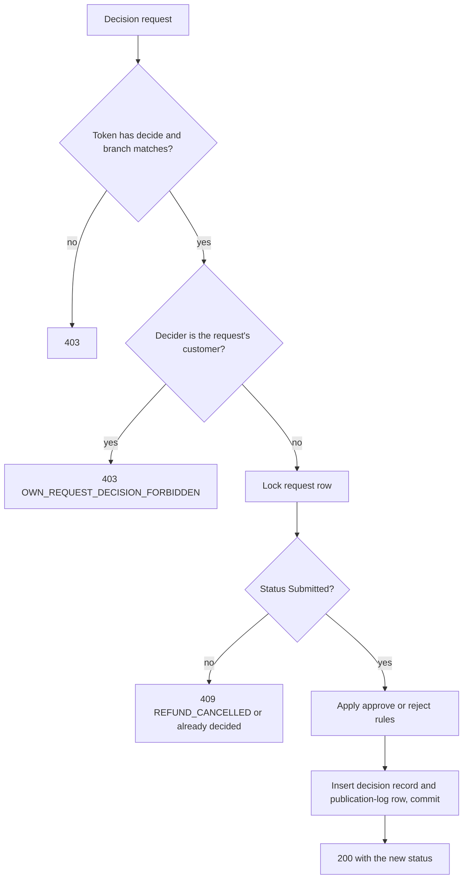
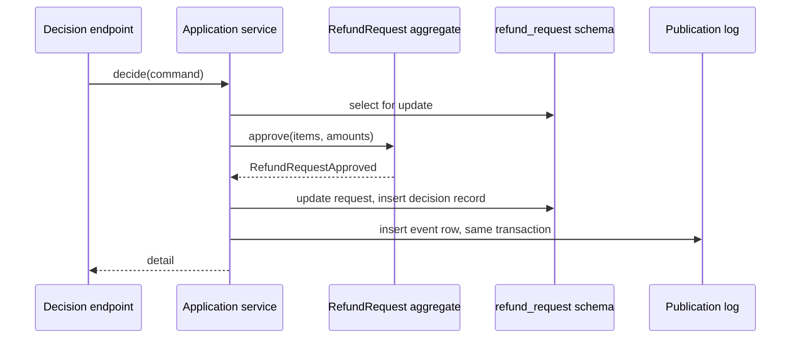

<!--
CHUNK: 13a
TITLE: Detailed Service Spec - Refund Request
PROJECT: Refunds Platform
VERSION: 1.0
DEPENDS_ON: 09, 07, 10 (event hub - event names and DTOs match chunk 10 verbatim), 11 (API contracts - integration endpoints carry their API ID and match chunk 11 verbatim), 12 (roles - permission tokens match chunk 12 verbatim)
PART OF: SDD - Refunds Platform
-->

# 17. Detailed Service Specs

---

## 17.1 Refund Request

### What

The refund-request module (a module of the one deployable, [ADR-01](./06-principles-and-decisions.md#10-architectural-decisions)) owns the refund request bounded context: a customer's request for money back for items on a branch receipt, its lifecycle from Submitted to an end state, the branch manager's decision, and the decision record of every status change. It is the system of record for refund requests ([PSDD/DAT-01.1](../pre-sdd-refunds-platform/03d-register-data.md#dat-01)).

### Boundaries

- **Owns:** refund requests and their items, their status, the decision record, the customer's contact details for a request, the branch refund report query.
- **Does not own:** payouts, their attempts, card disputes, and manual payout results (payout, [§17.2](./13b-service-payout.md#172-payout)); message delivery (notification, [§17.3](./13c-service-notification.md#173-notification)); points (loyalty-points, [§17.4](./13d-service-loyalty-points.md#174-loyalty-points)); receipts and purchases (Point-of-Sale Records); identities (the identity provider).
- **Upstream consumers:** the web frontend (customer and branch areas); the notification module through `CustomerContactPort` ([API-03](./11-api-contracts.md#api-03-customer-contact-lookup-notification---refund-request)); the payout module through `RefundOutcomePort` ([API-09](./11-api-contracts.md#api-09-approved-refunds-of-a-period-payout---refund-request)); listeners of its events (payout, notification, loyalty-points).
- **Downstream dependencies:** Point-of-Sale Records ([API-01](./11-api-contracts.md#api-01-receipt-lookup-refund-request---point-of-sale-records)); the payout module's `CardDisputePort` ([API-02](./11-api-contracts.md#api-02-open-card-dispute-lookup-refund-request---payout)); the events `PayoutSucceeded`, `PayoutFailed`, and `CardDisputeDecided`.

### Input

| Type | Source | Description |
|------|--------|-------------|
| REST | Customer (web frontend) | Receipt lookup, submit, list own, open own, cancel own (List of APIs) |
| REST | Branch Manager (web frontend) | List and open the branch's requests, decide, branch refund report (List of APIs) |
| Port | payout module | `RefundOutcomePort.listApprovedRefunds` ([API-09](./11-api-contracts.md#api-09-approved-refunds-of-a-period-payout---refund-request)) |
| Port | notification module | `CustomerContactPort.findContact` ([API-03](./11-api-contracts.md#api-03-customer-contact-lookup-notification---refund-request)) |
| Event | payout, `PayoutSucceeded` | Marks the request Paid ([REFUNDS/UC-04](../brd-refunds-portal/06b-use-cases-branch-manager.md#uc-04-approve--reject-refund) step 9) |
| Event | payout, `PayoutFailed` | Keeps the request Approved, or moves it back from Paid to Approved ([REFUNDS/UC-04](../brd-refunds-portal/06b-use-cases-branch-manager.md#uc-04-approve--reject-refund) E1) |
| Event | payout, `CardDisputeDecided` | Rejects an approved request whose disputed payment the bank refunded ([REFUNDS/UC-04](../brd-refunds-portal/06b-use-cases-branch-manager.md#uc-04-approve--reject-refund) BR-8: the bank decides the dispute) |
| Schedule | contact-details-purge | Daily: deletes the contact details of requests that ended more than 90 days ago ([PSDD/DAT-06.1](../pre-sdd-refunds-platform/03d-register-data.md#dat-06)) |
| Schedule | receipt-lookup-purge | Hourly: deletes `receipt_lookup` rows older than 30 minutes with their `receipt_lookup_line` rows, and `receipt_lookup_count` rows older than 1 day |
| Schedule | refund-record-purge | Daily: deletes requests, items, and decision records 10 years after the request ended ([PSDD/DAT-06.1](../pre-sdd-refunds-platform/03d-register-data.md#dat-06)) |

### Business Logic

The module applies the refund rules on its own data and the receipt data of Point-of-Sale Records, records every status change with its decision-record row and its publication-log row in one transaction, and publishes one in-process domain event per status change (§14.10). Every write checks the caller's permission token and scope (§16.2) and uses the request's `version` column for optimistic locking.

**Request a refund ([REFUNDS/UC-01](../brd-refunds-portal/06a-use-cases-customer.md#uc-01-request-a-refund)).**

- Steps 1-2: `GET /v1/receipts/{receiptNumber}/refundable-items` calls Point-of-Sale Records through [API-01](./11-api-contracts.md#api-01-receipt-lookup-refund-request---point-of-sale-records) and returns the receipt's items, one line per unit (each unit counts as one item: [REFUNDS/UC-01](../brd-refunds-portal/06a-use-cases-customer.md#uc-01-request-a-refund) BR-2: one unit, one item), each marked refundable or blocked with its reason: blocked while on a Submitted or Approved request or after a full refund (A1; BR-2: items on open requests), never refundable under store refund policy v3 (A2; BR-3: never-refundable items), the purchase older than 30 days (E1; BR-1: 30-day window), not paid by card (E4; BR-5: card purchases only), the branch not yet live (E6, the branch switch of §11.5), the receipt not found (E2), or Point-of-Sale Records unreachable (E5: the fallback of §12 INT-03; the answer never says the number is wrong). The list of never-refundable items is open in the BRD: **[NEEDS CLARIFICATION: Which items or item types can never be refunded under store refund policy v3? Owner: Refunds and Loyalty Product Owner.]** Whether day 30 counts, and which moment the window is measured at, is open: **[NEEDS CLARIFICATION: Is day 30 after the purchase inside the refund window, and is the window checked when the customer enters the receipt or when they submit? Owner: Refunds and Loyalty Product Owner.]**
- The lookup writes a `receipt_lookup` row with its lines and returns its ID as `lookupId` with the items.
- Lookup limit: each customer may make at most 10 receipt lookups in 10 minutes (recommended); a further lookup answers 429 `RATE_LIMITED` with `Retry-After`, and the web frontend shows a plain try-again message. The count is kept in the table `receipt_lookup_count`.
- Step 4: the refund amount of each item is the amount Point-of-Sale Records gives for that item line. **[NEEDS CLARIFICATION: How is an item's refund amount worked out when the receipt carries a discount on the whole receipt or on a group of items? Owner: Refunds and Loyalty Product Owner.]**
- Steps 5-7: `POST /v1/refund-requests` (with `Idempotency-Key`) validates the contact details (E3), reads the `receipt_lookup` row named by `lookupId` (same `customer_subject`, not older than 30 minutes) and re-checks every item against the rules above on that row and, under the receipt's lock, on the module's own requests; the amounts, branch, purchase date, and payment reference come only from that row; an expired or foreign `lookupId` answers 409 `RECEIPT_LOOKUP_EXPIRED`, and the browser repeats step 1. It then, in one transaction, inserts the request (status `SUBMITTED`, a new reference number), its items, its contact details, its first decision-record row (actor the customer), and the `RefundRequestSubmitted` publication-log row; it answers 201 with the reference number before any message is sent, so a message failure never stops the request (AC-4: messages cannot be sent). Whether both an email address and a mobile number are required is open in the BRD ([REFUNDS/UC-01](../brd-refunds-portal/06a-use-cases-customer.md#uc-01-request-a-refund) BR-4: contact details): **[NEEDS CLARIFICATION: Must the customer give both an email address and a mobile number, or is one of them enough? Owner: Refunds and Loyalty Product Owner.]**
- Reference number: ten characters, uppercase letters and digits from a database sequence with a check character (recommended), unique.

**Track refund status ([REFUNDS/UC-02](../brd-refunds-portal/06a-use-cases-customer.md#uc-02-track-refund-status)).** `GET /v1/refund-requests` lists only the requests whose `customer_subject` equals the token's subject (BR-1: own requests only), with reference number, amount, and status (steps 1-2; A1 returns an empty list with a message key). `GET /v1/refund-requests/{refundRequestId}` returns the request and its history read from the decision record: each status change with its date, the requested and approved amounts, and the reason of a rejection or a partial approval (steps 3-4). Requests stay visible for as long as [REFUNDS/NFR-06](../brd-refunds-portal/10-nfrs.md#non-functional-requirements) keeps them (BR-2: retention).

**Cancel a refund request ([REFUNDS/UC-03](../brd-refunds-portal/06a-use-cases-customer.md#uc-03-cancel-a-refund-request)).** `POST /v1/refund-requests/{refundRequestId}/cancellation` checks the owner (BR-2: own requests only) and that the status is `SUBMITTED` (BR-1: only Submitted); under the request's row lock it sets `CANCELLED`, writes the decision-record row, and records `RefundRequestCancelled` (step 5), which tells the customer by email and Loyalty Points the outcome (BR-3: Loyalty Points is told). A request decided in the meantime answers 409 (E1). The confirmation of steps 3-4 is a screen step in the web frontend.

**Approve or reject a refund ([REFUNDS/UC-04](../brd-refunds-portal/06b-use-cases-branch-manager.md#uc-04-approve--reject-refund)).**

- Steps 1-2: `GET /v1/branches/{branchId}/refund-requests?status=SUBMITTED` returns only the requests of the branch in the token's `branch_id` claim (BR-1: own branch only), oldest first, with amount and reason, each marked late when it has waited longer than the decision time. The decision time is open in the BRD ([REFUNDS/UC-04](../brd-refunds-portal/06b-use-cases-branch-manager.md#uc-04-approve--reject-refund) BR-5: decision time): **[NEEDS CLARIFICATION: Within how many days must a branch manager decide on a Submitted request? Owner: Refunds and Loyalty Product Owner.]**
- Steps 3-4 and E3: `GET /v1/branches/{branchId}/refund-requests/{refundRequestId}` returns the receipt number, purchase date, items with amounts, total requested amount, and reason, and asks the payout module for an open card dispute on the original payment through [API-02](./11-api-contracts.md#api-02-open-card-dispute-lookup-refund-request---payout); an open dispute is shown (AC-15: the dispute is shown).
- Steps 5-8 and A1, A2: `POST /v1/refund-requests/{refundRequestId}/decision` (with `Idempotency-Key`) takes `APPROVE` with the approved amount per item, or `REJECT` with a reason. A lowered item amount must be more than 0 and less than the item's requested amount, and a lowered amount needs a reason (BR-2: lowered amount limits); the approved amount is the sum of the item amounts (A1). A rejection needs a reason (BR-3: a rejection has a reason). The decider must not be the customer of the request (BR-6: no decision on one's own request); the platform tells this from the identity provider's link between the staff account and a customer identity: **[NEEDS CLARIFICATION: How does the platform know that a branch manager is the customer of a refund request: are staff and customer identities linked in the identity provider, or matched on contact details? Owner: Refunds and Loyalty Product Owner.]** Under the row lock, a request no longer `SUBMITTED` answers 409 and records no decision (E2: cancelled in the meantime). On approval the module sets `APPROVED`, writes the decision-record row (actor the branch manager, amount), and records `RefundRequestApproved` (step 8), which starts the payout and the approval message; on rejection it sets `REJECTED` and records `RefundRequestRejected` (A2).
- Step 9: on `PayoutSucceeded` the module sets `PAID`, writes the decision-record row (actor the payout module, or for a manual result both staff members from the event), and records `RefundRequestPaid`.
- E1: on `PayoutFailed` of kind `REFUSED`, the request stays `APPROVED` and, for the first failure of that payout, the module records `RefundPayoutDelayed`; of kind `RETURNED` (a paid payout the customer's bank sent back), the module sets `APPROVED` again, writes the decision-record row, and records `RefundRequestReturnedToApproved`. The branch manager's information message after one day of failures is the payout module's (`PayoutStillFailing`, [§17.2](./13b-service-payout.md#172-payout)).
- BR-8: payout waits for a card dispute. On `CardDisputeDecided` with outcome `REFUNDED_TO_CUSTOMER`, an `APPROVED` request becomes `REJECTED` with the reason that the bank has already refunded the payment (actor the payout module) and `RefundRequestRejected` is recorded; with outcome `DISPUTE_REFUSED` nothing changes here, and the payout module sends the payout (AC-16: payout sent after a refused dispute).
- BR-9: Loyalty Points is told the outcome. Every outcome that Loyalty Points needs (`RefundRequestPaid`, `RefundRequestRejected`, `RefundRequestReturnedToApproved`; for [REFUNDS/UC-03](../brd-refunds-portal/06a-use-cases-customer.md#uc-03-cancel-a-refund-request), `RefundRequestCancelled`) is an event in the publication log; before Loyalty Points goes live the loyalty-points inbox keeps them ([REFUNDS 04 § Project Scope](../brd-refunds-portal/04-scope-and-personas.md#project-scope)).
- BR-7: second approval above an amount. It is open in the BRD: **[NEEDS CLARIFICATION: Above which refund amount, if any, must a second person also approve a refund? Owner: Refunds and Loyalty Product Owner.]**
- BR-4: earlier requests of the customer. Whether the branch manager also sees them is open in the BRD; the detail shows none until it is answered.

**Branch refund report ([REFUNDS 09 § Reporting / Analytics](../brd-refunds-portal/09-reporting-and-analytics.md#reporting--analytics); [PSDD/DAT-08.1](../pre-sdd-refunds-platform/03d-register-data.md#dat-08)).** `GET /v1/branches/{branchId}/refund-report` aggregates, for the branch of the token, the requests per status, the amounts paid, the average time from Submitted to decision, and the average time from Submitted to Paid, from `refund_request` timestamps. **[NEEDS CLARIFICATION: What period does the daily branch refund report cover, and is it a screen, an export file, or both? Owner: Refunds and Loyalty Product Owner.]**

**State machine:**

**Summary:** A request is Submitted, then Cancelled by the customer or decided by the branch manager; an approved request becomes Paid on a successful payout or Rejected when the bank refunds a disputed payment, and a paid request goes back to Approved when its payout is sent back.

### Output

| Type | Destination | Description |
|------|-------------|-------------|
| REST response | Web frontend | Refundable items, the reference number, request lists and details, decisions, the branch report |
| In-process event | payout, notification, loyalty-points | `RefundRequestSubmitted`, `RefundRequestApproved`, `RefundRequestRejected`, `RefundRequestCancelled`, `RefundRequestPaid`, `RefundRequestReturnedToApproved`, `RefundPayoutDelayed` (§14.10) |
| Port response | notification | The contact details of one request ([API-03](./11-api-contracts.md#api-03-customer-contact-lookup-notification---refund-request)) |

### Integrations

| Integration | Direction | Protocol | Purpose | Contract | Failure Handling |
|-------------|-----------|----------|---------|----------|------------------|
| Point-of-Sale Records | Outbound, sync | HTTPS | Receipt lookup ([REFUNDS/UC-01](../brd-refunds-portal/06a-use-cases-customer.md#uc-01-request-a-refund) step 2) | API-01 (§15) | Timeout and fallback of §12 INT-03 (E5) |
| payout module | Outbound, sync (in process) | `CardDisputePort` | Open card dispute at the decision ([REFUNDS/UC-04](../brd-refunds-portal/06b-use-cases-branch-manager.md#uc-04-approve--reject-refund) E3) | API-02 (§15) | A port failure answers 503 to the branch manager; no decision without the dispute status |
| payout module | Inbound, sync (in process) | `RefundOutcomePort` | Approved refunds of a period for the monthly payout check | API-09 (§15) | Read-only query |
| notification module | Inbound, sync (in process) | `CustomerContactPort` | Contact details for a message | API-03 (§15) | Not found for a purged contact: the message is skipped |
| payout module | Async (in process) | Domain events | Payout results and dispute outcomes | `PayoutSucceeded`, `PayoutFailed`, `CardDisputeDecided` (§14.10) | Inbox deduplication; redelivered until completed |
| payout, notification, loyalty-points | Async (in process) | Domain events | Status changes | `RefundRequestSubmitted`, `RefundRequestApproved`, `RefundRequestRejected`, `RefundRequestCancelled`, `RefundRequestPaid`, `RefundRequestReturnedToApproved`, `RefundPayoutDelayed` (§14.10) | Publication log, after commit |

### DB Modeling

#### Entity Relationship

**Summary:** A refund request has its items, its decision-record rows, and at most one contact-details row; a receipt lookup has its lines; the idempotency, inbox, and lookup count tables stand alone.

#### Tables Design

**Table name:** `refund_request`

**Table purpose:** One row per refund request, with its status and amounts.

**Column details:**

| Column name | Data type | Required or optional | Description |
|-------------|-----------|----------------------|-------------|
| `id` | uuid | Required | UUIDv7 primary key |
| `reference_number` | varchar(10) | Required | The number shown to the customer; unique |
| `customer_subject` | varchar(255) | Required | The identity provider's subject of the customer; the own-request filter; indexed |
| `branch_id` | varchar(32) | Required | The branch of the purchase as Point-of-Sale Records names it; the own-branch filter; indexed with `status` and `submitted_at` |
| `receipt_number` | varchar(64) | Required | The receipt the request refunds; indexed |
| `purchase_date` | date | Required | From Point-of-Sale Records; the refund window check |
| `original_payment_ref` | varchar(128) | Required | The reference of the original card payment from Point-of-Sale Records, passed to the payout ([REFUNDS/UC-01](../brd-refunds-portal/06a-use-cases-customer.md#uc-01-request-a-refund) BR-5: card purchases only); its format is a provider fact ([PSDD/QD-04](../pre-sdd-refunds-platform/10-validation-risks-unknowns.md#101-validation-and-unknowns), [PSDD/QD-05](../pre-sdd-refunds-platform/10-validation-risks-unknowns.md#101-validation-and-unknowns)) |
| `reason` | text | Required | The customer's reason |
| `status` | varchar(16) | Required | `SUBMITTED`, `APPROVED`, `REJECTED`, `PAID`, `CANCELLED`; check constraint |
| `currency` | char(3) | Required | ISO-4217 code of the amounts |
| `requested_amount` | numeric(19,4) | Required | Sum of the requested item amounts |
| `approved_amount` | numeric(19,4) | Optional | Null until approved; sum of the approved item amounts |
| `decision_reason` | text | Optional | Null unless the request was rejected or approved in part; required by a check for those cases |
| `submitted_at` | timestamptz | Required | When the request was recorded |
| `decided_at` | timestamptz | Optional | Null until approved or rejected |
| `paid_at` | timestamptz | Optional | Null until Paid; cleared when the request goes back to Approved |
| `ended_at` | timestamptz | Optional | Null until the request is Paid, Rejected, or Cancelled; the start of the retention periods; set again when a request goes back to Approved and later ends |
| `version` | integer | Required | Optimistic lock and aggregate version of the events (`aggregateVersion` of the seven refund-request events) |
| `payout_version` | integer | Optional | Null until a payout event is applied; the last `aggregateVersion` of a payout event applied, older ones complete with no effect |
| `dispute_version` | integer | Optional | Null until a `CardDisputeDecided` is applied; the last `aggregateVersion` of a dispute event applied |
| `created_at` | timestamptz | Required | Audit column |
| `updated_at` | timestamptz | Required | Audit column |
| `created_by` | varchar(255) | Required | Audit column |
| `updated_by` | varchar(255) | Required | Audit column |

**Table name:** `refund_request_item`

**Table purpose:** One row per unit requested, with its requested and approved amounts.

**Column details:**

| Column name | Data type | Required or optional | Description |
|-------------|-----------|----------------------|-------------|
| `id` | uuid | Required | UUIDv7 primary key |
| `refund_request_id` | uuid | Required | The request; indexed |
| `receipt_line_ref` | varchar(64) | Required | The item line on the receipt from Point-of-Sale Records |
| `unit_index` | integer | Required | The unit within the line (1 to the quantity); unique with `receipt_line_ref` among items on Submitted or Approved requests of the same receipt, enforced by the module under the receipt's lock |
| `description` | varchar(255) | Required | The item as Point-of-Sale Records names it |
| `requested_amount` | numeric(19,4) | Required | The refund amount of the unit |
| `approved_amount` | numeric(19,4) | Optional | Null until approved; more than 0 and less than `requested_amount` when lowered |
| `created_at` | timestamptz | Required | Audit column |

**Table name:** `decision_record`

**Table purpose:** The append-only record of every status change of a request; nobody can update or delete a row before its retention ends ([PSDD/SEC-05.1](../pre-sdd-refunds-platform/03e-register-security.md#sec-05)).

**Column details:**

| Column name | Data type | Required or optional | Description |
|-------------|-----------|----------------------|-------------|
| `id` | uuid | Required | UUIDv7 primary key |
| `refund_request_id` | uuid | Required | The request; indexed with `occurred_at` |
| `from_status` | varchar(16) | Optional | Null for the first row (Submitted) |
| `to_status` | varchar(16) | Required | The new status |
| `actor_type` | varchar(16) | Required | `CUSTOMER`, `BRANCH_MANAGER`, `PLATFORM` (a payout result or a dispute outcome), `PAYOUT_STAFF` |
| `actor_subject` | varchar(255) | Required | The identity provider's subject of the actor, or the module name for `PLATFORM`; no contact details |
| `confirmed_by_subject` | varchar(255) | Optional | The second staff member of a manual paid result; null otherwise |
| `amount` | numeric(19,4) | Optional | The approved or paid amount when the change has one |
| `reason` | text | Optional | The reason, when one is given |
| `occurred_at` | timestamptz | Required | When the change happened |

**Table name:** `customer_contact`

**Table purpose:** The customer's contact details for one request, kept apart so they can be deleted 90 days after the request ends ([PSDD/DAT-06.1](../pre-sdd-refunds-platform/03d-register-data.md#dat-06)).

**Column details:**

| Column name | Data type | Required or optional | Description |
|-------------|-----------|----------------------|-------------|
| `id` | uuid | Required | UUIDv7 primary key |
| `refund_request_id` | uuid | Required | The request; unique |
| `email` | varchar(254) | Optional | Personal data, encrypted at rest ([PSDD/SEC-04.1](../pre-sdd-refunds-platform/03e-register-security.md#sec-04)); at least one of `email` and `mobile` is required by a check until [REFUNDS/UC-01](../brd-refunds-portal/06a-use-cases-customer.md#uc-01-request-a-refund) BR-4: contact details is answered |
| `mobile` | varchar(32) | Optional | Personal data, E.164 format, encrypted at rest |
| `created_at` | timestamptz | Required | Audit column |

**Table name:** `request_idempotency`

**Table purpose:** The idempotency keys of the module's write endpoints, so a repeated request returns the first response.

**Column details:**

| Column name | Data type | Required or optional | Description |
|-------------|-----------|----------------------|-------------|
| `id` | uuid | Required | UUIDv7 primary key |
| `idempotency_key` | varchar(64) | Required | The caller's key; unique with `caller_subject` |
| `caller_subject` | varchar(255) | Required | The token's subject |
| `request_hash` | char(64) | Required | SHA-256 of the request body; a reused key with another body answers 409 |
| `response_status` | integer | Required | The first response's status |
| `response_body` | jsonb | Required | The first response's body |
| `created_at` | timestamptz | Required | Kept 24 hours (recommended), then deleted |

**Table name:** `refund_inbox`

**Table purpose:** The IDs of the events this module has handled, so a redelivered event has no second effect.

**Column details:**

| Column name | Data type | Required or optional | Description |
|-------------|-----------|----------------------|-------------|
| `id` | uuid | Required | The event's ID (primary key) |
| `event_type` | varchar(64) | Required | The event's name |
| `handled_at` | timestamptz | Required | When it was handled; kept per §11.1 |

**Table name:** `receipt_lookup`

**Table purpose:** The receipt data of one lookup, kept 30 minutes (recommended), so submit uses what the customer saw without a second provider call.

**Column details:**

| Column name | Data type | Required or optional | Description |
|-------------|-----------|----------------------|-------------|
| `id` | uuid | Required | UUIDv7 primary key, returned to the browser as `lookupId` |
| `customer_subject` | varchar(255) | Required | The customer who looked the receipt up |
| `receipt_number` | varchar(64) | Required | The receipt |
| `branch_id` | varchar(32) | Required | The branch of the purchase |
| `purchase_date` | date | Required | The purchase date |
| `original_payment_ref` | varchar(128) | Optional | The original card payment reference; null for a purchase not paid by card |
| `paid_by_card` | boolean | Required | Whether the purchase was paid by card |
| `created_at` | timestamptz | Required | When looked up |

**Table name:** `receipt_lookup_line`

**Table purpose:** One item line of one lookup, deleted with its lookup.

**Column details:**

| Column name | Data type | Required or optional | Description |
|-------------|-----------|----------------------|-------------|
| `id` | uuid | Required | UUIDv7 primary key |
| `receipt_lookup_id` | uuid | Required | The lookup; indexed |
| `receipt_line_ref` | varchar(64) | Required | The item line on the receipt |
| `description` | varchar(255) | Required | The item as Point-of-Sale Records names it |
| `quantity` | integer | Required | Units on the line |
| `line_amount` | numeric(19,4) | Required | The amount Point-of-Sale Records gives for the line |

**Table name:** `receipt_lookup_count`

**Table purpose:** The per-customer count of receipt lookups in a 10-minute window, for the lookup limit.

**Column details:**

| Column name | Data type | Required or optional | Description |
|-------------|-----------|----------------------|-------------|
| `id` | uuid | Required | UUIDv7 primary key |
| `customer_subject` | varchar(255) | Required | The customer; unique with `window_start` |
| `window_start` | timestamptz | Required | The start of the 10-minute window |
| `count` | integer | Required | Lookups in the window |

#### Migration Strategy

- **Tool:** the versioned SQL migrations of [§11.1](./07-cross-cutting-concerns.md#111-db-modeling-default) on the `refund_request` schema.
- **Backward compatibility:** additive changes; expand then contract over two releases for a rename or a type change.
- **Data backfill:** in a migration step that runs before the new code reads the column, in batches.
- **Rollback:** redeploy the previous image; migrations are written so the previous version still runs on the expanded schema.

#### Retention Policy

- `refund_request`, `refund_request_item`, `decision_record`: 10 years after the request ended, then deleted by `refund-record-purge` ([PSDD/DAT-06.1](../pre-sdd-refunds-platform/03d-register-data.md#dat-06)).
- `customer_contact`: deleted 90 days after the request ended, by `contact-details-purge` ([PSDD/DAT-06.1](../pre-sdd-refunds-platform/03d-register-data.md#dat-06)).
- `request_idempotency`: 24 hours (recommended).
- `receipt_lookup`, `receipt_lookup_line`: 30 minutes (recommended), by `receipt-lookup-purge`.
- `receipt_lookup_count`: 1 day, by `receipt-lookup-purge`.
- `refund_inbox`: per §11.1.

#### Archival

- **Cold storage:** Not applicable for this release: the rows stay in the primary database for their 10 years; the data growth is [PSDD/DAT-02.1](../pre-sdd-refunds-platform/03d-register-data.md#dat-02).
- **Format:** Not applicable.
- **Schedule:** Not applicable.
- **Restore SLA:** per [§8.6.4](./05a-infrastructure-and-network.md#864-backup-and-disaster-recovery).

#### Data Encryption

- **At rest:** the database's storage encryption with the business-held keys ([PSDD/SEC-04.1](../pre-sdd-refunds-platform/03e-register-security.md#sec-04)); `customer_contact.email` and `customer_contact.mobile` also encrypted at column level by the module with a key from the key management service (recommended).
- **In transit:** TLS to the database ([§11.6](./07-cross-cutting-concerns.md#116-security-default)).
- **Key management:** the key management service, yearly rotation ([PSDD/SEC-04.1](../pre-sdd-refunds-platform/03e-register-security.md#sec-04)).
- **PII columns:** `customer_contact.email`, `customer_contact.mobile`; `customer_subject` and `actor_subject` are pseudonymous identifiers. Non-production environments hold generated data only ([§19](./15-environments.md#19-environments)).

### Multi-Tenancy Specifications

- **Strategy override:** None: follows [§11.2](./07-cross-cutting-concerns.md#112-multi-tenancy-default), which is open.
- **Tenant filter:** none until §11.2 is settled; every query filters by the caller's scope (`customer_subject` or `branch_id`).
- **Cross-tenant queries:** not applicable until §11.2 is settled.

### API Standards

- **Style:** REST with OpenAPI ([ADR-07](./06-principles-and-decisions.md#10-architectural-decisions)).
- **Versioning:** URI prefix `/v1`.
- **Authentication:** OIDC access token from the identity provider (Proposed, [ADR-06](./06-principles-and-decisions.md#10-architectural-decisions)).
- **Idempotency:** `Idempotency-Key` required on `POST /v1/refund-requests`, `POST /v1/refund-requests/{refundRequestId}/cancellation`, and `POST /v1/refund-requests/{refundRequestId}/decision`, stored in `request_idempotency`.
- **Pagination:** cursor-based on `submitted_at` and `id` for the lists; whether the lists need paging or export is open in the BRD ([REFUNDS 11 § UI/UX Expectations](../brd-refunds-portal/11-summary-and-uiux.md#uiux-expectations)), so the cursor is optional for the caller.
- **Error envelope:** per the §15.1 error model.

#### List of APIs (Swagger-friendly)

| Method | Path | Summary | Request Body | Response | Permission token (§16) | API ID (§15) |
|--------|------|---------|--------------|----------|------------------------|--------------|
| GET | `/v1/receipts/{receiptNumber}/refundable-items` | Look up a receipt's refundable items | - | `RefundableItems` | `refund-request.receipt.lookup` | - |
| POST | `/v1/refund-requests` | Submit a refund request | `SubmitRefundRequest` | `RefundRequestCreated` | `refund-request.refund-request.create` | - |
| GET | `/v1/refund-requests` | List the customer's own requests | - | `RefundRequestPage` | `refund-request.refund-request.read-own` | - |
| GET | `/v1/refund-requests/{refundRequestId}` | Open one own request with its history | - | `RefundRequestDetail` | `refund-request.refund-request.read-own` | - |
| POST | `/v1/refund-requests/{refundRequestId}/cancellation` | Cancel an own Submitted request | - | `RefundRequestDetail` | `refund-request.refund-request.cancel-own` | - |
| GET | `/v1/branches/{branchId}/refund-requests` | List the branch's requests, oldest first | - | `BranchRefundRequestPage` | `refund-request.refund-request.read-branch` | - |
| GET | `/v1/branches/{branchId}/refund-requests/{refundRequestId}` | Open one branch request with its dispute status | - | `BranchRefundRequestDetail` | `refund-request.refund-request.read-branch` | - |
| POST | `/v1/refund-requests/{refundRequestId}/decision` | Approve in full or in part, or reject | `RefundDecision` | `RefundRequestDetail` | `refund-request.refund-request.decide` | - |
| GET | `/v1/branches/{branchId}/refund-report` | The branch refund report | - | `BranchRefundReport` | `refund-request.branch-report.read` | - |
| POST | `/v1/operations/event-publications/{eventPublicationId}/redelivery` | Redeliver one incomplete publication-log row (platform operations, served on the management port only) | - | `RedeliveryAccepted` | `platform.event-publication.redeliver` | - |
| POST | `/v1/operations/refund-requests/{refundRequestId}/approval-republication` | Publish `RefundRequestApproved` again, for the payout listener only, for an Approved request whose payout is missing (platform operations, served on the management port only) | - | `RedeliveryAccepted` | `platform.event-publication.redeliver` | - |

**[NEEDS CLARIFICATION: Request and response fields for the endpoints of this List of APIs beyond the identifiers, statuses, and amounts named in Business Logic. The BRD's use cases imply them but do not specify them. Owner: Software Architect.]**

### Event-Driven Architecture (If Applicable)

#### Event Model

**Published events:**

Not applicable - no integration events.

**Consumed events:**

Not applicable - no integration events.

**In-process domain events (modules only):**

| Event | Publisher module | Listener modules | Transaction phase (before commit / after commit) | Payload (DTO) | Notes |
|---|---|---|---|---|---|
| `RefundRequestSubmitted` | refund-request | notification | after commit | `RefundRequestSubmittedDto`: refundRequestId, referenceNumber, submittedAt, aggregateVersion | No contact details in the payload |
| `RefundRequestApproved` | refund-request | payout, notification | after commit | `RefundRequestApprovedDto`: refundRequestId, referenceNumber, branchId, receiptNumber, originalPaymentRef, approvedAmount, partial, decisionReason, approvedAt, aggregateVersion | Starts the payout |
| `RefundRequestRejected` | refund-request | notification, loyalty-points | after commit | `RefundRequestRejectedDto`: refundRequestId, referenceNumber, receiptNumber, reason, rejectedAt, aggregateVersion | Also on a dispute refunded to the customer |
| `RefundRequestCancelled` | refund-request | notification, loyalty-points | after commit | `RefundRequestCancelledDto`: refundRequestId, referenceNumber, receiptNumber, cancelledAt, aggregateVersion | |
| `RefundRequestPaid` | refund-request | notification, loyalty-points | after commit | `RefundRequestPaidDto`: refundRequestId, referenceNumber, receiptNumber, paidAmount, paidAt, aggregateVersion | |
| `RefundRequestReturnedToApproved` | refund-request | notification, loyalty-points | after commit | `RefundRequestReturnedToApprovedDto`: refundRequestId, referenceNumber, receiptNumber, returnedAt, aggregateVersion | |
| `RefundPayoutDelayed` | refund-request | notification | after commit | `RefundPayoutDelayedDto`: refundRequestId, referenceNumber, delayedAt, aggregateVersion | First failure of a payout only |
| `PayoutSucceeded` | payout | refund-request | after commit | `PayoutSucceededDto`: payoutId, refundRequestId, paidAmount, paidAt, manualRecordedBy, manualConfirmedBy, aggregateVersion | Listener sets Paid |
| `PayoutFailed` | payout | refund-request | after commit | `PayoutFailedDto`: payoutId, refundRequestId, kind, failedAt, attempt, aggregateVersion | Listener keeps or restores Approved |
| `CardDisputeDecided` | payout | refund-request | after commit | `CardDisputeDecidedDto`: disputeId, refundRequestId, outcome, decidedAt, aggregateVersion | Listener rejects on a refund to the customer |

#### Messaging Infra

Not applicable - no integration events.

### Constraints

- [REFUNDS/UC-01](../brd-refunds-portal/06a-use-cases-customer.md#uc-01-request-a-refund): Customer only, own identity: `refund-request.receipt.lookup`, `refund-request.refund-request.create` ([§16](./12-centralized-user-roles.md#165-capability-matrix-canonical)).
- [REFUNDS/UC-02](../brd-refunds-portal/06a-use-cases-customer.md#uc-02-track-refund-status): Customer, own requests only ([REFUNDS 07 § Users & Use Cases Matrix](../brd-refunds-portal/07-users-use-cases-matrix.md#users--use-cases-matrix) footnote 2): `refund-request.refund-request.read-own`.
- [REFUNDS/UC-03](../brd-refunds-portal/06a-use-cases-customer.md#uc-03-cancel-a-refund-request): Customer, own requests only: `refund-request.refund-request.cancel-own`.
- [REFUNDS/UC-04](../brd-refunds-portal/06b-use-cases-branch-manager.md#uc-04-approve--reject-refund): Branch Manager, own branch only ([REFUNDS 07 § Users & Use Cases Matrix](../brd-refunds-portal/07-users-use-cases-matrix.md#users--use-cases-matrix) footnote 1), never on a request they submitted as a customer (BR-6: no decision on one's own request): `refund-request.refund-request.read-branch`, `refund-request.refund-request.decide`; the branch refund report: `refund-request.branch-report.read`.
- `CustomerContactPort` (API-03): only the notification module's identity, `refund-request.customer-contact.read`.
- `RefundOutcomePort` (API-09): only the payout module's identity, `refund-request.approved-refund.read`.
- Who besides the branch manager may view the decision record, and who decides when the branch manager is away, are open in the BRD ([REFUNDS 03 § Decision record](../brd-refunds-portal/03-definitions-and-domain-concepts.md#decision-record), [REFUNDS 03 § Branch ownership](../brd-refunds-portal/03-definitions-and-domain-concepts.md#branch-ownership)); no other role reads it in this release.
- The platform operations endpoint `POST /v1/operations/event-publications/{eventPublicationId}/redelivery` is served on the management port only (not routed by the public load balancer; reached through the session of [§8.7.6](./05a-infrastructure-and-network.md#876-administrative-access)), checks `platform.event-publication.redeliver`, and logs each call with the operator, the row, and the time; so does `POST /v1/operations/refund-requests/{refundRequestId}/approval-republication`, whose new publication row carries a new event ID and the request's current `aggregateVersion`, and which answers 409 `REFUND_NOT_APPROVED` for a request that is not `APPROVED`.
- The decision record is append-only: the module's database role has no update or delete right on `decision_record` outside the purge job's role ([PSDD/SEC-05.1](../pre-sdd-refunds-platform/03e-register-security.md#sec-05)).

### Error Handling

- **Synchronous APIs:** Problem Details per §15.1 with the codes below; the web frontend shows a plain-language message per `errorCode` and never the code ([REFUNDS 11 § UI/UX Expectations](../brd-refunds-portal/11-summary-and-uiux.md#uiux-expectations)).
- **Validation errors:** 400 `VALIDATION_FAILED` with `errors[]`: contact details not valid ([REFUNDS/UC-01](../brd-refunds-portal/06a-use-cases-customer.md#uc-01-request-a-refund) E3), a missing rejection or partial-approval reason ([REFUNDS/UC-04](../brd-refunds-portal/06b-use-cases-branch-manager.md#uc-04-approve--reject-refund) BR-3: a rejection has a reason).
- **Domain errors:** [REFUNDS/UC-01](../brd-refunds-portal/06a-use-cases-customer.md#uc-01-request-a-refund) E1 → 422 `REFUND_WINDOW_PASSED`; E2 → 404 `RECEIPT_NOT_FOUND`; E4 → 422 `PURCHASE_NOT_PAID_BY_CARD`; E6 → 422 `BRANCH_NOT_LIVE`; [REFUNDS/UC-03](../brd-refunds-portal/06a-use-cases-customer.md#uc-03-cancel-a-refund-request) E1 → 409 `REFUND_ALREADY_DECIDED`; [REFUNDS/UC-04](../brd-refunds-portal/06b-use-cases-branch-manager.md#uc-04-approve--reject-refund) E2 → 409 `REFUND_CANCELLED`; [REFUNDS/UC-04](../brd-refunds-portal/06b-use-cases-branch-manager.md#uc-04-approve--reject-refund) BR-2: lowered amount limits → 422 `INVALID_LOWERED_AMOUNT`; an item blocked by [REFUNDS/UC-01](../brd-refunds-portal/06a-use-cases-customer.md#uc-01-request-a-refund) BR-2: items on open requests, at submit, → 422 `ITEM_NOT_REFUNDABLE`; an expired or foreign `lookupId` at submit → 409 `RECEIPT_LOOKUP_EXPIRED`.
- **Auth errors:** 401 `UNAUTHENTICATED`; 403 `FORBIDDEN` for another customer's request or another branch; [REFUNDS/UC-04](../brd-refunds-portal/06b-use-cases-branch-manager.md#uc-04-approve--reject-refund) BR-6: no decision on one's own request → 403 `OWN_REQUEST_DECISION_FORBIDDEN`.
- **Rate limit:** more than 10 receipt lookups in 10 minutes → 429 `RATE_LIMITED` with `Retry-After`.
- **Server errors:** [REFUNDS/UC-01](../brd-refunds-portal/06a-use-cases-customer.md#uc-01-request-a-refund) E5 → 503 `RECEIPT_LOOKUP_UNAVAILABLE` with no statement about the number; other failures 500 `INTERNAL_ERROR`, logged with the correlation ID.
- **Async consumers:** an event listener that fails rolls back its transaction; the publication log redelivers it with backoff; the inbox makes the retry safe.
- **Poison messages:** an event over the poison threshold of §11.1 stays incomplete in the publication log, raises the alert of §11.4, and is replayed by [§20.1.3](./16-operations-runbook.md#2013-replay-dlq-messages) after the fix.

### Observability & Monitoring

#### Logging

- JSON per [§11.4](./07-cross-cutting-concerns.md#114-observability-default).
- Mandatory fields: `correlation_id`, `refund_request_id`, `status`, never contact details.
- Retention: the managed log service's setting of §11.4.

#### Metrics

| Metric | Type | Labels | Purpose |
|--------|------|--------|---------|
| `refund_requests_submitted_total` | counter | `branch_id` | Submissions per branch |
| `refund_decisions_total` | counter | `outcome` | Approvals, partial approvals, rejections |
| `refund_request_age_seconds` | histogram | `status` | Time in Submitted; late requests |
| `receipt_lookup_duration_seconds` | histogram | `outcome` | API-01 latency and failures |
| `receipt_lookups_limited_total` | counter | - | Lookups refused by the per-customer limit |
| `refund_status_change_duration_seconds` | histogram | `endpoint`, `result` | Everyday-action latency at the edge against [PSDD/CAP-07.1](../pre-sdd-refunds-platform/03b-register-capacity.md#cap-07) |

#### Tracing

- Spans on each endpoint, the API-01 call, the API-02 port call, and each event delivery.
- W3C trace context propagated into the publication log rows so a listener's span joins the publisher's trace.
- Sampling per §11.4.

### Developer Notes

- **Recommended patterns:** aggregate `RefundRequest` with methods per transition that return the event; the application service writes the request, the decision-record row, and the publication-log row in one transaction; the receipt lookup behind a `ReceiptLookupPort` with its adapter.
- **Avoid:** reading the payout schema; sending a message or calling a provider inside the request transaction; updating a decision-record row.
- **Testing:** unit tests per transition and rule; integration tests on a real PostgreSQL in a container; a stub of Point-of-Sale Records for E2 and E5; a test that the decision record cannot be updated by the module's role.

### Service-Level Diagrams

#### Implementation Flow Chart

**Summary:** A decision is authorised by token and branch, refused for the decider's own request, taken under the request's row lock only while the request is Submitted, and committed with its decision-record and publication-log rows before the answer.

#### Sequence Diagram (Service-Internal)

**Summary:** The application service locks the request, lets the aggregate apply the decision and return its event, and writes the request, the decision record, and the publication-log row in one transaction.

### Compliance

- **GDPR:** applicability depends on the applicable data-protection law, which is open ([PSDD/SEC-01.1](../pre-sdd-refunds-platform/03e-register-security.md#sec-01) under [PSDD/EXC-01](../pre-sdd-refunds-platform/11-gate-and-sign-off.md#111-gate-result); marker in §11.6). Retention windows and the erasure of contact details follow [PSDD/DAT-06.1](../pre-sdd-refunds-platform/03d-register-data.md#dat-06).
- **PCI-DSS:** no card number is received or stored; the module keeps only the original payment reference that Point-of-Sale Records gives, so card data stays with Point-of-Sale Records and CardPay Ltd.
- **ISO 27001 / SOC 2:** Not applicable for this service: no certification is stated by a source.
- **Local regulations:** tax and accounting records of a paid refund ([REFUNDS/NFR-07](../brd-refunds-portal/10-nfrs.md#non-functional-requirements)) are open: the countries and the refund document are BRD questions ([REFUNDS 10 § Non-Functional Requirements](../brd-refunds-portal/10-nfrs.md#non-functional-requirements)).

### Deployment Strategy

- **Service-specific override:** None: part of the one deployable ([§11.3](./07-cross-cutting-concerns.md#113-deployment-default)).
- **Replicas:** per the deployable (§8.6.2).
- **Strategy:** rolling, per §11.3.
- **Health checks:** the deployable's readiness includes the module's database connection; liveness is process-level.
- **Rollback:** previous image, per §11.3.

### Future Enhancements

- Bulk approval of small refunds ([REFUNDS/UC-04](../brd-refunds-portal/06b-use-cases-branch-manager.md#uc-04-approve--reject-refund) Future Enhancements).

<!-- MASTER: refunds-platform-sdd-master.md | PREV: 12-centralized-user-roles.md | NEXT: 13b-service-payout.md -->
