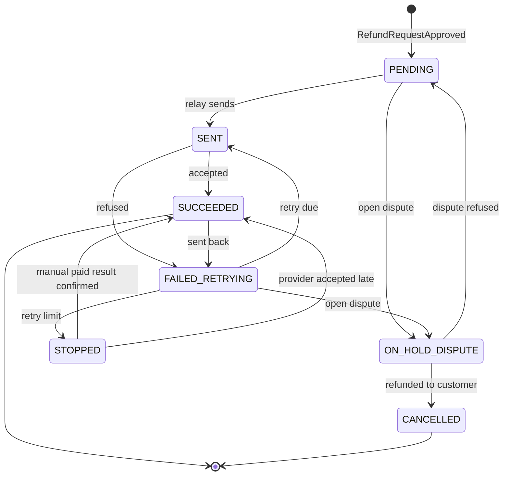
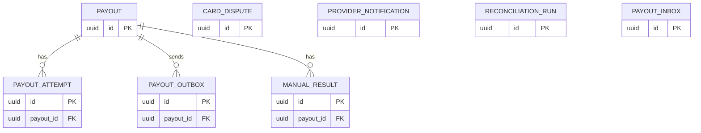
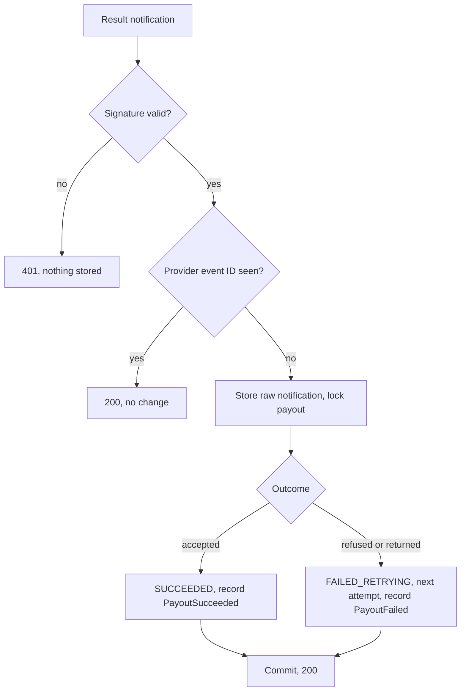
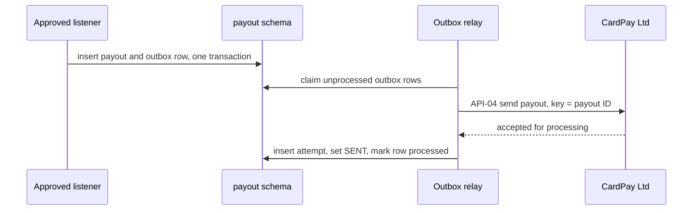

<!--
CHUNK: 13b
TITLE: Detailed Service Spec - Payout
PROJECT: Refunds Platform
VERSION: 1.0
DEPENDS_ON: 09, 07, 10 (event hub - event names and DTOs match chunk 10 verbatim), 11 (API contracts - integration endpoints carry their API ID and match chunk 11 verbatim), 12 (roles - permission tokens match chunk 12 verbatim)
PART OF: SDD - Refunds Platform
-->

# 17. Detailed Service Specs

---

## 17.2 Payout

### What

The payout module owns the payout bounded context: sending an approved refund to the customer's original card through CardPay Ltd, every attempt and its result, the hold while the original card payment is disputed, the manual result that two payout staff members record and confirm when a payout stops, and the monthly check that no payout is missing or paid twice ([REFUNDS/NFR-01](../brd-refunds-portal/10-nfrs.md#non-functional-requirements)). It owns no BRD use case; it realises the payout parts of [REFUNDS/UC-04](../brd-refunds-portal/06b-use-cases-branch-manager.md#uc-04-approve--reject-refund), which refund-request owns.

### Boundaries

- **Owns:** payouts, payout attempts, the payout outbox, provider notifications received, card disputes, manual results, monthly check runs.
- **Does not own:** the refund request and its status (refund-request, [§17.1](./13a-service-refund-request.md#171-refund-request)); messages (notification); card data (CardPay Ltd).
- **Upstream consumers:** refund-request through `CardDisputePort` ([API-02](./11-api-contracts.md#api-02-open-card-dispute-lookup-refund-request---payout)); CardPay Ltd's notifications ([API-05](./11-api-contracts.md#api-05-payout-result-notification-cardpay-ltd---payout), [API-06](./11-api-contracts.md#api-06-card-dispute-notification-cardpay-ltd---payout)); payout staff in the web frontend.
- **Downstream dependencies:** CardPay Ltd ([API-04](./11-api-contracts.md#api-04-send-payout-payout---cardpay-ltd)); refund-request's `RefundOutcomePort` ([API-09](./11-api-contracts.md#api-09-approved-refunds-of-a-period-payout---refund-request)); the event `RefundRequestApproved`.

### Input

| Type | Source | Description |
|------|--------|-------------|
| Event | refund-request, `RefundRequestApproved` | Creates the payout and its first outbox row, or holds it for an open dispute ([REFUNDS/UC-04](../brd-refunds-portal/06b-use-cases-branch-manager.md#uc-04-approve--reject-refund) step 8) |
| REST | CardPay Ltd | Payout result notification ([API-05](./11-api-contracts.md#api-05-payout-result-notification-cardpay-ltd---payout)), path `TBD - external` |
| REST | CardPay Ltd | Card dispute notification ([API-06](./11-api-contracts.md#api-06-card-dispute-notification-cardpay-ltd---payout)), path `TBD - external` |
| Port | refund-request | `CardDisputePort.findOpenDispute` ([API-02](./11-api-contracts.md#api-02-open-card-dispute-lookup-refund-request---payout)) |
| Schedule | payout-retry | Every minute: resends due failed payouts, raises `PayoutStillFailing` after one day of failures, stops a payout at the retry limit ([REFUNDS/UC-04](../brd-refunds-portal/06b-use-cases-branch-manager.md#uc-04-approve--reject-refund) E1) |
| Schedule | payout-reconciliation-monthly | First day of each month: checks that every refund request approved in the past month ([API-09](./11-api-contracts.md#api-09-approved-refunds-of-a-period-payout---refund-request)) has exactly one succeeded payout, or a payout still retrying or waiting for a dispute; that no refund request has two succeeded payouts; and that every succeeded payout is in CardPay Ltd's record of refunds ([REFUNDS/NFR-01](../brd-refunds-portal/10-nfrs.md#non-functional-requirements)) |
| REST | Payout staff member | List stopped payouts, record a manual result, confirm it (List of APIs) |

### Business Logic

**Send the payout ([REFUNDS/UC-04](../brd-refunds-portal/06b-use-cases-branch-manager.md#uc-04-approve--reject-refund) step 8).** On `RefundRequestApproved` the module, in one transaction, inserts a payout (status `PENDING`, its UUIDv7 `id`, the approved amount, the original payment reference) and checks for an open card dispute on that payment: with one, the payout is `ON_HOLD_DISPUTE` (E3; BR-8: payout waits for a card dispute); without one, it writes a `payout_outbox` row whose idempotency key is the payout ID. Before each send and each resend the relay reads `card_dispute` for an `OPEN` dispute on the payout's original payment; with one, the payout moves to `ON_HOLD_DISPUTE` and is not sent (BR-8: payout waits for a card dispute). The relay sends the payout to CardPay Ltd through [API-04](./11-api-contracts.md#api-04-send-payout-payout---cardpay-ltd) after commit, records the attempt, and moves the payout to `SENT`. A payout goes only to the card used for the purchase ([PSDD/BUS-07.1](../pre-sdd-refunds-platform/03a-register-business.md#bus-07)) and follows the refund terms agreed with CardPay Ltd ([PSDD/BUS-08.1](../pre-sdd-refunds-platform/03a-register-business.md#bus-08)); the confirmation that CardPay Ltd supports this is the open condition [PSDD/COND-01](../pre-sdd-refunds-platform/11-gate-and-sign-off.md#111-gate-result).

**Result ([REFUNDS/UC-04](../brd-refunds-portal/06b-use-cases-branch-manager.md#uc-04-approve--reject-refund) step 9 and E1).** A result notification ([API-05](./11-api-contracts.md#api-05-payout-result-notification-cardpay-ltd---payout)) is verified, stored raw in `provider_notification` with its provider ID (a repeat is dropped), and applied under the payout's row lock: accepted moves the payout to `SUCCEEDED` and records `PayoutSucceeded`; refused moves it to `FAILED_RETRYING`, schedules the next attempt, and records `PayoutFailed` of kind `REFUSED`; a succeeded payout that the customer's bank sends back moves to `FAILED_RETRYING` and records `PayoutFailed` of kind `RETURNED`. A verified result notification whose payout is unknown is stored in `provider_notification` with `kind` `PAYOUT_RESULT_UNMATCHED` and alerted; it is never dropped. Whether CardPay Ltd calls back or must be queried is open (§12 INT-01 marker); with a query, the payout-retry schedule asks for the result of each `SENT` payout older than its wait.

**Retry ([REFUNDS/UC-04](../brd-refunds-portal/06b-use-cases-branch-manager.md#uc-04-approve--reject-refund) E1).** `payout-retry` resends each due `FAILED_RETRYING` payout, with exponential backoff and jitter (§12 INT-01). A resend after a `TIMEOUT` or a retryable error keeps the key of the attempt it repeats; a resend after a definitive `REFUSED` or `RETURNED` result increments `key_generation` and sends the key `<payout ID>-<key_generation>`, so CardPay Ltd never takes a resend for a replay of a refused or returned instruction. **[NEEDS CLARIFICATION: When the platform resends a payout with an idempotency key CardPay Ltd has already seen, does CardPay Ltd return the stored result or process the payout again, and for how long does it keep the keys? Owner: CardPay Ltd.]** When the first failure is more than one day old and the branch manager has not yet been told, it records `PayoutStillFailing` once. When the retry limit is reached, the payout becomes `STOPPED` and waits for a manual result. **[NEEDS CLARIFICATION: How long does the system keep trying a failed payout before it stops? Owner: Refunds and Loyalty Product Owner.]** **[NEEDS CLARIFICATION: How is a customer paid when the payout to their original card can never succeed, for example because the card is closed? Owner: Refunds and Loyalty Product Owner.]**

**Card dispute ([REFUNDS/UC-04](../brd-refunds-portal/06b-use-cases-branch-manager.md#uc-04-approve--reject-refund) E3 and BR-8: payout waits for a card dispute).** A dispute notification ([API-06](./11-api-contracts.md#api-06-card-dispute-notification-cardpay-ltd---payout)) opens or updates a `card_dispute` row for the original payment. `CardDisputePort.findOpenDispute` answers refund-request's decision screen. When the bank decides: refused, a held payout goes to `PENDING` and gets its outbox row (AC-16: payout sent after a refused dispute); refunded to the customer, a held payout becomes `CANCELLED` and `CardDisputeDecided` is recorded so refund-request rejects the request (AC-13: request rejected after the bank refunds). A dispute decided `REFUNDED_TO_CUSTOMER` on a payment whose payout is `SUCCEEDED` changes no state; it is recorded as a double-refund finding for the monthly check and alerted to payout staff. **[NEEDS CLARIFICATION: When the customer's bank refunds a disputed card payment after the refund payout was already paid, how does the business recover the second refund? Owner: Refunds and Loyalty Product Owner.]** Whether CardPay Ltd can report disputes at all is open (§12 INT-01 marker); until it can, `CardDisputePort` answers that no dispute is known.

**Manual result ([REFUNDS 03 § Decision record](../brd-refunds-portal/03-definitions-and-domain-concepts.md#decision-record)).** A payout staff member records by hand that a `STOPPED` payout was paid or not (`POST /v1/payouts/{payoutId}/manual-results`); a second, different staff member confirms it (`POST /v1/payouts/{payoutId}/manual-results/{manualResultId}/confirmation`); only the confirmation of a paid result moves the payout to `SUCCEEDED` and records `PayoutSucceeded` with both staff members, which refund-request writes into the decision record. The same staff member cannot confirm their own record ([PSDD/SEC-07.1](../pre-sdd-refunds-platform/03e-register-security.md#sec-07)). No BRD use case covers this work, and its team is open (§7.1 marker): **[NEEDS CLARIFICATION: Which REFUNDS use case covers recording a payout result by hand and its confirmation by a second staff member? Owner: Refunds and Loyalty Product Owner.]**

**Monthly payout check ([REFUNDS/NFR-01](../brd-refunds-portal/10-nfrs.md#non-functional-requirements); [PSDD/REL-10.1](../pre-sdd-refunds-platform/03c-register-reliability.md#rel-10)).** `payout-reconciliation-monthly` reads the refunds approved in the past month through [API-09](./11-api-contracts.md#api-09-approved-refunds-of-a-period-payout---refund-request) and compares them, and the succeeded payouts, with CardPay Ltd's record of refunds and lists any payout missing, paid twice, still retrying (delayed, not missing), or waiting for a dispute (waiting, not missing). CardPay Ltd's record of refunds is a provider document: **[NEEDS CLARIFICATION: Which report or query of CardPay Ltd lists the refunds it paid, for the monthly check? Owner: CardPay Ltd.]** Who reads the result is open in the BRD ([REFUNDS 04 § Personas / Actors](../brd-refunds-portal/04-scope-and-personas.md#personas--actors)): **[NEEDS CLARIFICATION: Which REFUNDS use case and which team cover the monthly check that no payout is missing or paid twice (REFUNDS/NFR-01)? Owner: Refunds and Loyalty Product Owner.]**

**State machine:**

**Summary:** A payout is created on approval, held while the original payment is disputed, sent through the outbox, and succeeds or fails; failed and sent-back payouts are retried until they succeed or stop, and a stopped payout succeeds through a manual result confirmed by a second staff member or a late provider acceptance.

**Results in other states:**

| Payout state | Result | Effect |
|---|---|---|
| STOPPED | Provider accepted | SUCCEEDED, `PayoutSucceeded` recorded; an unconfirmed manual result is closed as superseded |
| STOPPED | Provider refused or returned | No change; stored |
| CANCELLED | Provider accepted | No change; stored; alert "payout accepted after cancellation" to payout staff (a possible double refund, §20.1.8 step 3) |
| SUCCEEDED | Provider accepted again | No change |
| PENDING, ON_HOLD_DISPUTE, SENT, FAILED_RETRYING | Provider returned | No change; stored; alert |
| STOPPED | Manual not-paid result confirmed | Stays STOPPED; the confirmed result is kept; `payouts_stopped` keeps counting it; it waits for the business rule of the marker on payouts that can never succeed |

### Output

| Type | Destination | Description |
|------|-------------|-------------|
| Provider call | CardPay Ltd | Send payout ([API-04](./11-api-contracts.md#api-04-send-payout-payout---cardpay-ltd)) through the outbox |
| In-process event | refund-request | `PayoutSucceeded`, `PayoutFailed`, `CardDisputeDecided` (§14.10) |
| In-process event | notification | `PayoutStillFailing` (§14.10) |
| Port response | refund-request | Open dispute status ([API-02](./11-api-contracts.md#api-02-open-card-dispute-lookup-refund-request---payout)) |
| REST response | Web frontend, payout area | Stopped payouts, manual results |

### Integrations

| Integration | Direction | Protocol | Purpose | Contract | Failure Handling |
|-------------|-----------|----------|---------|----------|------------------|
| CardPay Ltd | Outbound | HTTPS | Send payout | API-04 (§15) | Outbox, retries, circuit breaker (§12 INT-01) |
| CardPay Ltd | Inbound | HTTPS | Payout result | API-05 (§15) | Verify, store, deduplicate; reject unverified with 401 |
| CardPay Ltd | Inbound | HTTPS | Card dispute | API-06 (§15) | Verify, store, deduplicate |
| refund-request | Inbound, sync (in process) | `CardDisputePort` | Open dispute at the decision | API-02 (§15) | Read-only query on `card_dispute` |
| refund-request | Outbound, sync (in process) | `RefundOutcomePort` | Approved refunds of a period for the monthly check | API-09 (§15) | A port failure fails the run, which retries in the next hour |
| refund-request | Async (in process) | Domain events | Approval in; results and dispute outcomes out | `RefundRequestApproved`, `PayoutSucceeded`, `PayoutFailed`, `CardDisputeDecided` (§14.10) | Inbox deduplication; publication log |
| notification | Async (in process) | Domain event | Branch manager message | `PayoutStillFailing` (§14.10) | Publication log |

### DB Modeling

#### Entity Relationship

**Summary:** A payout has its attempts, its outbox rows, and its manual results; card disputes, provider notifications, monthly check runs, and the event inbox stand alone and refer to payouts by the original payment reference or the payout ID in their columns.

#### Tables Design

**Table name:** `payout`

**Table purpose:** One row per payout of an approved refund request.

**Column details:**

| Column name | Data type | Required or optional | Description |
|-------------|-----------|----------------------|-------------|
| `id` | uuid | Required | UUIDv7 primary key; the base of the idempotency key towards CardPay Ltd |
| `refund_request_id` | uuid | Required | The refund request (refund-request's ID, no foreign key across schemas); unique while the payout is not `CANCELLED` |
| `original_payment_ref` | varchar(128) | Required | The original card payment; indexed (dispute lookup) |
| `amount` | numeric(19,4) | Required | The approved amount |
| `currency` | char(3) | Required | ISO-4217 code |
| `status` | varchar(20) | Required | `PENDING`, `ON_HOLD_DISPUTE`, `SENT`, `SUCCEEDED`, `FAILED_RETRYING`, `STOPPED`, `CANCELLED`; check constraint; indexed with `next_attempt_at` |
| `provider_payout_ref` | varchar(128) | Optional | CardPay Ltd's reference, null until it answers |
| `first_failed_at` | timestamptz | Optional | Null until the first failure; the one-day rule of [REFUNDS/UC-04](../brd-refunds-portal/06b-use-cases-branch-manager.md#uc-04-approve--reject-refund) E1 |
| `branch_manager_told_at` | timestamptz | Optional | Null until `PayoutStillFailing` is recorded |
| `next_attempt_at` | timestamptz | Optional | Null unless a retry is due |
| `attempt_count` | integer | Required | Attempts so far |
| `key_generation` | integer | Required | Starts at 1; incremented on a resend after a definitive `REFUSED` or `RETURNED` result |
| `succeeded_at` | timestamptz | Optional | Null until succeeded |
| `version` | integer | Required | Optimistic lock and aggregate version: `aggregateVersion` of `PayoutSucceeded`, `PayoutFailed`, and `PayoutStillFailing` |
| `created_at` | timestamptz | Required | Audit column |
| `updated_at` | timestamptz | Required | Audit column |
| `created_by` | varchar(255) | Required | Audit column |
| `updated_by` | varchar(255) | Required | Audit column |

**Table name:** `payout_attempt`

**Table purpose:** One row per call to CardPay Ltd for a payout, kept for the monthly check and for diagnosis.

**Column details:**

| Column name | Data type | Required or optional | Description |
|-------------|-----------|----------------------|-------------|
| `id` | uuid | Required | UUIDv7 primary key |
| `payout_id` | uuid | Required | The payout; indexed |
| `attempt_no` | integer | Required | 1 for the first send |
| `idempotency_key` | varchar(64) | Required | The key sent on that attempt |
| `sent_at` | timestamptz | Required | When the relay called |
| `outcome` | varchar(20) | Optional | Null until known: `ACCEPTED`, `REFUSED`, `RETURNED`, `TIMEOUT` |
| `provider_error` | varchar(255) | Optional | The provider's error, mapped once API-04 is documented |

**Table name:** `payout_outbox`

**Table purpose:** The sends that must follow a payout state change, written in the same transaction and performed by the relay after commit.

**Column details:**

| Column name | Data type | Required or optional | Description |
|-------------|-----------|----------------------|-------------|
| `id` | uuid | Required | UUIDv7 primary key |
| `payout_id` | uuid | Required | The payout; the key sent is the attempt's `idempotency_key` (`payout_attempt`) |
| `created_at` | timestamptz | Required | When written |
| `processed_at` | timestamptz | Optional | Null until the relay has called; indexed where null |

**Table name:** `card_dispute`

**Table purpose:** The disputes CardPay Ltd reports on original card payments, and their outcomes.

**Column details:**

| Column name | Data type | Required or optional | Description |
|-------------|-----------|----------------------|-------------|
| `id` | uuid | Required | UUIDv7 primary key |
| `original_payment_ref` | varchar(128) | Required | The disputed payment; indexed |
| `provider_dispute_ref` | varchar(128) | Required | CardPay Ltd's reference; unique |
| `status` | varchar(24) | Required | `OPEN`, `REFUSED`, `REFUNDED_TO_CUSTOMER` |
| `opened_at` | timestamptz | Required | When reported |
| `decided_at` | timestamptz | Optional | Null until the bank decides |
| `version` | integer | Required | Aggregate version: `aggregateVersion` of `CardDisputeDecided` |

**Table name:** `manual_result`

**Table purpose:** A payout result recorded by hand and its confirmation by a second staff member ([REFUNDS 03 § Decision record](../brd-refunds-portal/03-definitions-and-domain-concepts.md#decision-record)).

**Column details:**

| Column name | Data type | Required or optional | Description |
|-------------|-----------|----------------------|-------------|
| `id` | uuid | Required | UUIDv7 primary key |
| `payout_id` | uuid | Required | The payout; indexed |
| `paid` | boolean | Required | Whether the staff member records the payout as paid |
| `note` | text | Optional | The evidence the staff member gives |
| `recorded_by` | varchar(255) | Required | The recording staff member's subject |
| `recorded_at` | timestamptz | Required | When recorded |
| `confirmed_by` | varchar(255) | Optional | Null until confirmed; must differ from `recorded_by` (check) |
| `confirmed_at` | timestamptz | Optional | Null until confirmed |

**Table name:** `provider_notification`

**Table purpose:** Every verified notification from CardPay Ltd, kept raw for audit and deduplication.

**Column details:**

| Column name | Data type | Required or optional | Description |
|-------------|-----------|----------------------|-------------|
| `id` | uuid | Required | UUIDv7 primary key |
| `provider_event_ref` | varchar(128) | Required | The provider's notification ID; unique (deduplication) |
| `kind` | varchar(24) | Required | `PAYOUT_RESULT`, `PAYOUT_RESULT_UNMATCHED`, or `CARD_DISPUTE` |
| `payload` | jsonb | Required | The body as received |
| `received_at` | timestamptz | Required | When received |

**Table name:** `reconciliation_run`

**Table purpose:** One row per monthly payout check with its findings.

**Column details:**

| Column name | Data type | Required or optional | Description |
|-------------|-----------|----------------------|-------------|
| `id` | uuid | Required | UUIDv7 primary key |
| `period_month` | date | Required | The first day of the checked month; unique |
| `missing_count` | integer | Required | Payouts missing |
| `duplicate_count` | integer | Required | Payouts paid twice |
| `delayed_count` | integer | Required | Payouts still retrying at month end |
| `waiting_count` | integer | Required | Payouts waiting for a dispute at month end |
| `findings` | jsonb | Required | The payout IDs per finding |
| `ran_at` | timestamptz | Required | When the check ran |

**Table name:** `payout_inbox`

**Table purpose:** The IDs of the events this module has handled.

**Column details:**

| Column name | Data type | Required or optional | Description |
|-------------|-----------|----------------------|-------------|
| `id` | uuid | Required | The event's ID (primary key) |
| `event_type` | varchar(64) | Required | The event's name |
| `handled_at` | timestamptz | Required | When handled; kept per §11.1 |

#### Migration Strategy

- **Tool:** the versioned SQL migrations of [§11.1](./07-cross-cutting-concerns.md#111-db-modeling-default) on the `payout` schema.
- **Backward compatibility:** additive; expand then contract.
- **Data backfill:** batched migration steps before the new code reads a column.
- **Rollback:** previous image on the expanded schema.

#### Retention Policy

- `payout`, `payout_attempt`, `manual_result`, `card_dispute`, `reconciliation_run`: 10 years with the refund records ([PSDD/DAT-06.1](../pre-sdd-refunds-platform/03d-register-data.md#dat-06)).
- `provider_notification`: 10 years, as payout evidence ([PSDD/DAT-06.1](../pre-sdd-refunds-platform/03d-register-data.md#dat-06)).
- `payout_outbox`: processed rows kept 30 days (recommended).
- `payout_inbox`: per §11.1.

#### Archival

- **Cold storage:** Not applicable for this release: rows stay in the primary database.
- **Format:** Not applicable.
- **Schedule:** Not applicable.
- **Restore SLA:** per [§8.6.4](./05a-infrastructure-and-network.md#864-backup-and-disaster-recovery).

#### Data Encryption

- **At rest:** storage encryption with the business-held keys ([PSDD/SEC-04.1](../pre-sdd-refunds-platform/03e-register-security.md#sec-04)).
- **In transit:** TLS to the database and to CardPay Ltd.
- **Key management:** key management service, yearly rotation ([PSDD/SEC-04.1](../pre-sdd-refunds-platform/03e-register-security.md#sec-04)).
- **PII columns:** none: no card number or customer contact is stored; `original_payment_ref` is a provider reference.

### Multi-Tenancy Specifications

- **Strategy override:** None: follows [§11.2](./07-cross-cutting-concerns.md#112-multi-tenancy-default), which is open.
- **Tenant filter:** none until §11.2 is settled.
- **Cross-tenant queries:** not applicable until §11.2 is settled.

### API Standards

- **Style:** REST with OpenAPI.
- **Versioning:** URI prefix `/v1`.
- **Authentication:** OIDC access token for staff; the provider's scheme for CardPay Ltd's notifications (`TBD - external`).
- **Idempotency:** `Idempotency-Key` on the two manual-result endpoints; provider notifications deduplicated on the provider's notification ID.
- **Pagination:** cursor-based on the stopped-payout list.
- **Error envelope:** per the §15.1 error model.

#### List of APIs (Swagger-friendly)

| Method | Path | Summary | Request Body | Response | Permission token (§16) | API ID (§15) |
|--------|------|---------|--------------|----------|------------------------|--------------|
| GET | `/v1/payouts` | List stopped payouts waiting for a manual result | - | `PayoutPage` | `payout.manual-result.record` | - |
| POST | `/v1/payouts/{payoutId}/manual-results` | Record a payout result by hand | `ManualResult` | `ManualResultRecorded` | `payout.manual-result.record` | - |
| POST | `/v1/payouts/{payoutId}/manual-results/{manualResultId}/confirmation` | Confirm a manual result as a second staff member | - | `ManualResultConfirmed` | `payout.manual-result.confirm` | - |
| TBD | TBD | Payout result notification from CardPay Ltd | TBD | TBD | - | API-05 |
| TBD | TBD | Card dispute notification from CardPay Ltd | TBD | TBD | - | API-06 |

**[NEEDS CLARIFICATION: Request and response fields for the manual-result endpoints beyond the payout, the paid flag, and the staff members named in Business Logic. Owner: Software Architect.]**

### Event-Driven Architecture (If Applicable)

#### Event Model

**Published events:**

Not applicable - no integration events.

**Consumed events:**

Not applicable - no integration events.

**In-process domain events (modules only):**

| Event | Publisher module | Listener modules | Transaction phase (before commit / after commit) | Payload (DTO) | Notes |
|---|---|---|---|---|---|
| `RefundRequestApproved` | refund-request | payout, notification | after commit | `RefundRequestApprovedDto`: refundRequestId, referenceNumber, branchId, receiptNumber, originalPaymentRef, approvedAmount, partial, decisionReason, approvedAt, aggregateVersion | Creates the payout |
| `PayoutSucceeded` | payout | refund-request | after commit | `PayoutSucceededDto`: payoutId, refundRequestId, paidAmount, paidAt, manualRecordedBy, manualConfirmedBy, aggregateVersion | The manual fields are null for a provider result |
| `PayoutFailed` | payout | refund-request | after commit | `PayoutFailedDto`: payoutId, refundRequestId, kind, failedAt, attempt, aggregateVersion | `kind`: `REFUSED` or `RETURNED` |
| `PayoutStillFailing` | payout | notification | after commit | `PayoutStillFailingDto`: payoutId, refundRequestId, branchId, firstFailedAt, aggregateVersion | Once per payout |
| `CardDisputeDecided` | payout | refund-request | after commit | `CardDisputeDecidedDto`: disputeId, refundRequestId, outcome, decidedAt, aggregateVersion | `outcome`: `REFUNDED_TO_CUSTOMER` or `DISPUTE_REFUSED` |

#### Messaging Infra

Not applicable - no integration events.

### Constraints

- [REFUNDS/UC-04](../brd-refunds-portal/06b-use-cases-branch-manager.md#uc-04-approve--reject-refund) payout parts: no user role triggers a payout directly; only `RefundRequestApproved` creates one.
- Manual results: payout staff only, `payout.manual-result.record` to record and `payout.manual-result.confirm` to confirm; the confirmer differs from the recorder ([PSDD/SEC-07.1](../pre-sdd-refunds-platform/03e-register-security.md#sec-07)).
- `CardDisputePort` (API-02): only refund-request's module identity, `payout.card-dispute.read`.
- One non-cancelled payout per refund request; a second `RefundRequestApproved` for the same request (for example after a manual reprocess) reuses the existing payout.
- Payouts go only to the original card ([PSDD/BUS-07.1](../pre-sdd-refunds-platform/03a-register-business.md#bus-07)).

### Error Handling

- **Synchronous APIs:** Problem Details per §15.1.
- **Validation errors:** 400 `VALIDATION_FAILED` on a manual result without its paid flag.
- **Domain errors:** a manual result on a payout that is not `STOPPED` → 409 `PAYOUT_NOT_STOPPED`; a confirmation by the recorder → 403 `SAME_STAFF_CONFIRMATION_FORBIDDEN`; [REFUNDS/UC-04](../brd-refunds-portal/06b-use-cases-branch-manager.md#uc-04-approve--reject-refund) E1 is not an API error: it is the retry path above.
- **Auth errors:** 401 `UNAUTHENTICATED`; 403 `FORBIDDEN`; an unverified provider notification → 401, stored nowhere.
- **Server errors:** 500 `INTERNAL_ERROR`; a provider timeout on API-04 is an attempt with outcome `TIMEOUT`, resent with the same key.
- **Async consumers:** listener failures roll back and are redelivered by the publication log; the inbox makes them safe.
- **Poison messages:** an event over the poison threshold of §11.1 stays incomplete, raises the alert, and is replayed by [§20.1.3](./16-operations-runbook.md#2013-replay-dlq-messages).

### Observability & Monitoring

#### Logging

- JSON per §11.4; fields `payout_id`, `refund_request_id`, `attempt_no`; never card data.
- Every provider call logged with its outcome and duration.
- Retention per §11.4.

#### Metrics

| Metric | Type | Labels | Purpose |
|--------|------|--------|---------|
| `payouts_total` | counter | `outcome` | Succeeded, refused, returned |
| `payout_outbox_oldest_seconds` | gauge | - | Age of the oldest unprocessed send |
| `payouts_stopped` | gauge | - | Payouts waiting for a manual result |
| `payouts_on_hold_dispute` | gauge | - | Payouts waiting for a bank decision |
| `cardpay_call_duration_seconds` | histogram | `operation`, `result` | Provider latency and errors |

#### Tracing

- Spans on the relay, each API-04 call, each notification received, and each event.
- Trace context carried from the approval through the payout.
- Sampling per §11.4.

### Developer Notes

- **Recommended patterns:** a `PaymentProviderPort` with a CardPay Ltd adapter that maps provider errors to `REFUSED`, `RETURNED`, or retryable; the relay claims rows with `FOR UPDATE SKIP LOCKED`.
- **Avoid:** a new idempotency key on a resend after a timeout or a retryable error; calling CardPay Ltd inside the listener's transaction; trusting an unverified notification.
- **Testing:** a stub CardPay Ltd that refuses, returns, times out, and repeats notifications; a test that a resend after a failover sends the same key; integration tests on a real PostgreSQL.

### Service-Level Diagrams

#### Implementation Flow Chart

**Summary:** A provider notification is verified and deduplicated before it is stored, then applied under the payout's lock as a success or a failure with its event, and committed before the answer.

#### Sequence Diagram (Service-Internal)

**Summary:** The approval listener writes the payout and its outbox row together; the relay later claims the row, sends the payout with the payout ID as its key, and records the attempt.

### Compliance

- **GDPR:** no customer personal data in this module; applicability otherwise as §17.1.
- **PCI-DSS:** no card data is received, stored, or logged; the original payment reference and CardPay Ltd's references only. Whether any CardPay Ltd field falls in PCI scope is known once API-04 is documented.
- **ISO 27001 / SOC 2:** Not applicable for this service: no certification is stated by a source.
- **Local regulations:** payout records kept 10 years for tax records ([PSDD/DAT-06.1](../pre-sdd-refunds-platform/03d-register-data.md#dat-06)).

### Deployment Strategy

- **Service-specific override:** None: part of the one deployable.
- **Replicas:** per the deployable (§8.6.2); the schedules run on one replica under an advisory lock.
- **Strategy:** rolling, per §11.3.
- **Health checks:** readiness includes the database; the circuit breaker state of CardPay Ltd is reported but does not fail readiness.
- **Rollback:** previous image.

### Future Enhancements

- Not applicable: the BRD states no payout follow-up beyond bulk approval, which belongs to [REFUNDS/UC-04](../brd-refunds-portal/06b-use-cases-branch-manager.md#uc-04-approve--reject-refund) in §17.1.

<!-- MASTER: refunds-platform-sdd-master.md | PREV: 13a-service-refund-request.md | NEXT: 13c-service-notification.md -->
