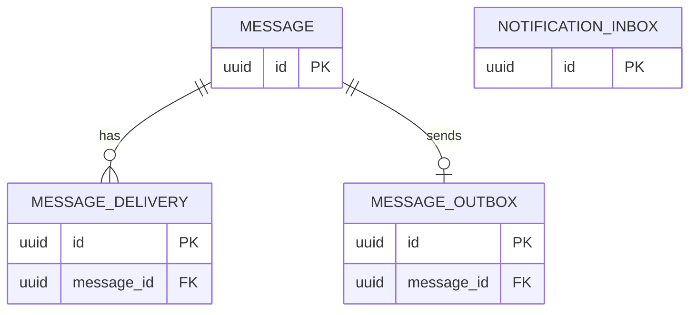
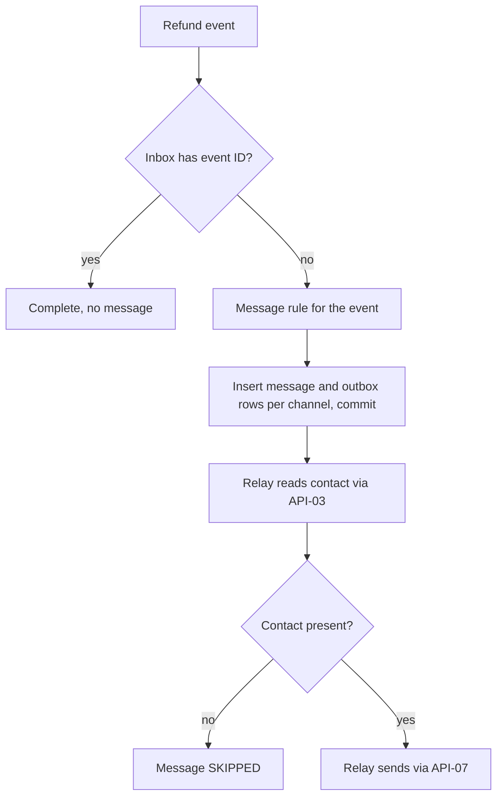
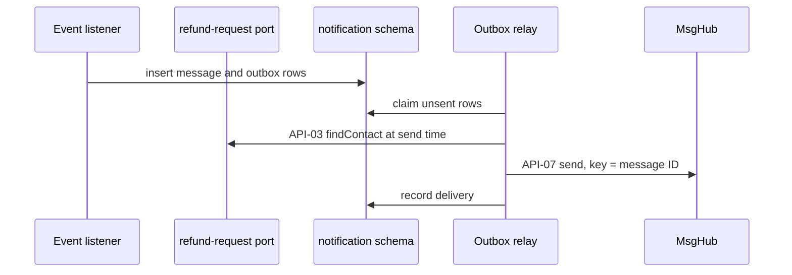

<!--
CHUNK: 13c
TITLE: Detailed Service Spec - Notification
PROJECT: Refunds Platform
VERSION: 1.0
DEPENDS_ON: 09, 07, 10 (event hub - event names and DTOs match chunk 10 verbatim), 11 (API contracts - integration endpoints carry their API ID and match chunk 11 verbatim), 12 (roles - permission tokens match chunk 12 verbatim)
PART OF: SDD - Refunds Platform
-->

# 17. Detailed Service Specs

---

## 17.3 Notification

### What

The notification module owns message delivery: it turns refund status changes into the customer messages of [REFUNDS 03 § Customer messages](../brd-refunds-portal/03-definitions-and-domain-concepts.md#customer-messages) (email and SMS, email only for a cancellation) and the payout-still-failing information message for the branch manager ([REFUNDS/UC-04](../brd-refunds-portal/06b-use-cases-branch-manager.md#uc-04-approve--reject-refund) E1), sends them through MsgHub from its outbox, and records each delivery. It owns no BRD use case. A message that fails never stops or changes a refund request ([REFUNDS 03 § Customer messages](../brd-refunds-portal/03-definitions-and-domain-concepts.md#customer-messages)).

### Boundaries

- **Owns:** message records, their deliveries, the message outbox, the message templates.
- **Does not own:** contact details (refund-request, read through `CustomerContactPort`); refund status (refund-request); payouts (payout).
- **Upstream consumers:** none: it is triggered by events only.
- **Downstream dependencies:** MsgHub ([API-07](./11-api-contracts.md#api-07-send-customer-message-notification---msghub)); refund-request's `CustomerContactPort` ([API-03](./11-api-contracts.md#api-03-customer-contact-lookup-notification---refund-request)).

### Input

| Type | Source | Description |
|------|--------|-------------|
| Event | refund-request, `RefundRequestSubmitted` | Submitted message with the reference number ([REFUNDS/UC-01](../brd-refunds-portal/06a-use-cases-customer.md#uc-01-request-a-refund) step 7) |
| Event | refund-request, `RefundRequestApproved` | Approved-in-full or approved-in-part message with the approved amount and, in part, the reason ([REFUNDS/UC-04](../brd-refunds-portal/06b-use-cases-branch-manager.md#uc-04-approve--reject-refund) step 8) |
| Event | refund-request, `RefundRequestRejected` | Rejected message with the reason ([REFUNDS/UC-04](../brd-refunds-portal/06b-use-cases-branch-manager.md#uc-04-approve--reject-refund) A2) |
| Event | refund-request, `RefundRequestCancelled` | Cancelled message, email only ([REFUNDS/UC-03](../brd-refunds-portal/06a-use-cases-customer.md#uc-03-cancel-a-refund-request) step 5) |
| Event | refund-request, `RefundRequestPaid` | Paid message saying when the money usually shows ([REFUNDS/UC-04](../brd-refunds-portal/06b-use-cases-branch-manager.md#uc-04-approve--reject-refund) step 9) |
| Event | refund-request, `RefundRequestReturnedToApproved` | Back-to-Approved message: the payout is delayed ([REFUNDS/UC-04](../brd-refunds-portal/06b-use-cases-branch-manager.md#uc-04-approve--reject-refund) E1) |
| Event | refund-request, `RefundPayoutDelayed` | Payout delayed message ([REFUNDS/UC-04](../brd-refunds-portal/06b-use-cases-branch-manager.md#uc-04-approve--reject-refund) E1) |
| Event | payout, `PayoutStillFailing` | Branch manager information message after one day of failures ([REFUNDS/UC-04](../brd-refunds-portal/06b-use-cases-branch-manager.md#uc-04-approve--reject-refund) E1) |

### Business Logic

For each event the module looks up the message rule of [REFUNDS 03 § Customer messages](../brd-refunds-portal/03-definitions-and-domain-concepts.md#customer-messages) (which channels, which content), writes, in one transaction, a `message` row per channel of the message rule and a `message_outbox` row per message, keyed by the event ID and the channel so a redelivered event creates no second message; the listener reads no contact detail. The relay reads the request's contact details through [API-03](./11-api-contracts.md#api-03-customer-contact-lookup-notification---refund-request) at send time; a channel with no contact, or a contact purged under [PSDD/DAT-06.1](../pre-sdd-refunds-platform/03d-register-data.md#dat-06), sets the message to `SKIPPED` with no call to MsgHub. The relay sends each message through MsgHub ([API-07](./11-api-contracts.md#api-07-send-customer-message-notification---msghub)) with the message ID as the idempotency key, retries per §12 INT-02, and records the delivery outcome. A failure is recorded and alerted, never reported back to refund-request.

- [REFUNDS/UC-01](../brd-refunds-portal/06a-use-cases-customer.md#uc-01-request-a-refund) step 7: email and SMS with the reference number.
- [REFUNDS/UC-04](../brd-refunds-portal/06b-use-cases-branch-manager.md#uc-04-approve--reject-refund) step 8 and A1: email and SMS with the approved amount, and in part also the reason.
- [REFUNDS/UC-04](../brd-refunds-portal/06b-use-cases-branch-manager.md#uc-04-approve--reject-refund) A2 and BR-8: payout waits for a card dispute: email and SMS with the reason, including the reason that the bank already refunded the payment.
- [REFUNDS/UC-03](../brd-refunds-portal/06a-use-cases-customer.md#uc-03-cancel-a-refund-request) step 5: email only.
- [REFUNDS/UC-04](../brd-refunds-portal/06b-use-cases-branch-manager.md#uc-04-approve--reject-refund) step 9: email and SMS saying when the money usually shows on the card. **[NEEDS CLARIFICATION: How many days after the payout does a refund usually show on the customer's card statement? Owner: Refunds and Loyalty Product Owner.]**
- [REFUNDS/UC-04](../brd-refunds-portal/06b-use-cases-branch-manager.md#uc-04-approve--reject-refund) E1: email and SMS saying the payout is delayed, on the first failure and on a return after Paid; the branch manager's message after one day, on the channel that §12 INT-02 leaves open, to the branch manager of the payout's branch read from the identity provider's staff directory (standard operational infrastructure, §15.1).
- Language, currency display, and date formats of the messages follow the BRD answers still open ([REFUNDS 11 § UI/UX Expectations](../brd-refunds-portal/11-summary-and-uiux.md#uiux-expectations)): **[NEEDS CLARIFICATION: Which languages do the customer messages use? Owner: Refunds and Loyalty Product Owner.]**
- A contact purged under [PSDD/DAT-06.1](../pre-sdd-refunds-platform/03d-register-data.md#dat-06) (90 days after the request ended) is not sent: the relay sets the message `SKIPPED`.

### Output

| Type | Destination | Description |
|------|-------------|-------------|
| Provider call | MsgHub | Email and SMS ([API-07](./11-api-contracts.md#api-07-send-customer-message-notification---msghub)) through the outbox |

### Integrations

| Integration | Direction | Protocol | Purpose | Contract | Failure Handling |
|-------------|-----------|----------|---------|----------|------------------|
| MsgHub | Outbound | HTTPS | Send email and SMS | API-07 (§15) | Outbox, retries, then recorded as failed (§12 INT-02) |
| refund-request | Outbound, sync (in process) | `CustomerContactPort` | Contact details of a request | API-03 (§15) | A port failure leaves the outbox row for the relay's next attempt |
| refund-request, payout | Async (in process) | Domain events | The triggers above | §14.10 | Inbox deduplication |

### DB Modeling

#### Entity Relationship

**Summary:** A message has its delivery attempts and one outbox row; the inbox stands alone.

#### Tables Design

**Table name:** `message`

**Table purpose:** One row per message to send, per event and channel.

**Column details:**

| Column name | Data type | Required or optional | Description |
|-------------|-----------|----------------------|-------------|
| `id` | uuid | Required | UUIDv7 primary key; the idempotency key towards MsgHub |
| `source_event_id` | uuid | Required | The event that caused it; unique with `channel` |
| `refund_request_id` | uuid | Optional | The request, null for the branch manager's message when it has none |
| `recipient_kind` | varchar(16) | Required | `CUSTOMER` or `BRANCH_MANAGER` |
| `channel` | varchar(8) | Required | `EMAIL` or `SMS` |
| `template_key` | varchar(64) | Required | The message rule applied |
| `status` | varchar(12) | Required | `PENDING`, `SENT`, `FAILED`, `SKIPPED` |
| `created_at` | timestamptz | Required | Audit column |
| `updated_at` | timestamptz | Required | Audit column |

**Table name:** `message_delivery`

**Table purpose:** One row per call to MsgHub for a message.

**Column details:**

| Column name | Data type | Required or optional | Description |
|-------------|-----------|----------------------|-------------|
| `id` | uuid | Required | UUIDv7 primary key |
| `message_id` | uuid | Required | The message; indexed |
| `attempt_no` | integer | Required | 1 for the first call |
| `sent_at` | timestamptz | Required | When called |
| `outcome` | varchar(16) | Optional | Null until known: `ACCEPTED`, `REJECTED`, `TIMEOUT` |
| `provider_message_ref` | varchar(128) | Optional | MsgHub's reference, null until it answers |

**Table name:** `message_outbox`

**Table purpose:** The sends that follow a message's creation, performed by the relay after commit.

**Column details:**

| Column name | Data type | Required or optional | Description |
|-------------|-----------|----------------------|-------------|
| `id` | uuid | Required | UUIDv7 primary key |
| `message_id` | uuid | Required | The message; unique |
| `created_at` | timestamptz | Required | When written |
| `processed_at` | timestamptz | Optional | Null until sent or given up; indexed where null |

**Table name:** `notification_inbox`

**Table purpose:** The IDs of the events this module has handled.

**Column details:**

| Column name | Data type | Required or optional | Description |
|-------------|-----------|----------------------|-------------|
| `id` | uuid | Required | The event's ID (primary key) |
| `event_type` | varchar(64) | Required | The event's name |
| `handled_at` | timestamptz | Required | When handled; kept per §11.1 |

No table holds a contact detail or a message body: the relay reads the contact through API-03 and renders the template at send time.

#### Migration Strategy

- **Tool:** the versioned SQL migrations of [§11.1](./07-cross-cutting-concerns.md#111-db-modeling-default) on the `notification` schema.
- **Backward compatibility:** additive; expand then contract.
- **Data backfill:** batched migration steps.
- **Rollback:** previous image.

#### Retention Policy

- `message`, `message_delivery`: 90 days after creation (recommended, within the contact-details period of [PSDD/DAT-06.1](../pre-sdd-refunds-platform/03d-register-data.md#dat-06)).
- `message_outbox`: processed rows kept 30 days (recommended).
- `notification_inbox`: per §11.1.

#### Archival

- **Cold storage:** Not applicable for this release.
- **Format:** Not applicable.
- **Schedule:** Not applicable.
- **Restore SLA:** per [§8.6.4](./05a-infrastructure-and-network.md#864-backup-and-disaster-recovery).

#### Data Encryption

- **At rest:** storage encryption with the business-held keys ([PSDD/SEC-04.1](../pre-sdd-refunds-platform/03e-register-security.md#sec-04)).
- **In transit:** TLS to the database and to MsgHub.
- **Key management:** key management service, yearly rotation.
- **PII columns:** none stored; contact details pass through memory at send time only.

### Multi-Tenancy Specifications

- **Strategy override:** None: follows [§11.2](./07-cross-cutting-concerns.md#112-multi-tenancy-default), which is open.
- **Tenant filter:** none until §11.2 is settled.
- **Cross-tenant queries:** not applicable until §11.2 is settled.

### API Standards

- **Style:** no endpoint of its own; module port client and provider adapter.
- **Versioning:** Not applicable.
- **Authentication:** the module's identity for `CustomerContactPort`; the provider's scheme for MsgHub (`TBD - external`).
- **Idempotency:** message ID as the key towards MsgHub; event ID and channel unique per message.
- **Pagination:** Not applicable.
- **Error envelope:** per the §15.1 error model for the port's typed errors.

#### List of APIs (Swagger-friendly)

Not applicable: the module exposes no endpoint.

### Event-Driven Architecture (If Applicable)

#### Event Model

**Published events:**

Not applicable - no integration events.

**Consumed events:**

Not applicable - no integration events.

**In-process domain events (modules only):**

| Event | Publisher module | Listener modules | Transaction phase (before commit / after commit) | Payload (DTO) | Notes |
|---|---|---|---|---|---|
| `RefundRequestSubmitted` | refund-request | notification | after commit | `RefundRequestSubmittedDto`: refundRequestId, referenceNumber, submittedAt, aggregateVersion | Email and SMS |
| `RefundRequestApproved` | refund-request | payout, notification | after commit | `RefundRequestApprovedDto`: refundRequestId, referenceNumber, branchId, receiptNumber, originalPaymentRef, approvedAmount, partial, decisionReason, approvedAt, aggregateVersion | Email and SMS |
| `RefundRequestRejected` | refund-request | notification, loyalty-points | after commit | `RefundRequestRejectedDto`: refundRequestId, referenceNumber, receiptNumber, reason, rejectedAt, aggregateVersion | Email and SMS |
| `RefundRequestCancelled` | refund-request | notification, loyalty-points | after commit | `RefundRequestCancelledDto`: refundRequestId, referenceNumber, receiptNumber, cancelledAt, aggregateVersion | Email only |
| `RefundRequestPaid` | refund-request | notification, loyalty-points | after commit | `RefundRequestPaidDto`: refundRequestId, referenceNumber, receiptNumber, paidAmount, paidAt, aggregateVersion | Email and SMS |
| `RefundRequestReturnedToApproved` | refund-request | notification, loyalty-points | after commit | `RefundRequestReturnedToApprovedDto`: refundRequestId, referenceNumber, receiptNumber, returnedAt, aggregateVersion | Email and SMS |
| `RefundPayoutDelayed` | refund-request | notification | after commit | `RefundPayoutDelayedDto`: refundRequestId, referenceNumber, delayedAt, aggregateVersion | Email and SMS |
| `PayoutStillFailing` | payout | notification | after commit | `PayoutStillFailingDto`: payoutId, refundRequestId, branchId, firstFailedAt, aggregateVersion | Branch manager message |

#### Messaging Infra

Not applicable - no integration events.

### Constraints

- No user role reaches this module; it holds `refund-request.customer-contact.read` as the module identity `NOTIFICATION_MODULE` ([§16](./12-centralized-user-roles.md#1611-permission--role-matrix-platform-wide)).
- Messages follow [REFUNDS 03 § Customer messages](../brd-refunds-portal/03-definitions-and-domain-concepts.md#customer-messages) exactly: no message for an event without a row there, except the branch manager's message of [REFUNDS/UC-04](../brd-refunds-portal/06b-use-cases-branch-manager.md#uc-04-approve--reject-refund) E1.
- Loyalty Points sends no message when points are taken back ([LOYALTY/UC-02](../brd-loyalty-points/06a-use-cases-member.md#uc-02-view-points-history) BR-8: no message on take-back), so this module has no loyalty trigger.

### Error Handling

- **Synchronous APIs:** Not applicable - no endpoint.
- **Validation errors:** a contact that MsgHub rejects as invalid is recorded `FAILED` with no retry.
- **Domain errors:** Not applicable - the module applies no business rule that can refuse a caller.
- **Auth errors:** a `FORBIDDEN` from `CustomerContactPort` is a configuration defect: alert, no retry.
- **Server errors:** MsgHub 5xx and timeouts are retried per §12 INT-02, then `FAILED` with an alert.
- **Async consumers:** a listener failure rolls back and is redelivered; the inbox and the unique key make it safe.
- **Poison messages:** an event over the poison threshold of §11.1 stays incomplete and is replayed by [§20.1.3](./16-operations-runbook.md#2013-replay-dlq-messages).

### Observability & Monitoring

#### Logging

- JSON per §11.4; fields `message_id`, `source_event_id`, `channel`; never the address, number, or body.
- Each MsgHub call with its outcome.
- Retention per §11.4.

#### Metrics

| Metric | Type | Labels | Purpose |
|--------|------|--------|---------|
| `messages_total` | counter | `channel`, `status` | Sent and failed messages |
| `message_outbox_oldest_seconds` | gauge | - | Age of the oldest unsent message |
| `msghub_call_duration_seconds` | histogram | `channel`, `result` | Provider latency and errors |

#### Tracing

- Spans on each event, the API-03 port call, and each API-07 call.
- Trace context from the publisher's event row.
- Sampling per §11.4.

### Developer Notes

- **Recommended patterns:** a `MessageChannelPort` with a MsgHub adapter; templates keyed by `template_key` and language.
- **Avoid:** storing contact details or message bodies; calling refund-request back with a status.
- **Testing:** a stub MsgHub that rejects and times out; a test that a redelivered event sends nothing twice.

### Service-Level Diagrams

#### Implementation Flow Chart

**Summary:** A refund event is deduplicated, mapped to its message rule, and turned into one message and outbox row per channel; the relay reads the contact at send time, skips a message with no contact, and sends the rest.

#### Sequence Diagram (Service-Internal)

**Summary:** The listener writes the message rows from the event alone; the relay reads the contact at send time, sends through MsgHub with the message ID as the key, and records the delivery.

### Compliance

- **GDPR:** contact details are processed in memory only, under the law that is still open (§11.6).
- **PCI-DSS:** Not applicable for this service: no payment data.
- **ISO 27001 / SOC 2:** Not applicable for this service: no certification is stated by a source.
- **Local regulations:** Not applicable for this service: no source states a messaging regulation.

### Deployment Strategy

- **Service-specific override:** None: part of the one deployable.
- **Replicas:** per the deployable.
- **Strategy:** rolling, per §11.3.
- **Health checks:** readiness includes the database.
- **Rollback:** previous image.

### Future Enhancements

- Tell the member when points are taken back ([LOYALTY/UC-02](../brd-loyalty-points/06a-use-cases-member.md#uc-02-view-points-history) Future Enhancements), which would add a loyalty trigger here.

<!-- MASTER: refunds-platform-sdd-master.md | PREV: 13b-service-payout.md | NEXT: 13d-service-loyalty-points.md -->
