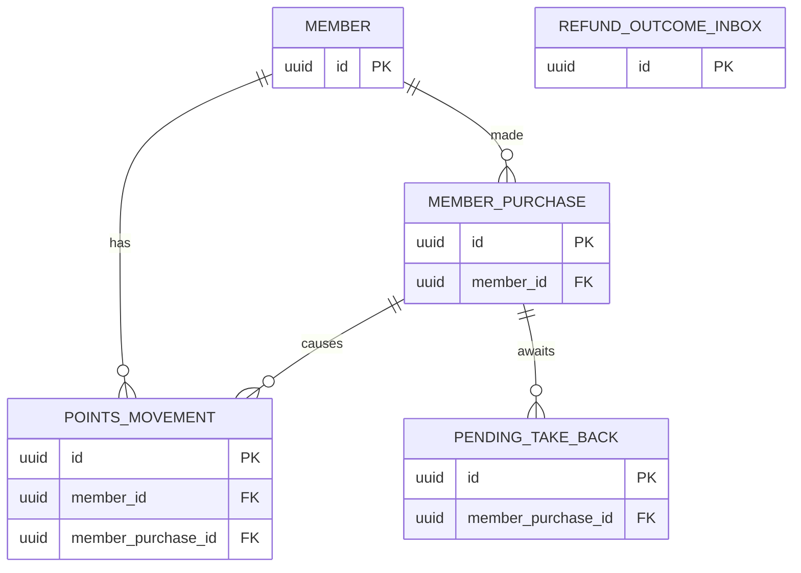
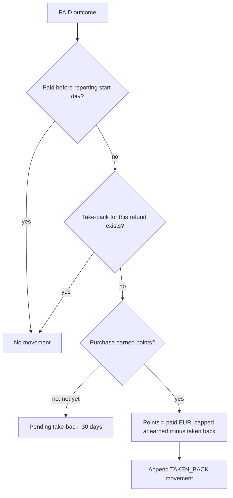
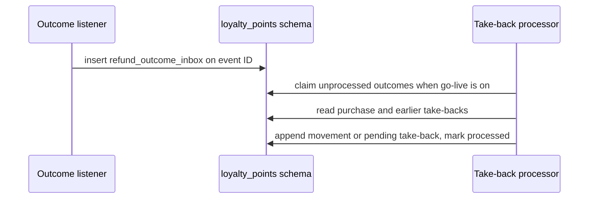

<!--
CHUNK: 13d
TITLE: Detailed Service Spec - Loyalty Points
PROJECT: Refunds Platform
VERSION: 1.0
DEPENDS_ON: 09, 07, 10 (event hub - event names and DTOs match chunk 10 verbatim), 11 (API contracts - integration endpoints carry their API ID and match chunk 11 verbatim), 12 (roles - permission tokens match chunk 12 verbatim)
PART OF: SDD - Refunds Platform
-->

# 17. Detailed Service Specs

---

## 17.4 Loyalty Points

### What

The loyalty-points module owns the points bounded context: the member's points movements (earned on a branch purchase, taken back after a paid refund), the balance as their sum, the purchases received from Point-of-Sale Records, and the refund outcomes received from refund-request. It is the system of record for points ([PSDD/DAT-01.2](../pre-sdd-refunds-platform/03d-register-data.md#dat-01)).

### Boundaries

- **Owns:** members as seen by Loyalty Points (their identity link and membership state), points movements, received purchases, the refund outcome inbox, pending take-backs.
- **Does not own:** refund requests and their status (refund-request); purchases and receipts (Point-of-Sale Records); member sign-up and sign-in (open: [LOYALTY/UC-01](../brd-loyalty-points/06a-use-cases-member.md#uc-01-view-points-balance) Preconditions); who records that a member left the program (open: [LOYALTY 03 § Member leaves the loyalty program](../brd-loyalty-points/03-definitions-and-domain-concepts.md#member-leaves-the-loyalty-program)).
- **Upstream consumers:** the web frontend (member area); Point-of-Sale Records' purchase feed ([API-08](./11-api-contracts.md#api-08-member-purchase-feed-point-of-sale-records---loyalty-points)).
- **Downstream dependencies:** the events `RefundRequestPaid`, `RefundRequestRejected`, `RefundRequestCancelled`, `RefundRequestReturnedToApproved`.

### Input

| Type | Source | Description |
|------|--------|-------------|
| REST | Member (web frontend) | Points balance, points history, one movement (List of APIs) |
| REST or file | Point-of-Sale Records | Member purchases ([API-08](./11-api-contracts.md#api-08-member-purchase-feed-point-of-sale-records---loyalty-points)); mechanism open |
| Event | refund-request, `RefundRequestPaid` | Takes points back once for a paid refund ([LOYALTY/UC-02](../brd-loyalty-points/06a-use-cases-member.md#uc-02-view-points-history) BR-1: points taken back when paid; BR-3: once per paid refund) |
| Event | refund-request, `RefundRequestRejected` | Records the outcome, adds no movement ([LOYALTY/UC-02](../brd-loyalty-points/06a-use-cases-member.md#uc-02-view-points-history) BR-1: points taken back when paid) |
| Event | refund-request, `RefundRequestCancelled` | Records the outcome, adds no movement ([LOYALTY/UC-02](../brd-loyalty-points/06a-use-cases-member.md#uc-02-view-points-history) BR-1: points taken back when paid) |
| Event | refund-request, `RefundRequestReturnedToApproved` | Records the outcome, adds no movement until LOYALTY states a rule (R-05) |
| Schedule | take-back-wait-expiry | Daily: ends the pending take-backs whose 30-day wait has passed ([LOYALTY/UC-02](../brd-loyalty-points/06a-use-cases-member.md#uc-02-view-points-history) BR-5: 30-day wait for a late purchase) |
| Schedule | points-history-purge | Daily: deletes the points history and purchase details of members who left more than 30 days ago ([PSDD/DAT-06.1](../pre-sdd-refunds-platform/03d-register-data.md#dat-06)) |

### Business Logic

**Earning ([LOYALTY 03 § Earning points](../brd-loyalty-points/03-definitions-and-domain-concepts.md#earning-points); no use case: [LOYALTY 05 § Use Case Summary](../brd-loyalty-points/05-user-journeys-overview.md#use-case-summary)).** Each member purchase from the feed is stored with its purchase reference, date, branch, and amount, once per purchase reference; when the member is in the program, has not left ([LOYALTY 03 § Member leaves the loyalty program](../brd-loyalty-points/03-definitions-and-domain-concepts.md#member-leaves-the-loyalty-program)), and the purchase date is on or after the start of points ([LOYALTY 03 § Start of points](../brd-loyalty-points/03-definitions-and-domain-concepts.md#start-of-points)), the module adds an earned movement of 1 point per 1 EUR, with the purchase date as the movement date, even when the purchase arrives late. Whole points only; the rounding of a non-whole euro amount is open in the BRD: **[NEEDS CLARIFICATION: When a purchase amount is not a whole number of euros, is the number of points rounded down, rounded up, or to the nearest whole point? Owner: Loyalty Points owner.]** **[NEEDS CLARIFICATION: What is the date from which branch purchases earn points? Owner: Loyalty Points owner.]** A purchase that earns points also settles any pending take-back for it (below).

**View points balance ([LOYALTY/UC-01](../brd-loyalty-points/06a-use-cases-member.md#uc-01-view-points-balance)).** `GET /v1/members/me/points-balance` resolves the member from the token's subject (BR-1: own points only), refuses a person who has left (AC-7: no balance after leaving), and returns the sum of the member's movements, the date of the newest movement in the history (BR-3: last movement date), the timing note (BR-2: when purchases and take-backs appear; the take-back time is [LOYALTY/NFR-02](../brd-loyalty-points/10-nfrs.md#non-functional-requirements), the earning time is open in [LOYALTY/NFR-03](../brd-loyalty-points/10-nfrs.md#non-functional-requirements)), and the line that points cannot be used yet (step 2). With no movement it returns 0 and a flag to explain earning (A1); when the read fails it returns 503 and no balance (E1).

**View points history ([LOYALTY/UC-02](../brd-loyalty-points/06a-use-cases-member.md#uc-02-view-points-history)).** `GET /v1/members/me/points-movements` lists the member's movements newest first (step 2), each with its date, reference, and points, with the same timing note; `GET /v1/members/me/points-movements/{movementId}` returns the purchase or refund details behind one movement (step 4), or the movement without details once they are no longer kept (A2). When the read fails it returns 503, never an empty list (E1).

**Take-back ([LOYALTY/UC-02](../brd-loyalty-points/06a-use-cases-member.md#uc-02-view-points-history) A1 and the business rules).** Every refund outcome event is inserted into `refund_outcome_inbox` under its event ID in the listener's transaction (a duplicate is skipped). While the Loyalty Points go-live switch is off, the inbox only keeps the outcomes ([REFUNDS 04 § Project Scope](../brd-refunds-portal/04-scope-and-personas.md#project-scope)). Once it is on, the processor handles each kept or new outcome in order:

- `PAID` (BR-1: points taken back when paid): only refunds the platform reports take points back (BR-7: only reported refunds), and a refund paid before the day reporting started takes none (BR-7: only reported refunds; the start day is `loyalty_reporting_started_on`, §11.5); at most one take-back per refund request ID (BR-3: once per paid refund). When the purchase earned points (BR-4: only purchases that earned points), the module adds a taken-back movement of 1 point per 1 EUR of the paid amount, rounded as earning is, dated the refund's paid date, and capped so the points taken back for the purchase never exceed what it earned (BR-6: never more than earned). When the purchase has not earned points yet, a `pending_take_back` row waits up to 30 days after the refund was paid (BR-5: 30-day wait for a late purchase); the purchase earning its points within the wait applies the take-back then, and the wait ending adds no movement. A member who left takes no points back ([LOYALTY 03 § Member leaves the loyalty program](../brd-loyalty-points/03-definitions-and-domain-concepts.md#member-leaves-the-loyalty-program)).
- `REJECTED`, `CANCELLED`: recorded, no movement (BR-1: points taken back when paid).
- `RETURNED_TO_APPROVED`: recorded, no movement; LOYALTY states no rule for points already taken back (R-05, marker in §4).
- Take-backs show within 1 hour of the refund being paid ([LOYALTY/NFR-02](../brd-loyalty-points/10-nfrs.md#non-functional-requirements); [PSDD/INT-05.1](../pre-sdd-refunds-platform/03f-register-integration.md#int-05), [PSDD/CAP-09.1](../pre-sdd-refunds-platform/03b-register-capacity.md#cap-09)): the processor runs within one minute of each event (recommended), well inside the hour.
- Matching a refund to a purchase uses the receipt number from the refund outcome as the purchase reference ([§3](./01-executive-summary-scope-risks.md#3-assumptions) assumption 5, open).
- No message is sent to the member (BR-8: no message on take-back).

**Membership.** A member row links the identity provider's subject to the loyalty member and holds whether and when the member left. A member row is created from the purchase feed on the first purchase of an unknown `pos_member_ref`, with `subject` empty; the member's first sign-in links the token's subject to that row through the member number the identity carries, and a sign-in whose member number has no row yet creates the row with both identifiers. **[NEEDS CLARIFICATION: Which member number does the member's sign-in carry, and is it the same member reference that Point-of-Sale Records sends with each purchase? Owner: Loyalty Points owner, with the Retail IT team.]** Who records that a member left is open in the BRD ([LOYALTY 03 § Member leaves the loyalty program](../brd-loyalty-points/03-definitions-and-domain-concepts.md#member-leaves-the-loyalty-program)): **[NEEDS CLARIFICATION: Which system tells Loyalty Points that a member has left the loyalty program, and how? Owner: Loyalty Points owner.]**

### Output

| Type | Destination | Description |
|------|-------------|-------------|
| REST response | Web frontend, member area | Balance, history, movement details |

### Integrations

| Integration | Direction | Protocol | Purpose | Contract | Failure Handling |
|-------------|-----------|----------|---------|----------|------------------|
| Point-of-Sale Records | Inbound | TBD (mechanism open) | Member purchases | API-08 (§15) | Deduplicate on purchase reference; a late purchase keeps its date |
| refund-request | Async (in process) | Domain events | Refund outcomes | `RefundRequestPaid`, `RefundRequestRejected`, `RefundRequestCancelled`, `RefundRequestReturnedToApproved` (§14.10) | Inbox keyed by event ID; kept until go-live |

### DB Modeling

#### Entity Relationship

**Summary:** A member has purchases and points movements; each movement comes from one purchase (earned) or from a paid refund of it (taken back); a pending take-back waits on a purchase; the refund outcome inbox stands alone.

#### Tables Design

**Table name:** `member`

**Table purpose:** One row per loyalty member, linking the identity provider's subject to the membership state.

**Column details:**

| Column name | Data type | Required or optional | Description |
|-------------|-----------|----------------------|-------------|
| `id` | uuid | Required | UUIDv7 primary key |
| `subject` | varchar(255) | Optional | The identity provider's subject; null until the member first signs in; unique where not null |
| `pos_member_ref` | varchar(64) | Required | The member as Point-of-Sale Records names it in the feed; unique |
| `left_at` | timestamptz | Optional | Null while the member is in the program |
| `created_at` | timestamptz | Required | Audit column |
| `updated_at` | timestamptz | Required | Audit column |

**Table name:** `member_purchase`

**Table purpose:** One row per member purchase received from Point-of-Sale Records, with its details while they are kept.

**Column details:**

| Column name | Data type | Required or optional | Description |
|-------------|-----------|----------------------|-------------|
| `id` | uuid | Required | UUIDv7 primary key |
| `member_id` | uuid | Required | The member; indexed |
| `purchase_ref` | varchar(64) | Required | The purchase reference; unique |
| `purchase_date` | date | Required | The movement date of its earned points |
| `branch_id` | varchar(32) | Optional | Null once details are no longer kept ([LOYALTY 03 § Keeping points history](../brd-loyalty-points/03-definitions-and-domain-concepts.md#keeping-points-history)) |
| `amount_eur` | numeric(19,4) | Optional | Null once details are no longer kept |
| `points_earned` | integer | Required | 0 when it earned none |
| `received_at` | timestamptz | Required | When the feed delivered it |

**Table name:** `points_movement`

**Table purpose:** The append-only ledger of points movements; the balance is the sum of a member's rows.

**Column details:**

| Column name | Data type | Required or optional | Description |
|-------------|-----------|----------------------|-------------|
| `id` | uuid | Required | UUIDv7 primary key |
| `member_id` | uuid | Required | The member; indexed with `movement_date` descending |
| `member_purchase_id` | uuid | Required | The purchase that earned the points, or whose refund took them back |
| `kind` | varchar(12) | Required | `EARNED` or `TAKEN_BACK` |
| `points` | integer | Required | Positive for earned, negative for taken back |
| `movement_date` | date | Required | The purchase date (earned) or the refund's paid date (taken back) |
| `refund_request_id` | uuid | Optional | The refund request of a taken-back movement; unique where not null (one take-back per paid refund) |
| `refund_ref` | varchar(64) | Optional | The refund's reference number (`referenceNumber` of the event), shown to the member as the refund reference ([LOYALTY/UC-02](../brd-loyalty-points/06a-use-cases-member.md#uc-02-view-points-history) step 4); not unique |
| `refunded_amount_eur` | numeric(19,4) | Optional | The refunded amount for a taken-back movement, null once details are no longer kept |
| `created_at` | timestamptz | Required | Audit column |

**Table name:** `pending_take_back`

**Table purpose:** A paid refund whose purchase has not earned points yet, waiting up to 30 days ([LOYALTY/UC-02](../brd-loyalty-points/06a-use-cases-member.md#uc-02-view-points-history) BR-5: 30-day wait for a late purchase).

**Column details:**

| Column name | Data type | Required or optional | Description |
|-------------|-----------|----------------------|-------------|
| `id` | uuid | Required | UUIDv7 primary key |
| `purchase_ref` | varchar(64) | Required | The purchase awaited; indexed |
| `member_purchase_id` | uuid | Optional | Null until the purchase arrives |
| `refund_request_id` | uuid | Required | The refund request; unique |
| `refund_ref` | varchar(64) | Required | The refund's reference number (`referenceNumber` of the event), shown to the member as the refund reference; not unique |
| `paid_amount_eur` | numeric(19,4) | Required | The refunded amount |
| `paid_at` | timestamptz | Required | The refund's paid time |
| `expires_at` | timestamptz | Required | 30 days after `paid_at` |
| `status` | varchar(12) | Required | `WAITING`, `APPLIED`, `EXPIRED` |

**Table name:** `refund_outcome_inbox`

**Table purpose:** Every refund outcome event received, kept until processed, also before go-live.

**Column details:**

| Column name | Data type | Required or optional | Description |
|-------------|-----------|----------------------|-------------|
| `id` | uuid | Required | The event's ID (primary key) |
| `refund_request_id` | uuid | Required | The refund request; indexed |
| `refund_ref` | varchar(64) | Required | The refund's reference number (`referenceNumber` of the event), shown to the member as the refund reference; not unique |
| `purchase_ref` | varchar(64) | Required | The receipt number sent as the purchase reference |
| `outcome` | varchar(24) | Required | `PAID`, `REJECTED`, `CANCELLED`, `RETURNED_TO_APPROVED` |
| `amount_eur` | numeric(19,4) | Optional | The paid amount, for `PAID` only |
| `paid_at` | timestamptz | Optional | For `PAID` only |
| `aggregate_version` | integer | Required | The event's `aggregateVersion`; the outcomes of one refund are processed in this order |
| `received_at` | timestamptz | Required | When received |
| `processed_at` | timestamptz | Optional | Null until processed; indexed where null |

#### Migration Strategy

- **Tool:** the versioned SQL migrations of [§11.1](./07-cross-cutting-concerns.md#111-db-modeling-default) on the `loyalty_points` schema.
- **Backward compatibility:** additive; expand then contract.
- **Data backfill:** batched migration steps; an opening balance from an earlier program is open in the BRD ([LOYALTY 03 § Start of points](../brd-loyalty-points/03-definitions-and-domain-concepts.md#start-of-points)).
- **Rollback:** previous image.

#### Retention Policy

- `points_movement`, `member_purchase`, `member`: kept while the membership lasts, deleted within 30 days after it ends ([PSDD/DAT-06.1](../pre-sdd-refunds-platform/03d-register-data.md#dat-06)) by `points-history-purge`.
- The purchase and refund details behind a movement (`member_purchase.branch_id`, `member_purchase.amount_eur`, `points_movement.refunded_amount_eur`): set to null when their period ends ([LOYALTY 03 § Keeping points history](../brd-loyalty-points/03-definitions-and-domain-concepts.md#keeping-points-history)). **[NEEDS CLARIFICATION: How long must the system keep the purchase and refund details behind a points movement? Owner: Loyalty Points owner.]**
- `pending_take_back`: 30 days after expiry or application (recommended).
- `refund_outcome_inbox`: processed rows kept 90 days (recommended).

#### Archival

- **Cold storage:** Not applicable for this release.
- **Format:** Not applicable.
- **Schedule:** Not applicable.
- **Restore SLA:** per [§8.6.4](./05a-infrastructure-and-network.md#864-backup-and-disaster-recovery).

#### Data Encryption

- **At rest:** storage encryption with the business-held keys ([PSDD/SEC-04.1](../pre-sdd-refunds-platform/03e-register-security.md#sec-04)).
- **In transit:** TLS.
- **Key management:** key management service, yearly rotation.
- **PII columns:** `member.subject`, `member.pos_member_ref`, and the purchase rows are member data ([PSDD/DAT-03.1](../pre-sdd-refunds-platform/03d-register-data.md#dat-03)); non-production holds generated data only.

### Multi-Tenancy Specifications

- **Strategy override:** None: follows [§11.2](./07-cross-cutting-concerns.md#112-multi-tenancy-default), which is open.
- **Tenant filter:** none until §11.2 is settled; every member query filters by the token's subject.
- **Cross-tenant queries:** not applicable until §11.2 is settled.

### API Standards

- **Style:** REST with OpenAPI.
- **Versioning:** URI prefix `/v1`.
- **Authentication:** OIDC access token of the member (Proposed; the sign-in party is open); the provider's scheme for the purchase feed (`TBD - external`).
- **Idempotency:** reads only for members; the feed deduplicates on the purchase reference.
- **Pagination:** cursor-based on `movement_date` and `id`; the page size is open in the BRD ([LOYALTY 11 § UI/UX Expectations](../brd-loyalty-points/11-summary-and-uiux.md#uiux-expectations)).
- **Error envelope:** per the §15.1 error model.

#### List of APIs (Swagger-friendly)

| Method | Path | Summary | Request Body | Response | Permission token (§16) | API ID (§15) |
|--------|------|---------|--------------|----------|------------------------|--------------|
| GET | `/v1/members/me/points-balance` | The member's balance, last movement date, and notes | - | `PointsBalance` | `loyalty-points.points-balance.read-own` | - |
| GET | `/v1/members/me/points-movements` | The member's movements, newest first | - | `PointsMovementPage` | `loyalty-points.points-history.read-own` | - |
| GET | `/v1/members/me/points-movements/{movementId}` | The details behind one movement | - | `PointsMovementDetail` | `loyalty-points.points-history.read-own` | - |
| TBD | TBD | Member purchase feed from Point-of-Sale Records | TBD | TBD | - | API-08 |

**[NEEDS CLARIFICATION: Request and response fields for the member endpoints beyond the balance, dates, references, and points named in Business Logic. Owner: Software Architect.]**

### Event-Driven Architecture (If Applicable)

#### Event Model

**Published events:**

Not applicable - no integration events.

**Consumed events:**

Not applicable - no integration events.

**In-process domain events (modules only):**

| Event | Publisher module | Listener modules | Transaction phase (before commit / after commit) | Payload (DTO) | Notes |
|---|---|---|---|---|---|
| `RefundRequestRejected` | refund-request | notification, loyalty-points | after commit | `RefundRequestRejectedDto`: refundRequestId, referenceNumber, receiptNumber, reason, rejectedAt, aggregateVersion | Recorded, no movement |
| `RefundRequestCancelled` | refund-request | notification, loyalty-points | after commit | `RefundRequestCancelledDto`: refundRequestId, referenceNumber, receiptNumber, cancelledAt, aggregateVersion | Recorded, no movement |
| `RefundRequestPaid` | refund-request | notification, loyalty-points | after commit | `RefundRequestPaidDto`: refundRequestId, referenceNumber, receiptNumber, paidAmount, paidAt, aggregateVersion | Take-back |
| `RefundRequestReturnedToApproved` | refund-request | notification, loyalty-points | after commit | `RefundRequestReturnedToApprovedDto`: refundRequestId, referenceNumber, receiptNumber, returnedAt, aggregateVersion | Recorded, no movement (R-05) |

#### Messaging Infra

Not applicable - no integration events.

### Constraints

- [LOYALTY/UC-01](../brd-loyalty-points/06a-use-cases-member.md#uc-01-view-points-balance) and [LOYALTY/UC-02](../brd-loyalty-points/06a-use-cases-member.md#uc-02-view-points-history): Member only, own points only ([LOYALTY 07 § Users & Use Cases Matrix](../brd-loyalty-points/07-users-use-cases-matrix.md#users--use-cases-matrix) footnote 1; [LOYALTY/NFR-05](../brd-loyalty-points/10-nfrs.md#non-functional-requirements)): `loyalty-points.points-balance.read-own`, `loyalty-points.points-history.read-own`.
- People who answer member calls have no view of a member's points in this release ([LOYALTY 04 § Personas / Actors](../brd-loyalty-points/04-scope-and-personas.md#personas--actors)).
- Points never expire in this release ([LOYALTY 03 § Points movement](../brd-loyalty-points/03-definitions-and-domain-concepts.md#points-movement)); no correction movement exists ([LOYALTY 04 § Out of Scope](../brd-loyalty-points/04-scope-and-personas.md#out-of-scope)).

### Error Handling

- **Synchronous APIs:** Problem Details per §15.1.
- **Validation errors:** 400 `VALIDATION_FAILED` on a malformed cursor.
- **Domain errors:** a person who has left → 403 `MEMBERSHIP_ENDED` ([LOYALTY/UC-01](../brd-loyalty-points/06a-use-cases-member.md#uc-01-view-points-balance) AC-7: no balance after leaving); an unknown movement → 404 `NOT_FOUND`.
- **Auth errors:** 401 `UNAUTHENTICATED`; 403 `FORBIDDEN`.
- **Server errors:** [LOYALTY/UC-01](../brd-loyalty-points/06a-use-cases-member.md#uc-01-view-points-balance) E1 and [LOYALTY/UC-02](../brd-loyalty-points/06a-use-cases-member.md#uc-02-view-points-history) E1 → 503 `POINTS_UNAVAILABLE`; the frontend shows the try-again message and no balance or empty list.
- **Async consumers:** the inbox insert is idempotent; processing failures are retried by the processor.
- **Poison messages:** an outcome over the poison threshold of §11.1 is marked and alerted; replay per [§20.1.3](./16-operations-runbook.md#2013-replay-dlq-messages).

### Observability & Monitoring

#### Logging

- JSON per §11.4; fields `member_id`, `refund_ref`, `purchase_ref`; no member contact data.
- Each take-back decision with its rule.
- Retention per §11.4.

#### Metrics

| Metric | Type | Labels | Purpose |
|--------|------|--------|---------|
| `points_movements_total` | counter | `kind` | Earned and taken-back movements |
| `take_back_latency_seconds` | histogram | - | From paid time to movement, against [LOYALTY/NFR-02](../brd-loyalty-points/10-nfrs.md#non-functional-requirements) |
| `pending_take_backs` | gauge | - | Take-backs waiting for a purchase |
| `refund_outcome_inbox_unprocessed` | gauge | - | Outcomes waiting (also before go-live) |

#### Tracing

- Spans on each endpoint, each feed delivery, and each outcome processed.
- Trace context from the publisher's event row.
- Sampling per §11.4.

### Developer Notes

- **Recommended patterns:** a `PointsLedger` that appends movements and computes balances; take-back rules as one policy class tested rule by rule.
- **Avoid:** updating a movement; computing the balance from a cached column that can drift.
- **Testing:** the acceptance criteria of [LOYALTY/UC-02](../brd-loyalty-points/06a-use-cases-member.md#uc-02-view-points-history) as policy tests (duplicates, caps, the 30-day wait, the start day); a test that outcomes kept before go-live follow BR-7: only reported refunds.

### Service-Level Diagrams

#### Implementation Flow Chart

**Summary:** A paid refund takes no points when it was paid before reporting started or already took points back; otherwise it takes back 1 point per euro, capped at what remains of the purchase's earned points, or waits for the purchase to earn its points.

#### Sequence Diagram (Service-Internal)

**Summary:** The listener only records the outcome; the processor applies the rules once Loyalty Points is live, appending a movement or a pending take-back.

### Compliance

- **GDPR:** member data is deleted within 30 days after the membership ends ([PSDD/DAT-06.1](../pre-sdd-refunds-platform/03d-register-data.md#dat-06)); the applicable law is open (§11.6).
- **PCI-DSS:** Not applicable for this service: no payment data.
- **ISO 27001 / SOC 2:** Not applicable for this service: no certification is stated by a source.
- **Local regulations:** Not applicable for this service: no source states one.

### Deployment Strategy

- **Service-specific override:** None: part of the one deployable; the go-live switch of §11.5 controls the processing and the member endpoints.
- **Replicas:** per the deployable.
- **Strategy:** rolling, per §11.3.
- **Health checks:** readiness includes the database.
- **Rollback:** previous image.

### Future Enhancements

- Export the history; tell the member when points are taken back ([LOYALTY/UC-02](../brd-loyalty-points/06a-use-cases-member.md#uc-02-view-points-history) Future Enhancements).

<!-- MASTER: refunds-platform-sdd-master.md | PREV: 13c-service-notification.md | NEXT: 14-performance-and-capacity.md -->
