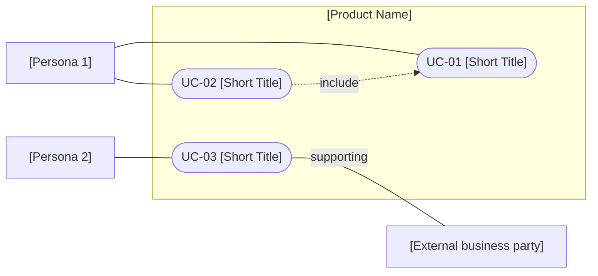

<!--
CHUNK: 05
TITLE: User Journeys & Use Cases - Overview
PROJECT: [Project Name]
VERSION: [X.X]
DEPENDS_ON: 04
PART OF: BRD - [Project Name]
LANGUAGE: Business language only. No technology names, protocols, or implementation terminology - the how is owned by the SDD.
-->

# User Journeys & Use Cases

## Use Case Stats

<!-- Derived from the Use Case Summary below, never typed by hand: recount whenever a Phase, Priority, or Complexity value changes, or a use case is added, merged, or removed. Count the active use cases only; rows marked `Merged into UC-NN` or `Removed` are counted on the last line. A `(proposed)` value counts as its value until the product manager accepts or adjusts it (SKILL.md § Use-case attributes). Later chunks take these values from the Use Case Summary, never from this section. List only the phases that hold use cases, in ascending order. -->

**Active use cases:** [n] | **Proposed values waiting for the product manager:** [n, or None]

### By Priority

| Priority | Use cases |
|----------|-----------|
| High | [n] |
| Medium | [n] |
| Low | [n] |
| **Total** | **[n]** |

### By Complexity

| Complexity | Use cases |
|------------|-----------|
| High | [n] |
| Medium | [n] |
| Low | [n] |
| **Total** | **[n]** |

### By Phase

| Phase | Use cases |
|-------|-----------|
| Phase 1 | [n] |
| Phase 2 | [n] |
| **Total** | **[n]** |

### By Phase, Priority and Complexity

<!-- One grid per phase: Priority rows, Complexity columns, with row and column totals. The bottom-right cell equals that phase's count in By Phase. -->

#### Phase 1 ([n] use cases)

| Priority \ Complexity | High | Medium | Low | Total |
|-----------------------|------|--------|-----|-------|
| High | [n] | [n] | [n] | [n] |
| Medium | [n] | [n] | [n] | [n] |
| Low | [n] | [n] | [n] | [n] |
| **Total** | **[n]** | **[n]** | **[n]** | **[n]** |

#### Phase 2 ([n] use cases)

| Priority \ Complexity | High | Medium | Low | Total |
|-----------------------|------|--------|-----|-------|
| High | [n] | [n] | [n] | [n] |
| Medium | [n] | [n] | [n] | [n] |
| Low | [n] | [n] | [n] | [n] |
| **Total** | **[n]** | **[n]** | **[n]** | **[n]** |

**Not counted:** [n] merged, [n] removed.

<!-- Start with the end-to-end journey of each primary persona, in plain business language. One short narrative per persona, describing what they come to the system to accomplish and the path they take. -->

## User Journeys

### [Persona 1] Journey

[1 paragraph: what this user wants to accomplish end-to-end, the path they take through the system, and the outcome they leave with.]

### [Persona 2] Journey

[1 paragraph.]

## Summarized Workflow

<!-- Optional: A simplified step-by-step summary of the key journey(s). Diagrams are inline Mermaid (business-language labels), each with a mandatory 1-2 sentence prose summary. Append a `> Miro: <url>` link only if the user asked for a board. -->

[Workflow description with numbered steps and/or an inline Mermaid flowchart + prose summary.]

## Use Case Summary

<!-- Every use case in the BRD, one row each. UC numbering is sequential across the whole BRD. A use case that disappears keeps its row, and its Description cell starts with `Merged into UC-NN.` or `Removed: [reason].` (use-case-quality.md § UC numbering and IDs). Group rows per persona - the detailed chunks (06a, 06b, ...) split per persona in the same order. -->

<!-- The last three columns are the home of each use case's Phase (`Phase 1`, `Phase 2`, ...), Priority (`High` / `Medium` / `Low`), and Complexity (`High` / `Medium` / `Low`). Every use case of every phase has a row. A value no source states carries ` (proposed)`, and the marker below asks about all of them at once; leave the marker out when no cell is proposed. A row marked `Merged into` or `Removed` holds `-` in the three columns. Sources, rubric, and acceptance: SKILL.md § Use-case attributes. -->

**[NEEDS CLARIFICATION: proposed Phase, Priority and Complexity for the cells marked (proposed); confirm or adjust]**

| UC ID | Use Case | Primary Actor | Description | Phase | Priority | Complexity |
|-------|----------|---------------|-------------|-------|----------|------------|
| **[Persona 1]** | | | | | | |
| UC-01 | [Short Title] | [Persona 1] | [1-3 sentence summary of the goal and outcome] | Phase 1 | High | Medium (proposed) |
| UC-02 | [Short Title] | [Persona 1] | [Summary] | Phase 1 (proposed) | Medium (proposed) | Low (proposed) |
| **[Persona 2]** | | | | | | |
| UC-03 | [Short Title] | [Persona 2] | [Summary] | Phase 2 | High | High (proposed) |

<!--
USE CASE DIAGRAMS SLOT (to-do step 5 in 14-todo.md). Emit nothing here at first generation, and do not copy this comment into the generated chunk.
Add the section below only after to-do steps 1-3 are confirmed complete (it runs in parallel with step 4). One overview diagram if it fits about 30 lines, otherwise one per persona in the order above. Every UC-NN (except rows marked Merged into or Removed) appears in at least one diagram; every persona association matches the use-case actor fields and the matrix (07), and every external-party association matches the Supporting Actors and chunk 08, never the matrix; include / extend only where a narrative documents it. Notation: mermaid-diagrams.md § Use-case diagrams.

## Use Case Diagrams

### Figure N - Use cases: [Overview | Persona name]

**Summary:** [1-2 sentences: who does what inside the product boundary, and the relationships shown.]
-->

<!-- MASTER: [project-slug]-brd-master.md | PREV: 04-scope-and-personas.md | NEXT: 06a-use-cases-[persona-slug].md -->
