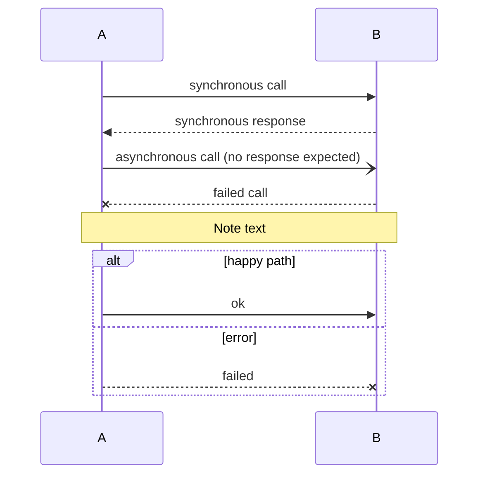
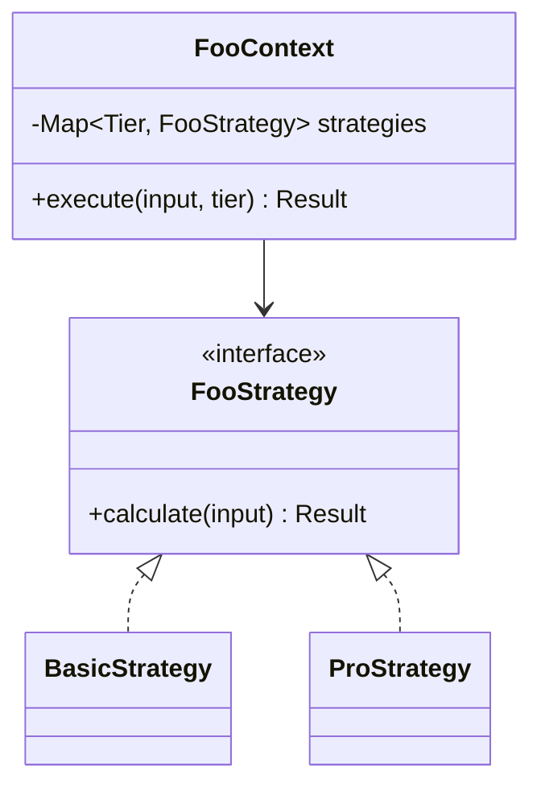
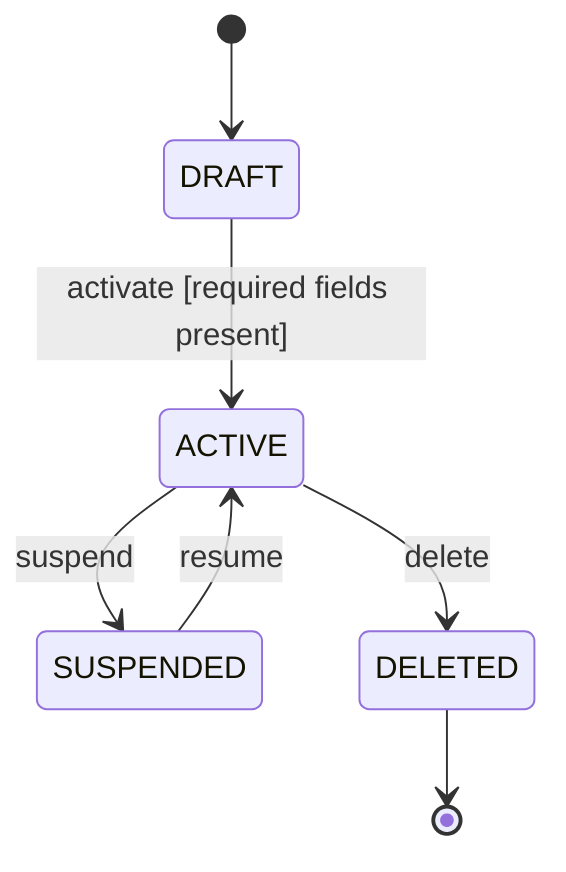
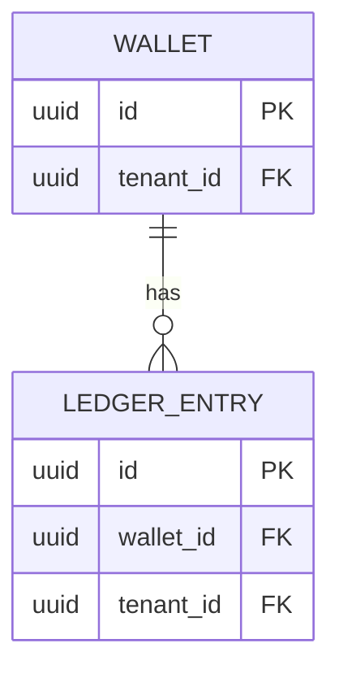
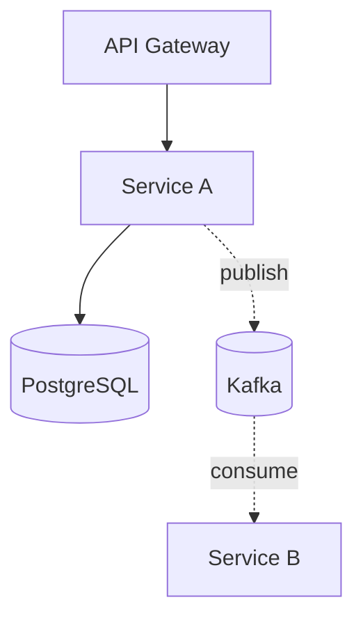

<!-- SHARED: mermaid-syntax.md | HOME: lld-unifier | COPIES: brd-unifier, sdd-unifier | Each skill reads only its own copy. Edit the HOME copy, then copy it byte for byte to every COPIES skill in the same change. _fixtures/checkers/check_shared.py compares the copies. -->

# Mermaid Syntax Quick Reference

Examples of the dialects the unifier skills use. A skill's own rules for labels and diagrams win where they differ from an example here.

## `sequenceDiagram`

## `classDiagram`

Roles:
- `<|--` inheritance.
- `<|..` interface implementation.
- `--*` composition.
- `--o` aggregation.
- `-->` association.

## `stateDiagram-v2`

## `erDiagram`

Cardinalities:
- `||--||` one-to-one.
- `||--o{` one-to-many.
- `}o--o{` many-to-many.

## `graph` / `flowchart`

Node shapes:
- `[ ]` rectangle.
- `( )` rounded.
- `(( ))` circle.
- `[( )]` cylinder (DB).
- `{ }` rhombus (decision).
