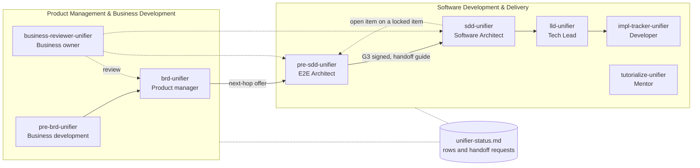

# Pre-SDD Unifier and the chain handoff: design

**Date:** 2026-10-23 (UTC)
**Status:** Approved by the owner on 2026-10-23, including the calls in § 11. Next step: the implementation plan.
**Scope:** a new skill, `pre-sdd-unifier`, with its Studio web form and shared engine; a shared status board; and the changes to the existing unifier skills and the README that place Pre-SDD between the BRD and the SDD.

---

## 1. Intent

Today `sdd-unifier` collects the technical drivers itself. From a business-language BRD it pre-fills an eight-question architecture questionnaire and an ecosystem table. Nobody accountable settles the numbers that size the system (TPS, P99, availability, RTO and RPO, data growth, bandwidth), or the hard choices that follow from them (hosting target, fault scope, DR strategy, topology, data-store shape), before the design starts.

A method for that step already exists outside the chain, in `C:\Users\negat\Downloads\pre-sdd-preparation`: the Pre-SDD Architecture Standard, the Quick Discovery Guide, worked examples, and the Pre-SDD Architecture Studio (a single-file HTML calculator). The repo folder `pre-sdd-unifier/` holds only one exported Studio v2.2 handoff package (a demo). It is not a skill yet.

This work makes Pre-SDD a hop in the chain, played by a new employee, the E2E Architect:

- the E2E Architect turns the BRD's business expectations into settled technical numbers and shape decisions, and a person confirms every value;
- the Software Architect (`sdd-unifier`) designs from those settled inputs and treats them as locked;
- every employee can read one status file to see where each hop stands, pick up a handoff, or resume its own work.

The owner's framing: each unifier skill is an employee, the agents will work together on Band or Paperclip, and the suite as a whole becomes a startup run by agent employees.

---

## 2. Decided with the owner

Decided in the brainstorming conversation on 2026-10-23.

1. Pre-SDD runs after the BRD and before the SDD.
2. Pre-SDD numbers and decisions are **locked** for the SDD. The SDD loads the Pre-SDD when one is available, and triggers Pre-SDD when it is not. When the SDD finds a locked item wrong or conflicting, it raises an open item. It never changes the item.
3. **Boundary:** Pre-SDD settles the shape (for example "relational, strongly consistent, multi-AZ"). The SDD picks products, versions, and the detailed design (for example "PostgreSQL 17").
4. **Skills are independent employees.** They interact only through files: their output documents, the shared status board, and the handoff requests posted on it. Each skill writes only its own folder and its own status entries.
5. **The company model:**

   | Skill | Employee | Team |
   |---|---|---|
   | `pre-brd-unifier` | Business development | Product Management & Business Development |
   | `brd-unifier` | Product manager | Product Management & Business Development |
   | `business-reviewer-unifier` | Business owner | Product Management & Business Development |
   | `pre-sdd-unifier` | E2E Architect | Software Development & Delivery |
   | `sdd-unifier` | Software Architect | Software Development & Delivery |
   | `lld-unifier` | Tech Lead | Software Development & Delivery |
   | `impl-tracker-unifier` | Developer / software engineer | Software Development & Delivery |
   | `tutorialize-unifier` | Mentor / assistant | Software Development & Delivery |

   QA, DevOps, and other employees come later. Keep room for them; build nothing for them now.
6. **Change flow with approval.** A change moves between Pre-SDD and SDD, in either direction, only with approval. An SDD change then reaches the LLD through the LLD's existing refresh offer, also only with approval.
7. **Method sources:**
   - The Standard is the full Pre-SDD. The Quick Discovery Guide is the first discovery conversation.
   - The Examples README and its eight examples are worked examples, not templates.
   - The Intake Template is left out.
   - When the sources disagree, the Standard wins. Its gates G0-G3 are the ones used, and G3 approval means the SDD may start.
8. **Modes:** *quick* is the discovery conversation, which ends with the unknowns and who owns each. *Full* runs the Standard through G3.
   **Paths:**
   - greenfield or brownfield, crossed with cloud or on-prem;
   - hybrid as two sub-assessments;
   - migration as an overlay.

   Simple and Complex are recovery tiers for picking the closest worked example. They are not modes.
9. The skill writes a **handoff guide** for `sdd-unifier`, which replaces the Studio's run brief.
10. **Input by web (the Studio) or by prompt (chat),** chosen per run, with web recommended. Both give the same results: they are two ways of collecting the same input.
11. **One calculator.** The formulas, rules, and checks move into one `engine.js`, which the Studio bundles and the skill runs with Node.js. Node.js is accepted as a new requirement of this skill.
12. **The web form covers all 70 checklist items** of the Standard. Anything that can be derived from the BRD or from earlier answers is pre-filled to save time, and the input comes in stages, never all at once.
13. **SDD side:**
    - A G3-signed Pre-SDD is loaded, and it locks what it settles.
    - A Pre-SDD that exists but is not signed makes the SDD stop, wait, and list the blockers.
    - A missing Pre-SDD makes the SDD stop and request one, or offer to start it when the SDD is running on its own.
    - An SDD generated from a brief with no BRD runs as it does today, because Pre-SDD needs a BRD.
    - A TRANSFORM keeps the source SDD's architecture.
    - An SDD built before this change keeps working, and its next update offers a Pre-SDD once.
    - SDD chunk 00 gets a Source Pre-SDD lineage row, which is checked on every run.
14. **Answering the SDD's open items.** The Pre-SDD owner answers an open item the SDD raises on a locked item. The Pre-SDD updates its own document and version, and then the SDD applies the change.
15. **One shared status file in the project root.** Each employee owns its row (state, version, next step) and posts its handoff requests there. Every chain skill reads and updates it.
16. **The BRD's handoff offers the next hop, Pre-SDD,** which can be accepted now or later.
17. **Several entries per item, as the Standard models them.** An item the Standard answers per journey, failure scope, dataset, or workload holds several entries. One primary entry is required and the rest are optional. Each entry carries the Standard's record fields, and the engine picks a DR strategy per failure scope.
18. **Proposed targets.** The E2E Architect may propose business targets the BRD does not give (availability, RTO, RPO, latency), each with its reason, and a person or an answer policy picks. Forecasts and measurements are never proposed.
19. **G3 per role:**
    - Each applicable role signs. One person may hold several roles, and by default the owner holds them all.
    - "Approved with conditions" lets the SDD start when every condition has an owner and a due date and is carried in the handoff guide.
    - Only a named person, never a stand-in, can grant an exception that lets an `Open` hard item pass.
20. **Engineering defaults appendix.** The skill ships a policy appendix with the Studio preset's engineering factors (§ 6.5). The owner approves it once, and every project gets the values pre-filled as `Estimated`.
21. **The company files.** A parallel session built `hivantic-org-unifier/` from the first draft of this design. This build brings it in line with the final design, as its last step.
22. **Studio palette.** Keep the v2.2 teal palette.

---

## 3. Goals, non-goals, anti-goals

### Goals

1. `pre-sdd-unifier` works in Claude Code, Codex, and Kimi Code. It produces a Pre-SDD from a finished BRD in quick or full mode, with web or prompt input. In full mode it ends at the G3 sign-off stop.
2. `sdd-unifier` loads a G3-signed Pre-SDD as locked input, waits on one that is not signed, and requests one that is missing.
3. Both input paths give identical numbers, rule hits, validation results, and blueprint for the same input, because both run the same engine.
4. No one faces 70 empty items. Derivable items arrive pre-filled with their source, the work comes in stages, and any stage can stop and resume.
5. Any employee, human or agent, can read one file and know each hop's state, what it waits on, and which handoff requests are open.
6. The company model (employee and team) shows in the README, in each skill, and on the status board.
7. The README, the Codex and Kimi junctions, the Band role files, and the fixtures reflect the new chain.

### Non-goals

- QA, DevOps, or any other future employee. The only provision for them: the status board accepts new rows without changes to existing ones.
- Band or Paperclip integration beyond the files: no platform API calls, tickets, or messages.
- Gates G4 (cutover readiness) and G5 (production acceptance), which fall after the SDD.
- A hybrid worked example, or a rewrite of the eight examples.
- Changes to the originals in Downloads.

### Anti-goals (a failure even if everything technically works)

- Pre-SDD names a product, a version, or the architecture style (monolith, hybrid, microservices).
- The SDD changes a locked item instead of raising an open item.
- An agent writes `Confirmed` for a value, signs G3, or approves its own work.
- Two calculators that can disagree, or a number worked out by hand in prose.
- A pre-filled value that was guessed. A business number the sources do not give stays `Open`.
- A form that shows all 70 items at once with nothing filled.
- A hop edits another hop's documents beyond the writes the chain already allows (the LLD's own Child LLDs row, and the business review's edits to BRD and SDD content).
- A change moves between Pre-SDD, SDD, and LLD without approval.
- A skill reads another skill's rule files to do its job.
- The Studio makes a network call or needs a server.

---

## 4. Constraints

- **House conventions** (README § Shared conventions) apply to the Pre-SDD:
  - chunks or combined, with a master index;
  - self-describing chunks (`<!-- CHUNK: ... -->` comment, `<!-- MASTER: ... -->` footer) and stable file names;
  - one fact, one home;
  - stable, owned IDs;
  - gaps flagged, never invented (`[NEEDS CLARIFICATION: ...]`);
  - the cleared-context reviewer and the open-items loop;
  - the answer policy and stand-ins, and light runs;
  - `decision-log.md`, and one update, one version;
  - inline Mermaid with a 1-2 sentence summary, and no em dash characters.
- **The owner's CLAUDE.md:**
  - No new dependencies beyond Node.js: no npm packages. The Python validator's `jsonschema` is already installed.
  - No comments in code unless the owner asks.
  - UTC for every timestamp.
  - No `git commit` or `git push` by the agent.
- **SKILL.md requirements:** the description is at most 1024 characters, and the front matter must parse for Codex and Kimi. Include a § Running outside Claude Code like the other unifiers.
- **Windows first:** PowerShell and Git Bash, and paths with spaces. The repo's `.gitattributes` line-ending rules hold.
- **The Studio stays one offline HTML file** that opens from disk in current Chrome, Edge, and Firefox.
- **The Studio code came from Downloads,** so it is reviewed before it enters the repo.
- **Independence:**
  - Every chain skill states the status-board rules in the same words.
  - A skill reads other hops' output documents and the status board, never their rule files.
- **A parallel session works in this repo.** On 2026-10-23 another session rebuilt the Band role files as the company model in `hivantic-org-unifier/` (merged as `4177fce` and pushed): eight role files, two team files, and a handbook README, all from the first draft of this design. It also renamed one README subsection to "The unifier company (hivantic-org-unifier/)". That session now leaves `hivantic-org-unifier/` alone. The build therefore:
  - runs in its own git worktree on a feature branch;
  - rebases on `main` before any merge, and merges around that README subsection;
  - owns the sync of `hivantic-org-unifier/` (§ 9).

---

## 5. The company and the chain



**Summary:** solid arrows are the handoffs. Dashed arrows are reviews and the SDD's only way back to Pre-SDD, which is an open item, never an edit. Both teams read and write the one status board.

---

## 6. The new skill: `pre-sdd-unifier`

### 6.1 Start conditions and intents

- **Source:** one or more finished BRDs for one system, meaning no part is `Pending` or `In progress` in the BRD master (the SDD's rule today). There is one Pre-SDD per system, and its parent BRDs are the ones the SDD will have.
- **A BRD that is not `Approved`:** ask once whether to go on, as the SDD does.
- **No BRD:** refuse, and point to `brd-unifier`.
- **Intents:**
  - GENERATE: a new Pre-SDD from BRDs.
  - RESUME: an existing Pre-SDD folder with a stage not done.
  - UPDATE: a new BRD version, an SDD open item, or a change the owner asks for.
  - IMPORT: a Studio v2.2 project JSON or handoff ZIP. Its inputs come in as `Estimated` (never `Confirmed`), then a normal run follows.

### 6.2 Arguments

`pre-sdd-unifier [quick|full] [web|prompt] [chunks|combined] [light]`

- `quick|full`: full is the default. Full mode runs stage 1 (the quick discovery) first, so quick mode is full mode stopped after stage 1. A quick-mode Pre-SDD claims no gate; it reads `Discovery` (§ 6.4).
- `web|prompt`: when not given, ask once per run, with web recommended. The choice can change at any stage boundary.
- `chunks|combined`: when not given, ask, as the other unifiers do.
- `light`: per the house rule, keep templates, IDs, and handoff contracts whole. § Light run lists what it skips. It never skips the engine run, any of the 70 register rows (`Open` is allowed), the gate, or the handoff guide.

### 6.3 Paths and classification

- **Classification** follows the Standard: change type crossed with target.
  - Change type is greenfield or brownfield ("existing workload or state to preserve?").
  - Target is cloud (provider-hosted) or on-prem (organization-operated, including a self-run private cloud).
- **Special cases:**
  - An undecided target compares placements before any code is set.
  - Hybrid means one cloud and one on-prem sub-assessment, plus a boundary analysis.
  - A new product on legacy is greenfield plus a brownfield dependency assessment.
  - Cloud to cloud, or on-prem to cloud, is brownfield-cloud plus the migration overlay.
- **The migration overlay** is independent of the path. It adds the overlay items, one primary R per workload (7R), the cutover rules, and the migration chunk.
- **The recovery tier** comes from RTO and RPO: Simple (both over 6 h), Complex (both under 10 s for a scoped fault), or neither. It is used only to point at the closest worked example.
- **Per-path content** follows Standard §7 (per-path evidence and required outputs). The existing-estate chunk exists only for brownfield, and the migration chunk only with the overlay.

### 6.4 Collecting the input

**The register.** There is one row per checklist item:

| Group | Items |
|---|---|
| Business | BUS-01 to BUS-08 |
| Capacity | CAP-01 to CAP-12 |
| Reliability | REL-01 to REL-10 |
| Data | DAT-01 to DAT-09 |
| Security | SEC-01 to SEC-08 |
| Integration | INT-01 to INT-09 |
| Operations | OPS-01 to OPS-08 |
| Economics | ECO-01 to ECO-06 |

The register also holds:
- the identity fields;
- the calculator's sizing factors, each attached to the item it refines (for example `callsPerTxn` and `requestFactor` under CAP-02);
- the migration overlay fields.

**Entries.** An item holds one or more entries.
- An item the Standard answers per journey, per disaster scenario, per dataset, or per workload repeats. One primary entry is required, and the others are optional.
- The repeating items include at least:
  - CAP-07 and REL-01, per journey;
  - REL-03 and REL-04, per scenario and dataset;
  - REL-05, one entry per failure scope;
  - the data items v2.2 already repeats per workload.

  The builder takes the full list from the Standard's item wording.
- Every other item holds one entry.

**Each entry holds** the Standard's record fields:
- the value, with its unit and window;
- where it is measured;
- the priority: Must, Should, or Could;
- the kind: hard guardrail, negotiable target, forecast, or assumption;
- the verification method;
- the status: `Confirmed`, `Estimated`, `Open`, or `N/A` (with a reason);
- the source: `BRD: KEY/ID`, `Derived: CALC-NN from <items>`, `Answer: <who>, <UTC date>`, or `Default: <appendix or rule>`;
- the owner code: B, E, D, Sec, Ops, Fin, or Legal;
- the evidence reference;
- for `Confirmed`, who confirmed it and when.

An `Open` entry blocks a gate only when its kind is hard guardrail and it has no time-bound exception (the Standard's rule).

**Stages:**

| Stage | What the user sees | Ends with |
|---|---|---|
| 1. Discovery (quick) | Classification, fault scope, and the Quick Discovery Guide's minimum numbers: TPS or RPS, concurrency, P95 and P99, availability, RTO, RPO, data volume, cost and timeline. Each is pre-filled where the BRD gives it. | The discovery summary and the unknowns register with owners. Quick mode stops here. Full mode goes straight on. |
| 2. Register (full) | The remaining items one group at a time, with the ones that need an answer first. Derived values recompute after each answer. | Every one of the 70 items has a status, and every `Open` item has an owner and a due date. This meets the Standard's G1 ("universal checklist reviewed, unknowns visible"). G1 review stop. |
| 3. Assess (full) | Calculations, target shape, options (§ 6.5), and migration if any. | G2 review stop. |
| 4. Confirm and decide (full) | Every `Estimated` value still standing, grouped, with one confirm per group. Then the decisions and the validation. | The write-up, the review, and the handoff guide. G3 sign-off stop. |

**Pre-fill**, in order of trust:
1. **The BRD,** with a BRD citation on each value and status `Estimated`. Sources: Technical Inputs (chunk 12), NFRs (10), integrations (08), constraints, assumptions and dependencies (02), scope and personas (04), the use case summary (05), and reporting (09).
2. **Earlier answers** in this Pre-SDD.
3. **Engine derivations,** with status `Estimated` and source `Derived`. These are formula results from other items: for example, RPS from TPS and calls per transaction; in-flight requests from RPS and mean latency; the error budget from availability; and storage growth from transactions per day, stored size, and retention.
4. **The engineering defaults appendix** (§ 6.5), and project defaults for other items that are not business facts (for example the environment list in OPS-04). Source `Default: <appendix or rule>`, status `Estimated`.

Never pre-filled: a business number the sources do not give. It stays `Open`, and the engine shows TBD, never zero.

**Proposals.** When the sources do not give a business target (availability, RTO, RPO, latency), the E2E Architect may propose one, with its reason. The reason is tied to the BRD where it can be: for example, a monthly disruption limit.
- The proposal sits beside the entry, and the entry stays `Open` until a person, or an answer policy, picks it.
- Once picked, the source reads `Answer: <who>, <UTC date> (proposal accepted)`, or the policy label.
- Forecasts and measurements (TPS, data volume, payload sizes) are never proposed.

**Who confirms:** only a person, by a tick in the web form or an explicit answer in chat, recorded with who and when. Under an answer policy the house rules hold:
- The policy never supplies a forecast, a measurement, or any other fact only a person can give.
- It may take a recommended option for a choice. The value is then `Confirmed`, with the confirmer recorded as `Policy: <policy> (set by <name>, <date>)`.
- Fixtures use the house test-run policy: fixture answers labelled with a named fixture owner.

**Prompt path:**
- The same items come in the same stages and order.
- They are asked in batches of up to four: AskUserQuestion in Claude Code, plain numbered questions elsewhere.
- A pre-filled value is shown as "keep or change".
- Each group ends with one "confirm all pre-filled values in this group" question.

**Saving:**
- On the prompt path, the skill writes the project file after every answered batch.
- On the web, the user saves at any time.
- The master's progress table and the status board name the next stage and group.

### 6.5 The engine and the Studio

**Layout:**

```
pre-sdd-unifier/
  SKILL.md, README.md, rule files (.md)
  chunks/                 chunk and master templates
  studio/
    src/engine.js         pure functions, no DOM
    src/ui.js             form, tabs, diagrams, import, save
    src/shell.html
    src/style.css
    build.mjs             builds pre-sdd-studio.html; can embed a project state
    cli.mjs               new, derive, compute, validate, diff, embed
    pre-sdd-studio.html   the built, blank Studio
    schema/               architecture-blueprint.schema.json, project-state.schema.json
    validate_handoff.py
    tests/                node:test suites
  reference/              the Standard and the Quick Discovery Guide, verbatim, with a source note
  examples/               the Examples README, the eight examples, ERRATA.md, the v2.2 demo export
```

**What `engine.js` holds:**
- the field and item catalogue;
- classification and the `CALC-NN` calculations;
- the DR strategy and topology choice;
- the recommendation rules, and validation (blockers, conflicts, advisories);
- derivation and the blueprint;
- the Mermaid, draw.io, and YAML writers.

It is extracted from the Studio v2.2 `source/app.js`. The built v2.2 HTML is exactly `shell.html` + `style.css` + `app.js`.

**Same results:**
- The CLI and the HTML call the same engine functions on the same project state.
- The build embeds `engine.js` unchanged, and a test compares the bytes.
- After a web session, the skill recomputes the blueprint from the saved project state with the CLI and reports any difference from the one the Studio saved. The expected difference is none.

**Versions:**
- Studio 3.0, because the 70-item register is a breaking change to the project file.
- Blueprint schema 2.0.0, plus a new project-state schema.
- The engine version is stamped into the blueprint and into Pre-SDD chunk 00.

**Fixed in the move** (from the review of v2.2):
- The authority text and the manifest flags say Pre-SDD is locked and the SDD raises open items.
- `gate_status` and `authorized_to_start_sdd` follow G3, instead of always reading provisional and false.
- A filled-in BRD reference produces a key the schema accepts.
- The tenant model input feeds DAT-07 and the outputs.
- The hard-coded hash of `sdd-unifier/SKILL.md` is replaced by the engine and skill versions.
- `Confirmed` needs who and when. An imported `Confirmed` without them is read as `Estimated`.
- The rule numbers SEC-11 and DB-READ-11 stop colliding: one moves to a free number before release.
- Saved file names carry the project slug and a UTC timestamp.
- The provider tab opens on the logical view, and provider names stay illustration only.

**Options and cost.** Options are shape-level only, for example "one region, multi-AZ" against "two regions, warm standby". They never name products. The project state gains an options section:
- one entry per option, each with optional one-time and monthly cost estimates entered by a person;
- the TCO horizon, from ECO-03;
- the weights, with who approved them.

The engine adds a TCO calculation (one-time plus horizon times monthly) and a weighted score. A missing cost gives TBD and an unknown. With no approved weights, the comparison is unweighted and flagged, because the Standard forbids invented weights.

**Engineering defaults appendix.** `pre-sdd-unifier/reference/policy-appendix.md` holds the default engineering factors. It is the Standard's "separately approved policy appendix".

| Factor | Default |
|---|---|
| Utilization target | 0.65 |
| Network overhead | 1.2 |
| Index factor | 1.4 |
| Copies | 2 |
| Mean latency | 120 ms |
| Calls per transaction | 3 |
| Request factor | 1.1 |

- The values come from the Studio v2.2 preset. The owner chose to ship them on 2026-10-23, and the appendix records that approval with its version.
- Every project pre-fills them as `Estimated`, with source `Default: policy appendix v<N>`, and a person confirms them per group.
- A change to the appendix needs the owner's approval and a new appendix version.

**DR per failure scope.** The engine picks a DR strategy for each failure-scope entry, using the v2.2 thresholds. The target shape must satisfy every scope's strategy, and an entry it cannot satisfy is a validation conflict.

**Pre-filled Studio.** The skill writes `./pre-sdd-[slug]/studio/pre-sdd-studio.html` with the project state embedded, so the user opens a filled form with no import step. Import still works.

**Getting the file back:**
1. The browser saves `pre-sdd-[slug]-state-<UTC>.json` to Downloads.
2. The skill finds the newest matching file written after it built the HTML, and confirms the path with the user.
3. It validates the file against the schema and copies it to `./pre-sdd-[slug]/studio/project-state.json`.

**Opening:** the skill prints the path and offers to open the Studio in the default browser.

**Standalone export:** the Studio's ZIP export stays, for people who use the HTML without the skill. It is labelled a preview, not the Pre-SDD of record.

**UI rules** (the owner's UX rules): keyboard reachable, visible focus, labelled controls, 4.5:1 contrast, and validation on blur, with errors that explain how to fix them.

**Palette:** the v2.2 palette stays, as tokens on `:root`, and its contrast is re-checked:
- teal `#0c8286` is the key color;
- navy `#0c2138`;
- amber and red for warnings and blockers.

### 6.6 Output

**Folder** `./pre-sdd-[slug]/`, containing:
- the master `[slug]-pre-sdd-master.md`: the index, plus progress (stage, group, gate, write-up, review, handoff);
- `decision-log.md`;
- `studio/`, as above.

**Chunks:**

| # | File | Content | Written |
|---|---|---|---|
| 00 | `00-cover-and-changelog.md` | Title, Document Lineage (source BRDs with keys, the consuming SDD), gate state, engine version, Changes Log, indexes | quick and full |
| 01 | `01-business-brief.md` | Outcome, scope, and why: the business items in summary, linked to the BRD | quick and full |
| 02 | `02-classification-and-path.md` | Path code, hybrid, overlay, recovery tier, path evidence | quick and full |
| 03a-03h | `03a-register-business.md` ... `03h-register-economics.md` | The register, one chunk per group | quick (stage 1 rows; the rest `Open`) and full |
| 04 | `04-targets-and-calculations.md` | SLOs, latency budgets, RTO and RPO, capacity; every `CALC-NN` with formula, inputs, result, and status | full |
| 05 | `05-target-shape.md` | Hosting, topology, DR strategy, data shape, network shape; Mermaid diagrams (infrastructure, network, DR, data) | full |
| 06 | `06-existing-estate.md` | Brownfield inventory, as-is and to-be | full, brownfield only |
| 07 | `07-options-and-economics.md` | Options, the hard-constraint filter, a comparison with approved weights only, TCO | full |
| 08 | `08-migration-overlay.md` | 7R per workload, cutover, transfer math | full, overlay only |
| 09 | `09-decisions.md` | Requirement-to-consequence trace, decision tree (`DT-NN`), rule trace, Pre-SDD ADRs | full |
| 10 | `10-validation-risks-unknowns.md` | Blockers, conflicts, advisories, risks; unknowns (`QD-NN`) with owner and due date; exceptions with expiry | quick and full |
| 11 | `11-gate-and-sign-off.md` | G0-G3 checklist; sign-off register, one row per applicable role; conditions with owner and due date; exceptions with who granted them and expiry; "SDD initiation authorized by" | full |
| 12 | `12-sdd-handoff-guide.md` | The contract for `sdd-unifier` (below) | full |
| 13 | `13-open-items-and-clarifications.md` | Reviewer findings `OI-NN` | full |

- An omitted chunk is omitted, not stubbed (the LLD's rule for its chunk 14).
- Combined mode writes `PRE-SDD-[ProjectName]-vX.Y.md`, plus `studio/`.

**IDs:**
- Register items keep the Standard's IDs.
- Calculations are `CALC-NN`, and rules keep the Studio's IDs.
- Pre-SDD decisions use the Standard's `ADR-<AREA>-NNN`.
- Unknowns are `QD-NN`, and open items are `OI-NN`.
- Downstream documents cite them as `PSDD/<ID>` with a link (there is one Pre-SDD per SDD). BRD IDs keep their BRD key.

**The handoff guide** (chunk 12) states:
- the Pre-SDD version, the gate state, the signer, and the engine version;
- every locked item and decision: its ID, its value, and where it lands in the SDD. The lock is on numbers and shape, never on the SDD's own questions:
  - the Project Type evidence, since the Standard's brownfield (state to preserve) is not the SDD's brownfield (a codebase to extend);
  - the evidence for questionnaire Q3;
  - the hosting constraint inside Q8;
  - the isolation constraint on Q7;
  - constraint notes on the affected §6 rows;
  - §8.3, §11, §18 and §18.5, §19, and §20;
- what is left to the SDD: products, versions, architecture style, communication, detailed DR procedures, and per-service sizing;
- the open-item rule: a disagreement becomes an SDD chunk 18 item owned by the E2E Architect, plus a handoff request, and the SDD never edits the item;
- the time-bound exceptions and unknowns that did not block G3, each with owner and due date;
- the citation format, `PSDD/<ID>`.

### 6.7 Gates and sign-off

- **Gates** come from the Standard: G0 Initiate, G1 Discover, G2 Assess, and G3 Approve. Each has the Standard's exit criteria, and G3 adds the 14-item checklist. The decision rules DT-01 to DT-15 apply, with their STOP and BLOCK outcomes.
- **Stops:** G1 and G2 are review stops, where the user says "continue", as at the BRD and SDD part stops. G3 is the sign-off stop.
- **Signers:** each applicable role in the Standard's sign-off register signs (business, architecture authority, security and data, operations and finance), as the Standard applies them.
  - One person may hold several roles. By default the owner holds them all.
  - Under an answer policy, an Approver stand-in may sign a role only when its conditions hold (house rule).
  - The skill never signs.
- **Outcomes:** `Approved`, or `Approved with conditions`. Either one lets the SDD load and lock the Pre-SDD.
  - Each condition needs an owner and a due date, and is carried in the handoff guide.
  - The SDD shows open conditions as risks.
- **Exceptions:** only a named person, never a stand-in, may grant a time-bound exception that lets an `Open` hard item pass. The exception records who granted it, its expiry, and its review date.
- **Change after G3:** a content change sets the gate back to review and needs a new signature. The version bumps by the house rules.

### 6.8 Review and open items

This works as in the BRD and SDD:
- A cleared-context reviewer writes chunk 13 on the first full build (`OI-NN`, each with options, a Recommended Answer, and the Why), then the accept loop runs.
- Decisions go to `decision-log.md`.
- There are at most three review passes in one request.
- A later update that changes content gets a delta review.

### 6.9 Resume, versions, and change flow

- **Resume:**
  - The master's progress table records the stage, group, gate, and write-up state.
  - A run on an existing folder resumes, never restarts.
  - When the request is empty, it asks "Continue with <stage, group>?" (the SDD's resume rule).
- **Versions:** one update, one version (house rule), and Changes Log rows with `Chunks:`.
- **A new BRD version:**
  1. One offer names the affected items and chunks.
  2. On approval, one update runs.
  3. Then a handoff request goes to the SDD: "Pre-SDD has a new version".
- **An SDD open item on a locked item:**
  1. It arrives as a handoff request.
  2. The E2E Architect decides with the owner.
  3. On approval, one update runs.
  4. A handoff request goes back to the SDD, which closes the item on its next run.
- **A question only the BRD owner can answer:** a handoff request to `brd-unifier`, also listed in the handoff (the SDD's pattern today).

### 6.10 What Pre-SDD settles, and what it leaves to the SDD

| Topic | Pre-SDD settles (locked) | The SDD decides |
|---|---|---|
| Hosting | Cloud, on-prem, or hybrid. A named provider only when the business makes it a hard constraint | Provider when not constrained, products, managed or self-managed |
| Capacity | TPS, RPS, concurrency, latency budgets, growth, payload sizes, storage, bandwidth (`CALC-NN`) | Per-service breakdown, sizing per deployable, caching |
| Availability and DR | SLO, fault scope, RTO and RPO, DR strategy (local HA, backup, pilot light, warm, active), topology (multi-AZ, regional) | DR procedures, failover mechanics, environment layout |
| Data | Data kind and consistency per workload, the replication shape the RPO needs (synchronous or asynchronous), residency, retention, tenancy model and isolation level (DAT-07) | Products, the schema strategy per service (Q7, within the isolation level), partitioning, ERDs |
| Integration | Delivery, ordering, and duplicate-tolerance needs; partner SLAs (INT answers) | The mechanism: broker, outbox, synchronous calls (Q5), contracts |
| Architecture style | Nothing; the drivers only | Q4 style, Q5 communication, Q6 data ownership |
| Security | Classification, obligations, key-custody needs (SEC answers) | Identity product, authorization model |
| Network | Connectivity shape (public, private, hybrid, partner), address constraints | Network design, firewall rules, routes |
| Cost | Budget envelope, TCO horizon, option comparison with approved weights | Cost per component |

The Standard's ADR set maps onto this table:
- ADR-DR-001, ADR-DATA-001, and the hosting part of ADR-PLATFORM-001 are Pre-SDD decisions.
- ADR-PERF-001, ADR-INT-001, and ADR-IAM-001 become SDD ADRs, which cite the Pre-SDD answers that drive them.

---

## 7. The status board

- **File:** `unifier-status.md` in the project root, the folder that holds the hop folders (`./brd-*`, `./pre-sdd-*`, `./sdd-*`, `./lld-*`). The first chain skill that runs creates it, and nobody deletes it.
- **Employees table:** one row per employee, with the columns Employee, Team, Skill, Folder, State, Version, Updated (UTC), Next step, and Waiting on.
  - The file starts with a row for every current employee, marked `Not started`.
  - A future employee adds its own row.
  - The owning skill writes only its own row.
- **States:**
  - `Not started`
  - `In progress: <step>`
  - `Waiting on: <employee> (<request ID>)`
  - `Ready for handoff`
  - `Done v<X.Y>`
  - `Stale: <reason>`
- **Handoff requests table:** the columns are ID (`HR-NNN`), From, To, Request, Why, Raised (UTC), State, Closed (UTC), and Link.
  - States are `Open`, `Later`, `Accepted`, `Done`, and `Declined`.
  - The skill that raises a request writes its row. The receiving skill updates State and Closed.
  - IDs are never renumbered.
- **Each skill:**
  - reads the board at the start of a run, to find its pending requests and the upstream states;
  - updates its row at every stop (a part checkpoint, a gate stop, a handoff, or a wait);
  - raises requests at its handoff points.
- **Concurrency:** re-read just before writing, change only the cells you own, and keep the line structure. The accepted risk is two agents writing at the same instant, since there is no lock.
- **Run mode:** a header line, `Run mode: solo` or `Run mode: team`.
  - The skill that creates the board writes `solo`, unless its instructions say the project is run by a team (the Band role files do).
  - Only the user changes it.
  - In `team` mode a hop never starts another skill. It raises the request and stops, which keeps one owner per folder.
  - In `solo` mode a hop offers to start the next skill in the same session.
- **Resuming inside a hop** still uses each skill's own master. The board's Next step points to it.
- **Writers outside the project root:**
  - The tracker runs in the code repo. It writes its row through the docs path in its configuration, and when that path is unreachable it skips with a note.
  - `tutorialize-unifier` only reads the board and has no row.
- **Starting the next hop:**
  - In `solo` mode, a handoff accepted "now" starts the next skill in the same session, when the runtime can (Claude Code).
  - In `team` mode, or when the runtime cannot, the request waits for that employee.
  - "Later" sets the request state to `Later`.

---

## 8. Changes to the existing skills

### 8.1 `brd-unifier`

- **Step 9 handoff:** offer "Next hop: Pre-SDD (E2E Architect). Start now, or later?" and raise the handoff request.
- **Chunk 10 template note:** today it says technical targets are "defined in the SDD". It changes to say the Pre-SDD settles the technical targets, and the SDD designs the architecture that meets them.
- **Chunk 12 Technical Inputs for the SDD:** the heading is unchanged. The Pre-SDD reads it for shape, and the SDD reads it for products.
- **Pre-SDD follow-up questions** come in the same way as the SDD's.
- Add the status-board section and the role line.

### 8.2 `sdd-unifier`

- **New Pre-SDD check** for DERIVE-FROM-BRD, before step 3a. It finds the Pre-SDD whose lineage names the same BRDs, and reads its handoff guide first.
  - **G3 signed** (`Approved` or `Approved with conditions`): load it, and lock the numbers and shape the guide lists. The SDD's own questions stay its own:
    - The Project Type question stays, pre-filled from the Pre-SDD classification. When the Pre-SDD is brownfield with no codebase to extend (a rewrite with data migration, for example), the SDD answers Greenfield and carries the migration context.
    - Q3 stays the SDD's choice, with the Pre-SDD numbers as its cited evidence.
    - Q8's hosting target (cloud, on-prem, or hybrid, and a provider only when constrained) is locked. The runtime option is the SDD's.
    - Q7 is chosen within the Pre-SDD isolation level.
    - The §6 product rows carry the Pre-SDD constraints in Notes. A product that breaks one becomes an open item.
    - §18 cites the `CALC` values.
    - §11, §19, and §20 follow the DR strategy.
  - **Present but not signed:** stop. Set the row to `Waiting on: E2E Architect (HR-NNN)`, raise a request that lists the blockers, and in `solo` mode offer to start Pre-SDD.
  - **Missing:** the same, with a "create the Pre-SDD" request.
- **Unchanged:** GENERATE without a BRD, and TRANSFORM.
- **An SDD built without a Pre-SDD:** one offer on its next update. A decline is recorded in `decision-log.md` and on the board.
- **Chunk 00 Document Lineage:** a Source Pre-SDD row (key, version, gate, link), checked every run. A newer version gets one offer.
- **Conflict rule:** a disagreement with a locked item becomes an OI in chunk 18 with `Owner: E2E Architect (pre-sdd-unifier)`, plus a handoff request. The e2e gate treats it like any other OI.
- **New request:** "Pre-SDD has a new version", handled like "BRD KEY has a new version".
- **`architecture-questionnaire.md`:** when a Pre-SDD is loaded, Q3 cites its numbers as evidence, Q8 shows the hosting target as locked with source `Pre-SDD`, and Q7 shows the isolation constraint.
- Add the status-board section and the role line.

### 8.3 `lld-unifier`

- It reads Pre-SDD content only through the SDD's citations.
- Its handoff names the next hop (the tracker) and raises the request.
- Add the status-board section and the role line.

### 8.4 `business-reviewer-unifier`

- The Pre-SDD joins the documents it can review.
- The panel does not edit the Pre-SDD. Its close lists the `pre-sdd-unifier` request between the BRD and SDD requests.
- Role: Business owner.
- Add the status-board section.

### 8.5 `pre-brd-unifier`

- Its handoff names the next hop (the BRD) and raises the request.
- Add the status-board section and the role line.

### 8.6 `impl-tracker-unifier`

- It writes its row on the board through its docs path.
- Add the role line.

### 8.7 `tutorialize-unifier`

- It reads the board.
- Add the role line.

### 8.8 For every skill above

- The same status-board section, word for word.
- A role line near the top: "You act as the <Employee> (<Team>) in the unifier company."

---

## 9. Repository and environment housekeeping

- **README:**
  - the company table;
  - the chain diagrams with Pre-SDD;
  - a new section, "3. Pre-SDD (`pre-sdd-unifier`)";
  - stages renumbered to SDD 4, LLD 5, Business reviewer 6, and tracker 7, with the anchors updated;
  - BRD to Pre-SDD and Pre-SDD to SDD mapping tables;
  - new "Who owns what" rows (capacity numbers, availability and DR targets, and hosting shape belong to the Pre-SDD);
  - the status board and the roles added to Shared conventions;
  - Pre-SDD added to the lineage and change flow;
  - the Node.js requirement under Installation;
  - Suggested workflow and Known gaps.
- **Junction:** `~/.agents/skills/pre-sdd-unifier` points to the repo folder. Verify it with headless Codex and Kimi listings.
- **The company files** (`hivantic-org-unifier/`): the build's last step brings them in line with the final design and the shipped skills:
  - the E2E Architect role file, which says it follows the design until the skill ships;
  - the handbook README, and the Product manager and Software Architect files, which say a finished BRD goes straight to the SDD until `pre-sdd-unifier` ships;
  - the run-mode line, with team mode stated for Band (§ 7);
  - per-role G3, the defaults appendix, proposed targets, several entries per item, and the SDD-side locking.

  The `## Company rules` block must stay byte-identical across all eight role files. The other session recorded SHA-256 prefix `6c40dc2f72a369d5`, over the bytes from that heading to the end of the file. A change to the block goes into all eight files at once.
- **Current folder content:** move the v2.2 demo export to `pre-sdd-unifier/examples/studio-v2.2-export/`, labelled as the old format.
- **Examples:** the Examples README and the eight examples go to `pre-sdd-unifier/examples/`, with an `ERRATA.md` that lists only verified issues. The helper found two sizing figures that look wrong, "MODELED PASS" on stress tests that fail by the examples' own numbers, and copy-paste leaks.
- **Reference:** the Standard and the Quick Discovery Guide go to `pre-sdd-unifier/reference/`, verbatim. The skill's own rule files distill them.
- **Fixtures:**
  - a Pre-SDD run from the baseline chain's BRD (`_fixtures/chain/run-2026-10-13-fc`), on the prompt path under an answer policy, then an SDD run that loads it;
  - a "missing Pre-SDD" scenario;
  - a "not signed" scenario.

---

## 10. Testing and verification

- **Engine:** `node:test` suites, with no dependency.
  - **Golden:** the two v2.2 example ZIPs and the demo export, where the engine output must equal their blueprints on the fields v2.2 computes.
  - **Unit:** every `CALC` and rule, with boundary cases (the DR thresholds 30 s, 60 s, 900 s, 3600 s, and 14400 s).
  - **Per scope:** one DR strategy per failure-scope entry, plus the conflict when the shape cannot satisfy a scope.
  - **Gate:** the gate function for each G3 outcome, condition, and exception case.
  - **Derivation:** every derivation rule.
  - **Build:** the built HTML embeds `engine.js` byte for byte.
- **Schema:** `validate_handoff.py` runs on every blueprint the tests produce (`jsonschema` is installed).
- **Studio:** a manual check in a browser through the Playwright MCP during the build: open, pre-fill, edit, confirm, save, re-import, and parity with the CLI. There is no repeatable browser suite, because it would need a new dependency.
- **Skill:**
  - the fixture runs in § 9;
  - the description is at most 1024 characters, and the YAML parses;
  - an em dash scan;
  - headless Codex and Kimi skill listings.
- **Chain:** after the edits, a consistency check over the chain skills confirms that the status-board section is word for word the same everywhere, and that every cross-reference to a renumbered README stage resolves.

---

## 11. Calls I made (please check)

1. Full is the default mode, and quick is full mode stopped after stage 1.
2. Pre-SDD needs finished BRDs (no part pending), the same rule the SDD uses. There is one Pre-SDD per system.
3. An IMPORT intent takes a Studio v2.2 project file or ZIP, with every value as `Estimated`.
4. The stage 2 group order follows the Standard's decision hierarchy.
5. The pre-fill order of trust, and project defaults only for items that are not business facts.
6. The Pre-SDD output uses the house style, with the chunk list in § 6.6.
7. G1 and G2 are review stops, and G3 is the sign-off stop.
8. Downstream citations use `PSDD/<ID>`.
9. The mapping of the Standard's ADR set across the boundary (§ 6.10).
10. Status board details:
    - the name `unifier-status.md`;
    - its columns and states;
    - the tracker writes through its docs path;
    - tutorialize only reads.
11. Every hop's handoff offers the next hop, not only the BRD's.
12. The business reviewer hands Pre-SDD decisions off instead of editing the Pre-SDD.
13. README stages are renumbered in chain order.
14. Studio 3.0 and blueprint schema 2.0.0, with the v2.2 bugs fixed in the move.
15. The Studio keeps its standalone ZIP export, labelled a preview.
16. The skill embeds the project state into a per-project copy of the Studio, so there is no import step.
17. Tests use `node:test` instead of Jest, and the Studio is checked manually through the Playwright MCP instead of with a Playwright suite. Both choices avoid new dependencies.
18. The Studio is English only, with no i18n or RTL work. It is an internal tool.
19. The examples are copied with an errata file, not corrected.
20. **Correction to what I said in chat.** I said the SDD would lock Q3, Q8, the greenfield or brownfield answer, and "ecosystem rows". Under your boundary, Q8's options (Kubernetes, managed containers, VMs) and every §6 row are products, and the Standard's brownfield means something different from the SDD's. So the SDD locks the Pre-SDD numbers and shape, and keeps its own questions (§ 8.2).
21. Stages: discovery, register (ends at G1), assess (G2), confirm and decide (G3). Quick mode stops after discovery and claims no gate.
22. Options are shape-level. Costs and weights come from a person, and the engine computes TCO (§ 6.5).
23. The status board's `Run mode` line decides whether a hop may start the next skill (§ 7).
24. A choice an answer policy takes is `Confirmed` with the policy as the confirmer. A fact never is.

---

## 12. Left to the builder

- The exact split of `app.js` into `engine.js` and `ui.js`, and the CLI's argument syntax.
- The register UI layout inside the Studio, within § 6.4 and the UX rules in § 6.5.
- The derivation table (which item comes from which BRD chunk or formula), within § 6.4. It must never guess a business number.
- The wording of every new rule file, template, and status-board section, matching the house style.
- The SKILL.md description text (at most 1024 characters).
- What `light` skips, within § 6.2.
- Fixture contents, and any checker updates in `_fixtures/`.

---

## 13. Source map

| Source | Used for |
|---|---|
| `Downloads/pre-sdd-preparation/Pre-SDD_Architecture_Standard_v1.md` | Method, gates G0-G3, the 70 items, the decision hierarchy, DT-01 to DT-15, ADR set, sign-off |
| `Downloads/pre-sdd-preparation/Pre-SDD_Quick_Discovery_Guide.md` | Quick mode, statuses `Confirmed`, `Estimated`, `Open`, and `N/A`, `QD-NN` unknowns, minimum numbers |
| `Downloads/pre-sdd-preparation/PreSDD_Examples_README.md` and the eight `PreSDD_*_*.md` | Worked examples; the recovery tiers |
| `Downloads/pre-sdd-preparation/Pre-SDD_Architecture_Studio Visualizer/` | The Studio v2.2 (`source/`, built HTML, schema, `validate_handoff.py`, example ZIPs), the source of `engine.js` |
| `pre-sdd-unifier/` (current) | A v2.2 demo export; it moves to `examples/` |
| `sdd-unifier/SKILL.md` steps 1, 3a-3c; `architecture-questionnaire.md` | Where the Pre-SDD check and the locks go |
| `brd-unifier/SKILL.md` step 9; `chunks/10-nfrs.md` | The next-hop offer; the NFR note |
| `README.md` | The chain, shared conventions, lineage and change flow |
