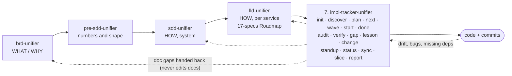

# impl-tracker-unifier

Stage 7 of the suite: tracks implementation against the BRD, SDD and LLD. It acts as the Developer / software engineer (Software Development & Delivery) in the unifier company. Entry point: [SKILL.md](SKILL.md). Below are the design decisions behind it.

## Where it sits in the chain

**Summary:** the tracker is the seventh stage: in the chain it comes after SoW, BRD, Pre-SDD, SDD and LLD. It reads the BRD, SDD and LLD, never edits them, and owns
only `./tracking/`. A doc problem nobody has decided yet goes back to the owning skill as a gap row, the same way the
review panel hands points to the authoring skills. A change that is decided runs the owning skills in chain order in the same change, before its code reaches In review: up the chain when it starts at the code or the LLD, down the chain when it starts at the BRD, and both ways when it starts at the SDD (up to the BRD when a business rule changes, down to each child LLD), and always ending with the tracker's own `sync` (and `plan` for new scope). See `SKILL.md` § Documents chain.
The tracker also writes its own row on the shared status board, `unifier-status.md` in the docs root, through
the `Board` path that `init` records in `tracking/config.md`. It also raises a handoff request on the board for each doc gap it routes to an owning skill (`SKILL.md` § The tracker's board row).

## Why a custom skill instead of Spec Kit / Task Master / Backlog.md

| Need | Spec Kit | Task Master | Backlog.md | This skill |
|---|---|---|---|---|
| Uses your keyed IDs (`AUTOAPPLY/UC-23`, `AC-3`, `MK-02`, `TC-SND-01`) | No | No | No | Yes: the task ID *is* keyed the same way |
| Splits from LLD workflow blocks + SDD §7.3, not from a free PRD | No | No | No | Yes |
| "Why this way" per task, linked to LLD §7.4 pattern / ADR | Partly | No | No | Yes |
| Hard block when dependencies aren't done | No | Soft | Soft | Hard, with a written override |
| Prevents building the same thing twice | No | No | No | Yes: ownership index (`ownership.md`) |
| Gap register + doc drift after a BRD/LLD version bump | No | No | No | Yes |
| Daily standup with agent attribution | No | No | No | Yes |
| Token cost per command | High | Medium | Low | Low: each command has a fixed read budget |

## The core idea in five rules

1. **One name everywhere.** The feature key is the BRD key (`AUTOAPPLY`, `RESUME`, `INTERVIEW`, `PLATFORM`).
   Tasks are `AUTOAPPLY/T-014`, gaps `AUTOAPPLY/GAP-007`. Every task cites the keyed UC/AC it realises
   and the LLD/SDD anchor it implements. Commits carry `Task: AUTOAPPLY/T-014`.
2. **The LLD is the plan; the tracker is the ledger.** Tasks are derived from LLD units (workflow blocks,
   §7.2 classes, migrations, API contracts, events, screens, e2e specs) grouped by the LLD 17-specs
   Roadmap phases. The tracker adds order, ownership, status and evidence, never new design.
3. **No start without ready dependencies.** `start` refuses when any `depends_on` task is not `Done` or `Verified`.
   The only way past is an explicit user override, recorded as a gap.
4. **No double build.** Every task declares what it *owns* (classes, tables, endpoints, screens, files).
   An ownership index rejects a second task owning the same thing, and `start` greps the code for it.
5. **Files are the truth, chat is not.** Every state change is written to disk immediately, so any agent
   (Claude, Codex, Kimi, a human) picks up from the files alone.

## Where the files live

**Recommended: in the code repo**, folder `./tracking/`, committed with the code. Reason: task status and
code change in the same commit, so they can't drift. The docs stay in their own repo (for example `../chagaf-platform` in the `templates.md` config example); the tracker
links to them by relative path and records the doc **versions** it planned against (baseline), so a
later BRD/LLD bump is detected by `sync`.

If code and docs are the same repo, `./tracking/` sits at its root. A separate central repo is only
worth it when several products share one tracker (not now).

## Token budget (why it stays cheap)

- Sub-agents only where they buy independence: the auditor in `done`/`audit` (one per task, fresh
  context), the design-check reviewer in `start` (risk `high` only), and `plan deep` (opt-in). A pre-flight script runs the mechanical checks first, so the
  auditor's tokens go to judgement, not to greps.
- Each command names the exact files it may read (`SKILL.md` § Read budget per command). `next`, `start`, `status`
  read the small index files only, never the BRD.

## Files in this skill

| File | Contents |
|---|---|
| `SKILL.md` | Commands, workflow per command, rules, documents chain, board row, quality checks |
| `templates.md` | Templates for every file written in `./tracking/` |
| `task-splitting.md` | How LLD units become tasks, sizing, dependencies, risk, the "why" rules |
| `status-rules.md` | Task states, legal transitions, blocking and override |
| `gap-rules.md` | Gap types, severity, owner routing, closing |
| `sync-and-drift.md` | Doc-version baseline, stale detection, code-ownership checks |
| `discovery-rules.md` | Inventory of existing code, matching it to LLD units, Adopted status |
| `slice-rules.md` | Slice mode: end-to-end slices, order, delivery gate, manager report |
| `lessons-rules.md` | Lessons, recall, promotion, the change log |
| `audit-rules.md` | The fresh auditor, layer matrix, verdicts, clean export, Stop hook |
| `scripts/` | `preflight.py` (mechanical checks before any audit) and `history.py` (builds `tracking/history.md` from recorded facts) |
| `hooks/` | `stop-audit-guard.js`, an optional Claude Code Stop hook that blocks ending a turn while a task is In review without a passing audit |
