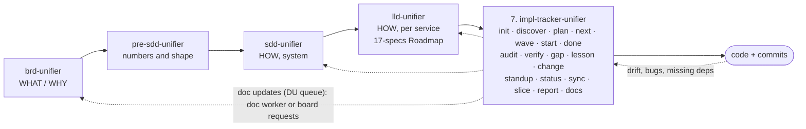

# impl-tracker-unifier

Stage 7 of the suite: tracks implementation against the BRD, SDD and LLD. It acts as the Developer / software engineer (Software Development & Delivery) in the unifier company. Entry point: [SKILL.md](SKILL.md). Below are the design decisions behind it.

## Where it sits in the chain

**Summary:** the tracker is the seventh stage: in the chain it comes after SoW, BRD, Pre-SDD, SDD and LLD. It reads the BRD, SDD and LLD, never edits them itself, and owns
only `./tracking/`. Every doc point it finds becomes a gap row and a doc update (DU, `KEY/DU-NNN` in
`tracking/doc-updates.md`): triaged to the docs it affects (LLD only, or SDD, BRD, SoW too), applied top-down,
checked by a fresh verifier, then synced, so the docs stay consistent with the code (`doc-impact-rules.md`).
The DU queue is the tracker's only route for a doc change, in one of two run modes (the board's Run mode line):

- `solo` (one session can edit the docs): a background doc worker applies each DU through the owning skill's own
  row (`Decided change` for a DU decided by a CHG, `Doc gap` for a DU that needs an owner's decision), so that
  skill's delta review, `Review:` stamp and documents-chain hops run inside the worker.
- `team` (another employee owns the doc folder): the worker does not edit. The tracker raises the board request
  on the shared status board, `unifier-status.md` in the docs root (the `Board` path in `tracking/config.md`):
  `Decided change <KEY>/CHG-NNN (DU-NNN): 
` or `Doc gap <KEY>/GAP-NNN (DU-NNN): <question>`. The DU
  state follows the request: `Running` while it is open, `Applied` when it is Done (with a version, or with
  `No change`, for the verifier to confirm), `Rejected` only when it is Declined with no other owner named.

Either way the tracker starts only the first hop. The owning skill carries the change up or down the chain, every
next-hop request keeps the CHG and DU IDs, and the tracker reads each request carrying them to fill the CHG
Follow-up and the DU state. See `SKILL.md` § Documents chain and § The tracker's board row. The tracker also
writes its own row on that board.

## Why a custom skill instead of Spec Kit / Task Master / Backlog.md

| Need | Spec Kit | Task Master | Backlog.md | This skill |
|---|---|---|---|---|
| Uses your keyed IDs (`AUTOAPPLY/UC-23`, `AC-3`, `MK-02`, `TC-SND-01`) | No | No | No | Yes: the task ID *is* keyed the same way |
| Splits from LLD workflow blocks + SDD §7.3, not from a free PRD | No | No | No | Yes |
| "Why this way" per task, linked to LLD §7.4 pattern / ADR | Partly | No | No | Yes |
| Hard block when dependencies aren't done | No | Soft | Soft | Hard, with a written override |
| Prevents building the same thing twice | No | No | No | Yes: ownership index (`ownership.md`) |
| Gap register + doc drift after a BRD/LLD version bump | No | No | No | Yes |
| Daily standup with agent attribution | No | No | No | Yes |
| Token cost per command | High | Medium | Low | Low: each command has a fixed read budget |

## The core idea in five rules

1. **One name everywhere.** The feature key is the BRD key (`AUTOAPPLY`, `RESUME`, `INTERVIEW`, `PLATFORM`).
   Tasks are `AUTOAPPLY/T-014`, gaps `AUTOAPPLY/GAP-007`. Every task cites the keyed UC/AC it realises
   and the LLD/SDD anchor it implements. Commits carry `Task: AUTOAPPLY/T-014`.
2. **The LLD is the plan; the tracker is the ledger.** Tasks are derived from LLD units (workflow blocks,
   §7.2 classes, migrations, API contracts, events, screens, e2e specs, and every other buildable unit kind
   in `task-splitting.md`'s unit map: filters, limiters, masking, probes, route guards, interim components)
   grouped by the LLD 17-specs Roadmap phases. The plan's coverage check proves each unit has a task; a unit
   with no LLD home is a `plan-gap` for `lld-unifier`. Slices stay with the tracker: their order lives in
   `tracking/config.md` § Slices, which `lld-unifier` reads for its build columns. The tracker adds order,
   ownership, status and evidence, never new design.
3. **No start without ready dependencies.** `start` refuses when any `depends_on` task is not `Done` or `Verified`.
   The only way past is an explicit user override, recorded as a gap.
4. **No double build.** Every task declares what it *owns* (classes, tables, endpoints, screens, files).
   An ownership index rejects a second task owning the same thing, and `start` greps the code for it.
5. **Files are the truth, chat is not.** Every state change is written to disk immediately, so any agent
   (Claude, Codex, Kimi, a human) picks up from the files alone.

## Where the files live

**Recommended: in the code repo**, folder `./tracking/`, committed with the code. Reason: task status and
code change in the same commit, so they can't drift. The docs stay in their own repo; the tracker
links to them by relative path and records the doc **versions** it planned against (baseline), so a
later BRD/LLD bump is detected by `sync`.

If code and docs are the same repo, `./tracking/` sits at its root. A separate central repo is only
worth it when several products share one tracker (not now).

## Token budget (why it stays cheap)

- Sub-agents only where they buy independence: the auditor in `done`/`audit` (one per task, fresh
  context), the design-check reviewer in `start` (risk `high` only), the doc worker and its fresh verifier
  (background, one at a time, `doc-impact-rules.md`), and `plan deep` (opt-in). A pre-flight script runs the mechanical checks first, so the
  auditor's tokens go to judgement, not to greps.
- Each command names the exact files it may read (`SKILL.md` § Read budget per command). `next`, `start`, `status`
  read the small index files only, never the BRD.

## Files in this skill

| File | Contents |
|---|---|
| `SKILL.md` | Commands, workflow per command, rules, documents chain, board row, quality checks |
| `templates.md` | Templates for every file written in `./tracking/` |
| `task-splitting.md` | How LLD units become tasks (the unit map covers every buildable unit kind), sizing, dependencies, risk, the "why" rules |
| `status-rules.md` | Task states, legal transitions, blocking and override |
| `gap-rules.md` | Gap types, severity, owner routing, closing |
| `sync-and-drift.md` | Doc-version baseline, stale detection, code-ownership checks |
| `discovery-rules.md` | Inventory of existing code, matching it to LLD units, Adopted status |
| `doc-impact-rules.md` | Doc updates: triggers, code-or-doc decision, impact level, queue, doc worker, team run mode, verifier, sync, gates |
| `slice-rules.md` | Slice mode: end-to-end slices, order (its one home is `tracking/config.md` § Slices), delivery gate, manager report |
| `lessons-rules.md` | Lessons, recall, promotion, the change log |
| `audit-rules.md` | The fresh auditor, layer matrix, verdicts, clean export, Stop hook |
| `scripts/` | `preflight.py` (mechanical checks before any audit) and `history.py` (builds `tracking/history.md` from recorded facts) |
| `hooks/` | `stop-audit-guard.js`, an optional Claude Code Stop hook that blocks ending a turn while a task is In review without a passing audit; `post-commit-lint.sh`, an optional git post-commit hook that lints the commit's task |
