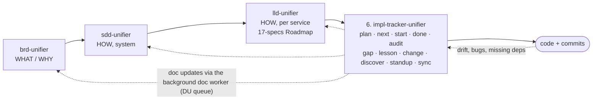

# impl-tracker-unifier

Stage 6 of the suite: tracks implementation against the BRD, SDD and LLD. Entry point: [SKILL.md](SKILL.md). Below are the design decisions behind it.

## Where it sits in the chain

**Summary:** the tracker is the sixth stage. It reads the BRD, SDD and LLD, never edits them itself, and owns
only `./tracking/`. Every doc point it finds becomes a gap row and a doc update (DU): triaged to the docs it
affects (LLD only, or SDD, BRD, SoW too), applied in the background by a separate doc worker, checked by a
fresh verifier, then synced, so the docs stay consistent with the code (doc-impact-rules.md).

## Why a custom skill instead of Spec Kit / Task Master / Backlog.md

| Need | Spec Kit | Task Master | Backlog.md | This skill |
|---|---|---|---|---|
| Uses your keyed IDs (`AUTOAPPLY/UC-23`, `AC-3`, `MK-02`, `TC-SND-01`) | No | No | No | Yes — the task ID *is* keyed the same way |
| Splits from LLD workflow blocks + SDD §7.3, not from a free PRD | No | No | No | Yes |
| "Why this way" per task, linked to LLD §7.4 pattern / ADR | Partly | No | No | Yes |
| Hard block when dependencies aren't done | No | Soft | Soft | Hard, with a written override |
| Prevents building the same thing twice | No | No | No | Yes — ownership index (§ C4) |
| Gap register + doc drift after a BRD/LLD version bump | No | No | No | Yes |
| Daily standup with agent attribution | No | No | No | Yes |
| Token cost per command | High | Medium | Low | Low — each command has a fixed read budget |

## The core idea in five rules

1. **One name everywhere.** The feature key is the BRD key (`AUTOAPPLY`, `RESUME`, `INTERVIEW`, `PLATFORM`).
   Tasks are `AUTOAPPLY/T-014`, gaps `AUTOAPPLY/GAP-007`. Every task cites the keyed UC/AC it realises
   and the LLD/SDD anchor it implements. Commits carry `Task: AUTOAPPLY/T-014`.
2. **The LLD is the plan; the tracker is the ledger.** Tasks are derived from LLD units (workflow blocks,
   §7.2 classes, migrations, API contracts, events, screens, e2e specs) grouped by the LLD 17-specs
   Roadmap phases. The tracker adds order, ownership, status and evidence — never new design.
3. **No start without ready dependencies.** `start` refuses when any `depends_on` task is not `Done`.
   The only way past is an explicit user override, recorded as a gap.
4. **No double build.** Every task declares what it *owns* (classes, tables, endpoints, screens, files).
   An ownership index rejects a second task owning the same thing, and `start` greps the code for it.
5. **Files are the truth, chat is not.** Every state change is written to disk immediately, so any agent
   (Claude, Codex, Kimi, a human) picks up from the files alone.

## Where the files live

**Recommended: in the code repo**, folder `./tracking/`, committed with the code. Reason: task status and
code change in the same commit, so they can't drift. The docs stay in `chagaf-platform`; the tracker
links to them by relative path and records the doc **versions** it planned against (baseline), so a
later BRD/LLD bump is detected by `sync`.

If code and docs are the same repo, `./tracking/` sits at its root. A separate central repo is only
worth it when several products share one tracker — not now.

## Token budget (why it stays cheap)

- Sub-agents only where they buy independence: the auditor in `done`/`audit` (one per task, fresh
  context) and `plan deep` (opt-in). A pre-flight script runs the mechanical checks first, so the
  auditor's tokens go to judgement, not to greps.
- Each command names the exact files it may read (§ B5 Read budget). `next`, `start`, `status`
  read the small index files only — never the BRD.
