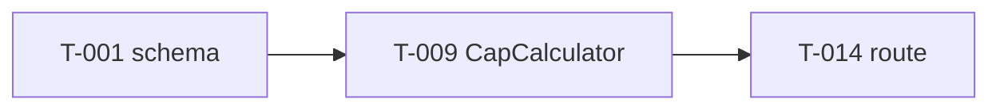

# Templates

Exact templates for every file the skill writes in `./tracking/`. Replace `<rel>` with the relative path from the written file to the doc heading.

## `tracking/config.md`

~~~markdown
# Tracking config

| Key | Value |
|---|---|
| Code root | . |
| Docs root | ../chagaf-platform |
| Board | ../chagaf-platform/unifier-status.md |
| Current phase | AUTOAPPLY: P1 |
| Commit trailer | Task: <KEY/T-NNN>; tracking-only commits of no single task: Tracking: <reason> |

## Audit checks

| Check | Command | Layer |
|---|---|---|
| Migrations valid | <e.g. ./mvnw flyway:validate> | db |
| API spec diff | <e.g. oasdiff breaking api/openapi.yaml build/openapi.yaml> | api |
| Frontend types | <e.g. npx tsc --noEmit> | ui |
| Log/security rules | <e.g. semgrep --config .semgrep/> | logs, security |

## Preflight

| Item | Value |
|---|---|
| Compose file | <e.g. docker-compose.yml, or -> |

## Preflight suites

| Suite | Command | Reports | Required when |
|---|---|---|---|
| backend | <e.g. cd api && mvn -B -q clean test> | <e.g. api/target/surefire-reports/TEST-*.xml> | paths: api/ |
| frontend-app | <e.g. cd web && npx ng test app --watch=false --reporters=junit --output-file=test-results/app.xml> | <e.g. web/test-results/app.xml> | paths: web/ |
| frontend-admin | <e.g. cd web && npx ng test admin --watch=false --reporters=junit --output-file=test-results/admin.xml> | <e.g. web/test-results/admin.xml> | paths: web/ |

Prefer `paths:` over `always`, so a suite runs only when its own code changed; `paths: web/; not: web/e2e/` excludes prefixes (e2e specs never re-run the unit suites). Required suites run in parallel, so no two suites share a build directory or a report file (pre-flight
deletes each suite's `Reports` matches before its run). Split independent projects (two Angular apps) into
their own rows so they run side by side.

## Verify worktree

| Item | Value |
|---|---|
| Path | <e.g. ../verify: a permanent `git worktree add --detach`, outside the checkout the IDE runs; or -> |

Pre-flight runs here, never in the checkout the user runs from the IDE. Move it to the head before each
pre-flight; only dependency folders survive, so installs run only when the lock file changed:

```bash
V=<path>; H=<task head sha>; OLD=$(git -C "$V" rev-parse HEAD)
git -C "$V" clean -ffdx -e '**/node_modules'   # first: a report left from the last run would block the checkout
git -C "$V" checkout --detach "$H" && test "$(git -C "$V" rev-parse HEAD)" = "$(git rev-parse "$H")"
git -C "$V" diff --quiet "$OLD" "$H" -- '*package-lock.json' || (cd "$V/<frontend dir>" && npm ci)
```

Copy `tracking/<KEY>/preflight/<T-NNN>-<sha>.md` back into the main tracking folder before committing it.

## Delivery

| Item | Value |
|---|---|
| Push after Done | ask, or `auto (user: "<quote>", <date>)`: push once after each wave's last Done task, only when `--push-check` passes |

## Slices (slice mode only)

| Key | Order | Current |
|---|---|---|
| PLATFORM | S-01, S-03, S-05, S-06 (user: "<quote>", <date>) | S-01 |

`auto` is valid only as `auto (user: "<quote>", <date>)`, written when the user says so in chat; any other
value means ask.

## Standing rules (promoted lessons)

| Lesson | Rule | Check |
|---|---|---|

## Features

| Key | BRD master | SDD §7.3 | LLD master | LLD 04-implementation | Baseline (BRD / SDD / LLD) | Mode |
|---|---|---|---|---|---|---|
| AUTOAPPLY | features/job-manager/brd-chagaf-autoapply/chagaf-autoapply-brd-master.md | tech/sdd-chagaf-platform/03-users-and-use-cases.md#73-… | tech/lld-chagaf-autoapply/chagaf-autoapply-lld-master.md | tech/lld-chagaf-autoapply/04-implementation/autoapply.md | v1.3 / vX / v1.4 | layer |
~~~

## `tracking/index.md` (generated, one line per task)

~~~markdown
| ID | Title | Phase | Slice | Layer | Status | depends_on | UC | Agent | Updated |
|---|---|---|---|---|---|---|---|---|---|
| AUTOAPPLY/T-001 | Flyway: autoapply schema baseline | P1 | - | data | Done | - | - | codex | 2026-10-18 |
| AUTOAPPLY/T-014 | RoutingServiceImpl.route (Review only) | P2 | - | domain | Planned | T-009, T-011 | UC-23 | - | 2026-10-19 |

Slice is `-` for keys in layer mode. In slice mode, a second table follows: `| Slice | Order | Title | Status | Tasks done / total | Delivered |`.
~~~

## Task card `tracking/AUTOAPPLY/tasks/T-014-routing-service-route.md`

~~~markdown
# AUTOAPPLY/T-014: RoutingServiceImpl.route (Review mode)

| Field | Value |
|---|---|
| Status | Planned |
| Phase / Layer | P2 Review mode / domain |
| Slice | - (slice mode: `KEY/S-NN` title) |
| depends_on | AUTOAPPLY/T-009 (CapCalculator), AUTOAPPLY/T-011 (match repository) |
| Unblocks | AUTOAPPLY/T-017, AUTOAPPLY/T-022 |
| Size | M (one session) |
| Risk | high (concurrency: send-record claim) |
| Agent / started / finished | - |
| Start commit | - |
| Layers to touch | api (LLD 6.2) · db (LLD 5.1) · logs (LLD 11.3) |

## Goal
Route a new match to Quick Review or drop it, per Review-mode rules.

## Realises
- [AUTOAPPLY/UC-23](<rel>#uc-23-route-a-new-match) steps 1-4; AC-1: score at threshold approves; A1: review queue full
- Test cases: [AUTOAPPLY/TC-RTE-01](<rel>), [AUTOAPPLY/TC-RTE-03](<rel>)

## Implements (LLD / SDD)
- [LLD 7.3 `RoutingServiceImpl.route`](<rel>#routingserviceimplroute)
- [LLD 7.4 Pattern: Chain of Responsibility](<rel>#pattern-chain-of-responsibility-posting-filters)
- [SDD 13e autoapply service](<rel>)

## Why this way
- Chain of Responsibility because the LLD fixes filter order and each filter can stop routing (LLD 7.4).
- Hybrid/Auto branches are **not** built here: they ship in P5/P6 behind the per-mode release switch
  (LLD 17-specs Roadmap); building them now would be built twice.

## Owns
- class `RoutingServiceImpl`, interface `RoutingService`
- file `autoapply/src/main/java/.../routing/RoutingServiceImpl.java`

## Touches (files outside Owns this task may change, with the reason)
- `autoapply-api/pom.xml`: adds the AWS SDK dependency this task needs

## Definition of done
- [ ] Owned items exist; ArchUnit rules pass
- [ ] Unit tests named in LLD 16.2 for UC-23 written and green
- [ ] Commit(s) carry `Task: AUTOAPPLY/T-014`

## Tests
- `route_hybridScoreEqualsThreshold_approves`: AUTOAPPLY/UC-23 AC (LLD 16.2)
- `route_reviewQueueFull_doesNotKeepMatch`: AUTOAPPLY/UC-23 A1

## Lessons that apply (filled by start)
- L-004: Always add a migration with any entity field change. Check: diff has `db/migration/V*.sql`

## Evidence (filled by done/verify)
| Date | Agent | Commits | Tests | Audit | Note |
|---|---|---|---|---|---|

## History
| Date | Agent | From → To | Reason |
|---|---|---|---|
| 2026-10-19 | claude-opus-5-5 | - → Planned | plan AUTOAPPLY/P2 |
~~~

## `tracking/AUTOAPPLY/plan.md`

~~~markdown
# AUTOAPPLY implementation plan

**Baseline:** BRD v1.3 · SDD vX · LLD v1.4 · planned 2026-10-19 by <agent>
**Scope:** P1-P2

## Phases
| Phase | Tasks | UCs | Status |
|---|---|---|---|

## Slices (slice mode; replaces Phases as the build order)
| Order | Slice | Use cases | Tasks | High risk | Demo |
|---|---|---|---|---|---|

## Dependency graph


## Coverage
| UC | ACs | Tasks | e2e spec | Exists (Match / Partial / Missing) | Covered? |
|---|---|---|---|---|---|

## Planning decisions (local, decided by the tracker)
| # | Decision | Reason |
|---|---|---|
~~~

## Slice card `tracking/PLATFORM/slices/S-01-create-account-and-sign-in.md`

~~~markdown
# PLATFORM/S-01: Create account and sign in, end to end

| Field | Value |
|---|---|
| Status | Planned |
| Order | 1 (config.md § Slices) |
| Use cases | [RESUME/UC-01](<rel>#uc-01-create-an-account-and-sign-in) |
| Tasks | PLATFORM/T-001, PLATFORM/T-002, … (n) |
| E2E specs | `e2e/resume-uc-01-create-an-account-and-sign-in.spec.ts` |
| Delivered | - |

## Demo
A new visitor creates an account, verifies the email and signs in to the home page.

## Out of scope (later slices or follow-ups)
- …

## Delivery evidence (filled by slice deliver)
| Check | Result | Link |
|---|---|---|

## History
| Date | Agent | Change |
|---|---|---|
~~~

## `tracking/journal/report-2026-10-21.md` (report)

~~~markdown
# Delivery report: 2026-10-21

**Delivered:** Create account and sign in (2026-10-21): a new visitor creates an account, verifies and signs in.
**In progress:** Admin portal: first Super Admin and admin sign-in (3 of 5 tasks done).
**Next:** Home hub and landing page; Upload CV from my computer.
**Blockers:** none.
~~~

## `tracking/gaps.md`

~~~markdown
| ID | Type | Severity | Found (date, agent, during) | Where (doc anchor / code) | Description | Owner | Fix task | Status |
|---|---|---|---|---|---|---|---|---|
| AUTOAPPLY/GAP-003 | doc-gap | major | 2026-10-19, codex, T-014 | LLD 7.3 route | Tie on score not defined | lld-unifier | - | Open |
~~~

## `tracking/ownership.md` (generated)

~~~markdown
| Item | Kind | Owner task | Status |
|---|---|---|---|
| RoutingServiceImpl | class | AUTOAPPLY/T-014 | Planned |
| autoapply.match | table | AUTOAPPLY/T-003 | Done |
| POST /api/autoapply/profile/mode | endpoint | AUTOAPPLY/T-030 | Planned |
~~~

## `tracking/journal/2026-10-19.md`

~~~markdown
# Standup 2026-10-19

## Done since 2026-10-18
- AUTOAPPLY/T-009 CapCalculator · codex · 3 commits · unblocked T-014, T-015

## In progress
- AUTOAPPLY/T-011 · claude-opus-5-5 · since 2026-10-18

## Next
1. AUTOAPPLY/T-014: critical path, unblocks 2
2. AUTOAPPLY/T-015

## Blockers
- T-020 waits on T-011 (in progress)

## Gaps
- New: AUTOAPPLY/GAP-003 (doc-gap, major) → lld-unifier
- Closed: none

## Untracked commits
- a1b2c3d "fix mail parser": no Task trailer → which task?

## Needs your decision
- GAP-003: tie-breaking rule on equal scores
~~~

## `tracking/inventory.md` (generated)

~~~markdown
# Code inventory: 2026-10-19 (stack: Spring Boot + Next.js)

| Kind | Name | File:line | First / last commit | Key guess | Claimed by |
|---|---|---|---|---|---|
| endpoint | POST /api/autoapply/profile/mode | ProfileController.java:42 | a1b2c3d 2026-09-02 / f4e5d6c 2026-10-01 | AUTOAPPLY | AUTOAPPLY/T-030 (Adopted) |
| screen | /autoapply/review | web/app/autoapply/review/page.tsx:1 | … | AUTOAPPLY | AUTOAPPLY/T-033 (Partial) |
| migration | V007__match.sql | db/migration/V007__match.sql | … | AUTOAPPLY | - → GAP-011 untracked-code |
~~~

## `tracking/lessons.md`

~~~markdown
| ID | State | Trigger | Root cause | Rule | Check | Scope (layer · key · tags) | Hits | Source | Updated |
|---|---|---|---|---|---|---|---|---|---|
| L-004 | Promoted-DoD | AUTOAPPLY/T-014 audit-1: entity field added, no migration | skipped-layer | Always add a Flyway migration in the same task as any new/changed @Entity field | `git diff --name-only <start>..HEAD` has `db/migration/V*.sql` when it has `*Entity.java` | db · * · entity, migration | 2 | T-014 audit-1, T-022 audit-1 (recurred) | 2026-10-19 |
~~~

## `tracking/changes.md`

~~~markdown
| ID | Date | What changed (from → to) | Decided by | Why | Affected | Supersedes | Follow-up | Status |
|---|---|---|---|---|---|---|---|---|
| CHG-002 | 2026-10-19 | Score threshold per user → per mode | user: "make it per mode" | Hybrid needs its own bar | T-014 (Done-stale), table autoapply.profile | Plan decision #3, L-002 | T-041 rework; LLD v1.5 (lld-unifier); SDD and BRD: no change, neither states the threshold | Active |
~~~

## Audit report `tracking/AUTOAPPLY/audits/T-014-audit-1.md`

~~~markdown
# AUTOAPPLY/T-014 audit 1: FAIL

Auditor: <agent/model> · risk <low|high> · 2026-10-19 · commits <shas> · export <head>
Pre-flight: [T-014-<sha>.md](../preflight/T-014-<sha>.md) · auditor verdict <as written> · recomputed <verdict>
Tests: <full run in export | reused pre-flight <file> (tree = head) + ran <classes>> · Scope: <full | delta of audit-<n>> · Export: <fresh | reused, clean, HEAD = <sha>>

## Layers
| Layer | Applies | Result | Evidence |
|---|---|---|---|
| API | yes | pass | RoutingController.java:41 matches LLD 6.2 |
| DB | yes | FAIL | MatchEntity.java:58 new `routedAt`; no migration in diff |
| Frontend | no | n/a | no UI in LLD 14 for UC-23 steps 1-4 |
| Logs / audit | yes | FAIL | LLD 11.3 requires `match.routed` event; not emitted |
| Security | yes | pass | … |
| Tests | yes | pass | 2/2 green |
| Lessons | yes | FAIL | L-004 violated |

## Trace (UC-23 step 2)
UI: n/a → DTO RouteRequest.java:12 → RoutingServiceImpl.java:77 → MatchEntity.java:58 → **migration missing** → log **missing**

## Findings
| # | Layer | Severity | Expected | Actual | Fix | Gap |
|---|---|---|---|---|---|---|
| 1 | db | blocker | LLD 5.1 match.routed_at | no V*.sql | add V014__match_routed_at.sql | GAP-008 layer-miss |

## Lesson candidates
- skipped-layer · (recurrence of L-004)
~~~

## Agent rules block (added to the code repo's AGENTS.md / CLAUDE.md)

~~~markdown
## Implementation tracking

- Before coding, run `impl-tracker-unifier next` (or read `tracking/index.md`). Work only on a task that is
  `In progress` under your name. Never start a task whose depends_on are not Done.
- Build only what the task's **Owns** lists. Need something else → it's another task or a gap.
- Every commit ends with exactly one `Task: <KEY/T-NNN>` trailer; never two tasks in one commit.
- Change files outside the task's **Owns** only when the card lists them under `## Touches`.
- Before coding, read the brief's **Lessons that apply** and **Layers to touch**; touch every layer listed
  (API, DB migration, UI, logs/audit trail) or say why not.
- Never call a task done yourself: `done` runs pre-flight, then an independent audit; only a PASS makes
  it Done.
- Push only when the user said so, or `config.md` § Delivery reads `auto (user: "…")` and the push check
  passes.
- The user corrects you or changes direction → `impl-tracker-unifier lesson` / `change` before continuing.
- Finished → `impl-tracker-unifier done <id>`. Found a bug, missing rule, or doc conflict →
  `impl-tracker-unifier gap`. Never edit BRD/SDD/LLD to make code fit.
~~~

## `tracking/checks.json` (every Active lesson needs an entry; pre-flight runs them)

~~~json
[
  {"id": "no-env-skips", "lessons": ["L-003"], "keys": ["*"], "description": "no Testcontainers opt-out",
   "cmd": "grep -rn disabledWithoutDocker api/src/test", "paths": ["api/src/test"], "expect": "empty"},
  {"id": "clean-tree", "lessons": ["L-011"], "builtin": "P1"},
  {"id": "cache-concurrency", "lessons": ["L-007"], "judgement": "each cache has a concurrent test asserting its limits"}
]
~~~
`expect`: `empty` = the command prints nothing and exits 0 or 1; `exit0` = the command exits 0. Commands run
with bash (`set -o pipefail`) from the code root; exit ≥ 2 is an error; `2>/dev/null` is refused;
`paths` must exist. `builtin`: `P1` clean tree, `P5` tests, `P6` local stack.
