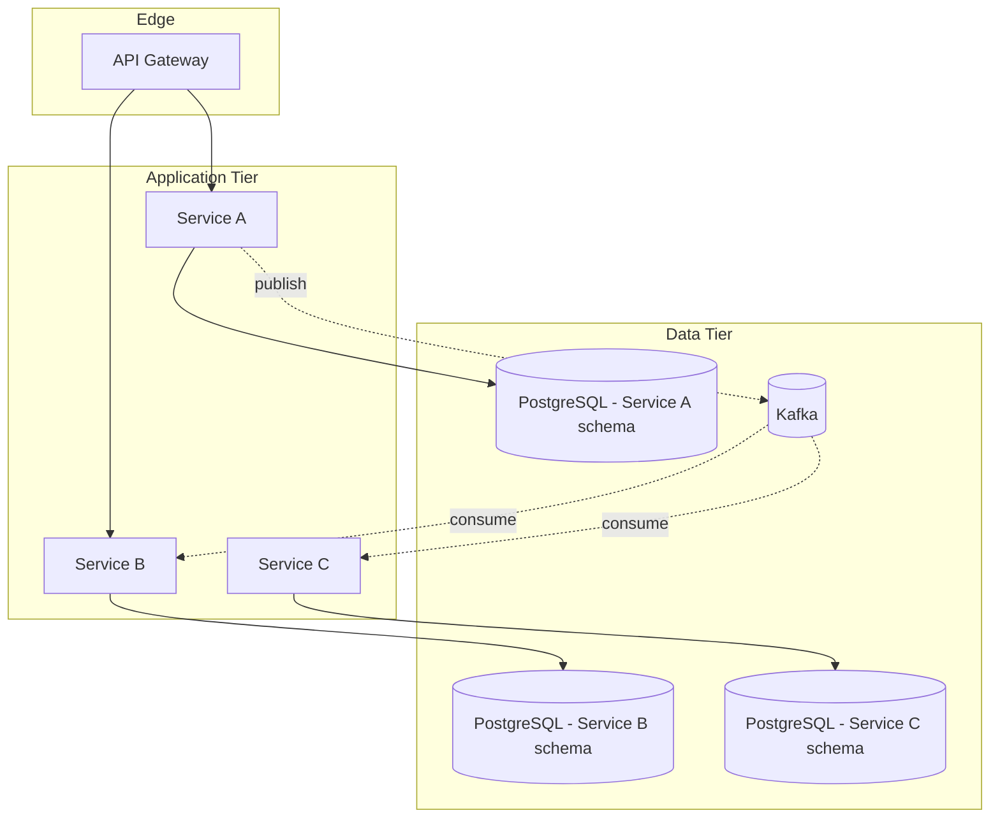

<!--
CHUNK: 03
TITLE: Architecture Overview - Components & Deployment
PROJECT: [Project Name]
VERSION: [X.X]
PART OF: LLD - [Project Name]
-->

# 6. Architecture Overview

> **Note:** this chunk is a high-level orientation. Per-service detail lives in `04-implementation/<service>.md`. If you need class-level or method-level detail, jump straight there.

## 6.1 Component Topology

**Summary:** [1-2 sentences: the components and the load-bearing connections.]

> Miro: [optional whiteboard view URL]

## 6.2 Deployment Topology

| Concern | Choice | Source / Rationale |
|---------|--------|--------------------|
| Container | Docker (one image per deployable: each service, or the single deployable of a modular monolith) | [SDD §8.6](../sdd-[sdd-slug]/05a-infrastructure-and-network.md#86-infrastructure-architecture) deployables; SDD §8.1 style / CLAUDE.md default |
| Orchestrator | Kubernetes (Helm chart per deployable) | [SDD §8.6](../sdd-[sdd-slug]/05a-infrastructure-and-network.md#86-infrastructure-architecture) deployment target / CLAUDE.md default |
| Namespace strategy | [Per-environment / Per-tenant / Hybrid] | [SDD §8.6 / §11.3 / §19 if applicable] |
| Service mesh / Ingress | [Istio / Linkerd / NGINX Ingress / API Gateway alone] | [[SDD §8.7](../sdd-[sdd-slug]/05a-infrastructure-and-network.md#87-network-architecture) ingress path and mTLS / SDD §6 if applicable] |
| Replicas (per deployable, baseline) | [N min / M max] | [SDD §17.X Deployment Strategy if applicable] |
| Deployment strategy | [Rolling / Blue-Green / Canary] | [Per-service overrides in `04-implementation/<svc>.md`] |

> **Convention:** a Source cell links the SDD §8.6 or §8.7 part it implements; with no SDD, or an SDD written before chunk 05a, it names §6, §11.3, §19, or §17.X as before. A value that differs is drift to flag (`sdd-to-lld.md` § One fact, one home, rule 3).

## 6.2a Process and Profile Wiring

> **Inherits from:** the § 6.2 deployables and the style SDD ADR-01 records (§ 6.4).
>
> **What this section adds:** the one home for "what loads in which runtime role". A runtime role is a process, a profile (for example a Spring profile), or a one-off command of a deployable. `04-implementation/<service>.md`, `09-cross-cutting.md` and `10-operations.md` cite the role here and never restate it.

<!-- Required when SDD ADR-01 is a modular monolith or hybrid core, or whenever one image runs several processes or profiles (for example a web and a worker command of one image). Otherwise one row per deployable is enough, naming its single role. From code with no SDD: read the style from § 6.4, and the roles from the profile files, the launch commands and the conditional wiring. -->

### Runtime Roles

| Role | Deployable | Kind | Filters (in order) | Scheduled jobs | Runners | Listeners | Adapter set | Port bindings | Source |
|------|------------|------|--------------------|----------------|---------|-----------|-------------|---------------|--------|
| `[api]` | `[image]` | Long-running | `1 [CorrelationIdFilter]`, `2 [TenantFilter]`, `3 [BodyLimitFilter]` | None | None | None | Real | `[FooPort]` -> `[FooPortAdapter]` | [SDD §8.6 / `code (<file>:<line>)` / LLD] |
| `[worker]` | `[image]` | Long-running | None | `[OutboxPublisher]`, `[LeaseReaper]` | None | `[FooEventListener]` | Real | `[FooPort]` -> `[FooPortAdapter]` | [SDD §8.6 / `code (<file>:<line>)` / LLD] |
| `[migrate]` | `[image]` | One-off | None | None | `[MigrationRunner]` | None | None | None | [SDD §8.6 / `code (<file>:<line>)` / LLD] |
| `[setup]` | `[image]` | One-off | None | None | `[SetupRunner]` | None | Real | None | [SDD §8.6 / `code (<file>:<line>)` / LLD] |
| `[demo]` | `[image]` | Long-running | Same as `[api]` | None | `[DemoSeedRunner]` | None | Demo / stub | `[FooPort]` -> `[FooPortStub]` | [SDD §8.6 / `code (<file>:<line>)` / LLD] |

> **Convention:** every filter, scheduled job, runner, listener and adapter that 04 § 7.2, 09 or 10 names appears here, in exactly the roles that load it. A component in no role is never built; a role that 09 or 10 states differently is drift to fix in one place. Filters are numbered in execution order; 09 states what each filter does and cites this order. A cell with nothing to load reads `None`, never blank.

### One-off Commands

| Command | Role | Arguments | Exit behaviour | Waited on by |
|---------|------|-----------|----------------|--------------|
| `[migrate]` | `[migrate]` | `[none]` | `[0 on success; non-zero on a failed migration, with no partial version left applied]` | `[api and worker start only after it exits 0, for example an init container or a pre-upgrade hook]` |
| `[setup]` | `[setup]` | `[--tenant=<slug> --admin-email=<email>]` | `[0 when done or already done (idempotent); 2 on invalid arguments]` | `[Nothing; an operator runs it once per environment]` |

> **Convention:** each argument is written with its exact format. A command that is safe to run twice says so in Exit behaviour. With no one-off command, write "None - no one-off commands".

### Mutually Exclusive Roles

| Role | Never runs with | Why | Start-up guard |
|------|-----------------|-----|----------------|
| `[demo]` | `[api]`, `[worker]` | Demo or stub adapters never load with real ones | `[Start-up fails when both are active, for example a profile-condition check]` |

> **Convention:** a demo or stub adapter set never loads in the same process as a real one, and the guard that stops it is named. With no demo or stub role, write "None - no demo or stub roles".

## 6.3 Runtime Stack

| Layer | Technology | Version | Source |
|-------|-----------|---------|--------|
| Language | Java | 21 | [[SDD §6](../sdd-[sdd-slug]/02-ecosystem-overview.md#6-ecosystem-overview) [layer] row / `manifest (<file>)` / LLD default] |
| Framework | Spring Boot | 3.5+ | [[SDD §6](../sdd-[sdd-slug]/02-ecosystem-overview.md#6-ecosystem-overview) [layer] row / `manifest (<file>)` / LLD default] |
| Build | [Maven / Gradle] | [version] | [[SDD §6](../sdd-[sdd-slug]/02-ecosystem-overview.md#6-ecosystem-overview) [layer] row / [Stack approval](./decision-log.md#stack-approval-record) / `manifest (<file>)` / LLD default] |
| Database | PostgreSQL | 17+ | [[SDD §6](../sdd-[sdd-slug]/02-ecosystem-overview.md#6-ecosystem-overview) [layer] row / `manifest (<file>)` / LLD default] |
| Message Broker | Kafka | [version] | [[SDD §6](../sdd-[sdd-slug]/02-ecosystem-overview.md#6-ecosystem-overview) [layer] row / `manifest (<file>)` / LLD default] |
| Cache | [Redis / Caffeine / None] | [version] | [[SDD §6](../sdd-[sdd-slug]/02-ecosystem-overview.md#6-ecosystem-overview) [layer] row / [Stack approval](./decision-log.md#stack-approval-record) / `manifest (<file>)` / LLD default] |
| Auth | Keycloak | [version] | [[SDD §6](../sdd-[sdd-slug]/02-ecosystem-overview.md#6-ecosystem-overview) [layer] row / `manifest (<file>)` / LLD default] |
| Migrations | Flyway | [version] | [[SDD §6](../sdd-[sdd-slug]/02-ecosystem-overview.md#6-ecosystem-overview) [layer] row / `manifest (<file>)` / LLD default] |
| Observability | [Prometheus + Grafana + Loki + Tempo / other] | [version] | [[SDD §6](../sdd-[sdd-slug]/02-ecosystem-overview.md#6-ecosystem-overview) [layer] row / [Stack approval](./decision-log.md#stack-approval-record) / `manifest (<file>)` / LLD default] |
| Frontend (if applicable) | Angular | 17+ | [[SDD §6](../sdd-[sdd-slug]/02-ecosystem-overview.md#6-ecosystem-overview) [layer] row / `manifest (<file>)` / LLD default] |

> **Convention:** the stack approval (SKILL.md step 3a) settles these rows. This is the one list of the Source labels of §6.3 and of §6.5.1 (`03a-libraries-and-conventions.md`); other text that names a label spells it as here.
>
> - **SDD §6 row:** `[SDD §6](../sdd-[sdd-slug]/02-ecosystem-overview.md#6-ecosystem-overview) <layer> row`, for a row derived from SDD §6. SDD §6 is read in either shape (`sdd-to-lld.md` field mapping, row 02). When the SDD row is a proposal (Status `Proposed`, or a legacy row whose Notes mark it Proposed in any form, bold or plain text), it pins nothing: the LLD row stays a proposal, and the label ends with `(Proposed in SDD §6)`.
> - **Project rule:** a link named `Project rule` to the project instruction file that states the row (`../AGENTS.md` or `../CLAUDE.md`).
> - **Stack approval:** `[Stack approval](./decision-log.md#stack-approval-record)`, for a row neither SDD §6 nor the project rules pin that the stack approval settled.
> - **Override:** `Customer decision, overrides SDD §6 <layer>`, or `Customer decision, overrides Project rule <layer>` for a layer SDD §6 does not state, linked to its entry in `./decision-log.md`. An approved override is not drift; any other value that disagrees with SDD §6 is drift to flag (`sdd-to-lld.md` § One fact, one home, rule 3).
> - **Manifest:** `manifest (<file>)`, in a code-read direction, for a row a dependency manifest pins (`<file>` is that manifest, such as `pom.xml`).
> - **Code:** `code (<file>:<line>)`, in a code-read direction, for a row no dependency manifest shows because it is not a dependency (the DTOs row, the `RestClient` row of a Spring MVC service): the declaration or call site it was read from.
> - **LLD default:** `LLD default`, for a default nothing has confirmed. A §6.3 row with this label is flagged `> Confirm:` until it is confirmed, and one that adds a dependency SDD §6 does not name is marked `proposed; needs approval when the project's rules reserve new dependencies`; where those rules reserve it, only the explicit request of SKILL.md step 3a, item 1 confirms it. A §6.5.1 row is marked by its Status column alone, by the Status rule of `03a-libraries-and-conventions.md` § 6.5.1.

## 6.4 Architectural Style - As Operationalised

> **Inherits from:** SDD §8.1 Architecture Style.
>
> **What this section adds:** the concrete operationalisation. Where the SDD says "event-driven microservices", this section names the topics, the consumer-group conventions, the schema-registry choice, the outbox-table convention. Where it says "modular monolith" (its ADR-01), this section names the module boundaries, the ports, and the in-process events.

- **Service boundary rule:** one service (or module) = one bounded context = one private PostgreSQL schema. No cross-schema reads.
- **Inter-service async:** Topics named as SDD §14.4 names them (from code with no SDD: as the code names them). JSON Schema in [registry] (or Avro in [registry]). Module-to-module events of a modular monolith are in-process (`07-event-contracts.md` § 10.6), not topics.
- **Inter-service sync:** [allowed for / forbidden - per CLAUDE.md "no service-to-service chained REST calls more than one hop deep"]. Module-to-module calls of a modular monolith go through ports (`06-api-contracts.md` § 9.6), never HTTP.
- **Outbox pattern:** mandatory for every side effect that must follow a state change and must not be lost; scope and implementation per `09-cross-cutting.md` § Outbox.
- **Saga choreography vs orchestration:** [default per CLAUDE.md - choreography unless flow is complex; orchestrator-owning service named per case].

### Shared Code and Wiring

> **What this section adds:** the one home for where shared code lives and how shared components are wired. The 04 files cite it and never restate it.

| Rule | This LLD | Applies when | Source |
|------|----------|--------------|--------|
| Shared constants | `[Values callers need (event names, codes, setting keys, limits) live in the owning module's or service's api or domain package: <package>.]` Never on an adapter, a stub or a demo class. | Always | [`[Project rule](../<file>)` / SDD §8.1 and ADR-01 / LLD default] |
| Shared infrastructure beans | One bean per shared infrastructure type, or a named qualifier stated for each extra one (table below). | Always | [LLD default] |
| Port guard | `[PortGuard]` in `[package]`. Every port adapter calls it before any other work. Checks, in order: `[1 the caller module is a declared caller of the contract (SDD §15); 2 the contract's SDD §16 permission token; 3 the tenant or account context is present and matches the target]`. Ignores: `[the acting user's role]`. Refusal: `[errorCode]`. | Modular monolith or hybrid core | [SDD §15.1, §16] |
| Module scanning | `[Each module's components are found from its own package root, for example a list of scan base packages.]` A module's scan never widens past its package, and the application package stays scanned. | Modular monolith or hybrid core | [SDD ADR-01 / `code (<file>:<line>)`] |
| Repository packages | `[Each module's repositories and entities sit in its own package and are registered for that module only, for example one repository base package per module.]` No repository reads another module's tables. | Modular monolith or hybrid core | [SDD ADR-01 / `code (<file>:<line>)`] |

> **Convention:** the port guard's checks are written here once. A port adapter calls the guard and adds no check of its own. A row that does not fit the style reads `Not applicable - <reason>`, for example `Not applicable - microservices, no in-process ports`.

| Infrastructure type | Bean or qualifier | Defined in | Injected by |
|---------------------|-------------------|------------|-------------|
| `[Clock]` | One bean | `[TimeConfig]` | All modules |
| `[ObjectStorageClient]` | `[documentsStorage]`, `[exportsStorage]` (qualifiers) | `[StorageConfig]` | `[DocumentAdapter]` (documentsStorage), `[ExportJob]` (exportsStorage) |

> **Convention:** one row per shared infrastructure type (for example a clock, an object-storage client, an HTTP client, a message producer, a data source). A type with a second bean names a qualifier for each bean, and every injection point names its qualifier, so injection by type never finds two candidates.

<!-- MASTER: [project-slug]-lld-master.md | PREV: 02-context.md | NEXT: 03a-libraries-and-conventions.md -->
