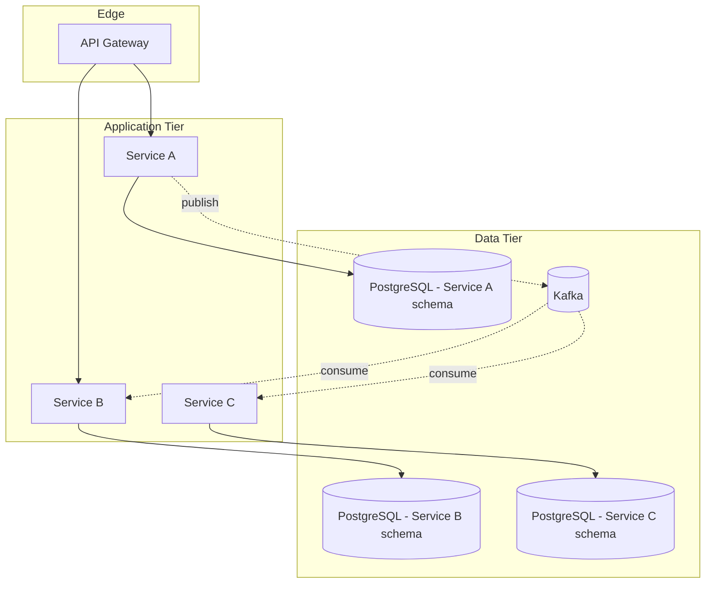

<!--
CHUNK: 03
TITLE: Architecture Overview - Components & Deployment
PROJECT: [Project Name]
VERSION: [X.X]
PART OF: LLD - [Project Name]
-->

# 6. Architecture Overview

> **Note:** this chunk is a high-level orientation. Per-service detail lives in `04-implementation/<service>.md`. If you need class-level or method-level detail, jump straight there.

## 6.1 Component Topology

**Summary:** [1-2 sentences: the components and the load-bearing connections.]

> Miro: [optional whiteboard view URL]

## 6.2 Deployment Topology

| Concern | Choice | Source / Rationale |
|---------|--------|--------------------|
| Container | Docker (one image per deployable: each service, or the single deployable of a modular monolith) | [SDD §8.6](../sdd-[sdd-slug]/05a-infrastructure-and-network.md#86-infrastructure-architecture) deployables; SDD §8.1 style / CLAUDE.md default |
| Orchestrator | Kubernetes (Helm chart per deployable) | [SDD §8.6](../sdd-[sdd-slug]/05a-infrastructure-and-network.md#86-infrastructure-architecture) deployment target / CLAUDE.md default |
| Namespace strategy | [Per-environment / Per-tenant / Hybrid] | [SDD §8.6 / §11.3 / §19 if applicable] |
| Service mesh / Ingress | [Istio / Linkerd / NGINX Ingress / API Gateway alone] | [[SDD §8.7](../sdd-[sdd-slug]/05a-infrastructure-and-network.md#87-network-architecture) ingress path and mTLS / SDD §6 if applicable] |
| Replicas (per deployable, baseline) | [N min / M max] | [SDD §17.X Deployment Strategy if applicable] |
| Deployment strategy | [Rolling / Blue-Green / Canary] | [Per-service overrides in `04-implementation/<svc>.md`] |

> **Convention:** a Source cell links the SDD §8.6 or §8.7 part it implements; with no SDD, or an SDD written before chunk 05a, it names §6, §11.3, §19, or §17.X as before. A value that differs is drift to flag (`sdd-to-lld.md` § One fact, one home, rule 3).

## 6.3 Runtime Stack

| Layer | Technology | Version | Source |
|-------|-----------|---------|--------|
| Language | Java | 21 | [[SDD §6](../sdd-[sdd-slug]/02-ecosystem-overview.md#6-ecosystem-overview) [layer] row / `manifest (<file>)` / LLD default] |
| Framework | Spring Boot | 3.5+ | [[SDD §6](../sdd-[sdd-slug]/02-ecosystem-overview.md#6-ecosystem-overview) [layer] row / `manifest (<file>)` / LLD default] |
| Build | [Maven / Gradle] | [version] | [[SDD §6](../sdd-[sdd-slug]/02-ecosystem-overview.md#6-ecosystem-overview) [layer] row / [Stack approval](./decision-log.md#stack-approval-record) / `manifest (<file>)` / LLD default] |
| Database | PostgreSQL | 17+ | [[SDD §6](../sdd-[sdd-slug]/02-ecosystem-overview.md#6-ecosystem-overview) [layer] row / `manifest (<file>)` / LLD default] |
| Message Broker | Kafka | [version] | [[SDD §6](../sdd-[sdd-slug]/02-ecosystem-overview.md#6-ecosystem-overview) [layer] row / `manifest (<file>)` / LLD default] |
| Cache | [Redis / Caffeine / None] | [version] | [[SDD §6](../sdd-[sdd-slug]/02-ecosystem-overview.md#6-ecosystem-overview) [layer] row / [Stack approval](./decision-log.md#stack-approval-record) / `manifest (<file>)` / LLD default] |
| Auth | Keycloak | [version] | [[SDD §6](../sdd-[sdd-slug]/02-ecosystem-overview.md#6-ecosystem-overview) [layer] row / `manifest (<file>)` / LLD default] |
| Migrations | Flyway | [version] | [[SDD §6](../sdd-[sdd-slug]/02-ecosystem-overview.md#6-ecosystem-overview) [layer] row / `manifest (<file>)` / LLD default] |
| Observability | [Prometheus + Grafana + Loki + Tempo / other] | [version] | [[SDD §6](../sdd-[sdd-slug]/02-ecosystem-overview.md#6-ecosystem-overview) [layer] row / [Stack approval](./decision-log.md#stack-approval-record) / `manifest (<file>)` / LLD default] |
| Frontend (if applicable) | Angular | 17+ | [[SDD §6](../sdd-[sdd-slug]/02-ecosystem-overview.md#6-ecosystem-overview) [layer] row / `manifest (<file>)` / LLD default] |

> **Convention:** the stack approval (SKILL.md step 3a) settles these rows. This is the one list of the Source labels of §6.3 and of §6.5.1 (`03a-libraries-and-conventions.md`); other text that names a label spells it as here.
>
> - **SDD §6 row:** `[SDD §6](../sdd-[sdd-slug]/02-ecosystem-overview.md#6-ecosystem-overview) <layer> row`, for a row derived from SDD §6. SDD §6 is read in either shape (`sdd-to-lld.md` field mapping, row 02). When the SDD row is a proposal (Status `Proposed`, or a legacy row whose Notes mark it Proposed in any form, bold or plain text), it pins nothing: the LLD row stays a proposal, and the label ends with `(Proposed in SDD §6)`.
> - **Project rule:** a link named `Project rule` to the project instruction file that states the row (`../AGENTS.md` or `../CLAUDE.md`).
> - **Stack approval:** `[Stack approval](./decision-log.md#stack-approval-record)`, for a row neither SDD §6 nor the project rules pin that the stack approval settled.
> - **Override:** `Customer decision, overrides SDD §6 <layer>`, or `Customer decision, overrides Project rule <layer>` for a layer SDD §6 does not state, linked to its entry in `./decision-log.md`. An approved override is not drift; any other value that disagrees with SDD §6 is drift to flag (`sdd-to-lld.md` § One fact, one home, rule 3).
> - **Manifest:** `manifest (<file>)`, in a code-read direction, for a row a dependency manifest pins (`<file>` is that manifest, such as `pom.xml`).
> - **Code:** `code (<file>:<line>)`, in a code-read direction, for a row no dependency manifest shows because it is not a dependency (the DTOs row, the `RestClient` row of a Spring MVC service): the declaration or call site it was read from.
> - **LLD default:** `LLD default`, for a default nothing has confirmed. A §6.3 row with this label is flagged `> Confirm:` until it is confirmed, and one that adds a dependency SDD §6 does not name is marked `proposed; needs approval when the project's rules reserve new dependencies`; where those rules reserve it, only the explicit request of SKILL.md step 3a, item 1 confirms it. A §6.5.1 row is marked by its Status column alone, by the Status rule of `03a-libraries-and-conventions.md` § 6.5.1.

## 6.4 Architectural Style - As Operationalised

> **Inherits from:** SDD §8.1 Architecture Style.
>
> **What this section adds:** the concrete operationalisation. Where the SDD says "event-driven microservices", this section names the topics, the consumer-group conventions, the schema-registry choice, the outbox-table convention. Where it says "modular monolith" (its ADR-01), this section names the module boundaries, the ports, and the in-process events.

- **Service boundary rule:** one service (or module) = one bounded context = one private PostgreSQL schema. No cross-schema reads.
- **Inter-service async:** Topics named as SDD §14.4 names them (from code with no SDD: as the code names them). JSON Schema in [registry] (or Avro in [registry]). Module-to-module events of a modular monolith are in-process (`07-event-contracts.md` § 10.6), not topics.
- **Inter-service sync:** [allowed for / forbidden - per CLAUDE.md "no service-to-service chained REST calls more than one hop deep"]. Module-to-module calls of a modular monolith go through ports (`06-api-contracts.md` § 9.6), never HTTP.
- **Outbox pattern:** mandatory for every side effect that must follow a state change and must not be lost; scope and implementation per `09-cross-cutting.md` § Outbox.
- **Saga choreography vs orchestration:** [default per CLAUDE.md - choreography unless flow is complex; orchestrator-owning service named per case].

<!-- MASTER: [project-slug]-lld-master.md | PREV: 02-context.md | NEXT: 03a-libraries-and-conventions.md -->
