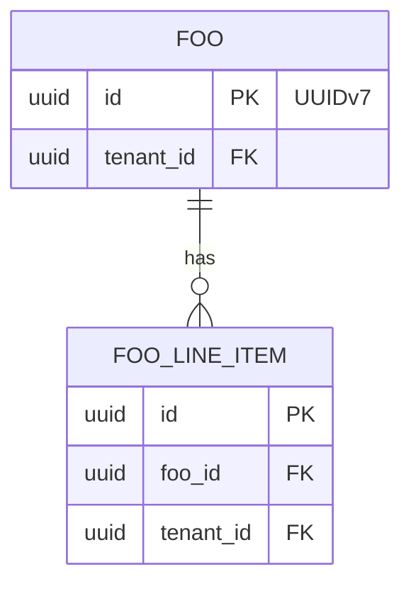

<!--
CHUNK: 05
TITLE: Data Model
PROJECT: [Project Name]
VERSION: [X.X]
DEPENDS_ON: 04
PART OF: LLD - [Project Name]
-->

# 8. Data Model

> **Per-service ownership:** each service owns its own private PostgreSQL schema (CLAUDE.md default). This chunk covers all schemas in the LLD scope.

## 8.1 Entity Relationship (system-wide)

<!-- Entities, keys (PK, FK), and relationships only, as the SDD's ERD draws them, with no line cap; every other column lives in § 8.2 (sdd-to-lld.md § Field mapping table, 13a DB Modeling). -->

**Summary:** [1-2 sentences: the main entities and their key relationships.]

> Miro: [optional whiteboard view URL]

## 8.2 Tables (per service)

<!-- The one table format, as the SDD's DB Modeling Tables Design defines it (this section is its derived view, principle 13). One block per table: **Table name:**, **Table purpose:**, **Column details:**. The Column details table starts with the four shared columns, Column name, Data type, Required or optional, Description, and adds the implementation delta after them: Constraints and Source. An **Indexes:** line names the table's indexes; § 8.3 defines each. Required means the column does not accept null; Optional means it does; nullability is stated only in that column. A unique key, index, or check the SDD fixes appears in the Description of the column it covers, with its tenant_id lead; copy it, never contradict it. -->

### Service: `[service-a]` - schema `app_[service_a]`

**Table name:** `foo`

**Table purpose:** [Why the table exists, in one sentence, as the SDD states it. Where the SDD's Tables Design is prose with no per-table purpose, take it from that prose, else write it from the LLD with a `> Confirm:` flag.] [SDD §17.X Tables Design]

**Column details:**

| Column name | Data type | Required or optional | Description | Constraints | Source |
|-------------|-----------|----------------------|-------------|-------------|--------|
| `id` | `uuid` | Required | UUIDv7, generated at service layer | PK | [SDD §17.X Tables Design] |
| `tenant_id` | `uuid` | Required | Required for multi-tenant queries; every secondary index and unique key on this table leads with it; the primary key `id` is exempt | None | [SDD §17.X Tables Design] |
| `status` | `text` | Required | Domain-state column | CHECK in (...) | [SDD §17.X Tables Design] |
| `version` | `bigint` | Required | Optimistic locking | default 0 | [SDD §17.X Tables Design / LLD] |
| `created_at` | `timestamptz` | Required | UTC always | None | [SDD §17.X Tables Design] |
| `updated_at` | `timestamptz` | Required | UTC always | None | [SDD §17.X Tables Design] |

**Indexes:** `idx_foo_tenant`, `idx_foo_tenant_status` (§ 8.3)

**Table name:** `outbox`

**Table purpose:** Holds each event, provider write, or durable in-process event until the publisher confirms delivery, so a state change and its event commit together (`09-cross-cutting.md` § 12.4). [SDD §17.X Tables Design / LLD]

**Column details:**

| Column name | Data type | Required or optional | Description | Constraints | Source |
|-------------|-----------|----------------------|-------------|-------------|--------|
| `id` | `uuid` | Required | UUIDv7 | PK | [SDD §17.X Tables Design / LLD] |
| `aggregate_type` | `text` | Required | e.g. "foo" | None | [SDD §17.X Tables Design / LLD] |
| `aggregate_id` | `uuid` | Required | Used as Kafka key | None | [SDD §17.X Tables Design / LLD] |
| `event_type` | `text` | Required | e.g. "foo.created" | None | [SDD §17.X Tables Design / LLD] |
| `target_topic` | `text` | Required | The target: the Kafka topic; for a provider write or a durable in-process event, the target it names (`09-cross-cutting.md` § 12.4) | None | [SDD §17.X Tables Design / LLD] |
| `payload` | `jsonb` | Required | Event payload, including `eventId`; fixed at write time | None | [SDD §17.X Tables Design / LLD] |
| `created_at` | `timestamptz` | Required | Insert time | None | [SDD §17.X Tables Design / LLD] |
| `processed_at` | `timestamptz` | Optional | Set by the publisher only after the target acknowledges the row (`09-cross-cutting.md` § 12.4); null = pending or retryable | None | [SDD §17.X Tables Design / LLD] |

**Indexes:** `idx_outbox_unprocessed` (§ 8.3)

**Table name:** `idempotency_record`

**Table purpose:** Stores the outcome of each write request under its idempotency key, so a retry returns the same response instead of repeating the write (`09-cross-cutting.md` § 12.2). [SDD §17.X Tables Design / LLD]

**Column details:**

| Column name | Data type | Required or optional | Description | Constraints | Source |
|-------------|-----------|----------------------|-------------|-------------|--------|
| `tenant_id` | `uuid` | Required | Composite PK | PK part 1 | [SDD §17.X Tables Design / LLD] |
| `idempotency_key` | `text` | Required | From `Idempotency-Key` header | PK part 2 | [SDD §17.X Tables Design / LLD] |
| `status` | `text` | Required | IN_PROGRESS / COMPLETED / FAILED | None | [SDD §17.X Tables Design / LLD] |
| `cached_response` | `jsonb` | Optional | Set on COMPLETED | None | [SDD §17.X Tables Design / LLD] |
| `created_at` | `timestamptz` | Required | Deleted after the `09-cross-cutting.md` § 12.2 TTL | None | [SDD §17.X Tables Design / LLD] |

**Indexes:** `idx_idempotency_created` (§ 8.3)

> **Source:** from an SDD, each block restates the SDD table it comes from: the Table name, the Table purpose (carried over, never reworded into a different purpose; where the SDD's Tables Design is prose with no per-table purpose, taken from that prose, else written from the LLD and flagged `> Confirm:`), and per column the Column name, Data type, Required or optional, and Description as the SDD's Tables Design states them. The Table purpose line and each column row link the SDD row they come from (a `13x` Tables Design block or column, or SDD §11.1 for the publication log); `LLD` marks a table or column the LLD adds (its Description names the pattern that needs it). The Constraints cell and the Indexes line are the implementation delta: the PK and its parts, the FK target, UNIQUE, CHECK, and default the schema enforces (`None` when there is none), and the names of the § 8.3 indexes that table has (`None` when it has none). A unique key, index, or check the SDD states in a column's Description stays in that column's Description as the SDD states it; its enforced form is held in that column's Constraints cell or, for an index, in § 8.3. A value that differs from the SDD is drift to flag (`sdd-to-lld.md` § One fact, one home, rule 3). From code with no SDD: the migration that creates it; the Table purpose from the entity's own documentation, else `[NEEDS CLARIFICATION: why <table> exists]`; Required from NOT NULL.

### Service: `[service-b]` - schema `app_[service_b]`

<!-- Repeat per service. -->

## 8.3 Indexes

| Index | Table | Columns | Type | Rationale |
|-------|-------|---------|------|-----------|
| `idx_foo_tenant` | `foo` | `(tenant_id)` | btree | Required for tenant-scoped queries (every secondary index and unique key of a shared-schema table leads with tenant_id) |
| `idx_foo_tenant_status` | `foo` | `(tenant_id, status)` | btree | Hot-path: list by status |
| `idx_outbox_unprocessed` | `outbox` | `(created_at) WHERE processed_at IS NULL` | partial btree | Outbox publisher poll, oldest unprocessed first |
| `idx_idempotency_created` | `idempotency_record` | `(created_at)` | btree | Cleanup job |

## 8.4 Multi-Tenancy Strategy

> **Default per CLAUDE.md:** schema-per-tenant for high-volume services; shared-schema with `tenant_id` for low-volume.

| Service | Strategy | Rationale |
|---------|----------|-----------|
| `[service-a]` | [Schema-per-tenant / Shared with tenant_id] | [Reasoning] |
| `[service-b]` | [Schema-per-tenant / Shared with tenant_id] | [Reasoning] |

**Tenant filter enforcement:** [Hibernate filter / row-level security policy / query helper - pick one and apply uniformly]

**Cross-tenant queries:** forbidden at the application layer (CLAUDE.md). [Enforced via X.]

## 8.5 Migration Plan (Flyway)

| Version | File | Purpose |
|---------|------|---------|
| `V001__create_foo.sql` | `[service-a]/src/main/resources/db/migration` | Initial foo + foo_line_item tables |
| `V002__create_outbox.sql` | `[service-a]/...` | Outbox table |
| `V003__create_idempotency.sql` | `[service-a]/...` | Idempotency record table |

> **Convention per CLAUDE.md:** versioned SQL only; backward-compatible changes only; expand-contract for breaking changes.

## 8.6 Retention & Archival

| Table | Hot retention | Archival destination | Restore SLA |
|-------|---------------|---------------------|-------------|
| `foo` | Indefinite | N/A (operational) | N/A |
| `outbox` | 7 days after `processed_at`; unprocessed rows are never deleted | Cleanup job (delete) | N/A |
| `idempotency_record` | The `09-cross-cutting.md` § 12.2 TTL | Cleanup job (delete) | N/A |
| `audit_log` (if any) | 90 days hot | S3-compatible cold storage | 24h |

## 8.7 Encryption

| Concern | Approach |
|---------|----------|
| At rest | [pgcrypto column-level for PII / TDE / disk-level only] |
| In transit | TLS 1.2+ between services and DB |
| Key management | [KMS / Vault - rotation policy] |
| PII columns | [List + masking rule for non-prod] |

<!-- MASTER: [project-slug]-lld-master.md | PREV: 04-implementation/<service>.md | NEXT: 06-api-contracts.md -->
