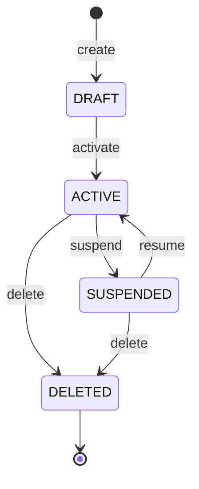

<!--
CHUNK: 08
TITLE: State Machines & Business Rules
PROJECT: [Project Name]
VERSION: [X.X]
DEPENDS_ON: 04
PART OF: LLD - [Project Name]
-->

# 11. State Machines & Business Rules

> **Convention:** include a state machine only for entities that are genuinely stateful with named states. Stateless services have no state machine here. A status column that a recurring job selects gets a § 11.4 block even without a state machine. Per-service rules that are mostly local stay in `04-implementation/<service>.md`; rules that span services live here.

## 11.1 Aggregate State Machines

### `Foo` aggregate (in `[service-a]`)

**States:** `DRAFT`, `ACTIVE`, `SUSPENDED`, `DELETED` (soft).



**Summary:** [1-2 sentences: the states and what moves the aggregate between them.]

**Transition rules:**

| From | Event | To | Guard | Side effect |
|------|-------|----|----|-------------|
| `DRAFT` | `activate` | `ACTIVE` | All required fields populated | Emit `foo.activated` |
| `ACTIVE` | `suspend` | `SUSPENDED` | Caller has `foo:suspend` scope | Emit `foo.suspended` |
| `SUSPENDED` | `resume` | `ACTIVE` | Suspension reason resolved | Emit `foo.resumed` |
| `ACTIVE` | `delete` | `DELETED` | No active dependencies | Emit `foo.deleted` |

> **Invariants enforced at every transition:**
> - Optimistic lock version must match.
> - Tenant ID immutable.
> - Created-at immutable.

## 11.2 Cross-Service Business Rules

> **Rules that one service depends on another to enforce.** When you change a rule here, check downstream consumers.

### Rule: [Rule Name]

**Statement:** [One-sentence rule.]

**Source of truth:** [Which service owns this rule]

**Enforcement points:** [Which services / endpoints / consumers must respect it]

**Validation matrix:**

| Input condition | Expected outcome |
|-----------------|------------------|
| [Condition] | [Outcome] |
| [Condition] | [Outcome] |

## 11.3 Algorithm Pseudocode (non-trivial only)

> **Convention:** include only algorithms whose correctness isn't obvious from the code structure. Skip plain loops, plain CRUD, plain validation.

### Algorithm: [Name]

**Input:** [Inputs]

**Output:** [Outputs]

```text
[Pseudocode]
```

**Edge cases:** [List]

**Complexity:** [Big-O]

## 11.4 State × Producer × Job Matrix

<!-- One block per state or status column that a recurring job selects, changes or deletes, with or without a § 11.1 state machine. A recurring job is any scheduled or polling work: a sweep, reconciler, expiry timer, retention cleanup or orphan sweep (05 § 8.6), or a publisher. One row per state value. Producers: every operation that writes the value, with its anchor: an endpoint (06 § 9.1), a port (06 § 9.6), a consumer (07 § 10.4), a § 11.1 transition, a job, a setup or seed step, or a migration backfill. Jobs: every recurring job whose predicate can match a row in that value, with its full predicate (the state and every other condition, such as age or a null column) and its action (select, change to a named state, delete); `None` when no job matches. Why correct: for each job and each producer whose rows it matches, one line saying why the job's action is right for those rows. A new producer adds its lines. When a job is not right for a producer's rows, add a guard to the job's predicate or give those rows a distinct state, and update this block. With no state column that a recurring job selects, write "None - no recurring job selects a state column." -->

### `foo.status` (table `foo`, in `[service-a]`)

| State | Producers | Recurring jobs (predicate, action) | Why each job is correct for each producer's rows |
|-------|-----------|------------------------------------|---------------------------------------------------|
| `DRAFT` | `POST /v1/foo` (06 § 9.1); `[setup step]` | `[FooDraftExpiry]`: `status = 'DRAFT' AND created_at < now - [7 days] AND created_by <> 'setup'`, delete | `POST /v1/foo`: an abandoned draft has no other use. `[setup step]`: excluded by the `created_by` guard, since setup rows wait for a person to act. |
| `ACTIVE` | `activate`, `resume` (§ 11.1) | None | - |
| `DELETED` | `delete` (§ 11.1) | `[FooPurge]`: `status = 'DELETED' AND updated_at < now - [30 days]`, hard delete | `delete`: the 05 § 8.6 retention window has passed. |

<!-- MASTER: [project-slug]-lld-master.md | PREV: 07-event-contracts.md | NEXT: 09-cross-cutting.md -->
