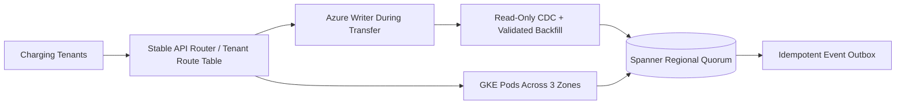
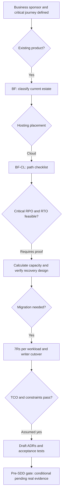

# Worked Pre-SDD | BF-CL | Complex — Cloud-to-Cloud Real-Time Usage Charging Migration

**Example ID:** EX-BF-CL-Complex  
**Classification:** Brownfield × Cloud  
**Primary recovery tier:** Complex — Both RPO **2 s** and RTO **8 s** are **strictly less than 10 seconds** for the stated primary failure scope.  
**Migration overlay:** Azure cloud → Google Cloud  
**Version/date:** 1.0 / 2026-10-16  
**Status:** ILLUSTRATIVE WORKED EXAMPLE, **NOT** a real stakeholder-approved Pre-SDD. Every person, product, demand number, target, time allowance, price and budget below is intentionally **invented** for architectural training unless a public reference explicitly substantiates a general service behavior.

**Companion documents:** [Pre-SDD Standard](./Pre-SDD_Architecture_Standard_v1.md) · [Blank Intake](./Pre-SDD_Project_Intake_Template.md) · [Case Index](./PreSDD_Examples_README.md)

## 1. Business brief, responsibility and classification

| Field | Completed fictional business input |
|---|---|
| Business sponsor / sign-off | VP Real-time credit/usage accounting (role is illustrative; no real signature) |
| Product owner / data owner | Product Manager + domain Data Steward (illustrative) |
| Lead architect / design authority | Enterprise Solution Architect + Architecture Review Board (illustrative) |
| Problem/outcome | Migrate from Azure to Google Cloud without degrading one-zone failover objectives |
| Critical journey | Accept a charge and deduct a tenant balance once, with immutable trace |
| Population | Multi-tenant telecom usage-charging API clients |
| Source/current estate | Azure AKS service + Azure PostgreSQL and event hub, peak 1,300 TPS, p99 620 ms, AZ failover 80 s, 1.6 TiB active data |
| Source→target | Microsoft Azure AKS/PostgreSQL/event platform → Google Cloud GKE regional + Spanner regional transaction core |
| Path / direction | BF-CL / Azure cloud → Google Cloud |
| Hard placement guardrail | Consolidate platform operations with Google Cloud data and platform services (business decision assumed) |
| Deadline | 15-month staged move; source contract ends at month 18 |
| Compliance baseline | Sensitive tenant usage and wallet balances; strict tenant isolation, encryption/key rotation, audit, residency mapping |
| Assumed financial exposure | $750,000/hour of critical-journey outage |

**Why classification is correct.** The workload already runs, has legacy state and dependencies, and requires discovery and reversible changes. Target placement is Google Cloud GKE regional + Spanner regional transaction core. The migration overlay is recorded separately; it does not create a fifth branch.

## 2. NFR contract, scope and business-impact arithmetic

| Dimension | Fictional business target, exact semantics |
|---|---|
| RPO for primary incident | 2 s for last recoverable committed data |
| RTO for primary incident | 8 s until the business API/journey is usable |
| Incident/fault scope | complete loss of a single Google Cloud availability zone after cutover, with remaining two zones healthy |
| Separate full site / region disaster | Whole Google Cloud region unavailable: RPO 30 min; RTO 6 h; cross-provider outage during migration handled by a separate cutover runbook |
| Availability SLO | 99.99% 30-day critical-journey success; failed/time-out calls counted as errors |
| p50 / p95 / p99 | ≤80 / ≤190 / ≤350 milliseconds; edge ingress-to-valid-response critical journey |
| Average vs peak | 250 TPS during 24 active h/day / 1,800 TPS for 10 minutes |
| API RPS at peak | 3,600 external requests/s; each business transaction performs 2 such requests |
| Peak simultaneously active users | 12,000 (not to be confused with peak in-flight requests) |
| Year-1 demand growth | +50%; validate at 1.50× additional load |
| Data correctness | No double authorization/charge and durable acknowledged writes with deduplication |
| Support / escalation | 24×7 cross-provider migration war room and SRE, 2 weeks parallel observation after cutover |

**Scope is binding:** `complete loss of a single Google Cloud availability zone after cutover, with remaining two zones healthy`. **Other disasters have different commitments:** Whole Google Cloud region unavailable: RPO 30 min; RTO 6 h; cross-provider outage during migration handled by a separate cutover runbook. RTO is elapsed time from loss of the scoped business journey until a verified usable journey returns; RPO is the age of last recoverable committed business data at the incident point. It is wrong to claim site/region/cyber recovery meets 8 s just because a node/rack/zone test does.

**30-day downtime budget:** `(1 - 99.99000/100) × 30 × 24 × 3600 = 259.2 seconds = 4.32 minutes`. This is an illustrative **end-to-end journey** error budget, not an individual cloud service SLA. One recovery exercise may consume part of it. The worst-case single-incident RTO of 8 s consumes 3.1% of a full 30-day error budget; all other incidents, deployments and dependency failures must fit the remainder for the period SLO to pass.

**Outage impact at the target RTO (linear approximation):** `$750,000/h × (8 s ÷ 3600) = $1,666.67`; actual loss is scenario-specific and may be nonlinear.

## 3. Transparent workload, CPU, network and storage calculations

### 3.1 Workload → CPU and concurrency

- **Transactions/day:** `250 avg TPS × 24 active h/day × 3,600 = 21,600,000 business transactions/day` (not 1,800 peak TPS all day).
- **Peak API demand:** `1,800 TPS × 2 external requests/transaction = 3,600 RPS` (internal RPCs and retries add separate load).
- **Modeled CPU work:** `1,800 TPS × 12 ms CPU/transaction ÷ 1,000 = 21.60 busy vCPU cores` before overhead and N-1 protection.
- **N-1 domain sizing:** `ceil(21.60 ÷ (2 surviving domains × 0.60 max modeled CPU))`, rounded up to even vCPUs = **20 vCPU per domain**, across 3 zones/racks (**60 allocated vCPU**). Surviving capacity 40 vCPU → estimated 54.0% CPU during peak after one domain loss; this excludes DB/queue CPU, reserves and hypervisor overhead.
- **Year-1 expansion decision:** +50% peak traffic raises modeled CPU demand from 21.60 to 32.40 busy cores; maintain a 60% modeled CPU ceiling and N-1 fault-domain tolerance by increasing from **20 → 28 app vCPU per domain**, i.e. **24 additional vCPU** overall in the first year. Reserve cloud quotas / test autoscaling and update cloud forecasts.
- **Little's Law, in-flight API estimate:** `3,600 external RPS × 0.160 s assumed **mean** response time = 576.0 in-flight API requests` at peak. These are **not** simultaneous human users; do not use p99 as the average.

### 3.2 Network demand and burst allowance

- **Application payload:** `3,600 RPS × 5 KiB round-trip/request × 1,024 B/KiB × 8 bits/B ÷ 1,000,000 = 147.46 Mb/s`, measured as total application traffic budget across request + response.
- **Engineering envelope:** `147.46 × 3 = 442.37 Mb/s` for illustrative retries, framing and bursts, **not** a physical link guarantee; add TLS, database replication, backups, migration, logging and cross-site flows separately.
- **Placement impact:** Global HTTPS ingress/WAF, private GKE-Spanner routing, Azure↔Google encrypted transfer during migration, non-overlapping CIDRs, no DNS-only failover, measure RTT and egress.

### 3.3 Durable data growth and retention (uncompressed model)

- **Transactional event volume:** `21,600,000 transactions/day × 2.5 KiB/event ÷ (1,024 × 1,024) = 51.498 GiB/day`.
- **Additional nontransactional data:** `1.000 GiB/day` (files, attachments, reference data or indexes modeled separately, scenario dependent). Total logical growth **52.498 GiB/day**.
- **12-month no-deletion baseline:** `1600 GiB initial + 365 × 52.498 GiB/day = 20,761.9 GiB`. This is a planning bound; active-data TTL can lower net production size.
- **Retention buffers:** hot 30 days × 52.498 = **1,575.0 GiB** of new logical data, archive +400 days × 52.498 = **20,999.4 GiB** (before compression, index amplification, snapshots, backup copies and replica count).
- **Durable replication planning:** one logical event stream modeled at 51.498 GiB/day → **154.495 GiB/day** if 3 physical copies are provisioned. Actual DB/log/queue products differ; do not multiply every store twice.

### 3.4 Storage footprint, application memory and database IOPS screening

- **DB operations:** assume 4 logical reads and 2 logical writes per business transaction at the peak (a *different* measure from API RPS). `1,800 TPS × (4 reads + 2 writes) = 10,800 logical ops/s`. Double this **fictional** demand for index/WAL amplification and bursts: **21,600 storage operation/s screening envelope**. These do **not** replace real device/service IOPS tests, write latency or database service quotas.
- **Protected hot footprint:** `(initial 1,600 GiB + last 30 days 1,575.0 GiB) × 1.40 index/WAL allowance × 3 retained live physical replica(s) × 1.25 free-capacity allowance = ~16,669 GiB physical-equivalent provisioned`. Archive (20,999.4 GiB), offsite backup and temporary migration copies are **additional**. Managed cloud storage billing may abstract replicas and must **not** be treated as 3 customer-provisioned disks.
- **Memory envelope (not measured):** `20 application vCPU/domain × 4 GiB/vCPU = 80 GiB/domain` for early VM/pod-request modeling; multiply by 3 fault domains for **240 GiB total** application allocation, excluding DB, message platform, OS and observability. Profile heap/working set before ordering hosts or SKUs.
- **Write-replication steady-state wire payload:** `1,800 peak TPS × 2.5 KiB/event × 2 additional live replicas × 1,024 × 8 ÷ 1e6 = 73.73 Mb/s`, **in addition** to the 147.46 Mb/s API round-trip workload and burst factors. Partition replay or restoring a replica can overwhelm this steady-state figure; reserve repair bandwidth and test link failure.
- **Monthly API payload volume, both directions:** `250 TPS × 24 h/day × 3,600 × 30 days × 2 calls × 5 KiB ÷ (1,024²) = 6,179.8 GiB/month`. Only a subset may be *billable egress*; calculate actual inbound/outbound, inter-zone and client/partner traffic from flow telemetry before vendor pricing.

### 3.5 A proposed latency work-budget — not a percentile equation

Allocate the end-to-end p99 **target** into early subsystem work envelopes, solely to guide profiling. **Do not add observed component p99 percentiles to derive end-to-end p99**; concurrent request paths, covariance, queues, errors and retries invalidate that shortcut. Prove the full critical journey under real peak and N-1 fault tests.

| Element | Assumed share of end-to-end target | Engineering work envelope |
|---|---:|---:|
| Edge / auth token checking / transit | 15% | 52.5 ms |
| Application rules and API work | 25% | 87.5 ms |
| Database operations and commits | 40% | 140.0 ms |
| Contention, jitter, retry and test margin | 20% | 70.0 ms |

The design envelopes sum to 350 ms; they are **planning allowances**, not measured SLI percentiles, and should be revised once distributed tracing exists.

### 3.6 Recovery timing and feasibility

Planned component time budget: **detect unhealthy zone 2s + remove unhealthy endpoints 2s + verify surviving transaction quorum 2s + idempotent client retry 1s = 7 seconds**, versus RTO **8 s** (modeled margin 1 s). These figures are *engineering hypotheses, not measured failover guarantees*; if any single step exceeds its allowance, revise the architecture.

| Failure-recovery step | Hypothetical elapsed budget |
|---|---|
| detect unhealthy zone | 2 s |
| remove unhealthy endpoints | 2 s |
| verify surviving transaction quorum | 2 s |
| idempotent client retry | 1 s |

**Sub-10s engineering caveat:** node/rack/zone automatic failover is not region-wide DR, DNS-only changes are not a deterministic 8-second mechanism, and application availability must include quorum, token checking and the client retry. Quorum write acknowledgment protects *committed* operations; anything not acknowledged may need outcome lookup plus idempotent retry. Test partitions and failback as well as clean node failure.

## 4. Selected design and architecture diagram

| Layer | Recommended candidate and rationale |
|---|---|
| Infrastructure / compute | GKE regional cluster across three zones, hot pods sized for N-1 zone, strongly consistent Spanner regional DB, durable event forwarding; independent recovery backups outside DB replication. |
| Network / ingress / segmentation | Global HTTPS ingress/WAF, private GKE-Spanner routing, Azure↔Google encrypted transfer during migration, non-overlapping CIDRs, no DNS-only failover, measure RTT and egress. |
| Software architecture | Refactor old charging DB transaction into a single atomic target transaction and idempotency-key ledger; portable API contract, transactional outbox, reconciliation worker, gradual tenant routing. |
| Transactional store and backups | Azure PostgreSQL → Spanner schema and SQL semantics transformation via bulk import + controlled CDC; one write authority per tenant during migration, never uncontrolled dual writes. |
| Identity | Federated machine identities and signed JWT validation; no cross-cloud online token introspection in charging path |
| External dependencies | Billing export, invoice generation, CRM and event consumers moved as dependency waves; external links async |
| Security | Sensitive tenant usage and wallet balances; strict tenant isolation, encryption/key rotation, audit, residency mapping |
| Operations | 24×7 cross-provider migration war room and SRE, 2 weeks parallel observation after cutover |

> Diagram depicts a proposed deployment pattern, not a provider-specific implementation guarantee. A full SDD must expand all security groups/firewalls, route paths, subnet CIDRs, AZ/rack anti-affinity, certificates, dependencies, data movement and operational owners.

## 5. Actual requirements → infrastructure, network and software consequences

| Business requirement | Assumed input | Infrastructure decision | Network decision | Software/data decision |
|---|---|---|---|---|
| `CAP-01/02/04` Demand | 1,800 peak TPS; 3,600 external RPS | Provision 20 vCPU per fault domain (3 domain(s)) as first-pass CPU-only envelope; prove disk and memory separately | Design for ~442.4 Mb/s modeled application payload headroom; test east-west and failover burst | Bounded queue/retries, rate limits, load sheds noncritical requests |
| `CAP-07` Tail latency | p99 ≤350 ms | CPU contention and DB IO tracing with p99 under peak | Minimize RTT and cross-datacenter synchronous hops | Index/test hot keys and limit critical sync call fanout |
| `REL-03` RTO | 8 s, scoped complete loss of a single Google Cloud availability zone after cutover, with remaining two zones healthy | Hot pre-warmed capacity and election if <10 sec | Health routed VIP/LB for sub-10s | Idempotent retries and readiness checks |
| `REL-04/10` RPO/correctness | 2 s | Synchronous quorum commit for scoped single fault, plus independent backup | Inter-domain quorum RTT/capacity | Atomic commits and safe replay |
| `REL-01` Availability | 99.99%; 30d 4.32 min error-budget equivalent | Avoid shared failure domains; align support model | Edge/IdP/DNS dependencies part of end-to-end SLO | Degrade noncritical steps instead of letting the user journey fail |
| `DAT-02/06` Volume | 1,600 GiB initial + 52.50 GiB/day modeled | Disk/backup capacity includes indexes and replicas, not just raw events | Backup, CDC and bulk-copy link capacity to be sized | Retention, archival, partitions, purge and reconciliation |
| `SEC-02/04` Security | Sensitive tenant usage and wallet balances; strict tenant isolation, encryption/key rotation, audit, residency mapping | Encrypted volumes, secrets and role split | TLS/segmentation, private DB and admin reachability | OIDC, authorization checks, secure logs, tenant isolation if applicable |
| `INT-01/09` Dependencies | Billing export, invoice generation, CRM and event consumers moved as dependency waves; external links async | Service integration owner and HA gap review | Link reachability and external rate limits | Async adapter/outbox and timeouts |
| `ECO-01/03` TCO | $5,680,000 3-year model vs $6,000,000 ceiling | Avoid unnecessary hot redundancy for relaxed RTO | Egress/backups/extra links included in estimates | Decomposition cost and support burden must be justified |
| `OPS-07 / MIG` Transition | Azure cloud → Google Cloud | Dual running temporarily, reserve destination capacity | Encrypted source→target transit; CIDR, RTT, bandwidth, egress cost | Per-workload 7Rs, CDC, single write authority and cutover rehearsal |

## 6. All 70 master checklist inputs filled for this fictional initiative

The original standard contains **70** inputs. The table below provides a specific assumed answer or explained N/A for each, enabling the architect to practice replacing assumptions with real stakeholder evidence. The corresponding general *three-layer impacts* remain in the [standard](./Pre-SDD_Architecture_Standard_v1.md); case-specific consequences appear in Section 5 above.

### 6.1. Business objectives (8 inputs)

| Req ID / question | Completed example input | Evidence owner / approval status |
|---|---|---|
| `BUS-01` — Problem, business outcome and KPI with baseline, target, deadline | Migrate from Azure to Google Cloud without degrading one-zone failover objectives; business KPI owner: sponsor; baseline: Azure AKS service + Azure PostgreSQL and event hub, peak 1,300 TPS, p99 620 ms, AZ failover 80 s, 1.6 TiB active data. | Business sponsor/Product; **fictional assumed, not signed** |
| `BUS-02` — Critical user journeys, failure impact and journey priorities | Tier-0 critical journey: Accept a charge and deduct a tenant balance once, with immutable trace; outage loss modeled at $750,000/hour. | Business sponsor/Product; **fictional assumed, not signed** |
| `BUS-03` — In/out of scope; dependencies; MVP versus later phases | In: API/UI, durable core data, operations, SLO tests. Out: unrelated products and historical vendor platform rewrite; project scope is Cloud-to-Cloud Real-Time Usage Charging Migration. | Business sponsor/Product; **fictional assumed, not signed** |
| `BUS-04` — Revenue/loss or safety impact per outage and per degraded minute | At-risk value: $750,000/h = $208.33/s. Business-impact calculation is an *assumption*, not actual loss evidence. | Business sponsor/Product; **fictional assumed, not signed** |
| `BUS-05` — Launch date, hard deadlines, blackout/change windows | Assumed deadline: 15-month staged move; source contract ends at month 18; no deployments during agreed monthly financial/plant/change blackout window. | Business sponsor/Product; **fictional assumed, not signed** |
| `BUS-06` — Countries, users, contracts and accessibility/localization commitments | Users: 150,000; simultaneous active user forecast 12,000; audience: Multi-tenant telecom usage-charging API clients; localization English-first with accessibility checks. | Business sponsor/Product; **fictional assumed, not signed** |
| `BUS-07` — Explicit prohibitions / non-goals (e.g., forbidden data movement) | Hard placement constraint: Consolidate platform operations with Google Cloud data and platform services (business decision assumed); processing/storage in US-approved region only; no exception assumed. | Business sponsor/Product; **fictional assumed, not signed** |
| `BUS-08` — Commercial/legal obligations to customers and penalty conditions | Internal journey SLO 99.99% on a rolling 30-day window; any contractual penalties and external SLA wording require legal approval; not assumed equal to component SLA. | Business sponsor/Product; **fictional assumed, not signed** |

### 6.2. Capacity and latency (12 inputs)

| Req ID / question | Completed example input | Evidence owner / approval status |
|---|---|---|
| `CAP-01` — Transactions by **type**: normal and peak TPS, and define what a transaction counts | Business transactions defined as **Accept a charge and deduct a tenant balance once, with immutable trace**; normal active-hour avg 250 TPS and 10-minute peak 1,800 TPS. | Product + SRE; **fictional assumed, not signed** |
| `CAP-02` — API request rate (RPS), reads/writes, retries, fan-out, requests per business transaction | 2 externally visible API calls/transaction; peak 3,600 RPS; internal fan-out and retry amplification tested independently. | Product + SRE; **fictional assumed, not signed** |
| `CAP-03` — DAU/MAU, peak *simultaneously active* users, sessions and session duration | 150,000 total accounts; 12,000 simultaneously active users at peak; stateless HTTP session and OIDC token validation. | Product + SRE; **fictional assumed, not signed** |
| `CAP-04` — Hourly/daily/weekly peaks, seasonality, campaign and burst size/duration | Average active usage 24 h/day; peak lasts up to 10 min at 1,800 TPS; incident test sustains peak while one fault domain is down. | Product + SRE; **fictional assumed, not signed** |
| `CAP-05` — Forecasted growth by period and confidence, major future feature/product launches | Year-1 demand growth +50% over launch; rerun CPU/storage/network model at 1.0× and 1.50× load; review quarterly. | Product + SRE; **fictional assumed, not signed** |
| `CAP-06` — Payload/request/response sizes, file/object sizes, compression assumptions | Request+response byte budget 5 KiB per external API call; durable event/transaction payload 2.5 KiB (before indexes/replication). | Product + SRE; **fictional assumed, not signed** |
| `CAP-07` — p50, p95, p99 (and p99.9 if justified) *per critical journey*; units and observation window | Ingress-to-response p50 ≤80 ms; p95 ≤190 ms; p99 ≤350 ms for the critical journey over a 30-day window; separate transient error rate objective. | Product + SRE; **fictional assumed, not signed** |
| `CAP-08` — Define where latency is measured (client end-to-end, ingress, service, batch completion) and what counts as failure | Timestamp at ingress proxy after TLS termination until valid API response; count timed-out/failed calls in error SLI (do not omit failures from availability). | Product + SRE; **fictional assumed, not signed** |
| `CAP-09` — Max queue age, processing deadline, freshness, end-to-end batch completion and backlog recovery target | Critical transactional path synchronous commit; noncritical notification/export queue age ≤5 min. | Product + SRE; **fictional assumed, not signed** |
| `CAP-10` — Read/write mix, hot keys, expensive operations, query/report schedules | Assumed 70% reads / 30% writes across the API request mix (redemption/charging core still transactional); hot-key and burst skew require measured test. | Product + SRE; **fictional assumed, not signed** |
| `CAP-11` — Expected request failures/timeouts/retry behavior at dependencies and load-shedding tolerance | Client retry limit 2 with exponential jitter; critical write requires idempotency key, timeout budget and explicit replay evidence. | Product + SRE; **fictional assumed, not signed** |
| `CAP-12` — Resource-intensive AI/ML/media jobs if in scope: model size, token/compute demand, jobs and deadlines | No AI/ML/GPU jobs in scope; N/A by design. | Product + SRE; **fictional assumed, not signed** |

### 6.3. Reliability, RPO and RTO (10 inputs)

| Req ID / question | Completed example input | Evidence owner / approval status |
|---|---|---|
| `REL-01` — Availability SLO **per user journey**; denominator, service window, and measurement period | End-to-end 99.99% 30-day availability SLO for Accept a charge and deduct a tenant balance once, with immutable trace; excludes only formally accepted maintenance windows (none for complex). | Business continuity + SRE; **fictional assumed, not signed** |
| `REL-02` — SLA to customers vs internal SLO; what failures/exclusions count; penalties | Internal SLO only until customer/employee agreement is approved; monthly downtime budget calculated from 99.99%; component provider SLAs cannot substitute. | Business continuity + SRE; **fictional assumed, not signed** |
| `REL-03` — RTO per service/journey **and disaster scenario**: acceptable elapsed time to restored usable service | RTO **8 seconds** for complete loss of a single Google Cloud availability zone after cutover, with remaining two zones healthy; Whole Google Cloud region unavailable: RPO 30 min; RTO 6 h; cross-provider outage during migration handled by a separate cutover runbook. | Business continuity + SRE; **fictional assumed, not signed** |
| `REL-04` — RPO per dataset/transaction and disaster scenario: acceptable *age of last recoverable data point* | RPO **2 seconds** (maximum tolerated committed transaction loss) under complete loss of a single Google Cloud availability zone after cutover, with remaining two zones healthy; acknowledged writes target zero lost through quorum durability; in-flight outcomes may require deduplication. | Business continuity + SRE; **fictional assumed, not signed** |
| `REL-05` — Scope of recoverable failure: process, node, rack, site, AZ, region, ransomware, vendor failure | Critical scope: complete loss of a single Google Cloud availability zone after cutover, with remaining two zones healthy; distinct site/region case: Whole Google Cloud region unavailable: RPO 30 min; RTO 6 h; cross-provider outage during migration handled by a separate cutover runbook; ransomware handled with immutable backups, not quorum replicas. | Business continuity + SRE; **fictional assumed, not signed** |
| `REL-06` — Maximum tolerable business interruption, minimum service during degradation, manual fallback and reconciliation | During isolated rack/zone loss, critical write journey must resume within RTO; asynchronous integrations may queue; read-only status allowed for noncritical screens. | Business continuity + SRE; **fictional assumed, not signed** |
| `REL-07` — Recovery sequence and dependencies: authentication, payments, ledger, reporting, etc. | Recover routing → token validation → transactional core/quorum → event outbox → downstream adapters; no single remote partner blocks critical requests. | Business continuity + SRE; **fictional assumed, not signed** |
| `REL-08` — Approved planned downtime, maintenance restrictions, deployment and upgrade windows | No approved planned outage for critical transactional journey; rolling deployment and backward-compatible schema changes. | Business continuity + SRE; **fictional assumed, not signed** |
| `REL-09` — Frequency and accepted evidence for restore, failover, failback and cyber-recovery drills | Exercise quarterly: inject primary fault, verify RTO/RPO with data commits before/during fault, save logs/traces, and restore an immutable backup. | Business continuity + SRE; **fictional assumed, not signed** |
| `REL-10` — Data durability and correctness expectations distinct from availability | No double-debit, double-order or missing acknowledged transaction under scoped single-fault incident; asynchronous side effects may be replayed exactly-once *effect* via deduplication. | Business continuity + SRE; **fictional assumed, not signed** |

### 6.4. Data and lifecycle (9 inputs)

| Req ID / question | Completed example input | Evidence owner / approval status |
|---|---|---|
| `DAT-01` — Business entities, system of record, ownership and data contracts | System of record for **Accept a charge and deduct a tenant balance once, with immutable trace** is the chosen DB after production authority transfer; business data owner approves schema and lifecycle. | Data owner; **fictional assumed, not signed** |
| `DAT-02` — Starting volume; records/day, GB/day, object size, peak writes and retention horizon | Starting data 1,600 GiB; modeled transactional events/day and additional growth computed in Section 3; event size 2.5 KiB. | Data owner; **fictional assumed, not signed** |
| `DAT-03` — Sensitivity classification: PII, financial, confidential, secrets, public | Sensitive tenant usage and wallet balances; strict tenant isolation, encryption/key rotation, audit, residency mapping. | Data owner; **fictional assumed, not signed** |
| `DAT-04` — Residency, allowed processing/storage/backup locations and cross-border restrictions | US-approved region only; temporary migrations/backup targets subject to data-owner approval; no unapproved cross-border copies. | Data owner; **fictional assumed, not signed** |
| `DAT-05` — Consistency, freshness, correctness, ordering and atomicity by operation | Atomic, durable and linearizable or serializable decision for the core balance/order update, with unique idempotency key; eventually consistent noncritical projections. | Data owner; **fictional assumed, not signed** |
| `DAT-06` — Retention, records hold, archive, deletion, portability and right-to-erasure requirements | Hot data 30 days, archive additional 400 days (fictional policy), then approved deletion unless legal hold; test purge/retention. | Data owner; **fictional assumed, not signed** |
| `DAT-07` — Multi-tenancy model, tenant isolation level, noisy-neighbor tolerance, tenants and growth | Each tenant has a logical partition, tenant-scope authorization on every query, row-level isolation tests, and noisy-neighbor load probes. | Data owner; **fictional assumed, not signed** |
| `DAT-08` — Reporting, analytics, batch exports, reconciliation frequency and data latency | Daily audited reconcile of core ledger/transactions, async analytics ≤15 min behind, immutable event/audit export. | Data owner; **fictional assumed, not signed** |
| `DAT-09` — Restore granularity (tenant/table/whole system), point-in-time needs and recovery verification | Recover entire transactional scope plus replay by tenant/partition with point-in-time correctness; separately demonstrate corruption recovery from protected backup. | Data owner; **fictional assumed, not signed** |

### 6.5. Security and governance (8 inputs)

| Req ID / question | Completed example input | Evidence owner / approval status |
|---|---|---|
| `SEC-01` — Laws, contracts, certifications and organization policies *actually applicable*; control mappings | Assume baseline internal security and privacy controls; *no special industry certification assumed*; security/legal must validate actual contractual or statutory obligations. | Security/Legal; **fictional assumed, not signed** |
| `SEC-02` — Actors, partner identities, workforce, machine principals, customer identity sources | Access actors: Multi-tenant telecom usage-charging API clients; admin, support operator, service identity and auditor; Federated machine identities and signed JWT validation; no cross-cloud online token introspection in charging path. | Security/Legal; **fictional assumed, not signed** |
| `SEC-03` — Threat/risk classification, acceptable residual risk and adversary concerns | High: financial correctness / tenant leakage / insider misuse; threat-model fraud, replay, split brain and dependency loss. | Security/Legal; **fictional assumed, not signed** |
| `SEC-04` — Encryption at rest/in transit, BYOK/HYOK, key custody, rotation, certificate requirements | TLS 1.2+ or approved equivalent, encryption at rest, rotated service credentials and secrets in managed vault; network/database access least privilege in provider cloud project/account. | Security/Legal; **fictional assumed, not signed** |
| `SEC-05` — Audit events, non-repudiation, investigation and evidence retention | Immutable request ID, actor/tenant, transaction state transition, prior/new balance, reconciliation and failover event retained per assumed policy. | Security/Legal; **fictional assumed, not signed** |
| `SEC-06` — Vulnerability, patch, pen-test, SBOM/supply-chain and incident reporting obligations | CI SAST/DAST/SBOM, automated dependency scanning, quarterly failover and pen-test scope before production; emergency patch procedure. | Security/Legal; **fictional assumed, not signed** |
| `SEC-07` — Required separation of duties, privileged access, break glass and tenant/customer administration | Separate platform admins, production deployers, data owners and incident commanders; break-glass use audited and time-limited. | Security/Legal; **fictional assumed, not signed** |
| `SEC-08` — Third-party processor/subprocessor and vendor risk restrictions | Third-party providers/IdP reviewed by procurement/security; restrict data sharing and define deletion/export obligations; no assumed certification inheritance. | Security/Legal; **fictional assumed, not signed** |

### 6.6. Integrations and networking (9 inputs)

| Req ID / question | Completed example input | Evidence owner / approval status |
|---|---|---|
| `INT-01` — Catalogue of upstream/downstream systems, owner, interface, business criticality | Dependencies: Billing export, invoice generation, CRM and event consumers moved as dependency waves; external links async; ownership/availability documented per dependency. | Integration + Network; **fictional assumed, not signed** |
| `INT-02` — Synchronous API vs event/file/batch, update frequency, order and delivery expectations | Core transaction uses synchronous durable commit; partners consume transactional outbox asynchronously; replay handles at-least-once delivery. | Integration + Network; **fictional assumed, not signed** |
| `INT-03` — External API quotas, latencies, SLAs, maintenance and rate limits | Assume external partner max 100 RPS per connector and >1 s p99; keep partner out of transaction path and buffer events. | Integration + Network; **fictional assumed, not signed** |
| `INT-04` — Failure behavior: reject, retry, queue, compensate, or manual handling | On partner outage: do not fail acknowledged core write; queue events, retry with jitter, DLQ after exhausted attempts, reconcile by idempotency ID. | Integration + Network; **fictional assumed, not signed** |
| `INT-05` — Consistency and ordering guarantees, duplicate tolerance, maximum delay | Exactly-once *business effect* via database uniqueness/idempotency; broker may deliver duplicates; ordering enforced per tenant/order key. | Integration + Network; **fictional assumed, not signed** |
| `INT-06` — Existing public IP, allowlists, firewall change process, proxies, DNS and certificate dependencies | DNS, certs, allowlists, backup endpoints and IdP from Billing export, invoice generation, CRM and event consumers moved as dependency waves; external links async; stable ingress hostname; DNS-only routing is not a sub-10 s failover plan. | Integration + Network; **fictional assumed, not signed** |
| `INT-07` — Client geography, edge locations, remote branches, IoT and intermittent/offline operation | Multi-tenant telecom usage-charging API clients; nominal latency measured at ingress, not synthetic zero-RTT localhost; offline/WAN contingency: Consolidate platform operations with Google Cloud data and platform services (business decision assumed). | Integration + Network; **fictional assumed, not signed** |
| `INT-08` — Address ranges, DNS zones, IP overlap, IPv4/IPv6, routing and private connectivity constraints | IP addressing & routing: Global HTTPS ingress/WAF, private GKE-Spanner routing, Azure↔Google encrypted transfer during migration, non-overlapping CIDRs, no DNS-only failover, measure RTT and egress.; reject overlapping ranges for source/target connectivity; validate symmetric flows and firewall rules. | Integration + Network; **fictional assumed, not signed** |
| `INT-09` — External SLA dependencies; legal or operational inability to move a peer system | No critical synchronous third-party dependence permitted; support degraded noncritical outputs under external outage. | Integration + Network; **fictional assumed, not signed** |

### 6.7. Operations and delivery (8 inputs)

| Req ID / question | Completed example input | Evidence owner / approval status |
|---|---|---|
| `OPS-01` — Support hours, user hours, incident severities, response and escalation commitments | 24×7 cross-provider migration war room and SRE, 2 weeks parallel observation after cutover; incident escalation starts at critical journey failure, not at app host alarm. | Operations/Delivery; **fictional assumed, not signed** |
| `OPS-02` — Team skills, support model, managed-service restrictions and ownership boundaries | Staffed platform + SRE, network engineers and DB owner capable of automated failover and manual fencing; skills proof via run-through. | Operations/Delivery; **fictional assumed, not signed** |
| `OPS-03` — Release frequency, rollback tolerance and change-freeze windows | Weekly small releases, canary rollout; no critical service downtime planned; expand/contract schema change. | Operations/Delivery; **fictional assumed, not signed** |
| `OPS-04` — Environments needed: dev, test, perf, stage, prod, DR; isolation and test data rules | Dev, integration, staging, performance/chaos, production; synthetic or masked test data and isolated DR backup restore. | Operations/Delivery; **fictional assumed, not signed** |
| `OPS-05` — Logging/tracing/metric retention, event cardinality, alerting and forensic search | 30-day metrics/traces, audit logs per retention policy, high-cardinality sampling guarded; alert on p99, error SLI, replication lag and quorum health. | Operations/Delivery; **fictional assumed, not signed** |
| `OPS-06` — Business continuity runbooks, escalation matrix and authority to invoke failover | SRE incident commander authorizes failover; automatic node/zone routing, manual only for site/region disaster; dual-control for writer fencing. | Operations/Delivery; **fictional assumed, not signed** |
| `OPS-07` — Changeover, reversibility, customer communication and decommissioning expectations | Planned go-live 15-month staged move; source contract ends at month 18; migration transition: Azure cloud → Google Cloud; source retirement only after data-owner approval. | Operations/Delivery; **fictional assumed, not signed** |
| `OPS-08` — Testing scope: load, soak, chaos/fault injection, DR, security, compliance, accessibility | Peak 1.0×/year-1 1.x× load, one-zone/rack chaos, network partition, persistence/ledger verification, soak and cyber restore. | Operations/Delivery; **fictional assumed, not signed** |

### 6.8. Economics and constraints (6 inputs)

| Req ID / question | Completed example input | Evidence owner / approval status |
|---|---|---|
| `ECO-01` — One-time implementation/migration budget and recurring annual/monthly run-cost envelope | One-time deployment/migration $460,000; modeled recurring $145,000/month; 3-year ceiling $6,000,000. | Business finance; **fictional assumed, not signed** |
| `ECO-02` — CapEx/OpEx preferences, currency, commitment period, chargeback unit | USD, 36-month TCO, incremental project CapEx plus recurring operations, no financing/tax/provider quote; include labor in monthly allowance. | Business finance; **fictional assumed, not signed** |
| `ECO-03` — TCO horizon and required benefits (cost, speed, risk, flexibility) | 36-month modeled TCO $5,680,000; headroom under assumed cap $320,000; schedule quarterly forecast review. | Business finance; **fictional assumed, not signed** |
| `ECO-04` — Delivery deadline, acceptable delivery risk, available people and vendor approval duration | Delivery deadline 15-month staged move; source contract ends at month 18; procurement and expertise availability are gated, not assumed to be approved. | Business finance; **fictional assumed, not signed** |
| `ECO-05` — Environmental/energy footprint goals **if applicable**, measurement expectations | No separately approved carbon-intensity requirement; efficiency reviewed during sizing (N/A until sponsor sets KPI). | Business finance; **fictional assumed, not signed** |
| `ECO-06` — Exit portability expectations, vendor lock-in tolerance and contract termination rights | Require exportable records, IaC, open documented API, and retained backup restore; non-portable managed DB coupling disclosed in ADR. | Business finance; **fictional assumed, not signed** |

## 7. Path-specific technical discovery

**Verified source/target inventory:** Azure AKS service + Azure PostgreSQL and event hub, peak 1,300 TPS, p99 620 ms, AZ failover 80 s, 1.6 TiB active data. Assess protocol, managed service APIs, SKU/quotas, identity/KMS, CIDR overlaps, egress, application compatibility, data semantics, license export, historical performance and vendor support. **Direction:** Azure cloud → Google Cloud.

### Brownfield as-is → to-be gap and inventory

| As-is observation / dependency | Required change / design response |
|---|---|
| Azure AKS service + Azure PostgreSQL and event hub, peak 1,300 TPS, p99 620 ms, AZ failover 80 s, 1.6 TiB active data | Evaluate measured baseline versus peak 1,800 TPS, p99 ≤350 ms and RTO 8 s. |
| Current location / data dependency: Microsoft Azure AKS/PostgreSQL/event platform | Inventory DB, scheduled jobs, certificates, directory, SDKs, routing, operator practices and license compatibility. |
| Current failover and old recovery | Introduce Azure PostgreSQL → Spanner schema and SQL semantics transformation via bulk import + controlled CDC; one write authority per tenant during migration, never uncontrolled dual writes.; preserve rollback, data lineage and verification evidence. |
| Legacy integration | Billing export, invoice generation, CRM and event consumers moved as dependency waves; external links async; isolate or jointly migrate latency-coupled consumers. |

## 8. Options appraisal and modeled 36-month economics

Cost estimates below are hypothetical line-item allowances, **not vendor quotes**. The monthly figure includes incremental allocated operations/engineering effort, infrastructure/services, network, backups and observability; it does not establish an actual provider price. One-time costs include a procurement allowance on-prem, and migration labor/testing for brownfield where applicable. Excludes taxes, financing, contractual discounts and unapproved headcount assumptions.

**Preferred candidate TCO arithmetic:** $0 + 36 × $145,000 + $460,000 = **$5,680,000 (36-month illustrative TCO)**; cap $6,000,000, difference **$320,000**.

**Invented monthly allowance breakdown (sum equals the monthly TCO input):**

| Category | Illustrative monthly spending envelope |
|---|---:|
| Compute, managed runtime and licenses | $50,750 |
| DB, files, backup and archival | $29,000 |
| Network, transit, monitoring, security tooling | $21,750 |
| Allocated on-call, SRE and platform labor | $43,500 |

**Finance stress test:** if monthly run costs were 25% above this fictional allowance for all 36 months, modeled TCO would be **$6,985,000** versus $6,000,000 cap — **over budget; renegotiate, redesign or increase cap before final approval**. This is not a forecast or an actual vendor quote. The growth-capacity additions from Section 3 require real pricing/availability before sign-off.

**Reference baseline (fictional):** existing ongoing estate $148,000/month × 36 = $5,328,000 without new investments. Net candidate difference vs that narrow baseline = $352,000. This is **not** a causal ROI estimate and excludes changing operations and avoided risk.

| Alternative | Hard constraint | RTO/RPO feasibility at stated scope | Illustrative 36-month cost | Decision |
|---|---|---|---:|---|
| Refactor transaction core + phased migration to GCP | Pass if POC succeeds | 8 s zone-failure candidate | $5,680,000 | Conditional recommendation |
| Lift VM/container image and keep legacy DB semantics | Fail: failover target unproven | Observed source 80 s | $4,960,000 | Rejected for NFR gap |
| Permanent Azure/GCP dual-writer ledger | Fail: unresolved consistency | Risk of double-charge | $7,200,000 | Rejected for correctness |

**Architecture decision rule:** hard constraints and critical correctness/recovery come first; cost is compared only among feasible options. Even the preferred candidate needs measurement.

## 9. Migration overlay, applied 7Rs and cutover

**Source → target:** Microsoft Azure → Google Cloud. This remains **BF-CL**, even though it has a different source platform. **Do not interpret the 7Rs as seven sequential steps:** evaluate one primary disposition **per component**.

### 9.1 Bulk-copy/CDC and economics calculation

| Variable | Hypothetical input / computed result |
|---|---|
| Initial data requiring transfer | 1,600 GiB = 1,638,400 MiB |
| Effective measured throughput hypothesis | 100 MiB/s **usable**, after TLS/overhead; not link headline bandwidth |
| Minimum one-pass transfer time | 1,638,400 MiB ÷ 100 MiB/s = **4.55 hours** with no retransmissions, validation or contention |
| Ongoing CDC event stream | 2.50 MiB/s average; 2.50% of effective bulk-link throughput (check bursts separately) |
| Example data-transfer tariff | $0.070 per GiB, purely fictional financial planning assumption |
| One-pass variable transfer expense | 1,600 × $0.070 = **$112.00**, before repeated copies/egress/links/dual-run |
| Planned migration cutover (not incident RTO) | **15 minutes planned cutover per tenant cohort; steady-state 8-second RTO does not apply to planned migration** |

**Critical distinction:** data copied in 4.55 hours is not enough evidence for a 15-minute cutover. The bulk copy runs while the **source remains authoritative**. CDC must catch up. During final cutover, fence/drain source writers, confirm the last committed watermark, validate checksums and only then promote the target. Long-term RPO/RTO compliance is separately tested after traffic has moved.

### 9.2 Applied seven-R assessment

| Component / capability | Selected strategy or explicitly rejected alternative | Decision and impact |
|---|---|---|
| Old duplicate analytics cron | Retire | Covered by existing analytics pipeline; data owner approves decommission |
| Contract-bound fraud scoring | Retain | Temporarily retain in Azure but make responses async/cached; audit network RTT and exit review |
| Stateless rating REST gateway | Rehost | Reuse container code/image on GKE with ingress/auth/adapters validated |
| Azure PaaS estate as-is | Relocate — not selected | AKS/Cosmos/PostgreSQL managed dependencies lack assumed hypervisor-level relocation; require platform mapping |
| Third-party customer reporting UI | Repurchase | Move to cloud-neutral licensed SaaS and validate SSO/tenant boundaries |
| Batch billing exporter | Replatform | Replace Azure-native scheduling/event adapters with GCP-supported scheduler/events while preserving logic |
| Balance charging transaction core | Refactor / re-architect | Rewrite transaction semantics for Spanner with idempotency and atomic balance+ledger |

**Relocate** is assessed but *rejected* here rather than mislabeled as a feasible universal cross-platform option. Every component gets one intended primary disposition; conditional rows require a proof-of-compatibility before approval.

### 9.3 Migration waves, data authority and rollback

1. W0: source mapping, tenant isolation audit, event contracts and PostgreSQL→Spanner semantic gap testing.
2. W1: establish GCP organization/projects, service identities, KMS, GKE, Spanner, global ingress and cross-cloud encrypted links.
3. W2: backfill immutable history, verify row counts and checksums by partition, then one-way ordered CDC from authoritative Azure writer to GCP shadow.
4. W3: complete load/latency and hard fault-injection tests on destination; test replays, dead letters, fraud/rating parity and N-1 zone capacity.
5. W4: cut over in tenant cohorts by stable routing layer: pause that tenant’s new writes, drain in-flight requests, wait for CDC zero lag, check last committed sequence, atomically transfer writer lease, route traffic to target.
6. W5: for any failed cohort before new writes, switch back; after target-only writes begin, use rollforward or formally implemented reverse reconciliation—not blind DNS rollback.
7. W6: two-week dual-run verification, regulator/customer reporting checks, data archive, close cross-cloud egress and revoke Azure access after sign-off.

**Point of no return:** the first acknowledged transaction written only to the new target after writer-lease/ownership transfer. After this point, an unplanned reversal to source without reverse replication would silently lose transactions or double-charge; use rollforward or proven reverse reconciliation.

## 10. Decision Tree — executed outcome for this case

| Gate | Question | Sample outcome |
|---|---|---|
| G1: Business | Named journey, sponsor and business value? | YES as fictional assumption; business re-sign required in real use |
| G2: Classification | Existing workload? hosting path? migration?  | BF-CL; overlay Azure cloud → Google Cloud |
| G3: Hard constraints | Residency, offline operation, deadlines/security eligible? | Concept passes with placement reason: Consolidate platform operations with Google Cloud data and platform services (business decision assumed) |
| G4: NFR feasibility | p99 ≤350 ms; RPO 2 s; RTO 8 s | CONDITIONAL: recovery budget and throughput mathematically plausible, not benchmarked |
| G5: Migration | Per-workload 7R, data authority, rollback? | CONDITIONAL: run documented cutover rehearsal / parity test |
| G6: Economics/operations | Expected 36-month model below cap? staffing? | MODELED PASS: $5,680,000 < $6,000,000; vendor quotes / staffing not validated |
| G7: ADRs & tests | Alternatives recorded, measurable tests defined? | YES: ADR candidates and verification plan below |
| G8: Authorization | Real approvals and SLO evidence received? | **NOT YET — cannot approve Pre-SDD on invented inputs** |

**Example branch trace:** Existing workload: Brownfield → Target GCP cloud: BF-CL → Source Azure → GCP; platform parity + 7R per component → 8 s / 2 s required only for post-cutover AZ loss → Conditional: DB semantics + rehearsal + chaos tests.

## 11. Proposed Architecture Decision Records (ADRs) and traceability

| Proposed ADR | Required inputs | Recommended decision | Rejected alternative / consequence | SDD output | Validation evidence |
|---|---|---|---|---|---|
| ADR-BF_CL_Complex-001: Hosting | BUS-05, BUS-07, ECO-01 | Google Cloud GKE regional + Spanner regional transaction core | Alternative placement violates constraints or delivery/economic fit | Deployment view, fault domains, responsibility matrix | Architecture gate and facility/landing-zone checklist |
| ADR-BF_CL_Complex-002: RPO/RTO/DR | REL-01, REL-03, REL-04, REL-05 | Azure PostgreSQL → Spanner schema and SQL semantics transformation via bulk import + controlled CDC; one write authority per tenant during migration, never uncontrolled dual writes. | Do not promise stronger untested site/region RTO | Recovery design, data authority and runbooks | Scoped recovery ≤8 s and data loss ≤2 s |
| ADR-BF_CL_Complex-003: Scaling | CAP-01, CAP-02, CAP-05, CAP-07 | 20 modeled vCPU/domain; 3 fault domain(s) | Pure average TPS sizing and unmeasured p99 disallowed | Load model, deployment sizing and observability | N-1 peak + year-1 growth, p99 and error SLIs |
| ADR-BF_CL_Complex-004: Networking | INT-01, INT-06, INT-08 | Global HTTPS ingress/WAF, private GKE-Spanner routing, Azure↔Google encrypted transfer during migration, non-overlapping CIDRs, no DNS-only failover, measure RTT and egress. | Avoid undocumented synchronous offsite calls / DNS-only failover | Network zone/CIDR diagram, flow and security matrix | Traffic replay, link-loss exercise, firewall/RTT measurements |
| ADR-BF_CL_Complex-005: Software boundaries | DAT-05, INT-02, REL-10 | Refactor old charging DB transaction into a single atomic target transaction and idempotency-key ledger; portable API contract, transactional outbox, reconciliation worker, gradual tenant routing. | Avoid redundant microservices or uncontrolled write authority | Component model, transaction/outbox/error semantics | Replay, idempotency, transaction/contract tests |
| ADR-BF_CL_Complex-006: Modernization | OPS-07, DAT-01, INT-01 | Azure cloud → Google Cloud | Uncontrolled big-bang replacement or undocumented legacy coupling | As-is/to-be, migration roadmap, decommission plan | Compatibility matrix and reversible rehearsal |
| ADR-BF_CL_Complex-007: 7R/cutover | OPS-07, DAT-05, ECO-03 | Per-component strategies with fenced target write-authority transfer | No global double writer or blind DNS rollback | Per-wave migration design and runbook | Checksum, last event watermark, per-tenant cutover gate |

**Required trace chain:** `REQ ID → design impact → option/decision → proposed ADR → SDD section → test evidence`. A real ADR remains **Proposed** until reviewed; a design sentence above is not an approved ADR.

## 12. Concrete validation plan and acceptance thresholds

| Test ID | How to test | Pass/fail threshold |
|---|---|---|
| TEST-CAP-01 | Replay peak 1,800 TPS using 2 API requests/txn for >=30 min, 30-day-like mix and realistic payloads | Throughput ≥1,800 TPS; p50/p95/p99 ≤80/190/350 ms; error SLI within approved budget |
| TEST-CAP-02 | Repeat at year-1 demand 2,700 TPS | Either pass SLO with funded additional capacity or record scaling lead time and milestone |
| TEST-DR-01 | Inject complete loss of a single Google Cloud availability zone after cutover, with remaining two zones healthy, generate uniquely numbered committed business transactions immediately before/during event | Measured journey interruption ≤8 s and loss age ≤2 s; no acknowledged duplicate effects |
| TEST-DR-02 | Restore from an isolated/immutable backup without trusting primary replicated data | Demonstrate Whole Google Cloud region unavailable: RPO 30 min; RTO 6 h; cross-provider outage during migration handled by a separate cutover runbook with exact measured times; document any exception |
| TEST-SEC-01 | Pen-test roles and service identity; verify no unauthorized access, secrets in logs or direct data-tier ingress | No release-blocking findings; auditor retains evidence |
| TEST-OPS-01 | Break DNS/IdP/partner channel, replay retries, verify alerts, runbook and ownership | Critical path unaffected where claimed; noncritical buffering and reconciliation confirmed |
| TEST-MIG-01 | Full dataset copy + CDC tail + per-partition row counts/checksums + idempotency stress and source writer fence | No missing committed events; planned cutover ≤15 min; rehearsed rollback only before point-of-no-return |

**Evidence capture:** run ID, timestamps, test environment/topology, workload generator parameters, fault command/time, commits sent/acknowledged, first successful post-fault business response, p50/p95/p99 charts, SLI error counts, reconciliation and owner approval. Do not declare pass from an infrastructure health dashboard alone.

## 13. Risks, gaps and assumptions requiring ownership

- [ ] Azure/GCP service APIs, network paths, quotas, encryption keys and authentication are not automatically equivalent — owner: Lead architect/SRE/Data owner; severity to be assessed; closing artifact: verified evidence or signed exception.
- [ ] Schema/transaction semantics and CDC order must be proven before switching writers — owner: Lead architect/SRE/Data owner; severity to be assessed; closing artifact: verified evidence or signed exception.
- [ ] 8-second steady-state recovery and 15-minute migration cutover are distinct contracts — owner: Lead architect/SRE/Data owner; severity to be assessed; closing artifact: verified evidence or signed exception.
- [ ] Spanner regional outage outside zone objective; region DR needs independent plan — owner: Lead architect/SRE/Data owner; severity to be assessed; closing artifact: verified evidence or signed exception.
- [ ] Replace all invented traffic, cost, recovery and legal assumptions with named business/data/platform owners and supporting measurements; **this item always blocks production sign-off**.
- [ ] Confirm security/privacy compliance, purchased vendor SKU behavior, regional service parity, RPO/RTO definitions and deployment runbook with actual teams.

## 14. Pre-SDD gate decision and sign-off matrix

**Preliminary architectural recommendation:** use **BF-CL / Complex** path, candidate **Refactor transaction core + phased migration to GCP**, and the DR/correctness strategy in ADR-002. The workload math demonstrates an engineering sizing *hypothesis*, not achieved SLIs.

| Required authority | Sign-off in fictional sample | Real rollout action |
|---|---|---|
| Business sponsor / Product | **Not signed** (training example) | Validate targets, evidence, risk and cost before SDD baseline |
| Data owner / Compliance | **Not signed** (training example) | Validate targets, evidence, risk and cost before SDD baseline |
| Security | **Not signed** (training example) | Validate targets, evidence, risk and cost before SDD baseline |
| Network / Infrastructure / Cloud platform | **Not signed** (training example) | Validate targets, evidence, risk and cost before SDD baseline |
| SRE / Operations | **Not signed** (training example) | Validate targets, evidence, risk and cost before SDD baseline |
| Enterprise Architecture Board | **Not signed** (training example) | Validate targets, evidence, risk and cost before SDD baseline |

**Gate conclusion:** **CONDITIONAL / NOT APPROVED** because the inputs are assumed, not provided and signed by an accountable business team, and the critical SLI/failover/restore evidence has not been measured. An architect following this standard must close the red items or obtain an authorized, time-bound waiver before starting a production SDD.

## 15. Public architecture references (inspiration, not the source of hypothetical sample numbers)

- [Google Cloud: Migrate from Azure to Google Cloud](https://docs.cloud.google.com/architecture/migration-from-azure-get-started)
- [Google Spanner: Quorum, regional and multi-region configurations](https://docs.cloud.google.com/spanner/docs/instance-configurations)
- [Microsoft Azure: Migrating AWS, GCP, on-prem to Azure](https://learn.microsoft.com/en-us/azure/migration/migrate-to-azure)
- [AWS Prescriptive Guidance: 7 migration strategies](https://docs.aws.amazon.com/prescriptive-guidance/latest/large-migration-guide/migration-strategies.html)
- [Google Cloud: Validate a migration plan](https://docs.cloud.google.com/architecture/migration-to-google-cloud-best-practices)

> These references inform available patterns and limitations. They **do not** establish any of the fictional traffic, failure time budgets, budget prices or achieved SLOs in this exercise. Check current service SKU, quota, pricing and service-level guarantees at project time.

