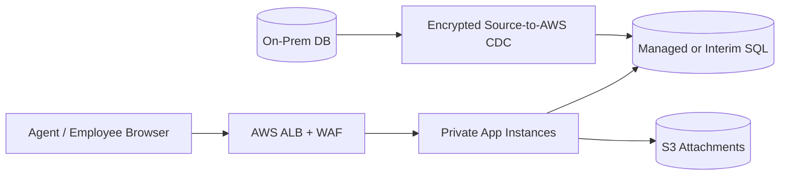
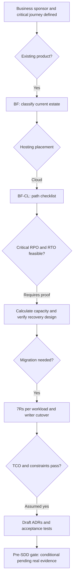

# Worked Pre-SDD | BF-CL | Simple — On-Prem IT Service Desk Migration to AWS

**Example ID:** EX-BF-CL-Simple  
**Classification:** Brownfield × Cloud  
**Primary recovery tier:** Simple — Both RPO **24 h** and RTO **12 h** are **greater than 6 hours** for the stated primary failure scope.  
**Migration overlay:** On-premises → AWS cloud  
**Version/date:** 1.0 / 2026-10-16  
**Status:** ILLUSTRATIVE WORKED EXAMPLE, **NOT** a real stakeholder-approved Pre-SDD. Every person, product, demand number, target, time allowance, price and budget below is intentionally **invented** for architectural training unless a public reference explicitly substantiates a general service behavior.

**Companion documents:** [Pre-SDD Standard](./Pre-SDD_Architecture_Standard_v1.md) · [Blank Intake](./Pre-SDD_Project_Intake_Template.md) · [Case Index](./PreSDD_Examples_README.md)

## 1. Business brief, responsibility and classification

| Field | Completed fictional business input |
|---|---|
| Business sponsor / sign-off | VP ITSM ticket management (role is illustrative; no real signature) |
| Product owner / data owner | Product Manager + domain Data Steward (illustrative) |
| Lead architect / design authority | Enterprise Solution Architect + Architecture Review Board (illustrative) |
| Problem/outcome | Retire aging data-center application estate and reduce 3-year operation cost |
| Critical journey | Create, assign and comment on a service ticket |
| Population | Internal support agents and employees |
| Source/current estate | Two VMware app VMs, SQL database, Windows scheduled report task, and unsupported legacy knowledge base; observed peak 18 TPS, p99 2,800 ms |
| Source→target | Corporate on-prem VMware/SQL Server data center → AWS public cloud in approved US region |
| Path / direction | BF-CL / On-premises → AWS cloud |
| Hard placement guardrail | Data center exit in 9 months; managed backup/monitoring accepted by compliance |
| Deadline | 9 months before data-center lease termination |
| Compliance baseline | Internal support tickets may contain PII; US-resident copies, encryption and retention redaction |
| Assumed financial exposure | $2,500/hour of critical-journey outage |

**Why classification is correct.** The workload already runs, has legacy state and dependencies, and requires discovery and reversible changes. Target placement is AWS public cloud in approved US region. The migration overlay is recorded separately; it does not create a fifth branch.

## 2. NFR contract, scope and business-impact arithmetic

| Dimension | Fictional business target, exact semantics |
|---|---|
| RPO for primary incident | 24 h for last recoverable committed data |
| RTO for primary incident | 12 h until the business API/journey is usable |
| Incident/fault scope | single application or database service failure in target AWS region |
| Separate full site / region disaster | Full AWS region loss: RPO 24 h; RTO 48 h using cross-region daily backups |
| Availability SLO | 98.00% 30-day critical-journey success; failed/time-out calls counted as errors |
| p50 / p95 / p99 | ≤250 / ≤850 / ≤1800 milliseconds; edge ingress-to-valid-response critical journey |
| Average vs peak | 2 TPS during 16 active h/day / 25 TPS for 10 minutes |
| API RPS at peak | 75 external requests/s; each business transaction performs 3 such requests |
| Peak simultaneously active users | 600 (not to be confused with peak in-flight requests) |
| Year-1 demand growth | +25%; validate at 1.25× additional load |
| Data correctness | Restore coherent recoverable records and reconcile permitted RPO loss |
| Support / escalation | Extended business hours, production on-call escalation, restore drill quarterly |

**Scope is binding:** `single application or database service failure in target AWS region`. **Other disasters have different commitments:** Full AWS region loss: RPO 24 h; RTO 48 h using cross-region daily backups. RTO is elapsed time from loss of the scoped business journey until a verified usable journey returns; RPO is the age of last recoverable committed business data at the incident point. It is wrong to claim site/region/cyber recovery meets 12 h just because a node/rack/zone test does.

**30-day downtime budget:** `(1 - 98.00000/100) × 30 × 24 × 3600 = 51840.0 seconds = 864.00 minutes`. This is an illustrative **end-to-end journey** error budget, not an individual cloud service SLA. One recovery exercise may consume part of it. The worst-case single-incident RTO of 12 h consumes 83.3% of a full 30-day error budget; all other incidents, deployments and dependency failures must fit the remainder for the period SLO to pass.

**Outage impact at the target RTO (linear approximation):** `$2,500/h × (43,200 s ÷ 3600) = $30,000.00`; actual loss is scenario-specific and may be nonlinear.

## 3. Transparent workload, CPU, network and storage calculations

### 3.1 Workload → CPU and concurrency

- **Transactions/day:** `2 avg TPS × 16 active h/day × 3,600 = 115,200 business transactions/day` (not 25 peak TPS all day).
- **Peak API demand:** `25 TPS × 3 external requests/transaction = 75 RPS` (internal RPCs and retries add separate load).
- **Modeled CPU work:** `25 TPS × 35 ms CPU/transaction ÷ 1,000 = 0.88 busy vCPU cores` before overhead and N-1 protection.
- **CPU-only lower bound:** `ceil(0.88 ÷ 0.60 CPU target)` rounded to even vCPU = **2 application vCPU**; memory, replica availability and DB size require independent empirical sizing.
- **Year-1 expansion decision:** +25% peak traffic raises modeled CPU demand from 0.88 to 1.09 busy cores; maintain a 60% modeled CPU ceiling and N-1 fault-domain tolerance by increasing from **2 → 2 app vCPU per domain**, i.e. **0 additional vCPU** overall in the first year. Reserve cloud quotas / test autoscaling and update cloud forecasts.
- **Little's Law, in-flight API estimate:** `75 external RPS × 0.450 s assumed **mean** response time = 33.8 in-flight API requests` at peak. These are **not** simultaneous human users; do not use p99 as the average.

### 3.2 Network demand and burst allowance

- **Application payload:** `75 RPS × 10 KiB round-trip/request × 1,024 B/KiB × 8 bits/B ÷ 1,000,000 = 6.14 Mb/s`, measured as total application traffic budget across request + response.
- **Engineering envelope:** `6.14 × 2.5 = 15.36 Mb/s` for illustrative retries, framing and bursts, **not** a physical link guarantee; add TLS, database replication, backups, migration, logging and cross-site flows separately.
- **Placement impact:** New AWS VPC with public ALB/WAF and private compute/DB subnets; temporary site-to-site VPN/dedicated link for sync; private admin access and route/CIDR overlap check.

### 3.3 Durable data growth and retention (uncompressed model)

- **Transactional event volume:** `115,200 transactions/day × 4 KiB/event ÷ (1,024 × 1,024) = 0.439 GiB/day`.
- **Additional nontransactional data:** `1.500 GiB/day` (files, attachments, reference data or indexes modeled separately, scenario dependent). Total logical growth **1.939 GiB/day**.
- **12-month no-deletion baseline:** `420 GiB initial + 365 × 1.939 GiB/day = 1,127.9 GiB`. This is a planning bound; active-data TTL can lower net production size.
- **Retention buffers:** hot 365 days × 1.939 = **707.9 GiB** of new logical data, archive +730 days × 1.939 = **1,415.8 GiB** (before compression, index amplification, snapshots, backup copies and replica count).
- **Backup cadence:** every 8 hours leaves a maximum schedule-gap data age of 8 hours **only if** every scheduled backup is complete, recoverable, and application-consistent. RPO slack: 16 hours.

### 3.4 Storage footprint, application memory and database IOPS screening

- **DB operations:** assume 6 logical reads and 2 logical writes per business transaction at the peak (a *different* measure from API RPS). `25 TPS × (6 reads + 2 writes) = 200 logical ops/s`. Double this **fictional** demand for index/WAL amplification and bursts: **400 storage operation/s screening envelope**. These do **not** replace real device/service IOPS tests, write latency or database service quotas.
- **Protected hot footprint:** `(initial 420 GiB + last 365 days 707.9 GiB) × 1.40 index/WAL allowance × 1 retained live physical replica(s) × 1.25 free-capacity allowance = ~1,974 GiB physical-equivalent provisioned`. Archive (1,415.8 GiB), offsite backup and temporary migration copies are **additional**. Managed cloud storage billing may abstract replicas and must **not** be treated as 1 customer-provisioned disks.
- **Memory envelope (not measured):** `2 application vCPU/domain × 4 GiB/vCPU = 8 GiB/domain` for early VM/pod-request modeling; multiply by 1 fault domains for **8 GiB total** application allocation, excluding DB, message platform, OS and observability. Profile heap/working set before ordering hosts or SKUs.
- **Replica-link demand:** no synchronous 3-way quorum is required by the fictional >6-hour RPO/RTO contract; off-site backups and periodic repair are separately scheduled and metered.
- **Monthly API payload volume, both directions:** `2 TPS × 16 h/day × 3,600 × 30 days × 3 calls × 10 KiB ÷ (1,024²) = 98.9 GiB/month`. Only a subset may be *billable egress*; calculate actual inbound/outbound, inter-zone and client/partner traffic from flow telemetry before vendor pricing.

### 3.5 A proposed latency work-budget — not a percentile equation

Allocate the end-to-end p99 **target** into early subsystem work envelopes, solely to guide profiling. **Do not add observed component p99 percentiles to derive end-to-end p99**; concurrent request paths, covariance, queues, errors and retries invalidate that shortcut. Prove the full critical journey under real peak and N-1 fault tests.

| Element | Assumed share of end-to-end target | Engineering work envelope |
|---|---:|---:|
| Edge / auth token checking / transit | 15% | 270.0 ms |
| Application rules and API work | 25% | 450.0 ms |
| Database operations and commits | 40% | 720.0 ms |
| Contention, jitter, retry and test margin | 20% | 360.0 ms |

The design envelopes sum to 1800 ms; they are **planning allowances**, not measured SLI percentiles, and should be revised once distributed tracing exists.

### 3.6 Recovery timing and feasibility

Planned component time budget: **detect and declare issue 30min + restore target database 180min + rebuild app runtime and network 90min + reconcile + verify critical flows 90min = 6.5 hours**, versus RTO **12 h** (modeled margin 5.5 h). These figures are *engineering hypotheses, not measured failover guarantees*; if any single step exceeds its allowance, revise the architecture.

| Failure-recovery step | Hypothetical elapsed budget |
|---|---|
| detect and declare issue | 1800 s |
| restore target database | 3 h |
| rebuild app runtime and network | 1.5 h |
| reconcile + verify critical flows | 1.5 h |

**Backup RPO caveat:** frequency alone is insufficient: incomplete or corrupt backup runs can make achieved RPO worse. Restoration throughput, available target capacity and encrypted backup-key access are mandatory measured checkpoints.

## 4. Selected design and architecture diagram

| Layer | Recommended candidate and rationale |
|---|---|
| Infrastructure / compute | AWS app VMs or managed container tasks (prefer small autoscaled VMs in phase 1), managed SQL-compatible DB after compatibility tests, S3 attachments, snapshots and isolated backup copy. |
| Network / ingress / segmentation | New AWS VPC with public ALB/WAF and private compute/DB subnets; temporary site-to-site VPN/dedicated link for sync; private admin access and route/CIDR overlap check. |
| Software architecture | Preserve service desk domain behavior, replace legacy scheduler with managed task, event/queue-based email; API contract and import adapter compatibility tests. |
| Transactional store and backups | Convert SQL Server to managed SQL-compatible destination only after stored-procedure audit; otherwise rehost SQL as interim step; 8-hourly recovery points verified. |
| Identity | Federated OIDC/SSO with corporate directory |
| External dependencies | Directory/SSO, HR roster, SMTP notification and archived KB connector |
| Security | Internal support tickets may contain PII; US-resident copies, encryption and retention redaction |
| Operations | Extended business hours, production on-call escalation, restore drill quarterly |

> Diagram depicts a proposed deployment pattern, not a provider-specific implementation guarantee. A full SDD must expand all security groups/firewalls, route paths, subnet CIDRs, AZ/rack anti-affinity, certificates, dependencies, data movement and operational owners.

## 5. Actual requirements → infrastructure, network and software consequences

| Business requirement | Assumed input | Infrastructure decision | Network decision | Software/data decision |
|---|---|---|---|---|
| `CAP-01/02/04` Demand | 25 peak TPS; 75 external RPS | Provision 2 vCPU per fault domain (1 domain(s)) as first-pass CPU-only envelope; prove disk and memory separately | Design for ~15.4 Mb/s modeled application payload headroom; test east-west and failover burst | Bounded queue/retries, rate limits, load sheds noncritical requests |
| `CAP-07` Tail latency | p99 ≤1800 ms | CPU contention and DB IO tracing with p99 under peak | Minimize RTT and cross-datacenter synchronous hops | Index/test hot keys and limit critical sync call fanout |
| `REL-03` RTO | 12 h, scoped single application or database service failure in target AWS region | Backup images and restore capacity available by incident start | Document DNS/firewall/spare subnet restoration | Document restore and reconcile runbook |
| `REL-04/10` RPO/correctness | 24 h | Verify <= 8 h recovery-point spacing with application consistency | Off-site protected backup transport | Coherent restore and manual reconciliation |
| `REL-01` Availability | 98.00%; 30d 864.00 min error-budget equivalent | Avoid shared failure domains; align support model | Edge/IdP/DNS dependencies part of end-to-end SLO | Degrade noncritical steps instead of letting the user journey fail |
| `DAT-02/06` Volume | 420 GiB initial + 1.94 GiB/day modeled | Disk/backup capacity includes indexes and replicas, not just raw events | Backup, CDC and bulk-copy link capacity to be sized | Retention, archival, partitions, purge and reconciliation |
| `SEC-02/04` Security | Internal support tickets may contain PII; US-resident copies, encryption and retention redaction | Encrypted volumes, secrets and role split | TLS/segmentation, private DB and admin reachability | OIDC, authorization checks, secure logs, tenant isolation if applicable |
| `INT-01/09` Dependencies | Directory/SSO, HR roster, SMTP notification and archived KB connector | Service integration owner and HA gap review | Link reachability and external rate limits | Async adapter/outbox and timeouts |
| `ECO-01/03` TCO | $538,000 3-year model vs $580,000 ceiling | Avoid unnecessary hot redundancy for relaxed RTO | Egress/backups/extra links included in estimates | Decomposition cost and support burden must be justified |
| `OPS-07 / MIG` Transition | On-premises → AWS cloud | Dual running temporarily, reserve destination capacity | Encrypted source→target transit; CIDR, RTT, bandwidth, egress cost | Per-workload 7Rs, CDC, single write authority and cutover rehearsal |

## 6. All 70 master checklist inputs filled for this fictional initiative

The original standard contains **70** inputs. The table below provides a specific assumed answer or explained N/A for each, enabling the architect to practice replacing assumptions with real stakeholder evidence. The corresponding general *three-layer impacts* remain in the [standard](./Pre-SDD_Architecture_Standard_v1.md); case-specific consequences appear in Section 5 above.

### 6.1. Business objectives (8 inputs)

| Req ID / question | Completed example input | Evidence owner / approval status |
|---|---|---|
| `BUS-01` — Problem, business outcome and KPI with baseline, target, deadline | Retire aging data-center application estate and reduce 3-year operation cost; business KPI owner: sponsor; baseline: Two VMware app VMs, SQL database, Windows scheduled report task, and unsupported legacy knowledge base; observed peak 18 TPS, p99 2,800 ms. | Business sponsor/Product; **fictional assumed, not signed** |
| `BUS-02` — Critical user journeys, failure impact and journey priorities | Tier-2 critical journey: Create, assign and comment on a service ticket; outage loss modeled at $2,500/hour. | Business sponsor/Product; **fictional assumed, not signed** |
| `BUS-03` — In/out of scope; dependencies; MVP versus later phases | In: API/UI, durable core data, operations, SLO tests. Out: unrelated products and historical vendor platform rewrite; project scope is On-Prem IT Service Desk Migration to AWS. | Business sponsor/Product; **fictional assumed, not signed** |
| `BUS-04` — Revenue/loss or safety impact per outage and per degraded minute | At-risk value: $2,500/h = $0.69/s. Business-impact calculation is an *assumption*, not actual loss evidence. | Business sponsor/Product; **fictional assumed, not signed** |
| `BUS-05` — Launch date, hard deadlines, blackout/change windows | Assumed deadline: 9 months before data-center lease termination; no deployments during agreed monthly financial/plant/change blackout window. | Business sponsor/Product; **fictional assumed, not signed** |
| `BUS-06` — Countries, users, contracts and accessibility/localization commitments | Users: 10,000; simultaneous active user forecast 600; audience: Internal support agents and employees; localization English-first with accessibility checks. | Business sponsor/Product; **fictional assumed, not signed** |
| `BUS-07` — Explicit prohibitions / non-goals (e.g., forbidden data movement) | Hard placement constraint: Data center exit in 9 months; managed backup/monitoring accepted by compliance; processing/storage in US-approved region only; no exception assumed. | Business sponsor/Product; **fictional assumed, not signed** |
| `BUS-08` — Commercial/legal obligations to customers and penalty conditions | Internal journey SLO 98.00% on a rolling 30-day window; any contractual penalties and external SLA wording require legal approval; not assumed equal to component SLA. | Business sponsor/Product; **fictional assumed, not signed** |

### 6.2. Capacity and latency (12 inputs)

| Req ID / question | Completed example input | Evidence owner / approval status |
|---|---|---|
| `CAP-01` — Transactions by **type**: normal and peak TPS, and define what a transaction counts | Business transactions defined as **Create, assign and comment on a service ticket**; normal active-hour avg 2 TPS and 10-minute peak 25 TPS. | Product + SRE; **fictional assumed, not signed** |
| `CAP-02` — API request rate (RPS), reads/writes, retries, fan-out, requests per business transaction | 3 externally visible API calls/transaction; peak 75 RPS; internal fan-out and retry amplification tested independently. | Product + SRE; **fictional assumed, not signed** |
| `CAP-03` — DAU/MAU, peak *simultaneously active* users, sessions and session duration | 10,000 total accounts; 600 simultaneously active users at peak; stateless HTTP session and OIDC token validation. | Product + SRE; **fictional assumed, not signed** |
| `CAP-04` — Hourly/daily/weekly peaks, seasonality, campaign and burst size/duration | Average active usage 16 h/day; burst for 10 min at 25 TPS; recovery may be scheduled around noncritical hours. | Product + SRE; **fictional assumed, not signed** |
| `CAP-05` — Forecasted growth by period and confidence, major future feature/product launches | Year-1 demand growth +25% over launch; rerun CPU/storage/network model at 1.0× and 1.25× load; review quarterly. | Product + SRE; **fictional assumed, not signed** |
| `CAP-06` — Payload/request/response sizes, file/object sizes, compression assumptions | Request+response byte budget 10 KiB per external API call; durable event/transaction payload 4 KiB (before indexes/replication). | Product + SRE; **fictional assumed, not signed** |
| `CAP-07` — p50, p95, p99 (and p99.9 if justified) *per critical journey*; units and observation window | Ingress-to-response p50 ≤250 ms; p95 ≤850 ms; p99 ≤1800 ms for the critical journey over a 30-day window; separate transient error rate objective. | Product + SRE; **fictional assumed, not signed** |
| `CAP-08` — Define where latency is measured (client end-to-end, ingress, service, batch completion) and what counts as failure | Timestamp at ingress proxy after TLS termination until valid API response; count timed-out/failed calls in error SLI (do not omit failures from availability). | Product + SRE; **fictional assumed, not signed** |
| `CAP-09` — Max queue age, processing deadline, freshness, end-to-end batch completion and backlog recovery target | Daily/report jobs complete within 4 h; async noncritical queue age ≤60 min. | Product + SRE; **fictional assumed, not signed** |
| `CAP-10` — Read/write mix, hot keys, expensive operations, query/report schedules | Assumed 80% reads / 20% writes for the noncritical journeys; verify indexes in profiling. | Product + SRE; **fictional assumed, not signed** |
| `CAP-11` — Expected request failures/timeouts/retry behavior at dependencies and load-shedding tolerance | Retry transient read once; enforce idempotency for create/update; circuit-break noncritical partner calls. | Product + SRE; **fictional assumed, not signed** |
| `CAP-12` — Resource-intensive AI/ML/media jobs if in scope: model size, token/compute demand, jobs and deadlines | No AI/ML/GPU jobs in scope; N/A by design. | Product + SRE; **fictional assumed, not signed** |

### 6.3. Reliability, RPO and RTO (10 inputs)

| Req ID / question | Completed example input | Evidence owner / approval status |
|---|---|---|
| `REL-01` — Availability SLO **per user journey**; denominator, service window, and measurement period | End-to-end 98.00% 30-day availability SLO for Create, assign and comment on a service ticket; excludes only formally accepted maintenance windows (none for complex). | Business continuity + SRE; **fictional assumed, not signed** |
| `REL-02` — SLA to customers vs internal SLO; what failures/exclusions count; penalties | Internal SLO only until customer/employee agreement is approved; monthly downtime budget calculated from 98.00%; component provider SLAs cannot substitute. | Business continuity + SRE; **fictional assumed, not signed** |
| `REL-03` — RTO per service/journey **and disaster scenario**: acceptable elapsed time to restored usable service | RTO **12 h** for single application or database service failure in target AWS region; Full AWS region loss: RPO 24 h; RTO 48 h using cross-region daily backups. | Business continuity + SRE; **fictional assumed, not signed** |
| `REL-04` — RPO per dataset/transaction and disaster scenario: acceptable *age of last recoverable data point* | RPO **24 h** for committed critical data under single application or database service failure in target AWS region; scheduled recovery points every 8 h. | Business continuity + SRE; **fictional assumed, not signed** |
| `REL-05` — Scope of recoverable failure: process, node, rack, site, AZ, region, ransomware, vendor failure | Critical scope: single application or database service failure in target AWS region; distinct site/region case: Full AWS region loss: RPO 24 h; RTO 48 h using cross-region daily backups; ransomware handled with immutable backups, not quorum replicas. | Business continuity + SRE; **fictional assumed, not signed** |
| `REL-06` — Maximum tolerable business interruption, minimum service during degradation, manual fallback and reconciliation | Use status/manual ticket or report queue during recovery; staff approve any manual entries and reconcile after restore. | Business continuity + SRE; **fictional assumed, not signed** |
| `REL-07` — Recovery sequence and dependencies: authentication, payments, ledger, reporting, etc. | Recover network + identity → application → database → notifications/reports; verify each business journey. | Business continuity + SRE; **fictional assumed, not signed** |
| `REL-08` — Approved planned downtime, maintenance restrictions, deployment and upgrade windows | One 2-hour planned monthly maintenance window, subject to business approval; backup exercises isolated from production. | Business continuity + SRE; **fictional assumed, not signed** |
| `REL-09` — Frequency and accepted evidence for restore, failover, failback and cyber-recovery drills | Exercise semiannual: inject primary fault, verify RTO/RPO with data commits before/during fault, save logs/traces, and restore an immutable backup. | Business continuity + SRE; **fictional assumed, not signed** |
| `REL-10` — Data durability and correctness expectations distinct from availability | Accepted records must be internally consistent after backup restore; losses within explicitly approved RPO are reconciled manually. | Business continuity + SRE; **fictional assumed, not signed** |

### 6.4. Data and lifecycle (9 inputs)

| Req ID / question | Completed example input | Evidence owner / approval status |
|---|---|---|
| `DAT-01` — Business entities, system of record, ownership and data contracts | System of record for **Create, assign and comment on a service ticket** is the chosen DB after production authority transfer; business data owner approves schema and lifecycle. | Data owner; **fictional assumed, not signed** |
| `DAT-02` — Starting volume; records/day, GB/day, object size, peak writes and retention horizon | Starting data 420 GiB; modeled transactional events/day and additional growth computed in Section 3; event size 4 KiB. | Data owner; **fictional assumed, not signed** |
| `DAT-03` — Sensitivity classification: PII, financial, confidential, secrets, public | Internal support tickets may contain PII; US-resident copies, encryption and retention redaction. | Data owner; **fictional assumed, not signed** |
| `DAT-04` — Residency, allowed processing/storage/backup locations and cross-border restrictions | US-approved region only; temporary migrations/backup targets subject to data-owner approval; no unapproved cross-border copies. | Data owner; **fictional assumed, not signed** |
| `DAT-05` — Consistency, freshness, correctness, ordering and atomicity by operation | Strongly consistent source DB writes; reporting may lag up to a business day; reject duplicate submissions. | Data owner; **fictional assumed, not signed** |
| `DAT-06` — Retention, records hold, archive, deletion, portability and right-to-erasure requirements | Hot data 365 days, archive additional 730 days (fictional policy), then approved deletion unless legal hold; test purge/retention. | Data owner; **fictional assumed, not signed** |
| `DAT-07` — Multi-tenancy model, tenant isolation level, noisy-neighbor tolerance, tenants and growth | Single organization/account partition; no external multi-tenant SLA; role-based data partition enforced. | Data owner; **fictional assumed, not signed** |
| `DAT-08` — Reporting, analytics, batch exports, reconciliation frequency and data latency | Daily reporting and batch extracts; reporting freshness by next business day; any missing acknowledged source record blocks data-integrity acceptance. | Data owner; **fictional assumed, not signed** |
| `DAT-09` — Restore granularity (tenant/table/whole system), point-in-time needs and recovery verification | Restore complete DB and attachments to one coherent recovery point; tenant/row granular restore is a later requirement. | Data owner; **fictional assumed, not signed** |

### 6.5. Security and governance (8 inputs)

| Req ID / question | Completed example input | Evidence owner / approval status |
|---|---|---|
| `SEC-01` — Laws, contracts, certifications and organization policies *actually applicable*; control mappings | Assume baseline internal security and privacy controls; *no special industry certification assumed*; security/legal must validate actual contractual or statutory obligations. | Security/Legal; **fictional assumed, not signed** |
| `SEC-02` — Actors, partner identities, workforce, machine principals, customer identity sources | Access actors: Internal support agents and employees; admin, support operator, service identity and auditor; Federated OIDC/SSO with corporate directory. | Security/Legal; **fictional assumed, not signed** |
| `SEC-03` — Threat/risk classification, acceptable residual risk and adversary concerns | Medium: PII exposure, role bypass, ransomware, and accidental deletion; complete threat model before release. | Security/Legal; **fictional assumed, not signed** |
| `SEC-04` — Encryption at rest/in transit, BYOK/HYOK, key custody, rotation, certificate requirements | TLS 1.2+ or approved equivalent, encryption at rest, rotated service credentials and secrets in managed vault; network/database access least privilege in provider cloud project/account. | Security/Legal; **fictional assumed, not signed** |
| `SEC-05` — Audit events, non-repudiation, investigation and evidence retention | Audit create/update/export/read of sensitive records, admin changes and restore invocations; protect logs against tampering. | Security/Legal; **fictional assumed, not signed** |
| `SEC-06` — Vulnerability, patch, pen-test, SBOM/supply-chain and incident reporting obligations | CI SAST/DAST/SBOM, automated dependency scanning, quarterly failover and pen-test scope before production; emergency patch procedure. | Security/Legal; **fictional assumed, not signed** |
| `SEC-07` — Required separation of duties, privileged access, break glass and tenant/customer administration | Separate platform admins, production deployers, data owners and incident commanders; break-glass use audited and time-limited. | Security/Legal; **fictional assumed, not signed** |
| `SEC-08` — Third-party processor/subprocessor and vendor risk restrictions | Third-party providers/IdP reviewed by procurement/security; restrict data sharing and define deletion/export obligations; no assumed certification inheritance. | Security/Legal; **fictional assumed, not signed** |

### 6.6. Integrations and networking (9 inputs)

| Req ID / question | Completed example input | Evidence owner / approval status |
|---|---|---|
| `INT-01` — Catalogue of upstream/downstream systems, owner, interface, business criticality | Dependencies: Directory/SSO, HR roster, SMTP notification and archived KB connector; ownership/availability documented per dependency. | Integration + Network; **fictional assumed, not signed** |
| `INT-02` — Synchronous API vs event/file/batch, update frequency, order and delivery expectations | UI→app synchronous API; reporting/notification async or scheduled batch; bounded retry and dead-letter handling. | Integration + Network; **fictional assumed, not signed** |
| `INT-03` — External API quotas, latencies, SLAs, maintenance and rate limits | Assume external email/HR API quota 20 RPS; enqueue excess and measure delivery p99 separately. | Integration + Network; **fictional assumed, not signed** |
| `INT-04` — Failure behavior: reject, retry, queue, compensate, or manual handling | On integration outage: accept local transaction, queue notification, replay within agreed manual SLA. | Integration + Network; **fictional assumed, not signed** |
| `INT-05` — Consistency and ordering guarantees, duplicate tolerance, maximum delay | Best-effort report events, at-least-once delivery; duplicates removed at consumer, no global ordering requirement. | Integration + Network; **fictional assumed, not signed** |
| `INT-06` — Existing public IP, allowlists, firewall change process, proxies, DNS and certificate dependencies | DNS, TLS certificates, partner allowlists and IdP endpoints inventoried; New AWS VPC with public ALB/WAF and private compute/DB subnets; temporary site-to-site VPN/dedicated link for sync; private admin access and route/CIDR overlap check. | Integration + Network; **fictional assumed, not signed** |
| `INT-07` — Client geography, edge locations, remote branches, IoT and intermittent/offline operation | Internal support agents and employees; nominal latency measured at ingress, not synthetic zero-RTT localhost; offline/WAN contingency: Data center exit in 9 months; managed backup/monitoring accepted by compliance. | Integration + Network; **fictional assumed, not signed** |
| `INT-08` — Address ranges, DNS zones, IP overlap, IPv4/IPv6, routing and private connectivity constraints | IP addressing & routing: New AWS VPC with public ALB/WAF and private compute/DB subnets; temporary site-to-site VPN/dedicated link for sync; private admin access and route/CIDR overlap check.; reject overlapping ranges for source/target connectivity; validate symmetric flows and firewall rules. | Integration + Network; **fictional assumed, not signed** |
| `INT-09` — External SLA dependencies; legal or operational inability to move a peer system | External HR/payroll/email dependency may be unavailable; fail only dependent noncritical functions and queue work. | Integration + Network; **fictional assumed, not signed** |

### 6.7. Operations and delivery (8 inputs)

| Req ID / question | Completed example input | Evidence owner / approval status |
|---|---|---|
| `OPS-01` — Support hours, user hours, incident severities, response and escalation commitments | Extended business hours, production on-call escalation, restore drill quarterly; incident escalation starts at critical journey failure, not at app host alarm. | Operations/Delivery; **fictional assumed, not signed** |
| `OPS-02` — Team skills, support model, managed-service restrictions and ownership boundaries | Platform/generalist ops + one database owner, documented restore roles and tested escalation. | Operations/Delivery; **fictional assumed, not signed** |
| `OPS-03` — Release frequency, rollback tolerance and change-freeze windows | Biweekly releases; image/IaC rollback for code, database schema recovery separately tested. | Operations/Delivery; **fictional assumed, not signed** |
| `OPS-04` — Environments needed: dev, test, perf, stage, prod, DR; isolation and test data rules | Dev, staging and prod, separate recoverability test environment; masked sample data only. | Operations/Delivery; **fictional assumed, not signed** |
| `OPS-05` — Logging/tracing/metric retention, event cardinality, alerting and forensic search | 30-day searchable logs and 12-month monthly service indicators; alert on backups, errors, p99, CPU and disk. | Operations/Delivery; **fictional assumed, not signed** |
| `OPS-06` — Business continuity runbooks, escalation matrix and authority to invoke failover | Operations duty lead declares incident, restores backup with DBA approval and logs data-loss assessment. | Operations/Delivery; **fictional assumed, not signed** |
| `OPS-07` — Changeover, reversibility, customer communication and decommissioning expectations | Planned go-live 9 months before data-center lease termination; migration transition: On-premises → AWS cloud; source retirement only after data-owner approval. | Operations/Delivery; **fictional assumed, not signed** |
| `OPS-08` — Testing scope: load, soak, chaos/fault injection, DR, security, compliance, accessibility | Peak/soak, 1-year projected load, database restore, security threat model and UAT, including report/export verification. | Operations/Delivery; **fictional assumed, not signed** |

### 6.8. Economics and constraints (6 inputs)

| Req ID / question | Completed example input | Evidence owner / approval status |
|---|---|---|
| `ECO-01` — One-time implementation/migration budget and recurring annual/monthly run-cost envelope | One-time deployment/migration $70,000; modeled recurring $13,000/month; 3-year ceiling $580,000. | Business finance; **fictional assumed, not signed** |
| `ECO-02` — CapEx/OpEx preferences, currency, commitment period, chargeback unit | USD, 36-month TCO, incremental project CapEx plus recurring operations, no financing/tax/provider quote; include labor in monthly allowance. | Business finance; **fictional assumed, not signed** |
| `ECO-03` — TCO horizon and required benefits (cost, speed, risk, flexibility) | 36-month modeled TCO $538,000; headroom under assumed cap $42,000; schedule quarterly forecast review. | Business finance; **fictional assumed, not signed** |
| `ECO-04` — Delivery deadline, acceptable delivery risk, available people and vendor approval duration | Delivery deadline 9 months before data-center lease termination; procurement and expertise availability are gated, not assumed to be approved. | Business finance; **fictional assumed, not signed** |
| `ECO-05` — Environmental/energy footprint goals **if applicable**, measurement expectations | No separately approved carbon-intensity requirement; efficiency reviewed during sizing (N/A until sponsor sets KPI). | Business finance; **fictional assumed, not signed** |
| `ECO-06` — Exit portability expectations, vendor lock-in tolerance and contract termination rights | Require exportable records, IaC, open documented API, and retained backup restore; non-portable managed DB coupling disclosed in ADR. | Business finance; **fictional assumed, not signed** |

## 7. Path-specific technical discovery

**Verified source/target inventory:** Two VMware app VMs, SQL database, Windows scheduled report task, and unsupported legacy knowledge base; observed peak 18 TPS, p99 2,800 ms. Assess protocol, managed service APIs, SKU/quotas, identity/KMS, CIDR overlaps, egress, application compatibility, data semantics, license export, historical performance and vendor support. **Direction:** On-premises → AWS cloud.

### Brownfield as-is → to-be gap and inventory

| As-is observation / dependency | Required change / design response |
|---|---|
| Two VMware app VMs, SQL database, Windows scheduled report task, and unsupported legacy knowledge base; observed peak 18 TPS, p99 2,800 ms | Evaluate measured baseline versus peak 25 TPS, p99 ≤1800 ms and RTO 12 h. |
| Current location / data dependency: Corporate on-prem VMware/SQL Server data center | Inventory DB, scheduled jobs, certificates, directory, SDKs, routing, operator practices and license compatibility. |
| Current failover and old recovery | Introduce Convert SQL Server to managed SQL-compatible destination only after stored-procedure audit; otherwise rehost SQL as interim step; 8-hourly recovery points verified.; preserve rollback, data lineage and verification evidence. |
| Legacy integration | Directory/SSO, HR roster, SMTP notification and archived KB connector; isolate or jointly migrate latency-coupled consumers. |

## 8. Options appraisal and modeled 36-month economics

Cost estimates below are hypothetical line-item allowances, **not vendor quotes**. The monthly figure includes incremental allocated operations/engineering effort, infrastructure/services, network, backups and observability; it does not establish an actual provider price. One-time costs include a procurement allowance on-prem, and migration labor/testing for brownfield where applicable. Excludes taxes, financing, contractual discounts and unapproved headcount assumptions.

**Preferred candidate TCO arithmetic:** $0 + 36 × $13,000 + $70,000 = **$538,000 (36-month illustrative TCO)**; cap $580,000, difference **$42,000**.

**Invented monthly allowance breakdown (sum equals the monthly TCO input):**

| Category | Illustrative monthly spending envelope |
|---|---:|
| Compute, managed runtime and licenses | $4,550 |
| DB, files, backup and archival | $2,600 |
| Network, transit, monitoring, security tooling | $1,950 |
| Allocated on-call, SRE and platform labor | $3,900 |

**Finance stress test:** if monthly run costs were 25% above this fictional allowance for all 36 months, modeled TCO would be **$655,000** versus $580,000 cap — **over budget; renegotiate, redesign or increase cap before final approval**. This is not a forecast or an actual vendor quote. The growth-capacity additions from Section 3 require real pricing/availability before sign-off.

**Reference baseline (fictional):** existing ongoing estate $18,000/month × 36 = $648,000 without new investments. Net candidate difference vs that narrow baseline = $-110,000. This is **not** a causal ROI estimate and excludes changing operations and avoided risk.

| Alternative | Hard constraint | RTO/RPO feasibility at stated scope | Illustrative 36-month cost | Decision |
|---|---|---|---:|---|
| Phased rehost app + replatform eligible database | Pass if parity tested | 12 h target candidate | $538,000 | Preferred if no incompatible SQL features |
| Full refactor before data-center exit | Pass in principle | 9-month deadline risk | $1,200,000 | Rejected as initial wave |
| Keep on-prem and extend support | Fail: lease exit | Unacceptable | $648,000 | Excluded by deadline |

**Architecture decision rule:** hard constraints and critical correctness/recovery come first; cost is compared only among feasible options. Even the preferred candidate needs measurement.

## 9. Migration overlay, applied 7Rs and cutover

**Source → target:** On-prem VMware / SQL Server → AWS. This remains **BF-CL**, even though it has a different source platform. **Do not interpret the 7Rs as seven sequential steps:** evaluate one primary disposition **per component**.

### 9.1 Bulk-copy/CDC and economics calculation

| Variable | Hypothetical input / computed result |
|---|---|
| Initial data requiring transfer | 420 GiB = 430,080 MiB |
| Effective measured throughput hypothesis | 80 MiB/s **usable**, after TLS/overhead; not link headline bandwidth |
| Minimum one-pass transfer time | 430,080 MiB ÷ 80 MiB/s = **1.49 hours** with no retransmissions, validation or contention |
| Ongoing CDC event stream | 0.60 MiB/s average; 0.75% of effective bulk-link throughput (check bursts separately) |
| Example data-transfer tariff | $0.015 per GiB, purely fictional financial planning assumption |
| One-pass variable transfer expense | 420 × $0.015 = **$6.30**, before repeated copies/egress/links/dual-run |
| Planned migration cutover (not incident RTO) | **2 hours planned service interruption maximum; migration bulk copy happens before freeze** |

**Critical distinction:** data copied in 1.49 hours is not enough evidence for a 120-minute cutover. The bulk copy runs while the **source remains authoritative**. CDC must catch up. During final cutover, fence/drain source writers, confirm the last committed watermark, validate checksums and only then promote the target. Long-term RPO/RTO compliance is separately tested after traffic has moved.

### 9.2 Applied seven-R assessment

| Component / capability | Selected strategy or explicitly rejected alternative | Decision and impact |
|---|---|---|
| Legacy knowledge-base portal | Retire | Usage analytics indicate it is unused (fictional assumption); redirect bookmarks after approval |
| Legacy fax/notification gateway | Retain | Provider-bound service stays on-prem for six months behind encrypted link; record later exit date |
| Main service-desk app VMs | Rehost | Maintain Windows/IIS/API contracts initially on cloud VM while clearing exit deadline |
| VMware estate in bulk | Relocate — not selected | Do not presume hypervisor-level portable relocation path; validate tooling/licensing before adoption |
| Third-party reporting dashboard | Repurchase | Replace old dashboard product with approved cloud BI/SaaS, migrate roles and exports |
| SQL data tier | Replatform | Move into eligible managed relational DB only if SQL features, performance and RPO tests pass |
| Legacy integration daemon | Refactor / re-architect | Replace polling job with queue-driven adapter after core cutover, with compensations |

**Relocate** is assessed but *rejected* here rather than mislabeled as a feasible universal cross-platform option. Every component gets one intended primary disposition; conditional rows require a proof-of-compatibility before approval.

### 9.3 Migration waves, data authority and rollback

1. W0: inventory 100% of tickets, SQL procedures, attachments, identities and consumers; define hashes/counts.
2. W1: AWS landing zone, VPC, IAM/KMS, private DB and monitoring; create VPN and test return network.
3. W2: full source snapshot/backfill, transform/verify database, copy attachments, run one-way CDC while source remains sole writer.
4. W3: agents pilot via read-only shadow; freeze new ticket writes for the approved cutover window; drain and reconcile CDC; switch app and DNS/service entry.
5. W4: validate role-based ticket creation, history, p99 and backups, start target as sole writer; rollback only before point-of-no-return or with proven reverse sync.
6. W5: observe for 30 days, retain legal/audit exports, close VPN/credentials, retire unused source workloads after sign-off.

**Point of no return:** the first acknowledged transaction written only to the new target after writer-lease/ownership transfer. After this point, an unplanned reversal to source without reverse replication would silently lose transactions or double-charge; use rollforward or proven reverse reconciliation.

## 10. Decision Tree — executed outcome for this case

| Gate | Question | Sample outcome |
|---|---|---|
| G1: Business | Named journey, sponsor and business value? | YES as fictional assumption; business re-sign required in real use |
| G2: Classification | Existing workload? hosting path? migration?  | BF-CL; overlay On-premises → AWS cloud |
| G3: Hard constraints | Residency, offline operation, deadlines/security eligible? | Concept passes with placement reason: Data center exit in 9 months; managed backup/monitoring accepted by compliance |
| G4: NFR feasibility | p99 ≤1800 ms; RPO 24 h; RTO 12 h | CONDITIONAL: recovery budget and throughput mathematically plausible, not benchmarked |
| G5: Migration | Per-workload 7R, data authority, rollback? | CONDITIONAL: run documented cutover rehearsal / parity test |
| G6: Economics/operations | Expected 36-month model below cap? staffing? | MODELED PASS: $538,000 < $580,000; vendor quotes / staffing not validated |
| G7: ADRs & tests | Alternatives recorded, measurable tests defined? | YES: ADR candidates and verification plan below |
| G8: Authorization | Real approvals and SLO evidence received? | **NOT YET — cannot approve Pre-SDD on invented inputs** |

**Example branch trace:** Existing application: Brownfield → Target AWS cloud: BF-CL → Source on-prem → cloud: use per-workload 7Rs → RPO 24 h / RTO 12 h supports phased backup-based DR → Fit TCO; gated on SQL compatibility + rehearsal.

## 11. Proposed Architecture Decision Records (ADRs) and traceability

| Proposed ADR | Required inputs | Recommended decision | Rejected alternative / consequence | SDD output | Validation evidence |
|---|---|---|---|---|---|
| ADR-BF_CL_Simple-001: Hosting | BUS-05, BUS-07, ECO-01 | AWS public cloud in approved US region | Alternative placement violates constraints or delivery/economic fit | Deployment view, fault domains, responsibility matrix | Architecture gate and facility/landing-zone checklist |
| ADR-BF_CL_Simple-002: RPO/RTO/DR | REL-01, REL-03, REL-04, REL-05 | Convert SQL Server to managed SQL-compatible destination only after stored-procedure audit; otherwise rehost SQL as interim step; 8-hourly recovery points verified. | Do not promise stronger untested site/region RTO | Recovery design, data authority and runbooks | Scoped recovery ≤12 h and data loss ≤24 h |
| ADR-BF_CL_Simple-003: Scaling | CAP-01, CAP-02, CAP-05, CAP-07 | 2 modeled vCPU/domain; 1 fault domain(s) | Pure average TPS sizing and unmeasured p99 disallowed | Load model, deployment sizing and observability | N-1 peak + year-1 growth, p99 and error SLIs |
| ADR-BF_CL_Simple-004: Networking | INT-01, INT-06, INT-08 | New AWS VPC with public ALB/WAF and private compute/DB subnets; temporary site-to-site VPN/dedicated link for sync; private admin access and route/CIDR overlap check. | Avoid undocumented synchronous offsite calls / DNS-only failover | Network zone/CIDR diagram, flow and security matrix | Traffic replay, link-loss exercise, firewall/RTT measurements |
| ADR-BF_CL_Simple-005: Software boundaries | DAT-05, INT-02, REL-10 | Preserve service desk domain behavior, replace legacy scheduler with managed task, event/queue-based email; API contract and import adapter compatibility tests. | Avoid redundant microservices or uncontrolled write authority | Component model, transaction/outbox/error semantics | Replay, idempotency, transaction/contract tests |
| ADR-BF_CL_Simple-006: Modernization | OPS-07, DAT-01, INT-01 | On-premises → AWS cloud | Uncontrolled big-bang replacement or undocumented legacy coupling | As-is/to-be, migration roadmap, decommission plan | Compatibility matrix and reversible rehearsal |
| ADR-BF_CL_Simple-007: 7R/cutover | OPS-07, DAT-05, ECO-03 | Per-component strategies with fenced target write-authority transfer | No global double writer or blind DNS rollback | Per-wave migration design and runbook | Checksum, last event watermark, per-tenant cutover gate |

**Required trace chain:** `REQ ID → design impact → option/decision → proposed ADR → SDD section → test evidence`. A real ADR remains **Proposed** until reviewed; a design sentence above is not an approved ADR.

## 12. Concrete validation plan and acceptance thresholds

| Test ID | How to test | Pass/fail threshold |
|---|---|---|
| TEST-CAP-01 | Replay peak 25 TPS using 3 API requests/txn for >=30 min, 30-day-like mix and realistic payloads | Throughput ≥25 TPS; p50/p95/p99 ≤250/850/1800 ms; error SLI within approved budget |
| TEST-CAP-02 | Repeat at year-1 demand 31 TPS | Either pass SLO with funded additional capacity or record scaling lead time and milestone |
| TEST-DR-01 | Inject single application or database service failure in target AWS region, generate uniquely numbered committed business transactions immediately before/during event | Measured journey interruption ≤12 h and loss age ≤24 h; no acknowledged duplicate effects |
| TEST-DR-02 | Restore from an isolated/immutable backup without trusting primary replicated data | Demonstrate Full AWS region loss: RPO 24 h; RTO 48 h using cross-region daily backups with exact measured times; document any exception |
| TEST-SEC-01 | Pen-test roles and service identity; verify no unauthorized access, secrets in logs or direct data-tier ingress | No release-blocking findings; auditor retains evidence |
| TEST-OPS-01 | Break DNS/IdP/partner channel, replay retries, verify alerts, runbook and ownership | Critical path unaffected where claimed; noncritical buffering and reconciliation confirmed |
| TEST-MIG-01 | Full dataset copy + CDC tail + per-partition row counts/checksums + idempotency stress and source writer fence | No missing committed events; planned cutover ≤120 min; rehearsed rollback only before point-of-no-return |

**Evidence capture:** run ID, timestamps, test environment/topology, workload generator parameters, fault command/time, commits sent/acknowledged, first successful post-fault business response, p50/p95/p99 charts, SLI error counts, reconciliation and owner approval. Do not declare pass from an infrastructure health dashboard alone.

## 13. Risks, gaps and assumptions requiring ownership

- [ ] SQL Server stored procedures or licenses may block managed DB route — owner: Lead architect/SRE/Data owner; severity to be assessed; closing artifact: verified evidence or signed exception.
- [ ] On-prem DNS/IdP dependency may remain as single point of failure — owner: Lead architect/SRE/Data owner; severity to be assessed; closing artifact: verified evidence or signed exception.
- [ ] Source cutover rollback invalid after target-only writes unless reverse-sync exists — owner: Lead architect/SRE/Data owner; severity to be assessed; closing artifact: verified evidence or signed exception.
- [ ] Network throughput, CIDR overlap and data egress must be observed — owner: Lead architect/SRE/Data owner; severity to be assessed; closing artifact: verified evidence or signed exception.
- [ ] Replace all invented traffic, cost, recovery and legal assumptions with named business/data/platform owners and supporting measurements; **this item always blocks production sign-off**.
- [ ] Confirm security/privacy compliance, purchased vendor SKU behavior, regional service parity, RPO/RTO definitions and deployment runbook with actual teams.

## 14. Pre-SDD gate decision and sign-off matrix

**Preliminary architectural recommendation:** use **BF-CL / Simple** path, candidate **Phased rehost app + replatform eligible database**, and the DR/correctness strategy in ADR-002. The workload math demonstrates an engineering sizing *hypothesis*, not achieved SLIs.

| Required authority | Sign-off in fictional sample | Real rollout action |
|---|---|---|
| Business sponsor / Product | **Not signed** (training example) | Validate targets, evidence, risk and cost before SDD baseline |
| Data owner / Compliance | **Not signed** (training example) | Validate targets, evidence, risk and cost before SDD baseline |
| Security | **Not signed** (training example) | Validate targets, evidence, risk and cost before SDD baseline |
| Network / Infrastructure / Cloud platform | **Not signed** (training example) | Validate targets, evidence, risk and cost before SDD baseline |
| SRE / Operations | **Not signed** (training example) | Validate targets, evidence, risk and cost before SDD baseline |
| Enterprise Architecture Board | **Not signed** (training example) | Validate targets, evidence, risk and cost before SDD baseline |

**Gate conclusion:** **CONDITIONAL / NOT APPROVED** because the inputs are assumed, not provided and signed by an accountable business team, and the critical SLI/failover/restore evidence has not been measured. An architect following this standard must close the red items or obtain an authorized, time-bound waiver before starting a production SDD.

## 15. Public architecture references (inspiration, not the source of hypothetical sample numbers)

- [AWS Prescriptive Guidance: 7 migration strategies](https://docs.aws.amazon.com/prescriptive-guidance/latest/large-migration-guide/migration-strategies.html)
- [AWS Well-Architected: Defined recovery strategies](https://docs.aws.amazon.com/wellarchitected/2024-06-27/framework/rel_planning_for_recovery_disaster_recovery.html)
- [AWS RDS Multi-AZ failover timing (typically 60–120 s)](https://docs.aws.amazon.com/AmazonRDS/latest/UserGuide/Concepts.MultiAZ.Failover.html)

> These references inform available patterns and limitations. They **do not** establish any of the fictional traffic, failure time budgets, budget prices or achieved SLOs in this exercise. Check current service SKU, quota, pricing and service-level guarantees at project time.

