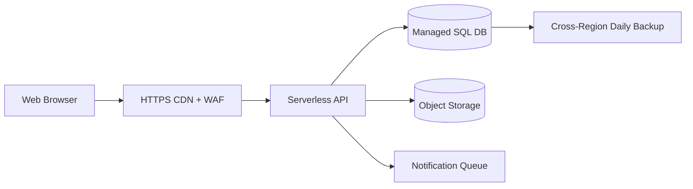
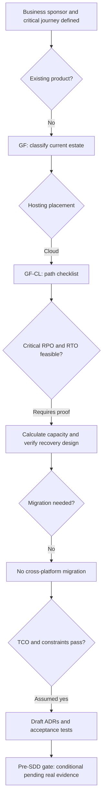

# Worked Pre-SDD | GF-CL | Simple — Customer Feedback & Event Registration Portal

**Example ID:** EX-GF-CL-Simple  
**Classification:** Greenfield × Cloud  
**Primary recovery tier:** Simple — Both RPO **12 h** and RTO **12 h** are **greater than 6 hours** for the stated primary failure scope.  
**Migration overlay:** None  
**Version/date:** 1.0 / 2026-10-16  
**Status:** ILLUSTRATIVE WORKED EXAMPLE, **NOT** a real stakeholder-approved Pre-SDD. Every person, product, demand number, target, time allowance, price and budget below is intentionally **invented** for architectural training unless a public reference explicitly substantiates a general service behavior.

**Companion documents:** [Pre-SDD Standard](./Pre-SDD_Architecture_Standard_v1.md) · [Blank Intake](./Pre-SDD_Project_Intake_Template.md) · [Case Index](./PreSDD_Examples_README.md)

## 1. Business brief, responsibility and classification

| Field | Completed fictional business input |
|---|---|
| Business sponsor / sign-off | VP Customer engagement (role is illustrative; no real signature) |
| Product owner / data owner | Product Manager + domain Data Steward (illustrative) |
| Lead architect / design authority | Enterprise Solution Architect + Architecture Review Board (illustrative) |
| Problem/outcome | Launch the service in 10 weeks and support seasonal campaigns |
| Critical journey | Register for an event and submit feedback |
| Population | Public users in the United States |
| Source/current estate | None: net-new service |
| Source→target | None → AWS single-region cloud landing zone |
| Path / direction | GF-CL / None |
| Hard placement guardrail | No data center assets; high speed of delivery; no hard offline/residency restriction outside US |
| Deadline | 10 weeks after initiation |
| Compliance baseline | User contact data; US-only processing (assumed), encryption and retention/delete controls |
| Assumed financial exposure | $1,000/hour of critical-journey outage |

**Why classification is correct.** No pre-existing production system is preserved. All business capabilities and data authority begin at launch. Target placement is AWS single-region cloud landing zone. The migration overlay is recorded separately; it does not create a fifth branch.

## 2. NFR contract, scope and business-impact arithmetic

| Dimension | Fictional business target, exact semantics |
|---|---|
| RPO for primary incident | 12 h for last recoverable committed data |
| RTO for primary incident | 12 h until the business API/journey is usable |
| Incident/fault scope | loss of the deployed application or database availability in the chosen region, recoverable from backups |
| Separate full site / region disaster | Full cloud-region outage: RPO 24 h; RTO 36 h using daily cross-region backup copies |
| Availability SLO | 98.00% 30-day critical-journey success; failed/time-out calls counted as errors |
| p50 / p95 / p99 | ≤250 / ≤900 / ≤1800 milliseconds; edge ingress-to-valid-response critical journey |
| Average vs peak | 0.8 TPS during 24 active h/day / 30 TPS for 10 minutes |
| API RPS at peak | 60 external requests/s; each business transaction performs 2 such requests |
| Peak simultaneously active users | 700 (not to be confused with peak in-flight requests) |
| Year-1 demand growth | +60%; validate at 1.60× additional load |
| Data correctness | Restore coherent recoverable records and reconcile permitted RPO loss |
| Support / escalation | Business hours 07:00–19:00 US Central; on-call for critical incidents |

**Scope is binding:** `loss of the deployed application or database availability in the chosen region, recoverable from backups`. **Other disasters have different commitments:** Full cloud-region outage: RPO 24 h; RTO 36 h using daily cross-region backup copies. RTO is elapsed time from loss of the scoped business journey until a verified usable journey returns; RPO is the age of last recoverable committed business data at the incident point. It is wrong to claim site/region/cyber recovery meets 12 h just because a node/rack/zone test does.

**30-day downtime budget:** `(1 - 98.00000/100) × 30 × 24 × 3600 = 51840.0 seconds = 864.00 minutes`. This is an illustrative **end-to-end journey** error budget, not an individual cloud service SLA. One recovery exercise may consume part of it. The worst-case single-incident RTO of 12 h consumes 83.3% of a full 30-day error budget; all other incidents, deployments and dependency failures must fit the remainder for the period SLO to pass.

**Outage impact at the target RTO (linear approximation):** `$1,000/h × (43,200 s ÷ 3600) = $12,000.00`; actual loss is scenario-specific and may be nonlinear.

## 3. Transparent workload, CPU, network and storage calculations

### 3.1 Workload → CPU and concurrency

- **Transactions/day:** `0.8 avg TPS × 24 active h/day × 3,600 = 69,120 business transactions/day` (not 30 peak TPS all day).
- **Peak API demand:** `30 TPS × 2 external requests/transaction = 60 RPS` (internal RPCs and retries add separate load).
- **Modeled CPU work:** `30 TPS × 25 ms CPU/transaction ÷ 1,000 = 0.75 busy vCPU cores` before overhead and N-1 protection.
- **CPU-only lower bound:** `ceil(0.75 ÷ 0.60 CPU target)` rounded to even vCPU = **2 application vCPU**; memory, replica availability and DB size require independent empirical sizing.
- **Year-1 expansion decision:** +60% peak traffic raises modeled CPU demand from 0.75 to 1.20 busy cores; maintain a 60% modeled CPU ceiling and N-1 fault-domain tolerance by increasing from **2 → 4 app vCPU per domain**, i.e. **2 additional vCPU** overall in the first year. Reserve cloud quotas / test autoscaling and update cloud forecasts.
- **Little's Law, in-flight API estimate:** `60 external RPS × 0.350 s assumed **mean** response time = 21.0 in-flight API requests` at peak. These are **not** simultaneous human users; do not use p99 as the average.

### 3.2 Network demand and burst allowance

- **Application payload:** `60 RPS × 16 KiB round-trip/request × 1,024 B/KiB × 8 bits/B ÷ 1,000,000 = 7.86 Mb/s`, measured as total application traffic budget across request + response.
- **Engineering envelope:** `7.86 × 2.5 = 19.66 Mb/s` for illustrative retries, framing and bursts, **not** a physical link guarantee; add TLS, database replication, backups, migration, logging and cross-site flows separately.
- **Placement impact:** Managed edge/WAF/CDN + HTTPS, cloud VPC private DB, NAT/egress rules and DNS; backup replication to secondary region only.

### 3.3 Durable data growth and retention (uncompressed model)

- **Transactional event volume:** `69,120 transactions/day × 3 KiB/event ÷ (1,024 × 1,024) = 0.198 GiB/day`.
- **Additional nontransactional data:** `0.350 GiB/day` (files, attachments, reference data or indexes modeled separately, scenario dependent). Total logical growth **0.548 GiB/day**.
- **12-month no-deletion baseline:** `30 GiB initial + 365 × 0.548 GiB/day = 229.9 GiB`. This is a planning bound; active-data TTL can lower net production size.
- **Retention buffers:** hot 180 days × 0.548 = **98.6 GiB** of new logical data, archive +365 days × 0.548 = **199.9 GiB** (before compression, index amplification, snapshots, backup copies and replica count).
- **Backup cadence:** every 4 hours leaves a maximum schedule-gap data age of 4 hours **only if** every scheduled backup is complete, recoverable, and application-consistent. RPO slack: 8 hours.

### 3.4 Storage footprint, application memory and database IOPS screening

- **DB operations:** assume 6 logical reads and 2 logical writes per business transaction at the peak (a *different* measure from API RPS). `30 TPS × (6 reads + 2 writes) = 240 logical ops/s`. Double this **fictional** demand for index/WAL amplification and bursts: **480 storage operation/s screening envelope**. These do **not** replace real device/service IOPS tests, write latency or database service quotas.
- **Protected hot footprint:** `(initial 30 GiB + last 180 days 98.6 GiB) × 1.40 index/WAL allowance × 1 retained live physical replica(s) × 1.25 free-capacity allowance = ~225 GiB physical-equivalent provisioned`. Archive (199.9 GiB), offsite backup and temporary migration copies are **additional**. Managed cloud storage billing may abstract replicas and must **not** be treated as 1 customer-provisioned disks.
- **Memory envelope (not measured):** `2 application vCPU/domain × 4 GiB/vCPU = 8 GiB/domain` for early VM/pod-request modeling; multiply by 1 fault domains for **8 GiB total** application allocation, excluding DB, message platform, OS and observability. Profile heap/working set before ordering hosts or SKUs.
- **Replica-link demand:** no synchronous 3-way quorum is required by the fictional >6-hour RPO/RTO contract; off-site backups and periodic repair are separately scheduled and metered.
- **Monthly API payload volume, both directions:** `0.8 TPS × 24 h/day × 3,600 × 30 days × 2 calls × 16 KiB ÷ (1,024²) = 63.3 GiB/month`. Only a subset may be *billable egress*; calculate actual inbound/outbound, inter-zone and client/partner traffic from flow telemetry before vendor pricing.

### 3.5 A proposed latency work-budget — not a percentile equation

Allocate the end-to-end p99 **target** into early subsystem work envelopes, solely to guide profiling. **Do not add observed component p99 percentiles to derive end-to-end p99**; concurrent request paths, covariance, queues, errors and retries invalidate that shortcut. Prove the full critical journey under real peak and N-1 fault tests.

| Element | Assumed share of end-to-end target | Engineering work envelope |
|---|---:|---:|
| Edge / auth token checking / transit | 15% | 270.0 ms |
| Application rules and API work | 25% | 450.0 ms |
| Database operations and commits | 40% | 720.0 ms |
| Contention, jitter, retry and test margin | 20% | 360.0 ms |

The design envelopes sum to 1800 ms; they are **planning allowances**, not measured SLI percentiles, and should be revised once distributed tracing exists.

### 3.6 Recovery timing and feasibility

Planned component time budget: **alert / incident declaration 20min + recreate compute and DB infrastructure 60min + restore database and user uploads 120min + validate flows and update routing 60min = 4.33333 hours**, versus RTO **12 h** (modeled margin 7.66667 h). These figures are *engineering hypotheses, not measured failover guarantees*; if any single step exceeds its allowance, revise the architecture.

| Failure-recovery step | Hypothetical elapsed budget |
|---|---|
| alert / incident declaration | 1200 s |
| recreate compute and DB infrastructure | 1 h |
| restore database and user uploads | 2 h |
| validate flows and update routing | 1 h |

**Backup RPO caveat:** frequency alone is insufficient: incomplete or corrupt backup runs can make achieved RPO worse. Restoration throughput, available target capacity and encrypted backup-key access are mandatory measured checkpoints.

## 4. Selected design and architecture diagram

| Layer | Recommended candidate and rationale |
|---|---|
| Infrastructure / compute | Serverless HTTP/API compute with 1 provisioned/warm instance if needed by p99, managed relational DB (single AZ if allowed), object storage and scheduled backups; no active-active second region. |
| Network / ingress / segmentation | Managed edge/WAF/CDN + HTTPS, cloud VPC private DB, NAT/egress rules and DNS; backup replication to secondary region only. |
| Software architecture | Modular monolith / small application, idempotent registration submissions, queue for optional email notifications, CDN cache for public static assets. |
| Transactional store and backups | Managed relational database with application-consistent 4-hour recovery points and a tested restore procedure; immutable upload versioning. |
| Identity | Managed OIDC for administrators; customers may submit with email verification |
| External dependencies | Email delivery service and analytics; queue and retry if provider fails |
| Security | User contact data; US-only processing (assumed), encryption and retention/delete controls |
| Operations | Business hours 07:00–19:00 US Central; on-call for critical incidents |

> Diagram depicts a proposed deployment pattern, not a provider-specific implementation guarantee. A full SDD must expand all security groups/firewalls, route paths, subnet CIDRs, AZ/rack anti-affinity, certificates, dependencies, data movement and operational owners.

## 5. Actual requirements → infrastructure, network and software consequences

| Business requirement | Assumed input | Infrastructure decision | Network decision | Software/data decision |
|---|---|---|---|---|
| `CAP-01/02/04` Demand | 30 peak TPS; 60 external RPS | Provision 2 vCPU per fault domain (1 domain(s)) as first-pass CPU-only envelope; prove disk and memory separately | Design for ~19.7 Mb/s modeled application payload headroom; test east-west and failover burst | Bounded queue/retries, rate limits, load sheds noncritical requests |
| `CAP-07` Tail latency | p99 ≤1800 ms | CPU contention and DB IO tracing with p99 under peak | Minimize RTT and cross-datacenter synchronous hops | Index/test hot keys and limit critical sync call fanout |
| `REL-03` RTO | 12 h, scoped loss of the deployed application or database availability in the chosen region, recoverable from backups | Backup images and restore capacity available by incident start | Document DNS/firewall/spare subnet restoration | Document restore and reconcile runbook |
| `REL-04/10` RPO/correctness | 12 h | Verify <= 4 h recovery-point spacing with application consistency | Off-site protected backup transport | Coherent restore and manual reconciliation |
| `REL-01` Availability | 98.00%; 30d 864.00 min error-budget equivalent | Avoid shared failure domains; align support model | Edge/IdP/DNS dependencies part of end-to-end SLO | Degrade noncritical steps instead of letting the user journey fail |
| `DAT-02/06` Volume | 30 GiB initial + 0.55 GiB/day modeled | Disk/backup capacity includes indexes and replicas, not just raw events | Backup, CDC and bulk-copy link capacity to be sized | Retention, archival, partitions, purge and reconciliation |
| `SEC-02/04` Security | User contact data; US-only processing (assumed), encryption and retention/delete controls | Encrypted volumes, secrets and role split | TLS/segmentation, private DB and admin reachability | OIDC, authorization checks, secure logs, tenant isolation if applicable |
| `INT-01/09` Dependencies | Email delivery service and analytics; queue and retry if provider fails | Service integration owner and HA gap review | Link reachability and external rate limits | Async adapter/outbox and timeouts |
| `ECO-01/03` TCO | $100,800 3-year model vs $115,000 ceiling | Avoid unnecessary hot redundancy for relaxed RTO | Egress/backups/extra links included in estimates | Decomposition cost and support burden must be justified |

## 6. All 70 master checklist inputs filled for this fictional initiative

The original standard contains **70** inputs. The table below provides a specific assumed answer or explained N/A for each, enabling the architect to practice replacing assumptions with real stakeholder evidence. The corresponding general *three-layer impacts* remain in the [standard](./Pre-SDD_Architecture_Standard_v1.md); case-specific consequences appear in Section 5 above.

### 6.1. Business objectives (8 inputs)

| Req ID / question | Completed example input | Evidence owner / approval status |
|---|---|---|
| `BUS-01` — Problem, business outcome and KPI with baseline, target, deadline | Launch the service in 10 weeks and support seasonal campaigns; business KPI owner: sponsor; baseline: None: net-new service. | Business sponsor/Product; **fictional assumed, not signed** |
| `BUS-02` — Critical user journeys, failure impact and journey priorities | Tier-2 critical journey: Register for an event and submit feedback; outage loss modeled at $1,000/hour. | Business sponsor/Product; **fictional assumed, not signed** |
| `BUS-03` — In/out of scope; dependencies; MVP versus later phases | In: API/UI, durable core data, operations, SLO tests. Out: unrelated products and historical vendor platform rewrite; project scope is Customer Feedback & Event Registration Portal. | Business sponsor/Product; **fictional assumed, not signed** |
| `BUS-04` — Revenue/loss or safety impact per outage and per degraded minute | At-risk value: $1,000/h = $0.28/s. Business-impact calculation is an *assumption*, not actual loss evidence. | Business sponsor/Product; **fictional assumed, not signed** |
| `BUS-05` — Launch date, hard deadlines, blackout/change windows | Assumed deadline: 10 weeks after initiation; no deployments during agreed monthly financial/plant/change blackout window. | Business sponsor/Product; **fictional assumed, not signed** |
| `BUS-06` — Countries, users, contracts and accessibility/localization commitments | Users: 30,000; simultaneous active user forecast 700; audience: Public users in the United States; localization English-first with accessibility checks. | Business sponsor/Product; **fictional assumed, not signed** |
| `BUS-07` — Explicit prohibitions / non-goals (e.g., forbidden data movement) | Hard placement constraint: No data center assets; high speed of delivery; no hard offline/residency restriction outside US; processing/storage in US-approved region only; no exception assumed. | Business sponsor/Product; **fictional assumed, not signed** |
| `BUS-08` — Commercial/legal obligations to customers and penalty conditions | Internal journey SLO 98.00% on a rolling 30-day window; any contractual penalties and external SLA wording require legal approval; not assumed equal to component SLA. | Business sponsor/Product; **fictional assumed, not signed** |

### 6.2. Capacity and latency (12 inputs)

| Req ID / question | Completed example input | Evidence owner / approval status |
|---|---|---|
| `CAP-01` — Transactions by **type**: normal and peak TPS, and define what a transaction counts | Business transactions defined as **Register for an event and submit feedback**; normal active-hour avg 0.8 TPS and 10-minute peak 30 TPS. | Product + SRE; **fictional assumed, not signed** |
| `CAP-02` — API request rate (RPS), reads/writes, retries, fan-out, requests per business transaction | 2 externally visible API calls/transaction; peak 60 RPS; internal fan-out and retry amplification tested independently. | Product + SRE; **fictional assumed, not signed** |
| `CAP-03` — DAU/MAU, peak *simultaneously active* users, sessions and session duration | 30,000 total accounts; 700 simultaneously active users at peak; stateless HTTP session and OIDC token validation. | Product + SRE; **fictional assumed, not signed** |
| `CAP-04` — Hourly/daily/weekly peaks, seasonality, campaign and burst size/duration | Average active usage 24 h/day; burst for 10 min at 30 TPS; recovery may be scheduled around noncritical hours. | Product + SRE; **fictional assumed, not signed** |
| `CAP-05` — Forecasted growth by period and confidence, major future feature/product launches | Year-1 demand growth +60% over launch; rerun CPU/storage/network model at 1.0× and 1.60× load; review quarterly. | Product + SRE; **fictional assumed, not signed** |
| `CAP-06` — Payload/request/response sizes, file/object sizes, compression assumptions | Request+response byte budget 16 KiB per external API call; durable event/transaction payload 3 KiB (before indexes/replication). | Product + SRE; **fictional assumed, not signed** |
| `CAP-07` — p50, p95, p99 (and p99.9 if justified) *per critical journey*; units and observation window | Ingress-to-response p50 ≤250 ms; p95 ≤900 ms; p99 ≤1800 ms for the critical journey over a 30-day window; separate transient error rate objective. | Product + SRE; **fictional assumed, not signed** |
| `CAP-08` — Define where latency is measured (client end-to-end, ingress, service, batch completion) and what counts as failure | Timestamp at ingress proxy after TLS termination until valid API response; count timed-out/failed calls in error SLI (do not omit failures from availability). | Product + SRE; **fictional assumed, not signed** |
| `CAP-09` — Max queue age, processing deadline, freshness, end-to-end batch completion and backlog recovery target | Daily/report jobs complete within 4 h; async noncritical queue age ≤60 min. | Product + SRE; **fictional assumed, not signed** |
| `CAP-10` — Read/write mix, hot keys, expensive operations, query/report schedules | Assumed 80% reads / 20% writes for the noncritical journeys; verify indexes in profiling. | Product + SRE; **fictional assumed, not signed** |
| `CAP-11` — Expected request failures/timeouts/retry behavior at dependencies and load-shedding tolerance | Retry transient read once; enforce idempotency for create/update; circuit-break noncritical partner calls. | Product + SRE; **fictional assumed, not signed** |
| `CAP-12` — Resource-intensive AI/ML/media jobs if in scope: model size, token/compute demand, jobs and deadlines | No AI/ML/GPU jobs in scope; N/A by design. | Product + SRE; **fictional assumed, not signed** |

### 6.3. Reliability, RPO and RTO (10 inputs)

| Req ID / question | Completed example input | Evidence owner / approval status |
|---|---|---|
| `REL-01` — Availability SLO **per user journey**; denominator, service window, and measurement period | End-to-end 98.00% 30-day availability SLO for Register for an event and submit feedback; excludes only formally accepted maintenance windows (none for complex). | Business continuity + SRE; **fictional assumed, not signed** |
| `REL-02` — SLA to customers vs internal SLO; what failures/exclusions count; penalties | Internal SLO only until customer/employee agreement is approved; monthly downtime budget calculated from 98.00%; component provider SLAs cannot substitute. | Business continuity + SRE; **fictional assumed, not signed** |
| `REL-03` — RTO per service/journey **and disaster scenario**: acceptable elapsed time to restored usable service | RTO **12 h** for loss of the deployed application or database availability in the chosen region, recoverable from backups; Full cloud-region outage: RPO 24 h; RTO 36 h using daily cross-region backup copies. | Business continuity + SRE; **fictional assumed, not signed** |
| `REL-04` — RPO per dataset/transaction and disaster scenario: acceptable *age of last recoverable data point* | RPO **12 h** for committed critical data under loss of the deployed application or database availability in the chosen region, recoverable from backups; scheduled recovery points every 4 h. | Business continuity + SRE; **fictional assumed, not signed** |
| `REL-05` — Scope of recoverable failure: process, node, rack, site, AZ, region, ransomware, vendor failure | Critical scope: loss of the deployed application or database availability in the chosen region, recoverable from backups; distinct site/region case: Full cloud-region outage: RPO 24 h; RTO 36 h using daily cross-region backup copies; ransomware handled with immutable backups, not quorum replicas. | Business continuity + SRE; **fictional assumed, not signed** |
| `REL-06` — Maximum tolerable business interruption, minimum service during degradation, manual fallback and reconciliation | Use status/manual ticket or report queue during recovery; staff approve any manual entries and reconcile after restore. | Business continuity + SRE; **fictional assumed, not signed** |
| `REL-07` — Recovery sequence and dependencies: authentication, payments, ledger, reporting, etc. | Recover network + identity → application → database → notifications/reports; verify each business journey. | Business continuity + SRE; **fictional assumed, not signed** |
| `REL-08` — Approved planned downtime, maintenance restrictions, deployment and upgrade windows | One 2-hour planned monthly maintenance window, subject to business approval; backup exercises isolated from production. | Business continuity + SRE; **fictional assumed, not signed** |
| `REL-09` — Frequency and accepted evidence for restore, failover, failback and cyber-recovery drills | Exercise semiannual: inject primary fault, verify RTO/RPO with data commits before/during fault, save logs/traces, and restore an immutable backup. | Business continuity + SRE; **fictional assumed, not signed** |
| `REL-10` — Data durability and correctness expectations distinct from availability | Accepted records must be internally consistent after backup restore; losses within explicitly approved RPO are reconciled manually. | Business continuity + SRE; **fictional assumed, not signed** |

### 6.4. Data and lifecycle (9 inputs)

| Req ID / question | Completed example input | Evidence owner / approval status |
|---|---|---|
| `DAT-01` — Business entities, system of record, ownership and data contracts | System of record for **Register for an event and submit feedback** is the chosen DB after production authority transfer; business data owner approves schema and lifecycle. | Data owner; **fictional assumed, not signed** |
| `DAT-02` — Starting volume; records/day, GB/day, object size, peak writes and retention horizon | Starting data 30 GiB; modeled transactional events/day and additional growth computed in Section 3; event size 3 KiB. | Data owner; **fictional assumed, not signed** |
| `DAT-03` — Sensitivity classification: PII, financial, confidential, secrets, public | User contact data; US-only processing (assumed), encryption and retention/delete controls. | Data owner; **fictional assumed, not signed** |
| `DAT-04` — Residency, allowed processing/storage/backup locations and cross-border restrictions | US-approved region only; temporary migrations/backup targets subject to data-owner approval; no unapproved cross-border copies. | Data owner; **fictional assumed, not signed** |
| `DAT-05` — Consistency, freshness, correctness, ordering and atomicity by operation | Strongly consistent source DB writes; reporting may lag up to a business day; reject duplicate submissions. | Data owner; **fictional assumed, not signed** |
| `DAT-06` — Retention, records hold, archive, deletion, portability and right-to-erasure requirements | Hot data 180 days, archive additional 365 days (fictional policy), then approved deletion unless legal hold; test purge/retention. | Data owner; **fictional assumed, not signed** |
| `DAT-07` — Multi-tenancy model, tenant isolation level, noisy-neighbor tolerance, tenants and growth | Single organization/account partition; no external multi-tenant SLA; role-based data partition enforced. | Data owner; **fictional assumed, not signed** |
| `DAT-08` — Reporting, analytics, batch exports, reconciliation frequency and data latency | Daily reporting and batch extracts; reporting freshness by next business day; any missing acknowledged source record blocks data-integrity acceptance. | Data owner; **fictional assumed, not signed** |
| `DAT-09` — Restore granularity (tenant/table/whole system), point-in-time needs and recovery verification | Restore complete DB and attachments to one coherent recovery point; tenant/row granular restore is a later requirement. | Data owner; **fictional assumed, not signed** |

### 6.5. Security and governance (8 inputs)

| Req ID / question | Completed example input | Evidence owner / approval status |
|---|---|---|
| `SEC-01` — Laws, contracts, certifications and organization policies *actually applicable*; control mappings | Assume baseline internal security and privacy controls; *no special industry certification assumed*; security/legal must validate actual contractual or statutory obligations. | Security/Legal; **fictional assumed, not signed** |
| `SEC-02` — Actors, partner identities, workforce, machine principals, customer identity sources | Access actors: Public users in the United States; admin, support operator, service identity and auditor; Managed OIDC for administrators; customers may submit with email verification. | Security/Legal; **fictional assumed, not signed** |
| `SEC-03` — Threat/risk classification, acceptable residual risk and adversary concerns | Medium: PII exposure, role bypass, ransomware, and accidental deletion; complete threat model before release. | Security/Legal; **fictional assumed, not signed** |
| `SEC-04` — Encryption at rest/in transit, BYOK/HYOK, key custody, rotation, certificate requirements | TLS 1.2+ or approved equivalent, encryption at rest, rotated service credentials and secrets in managed vault; network/database access least privilege in provider cloud project/account. | Security/Legal; **fictional assumed, not signed** |
| `SEC-05` — Audit events, non-repudiation, investigation and evidence retention | Audit create/update/export/read of sensitive records, admin changes and restore invocations; protect logs against tampering. | Security/Legal; **fictional assumed, not signed** |
| `SEC-06` — Vulnerability, patch, pen-test, SBOM/supply-chain and incident reporting obligations | CI SAST/DAST/SBOM, automated dependency scanning, quarterly failover and pen-test scope before production; emergency patch procedure. | Security/Legal; **fictional assumed, not signed** |
| `SEC-07` — Required separation of duties, privileged access, break glass and tenant/customer administration | Separate platform admins, production deployers, data owners and incident commanders; break-glass use audited and time-limited. | Security/Legal; **fictional assumed, not signed** |
| `SEC-08` — Third-party processor/subprocessor and vendor risk restrictions | Third-party providers/IdP reviewed by procurement/security; restrict data sharing and define deletion/export obligations; no assumed certification inheritance. | Security/Legal; **fictional assumed, not signed** |

### 6.6. Integrations and networking (9 inputs)

| Req ID / question | Completed example input | Evidence owner / approval status |
|---|---|---|
| `INT-01` — Catalogue of upstream/downstream systems, owner, interface, business criticality | Dependencies: Email delivery service and analytics; queue and retry if provider fails; ownership/availability documented per dependency. | Integration + Network; **fictional assumed, not signed** |
| `INT-02` — Synchronous API vs event/file/batch, update frequency, order and delivery expectations | UI→app synchronous API; reporting/notification async or scheduled batch; bounded retry and dead-letter handling. | Integration + Network; **fictional assumed, not signed** |
| `INT-03` — External API quotas, latencies, SLAs, maintenance and rate limits | Assume external email/HR API quota 20 RPS; enqueue excess and measure delivery p99 separately. | Integration + Network; **fictional assumed, not signed** |
| `INT-04` — Failure behavior: reject, retry, queue, compensate, or manual handling | On integration outage: accept local transaction, queue notification, replay within agreed manual SLA. | Integration + Network; **fictional assumed, not signed** |
| `INT-05` — Consistency and ordering guarantees, duplicate tolerance, maximum delay | Best-effort report events, at-least-once delivery; duplicates removed at consumer, no global ordering requirement. | Integration + Network; **fictional assumed, not signed** |
| `INT-06` — Existing public IP, allowlists, firewall change process, proxies, DNS and certificate dependencies | DNS, TLS certificates, partner allowlists and IdP endpoints inventoried; Managed edge/WAF/CDN + HTTPS, cloud VPC private DB, NAT/egress rules and DNS; backup replication to secondary region only. | Integration + Network; **fictional assumed, not signed** |
| `INT-07` — Client geography, edge locations, remote branches, IoT and intermittent/offline operation | Public users in the United States; nominal latency measured at ingress, not synthetic zero-RTT localhost; offline/WAN contingency: No data center assets; high speed of delivery; no hard offline/residency restriction outside US. | Integration + Network; **fictional assumed, not signed** |
| `INT-08` — Address ranges, DNS zones, IP overlap, IPv4/IPv6, routing and private connectivity constraints | IP addressing & routing: Managed edge/WAF/CDN + HTTPS, cloud VPC private DB, NAT/egress rules and DNS; backup replication to secondary region only.; reject overlapping ranges for source/target connectivity; validate symmetric flows and firewall rules. | Integration + Network; **fictional assumed, not signed** |
| `INT-09` — External SLA dependencies; legal or operational inability to move a peer system | External HR/payroll/email dependency may be unavailable; fail only dependent noncritical functions and queue work. | Integration + Network; **fictional assumed, not signed** |

### 6.7. Operations and delivery (8 inputs)

| Req ID / question | Completed example input | Evidence owner / approval status |
|---|---|---|
| `OPS-01` — Support hours, user hours, incident severities, response and escalation commitments | Business hours 07:00–19:00 US Central; on-call for critical incidents; incident escalation starts at critical journey failure, not at app host alarm. | Operations/Delivery; **fictional assumed, not signed** |
| `OPS-02` — Team skills, support model, managed-service restrictions and ownership boundaries | Platform/generalist ops + one database owner, documented restore roles and tested escalation. | Operations/Delivery; **fictional assumed, not signed** |
| `OPS-03` — Release frequency, rollback tolerance and change-freeze windows | Biweekly releases; image/IaC rollback for code, database schema recovery separately tested. | Operations/Delivery; **fictional assumed, not signed** |
| `OPS-04` — Environments needed: dev, test, perf, stage, prod, DR; isolation and test data rules | Dev, staging and prod, separate recoverability test environment; masked sample data only. | Operations/Delivery; **fictional assumed, not signed** |
| `OPS-05` — Logging/tracing/metric retention, event cardinality, alerting and forensic search | 30-day searchable logs and 12-month monthly service indicators; alert on backups, errors, p99, CPU and disk. | Operations/Delivery; **fictional assumed, not signed** |
| `OPS-06` — Business continuity runbooks, escalation matrix and authority to invoke failover | Operations duty lead declares incident, restores backup with DBA approval and logs data-loss assessment. | Operations/Delivery; **fictional assumed, not signed** |
| `OPS-07` — Changeover, reversibility, customer communication and decommissioning expectations | Go-live 10 weeks after initiation; no pre-existing production users to migrate; disaster failback tested. | Operations/Delivery; **fictional assumed, not signed** |
| `OPS-08` — Testing scope: load, soak, chaos/fault injection, DR, security, compliance, accessibility | Peak/soak, 1-year projected load, database restore, security threat model and UAT, including report/export verification. | Operations/Delivery; **fictional assumed, not signed** |

### 6.8. Economics and constraints (6 inputs)

| Req ID / question | Completed example input | Evidence owner / approval status |
|---|---|---|
| `ECO-01` — One-time implementation/migration budget and recurring annual/monthly run-cost envelope | One-time deployment/migration $0; modeled recurring $2,800/month; 3-year ceiling $115,000. | Business finance; **fictional assumed, not signed** |
| `ECO-02` — CapEx/OpEx preferences, currency, commitment period, chargeback unit | USD, 36-month TCO, incremental project CapEx plus recurring operations, no financing/tax/provider quote; include labor in monthly allowance. | Business finance; **fictional assumed, not signed** |
| `ECO-03` — TCO horizon and required benefits (cost, speed, risk, flexibility) | 36-month modeled TCO $100,800; headroom under assumed cap $14,200; schedule quarterly forecast review. | Business finance; **fictional assumed, not signed** |
| `ECO-04` — Delivery deadline, acceptable delivery risk, available people and vendor approval duration | Delivery deadline 10 weeks after initiation; procurement and expertise availability are gated, not assumed to be approved. | Business finance; **fictional assumed, not signed** |
| `ECO-05` — Environmental/energy footprint goals **if applicable**, measurement expectations | No separately approved carbon-intensity requirement; efficiency reviewed during sizing (N/A until sponsor sets KPI). | Business finance; **fictional assumed, not signed** |
| `ECO-06` — Exit portability expectations, vendor lock-in tolerance and contract termination rights | Require exportable records, IaC, open documented API, and retained backup restore; non-portable managed DB coupling disclosed in ADR. | Business finance; **fictional assumed, not signed** |

## 7. Path-specific technical discovery

**Landing zone:** approved org/account/project and US geography, IAM, KMS, audit, security perimeter, baseline network, cost tags/alerts, account quotas and support. **Managed-service selection:** Managed relational database with application-consistent 4-hour recovery points and a tested restore procedure; immutable upload versioning.. **Cross-region responsibility:** Full cloud-region outage: RPO 24 h; RTO 36 h using daily cross-region backup copies.

## 8. Options appraisal and modeled 36-month economics

Cost estimates below are hypothetical line-item allowances, **not vendor quotes**. The monthly figure includes incremental allocated operations/engineering effort, infrastructure/services, network, backups and observability; it does not establish an actual provider price. One-time costs include a procurement allowance on-prem, and migration labor/testing for brownfield where applicable. Excludes taxes, financing, contractual discounts and unapproved headcount assumptions.

**Preferred candidate TCO arithmetic:** $0 + 36 × $2,800 + $0 = **$100,800 (36-month illustrative TCO)**; cap $115,000, difference **$14,200**.

**Invented monthly allowance breakdown (sum equals the monthly TCO input):**

| Category | Illustrative monthly spending envelope |
|---|---:|
| Compute, managed runtime and licenses | $980 |
| DB, files, backup and archival | $560 |
| Network, transit, monitoring, security tooling | $420 |
| Allocated on-call, SRE and platform labor | $840 |

**Finance stress test:** if monthly run costs were 25% above this fictional allowance for all 36 months, modeled TCO would be **$126,000** versus $115,000 cap — **over budget; renegotiate, redesign or increase cap before final approval**. This is not a forecast or an actual vendor quote. The growth-capacity additions from Section 3 require real pricing/availability before sign-off.

| Alternative | Hard constraint | RTO/RPO feasibility at stated scope | Illustrative 36-month cost | Decision |
|---|---|---|---:|---|
| Managed single-region serverless + backups | Pass | 12 h target candidate | $100,800 | Recommended |
| Always-on three-AZ Kubernetes + active standby | Pass | Exceeds stated need | $320,000 | Rejected: cost/operational load |
| Purchase new on-prem hardware | Pass | Longer procurement | $165,000 | Rejected: time-to-market |

**Architecture decision rule:** hard constraints and critical correctness/recovery come first; cost is compared only among feasible options. Even the preferred candidate needs measurement.

## 9. Migration overlay and 7R decisions

**No source system is being moved across environments in this example.** The seven Rs are **N/A** rather than arbitrarily assigning a cloud migration strategy to a net-new implementation. For same-site brownfield relocation/modernization the analogues replatform/refactor are documented in the ADRs; the source→target cutover remains governed separately.

## 10. Decision Tree — executed outcome for this case

| Gate | Question | Sample outcome |
|---|---|---|
| G1: Business | Named journey, sponsor and business value? | YES as fictional assumption; business re-sign required in real use |
| G2: Classification | Existing workload? hosting path? migration?  | GF-CL; overlay None |
| G3: Hard constraints | Residency, offline operation, deadlines/security eligible? | Concept passes with placement reason: No data center assets; high speed of delivery; no hard offline/residency restriction outside US |
| G4: NFR feasibility | p99 ≤1800 ms; RPO 12 h; RTO 12 h | CONDITIONAL: recovery budget and throughput mathematically plausible, not benchmarked |
| G5: Migration | Cross-platform migration needed? | No: greenfield |
| G6: Economics/operations | Expected 36-month model below cap? staffing? | MODELED PASS: $100,800 < $115,000; vendor quotes / staffing not validated |
| G7: ADRs & tests | Alternatives recorded, measurable tests defined? | YES: ADR candidates and verification plan below |
| G8: Authorization | Real approvals and SLO evidence received? | **NOT YET — cannot approve Pre-SDD on invented inputs** |

**Example branch trace:** No existing workload: Greenfield → Cloud eligible; launch date dominates → 12 h RPO / 12 h RTO: scheduled backup & rebuild → Serverless + managed DB within 3-year envelope → Provisional GF-CL architecture.

## 11. Proposed Architecture Decision Records (ADRs) and traceability

| Proposed ADR | Required inputs | Recommended decision | Rejected alternative / consequence | SDD output | Validation evidence |
|---|---|---|---|---|---|
| ADR-GF_CL_Simple-001: Hosting | BUS-05, BUS-07, ECO-01 | AWS single-region cloud landing zone | Alternative placement violates constraints or delivery/economic fit | Deployment view, fault domains, responsibility matrix | Architecture gate and facility/landing-zone checklist |
| ADR-GF_CL_Simple-002: RPO/RTO/DR | REL-01, REL-03, REL-04, REL-05 | Managed relational database with application-consistent 4-hour recovery points and a tested restore procedure; immutable upload versioning. | Do not promise stronger untested site/region RTO | Recovery design, data authority and runbooks | Scoped recovery ≤12 h and data loss ≤12 h |
| ADR-GF_CL_Simple-003: Scaling | CAP-01, CAP-02, CAP-05, CAP-07 | 2 modeled vCPU/domain; 1 fault domain(s) | Pure average TPS sizing and unmeasured p99 disallowed | Load model, deployment sizing and observability | N-1 peak + year-1 growth, p99 and error SLIs |
| ADR-GF_CL_Simple-004: Networking | INT-01, INT-06, INT-08 | Managed edge/WAF/CDN + HTTPS, cloud VPC private DB, NAT/egress rules and DNS; backup replication to secondary region only. | Avoid undocumented synchronous offsite calls / DNS-only failover | Network zone/CIDR diagram, flow and security matrix | Traffic replay, link-loss exercise, firewall/RTT measurements |
| ADR-GF_CL_Simple-005: Software boundaries | DAT-05, INT-02, REL-10 | Modular monolith / small application, idempotent registration submissions, queue for optional email notifications, CDN cache for public static assets. | Avoid redundant microservices or uncontrolled write authority | Component model, transaction/outbox/error semantics | Replay, idempotency, transaction/contract tests |

**Required trace chain:** `REQ ID → design impact → option/decision → proposed ADR → SDD section → test evidence`. A real ADR remains **Proposed** until reviewed; a design sentence above is not an approved ADR.

## 12. Concrete validation plan and acceptance thresholds

| Test ID | How to test | Pass/fail threshold |
|---|---|---|
| TEST-CAP-01 | Replay peak 30 TPS using 2 API requests/txn for >=30 min, 30-day-like mix and realistic payloads | Throughput ≥30 TPS; p50/p95/p99 ≤250/900/1800 ms; error SLI within approved budget |
| TEST-CAP-02 | Repeat at year-1 demand 48 TPS | Either pass SLO with funded additional capacity or record scaling lead time and milestone |
| TEST-DR-01 | Inject loss of the deployed application or database availability in the chosen region, recoverable from backups, generate uniquely numbered committed business transactions immediately before/during event | Measured journey interruption ≤12 h and loss age ≤12 h; no acknowledged duplicate effects |
| TEST-DR-02 | Restore from an isolated/immutable backup without trusting primary replicated data | Demonstrate Full cloud-region outage: RPO 24 h; RTO 36 h using daily cross-region backup copies with exact measured times; document any exception |
| TEST-SEC-01 | Pen-test roles and service identity; verify no unauthorized access, secrets in logs or direct data-tier ingress | No release-blocking findings; auditor retains evidence |
| TEST-OPS-01 | Break DNS/IdP/partner channel, replay retries, verify alerts, runbook and ownership | Critical path unaffected where claimed; noncritical buffering and reconciliation confirmed |

**Evidence capture:** run ID, timestamps, test environment/topology, workload generator parameters, fault command/time, commits sent/acknowledged, first successful post-fault business response, p50/p95/p99 charts, SLI error counts, reconciliation and owner approval. Do not declare pass from an infrastructure health dashboard alone.

## 13. Risks, gaps and assumptions requiring ownership

- [ ] DB backup capabilities and four-hour recovery-point schedule depend on selected engine/configuration — owner: Lead architect/SRE/Data owner; severity to be assessed; closing artifact: verified evidence or signed exception.
- [ ] Third-party email latency excluded from registration SLO — owner: Lead architect/SRE/Data owner; severity to be assessed; closing artifact: verified evidence or signed exception.
- [ ] Cross-region restore and DNS timing need measured DR drills — owner: Lead architect/SRE/Data owner; severity to be assessed; closing artifact: verified evidence or signed exception.
- [ ] Replace all invented traffic, cost, recovery and legal assumptions with named business/data/platform owners and supporting measurements; **this item always blocks production sign-off**.
- [ ] Confirm security/privacy compliance, purchased vendor SKU behavior, regional service parity, RPO/RTO definitions and deployment runbook with actual teams.

## 14. Pre-SDD gate decision and sign-off matrix

**Preliminary architectural recommendation:** use **GF-CL / Simple** path, candidate **Managed single-region serverless + backups**, and the DR/correctness strategy in ADR-002. The workload math demonstrates an engineering sizing *hypothesis*, not achieved SLIs.

| Required authority | Sign-off in fictional sample | Real rollout action |
|---|---|---|
| Business sponsor / Product | **Not signed** (training example) | Validate targets, evidence, risk and cost before SDD baseline |
| Data owner / Compliance | **Not signed** (training example) | Validate targets, evidence, risk and cost before SDD baseline |
| Security | **Not signed** (training example) | Validate targets, evidence, risk and cost before SDD baseline |
| Network / Infrastructure / Cloud platform | **Not signed** (training example) | Validate targets, evidence, risk and cost before SDD baseline |
| SRE / Operations | **Not signed** (training example) | Validate targets, evidence, risk and cost before SDD baseline |
| Enterprise Architecture Board | **Not signed** (training example) | Validate targets, evidence, risk and cost before SDD baseline |

**Gate conclusion:** **CONDITIONAL / NOT APPROVED** because the inputs are assumed, not provided and signed by an accountable business team, and the critical SLI/failover/restore evidence has not been measured. An architect following this standard must close the red items or obtain an authorized, time-bound waiver before starting a production SDD.

## 15. Public architecture references (inspiration, not the source of hypothetical sample numbers)

- [AWS Well-Architected: Defined recovery strategies](https://docs.aws.amazon.com/wellarchitected/2024-06-27/framework/rel_planning_for_recovery_disaster_recovery.html)
- [AWS Architecture Blog: Pilot light / warm standby](https://aws.amazon.com/blogs/architecture/disaster-recovery-dr-architecture-on-aws-part-iii-pilot-light-and-warm-standby/)
- [Google Cloud: Disaster recovery planning guide](https://docs.cloud.google.com/architecture/dr-scenarios-planning-guide)

> These references inform available patterns and limitations. They **do not** establish any of the fictional traffic, failure time budgets, budget prices or achieved SLOs in this exercise. Check current service SKU, quota, pricing and service-level guarantees at project time.

