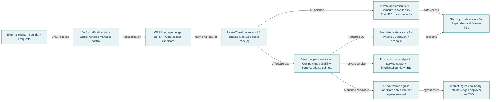
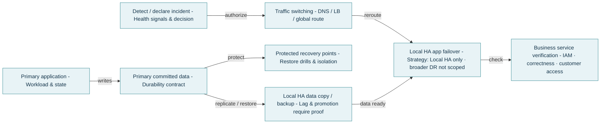

# Pre-SDD — Architecture Intelligence Calculator Handoff

**Generated:** 2026-10-17  
**Classification:** GF-CL  
**Status:** Provisional / review required — no independent verification  
**Purpose:** technical architecture companion to a separate BRD; this is NOT an SDD or approval certificate.

> Manual SDD-Unifier consumption: explicitly provide this Pre-SDD technical report alongside the BRD(s). BRD owns product UCs, actors, workflows and rules. SDD-Unifier has authority to override conflicts with these Pre-SDD recommendations, but must identify the conflict, record the selected resolution and reason, preserve source traceability, and complete its own architecture questionnaire and ecosystem confirmation. No native Pre-SDD adapter is installed.

## 1. Initiative and classification

- **Initiative:** EXAMPLE · Regional customer platform
- **BRD reference (optional):** Not supplied — product source required separately for full SDD
- **Business architectural outcome:** Demonstration only. This is not a real BRD product capability.
- **Primary/target deployment:** cloud; GF-CL
- **Migration:** Not indicated
- **Primary location:** Unassigned
- **Recovery location:** Unassigned

## 2. Technical requirements and provenance

| ID | Technical requirement | Value | Status | Owner / source |
|---|---|---|---|---|
| REQ-PLAT-001 | Change type | greenfield enum | estimated | TBD / Unverified local calculator input / fictional scenario |
| REQ-PLAT-002 | Target hosting | cloud enum | estimated | TBD / Unverified local calculator input / fictional scenario |
| REQ-CAP-001 | Daily transactions | 1000000 transactions/day | estimated | TBD / Unverified local calculator input / fictional scenario |
| REQ-CAP-002 | Peak factor | 5 × | estimated | TBD / Unverified local calculator input / fictional scenario |
| REQ-PERF-001 | Critical P99 | 450 ms | estimated | TBD / Unverified local calculator input / fictional scenario |
| REQ-CAP-003 | annualGrowth | 35 %/yr | estimated | TBD / Unverified local calculator input / fictional scenario |
| REQ-REL-001 | Availability SLO | 99.9 % | estimated | TBD / Unverified local calculator input / fictional scenario |
| REQ-DR-001 | RTO | 14400 s | estimated | TBD / Unverified local calculator input / fictional scenario |
| REQ-DR-002 | RPO | 3600 s | estimated | TBD / Unverified local calculator input / fictional scenario |
| REQ-DR-003 | Failure scope | az enum | estimated | TBD / Unverified local calculator input / fictional scenario |
| REQ-ECO-001 | budget | balanced enum | estimated | TBD / Unverified local calculator input / fictional scenario |
| REQ-DAT-001 | Data workload | relational enum | estimated | TBD / Unverified local calculator input / fictional scenario |
| REQ-DAT-002 | Consistency | strong enum | estimated | TBD / Unverified local calculator input / fictional scenario |
| REQ-SEC-001 | Data sensitivity | internal enum | estimated | TBD / Unverified local calculator input / fictional scenario |
| REQ-NET-001 | Connectivity | public enum | estimated | TBD / Unverified local calculator input / fictional scenario |
| REQ-MIG-001 | migration | no enum | estimated | TBD / Unverified local calculator input / fictional scenario |
| REQ-SEC-002 | residency | TBD  | open | TBD / Unverified local calculator input / fictional scenario |

## 3. Visible calculation rules

| ID | Formula | Live substitution | Derived result | Limitation |
|---|---|---|---|---|
| CALC-01 | `daily_transactions / 86400` | `1,000,000 / 86400` | 11.5741 txn/s | Daily average is not peak or burst demand. |
| CALC-02 | `average_TPS × peak_factor` | `11.574 × 5` | 57.8704 txn/s | Peak multiplier requires measured demand curve or agreed forecast. |
| CALC-03 | `peak_TPS × calls_per_txn × request_amplification` | `57.87 × 3 × 1.1` | 190.9722 req/s | API calls, event fanout and retries must not be double-counted. |
| CALC-04 | `peak_API_RPS / utilization_fraction` | `190.972 / 0.65` | 293.8034 req/s | Throughput envelope, not number of nodes. Requires P99 load tests. |
| CALC-05 | `peak_API_RPS × mean_latency_ms / 1000` | `190.972 × 120 / 1000` | 22.9167 requests | Little’s Law uses mean latency, not P99 or logged-in users. |
| CALC-06 | `peak_RPS × request_KB × 8 / 1000 × overhead` | `190.972 × 4 × 8 / 1000 × 1.2` | 7.3333 Mbps | One selected network boundary; excludes replication/east-west flows. |
| CALC-07 | `peak_RPS × response_KB × 8 / 1000 × overhead` | `190.972 × 16 × 8 / 1000 × 1.2` | 29.3333 Mbps | Directional egress is not a separate guaranteed link rating. |
| CALC-08 | `inbound_Mbps + outbound_Mbps` | `7.333 + 29.333` | 36.6667 Mbps | Sum of directional traffic; not a physical link-speed requirement. |
| CALC-09 | `avg_API_RPS × 86400 × (request_KB + response_KB) / 1e6` | `38.194 × 86400 × (4 + 16) / 1e6` | 66 GB/day | Decimal GB; excludes internal and replication traffic. |
| CALC-10 | `daily_txn × stored_KB_per_txn / 1e6` | `1,000,000 × 2 / 1e6` | 2 GB/day | Assumes every transaction contributes its stated logical size. |
| CALC-11 | `starting_GB + daily_new_GB × retention_days` | `0 + 2 × 365` | 730 GB | Steady-state simplified model; excludes historical growth and erasure. |
| CALC-12 | `logical_GB × index_factor × modeled_copies` | `730 × 1.4 × 2` | 2,044 GB | Provider redundancy, snapshots, WAL, logs and backups are not fully modeled. |
| CALC-13 | `(1 − availability_pct/100) × 30 × 86400` | `(1 − 99.9 / 100) × 2592000` | 2,592 s | Calendar-time assumption; SLA exclusions may differ. |
| CALC-14 | `(1 − availability_pct/100) × 365 × 86400` | `(1 − 99.9 / 100) × 31536000` | 31,536 s | SLO downtime budget is not an outage-specific RTO. |
| CALC-15 | `peak_TPS × RPO_seconds` | `57.87 × 3,600` | 208,333.3333 txns | Potential exposure if peak persisted; not the number of lost committed writes. |
| CALC-16 | `peak_RPS × (1 + growth_pct/100)` | `190.972 × (1 + 35 / 100)` | 257.8125 req/s | Simple uniform growth scenario; not an adopted business forecast. |
| CALC-17 | `migration_GB × 8000 / (effective_Mbps × 3600)` | `TBD × 8000 / (TBD × 3600)` | TBD | Only bulk-copy lower bound: excludes transform, CDC, verification and rollback. |
| CALC-18 | `2 ^ (32 − prefix)` | `2 ^ (32 − TBD)` | TBD | Planning block only; no CIDR allocation. Per-provider reserved subnet addresses and IPAM need confirmation. |
| CALC-19 | `peak_business_TPS × read_percent / 100` | `57.87 × TBD / 100` | TBD | Assumes read fraction applies to business transactions; not DB query rate. |
| CALC-20 | `peak_business_TPS × (100 − read_percent) / 100` | `57.87 × (100 − TBD) / 100` | TBD | Business operations do not map one-to-one to physical DB writes. |

## 4. Architecture candidates, not approved technical facts

- **Placement candidate:** Multi-zone · single region
- **DR candidate:** Local HA only · broader DR not scoped
- **Data architecture:** Relational transactional store
- **Networking:** Region/VPC(or VNet)/private app and data segments
- **Provider mapping:** no provider has been selected/approved by changing a comparison tab; exported canonical diagrams stay provider-neutral.

### Service alternatives and trade-offs

#### AWS service candidate map

| Capability | Candidate | Alternative | Trade-off |
|---|---|---|---|
| Compute & execution | Amazon ECS with AWS Fargate | Amazon EKS / EC2 / Lambda | ECS reduces cluster operations; EKS offers Kubernetes control; EC2 more tuning/toil; Lambda workload/runtime limits |
| Primary data (relational) | Amazon Aurora PostgreSQL-compatible | Amazon RDS for PostgreSQL | Aurora replication/storage model and Global Database options vs simpler RDS compatibility/operability/cost; verify regional capabilities |
| Access & traffic | Amazon Route 53 + AWS WAF + Application Load Balancer (where applicable) | Amazon CloudFront + WAF / Global Accelerator | DNS vs network acceleration are not identical; public/internal ALB and multi-region endpoints need explicit design |
| Network & security | Amazon VPC + AZ subnets + security groups | VPC endpoints/PrivateLink, NAT GW, Transit Gateway, VPN/Direct Connect | Endpoints are service-specific; NAT per-AZ cost/HA; TGW for topology complexity; not every service lives inside subnets |
| Data protection / disaster recovery | Local availability/failover only — broader DR unscoped | Separate site/region backup and DR objective requires independent discovery | Host/AZ failover must meet its scoped RTO/RPO. Backup & Restore is not evidence of local HA or of separate regional DR. |

#### Microsoft Azure service candidate map

| Capability | Candidate | Alternative | Trade-off |
|---|---|---|---|
| Compute & execution | Azure Container Apps | Azure Kubernetes Service (AKS) / Virtual Machines / Azure Functions | Container Apps reduces orchestrator management; AKS increases flexibility and operational burden |
| Primary data (relational) | Azure Database for PostgreSQL Flexible Server | Azure SQL Database / SQL Managed Instance for SQL Server workloads | Engine compatibility, HA zone support, cross-region replicas and failover management differ |
| Access & traffic | Azure Front Door + WAF / Application Gateway | Azure Load Balancer | Global edge vs regional L7 vs network L4; scopes differ |
| Network & security | Azure Virtual Network + NSG + Private Endpoint | Azure NAT Gateway / Virtual WAN / VPN Gateway / ExpressRoute | Subnet scopes and managed-service injection vary; validate routing, zone and residency |
| Data protection / disaster recovery | Local availability/failover only — broader DR unscoped | Separate site/region backup and DR objective requires independent discovery | Host/AZ failover must meet its scoped RTO/RPO. Backup & Restore is not evidence of local HA or of separate regional DR. |

#### Google Cloud service candidate map

| Capability | Candidate | Alternative | Trade-off |
|---|---|---|---|
| Compute & execution | Cloud Run | Google Kubernetes Engine (GKE) / Compute Engine / Cloud Functions | Fully managed vs Kubernetes control vs VM responsibility and runtime/cost boundaries |
| Primary data (relational) | Cloud SQL for PostgreSQL | AlloyDB for PostgreSQL / Spanner if globally distributed ACID requirements justify | Cloud SQL/AlloyDB compatibility and replication differ; Spanner uses different architecture and economics |
| Access & traffic | Cloud Load Balancing + Cloud Armor | Cloud CDN / external vs internal LB | Global/regional front end behavior, application security and DNS choices vary |
| Network & security | Google Cloud VPC regional subnets + Cloud NAT | Private Service Connect / Cloud VPN / Cloud Interconnect | GCP VPC is global and subnets regional: do not draw a distinct VPC per region by default |
| Data protection / disaster recovery | Local availability/failover only — broader DR unscoped | Separate site/region backup and DR objective requires independent discovery | Host/AZ failover must meet its scoped RTO/RPO. Backup & Restore is not evidence of local HA or of separate regional DR. |

#### Organization-operated on-premises candidates

| Capability | Candidate | Alternative | Trade-off |
|---|---|---|---|
| Compute & execution | Virtual machines or Kubernetes/OpenShift cluster | Bare-metal deployments / managed private platform | Platform ownership, hardware lifecycle, cluster operations, licensing and support |
| Primary data (relational) | PostgreSQL/SQL Server/Oracle with evaluated HA design | Commercial cluster and storage replication alternatives | Replication correctness, synchronous write behavior, licensing and recovery tooling |
| Access & traffic | HAProxy / NGINX / F5 (where licensed) | Reverse proxy + redundant load balancers | DMZ boundaries, appliances, certificate and failover governance |
| Network & security | DMZ + app/data VLANs or security zones | Redundant firewalls/routers, VPN, dedicated link, DNS | Physical redundancy, inter-site capacity, address ownership and change controls |
| Data protection / disaster recovery | Local availability/failover only — broader DR unscoped | Separate site/region backup and DR objective requires independent discovery | Host/AZ failover must meet its scoped RTO/RPO. Backup & Restore is not evidence of local HA or of separate regional DR. |

## 5. Explainable decision rules

| ID | Trigger | Assessment | Evidence needed |
|---|---|---|---|
| ARCH-01 | change=greenfield; target=cloud | Route to GF-CL; migration is a separate overlay. | Confirm target-hosting responsibility and hard platform restrictions. |
| HA-02 | fault=az, availability=99.9% | Use independent failure zones and avoid shared single points where feasible. This is HA, not proof of region DR. | Check zone support, shared dependencies, measured failover and supported availability. |
| CAP-04 | peak=57.87 TPS; 190.97 API RPS | Size and benchmark at sustained peak with headroom and failure-mode capacity. | Obtain peak duration, load profile, per-instance P99 throughput, storage IOPS and growth. |
| DB-10 | type=relational; consistency=strong | Recommend logical data-store pattern; compare provider products and failover semantics. | Validate operations, constraints and benchmarks per workload. |
| SLO-15 | RTO=4 h; 30-day budget=43.2 min | One full-length, user-visible outage in the measurement window may exceed the availability allowance; not inherently contradictory. | Clarify measurement exclusions and design impact on customer journeys. |

## 6. Infrastructure, network and DR diagrams

**All diagrams are PROPOSED technical architecture candidates. Locations, network allocations, capacity and DR objectives require validation.**

### Infrastructure Architecture · GF-CL

Multi-zone · single region candidate, Relational transactional store. RTO 4 h; RPO 1 h; scope az. All nodes and links are proposed logical candidates, not verified deployment facts. Source of product use cases remains the BRD.

```mermaid
flowchart LR
  %% Infrastructure Architecture · GF-CL — PROPOSED / NOT AN APPROVED DESIGN
  %% canonical component NODE-CLIENT
  CLIENT["Consumers - Product flows from BRD"]
  %% canonical component NODE-DNS
  DNS["Routing & health checks - global/shared boundary TBD"]
  %% canonical component NODE-EDGE
  EDGE["L7 ingress + security - Primary ingress · public candidate"]
  %% canonical component NODE-APP-A
  APP_A["Application tier - Application execution A"]
  %% canonical component NODE-DB-PRIMARY
  DB_PRIMARY["Relational transactional store - System of record (candidate)"]
  %% canonical component NODE-BACKUP
  BACKUP["Backups / restore points - retention & isolation TBD"]
  %% canonical component NODE-APP-B
  APP_B["Application tier - Application execution B"]
  %% canonical component NODE-DB-SECONDARY
  DB_SECONDARY["HA standby / replica - Same-region failover semantics TBD"]
  %% canonical component NODE-DR-SCOPE
  DR_SCOPE["Backup / broader DR scope TBD - Not an approved DR strategy"]
  CLIENT -->|request| DNS
  DNS -->|route| EDGE
  EDGE -->|traffic| APP_A
  APP_A -->|reads/writes| DB_PRIMARY
  DB_PRIMARY -->|backup| BACKUP
  EDGE -->|route| APP_B
  DB_PRIMARY -->|replicate| DB_SECONDARY
  BACKUP -->|recover| DR_SCOPE
  classDef proposed fill:#e8f3f6,stroke:#368b94,color:#15354b;
  class CLIENT,DNS,EDGE,APP_A,DB_PRIMARY,BACKUP,APP_B,DB_SECONDARY,DR_SCOPE proposed;
```

**SDD technical design instructions:**
- Confirm region/site and actual fault-domain independence; do not infer region or zone availability.
- Benchmark compute and data tier throughput under peak and impaired-zone load.
- Confirm database durability, failover behavior, backups, IAM, monitoring, and provider eligibility.

### Network Architecture · LOGICAL

Region/VPC(or VNet)/private app and data segments. Trust boundaries, zones/subnets and public/private paths are provisional. Actual IPAM, public subnet associations, provider-managed interfaces, routing and firewall rules must be verified.

**SDD technical design instructions:**
- Confirm real CIDR/IPAM allocations, public/private subnet eligibility, zone placement, routes, DNS and security/firewall rules; no IP addresses are assigned here.
- Provider networking differs: AWS VPCs regional with AZ subnets; GCP VPCs global with regional subnets; Azure VNets regional. Managed service resources may live on provider-owned boundaries.
- Confirm public or private ingress, internet egress/NAT and private endpoint eligibility, independent availability zone paths, and hybrid/partner failover before SDD.

### Recovery Architecture & Sequence

Failure scope: az; RTO=4 h; RPO=1 h; candidate: Local HA only · broader DR not scoped. These are targets, NOT achieved results.

**SDD technical design instructions:**
- Define recovery critical path: detection → failover authorization → data promotion/restore → app/IAM connectivity → routing → business verification.
- Demonstrate application-level recovery, data consistency, dependency reattachment, failback and split-brain protections.
- Document separate recovery objective for every in-scope failure scenario, including cyber/data corruption where relevant.

## 7. DR ladder evaluation

| Strategy | Selection considerations |
|---|---|
| Backup & Restore | Recreate and restore. Lower standby expense; restore time scales with data size and testing. Not automatically eligible for short RTO/RPO. |
| Pilot Light | Minimal continuously available core and data; activate remaining capacity. Requires proven scale-up, reconciliation and recovery orchestration. |
| Warm Standby | Running reduced-capacity recovery site/region with replicated data; faster candidate but operational and replication expense. |
| Multi-site Active-Active | Multiple serving sites; highest write-consistency, split-brain, operational and network complexity. Does not guarantee zero data loss. |

## 8. Required validation and open questions

### Blocking items
- **OPEN-residency:** Regulatory and geographic restrictions have not been assessed. Owner: Lead architect / responsible owner

### Other warnings
- **EVID-01:** Accountable owner not identified Owner: Architecture / platform owner
- **EVID-02:** No measurement or approval evidence reference supplied Owner: Architecture / platform owner

## 9. Architect override and decision history

- **Topology override:** auto
- **DR override:** auto
- **Reason:** N/A

## 10. Handoff governance

- **Calculator technical status:** Provisional / review required
- **User-stated approver / reference:** None
- **Formal Pre-SDD G3 authorization:** NOT verified or granted by this calculator.
- **BRD readiness for SDD-Unifier:** Not supplied; provide BRD(s) separately.
- **SDD-Unifier integration:** manual companion source; no native skill adapter claimed.

## 11. Instructions for manual SDD-Unifier run

1. Provide one or more actual BRDs and this Pre-SDD Markdown technical companion together.
2. Derive product scope, UC behavior, actors and rules from BRD only. Treat Pre-SDD as candidate non-product infrastructure, network, data architecture, capacity and DR input.
3. Run the skill’s native architecture questionnaire (Q1–Q8) and ecosystem confirmation. Prepopulate technical drivers from Pre-SDD only where appropriate; do not skip confirmations.
4. SDD-Unifier is permitted to override conflicting Pre-SDD options when building the broader SDD. Make disagreements explicit, record the chosen decision and rationale, and preserve the BRD technical mandates and evidence.
5. Use inline Mermaid and the exported component graph as technical starting material, not as an approved deployment inventory.
6. Produce the full SDD according to the skill’s templates and independent review process; do not infer product APIs, roles or user stories from calculator sizing data.

---
**Architecture estimation is not implementation evidence. The exported document is a technical planning source only.**
