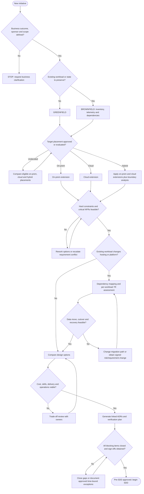

# Pre-SDD — Pre-Solution Design Document

**Architecture Discovery, Decision-Readiness and Governance Standard**  
**Version:** 1.0 (proposed, not yet organization-approved)  
**Applies to:** Greenfield, brownfield, on-premises, public/private cloud, hybrid, modernization, and migrations  
**Status:** Template / Standard for adoption  
**Project-specific targets:** `TBD` until confirmed by accountable owners

> **Charter:** The Pre-SDD must be available, reviewed and approved **before the formal SDD is started**. Exploration, measurements, proof-of-concept work, and evaluation of options are permitted during Pre-SDD; production solution design is not baselined until Pre-SDD approval. Architectural decisions discovered during Pre-SDD are recorded as proposed ADRs and finalized with the SDD design decisions.

## 1. Purpose, boundaries and outputs

**The business owns the desired outcomes and acceptable trade-offs.** Architects own translating those outcomes into architecture, identifying feasible options, and validating the consequences. A business stakeholder does **not** need to choose VM instance classes, CIDR ranges, database engines, or the number of microservices.

| Artifact | Primary question | Typical content | Owner / approval |
|---|---|---|---|
| Business brief | Why and what matters? | Objectives, user journeys, financial drivers, criticality, hard constraints | Product/business sponsor |
| **Pre-SDD** | What requirements and constraints must the design satisfy; which paths are feasible? | Business/NFR intake, evidence, existing estate, options, feasibility, risks, 7R assessments, decision tree, proposed ADRs | Lead architect; cross-functional sign-off |
| **ADR(s)** | Why was a consequential architecture choice made? | Context, constraints, options, rationale, consequences, validation and trigger for review | Accountable design authority |
| **SDD** | How will the approved solution be implemented? | C4/solution views, infrastructure, network, data, APIs, security, deployment, DR, runbooks and tests | Solution architect / engineering leads |
| Verification & operational evidence | Did the implemented solution meet approved targets? | Load/soak tests, DR exercise, threat model outcomes, controls, budget and monitoring evidence | QA, SRE, operations, security and business |

**Must-have deliverables from the Pre-SDD:**

1. Document metadata, sponsorship, classification and scope.
2. Business journeys and measurable success criteria.
3. Signed/owned NFR register, including how every measure will be verified.
4. Baseline evidence and dependency map for all existing systems.
5. Constraints, options assessment, feasibility gaps and open risks.
6. Target environment and *why*, not merely which environment was requested.
7. Migration direction, per-workload 7R recommendation and transition plan **when applicable**.
8. ADR candidate register with requirement linkage.
9. Approval record and remaining conditions/waivers.

### 1.1 Classification: exactly four primary target-state paths

Classify by **solution change type** × **intended target hosting/location responsibility**. For this four-way matrix, **on-prem** includes a self-operated private cloud inside the organization’s facility; **cloud** means provider-hosted cloud (public or hosted-private). Record IaaS/PaaS/SaaS and the exact operating-control boundary separately. If target is not yet confirmed, evaluate the permitted candidates before classifying. Migration is an independent overlay identifying *source → target*, not a substitute for this classification.

| Code | Change type | Target | Interpretation |
|---|---|---|---|
| GF-OP | Greenfield | On-premises / organization-run private cloud | Net-new solution in an organization-operated data-center footprint. |
| GF-CL | Greenfield | Cloud | Net-new solution in a provider-hosted cloud (public or hosted-private, specify which). |
| BF-OP | Brownfield | On-premises / organization-run private cloud | Existing solution enhanced, rebuilt in place, or migrated to an on-prem target. |
| BF-CL | Brownfield | Cloud | Existing solution enhanced, modernized, or migrated to a cloud target. |

**Ambiguities to disclose:** a new product that integrates a legacy platform is greenfield **for the new product**, with brownfield dependency assessment. A hybrid solution requires **two deployment sub-assessments** (OP and CL), explicit cross-boundary integration/DR, and one consolidated architecture decision. An application existing on cloud A moving to cloud B is **BF-CL** with a cloud-to-cloud migration overlay; an existing application on-prem moving to cloud is **BF-CL** with an on-prem-to-cloud overlay.

### 1.2 Standard project header (mandatory)

```yaml
pre_sdd_id: TBD
solution_name: TBD
business_sponsor: TBD
product_owner: TBD
lead_architect: TBD
architecture_review_authority: TBD
version_and_date: TBD
status: Draft | Discovery | Review | Approved | Approved-with-conditions | Blocked
business_problem_and_outcome: TBD
in_scope: TBD
out_of_scope: TBD
critical_user_journeys: TBD
change_type: Greenfield | Brownfield | Mixed (decompose)
intended_target: On-prem | Provider-hosted-cloud | Hybrid | Undecided
source_platforms_if_existing: TBD
migration_direction: None | On-prem-to-cloud | Cloud-to-cloud | Cloud-to-on-prem | Same-platform | Mixed
geographies_and_data_jurisdictions: TBD
hard_constraints: TBD
business_budget_owner: TBD
assumptions: []  # Explicitly separate from verified facts
unknowns_and_blockers: []
related_documents_and_baseline_evidence: []
```

## 2. Governance: business, architecture, and engineering responsibilities

| Accountable function | Must supply / approve | Must not be expected to guess |
|---|---|---|
| Business sponsor / product | Value, scope, priority, acceptable interruption/data loss, geographic commitments, budget, growth expectations, SLO trade-offs | Exact IOPS, CPU/RAM counts, VPC layout |
| Business operations / customer success | Business hours, regional workflows, support expectations, manual fallback, customer-impact thresholds | Router models or storage replication products |
| Data owner / legal / compliance | Classification, retention, residency, consent, audit, deletion, contractual/regulatory commitments | Physical database schema |
| Engineering / SRE / platform | Historical traffic, dependency traces, workload baselines, deployment and incident evidence, current constraints, achievable SLOs | Unapproved business risk tolerance |
| Network / infrastructure | Existing network, IP/CIDR overlap, routing, firewalls, capacity, carrier and data-center constraints, platform quotas | Business criticality choices |
| Security / IAM | Threat model, identity constraints, control requirements, risk acceptance | Business case ownership |
| Lead architect | Consolidation, scenario analysis, option trade-offs, design impacts, proposed ADRs, feasibility confidence | Invention of stakeholder requirements |
| Architecture Review Board / delegated authority | Review of material choices, conflicts, exceptions and ADR acceptance | Substituting technical preference for business decisions |

**Input rule:** for *every material answer*, capture (a) value, (b) unit or enumeration, (c) workload/journey scope, (d) current baseline and future horizon, (e) source/evidence, (f) accountable owner, (g) acceptance/verification method, (h) priority, and (i) date/approval status. “Fast”, “highly available”, “scalable”, “secure”, “zero downtime” and “real time” are **not valid measurable requirements** until defined.

## 3. Requirement register — required data model

Maintain one row per requirement. Use it to drive the checklist and all downstream ADRs.

| Field | Description |
|---|---|
| `REQ_ID` | Stable identifier, e.g. `NFR-PERF-001` |
| `DOMAIN` | Business, performance, reliability, security, data, integration, operations, finance, migration… |
| `JOURNEY_OR_WORKLOAD` | Specific service, endpoint, process, tenant class or customer journey |
| `QUESTION_AND_VALUE` | Precise question and business-approved response; `TBD` otherwise |
| `UNIT_AND_WINDOW` | E.g. operations/second, milliseconds, GB/day, monthly, launch / 12-month peak |
| `MEASUREMENT_LOCATION` | Client, ingress edge, backend, broker consumer, whole workflow, etc. |
| `PRIORITY` | Must / Should / Could (organization may adapt) |
| `CONSTRAINT_KIND` | Hard guardrail, negotiable target, forecast or assumption |
| `OWNER_AND_APPROVER` | Named individual/role |
| `SOURCE_AND_CONFIDENCE` | Evidence / baseline / forecast, measured vs estimate; confidence stated |
| `VERIFICATION_METHOD` | How acceptance will be tested and by whom |
| `DESIGN_IMPACT` | Infrastructure / network / application-software / data / operations |
| `DEPENDENCIES` | Linked services or REQ IDs |
| `STATUS` | Open / Proposed / Validated / Approved / Exception / N/A (reason) |
| `ADR_IDS_AND_TEST_IDS` | Traceability to architecture choice and validation |

`TBD` means **unknown**, not zero and not an implicit default. `N/A` requires a rationale. Hard requirements with unknown values or unresolved contradictions are blocking unless an empowered owner explicitly approves a documented, time-bound exception.

## 4. Universal checklist — business input → infrastructure, network and software impact

**Legend:** `B` = business/product accountable; `E` = engineering/SRE supplies baseline; `D` = data/compliance; `Sec` = security; `Ops` = operations; `Fin` = finance/procurement. Several rows require **B approval and E measurement**. Design impacts are *considerations*, not predetermined technology choices.

### 4.1 Business outcomes, usage and delivery

| ID / owner | Ask for (specific, measurable output) | Infrastructure impact | Network impact | Software/architecture impact |
|---|---|---|---|---|
| BUS-01 B | Problem, business outcome and KPI with baseline, target, deadline | Investment and capacity ceiling | Geographic/user reach | Domain boundaries; feature prioritization |
| BUS-02 B | Critical user journeys, failure impact and journey priorities | Resource protection for priority flows | Traffic prioritization / geographic proximity | Critical paths, fallback, transaction boundaries |
| BUS-03 B | In/out of scope; dependencies; MVP versus later phases | Initial vs future provisioning | Integrations to existing locations | Module decomposition, incremental delivery |
| BUS-04 B | Revenue/loss or safety impact per outage and per degraded minute | Redundancy and recovery investments | Redundant transit/ingress where justified | Graceful degradation, incident prioritization |
| BUS-05 B | Launch date, hard deadlines, blackout/change windows | Procurement and delivery feasibility | Connectivity lead times | Delivery strategy, feature flags, cutovers |
| BUS-06 B | Countries, users, contracts and accessibility/localization commitments | Geographic placement | Edge/CDN, routing, regional access | Localization, experience adaptation |
| BUS-07 B | Explicit prohibitions / non-goals (e.g., forbidden data movement) | Site, provider and hardware eligibility | Egress controls, trusted links | Data flow and component boundaries |
| BUS-08 B | Commercial/legal obligations to customers and penalty conditions | Resilience requirement feasibility | End-to-end dependency exposure | SLA boundaries, evidence and reporting |

### 4.2 Workload, sizing and performance

| ID / owner | Ask for (specific, measurable output) | Infrastructure impact | Network impact | Software/architecture impact |
|---|---|---|---|---|
| CAP-01 B+E | Transactions by **type**: normal and peak TPS, and define what a transaction counts | Compute, DB connection and storage provisioning | Load balancer and link throughput | Concurrency, sync/async, workload separation |
| CAP-02 B+E | API request rate (RPS), reads/writes, retries, fan-out, requests per business transaction | Gateway/worker headroom, database throughput | Request amplification, ingress/egress | Caching, batching, idempotency, rate limiting |
| CAP-03 B+E | DAU/MAU, peak *simultaneously active* users, sessions and session duration | Session store, compute, memory | Concurrent connections and LB sizing | Stateful vs stateless sessions; auth load |
| CAP-04 B+E | Hourly/daily/weekly peaks, seasonality, campaign and burst size/duration | Scale speed, spare capacity / reservations | Burst handling and congestion | Queues, backpressure, admission control |
| CAP-05 B | Forecasted growth by period and confidence, major future feature/product launches | Capacity expansion and cost envelope | Network scale, CIDR/IP planning | Partitioning and evolvability |
| CAP-06 B+E | Payload/request/response sizes, file/object sizes, compression assumptions | Storage throughput / memory | Bandwidth, MTU, transfer cost | Streaming, pagination, chunking |
| CAP-07 B+E | p50, p95, p99 (and p99.9 if justified) *per critical journey*; units and observation window | Placement, compute headroom, storage IOPS | RTT/hop minimization, CDN, path choice | Cache/queries/fan-out, concurrency and timeout budgets |
| CAP-08 B+E | Define where latency is measured (client end-to-end, ingress, service, batch completion) and what counts as failure | Telemetry placement | End-to-end path observability | Tracing, SLI instrumentation, error handling |
| CAP-09 B+E | Max queue age, processing deadline, freshness, end-to-end batch completion and backlog recovery target | Broker/worker/storage throughput | Ingestion and intersite link capacity | Consumer scaling, scheduling, ordering |
| CAP-10 B+E | Read/write mix, hot keys, expensive operations, query/report schedules | Cache and database IOPS/memory | Data locality | Indexing, CQRS if warranted, materialization |
| CAP-11 B+E | Expected request failures/timeouts/retry behavior at dependencies and load-shedding tolerance | Headroom and failure isolation | Retry traffic and connection budgets | Retry policy, circuit breakers, bulkheads |
| CAP-12 B+E | Resource-intensive AI/ML/media jobs if in scope: model size, token/compute demand, jobs and deadlines | Accelerator/memory/GPU eligibility | Large data movement | Async orchestration, quotas, fallback |

**Metric contract:** do not treat TPS and RPS as identical; one business transaction may trigger multiple calls/events. Define p99 as the percentile of a specified population of latency observations over a specified window and workload; p50 is median. Define treatment of failed/time-out attempts (measure errors separately; do not hide them by including only completed responses). Percentiles from individual services **cannot simply be added** to get end-to-end p99. Validate against realistic mixes, peaks and simultaneous failure conditions where required. Daily average TPS alone is inadequate for peak capacity planning.

### 4.3 Reliability, availability, disaster recovery and continuity

| ID / owner | Ask for (specific, measurable output) | Infrastructure impact | Network impact | Software/architecture impact |
|---|---|---|---|---|
| REL-01 B | Availability SLO **per user journey**; denominator, service window, and measurement period | Site/AZ/region redundancy and maintenance | Multiple network paths, DNS/LB failover | Statelessness, health checks, degradation |
| REL-02 B | SLA to customers vs internal SLO; what failures/exclusions count; penalties | Evidence-grade uptime instrumentation | Edge and external dependency boundaries | Error budget, service-level reporting |
| REL-03 B | RTO per service/journey **and disaster scenario**: acceptable elapsed time to restored usable service | Standby/warm capacity, backups and failover tooling | Rerouting / DNS propagation / alternate links | Restart orchestration, data reconciliation, recovery tests |
| REL-04 B+D | RPO per dataset/transaction and disaster scenario: acceptable *age of last recoverable data point* | Synchronous/asynchronous replication, backups | Replication bandwidth, RTT, partition sensitivity | Data consistency, commit semantics, replay |
| REL-05 B+Ops | Scope of recoverable failure: process, node, rack, site, AZ, region, ransomware, vendor failure | Fault domains, isolated backups, DR locations | Independent paths / isolated environments | Failover/failback and compromised-data recovery |
| REL-06 B | Maximum tolerable business interruption, minimum service during degradation, manual fallback and reconciliation | Tiered DR strategy | Emergency access channels | Read-only modes, queued work, manual reconciliation |
| REL-07 B+Ops | Recovery sequence and dependencies: authentication, payments, ledger, reporting, etc. | Dependency-order recovery capacity | Reachability to shared services | Recovery runbooks and sequencing |
| REL-08 B+Ops | Approved planned downtime, maintenance restrictions, deployment and upgrade windows | Rolling maintenance vs active-active needs | Ingress draining, failover | Backward compatibility, rolling releases |
| REL-09 B+Ops | Frequency and accepted evidence for restore, failover, failback and cyber-recovery drills | Test environments and backups | Failover route simulation | Recovery automation and data integrity checks |
| REL-10 B+E | Data durability and correctness expectations distinct from availability | Storage redundancy and anti-corruption controls | Replication channel guarantees | Checksums, invariants, idempotent replay |

**Do not conflate:** RTO with average incident resolution time (MTTR); RPO with backup schedule alone; availability SLO with RTO; redundancy with a tested DR plan; or backup success with restore success. Zero RPO and very short RTO are possible in certain failure scopes but may require expensive architectures, higher latency and hard consistency trade-offs. Their feasibility must be demonstrated, not asserted.

### 4.4 Data, information lifecycle and tenancy

| ID / owner | Ask for (specific, measurable output) | Infrastructure impact | Network impact | Software/architecture impact |
|---|---|---|---|---|
| DAT-01 D+B | Business entities, system of record, ownership and data contracts | Suitable storage/backup/compute classes | Data access topology | Domain/data ownership, transactional boundaries |
| DAT-02 D+B | Starting volume; records/day, GB/day, object size, peak writes and retention horizon | Storage capacity, IOPS, archival | Ingestion/replication throughput | Indexes, partitioning, TTL/archive jobs |
| DAT-03 D+Sec | Sensitivity classification: PII, financial, confidential, secrets, public | Encryption/KMS/HSM, isolation | Segmentation, encrypted flows | Field-level controls, masking, audit |
| DAT-04 D+Legal | Residency, allowed processing/storage/backup locations and cross-border restrictions | Region/site eligibility | Cross-border transfers and egress rules | Residency-aware routing and data separation |
| DAT-05 B+D | Consistency, freshness, correctness, ordering and atomicity by operation | Distributed storage trade-offs | RTT to replicas/remote services | Transaction, saga, concurrency and deduplication patterns |
| DAT-06 D | Retention, records hold, archive, deletion, portability and right-to-erasure requirements | Tiered storage/immutable archive | Data transfer routes | Erasure workflows, lineage, backup policy |
| DAT-07 B+D | Multi-tenancy model, tenant isolation level, noisy-neighbor tolerance, tenants and growth | Resource/data isolation, quotas | Tenant network separation if needed | IAM claims, tenant-aware data access, throttles |
| DAT-08 B+D | Reporting, analytics, batch exports, reconciliation frequency and data latency | Analytics compute and storage | ETL/replication movement | CDC, data pipeline, read model and lineage |
| DAT-09 D+Ops | Restore granularity (tenant/table/whole system), point-in-time needs and recovery verification | Backup granularity and restore staging | Recovery transfer throughput | Tenant-level restore logic and validation |

### 4.5 Security, privacy, identity and regulatory guardrails

| ID / owner | Ask for (specific, measurable output) | Infrastructure impact | Network impact | Software/architecture impact |
|---|---|---|---|---|
| SEC-01 Sec+D | Laws, contracts, certifications and organization policies *actually applicable*; control mappings | Approved sites/services, encryption/retention capabilities | Jurisdiction and segmentation controls | Security controls and audit evidence |
| SEC-02 B+Sec | Actors, partner identities, workforce, machine principals, customer identity sources | IAM/IdP reliability and key management | Trusted identity routes / endpoints | Authentication federation, RBAC/ABAC, authorization |
| SEC-03 Sec | Threat/risk classification, acceptable residual risk and adversary concerns | Hardening, isolation, secrets platforms | WAF, DDoS, firewalls, zero-trust paths | Secure coding, validation, least privilege |
| SEC-04 Sec+D | Encryption at rest/in transit, BYOK/HYOK, key custody, rotation, certificate requirements | KMS/HSM ownership and availability | TLS/mTLS, certificate lifecycle | Crypto/key usage, secret rotation, app auth |
| SEC-05 D+Sec | Audit events, non-repudiation, investigation and evidence retention | Tamper-resistant logs / storage | Secure log pipelines | Actor IDs, trace IDs, audit events |
| SEC-06 Sec+Ops | Vulnerability, patch, pen-test, SBOM/supply-chain and incident reporting obligations | Image/host hardening and patch capacity | Scanning paths / boundary controls | CI quality gates, dependency controls |
| SEC-07 Sec | Required separation of duties, privileged access, break glass and tenant/customer administration | Control-plane restrictions | Administrative network boundaries | Permission model, approvals, audit |
| SEC-08 B+Sec | Third-party processor/subprocessor and vendor risk restrictions | Supplier/service eligibility | Provider and partner trust boundaries | Vendor integration and exit strategy |

### 4.6 Integrations, external dependencies and connectivity

| ID / owner | Ask for (specific, measurable output) | Infrastructure impact | Network impact | Software/architecture impact |
|---|---|---|---|---|
| INT-01 B+E | Catalogue of upstream/downstream systems, owner, interface, business criticality | Shared component dependencies | Connectivity / routing matrix | API contracts, bounded contexts |
| INT-02 B+E | Synchronous API vs event/file/batch, update frequency, order and delivery expectations | Broker/transfer capacity | Ports/protocols, link bandwidth | Contract versioning, outbox, deduplication |
| INT-03 B+E | External API quotas, latencies, SLAs, maintenance and rate limits | Resilience headroom | Partner connectivity and failure domains | Bulkheads, caching, circuit breakers, retry/DLQ |
| INT-04 B+E | Failure behavior: reject, retry, queue, compensate, or manual handling | Durable queue/storage | Retry storms / intermittent links | Saga/compensation, idempotency keys |
| INT-05 B+E | Consistency and ordering guarantees, duplicate tolerance, maximum delay | Durable brokers, ordering constraints | Broker placement and intersite latency | Ordering keys and exactly-once *business-effect* handling |
| INT-06 E+Sec | Existing public IP, allowlists, firewall change process, proxies, DNS and certificate dependencies | Edge appliances / gateways | Firewall/NAT/DNS/proxy design | Endpoint authentication and retry logic |
| INT-07 B+E | Client geography, edge locations, remote branches, IoT and intermittent/offline operation | Regional/edge placement | WAN, 4G/5G, VPN/private links and CDN | Offline-first, conflict resolution and sync |
| INT-08 E | Address ranges, DNS zones, IP overlap, IPv4/IPv6, routing and private connectivity constraints | VPC/VNet/data-center topology | CIDR, BGP, peering/transit, route tables | Endpoint discovery and region-awareness |
| INT-09 B+E | External SLA dependencies; legal or operational inability to move a peer system | Co-location and shared-service reliability | Cross-environment network latency | Decoupling, anti-corruption layer, timeouts |

### 4.7 Operational model, release and lifecycle

| ID / owner | Ask for (specific, measurable output) | Infrastructure impact | Network impact | Software/architecture impact |
|---|---|---|---|---|
| OPS-01 B+Ops | Support hours, user hours, incident severities, response and escalation commitments | Monitoring/on-call tooling | Synthetic checks from relevant geographies | Instrumentation, alerts, error taxonomy |
| OPS-02 Ops+E | Team skills, support model, managed-service restrictions and ownership boundaries | Buy vs run; managed vs self-managed | Network operation model | Complexity choice and service boundaries |
| OPS-03 B+Ops | Release frequency, rollback tolerance and change-freeze windows | Blue/green capacity | Traffic shaping and ingress switching | Feature flags, schema compatibility, canaries |
| OPS-04 Ops | Environments needed: dev, test, perf, stage, prod, DR; isolation and test data rules | Environment count and cost | Isolated networks and private endpoints | Configuration and release pipelines |
| OPS-05 Ops | Logging/tracing/metric retention, event cardinality, alerting and forensic search | Observability storage/compute | Telemetry pipeline throughput | OpenTelemetry-style tracing, privacy filtering |
| OPS-06 B+Ops | Business continuity runbooks, escalation matrix and authority to invoke failover | DR automation and people coverage | Failover endpoint configuration | Recovery state machines and consistency checks |
| OPS-07 B+Ops | Changeover, reversibility, customer communication and decommissioning expectations | Temporary dual-run capacity | DNS/route transition | Backward compatibility and decommission gates |
| OPS-08 B+Ops | Testing scope: load, soak, chaos/fault injection, DR, security, compliance, accessibility | Representative nonproduction capacity | Network impairments / path tests | Contract, performance and fault tests |

### 4.8 Economics, delivery constraints and sustainability

| ID / owner | Ask for (specific, measurable output) | Infrastructure impact | Network impact | Software/architecture impact |
|---|---|---|---|---|
| ECO-01 B+Fin | One-time implementation/migration budget and recurring annual/monthly run-cost envelope | Hardware/cloud bill and staffing options | Link charges, egress, transfer costs | Build-vs-buy and complexity trade-offs |
| ECO-02 B+Fin | CapEx/OpEx preferences, currency, commitment period, chargeback unit | Reservation/lease/procurement model | Carrier commitment contracts | Cost allocation per tenant / journey |
| ECO-03 B+Fin | TCO horizon and required benefits (cost, speed, risk, flexibility) | Multi-year depreciation/capacity | Egress and cross-zone/region costs | Managed services / maintainability choices |
| ECO-04 B | Delivery deadline, acceptable delivery risk, available people and vendor approval duration | Procurement and skill bottlenecks | Telco provisioning lead times | Phased scope, COTS vs build decision |
| ECO-05 B+Fin | Environmental/energy footprint goals **if applicable**, measurement expectations | Energy efficiency / density | Transfer minimization | Workload and storage efficiency |
| ECO-06 B+Fin | Exit portability expectations, vendor lock-in tolerance and contract termination rights | Platform portability and asset costs | Egress pathways and interconnect | Portable contracts/standards where justified |

**Capacity sanity check:** classify *business TPS* separately from API RPS and event throughput; derive RPS from workflows, fanout and retry profiles. For the same workload under stable operating conditions, average concurrent in-flight work can be approximated as arrival rate × average response time, **not** a substitute for empirical load testing. For each requirement collect present, go-live, expected growth and stress-scenario numbers. No fixed headroom percentage or design tier is assumed.

## 5. Cross-cutting quality attribute questions often missed

The universal checklist must also explicitly decide (and enter into the register where relevant):

- **Correctness & integrity:** financial reconciliation, duplicate transactions, ordering, invariant checks, destructive updates, atomic business effects, eventual-consistency windows.
- **Scalability vs elasticity:** long-term growth versus speed of adapting to sudden bursts; scale-out limits and quota planning.
- **Maintainability:** independently deployable units, coupling constraints, release confidence, testability, API evolution and ownership.
- **Interoperability:** standards, data export format, backward compatibility, supplier contracts and protocol longevity.
- **Portability / reversibility:** ability to exit a provider, return data, terminate keys/identities and reconstitute operations.
- **Accessibility and usability:** WCAG/customer accessibility commitments and supported device/network profiles **only if applicable**.
- **Supportability:** diagnostic correlation, log sensitivity, operability under degraded service and incident forensics.
- **Legal & responsible data processing:** archival holds, privacy controls, deletion request propagation, cross-tenant visibility.
- **Environment constraints:** hardware accelerators, commercial appliances, licensing terms, unsupported OS/middleware, quota limits and lead times.
- **Data transfer costs:** backfills, replay, egress, replication and dual run; not only compute/month.

Each applicable requirement must identify a measurable result or a documented binary compliance test.

## 6. Metrics dictionary — non-negotiable precision

| Metric | What to ask / record | Typical design influence | Verification |
|---|---|---|---|
| **TPS** | What is one *business transaction*? Average, sustained peak, burst peak, window and mix. | State changes, DB write throughput, workflow orchestration. | Production metrics / representative load model. |
| **RPS / QPS** | Calls or queries/second per endpoint, including retry, dependencies, bulk and background operations. | API gateway, queues, DB pool, autoscaling and bandwidth. | Load test and tracing. |
| **p50 / p95 / p99** | Which journey, geography, client network, success definition, time window and load condition? | Placement, tail latency mitigation, caching, query optimization, timeout budgets. | Percentile histograms at client and service boundaries. |
| **Availability SLI/SLO** | Good user events / eligible user events (or agreed time-based measure), target and rolling/calendar window. | Fault domains, failover, error budgets, deployment safety. | Synthetic + real user measurements and incident data. |
| **SLA** | Contractual obligation (may have credits/penalties), exceptions and liable boundary. | Contract risk and operational reporting. | Contract-defined calculation. |
| **RTO** | Maximum acceptable time from qualifying interruption to a *usable* restored function, per disaster scope. | Restore/failover strategy and people/process readiness. | Time a DR drill from agreed trigger to recovery criteria. |
| **RPO** | Maximum acceptable data age/loss from the last recoverable point, per dataset and scenario. | Replication style, backup and recovery consistency. | Measure/reconcile committed data at recovery. |
| **Durability** | Which committed records must remain recoverable under which fault? | Storage and backup isolation, immutability, verification. | Restore, corruption and checksum tests. |
| **Freshness / lag** | Maximum age of data at consumer or allowable end-to-end pipeline delay. | Stream/batch topology and geo placement. | Watermark/lag SLI. |
| **Cost / unit** | $/transaction, $/tenant, $/GB, total run cost and bill components. | Resource sizing, network egress, architecture complexity. | Cost allocation and financial model. |

**Further measurement rules:** record p99 at **target peak**, not only at unloaded median traffic; measure critical journeys separately. A p99 latency target is not equivalent to 99% availability. Define the handling of client timeouts and retries; a p99 of successful backend requests alone can hide poor customer experience. Record an error-budget policy where SLOs are adopted.

## 7. The four primary architecture paths — mandatory path-specific extension

All four paths use Sections 1–6. Append the selected path below; do **not** use the four paths to sidestep source-system dependency discovery.

### Path GF-OP — Greenfield → on-premises

**Additional evidence to obtain:**

- Business reason for on-prem target (residency, latency to factory/branch, procurement, existing capital, disconnected operation, policy); challenge unsupported claims.
- Data-center site(s), facility uptime commitments, power/cooling/rack/physical security, hardware lead time and replacement lifecycle.
- Capacity, virtualization/container platform standards, OS/hypervisor support, hardware redundancy, shared storage, backup products, monitoring and licensing constraints.
- LAN/WAN topology, internal and external DNS, L4/L7 appliances, firewalls, carrier links, internet exposure, east-west segmentation and IP plan.
- Site-level DR, recovery site ownership, distance/RTT, intersite bandwidth, backup isolation, restoration tests and recovery team coverage.
- Hardware scale ceiling, purchase lead time vs business burst forecasts, spare components and service contracts.

**Primary trade-offs:** tighter site/data control and existing asset reuse versus longer capacity lead times, physical failure domains, equipment refresh and DR-site cost. Decisions to evaluate: VM vs containers vs bare metal; storage topology; redundant switching/carriers; active/passive/active-active sites; observability/IaC.

**Required outputs:** physical/logical site diagram, capacity and procurement plan, fault-domain/DR model, WAN/LAN flows, licensed software matrix, run costs, deployment standard and risk acceptance.

### Path GF-CL — Greenfield → cloud

**Additional evidence to obtain:**

- Business justification and constraints for region(s), providers, operational model, data residency, cloud contract, billing ownership and exit policy.
- Cloud landing-zone readiness: organization/accounts/subscriptions/projects, identity, guardrails, audit, policy, key management, cost tagging, network hub/transit, baseline observability.
- Compute execution envelope: managed/serverless, VMs, containers, accelerated workloads; workloads' characteristics, portability and staff skills.
- Virtual networking, private/public endpoints, ingress/WAF/CDN, NAT/egress, DNS, IPv4/IPv6, inter-region costs and connectivity to partners/on-prem systems.
- Service limits, regional service availability, quotas, permitted managed services and provider-shared-responsibility boundaries.
- Resilience against node/AZ/region failure, multi-region needs, replication/egress costs, identity/keys/DNS recovery and DR tests.

**Primary trade-offs:** elasticity/managed operations/time-to-value versus recurring consumption cost, quotas, dependencies, egress and platform-specific coupling. *Cloud by itself does not satisfy HA, RTO, RPO or security.*

**Required outputs:** landing-zone gap analysis, region/provider options, service eligibility matrix, network/identity boundary diagram, rough-order TCO, operating model and portability ADR candidates.

### Path BF-OP — Brownfield → on-premises target

**Additional evidence to obtain:**

- Current-state architecture and dependency graphs based on verified runtime traffic, not diagrams alone.
- Existing hardware, OS, middleware, DB, vendor support end dates, licenses, hypervisor, storage topology, site DR and network appliances.
- Historical traffic and latency percentiles, real incidents, availability, saturation, failover outcomes and existing SLO gaps.
- Current subnet/CIDR/DNS/firewall/policy inventory, legacy or undocumented partner connectivity and certificate/IP dependencies.
- Data model, undocumented batch jobs, file exchange, stored procedures, orphan integrations and access paths.
- Change tolerance, ownership, test coverage, release fragility, provisioning constraints, compatibility and technical debt.

**Decide:** keep/improve in place, consolidate, relocate to newer on-prem hardware, replatform, refactor, or retire. Migration within data centers can still require the migration overlay. Do not perpetuate critical defects by simply reproducing an existing environment.

**Required outputs:** as-is/to-be deltas, observed baseline vs target gap, component disposition and sequencing, operational impact, interim hybrid dependencies if any, rollback and decommission evidence.

### Path BF-CL — Brownfield → cloud target

**Additional evidence to obtain:**

- Everything from brownfield discovery above, plus exact **source**: on-prem, same cloud/provider, another cloud/provider or mixed.
- Target landing zone, account/subscription/projects, identity federation, key ownership, tenant isolation, network/cost guardrails and platform ownership.
- Managed-service and protocol compatibility; container/OS/VM portability; proprietary storage/event/API semantics; service quotas.
- Dependencies that remain in source and would become latency-sensitive cross-environment calls; network RTT and egress forecast.
- Data conversion, mapping, system-of-record ownership, replication/backfill, consistency and cutover/rollback feasibility.
- Policy/licensing/vendor transfer, cross-region/cross-cloud encryption and routing, egress/exit fees, hybrid run window and support capabilities.

**Decide:** per-workload 7R strategy, whether migration and modernization occur together or in stages, migration wave grouping, connectivity, source retirement and post-migration SLO verification. The fastest technical move is not necessarily the best long-term platform choice.

**Required outputs:** baseline + target gap analysis, full dependency graph, 7R workbook, data migration plan, transition network design, phased cutover/rollback, dual-run costs, tests and source decommission criteria.

## 8. Migration overlay: applicable regardless of primary path

For every brownfield component/workload crossing a hosting or platform boundary, add the following fields to the Pre-SDD:

| Field | Required response |
|---|---|
| Source → target | Datacenter A → cloud X, cloud X → cloud Y, region A → region B, etc. **No source/target assumed.** |
| Migration objective | Exit date, cost benefit, risk reduction, features, compliance or capacity. |
| Workload group | Business capability, hosts, stores, jobs, integrations and identity/network dependencies. |
| 7R strategy | One decision **per workload/component**, with alternatives and evidence. |
| Current-state baseline | Peak demand, p95/p99, incidents, SLA, RPO/RTO, usage and costs. |
| Destination fit | Feature/service compatibility, license, quota, performance, data residency, controls and operating model. |
| Transition and data plan | Initial bulk copy, CDC/replication, transformation, consistency, checksum/reconciliation, retained backup. |
| Network/cutover plan | Link bandwidth, RTT, routing, CIDR conflict, firewall, IP/DNS, certificate, TTL and load balancer changes. |
| Downtime contract | Approved cutover window, acceptable transient data lag, communication and business sign-off. |
| Fallback | True rollback/rollforward feasibility, failure triggers, return-to-source data compatibility and point of no return. |
| Acceptance criteria | Journey tests, p99/load comparison, data integrity, RPO/RTO, security controls, operational readiness and costs. |
| Decommission criteria | Owner approval, data/archive/legal hold, partner notifications, recovery retention, keys/secrets, billing and access cleanup. |

### 8.1 The seven Rs — consistent decision definitions

Use AWS's 7R nomenclature as the organization's **common vocabulary** even when destination is another cloud. The migration destination does **not** force the same technical implementation.

| Strategy | Meaning | Select when | Key infrastructure/network/software consequences |
|---|---|---|---|
| **Retire** | Shut down obsolete/redundant capability. | Confirmed no business value and no live/contractual dependencies. | Decommission servers, DNS/network rules, credentials and flows; archive/delete per policy; migrate consumers first. |
| **Retain** | Keep workload on source for now or permanently. | Legal/technical blocker, unfavorable business case, limited tolerance or pending decision. | Preserve source operations; secure hybrid/inter-cloud connectivity if peers move; assign owner and reassessment date. |
| **Rehost** | Lift-and-shift with minimal application change, normally VM/OS workload to destination IaaS. | Compatibility proven; time to exit dominates; existing design is acceptable. | Recreate compute, network policies, monitoring, licensing and backup; no automatic fix for technical debt. |
| **Relocate** | Move a compatible estate/platform at infrastructure or hypervisor level with minimal change. | Supported virtualization/estate relocation path exists and reduces effort. | Requires **verified platform/hypervisor compatibility**, network mapping and licensing. Not generally a portable default across clouds. |
| **Repurchase** | Replace existing software/capability with a new commercial product, commonly SaaS. | Product fits required business processes and economics/controls. | Data/identity and integration migration, vendor exits, network endpoints, workflow retraining; acceptance of feature gaps. |
| **Replatform** | Make limited platform changes, retaining core application behavior (e.g., self-managed DB → managed DB). | Managed service can reduce toil, resolve lifecycle issues or provide better fit with modest change. | Service feature parity, auth, config, drivers, network endpoints, backup semantics and performance regression testing. |
| **Refactor / re-architect** | Substantively change application design and/or code to meet target qualities. | Existing architecture cannot meet hard NFRs, portability, scaling or business change. | Larger development/testing scope; new APIs/data ownership, async boundaries, deployment strategy and cutover complexity. |

**Selection policy:** evaluate Retire and Retain explicitly; evaluate Repurchase where functional equivalence is credible; compare feasible Rehost/Relocate/Replatform/Refactor based on risk, NFRs, time, operational capacity and TCO. **No universal 7R priority order or percentage mix is mandated.** For a portfolio, different workloads will usually have different R decisions. Refactor/re-architect can be deferred after an initial safe migration when schedule requires and when the interim solution remains compliant and viable.

### 8.2 On-premises → cloud: specific migration hazards

- Physical/virtual servers, OS, legacy databases, shared storage, hardware licenses, unsupported protocols and hardware dependencies.
- One-time bulk transfer size vs WAN throughput and available window; offline transfer if justified; secure private or encrypted connectivity.
- Cross-environment RTT to retained directory, ERP, payment, database or partner systems; move tightly coupled dependencies together where feasible.
- Overlapping private IP address space, firewall allowlists, NAT, routes, DNS, PKI, identity federation and on-prem license servers.
- Cloud landing zone, service quota and resource policy readiness; region/residency restrictions and DR design.
- Realistic costs: migration factory, parallel run, network links/egress, licenses, re-engineering, testing, decommissioning and run-rate.
- Exit data center or maintain hybrid: explicit future-state ownership, contracts and review date.

### 8.3 Cloud A → cloud B: specific migration hazards

- Inventory **provider-managed** dependencies: proprietary managed databases, events/queues, functions, IAM, secrets/KMS, observability, APIs, DNS, object storage semantics, CI/CD and IaC.
- Database engine/extension/version compatibility, object metadata and events, schema / CDC tooling and portability of encryption keys and certificates.
- Data egress/transfer fees, inter-cloud links, synchronization duration, temporary double cloud bills, cross-cloud RTT and rate/quotas.
- Permissions/IAM identity and federated tokens do not necessarily translate directly; recreate least privilege and audit controls.
- Service SLOs, failure-domain models, backups, regional availability, network controls and support SLAs may differ across providers.
- Confirm what data must remain on origin for audit/legal retention and how an account/cloud is safely closed after cutover.
- Prove with pilot workloads before wave migration; avoid assuming 'relocate' exists for every managed-service estate.

### 8.4 Migration strategy and cutover decision rules

1. **Dependency first:** group tightly coupled workloads when separating them creates unacceptable latency, security or consistency risks.
2. **Data authority:** specify the system of record during each transition phase, write freeze or synchronization model, deduplication and conflict resolution. Avoid unsafe uncontrolled bidirectional writes.
3. **Choose explicit cutover mode:** phased/strangler, parallel validation, blue-green traffic switch, or scheduled outage; document why other modes were rejected.
4. **Define rollback at each phase:** source reactivation may cease to be valid after target becomes write-authoritative unless reverse replication/reconciliation is proven. A DNS switch alone is not a rollback plan.
5. **Verify before declaring completion:** business journeys, data counts/checksums, transactions, latency and availability under representative load, access controls, billing and observable operations.
6. **Decommission after stabilization:** preserve retention/forensics and meet legal hold requirements; remove unused accounts, routes, certificates, credentials and backups according to policy.

**Migration wave record:** `WAVE_ID | workload IDs | source→target | 7R | dependencies | window | data sync method | cutoff | rollback threshold | approvers | evidence | status | decommission deadline`.

## 9. Decision Tree — mandatory architecture team procedure

### 9.1 Decision hierarchy

Each architect must follow this order. Later preferences cannot override earlier hard gates.

1. **Outcome gate:** identifiable business owner, core journeys, business value and scope?
2. **Classification gate:** greenfield/brownfield; eligible target placements and source platform; identify hybrid components.
3. **Discovery gate:** business inputs plus engineering evidence sufficient to distinguish facts, forecasts and unknowns?
4. **Hard-constraint gate:** legal, security, data residency, physical dependencies, contracts and delivery deadlines satisfiable?
5. **NFR feasibility gate:** critical journey p99, capacity, availability, data correctness, RPO/RTO and operability compatible with candidate path(s)?
6. **Migration gate (if applicable):** per-workload 7Rs, source/target compatibility, data authority, cutover and fallback identified?
7. **Alternatives gate:** credible options compared using organization-approved criteria and weights, or single feasible option justified?
8. **Economics and capability gate:** TCO, one-time costs, operational team/skills, lead times and change risk acceptable?
9. **Decision and ADR gate:** material decisions assigned to ADRs, validation approach and residual risks approved?
10. **Pre-SDD approval gate:** signatures/conditional waivers present? Only then begin formal SDD.

### 9.2 Decision-tree diagram



**How to derive the four routes:** `GF + On-prem = GF-OP`; `GF + Cloud = GF-CL`; `BF + On-prem = BF-OP`; `BF + Cloud = BF-CL`. Hybrid is a composition of the relevant extensions, not a hidden fifth shortcut. For BF-CL, attach on-prem→cloud or cloud→cloud source/target overlay as applicable.

### 9.3 Architecture decision rules (no magic numbers)

| Rule | Observable condition | Mandatory architecture response | Evidence / outcome |
|---|---|---|---|
| DT-01 | Business outcome/owner is missing | **STOP**; identify owner and success criterion | Signed brief |
| DT-02 | User-facing p99 not defined for a latency-critical journey | **BLOCK** agreement on that SLO; do not pick instance types based on guesses | Journey SLI target and measurement location |
| DT-03 | RPO/RTO unknown for critical data/function | **BLOCK** DR commitments; perform business-impact analysis | RPO/RTO per scope and scenario |
| DT-04 | Hard data residency / compliance restriction excludes an option | Remove candidate; obtain compliance authority review if ambiguity remains | Control and jurisdiction mapping |
| DT-05 | Expected peak exceeds proven system capacity | Add capacity, change design or negotiate workload/SLO; test | Load model and headroom test |
| DT-06 | Tight latency between components would span sites/clouds | Quantify RTT and co-location/async alternatives; do **not** assume cross-site calls will work | Dependency trace and measured RTT |
| DT-07 | Target must survive a stated fault domain | Consider independent failure domains and failover, including shared dependencies | Failure mode model / DR exercise |
| DT-08 | RPO implies stringent consistency requirements | Assess synchronous vs async data protection and impact on write latency/availability | Replication trade-off ADR and test |
| DT-09 | Target platform requires unsupported technology/licensing | Exclude option or budget replatform/refactor; no 'blind lift-and-shift' | Compatibility matrix |
| DT-10 | Cloud costs, lead times, service quotas or skills violate limits | Revisit plan, negotiate constraints or choose another compliant path | TCO and viability sign-off |
| DT-11 | Migration destination differs from source | Evaluate 7 Rs **per workload**, dependency wave, cutover and rollback | Migration workbook and runbook |
| DT-12 | Critical design decision has more than one viable option | ADR must compare them against approved criteria | Accepted ADR |
| DT-13 | Only one feasible option exists | ADR records constraints eliminating alternatives; validation still required | Accepted ADR |
| DT-14 | Mandatory security/DR acceptance cannot be tested | **BLOCK** production acceptance; define verification and responsible owner | Test plan + results |
| DT-15 | Open high-severity risks are not approved | **BLOCK** Pre-SDD approval or obtain empowered, explicit, time-bound exception | Risk acceptance record |

### 9.4 Architecture trade-off worksheet

Use the same scoring sheet for infrastructure hosting, database, event platform, deployment style, network topology, DR strategy, and migration approach.

| Candidate | Hard constraints pass? | Meets measurable NFRs? | One-time cost | Recurring TCO | Delivery time | Operability/skills | Security/compliance | Reversibility/lock-in | Uncertainty / PoC evidence |
|---|---|---|---|---|---|---|---|---|---|
| Option A | TBD | TBD | TBD | TBD | TBD | TBD | TBD | TBD | TBD |
| Option B | TBD | TBD | TBD | TBD | TBD | TBD | TBD | TBD | TBD |

**Evaluation instructions:** first eliminate candidates that cannot satisfy hard constraints, then compare remaining candidates using *weights explicitly approved by the business/architecture authority*. Do not invent weights or declare a platform better without evidence. Record technical assumptions, required pilots, cost sensitivities and which condition would reverse a decision.

## 10. Derive ADRs from Pre-SDD

The Pre-SDD records **problem and constraints**; the ADR records the **choice and why**; the SDD describes **implementation detail**.

### 10.1 Traceability matrix (required)

| Requirement(s) | Architectural issue / alternative | Candidate ADR | SDD sections | Validation evidence |
|---|---|---|---|---|
| REL-01, REL-03, REL-05 | Active-active vs active-passive; number of fault domains | ADR-DR-001 Resilience topology | Deployment topology, failure handling | Failover exercise |
| REL-04, DAT-05 | Synchronous vs async replication; commit protocol | ADR-DATA-001 Data replication & consistency | Storage, transaction design | RPO/integrity test |
| CAP-01, CAP-04, CAP-07 | Sync vs queue; compute/cache/DB strategy | ADR-PERF-001 Workload processing model | Sequence diagrams, sizing | Peak/burst p99 test |
| SEC-02, DAT-07 | Identity provider, tenant isolation, authorization | ADR-IAM-001 Identity and tenancy | Security, API, data access | Isolation and access tests |
| INT-02, INT-04, INT-05 | Broker/outbox/dedup vs synchronous call | ADR-INT-001 Integration reliability | Interfaces, events, error handling | Fault/replay tests |
| ECO-01, ECO-06, BUS-07 | Hosting/provider and managed-vs-self-managed | ADR-PLATFORM-001 Hosting choice | Infra, networking, operations | Compliance and TCO validation |
| MIG (if applicable) | Rehost vs replatform vs refactor, cutover | ADR-MIG-001 Workload 7R and transition | Migration plan, data, network | Rehearsal + reconciliation |

**Example chain (illustrative; no values assumed):** `REL-04 (RPO=TBD)` → assess write semantics / fault scope → `ADR-DATA-001` → SDD replication topology and recovery procedure → DR drill test. Never create the ADR before confirming the relevant business-approved requirement value.

### 10.2 ADR template

```markdown
# ADR-XXX — Decision title
- Status: Proposed | Accepted | Superseded | Rejected
- Owner / reviewers / decision date: TBD
- Requirement links: REQ IDs
- Business context / why decision is needed: TBD
- Hard constraints and agreed NFRs: TBD
- Options considered (including do nothing / retain where meaningful): TBD
- Evidence and PoC results: TBD
- Option comparison: infrastructure, network, software, data,
  security, reliability, operations, TCO, migration and reversibility
- Decision and rationale: TBD
- Positive / negative consequences and residual risks: TBD
- Assumptions and confidence: TBD
- Conditions / follow-up / decision review trigger: TBD
- SDD sections affected / verification tests: TBD
```

**ADR timing:** draft candidate ADRs during Pre-SDD, approve material decisions needed to baseline the SDD, and update or add ADRs if later evidence changes the decision. Keep ADRs append-only/historically traceable rather than silently rewriting accepted rationale.

## 11. Stage gates and approval rules

| Gate | What must be true | Owner(s) | Result |
|---|---|---|---|
| G0: Initiate | Sponsor, business problem, intended measurable outcome, scope and lead architect identified | Business/product | Start Pre-SDD |
| G1: Discover | Universal checklist reviewed, source estate inventoried if brownfield, evidence identified, critical unknowns visible | Architect, business, ops, platform | Discovery baseline |
| G2: Assess | Hard constraints, critical NFRs, placement candidates, feasibility, operational/cost constraints and migration risks evaluated | Architect + SMEs | Feasible option shortlist or blocker |
| G3: Approve Pre-SDD | Business approves critical targets/trade-offs; security/data reviews complete; options and ADR candidates documented; risks accepted/closed | Business, architecture authority, Sec/D, Ops/Fin as applicable | **Permission to start formal SDD** |
| G4: Migration/cutover readiness *(if applicable)* | Target platform ready, data sync validated, dependencies operational, cutover & fallback rehearsed, stakeholder approvals | Migration lead, business, ops | Cutover Go/No-go |
| G5: Production acceptance | Tested SLOs, RPO/RTO, data correctness, security and operations criteria met; support ownership defined | Product/business, QA, ops, security | Production acceptance |

A Gate 3 approval is **not** a guarantee that the proposed design will meet its NFRs. The SDD, PoC and acceptance tests must close remaining feasibility uncertainties. If evidence shows a requirement is unattainable, re-open Pre-SDD and associated ADRs for stakeholder decision.

### 11.1 Minimum Gate 3 approval checklist

- [ ] A named business sponsor and product owner approved the problem, scope and success measures.
- [ ] The Greenfield/Brownfield × On-prem/Cloud path is recorded (including mixed/hybrid logic where needed).
- [ ] Source-to-target migration direction is explicit, or `N/A` with reason.
- [ ] Every critical journey has measurable capacity and performance outcomes, including measurement methodology.
- [ ] Availability, RTO, RPO, data correctness and tolerated failure scopes have business approval.
- [ ] Security/privacy/legal/data residency requirements are mapped to owners and feasibility checked.
- [ ] Integration/dependency graph and network boundary assumptions are validated.
- [ ] Cost and delivery envelopes, operating model and team capability have owners.
- [ ] For brownfield, baseline metrics, inventory, constraints and major defects are evidenced.
- [ ] For migrations, per-workload 7R, dependency waves, data path, fallback and no-return point are documented.
- [ ] All hard-constraint conflicts and high risks have been closed or formally accepted by an empowered owner.
- [ ] The option comparison, recommended path, rationale, open PoCs and proposed ADRs are recorded.
- [ ] SDD acceptance-test matrix and responsibilities are established.
- [ ] Required approvals, dates, conditions and next-review trigger are captured.

### 11.2 Sign-off register (fill in for each project)

| Role | Name | Approval / exception | Date | Comments |
|---|---|---|---|---|
| Business sponsor | TBD | TBD | TBD | Business outcome and trade-offs |
| Product owner / business process owner | TBD | TBD | TBD | Journeys, NFRs, success |
| Lead / principal architect | TBD | TBD | TBD | Feasibility, design options, ADR linkage |
| Infrastructure / platform owner | TBD | TBD | TBD | Hosting/capacity feasibility |
| Network owner | TBD | TBD | TBD | Connectivity/latency/routing feasibility |
| Security and privacy/compliance | TBD | TBD | TBD | Security, privacy, regulatory constraints |
| Data owner | TBD | TBD | TBD | RPO, integrity, residency, retention |
| SRE / operations | TBD | TBD | TBD | SLO monitoring and recoverability |
| Finance / procurement | TBD | TBD | TBD | TCO/budget/procurement viability |
| Migration owner (if relevant) | TBD or N/A | TBD | TBD | Transition and cutover approach |
| Architecture review authority | TBD | TBD | TBD | Decision acceptance |

## 12. Quality controls / common mistakes to prevent

1. Asking business to supply physical CPU, disk, CIDR, DB or Kubernetes node counts as if they are business NFRs.
2. Treating average traffic as capacity peak or interpreting TPS as all request/event rates.
3. Defining one system-wide p99 with no journey, measurement location, error definition or peak scenario.
4. Defining 'four nines' or zero RPO without commercial/risk agreement and fault scope.
5. Accepting generic 'HA' rather than specifying site/AZ/region failures, dependencies and a tested recovery path.
6. Relying on backups alone to meet short RTO, or backups without verified restore and cyber isolation.
7. Assuming public cloud automatically provides high availability, compliant data placement or elastic application performance.
8. Assuming on-prem always has cheaper TCO or tighter security, or cloud is inherently cheaper.
9. Skipping source inventory, network path and undocumented batch/partner dependencies in brownfield work.
10. Assuming a cross-cloud rehost/relocate preserves managed service behavior, encryption keys or IAM.
11. Promising zero-downtime migration without evidence that replication, client behavior, schema compatibility and rollback support it.
12. Omitting source decommission, software licensing, egress, link and dual-run costs from migration economics.
13. Approving an SDD with unowned hard NFRs, material contradictions or undocumented risk exceptions.
14. Creating ADRs that merely restate a chosen product without rejected alternatives, evidence and consequences.
15. Adopting a huge fixed NFR form without marking genuinely N/A items; proportional depth is acceptable, unexamined omissions are not.

## 13. Practical kickoff workshop sequence

- **Workshop 1 — Business and product:** outcome, journeys, MVP, forecast, geography, risk tolerance, SLA/RTO/RPO, budget, deadlines and ownership.
- **Workshop 2 — Existing-state evidence (brownfield only):** inventories, telemetry, critical paths, contract and tech debt, baseline cost, operational failure modes.
- **Workshop 3 — Security, data and network:** data flows/classification/residency, identity, compliance, integration, connection and failure scopes.
- **Workshop 4 — Options and strategy:** four-path identification, hybrid boundaries if any, migration overlay, 7R per workload, alternatives and feasibility tests.
- **Workshop 5 — Decisions and sign-off:** resolve contradictions, approve measurable targets, compare choices, assign ADR authors, review open risks and Gate 3 decision.

No workshop duration, delivery deadline, commercial target or platform product is assumed. Schedule depends on initiative scope.

## 14. Reusable blank mini-template — project-specific executive summary

```markdown
# Pre-SDD: <Solution Name>
Document ID: TBD | Version: TBD | Date: TBD | Owner: TBD | Status: Draft

## A. Why this initiative?
- Business problem / quantified opportunity: TBD
- Sponsor / critical stakeholders: TBD
- Core customer journeys and acceptance outcomes: TBD
- Scope / out-of-scope / target launch: TBD

## B. Classification
- Greenfield / brownfield: TBD (rationale)
- Target: on-prem / cloud / hybrid / undecided: TBD (rationale)
- Source / target platforms and migration direction: TBD or N/A
- Four-path code: TBD

## C. Requirements baseline
| ID | Journey | Metric/constraint | Value/unit/window | Owner | Evidence | Priority | Status |
|---|---|---|---|---|---|---|---|
| NFR-PERF-001 | TBD | p99 end-to-end | TBD ms, at TBD peak, over TBD window | TBD | TBD | Must | Open |
| NFR-CAP-001 | TBD | peak business TPS and RPS mapping | TBD /s | TBD | TBD | Must | Open |
| NFR-REL-001 | TBD | availability SLO | TBD %, over TBD window | TBD | TBD | Must | Open |
| NFR-DR-001 | TBD | RTO/RPO per scenario and dataset | TBD duration / TBD duration | TBD | TBD | Must | Open |
| NFR-SEC-001 | TBD | sensitive data/residency/identity | TBD | TBD | TBD | Must | Open |
| NFR-COST-001 | TBD | initial / recurring TCO cap | TBD | TBD | TBD | Must | Open |

## D. Existing estate (if brownfield)
- Components, owners and last-verified dependency graph: TBD / N/A
- Source SLOs, workload patterns, incidents, cost, limitations: TBD / N/A
- Licenses/OS/DB/network constraints and support status: TBD / N/A

## E. Target options and hard constraints
- Non-negotiable constraints: TBD
- Allowed deployment placement(s): TBD
- Option A / B / C: TBD
- Measurable NFR fit / security / cost / delivery / skills: TBD
- Evidence needed for high-risk choices: TBD

## F. Migration (if applicable)
- Workload/component 7R disposition and source→target: TBD / N/A
- Dependency waves, data sync, cutover window, rollback: TBD / N/A
- Integration, security and data integrity verification: TBD / N/A
- Stabilization and decommission acceptance: TBD / N/A

## G. Decisions and risk
- Recommended architecture direction, rationale and limits: TBD
- ADR backlog and link to requirement IDs: TBD
- Risks and owner/acceptance: TBD
- Remaining TBD, N/A, approved exceptions: TBD

## H. Approval and next steps
- G3 status: Approved / Conditional / Blocked
- Business/Product/Security/Data/Operations/Finance/Architecture approvals: TBD
- SDD section and test traceability owner: TBD
```

## 15. Evidence and standards references

These are **references and definitions**, not a requirement to deploy on the named cloud:

1. AWS Prescriptive Guidance, *About the migration strategies* (canonical seven Rs): https://docs.aws.amazon.com/prescriptive-guidance/latest/large-migration-guide/migration-strategies.html
2. AWS Well-Architected Reliability Pillar, *Disaster Recovery (DR) objectives* (RTO/RPO definitions): https://docs.aws.amazon.com/wellarchitected/latest/reliability-pillar/disaster-recovery-dr-objectives.html
3. Google SRE Workbook, *Implementing SLOs* (user-centered SLI/SLO definitions, windows, error budgets): https://sre.google/workbook/implementing-slos/
4. Microsoft Cloud Adoption Framework, *Assess your workloads for cloud migration* (discovery, dependencies, compliance): https://learn.microsoft.com/en-us/azure/cloud-adoption-framework/plan/contoso-migration-assessment
5. Microsoft Cloud Adoption Framework, *Plan your migration* (sequencing, data path, rollback): https://learn.microsoft.com/en-us/azure/cloud-adoption-framework/migrate/plan-migration
6. Microsoft Cloud Adoption Framework, *Execute migration* (cutover, reconciliation, fallback): https://learn.microsoft.com/en-us/azure/cloud-adoption-framework/migrate/execute-migration
7. AWS Well-Architected Framework, *The pillars of the framework* (operational excellence, security, reliability, performance efficiency, cost, sustainability): https://docs.aws.amazon.com/wellarchitected/latest/framework/the-pillars-of-the-framework.html

**Revision / local policy note:** This standard deliberately sets no default SLO, RTO, RPO, TPS, p99, budget, ADR scoring weight, environment, release frequency or migration downtime threshold. Organization-level guardrails and risk tiers should be added as a separately approved policy appendix rather than silently embedded as assumptions.


## 16. Worked-example library (fictional training cases)

This companion set demonstrates one fully populated Pre-SDD per **greenfield/brownfield × on-prem/cloud × recovery tier**. All numbers are *invented assumptions*, not baselines or accepted NFRs. The [case index](./PreSDD_Examples_README.md) maps the four paths and both recovery tiers. Each example contains the entire 70-item intake, calculations, suggested infrastructure/network/software design, proposed ADRs, tests, decisions and approval gates.

| Path | Both RPO and RTO >6 hours | Both RPO and RTO <10 seconds (scoped failure) |
|---|---|---|
| GF-OP | [Employee Training & Certification Portal](./PreSDD_GF_OP_Simple.md) | [Factory Production-Order Release & Inventory Reservation](./PreSDD_GF_OP_Complex.md) |
| GF-CL | [Customer Feedback & Event Registration Portal](./PreSDD_GF_CL_Simple.md) | [Real-Time Loyalty Credit Redemption API](./PreSDD_GF_CL_Complex.md) |
| BF-OP | [Legacy Payroll Reporting Modernization](./PreSDD_BF_OP_Simple.md) | [Legacy Factory Order Scheduler — Resilience Refactor](./PreSDD_BF_OP_Complex.md) |
| BF-CL | [On-Prem IT Service Desk Migration to AWS](./PreSDD_BF_CL_Simple.md) | [Cloud-to-Cloud Real-Time Usage Charging Migration](./PreSDD_BF_CL_Complex.md) |

The BF-CL **Simple** sample models **on-prem→AWS**. The BF-CL **Complex** sample models **Azure→Google Cloud**. Both contain an applied 7R decision table. The strict <10-second objectives in the complex cases apply to the expressly stated *rack or availability-zone* fault domain; each worked example defines **separate** full-site/region RTO/RPO. No training case is considered signed-off or benchmark proven.
