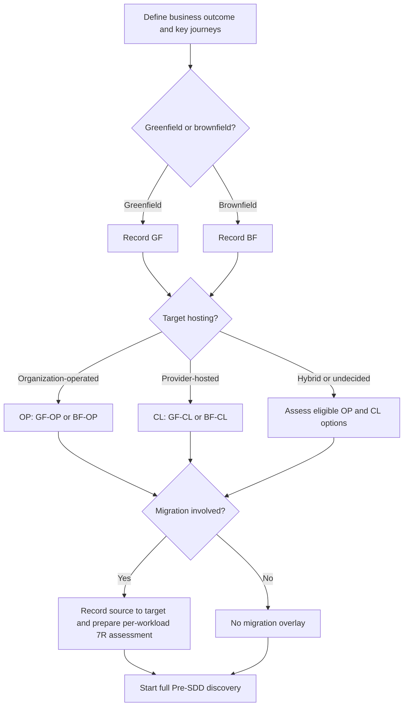

# Pre-SDD — Quick Discovery Guide

**Purpose:** A lightweight **entry point** to the formal Pre-Solution Design Document (Pre-SDD).  
**Applies to:** Greenfield, brownfield, on-premises, cloud, hybrid, modernization, and migration initiatives.  
**Companion standard:** [Pre-SDD Architecture Standard v1](./Pre-SDD_Architecture_Standard_v1.md)  
**Status:** Reusable intake template — **not** an approved Pre-SDD or Solution Design Document (SDD).

> **Guiding question:** *What must we understand and verify before deciding how to build or change the system?*

## 1. Use this guide first

This is the **first discovery conversation**, not the full requirements assessment. Capture the problem, classify the initiative, identify essential non-functional requirements (NFRs), and assign owners to unanswered questions. Do **not** choose a database, cloud service, deployment topology, or architectural pattern yet.

**How to record answers**

| Label | Use when |
|---|---|
| **Confirmed** | Validated by an accountable owner or evidence |
| **Estimated** | Forecast or assumption; record source and validation owner |
| **Open** | Unknown; record who will answer and by when |
| **N/A** | Not relevant; state why |

For each important answer, capture its **value/unit, journey or workload, applicable time horizon, source, owner, and status**. Distinguish a **hard constraint** from a negotiable target.

---

## 2. Essential discovery questions

Work through the following in order. Each question is deliberately broad: the **master Pre-SDD** provides the detailed follow-ups, evidence requirements, technical implications, and acceptance criteria.

### A. Business outcomes & scope
**Ask:** Business sponsor / product owner

- [ ] What business problem or opportunity must we address, **why now**, and what measurable result defines success?
- [ ] Who are the users/consumers, and what are the **top 3–5 critical journeys**?
- [ ] What is in scope, out of scope, or planned for a later phase? Are there fixed business deadlines?

### B. Current state & target context
**Ask:** Product, application owners, platform/operations

- [ ] Is the workload **greenfield, brownfield, or mixed**? What exists today?
- [ ] Is the target **on-premises, provider-hosted cloud, hybrid, or undecided**? Which choices are permitted or prohibited?
- [ ] Which existing systems, data, shared services, or dependencies must be retained, integrated, or changed?
- [ ] Is any migration, phased coexistence, or cutover necessary? From which source environment to which target?

### C. Workload & growth
**Ask:** Product for forecasts; engineering/SRE for baseline evidence

- [ ] What are the expected **users, concurrent users, business TPS, and API RPS**, at normal and peak load?
- [ ] What causes bursts or seasonality, and what growth is forecast for launch and future periods?
- [ ] Where is traffic generated, and what are the dominant **read/write patterns and payload sizes**?

### D. Performance & processing
**Ask:** Product and engineering/SRE

- [ ] What are the acceptable response times (**P95/P99**) for critical journeys, and **where/at what load** will they be measured?
- [ ] Which actions require immediate responses versus asynchronous processing? What are the data-freshness or batch deadlines?

### E. Availability & recovery
**Ask:** Business/product, operations/SRE, data owner

- [ ] What **availability SLO** is expected, for which user journeys and measurement period?
- [ ] What are the **RTO and RPO**, for which services/data and **which failure scenarios**?
- [ ] Which failures must be tolerated, and what degraded mode, manual fallback, or maintenance downtime is acceptable?

### F. Data & correctness
**Ask:** Business/data owner and engineering

- [ ] What are the key business entities, authoritative systems of record, initial data size, growth, and retention needs?
- [ ] Where is **strong consistency, atomicity, ordering, or idempotency** essential? Where is delay or eventual consistency acceptable?
- [ ] Is the workload **multi-tenant**? What isolation, restore, archival, and deletion requirements matter?

### G. Security & compliance
**Ask:** Security, data/privacy/compliance

- [ ] Who and what must authenticate or be authorized, and are existing identity systems mandatory?
- [ ] What **sensitive data, regulations, residency restrictions, encryption, and audit** obligations apply?

### H. Integration & network boundaries
**Ask:** Integration owners, network/platform teams

- [ ] Which upstream/downstream or third-party systems are critical, and how do they exchange data (API, events, files, batch)?
- [ ] What SLA, quotas, latency, failure-handling, private connectivity, firewall, or network constraints affect them?

### I. Cost, delivery & operations
**Ask:** Business sponsor, finance, engineering, operations

- [ ] What is the **delivery timeline**, and what is the one-time and recurring **budget envelope**?
- [ ] Who will develop, operate, monitor, and support the system? Are there mandated technologies or skill constraints?
- [ ] Are there release, rollback, observability, or support-hour requirements that materially limit the design?

### J. Migration — only if relevant
**Ask:** Migration lead, current-system/data/platform owners

- [ ] Which applications, datasets, dependencies, and connectivity paths must move **source → target**?
- [ ] What options should be assessed under the **7 Rs** (Retire, Retain, Rehost, Relocate, Repurchase, Replatform, Refactor) **per workload**?
- [ ] What downtime, data synchronization, validation, rollback, stabilization, and source decommissioning constraints apply?

**Do not fill missing values with invented numbers.** Mark them `Open` or `Estimated`, with an owner and validation action. Business owners define desired outcomes and acceptable loss/interruption; architects and engineering determine feasible technical approaches.

---

## 3. Classify the initiative for the full Pre-SDD

Classify using **change type × intended target hosting responsibility**:

| Code | Change type | Target |
|---|---|---|
| **GF-OP** | Greenfield | Organization-operated on-premises / private cloud |
| **GF-CL** | Greenfield | Provider-hosted cloud |
| **BF-OP** | Brownfield | Organization-operated on-premises / private cloud |
| **BF-CL** | Brownfield | Provider-hosted cloud |

**Special cases:**

- **Hybrid:** assess OP and CL components separately, then consolidate cross-boundary data, networking, security, and resilience requirements.
- **Target undecided:** keep plausible target options open until assessed; don't force a classification.
- **Migration:** add a separate **source → target** overlay, e.g., on-prem → AWS or Azure → GCP. Cloud-to-cloud migration of an existing system remains **BF-CL**.
- **New product with legacy dependencies:** the product can be greenfield while requiring brownfield assessment of integrations.

*Routing only: this does not constitute an architecture or platform decision.*

---

## 4. Minimum numbers to capture (or explicitly leave open)

| Metric | Minimum first-pass clarification | Why it matters |
|---|---|---|
| **TPS / RPS** | Average, peak, peak duration; transaction vs request definitions | Sizing, scaling, load control |
| **Concurrent users** | Peak active users/sessions | Capacity and session management |
| **P95 / P99** | Per critical journey; measurement point and peak workload | Latency budget and processing model |
| **Availability** | Percentage, measured journey and time window | Reliability and support model |
| **RTO** | Recovery time **per failure scope** | Resilience, failover, restoration |
| **RPO** | Maximum data loss **per dataset and failure scope** | Replication, backups, consistency |
| **Data** | Starting volume, growth, retention, sensitive-data location | Data architecture, storage and governance |
| **Cost / timeline** | Approved budget range, deadline, hard restrictions | Feasibility and trade-offs |

Remember: **RTO ≠ RPO ≠ availability**; **TPS ≠ RPS**. If a target is specified without a failure scope, workload, or measurement window, it still needs clarification in the full Pre-SDD.

---

## 5. Discovery signals → areas to investigate

These are **investigation prompts**, not design prescriptions.

| If discovery reveals… | Infrastructure | Network | Software / data |
|---|---|---|---|
| High peaks or bursts | Scaling and capacity headroom | Ingress/egress throughput | Concurrency, buffering, backpressure |
| Strict P99 | Compute/storage performance | RTT and service proximity | Critical-path latency, queries, asynchronous options |
| Short RTO / stringent RPO | Fault-domain redundancy, replication | Independent recovery paths | Failover, commit semantics, reconciliation |
| Sensitive or resident data | Allowed hosting and encryption facilities | Allowed cross-border paths | Isolation, access controls, retention |
| Legacy/partner dependencies | Dependency availability | Private/hybrid connectivity | Retry behavior, contract stability, idempotency |
| Tight cost or deadline | Cost envelope, lead time | Connectivity lead time | Scope phasing, operational complexity |

---

## 6. One-page discovery summary — reusable template

Create one per initiative and use it to initiate the master Pre-SDD.

| Field | Captured response | Status / owner |
|---|---|---|
| Initiative, sponsor, lead architect | TBD | Open / TBD |
| Business problem, success KPI, deadline | TBD | Open / TBD |
| Critical journeys, scope, non-goals | TBD | Open / TBD |
| Classification: GF/BF × OP/CL, hybrid/undecided | TBD | Open / TBD |
| Existing systems and key integrations | TBD | Open / TBD |
| Migration source → target (or N/A) | TBD | Open / TBD |
| Normal/peak TPS, RPS, concurrent users, growth | TBD | Open / TBD |
| P95/P99 and timeliness targets | TBD | Open / TBD |
| Availability, RTO/RPO, failure scenarios | TBD | Open / TBD |
| Data volumes, consistency, retention, tenancy | TBD | Open / TBD |
| Security, privacy, compliance, residency | TBD | Open / TBD |
| Infrastructure/network/technology constraints | TBD | Open / TBD |
| Budget, timeline, operations ownership | TBD | Open / TBD |

**Top unknowns / risks**

| ID | Question / risk | Impact if wrong | Owner | Next validation action / due date |
|---|---|---|---|---|
| QD-01 | TBD | TBD | TBD | TBD |
| QD-02 | TBD | TBD | TBD | TBD |
| QD-03 | TBD | TBD | TBD | TBD |

---

## 7. Ready to begin the full Pre-SDD?

- [ ] Problem, accountable sponsor, scope, and critical journeys are identifiable.
- [ ] Initiative type and possible hosting paths are recorded; unknown targets are explicitly tracked.
- [ ] Initial NFRs have values **or** named owners for missing data.
- [ ] Existing dependencies, restrictions, and migration direction are identified where applicable.
- [ ] Critical uncertainties and contradictions have follow-up actions.
- [ ] A lead architect is assigned to expand this into the formal Pre-SDD.

**If yes:** proceed to the [Pre-SDD Architecture Standard v1](./Pre-SDD_Architecture_Standard_v1.md), using this intake as the starting record:

| Master Pre-SDD stage | Sections |
|---|---|
| Requirements register, universal discovery, precise metrics | §§ 3–6 |
| Four primary project paths | § 7 |
| Migration overlay and seven Rs | § 8 |
| Decision tree and comparison of feasible options | § 9 |
| ADR candidates and traceability | § 10 |
| Stage gates, accountable approvals and authorization to begin the SDD | § 11 |

> **Completion means:** “We know **what to investigate next and who owns the missing answers**.” It does **not** mean all requirements are approved or that solution design may be baselined. The full Pre-SDD's approvals remain mandatory.
