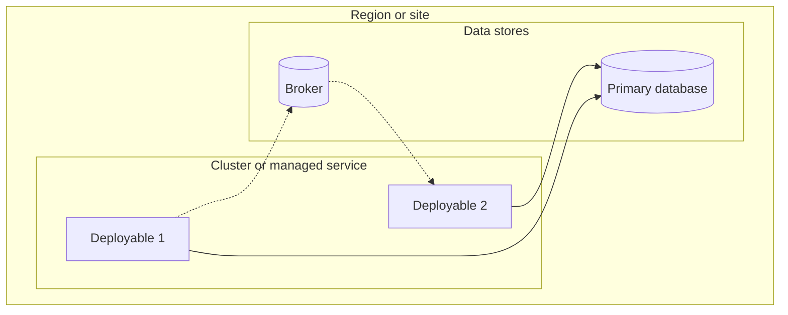
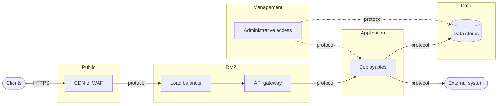

<!--
CHUNK: 05a
TITLE: System Design - Infrastructure & Network Architecture
PROJECT: [Project Name]
VERSION: [X.X]
DEPENDS_ON: 02 (§6 rows), 04 (§8.1), 06 (ADRs), 07 (§11.2, §11.3, §11.6), 08 (§8.7 links the §12 rows), 09 (the §13 rows behind the deployables); also reads 10 (§14.2), 11 (§15.2), 12 (§16.4.3), 13x (§17.X), 14 (§18), 15 (§19), and 16 (§20.1.5) once they are written
PART OF: SDD - [Project Name]
-->

## 8.6 Infrastructure Architecture

<!-- This chunk continues the System Design section from chunk 05 (Workflow & Sequence Diagrams). -->
<!--
Where the system runs (§8.6) and how traffic reaches it and leaves it (§8.7).
INPUTS: in derive-from-BRD, the derivation inputs are the one list in brd-to-sdd.md § SDD-only sections, §8.6 / §8.7. In TRANSFORM, the inputs are the source SDD's infrastructure and network content (source-transformation.md). In GENERATE, they are the source material.
ONE FACT, ONE HOME: each fact is linked to its home, never restated. A technology, version, or tier is its §6 row: a cell names a technology by its role (the primary database, the message broker) and links that row, and never restates its name or version, the TLS version (§11.6), or a timeout (§12). The deployment target is the §6 Compute / Infra row (questionnaire Q8), and its ADR when one records it. The deployables follow ADR-01 and §13. The tenancy strategy is §11.2. The deployment, resource, and security defaults are §11.3 and §11.6. The environments are §19 (in part 1, before §19 is written, the §11.3 promotion path). An external system's protocol, auth, and timeouts are its §12 row and its §15 contract. This section and §8.7 add only the topology and the network paths.
LINKS: a section that a later part writes (§14, §15, §16, §17.X, §18, §19, §20) is named as plain text until it exists, and the back-fill links it (parts-mode.md § What every part does, step 3).
SOURCE CELLS: a Source cell links the home of its fact: a §6 row, an ADR, a §11 default, a §12 row, §19, a BRD NFR or Technical Input as its keyed link, an eco-system file section, the source SDD section (TRANSFORM), or the source material (GENERATE). A design choice that no source states reads `recommended`, as a §6 basis does, with its evidence stated in the row. An unknown fact is a [NEEDS CLARIFICATION: ...] marker.
NO INVENTION: never an IP range, CIDR, hostname, or vendor product that no source states (SKILL.md § Things this skill never does). A component the design needs that no source names is written by its role (for example a WAF), never by a product name.
SIZE: never skipped. When the deployment is simple (for example one deployable on one managed container service), each sub-section is one line or one row, a part that does not apply reads `Not applicable for this release.` with the reason, and both diagrams are still drawn (chunking.md § Skip rules).
-->

### 8.6.1 Deployment Topology

**Deployment target:** [[§6 Compute / Infra](./02-ecosystem-overview.md#6-ecosystem-overview) (questionnaire Q8), and its ADR when one records it ([ADR-NN](./06-principles-and-decisions.md#10-architectural-decisions)); the deployables follow ADR-01 and [§13](./09-services-summary.md#13-services-decomposition-summary)]

| Concern | Design | Source |
|---------|--------|--------|
| Clusters | [How many clusters, and which environments and deployables each one runs / Not applicable: a managed container service] | [Source] |
| Regions or sites | [Each cloud region or on-premises site, as a source names it] | [[KEY 12 TI-NN](BRD link) (hosting) / KEY/NFR-NN (data residency) / marker] |
| Availability zones | [The zones the deployables and data stores spread over, and what keeps running when one zone is lost] | [KEY/NFR-NN (availability) / recommended / marker] |
| Node pools | [Each pool and what runs on it / Not applicable: a managed container service] | [Source] |

### 8.6.2 Deployables per Environment

<!-- One row per deployable: each §13 row of Type `service`; one row for the single deployable of a modular monolith or hybrid core, with its modules in the second cell; and each other deployable that a §6 row or an ADR names (for example the web frontend), with that row or ADR in the second cell. A cell names where the deployable runs in that environment (its cluster, or the managed service), or `-` when it does not run there. The columns are the environments of §19 (before §19 is written, the §11.3 promotion path). Replicas and the rollout strategy stay in §11.3 and each §17.X Deployment Strategy. -->

| Deployable | §13 rows or source | Dev | SIT | UAT | Prod |
|------------|--------------------|-----|-----|-----|------|
| [Deployable] | [[service-name](./09-services-summary.md#13-services-decomposition-summary) / §6 row or ADR] | [Where it runs / -] | [Where it runs / -] | [Where it runs / -] | [Where it runs / -] |

### 8.6.3 Data Stores, Broker, and Storage

<!-- One row per database, cache, broker, and object store that §6 lists; a §6 row that reads Not applicable has no row here. The technology and its version stay in the §6 row. The split into schemas or databases per service or module is §11.1, §11.2, and the data-ownership ADR: link them. -->

| Component | §6 row | Topology | Placement | Used by |
|-----------|--------|----------|-----------|---------|
| [Primary database] | [[Primary RDBMS](./02-ecosystem-overview.md#6-ecosystem-overview)] | [Instances, replicas, or cluster] | [Zones or site] | [Deployables] |

### 8.6.4 Backup and Disaster Recovery

<!-- One row per component that holds state. RPO and RTO come from the BRD NFRs that state availability, recovery, backup, or data-loss limits (the recovery NFRs): cite the keyed NFR (REFUNDS/NFR-02), and derive a figure only where its business measure allows it. When no BRD NFR states one, the cell holds [NEEDS CLARIFICATION: ...], never an invented figure. This table is the home of the RPO and RTO: the §18.5 row of the same NFR links here and holds neither a figure nor a marker of its own. The recovery procedure is §20.1.5 Database Failover (LINKS above). -->

| Component | Backup | RPO | RTO | Recovery | Source |
|-----------|--------|-----|-----|----------|--------|
| [Primary database] | [What is backed up, how often, and where the copies are kept] | [Figure / marker] | [Figure / marker] | [How service comes back; procedure §20.1.5, linked once §20 is written] | [KEY/NFR-NN / marker] |

### 8.6.5 Scaling Model

<!-- How each tier grows. The autoscaling defaults are the §11.3 Resource model and each §17.X Deployment Strategy, the hub topology (topics and fan-out) is §14.2, and the targets are §18: cite them (LINKS above). -->

- **Deployables:** [Horizontal or vertical, and what triggers it]
- **Data stores:** [Read replicas, partitions, or a tenant split per §11.2]
- **Broker:** [The scale unit / Not applicable: no broker]
- **Limits:** [What does not scale out, such as a singleton job, and how it is protected]

### 8.6.6 Deployment Diagram

**Figure [N]: Infrastructure Deployment**

<!-- Inline Mermaid flowchart with subgraphs: one per region or site, nested ones per zone, cluster, or managed service, holding the deployables and data stores of the tables above. Edges are runtime connections. The diagram names only what those rows name. No line cap (mermaid-diagrams.md § Block conventions). -->

**Summary:** [1-2 sentences: where each deployable and data store runs, and how the topology meets the availability and recovery rows above.]

## 8.7 Network Architecture

<!-- The rules under §8.6 apply here too. The minimum TLS version, the certificate management, and the service-to-service auth mechanism are §11.6. The DNS naming convention and the per-environment access rules are §19. This section states where traffic flows and where it is checked. -->

### 8.7.1 Network Zones

<!-- One row per zone. A zone the design does not need reads `Not applicable for this release.` with the reason, for example no DMZ when the managed service's load balancer is the only entry. -->

| Zone | Holds | Reached from | Source |
|------|-------|--------------|--------|
| Public | [For example DNS, and a CDN or WAF] | [Internet] | [Source] |
| DMZ | [For example the load balancer and the API gateway] | [Public] | [Source] |
| Application | [The deployables of §8.6.2] | [DMZ] | [Source] |
| Data | [The data stores of §8.6.3] | [Application] | [Source] |
| Management | [For example administrative access, CI/CD, and observability] | [The path of §8.7.6] | [Source] |

### 8.7.2 Ingress Path

<!-- The hops a client request takes, in order. Each hop names its component by its §6 row (API Gateway, Service Mesh / Ingress) or by its role. A provider callback (an External inbound contract in §15.2) takes this path too; an allow-list of the provider's addresses is cited from its source, never invented. A deployable that serves clients directly, such as a web frontend (§8.6.2), gets its own row, which names the hop it is reached from. -->

| # | Hop | Component | Zone | Source |
|---|-----|-----------|------|--------|
| 1 | DNS | [Role or §6 row] | Public | [Source] |
| 2 | CDN or WAF | [Role or §6 row / Not applicable] | Public | [Source] |
| 3 | Load balancer | [Role or §6 row] | DMZ | [Source] |
| 4 | API gateway | [[§6 API Gateway](./02-ecosystem-overview.md#6-ecosystem-overview) / Not applicable] | DMZ | [Source] |
| 5 | Service | [A deployable of §8.6.2] | Application | [Source] |
| 6 | Frontend | [The web frontend of §8.6.2, reached from hop [N] / Not applicable] | [Zone] | [Source] |

### 8.7.3 Egress to External Systems

<!-- One row per §12 row. Egress path: NAT, IP allow-list, VPN, or private link, as the provider requires. A system that only calls the platform reads `None: inbound only (§8.7.2)`, and a §12 system inside the platform's own network reads `None: internal (§8.7.7)`. The provider's requirement comes from the Network access field of an imported eco-system file's Part C block (SKILL.md step 3c item 8) or another provider document, else a marker. The protocol, auth, and timeouts stay in the §12 row and its §15 contract. -->

| §12 row | System | Egress path | Provider requirement | Source |
|---------|--------|-------------|----------------------|--------|
| [[INT-NN](./08-integrations.md#12-integrations)] | [System] | [NAT / IP allow-list / VPN / private link / None: inbound only (§8.7.2) / None: internal (§8.7.7)] | [What the provider requires / marker] | [[[project-slug]-eco-system.md § [System]](../[project-slug]-eco-system.md#[system-anchor]) / provider document / marker] |

### 8.7.4 TLS Termination and mTLS

<!-- One row per kind of connection: where its TLS ends and whether both sides authenticate (mTLS). The TLS version and the certificates are §11.6. -->

| Connection | TLS ends at | mTLS | Source |
|------------|-------------|------|--------|
| Client to platform | [Load balancer / API gateway] | [No] | [[§11.6](./07-cross-cutting-concerns.md#116-security-default)] |
| Service to service | [Each deployable / Not applicable: one deployable] | [Yes, by the service mesh / No] | [[§6 Service Mesh / Ingress](./02-ecosystem-overview.md#6-ecosystem-overview), §11.6] |
| Service to data store | [The data store] | [Yes / No] | [Source] |
| Platform to external system | [The provider's endpoint] | [As the provider requires] | [[INT-NN](./08-integrations.md#12-integrations)] |

### 8.7.5 Service-to-Service Network Policies

<!-- The policy model, stated once. Each allowed flow is a row of §8.7.7. In a single deployable, the policies cover only its data stores and its egress. -->

- **Default:** [Deny all; allow only the flows of §8.7.7]
- **Enforced by:** [Role or §6 row / marker]
- **Tenant isolation:** [Network separation per §11.2 / None: isolation is in the application, §11.2]

### 8.7.6 Administrative Access

<!-- How operators reach the management zone and the data stores. The roles are the platform-plane roles of §16.4.3 (LINKS above); the per-environment access rules are §19. -->

- **Path:** [For example a bastion, a VPN, or the provider's console, by role / marker]
- **Who:** [The platform-plane roles of §16.4.3, linked once §16 is written]
- **Grant and audit:** [How access is granted, limited in time, and logged]

### 8.7.7 Ports and Protocols

<!-- One row per allowed flow that crosses a zone or links two deployables: the hops of §8.7.2, the egress of §8.7.3, the synchronous calls between deployables (their API-NN in §15.2), and each deployable's data stores and broker. A port a source states is cited. A protocol a source fixes takes its registered port (for example HTTPS on 443), with Source `registered port`. Any other port is a marker. -->

| From | To | Port | Protocol | Purpose | Source |
|------|----|------|----------|---------|--------|
| [Zone or component] | [Zone or component] | [Port] | [Protocol] | [Purpose, or the API-NN it carries] | [Source] |

### 8.7.8 Network Diagram

**Figure [N+1]: Network Architecture**

<!-- Inline Mermaid flowchart with one subgraph per zone of §8.7.1, the ingress hops of §8.7.2, each egress of §8.7.3, and the administrative path of §8.7.6. Label each edge that crosses a zone with its protocol. The diagram names only what those rows name. No line cap (mermaid-diagrams.md § Block conventions). -->

**Summary:** [1-2 sentences: the zones, the ingress path, the egress to each external system, and where TLS ends.]

<!-- MASTER: [project-slug]-sdd-master.md | PREV: 05-workflows-and-sequences.md | NEXT: 06-principles-and-decisions.md -->
